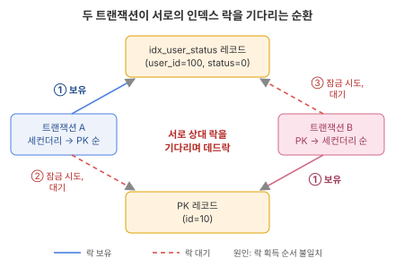

<!-- truncate -->

MySQL `InnoDB`에서 `UPDATE`, `DELETE`, `SELECT ... FOR UPDATE` 등으로 레코드를 잠글 때  
<mark>PK 인덱스 뿐 아니라 세컨더리 인덱스까지 락이 걸리면서 교착 상태(Deadlock)가 발생</mark>할 수 있습니다.

`InnoDB`는 보조 인덱스를 통해 접근하더라도,
결국 실제 데이터는 **클러스터드 PK 인덱스**에 저장되어 있기 때문에
세컨더리 인덱스 → PK 순서로 락을 획득하게 됩니다.

만약 서로 다른 트랜잭션이
- 하나는 세컨더리 인덱스 경로로,
- 하나는 PK 경로로

같은 row를 잠그게 되면,
락 획득 순서가 엇갈리며 Deadlock이 발생할 수 있습니다.

## MySQL의 락 동작 메커니즘
`InnoDB`는 Row-Level Lock처럼 보이지만
내부적으로는 <mark>**인덱스 레코드 기반 잠금 (Record Lock)**</mark>을 사용합니다.

즉,
- PK 인덱스도 잠금 대상
- 세컨더리 인덱스도 잠금 대상

입니다.

## 예제 시나리오
```sql
CREATE TABLE user_mission (
  id BIGINT PRIMARY KEY,
  user_id BIGINT NOT NULL,
  mission_id BIGINT NOT NULL,
  status TINYINT NOT NULL,
  UNIQUE KEY uk_user_mission (user_id, mission_id),
  KEY idx_user_status (user_id, status)
) ENGINE=InnoDB;
```

이번 문제는 다음과 같이 동시 접근이 충분히 발생할 수 있는 상황을 가정합니다:

### 트랜잭션 A
유저가 미션 완료 버튼을 눌러, 진행중인(IN_PROGRESS) 미션을 잠그고 처리합니다.
```sql
BEGIN;
SELECT *
FROM user_mission
WHERE user_id = 100 AND status = 0
FOR UPDATE;
-- → idx_user_status(user_id, status) 보조 인덱스로 탐색
-- → 해당 인덱스 레코드 잠금
-- → 이어서 PK(id=10) 레코드 잠금 시도
-- → (세컨더리 락 → PK 락) 순서로 락 획득
```

### 트랜잭션 B
배치나 백오피스에서 해당 미션을 만료 처리하거나 다른 상태로 변경합니다.
```sql
BEGIN;
UPDATE user_mission
SET status = 2
WHERE id = 10;
-- → PK(id=10) 레코드 X-lock 획득
-- → status 변경으로 인해 (user_id, status) 인덱스 엔트리 갱신 필요
-- → secondary 인덱스 레코드 잠금 시도
-- → (PK 락 → 세컨더리 락) 순서로 락 획득
```

이 상태에서 A와 B가 동일한 row를 가리키는 PK를 각자 다른 인덱스 경로로 접근하면,
서로가 상대의 락을 기다리며 데드락이 발생합니다.

### 내부 락 플로우 분석
<table>
  <tr>
    <th>순서</th>
    <th>A (세컨더리 인덱스 경로)</th>
    <th>B (PK 경로)</th>
  </tr>
  <tr>
    <td style={{ textAlign: 'center' }}>1</td>
    <td><code>idx_user_status</code> 인덱스 레코드 잠금 (user_id=100, status=0)</td>
    <td>PK(id=10) 레코드 잠금</td>
  </tr>
  <tr>
    <td style={{ textAlign: 'center' }}>2</td>
    <td>PK(id=10) 잠금 시도 → 이미 B가 PK 락 보유</td>
    <td><code>status</code> 변경 → <code>idx_user_status</code> 인덱스 엔트리 갱신 필요</td>
  </tr>
  <tr>
    <td style={{ textAlign: 'center' }}>3</td>
    <td>PK 대기 상태 진입</td>
    <td>Secondary 인덱스 잠금 시도 → A가 보유</td>
  </tr>
  <tr>
    <td style={{ textAlign: 'center' }}>4</td>
    <td colSpan={2} style={{ textAlign: 'center' }}>
      서로 상대 락을 기다리며 Deadlock 발생
    </td>
  </tr>
</table>

즉, <mark>락 획득 순서 불일치 (Lock Ordering Inconsistency)가 데드락의 핵심 원인</mark>입니다.

<details>
<summary>SVG 코드</summary>

```svg
<svg xmlns="http://www.w3.org/2000/svg" width="440" height="298" viewBox="0 0 440 298" font-family="-apple-system, 'Segoe UI', 'Noto Sans KR', sans-serif">
<defs><marker id="ah" viewBox="0 0 10 10" refX="9" refY="5" markerWidth="7" markerHeight="7" orient="auto-start-reverse"><path d="M0,0 L10,5 L0,10 z" fill="#888"/></marker></defs>
<rect x="0" y="0" width="440" height="298" fill="#FFFFFF"/>
<text x="220.0" y="22" font-size="13" fill="#333" text-anchor="middle" font-weight="bold">두 트랜잭션이 서로의 인덱스 락을 기다리는 순환</text>
<rect x="140" y="40" width="160" height="46" rx="6" fill="#FFF3E0" stroke="#E0A000"/>
<text x="220" y="59.4" font-size="10.5" fill="#333" text-anchor="middle">idx_user_status 레코드</text>
<text x="220" y="73.9" font-size="10.5" fill="#333" text-anchor="middle">(user_id=100, status=0)</text>
<rect x="140" y="214" width="160" height="46" rx="6" fill="#FFF3E0" stroke="#E0A000"/>
<text x="220" y="233.4" font-size="10.5" fill="#333" text-anchor="middle">PK 레코드</text>
<text x="220" y="247.9" font-size="10.5" fill="#333" text-anchor="middle">(id=10)</text>
<rect x="12" y="127" width="118" height="46" rx="6" fill="#EEF3FB" stroke="#4C7FE0"/>
<text x="71" y="146.4" font-size="10.5" fill="#26508F" text-anchor="middle">트랜잭션 A</text>
<text x="71" y="160.9" font-size="10.5" fill="#26508F" text-anchor="middle">세컨더리 → PK 순</text>
<rect x="310" y="127" width="118" height="46" rx="6" fill="#FCE4EC" stroke="#D06A86"/>
<text x="369" y="146.4" font-size="10.5" fill="#9E3A57" text-anchor="middle">트랜잭션 B</text>
<text x="369" y="160.9" font-size="10.5" fill="#9E3A57" text-anchor="middle">PK → 세컨더리 순</text>
<line x1="80" y1="127" x2="150" y2="88" stroke="#4C7FE0" stroke-width="1.6" marker-end="url(#ah)"/>
<text x="78" y="104" font-size="10.5" fill="#26508F" text-anchor="middle" font-weight="bold">① 보유</text>
<line x1="360" y1="173" x2="290" y2="212" stroke="#D06A86" stroke-width="1.6" marker-end="url(#ah)"/>
<text x="362" y="204" font-size="10.5" fill="#9E3A57" text-anchor="middle" font-weight="bold">① 보유</text>
<line x1="80" y1="173" x2="150" y2="212" stroke="#D9534F" stroke-width="1.6" stroke-dasharray="5 4" marker-end="url(#ah)"/>
<text x="64" y="200" font-size="10" fill="#B52B27" text-anchor="middle">② 잠금 시도,</text>
<text x="64" y="213" font-size="10" fill="#B52B27" text-anchor="middle">대기</text>
<line x1="360" y1="127" x2="290" y2="88" stroke="#D9534F" stroke-width="1.6" stroke-dasharray="5 4" marker-end="url(#ah)"/>
<text x="376" y="96" font-size="10" fill="#B52B27" text-anchor="middle">③ 잠금 시도,</text>
<text x="376" y="109" font-size="10" fill="#B52B27" text-anchor="middle">대기</text>
<text x="220" y="154" font-size="11" fill="#B52B27" text-anchor="middle" font-weight="bold">서로 상대 락을</text>
<text x="220" y="169" font-size="11" fill="#B52B27" text-anchor="middle" font-weight="bold">기다리며 데드락</text>
<line x1="60" y1="282" x2="90" y2="282" stroke="#4C7FE0" stroke-width="1.6"/>
<text x="96" y="286" font-size="9.5" fill="#555" text-anchor="start">락 보유</text>
<line x1="170" y1="282" x2="200" y2="282" stroke="#D9534F" stroke-width="1.6" stroke-dasharray="5 4"/>
<text x="206" y="286" font-size="9.5" fill="#555" text-anchor="start">락 대기</text>
<text x="260" y="286" font-size="9.5" fill="#555" text-anchor="start">원인: 락 획득 순서 불일치</text>
</svg>
```

</details>

<figure style={{textAlign: 'center', margin: '1.5rem 0'}}>
  
</figure>

<table>
  <thead>
    <tr>
      <th style={{ whiteSpace: 'nowrap', textAlign: 'center' }}>순서</th>
      <th>트랜잭션 A</th>
      <th>트랜잭션 B</th>
    </tr>
  </thead>
  <tbody>
    <tr>
      <td style={{ textAlign: 'center' }}>1</td>
      <td><code>idx_user_status</code> 인덱스 레코드 잠금</td>
      <td>PK(id=10) 락 획득</td>
    </tr>
    <tr>
      <td style={{ textAlign: 'center' }}>2</td>
      <td>PK 잠금 시도 → 대기</td>
      <td><code>status</code> 변경으로 인한 secondary 인덱스 갱신 필요</td>
    </tr>
    <tr>
      <td style={{ textAlign: 'center' }}>3</td>
      <td>대기 상태</td>
      <td>Secondary 인덱스 잠금 시도 → A가 보유</td>
    </tr>
    <tr>
      <td style={{ textAlign: 'center' }}>4</td>
      <td>🚨 교착 발생</td>
      <td>🚨 교착 발생</td>
    </tr>
  </tbody>
</table>

## 트랜잭션 B는 PK로만 접근했는데 왜 세컨더리 인덱스(`idx_user`) 락을 기다릴까?
InnoDB는 UPDATE 시
<mark>변경되는 컬럼이 세컨더리 인덱스 키에 포함되어 있다면 해당 인덱스 엔트리도 수정해야 합니다.</mark>

이번 예제에서 `status`는 `(user_id, status)` 복합 인덱스의 일부이므로
인덱스 엔트리 삭제 + 추가 작업이 발생합니다.

따라서 B는:
1. PK 레코드 잠금
2. 인덱스 정합성 유지를 위해 secondary 인덱스 갱신 시도
3. 이미 A가 해당 secondary 인덱스 레코드를 잠그고 있으면 대기

하게 됩니다.

## 데드락 로그 확인 방법
```sql
SHOW ENGINE INNODB STATUS\G
```