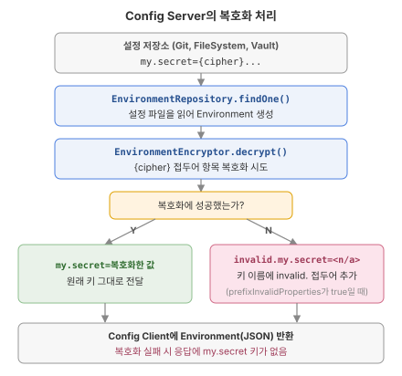
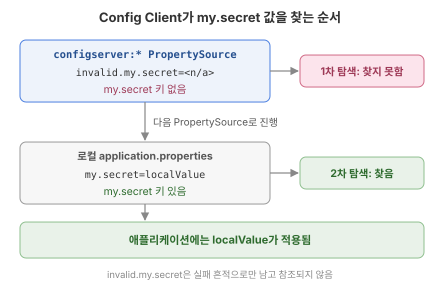

<!-- truncate -->

Spring Cloud Config Server를 사용하다 보면,
암호화된 설정값 `{cipher}...`가 복호화에 실패하면서 `invalid.my.secret` 형태로 노출되고,
결국 로컬 `application.properties`의 값이 적용되는 경우가 있습니다.

오늘은 그 내부 메커니즘을 코어 코드 레벨에서까지 뜯어보려 합니다.

## 암호화된 설정이 서버에 전달되는 구조
Config Server는 Git, FileSystem, Vault 등에서 설정 파일을 읽고,
`EnvironmentRepository.findOne()`을 통해 클라이언트에 `Environment` 객체(JSON)를 반환합니다.

이때 설정값 중 `{cipher}...`로 시작하는 항목이 있으면  
`EnvironmentController` → `EnvironmentRepository` → `EnvironmentEncryptor.decrypt()`
단계를 거치며 복호화를 시도합니다.
```java
// EnvironmentEncryptorEnvironmentRepository.java
@Override
public Environment findOne(String name, String profiles, String label, boolean includeOrigin) {
    Environment environment = this.delegate.findOne(name, profiles, label, includeOrigin);
    if (this.environmentEncryptors != null) {
        for (EnvironmentEncryptor environmentEncryptor : environmentEncryptors) {
            environment = environmentEncryptor.decrypt(environment);
        }
    }
    if (!this.overrides.isEmpty()) {
        environment.addFirst(new PropertySource("overrides", getOverridesMap(includeOrigin)));
    }
    return environment;
}
```
기본적으로 아래 두 개의 `EnvironmentEncryptor`가 존재합니다.
* `CipherEnvironmentEncryptor` (기본 RSA/Key 기반 복호화)
* `VaultEnvironmentEncryptor` (HashiCorp Vault 연동 시)

## 복호화 실패 시 `invalid.*` 키로 무효화 처리
`CipherEnvironmentEncryptor.decrypt()` 내부를 보면,
각 `PropertySource`의 키/값을 순회하며 `{cipher}` 접두어가 붙은 항목을 복호화합니다.

복호화 중 예외(`EncryptionOperationNotPossibleException`)가 발생하면 다음과 같이 처리됩니다.
```java
// CipherEnvironmentEncryptor.decrypt() 코드 요약
catch (Exception e){
    if(this.prefixInvalidProperties) {
        value = "<n/a>";
        name = "invalid." + name;
    }
    String message = "Cannot decrypt key: " + key + " (" + e.getClass() + ": " + e.getMessage() + ")";
}
map.put(name, value);
```
즉, 원래 키 `my.secret` 대신 `invalid.my.secret`이 추가됩니다.  
이때 기존 `my.secret` 키는 존재하지 않으므로, Config Client는 이 값을 무시하게 됩니다.

저장소의 암호화 값이 클라이언트에 반환되기까지의 처리를 정리하면 아래와 같습니다.

<details>
<summary>SVG 코드</summary>

```svg
<svg xmlns="http://www.w3.org/2000/svg" width="440" height="412" viewBox="0 0 440 412" font-family="-apple-system, 'Segoe UI', 'Noto Sans KR', sans-serif">
<defs><marker id="ah" viewBox="0 0 10 10" refX="9" refY="5" markerWidth="7" markerHeight="7" orient="auto-start-reverse"><path d="M0,0 L10,5 L0,10 z" fill="#888"/></marker></defs>
<rect x="0" y="0" width="440" height="412" fill="#FFFFFF"/>
<text x="220.0" y="22" font-size="13" fill="#333" text-anchor="middle" font-weight="bold">Config Server의 복호화 처리</text>
<rect x="60" y="36" width="320" height="44" rx="6" fill="#F7F7F7" stroke="#999999"/>
<text x="220.0" y="54" font-size="10.5" fill="#555" text-anchor="middle" font-weight="bold">설정 저장소 (Git, FileSystem, Vault)</text>
<text x="220.0" y="71" font-size="10.5" fill="#333" text-anchor="middle" font-family="Menlo, Consolas, monospace">my.secret={cipher}...</text>
<line x1="220.0" y1="80" x2="220.0" y2="94" stroke="#888" stroke-width="1.2" marker-end="url(#ah)"/>
<rect x="60" y="94" width="320" height="44" rx="6" fill="#EEF3FB" stroke="#4C7FE0"/>
<text x="220.0" y="112" font-size="10.5" fill="#26508F" text-anchor="middle" font-weight="bold" font-family="Menlo, Consolas, monospace">EnvironmentRepository.findOne()</text>
<text x="220.0" y="129" font-size="10.5" fill="#333" text-anchor="middle">설정 파일을 읽어 Environment 생성</text>
<line x1="220.0" y1="138" x2="220.0" y2="152" stroke="#888" stroke-width="1.2" marker-end="url(#ah)"/>
<rect x="60" y="152" width="320" height="44" rx="6" fill="#EEF3FB" stroke="#4C7FE0"/>
<text x="220.0" y="170" font-size="10.5" fill="#26508F" text-anchor="middle" font-weight="bold" font-family="Menlo, Consolas, monospace">EnvironmentEncryptor.decrypt()</text>
<text x="220.0" y="187" font-size="10.5" fill="#333" text-anchor="middle">{cipher} 접두어 항목 복호화 시도</text>
<line x1="220.0" y1="196" x2="220.0" y2="210" stroke="#888" stroke-width="1.2" marker-end="url(#ah)"/>
<rect x="120" y="210" width="200" height="30" rx="6" fill="#FFF3E0" stroke="#E0A000"/>
<text x="220.0" y="229" font-size="10.5" fill="#333" text-anchor="middle">복호화에 성공했는가?</text>
<line x1="170.0" y1="240" x2="115.0" y2="268" stroke="#888" stroke-width="1.2" marker-end="url(#ah)"/>
<text x="146.0" y="256" font-size="10" fill="#555" text-anchor="middle" font-weight="bold">Y</text>
<line x1="270.0" y1="240" x2="325.0" y2="268" stroke="#888" stroke-width="1.2" marker-end="url(#ah)"/>
<text x="294.0" y="256" font-size="10" fill="#555" text-anchor="middle" font-weight="bold">N</text>
<rect x="20" y="268" width="190" height="64" rx="6" fill="#E9F2E9" stroke="#8FBF8F"/>
<text x="115.0" y="294" font-size="10" fill="#2E6B2E" text-anchor="middle" font-weight="bold" font-family="Menlo, Consolas, monospace">my.secret=복호화한 값</text>
<text x="115.0" y="312" font-size="10.5" fill="#333" text-anchor="middle">원래 키 그대로 전달</text>
<rect x="230" y="268" width="190" height="64" rx="6" fill="#FCE4EC" stroke="#D06A86"/>
<text x="325.0" y="288" font-size="10" fill="#9E3A57" text-anchor="middle" font-weight="bold" font-family="Menlo, Consolas, monospace">invalid.my.secret=&lt;n/a&gt;</text>
<text x="325.0" y="306" font-size="10.5" fill="#333" text-anchor="middle">키 이름에 invalid. 접두어 추가</text>
<text x="325.0" y="323" font-size="9.5" fill="#888" text-anchor="middle">(prefixInvalidProperties가 true일 때)</text>
<line x1="115.0" y1="332" x2="115.0" y2="353" stroke="#888" stroke-width="1.2" marker-end="url(#ah)"/>
<line x1="325.0" y1="332" x2="325.0" y2="353" stroke="#888" stroke-width="1.2" marker-end="url(#ah)"/>
<rect x="20" y="354" width="400" height="44" rx="6" fill="#F7F7F7" stroke="#999999"/>
<text x="220.0" y="372" font-size="10.5" fill="#333" text-anchor="middle" font-weight="bold">Config Client에 Environment(JSON) 반환</text>
<text x="220.0" y="389" font-size="10.5" fill="#9E3A57" text-anchor="middle">복호화 실패 시 응답에 my.secret 키가 없음</text>
</svg>
```

</details>

<figure style={{textAlign: 'center', margin: '1.5rem 0'}}>
  
</figure>

## 클라이언트에서 `invalid.*` 가 무시되는 이유
Config Client가 서버로부터 받은 설정을 `Environment`로 머지할 때,
`PropertySourcesPropertyResolver`가 순서대로 `PropertySource`를 순회하며 값을 찾습니다.

<details>
<summary>SVG 코드</summary>

```svg
<svg xmlns="http://www.w3.org/2000/svg" width="440" height="292" viewBox="0 0 440 292" font-family="-apple-system, 'Segoe UI', 'Noto Sans KR', sans-serif">
<defs><marker id="ah" viewBox="0 0 10 10" refX="9" refY="5" markerWidth="7" markerHeight="7" orient="auto-start-reverse"><path d="M0,0 L10,5 L0,10 z" fill="#888"/></marker></defs>
<rect x="0" y="0" width="440" height="292" fill="#FFFFFF"/>
<text x="220.0" y="22" font-size="13" fill="#333" text-anchor="middle" font-weight="bold">Config Client가 my.secret 값을 찾는 순서</text>
<rect x="20" y="40" width="250" height="62" rx="6" fill="#EEF3FB" stroke="#4C7FE0"/>
<text x="145.0" y="58" font-size="10.5" fill="#26508F" text-anchor="middle" font-weight="bold" font-family="Menlo, Consolas, monospace">configserver:* PropertySource</text>
<text x="145.0" y="76" font-size="10" fill="#333" text-anchor="middle" font-family="Menlo, Consolas, monospace">invalid.my.secret=&lt;n/a&gt;</text>
<text x="145.0" y="93" font-size="10.5" fill="#9E3A57" text-anchor="middle">my.secret 키 없음</text>
<rect x="300" y="55" width="124" height="32" rx="6" fill="#FCE4EC" stroke="#D06A86"/>
<text x="362.0" y="75" font-size="10.5" fill="#9E3A57" text-anchor="middle" font-weight="bold">1차 탐색: 찾지 못함</text>
<line x1="270" y1="71" x2="298" y2="71" stroke="#888" stroke-width="1.2" marker-end="url(#ah)"/>
<line x1="145.0" y1="102" x2="145.0" y2="140" stroke="#888" stroke-width="1.2" marker-end="url(#ah)"/>
<text x="153.0" y="126" font-size="10" fill="#555" text-anchor="start">다음 PropertySource로 진행</text>
<rect x="20" y="142" width="250" height="62" rx="6" fill="#F7F7F7" stroke="#999999"/>
<text x="145.0" y="160" font-size="10.5" fill="#555" text-anchor="middle" font-weight="bold">로컬 application.properties</text>
<text x="145.0" y="178" font-size="10" fill="#333" text-anchor="middle" font-family="Menlo, Consolas, monospace">my.secret=localValue</text>
<text x="145.0" y="195" font-size="10.5" fill="#2E6B2E" text-anchor="middle">my.secret 키 있음</text>
<rect x="300" y="157" width="124" height="32" rx="6" fill="#E9F2E9" stroke="#8FBF8F"/>
<text x="362.0" y="177" font-size="10.5" fill="#2E6B2E" text-anchor="middle" font-weight="bold">2차 탐색: 찾음</text>
<line x1="270" y1="173" x2="298" y2="173" stroke="#888" stroke-width="1.2" marker-end="url(#ah)"/>
<rect x="20" y="222" width="404" height="36" rx="6" fill="#E9F2E9" stroke="#8FBF8F"/>
<text x="220.0" y="244" font-size="11" fill="#2E6B2E" text-anchor="middle" font-weight="bold">애플리케이션에는 localValue가 적용됨</text>
<line x1="145.0" y1="204" x2="145.0" y2="220" stroke="#888" stroke-width="1.2" marker-end="url(#ah)"/>
<text x="220.0" y="278" font-size="9.5" fill="#888" text-anchor="middle">invalid.my.secret은 실패 흔적으로만 남고 참조되지 않음</text>
</svg>
```

</details>

<figure style={{textAlign: 'center', margin: '1.5rem 0'}}>
  
</figure>

1.	먼저 `configserver:*` `PropertySource`를 탐색
2.	`{cipher}` 복호화 실패 → `invalid.my.secret`만 존재
3.	찾지 못하면 다음 `PropertySource` (로컬 파일 등)로 fall-through
4.	`application.properties`에서 `my.secret=localValue` 발견 → 반환 ✅

즉, `invalid.*` 키는 <mark>**단지 실패 흔적일 뿐**</mark>, `Environment`에서는 <mark>**참조되지 않습니다.**</mark>

이 동작은 `AbstractEnvironment` 내부에서 merge될 때, 단순히 `PropertySource` 순서대로 붙기 때문에
특별한 예외처리 없이 <mark>“뒤에 오는 `PropertySource`가 우선권을 가진다”</mark>는 일반 규칙으로 해결됩니다.