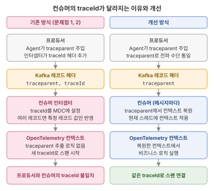
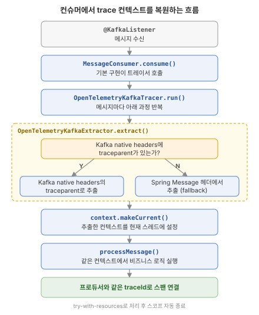

<!-- truncate -->

Spring Kafka를 사용하는 마이크로서비스 환경에서, Kafka 메시지를 프로듀서에서 보내고 컨슈머에서 받을 때 <mark>서로 다른 traceId</mark>로 기록되는 이슈가 있었습니다.
이번 포스트에서는 해당 이슈가 발생한 원인과 해결 과정에 대해서 공유하고자 합니다.

## 기존 코드
```java
@Slf4j
public class MdcKafkaProducerInterceptor<K, V> implements ProducerInterceptor<K, V> {

  @Override
  public void configure(Map<String, ?> configs) {
    log.debug("Configuring MdcKafkaProducerInterceptor with config: {}", configs);
  }

  @Override
  public ProducerRecord<K, V> onSend(final ProducerRecord<K, V> rec) {
    final Headers headers = new RecordHeaders(rec.headers());

    final String traceId = MDC.get("traceId");

    if (traceId != null) {
      headers.add("traceId", traceId.getBytes(StandardCharsets.UTF_8));
    }

    return new ProducerRecord<>(rec.topic(), rec.partition(), rec.timestamp(), rec.key(), rec.value(), headers);
  }

  @Override
  public void onAcknowledgement(final RecordMetadata metadata, final Exception exception) {
    if (exception == null) {
      log.debug("Message sent successfully: {}", metadata);
    } else {
      log.error("Message send failed: {}", exception.getMessage(), exception);
    }
  }

  @Override
  public void close() {
    log.info("Closing MdcKafkaProducerInterceptor");
  }
}
```
```java
@Slf4j
public class MdcKafkaConsumerInterceptor<K, V> implements ConsumerInterceptor<K, V> {

  @Override
  public void configure(Map<String, ?> configs) {
    log.info("Configuring MdcKafkaConsumerInterceptor with config: {}", configs);
  }

  @Override
  public ConsumerRecords<K, V> onConsume(ConsumerRecords<K, V> records) {
    for (final ConsumerRecord<K, V> record : records) {
      final String traceId = findTraceId(record);
      if (traceId != null) {
        MDC.put("traceId", traceId);
        MDC.put("spanId", SpanId.fromLong(DataKeyGenerator.generateNumericId()));
      }
    }
    return records;
  }

  @Override
  public void onCommit(Map<TopicPartition, OffsetAndMetadata> offsets) {
    log.info("Committing offsets: {}", offsets);
  }

  @Override
  public void close() {
    log.info("Closing MdcKafkaConsumerInterceptor");
  }

  @Nullable
  private static <K, V> String findTraceId(ConsumerRecord<K, V> record) {
    if (record.headers().lastHeader("traceId") != null) {
      return record.headers().lastHeader("traceId").toString();
    }
    return null;
  }
}
```

### 문제점 1
프로듀서 인터셉터에서 레코드 단위로 `traceId`를 메시지에 세팅하고
컨슈머 인터셉터에서 메시지의 `traceId`를 추출하여 `MDC`에 세팅하고 있는데,
다건의 레코드가 소비되는 경우에 특정 레코드의 `traceId`가 `MDC`에 세팅되어,
동일한 레코드임에도 불구하고 프로듀서-컨슈머 간에 `traceId`가 다르게 기록되는 문제가 있었습니다.

또한, 서비스 배포시 아래와 같이 OpenTelemetry Java Agent 방식(Agent Instrumentation)을 적용하고 있는데
```shell
export JAVA_TOOL_OPTIONS="-javaagent:/home/johny/apps/otel/opentelemetry-javaagent.jar"
```
이 경우 자동으로 Kafka 메시지 헤더에 W3C `traceparent`가 주입되고 있음에도,  
이를 활용하지 않고 별도로 `traceId`를 메시지에 추가로 세팅하고 있는것도 문제였습니다.

### 문제점 2
기존에는 Kafka 컨슈머에서 OpenTelemetry 컨텍스트를 추출하는 로직이 없었습니다.
프로듀서에서 `traceparent` 헤더를 포함해 메시지를 보내더라도, 컨슈머 측에서는 이를 인식하지 못하고 새로운 `traceId`로 스팬을 시작하게 되었습니다.

## 해결 방법
Kafka 메시지 헤더의 `traceparent`를 읽어 OpenTelemetry 컨텍스트를 복원(재구성)하고, 그 컨텍스트를 현재 스레드에 적용하는 로직을 추가했습니다.
이를 위해 세 가지 핵심 컴포넌트를 구현했습니다:
1. **MessageConsumer**: 컨슈머 인터페이스에 공통 트레이싱 로직 추가
2. **OpenTelemetryKafkaTracer**: 컨텍스트 추출 및 스코프 관리
3. **OpenTelemetryKafkaExtractor**: Kafka 헤더에서 `traceparent` 추출

기존 방식과 개선 방식에서 trace 정보가 프로듀서부터 컨슈머까지 전달되는 과정을 비교하면 아래와 같습니다.

<details>
<summary>SVG 코드</summary>

```svg
<svg xmlns="http://www.w3.org/2000/svg" width="440" height="392" viewBox="0 0 440 392" font-family="-apple-system, 'Segoe UI', 'Noto Sans KR', sans-serif">
<defs><marker id="ah" viewBox="0 0 10 10" refX="9" refY="5" markerWidth="7" markerHeight="7" orient="auto-start-reverse"><path d="M0,0 L10,5 L0,10 z" fill="#888"/></marker></defs>
<rect x="0" y="0" width="440" height="392" fill="#FFFFFF"/>
<text x="220.0" y="22" font-size="13" fill="#333" text-anchor="middle" font-weight="bold">컨슈머의 traceId가 달라지는 이유와 개선</text>
<rect x="14" y="34" width="200" height="24" rx="4" fill="#FCE4EC" stroke="#D06A86"/>
<text x="114.0" y="50" font-size="11" fill="#9E3A57" text-anchor="middle" font-weight="bold">기존 방식 (문제점 1, 2)</text>
<rect x="226" y="34" width="200" height="24" rx="4" fill="#EEF3FB" stroke="#4C7FE0"/>
<text x="326.0" y="50" font-size="11" fill="#26508F" text-anchor="middle" font-weight="bold">개선 방식</text>
<rect x="14" y="70" width="200" height="56" rx="6" fill="#F7F7F7" stroke="#999999"/>
<text x="114.0" y="87.0" font-size="10.5" fill="#555555" text-anchor="middle" font-weight="bold">프로듀서</text>
<text x="114.0" y="103.0" font-size="10.5" fill="#333" text-anchor="middle">Agent가 traceparent 주입</text>
<text x="114.0" y="118.0" font-size="10.5" fill="#333" text-anchor="middle">인터셉터가 traceId 헤더 추가</text>
<rect x="226" y="70" width="200" height="56" rx="6" fill="#F7F7F7" stroke="#999999"/>
<text x="326.0" y="87.0" font-size="10.5" fill="#555555" text-anchor="middle" font-weight="bold">프로듀서</text>
<text x="326.0" y="103.0" font-size="10.5" fill="#333" text-anchor="middle">Agent가 traceparent 주입</text>
<text x="326.0" y="118.0" font-size="10.5" fill="#333" text-anchor="middle">traceparent로 전파 수단 통일</text>
<line x1="114.0" y1="126" x2="114.0" y2="141" stroke="#888" stroke-width="1.2" marker-end="url(#ah)"/>
<line x1="326.0" y1="126" x2="326.0" y2="141" stroke="#888" stroke-width="1.2" marker-end="url(#ah)"/>
<rect x="14" y="142" width="200" height="40" rx="6" fill="#FFF3E0" stroke="#E0A000"/>
<text x="114.0" y="158.5" font-size="10.5" fill="#8A6400" text-anchor="middle" font-weight="bold">Kafka 레코드 헤더</text>
<text x="114.0" y="174.5" font-size="10" fill="#333" text-anchor="middle" font-family="Menlo, Consolas, monospace">traceparent, traceId</text>
<rect x="226" y="142" width="200" height="40" rx="6" fill="#FFF3E0" stroke="#E0A000"/>
<text x="326.0" y="158.5" font-size="10.5" fill="#8A6400" text-anchor="middle" font-weight="bold">Kafka 레코드 헤더</text>
<text x="326.0" y="174.5" font-size="10" fill="#333" text-anchor="middle" font-family="Menlo, Consolas, monospace">traceparent</text>
<line x1="114.0" y1="182" x2="114.0" y2="197" stroke="#888" stroke-width="1.2" marker-end="url(#ah)"/>
<line x1="326.0" y1="182" x2="326.0" y2="197" stroke="#888" stroke-width="1.2" marker-end="url(#ah)"/>
<rect x="14" y="198" width="200" height="56" rx="6" fill="#FCE4EC" stroke="#D06A86"/>
<text x="114.0" y="215.0" font-size="10.5" fill="#9E3A57" text-anchor="middle" font-weight="bold">컨슈머 인터셉터</text>
<text x="114.0" y="231.0" font-size="10.5" fill="#333" text-anchor="middle">traceId를 MDC에 설정</text>
<text x="114.0" y="246.0" font-size="10.5" fill="#333" text-anchor="middle">여러 레코드면 특정 레코드 값만 반영</text>
<rect x="226" y="198" width="200" height="56" rx="6" fill="#EEF3FB" stroke="#4C7FE0"/>
<text x="326.0" y="215.0" font-size="10.5" fill="#26508F" text-anchor="middle" font-weight="bold">컨슈머 (메시지마다)</text>
<text x="326.0" y="231.0" font-size="10.5" fill="#333" text-anchor="middle">traceparent에서 컨텍스트 복원</text>
<text x="326.0" y="246.0" font-size="10.5" fill="#333" text-anchor="middle">현재 스레드에 컨텍스트 적용</text>
<line x1="114.0" y1="254" x2="114.0" y2="269" stroke="#888" stroke-width="1.2" marker-end="url(#ah)"/>
<line x1="326.0" y1="254" x2="326.0" y2="269" stroke="#888" stroke-width="1.2" marker-end="url(#ah)"/>
<rect x="14" y="270" width="200" height="56" rx="6" fill="#FCE4EC" stroke="#D06A86"/>
<text x="114.0" y="287.0" font-size="10.5" fill="#9E3A57" text-anchor="middle" font-weight="bold">OpenTelemetry 컨텍스트</text>
<text x="114.0" y="303.0" font-size="10.5" fill="#333" text-anchor="middle">traceparent 추출 로직 없음</text>
<text x="114.0" y="318.0" font-size="10.5" fill="#333" text-anchor="middle">새 traceId로 스팬 시작</text>
<rect x="226" y="270" width="200" height="56" rx="6" fill="#EEF3FB" stroke="#4C7FE0"/>
<text x="326.0" y="287.0" font-size="10.5" fill="#26508F" text-anchor="middle" font-weight="bold">OpenTelemetry 컨텍스트</text>
<text x="326.0" y="303.0" font-size="10.5" fill="#333" text-anchor="middle">복원한 컨텍스트에서</text>
<text x="326.0" y="318.0" font-size="10.5" fill="#333" text-anchor="middle">비즈니스 로직 실행</text>
<line x1="114.0" y1="326" x2="114.0" y2="341" stroke="#888" stroke-width="1.2" marker-end="url(#ah)"/>
<line x1="326.0" y1="326" x2="326.0" y2="341" stroke="#888" stroke-width="1.2" marker-end="url(#ah)"/>
<rect x="14" y="342" width="200" height="36" rx="6" fill="#FCE4EC" stroke="#D06A86"/>
<text x="114.0" y="364" font-size="10.5" fill="#9E3A57" text-anchor="middle" font-weight="bold">프로듀서와 컨슈머의 traceId 불일치</text>
<rect x="226" y="342" width="200" height="36" rx="6" fill="#E9F2E9" stroke="#8FBF8F"/>
<text x="326.0" y="364" font-size="10.5" fill="#2E6B2E" text-anchor="middle" font-weight="bold">같은 traceId로 스팬 연결</text>
</svg>
```

</details>

<figure style={{textAlign: 'center', margin: '1.5rem 0'}}>
  
</figure>

## 구현 상세

### 1. MessageConsumer 인터페이스
모든 Kafka 컨슈머가 공통으로 사용할 수 있는 인터페이스를 정의했습니다.  
`consume` 메서드의 기본 구현에서 `OpenTelemetryKafkaTracer`를 통해 메시지를 처리합니다.

```java
public interface MessageConsumer<T> {

  default void consume(final List<Message<T>> messages) {
    OpenTelemetryKafkaTracer.run(messages, this::processMessage);
  }

  void processMessage(final Message<String> message);
}
```

### 2. OpenTelemetryKafkaTracer
각 메시지에 대해 컨텍스트를 추출하고, 해당 컨텍스트를 현재 스레드에 설정한 후 비즈니스 로직을 실행합니다.  
`try-with-resources`를 사용해 스코프가 자동으로 닫히도록 보장합니다.

```java
class OpenTelemetryKafkaTracer {
  private OpenTelemetryKafkaTracer() {}

  static <T> void run(final List<Message<T>> messages, final Consumer<Message<T>> task) {
    messages.forEach(msg -> processMessage(msg, task));
  }

  private static <T> void processMessage(final Message<T> message, final Consumer<Message<T>> task) {
    final Context context = OpenTelemetryKafkaExtractor.extract(message);
    try (Scope ignored = context.makeCurrent()) {
      task.accept(message);
    }
  }
}
```
- `OpenTelemetryKafkaExtractor.extract(message)`: 메시지 헤더를 읽어 컨텍스트 추출
- `context.makeCurrent()`: <mark>추출한 컨텍스트를 현재 스레드에 설정</mark>
- `try-with-resources`: 스코프가 자동으로 닫혀 메모리 누수 방지

### 3. OpenTelemetryKafkaExtractor

Kafka 메시지 헤더에서 `traceparent`를 추출하여 OpenTelemetry `Context`로 변환합니다. Kafka native headers를 우선적으로 확인하고, 없을 경우 Spring Message headers에서 추출합니다.

```java
public final class OpenTelemetryKafkaExtractor {

  private static final String TRACE_PARENT = "traceparent";

  private static final TextMapGetter<Headers> KAFKA_HEADERS_GETTER = new TextMapGetter<>() {
    @Override
    public Iterable<String> keys(final Headers carrier) {
      final List<String> keys = new ArrayList<>();
      carrier.forEach(h -> keys.add(h.key()));
      return keys;
    }

    @Override
    public String get(final Headers carrier, @NonNull final String key) {
      if (Objects.isNull(carrier)) {
        return null;
      }
      final Header h = carrier.lastHeader(key);
      if (Objects.isNull(h) || Objects.isNull(h.value())) {
        return null;
      }
      return new String(h.value(), StandardCharsets.UTF_8);
    }
  };

  private OpenTelemetryKafkaExtractor() {}

  /**
   * Extracts an OpenTelemetry {@link Context} from a Spring {@link Message}.
   *
   * <p>Prefers native Kafka headers first (looking for {@code traceparent}) and
   * falls back to Spring message headers.</p>
   *
   * @param <T> the payload type of the message
   * @param message the message to read headers from; may be {@code null}
   * @return the extracted {@link Context}; if {@code message} is {@code null}, returns {@link Context#current()}
   */
  public static <T> Context extract(final Message<T> message) {
    if (Objects.isNull(message)) {
      return Context.current();
    }
    // 1) Kafka native headers 우선
    final Object nativeHeaders = message.getHeaders().get(KafkaHeaders.NATIVE_HEADERS);
    if (nativeHeaders instanceof Headers headers && Objects.nonNull(headers.lastHeader(TRACE_PARENT))) {
      return GlobalOpenTelemetry.getPropagators()
                                .getTextMapPropagator()
                                .extract(Context.current(), headers, KAFKA_HEADERS_GETTER);
    }
    // 2) Fallback: Spring Message 헤더에서 추출
    return GlobalOpenTelemetry.getPropagators()
                              .getTextMapPropagator()
                              .extract(Context.current(), message, springMessageGetter());
  }

  private static <T> TextMapGetter<Message<T>> springMessageGetter() {
    return new TextMapGetter<>() {
      @Override
      public Iterable<String> keys(@NonNull final Message<T> carrier) {
        return carrier.getHeaders().keySet();
      }

      @Override
      public String get(final Message<T> carrier, @NonNull final String key) {
        if (Objects.isNull(carrier)) {
          return null;
        }
        final Object v = carrier.getHeaders().get(key);
        if (Objects.isNull(v)) {
          return null;
        }
        if (v instanceof byte[] b) {
          return new String(b, StandardCharsets.UTF_8);
        }
        return v.toString();
      }
    };
  }
}
```
- Kafka native headers 우선: `KafkaHeaders.NATIVE_HEADERS`에서 `traceparent` 헤더를 먼저 확인
- Fallback 메커니즘: Kafka native headers에 없을 경우 Spring Message headers에서 추출
- TextMapGetter 구현: OpenTelemetry의 표준 인터페이스를 구현하여 헤더 값을 읽음
- 바이트 배열 처리: Kafka 헤더는 바이트 배열이므로 UTF-8로 디코딩

## 실제 적용 예시

`SchedulerMessageConsumer`는 `MessageConsumer` 인터페이스를 구현하여 자동으로 트레이싱이 적용됩니다.

```java
public class SchedulerMessageConsumer implements MessageConsumer<String> {
  private final ImmediatePushService immediatePushService;

  @KafkaListener(topics = EventMessageConstants.TOPIC_SINGLE_PUSH_EXTRACT, batch = "false")
  public void consumeSingleMessage(final Message<String> message, final Acknowledgment acknowledgment) {
    try {
      consume(List.of(message));
    } catch (Exception e) {
      log.error("fail kafka consume. topic: {}, message: {}", EventMessageConstants.TOPIC_SINGLE_PUSH_EXTRACT, message, e);
    } finally {
      acknowledgment.acknowledge();
    }
  }

  @Override
  public void processMessage(final Message<String> message) {
    Optional.ofNullable(MessageUtil.deserialize(message, SinglePushExtractEventMessage.class))
            .ifPresent(dto -> {
              log.debug("SinglePushExtractEvent. event={}", NscConfig.MAPPER.valueToTree(dto).toString());
              immediatePushService.execute(dto);
              ThreadUtil.sleep(200, TimeUnit.MILLISECONDS);
            });
  }
}
```

### 동작 흐름

<details>
<summary>SVG 코드</summary>

```svg
<svg xmlns="http://www.w3.org/2000/svg" width="440" height="536" viewBox="0 0 440 536" font-family="-apple-system, 'Segoe UI', 'Noto Sans KR', sans-serif">
<defs><marker id="ah" viewBox="0 0 10 10" refX="9" refY="5" markerWidth="7" markerHeight="7" orient="auto-start-reverse"><path d="M0,0 L10,5 L0,10 z" fill="#888"/></marker></defs>
<rect x="0" y="0" width="440" height="536" fill="#FFFFFF"/>
<text x="220.0" y="22" font-size="13" fill="#333" text-anchor="middle" font-weight="bold">컨슈머에서 trace 컨텍스트를 복원하는 흐름</text>
<rect x="70" y="36" width="300" height="44" rx="6" fill="#F7F7F7" stroke="#999999"/>
<text x="220.0" y="54" font-size="10.5" fill="#555555" text-anchor="middle" font-weight="bold" font-family="Menlo, Consolas, monospace">@KafkaListener</text>
<text x="220.0" y="70" font-size="10.5" fill="#333" text-anchor="middle">메시지 수신</text>
<line x1="220.0" y1="80" x2="220.0" y2="94" stroke="#888" stroke-width="1.2" marker-end="url(#ah)"/>
<rect x="70" y="94" width="300" height="44" rx="6" fill="#EEF3FB" stroke="#4C7FE0"/>
<text x="220.0" y="112" font-size="10.5" fill="#26508F" text-anchor="middle" font-weight="bold" font-family="Menlo, Consolas, monospace">MessageConsumer.consume()</text>
<text x="220.0" y="128" font-size="10.5" fill="#333" text-anchor="middle">기본 구현이 트레이서 호출</text>
<line x1="220.0" y1="138" x2="220.0" y2="152" stroke="#888" stroke-width="1.2" marker-end="url(#ah)"/>
<rect x="70" y="152" width="300" height="44" rx="6" fill="#EEF3FB" stroke="#4C7FE0"/>
<text x="220.0" y="170" font-size="10.5" fill="#26508F" text-anchor="middle" font-weight="bold" font-family="Menlo, Consolas, monospace">OpenTelemetryKafkaTracer.run()</text>
<text x="220.0" y="186" font-size="10.5" fill="#333" text-anchor="middle">메시지마다 아래 과정 반복</text>
<line x1="220.0" y1="196" x2="220.0" y2="210" stroke="#888" stroke-width="1.2" marker-end="url(#ah)"/>
<rect x="20" y="210" width="400" height="132" rx="6" fill="#FFFBEA" stroke="#E0A000" stroke-dasharray="4 3"/>
<text x="30" y="226" font-size="10" fill="#8A6400" text-anchor="start" font-weight="bold" font-family="Menlo, Consolas, monospace">OpenTelemetryKafkaExtractor.extract()</text>
<rect x="70" y="236" width="300" height="34" rx="6" fill="#FFF3E0" stroke="#E0A000"/>
<text x="220.0" y="250" font-size="10.5" fill="#333" text-anchor="middle">Kafka native headers에</text>
<text x="220.0" y="264" font-size="10.5" fill="#333" text-anchor="middle">traceparent가 있는가?</text>
<line x1="160.0" y1="270" x2="122.0" y2="300" stroke="#888" stroke-width="1.2" marker-end="url(#ah)"/>
<text x="138.0" y="286" font-size="10" fill="#555" text-anchor="middle" font-weight="bold">Y</text>
<line x1="280.0" y1="270" x2="318.0" y2="300" stroke="#888" stroke-width="1.2" marker-end="url(#ah)"/>
<text x="302.0" y="286" font-size="10" fill="#555" text-anchor="middle" font-weight="bold">N</text>
<rect x="34" y="300" width="176" height="34" rx="6" fill="#EEF3FB" stroke="#4C7FE0"/>
<text x="122.0" y="314" font-size="10.5" fill="#333" text-anchor="middle">Kafka native headers의</text>
<text x="122.0" y="328" font-size="10.5" fill="#333" text-anchor="middle">traceparent로 추출</text>
<rect x="230" y="300" width="176" height="34" rx="6" fill="#EEF3FB" stroke="#4C7FE0"/>
<text x="318.0" y="314" font-size="10.5" fill="#333" text-anchor="middle">Spring Message 헤더에서</text>
<text x="318.0" y="328" font-size="10.5" fill="#333" text-anchor="middle">추출 (fallback)</text>
<line x1="220.0" y1="342" x2="220.0" y2="356" stroke="#888" stroke-width="1.2" marker-end="url(#ah)"/>
<rect x="70" y="356" width="300" height="44" rx="6" fill="#EEF3FB" stroke="#4C7FE0"/>
<text x="220.0" y="374" font-size="10.5" fill="#26508F" text-anchor="middle" font-weight="bold" font-family="Menlo, Consolas, monospace">context.makeCurrent()</text>
<text x="220.0" y="390" font-size="10.5" fill="#333" text-anchor="middle">추출한 컨텍스트를 현재 스레드에 설정</text>
<line x1="220.0" y1="400" x2="220.0" y2="414" stroke="#888" stroke-width="1.2" marker-end="url(#ah)"/>
<rect x="70" y="414" width="300" height="44" rx="6" fill="#EEF3FB" stroke="#4C7FE0"/>
<text x="220.0" y="432" font-size="10.5" fill="#26508F" text-anchor="middle" font-weight="bold" font-family="Menlo, Consolas, monospace">processMessage()</text>
<text x="220.0" y="448" font-size="10.5" fill="#333" text-anchor="middle">같은 컨텍스트에서 비즈니스 로직 실행</text>
<line x1="220.0" y1="458" x2="220.0" y2="472" stroke="#888" stroke-width="1.2" marker-end="url(#ah)"/>
<rect x="70" y="472" width="300" height="34" rx="6" fill="#E9F2E9" stroke="#8FBF8F"/>
<text x="220.0" y="493" font-size="11" fill="#2E6B2E" text-anchor="middle" font-weight="bold">프로듀서와 같은 traceId로 스팬 연결</text>
<text x="220.0" y="524" font-size="9.5" fill="#888" text-anchor="middle">try-with-resources로 처리 후 스코프 자동 종료</text>
</svg>
```

</details>

<figure style={{textAlign: 'center', margin: '1.5rem 0'}}>
  
</figure>

1. `@KafkaListener`가 메시지를 수신
2. `consume(List.of(message))` 호출 → `MessageConsumer`의 기본 구현 실행
3. `OpenTelemetryKafkaTracer.run()` → 메시지 헤더를 읽어 컨텍스트 추출 및 설정
4. `processMessage()` 실행 → 추출된 컨텍스트 하에서 비즈니스 로직 수행
5. 모든 스팬이 동일한 traceId로 연결됨

---

## 마치며
Kafka 기반 서비스에서 TraceId 불일치는 대부분 비표준 전파 방식(MDC 기반 커스텀 헤더)과
OpenTelemetry 컨텍스트 추출과 적용의 부재가 결합될 때 발생합니다.

이번 개선을 통해
- `OpenTelemetry Java Agent`가 자동으로 주입하는 `W3C traceparent` 헤더를 표준 전파 수단으로 통일하고,
- Consumer 측에서 컨텍스트를 정확히 추출해 스레드 컨텍스트로 적용하는 처리 계층을 도입함으로써

Producer → Consumer 전 구간에서 일관된 `TraceId`와 `Span` 구조를 확보할 수 있었고,
그 결과 분산 트랜잭션의 추적 정확도, 장애 분석 속도, 메시지 흐름 가시성이 크게 개선되었습니다.