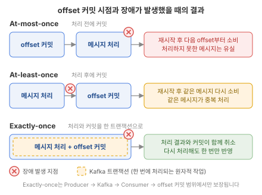

<!-- truncate -->

### `At-most-once` / `At-least-once` / `Exactly-once`

분산 시스템과 메시지 큐(Kafka, RabbitMQ 등)를 사용할 때  
가장 중요한 설계 포인트 중 하나는 **“메시지가 몇 번 전달될 수 있는가”** 입니다.

이를 **메시지 전달 보장(Delivery Semantics)** 이라고 하며, 대표적으로 다음 세 가지가 있습니다.

---

## 1. `At-most-once` (최대 한 번 전달)

### 개념
> 메시지는 **최대 한 번만 처리**되며,  
> 실패 시 메시지가 **유실될 수 있습니다**.

- 중복 ❌
- 유실 ⭕
- 재시도 ❌

---

### 특징

| 항목 | 설명 |
|---|---|
| 신뢰성 | 낮음 |
| 성능 | 매우 높음 |
| 구현 난이도 | 매우 낮음 |
| 처리 속도 | 최상 |

메시지를 받자마자 처리 완료로 간주하거나,  
처리 전에 offset을 커밋하는 방식에서 발생합니다.  
이 경우, 처리 중 장애가 발생하면 이미 커밋된 메시지는 다시 소비되지 않아 메시지 유실이 발생할 수 있습니다.

---

### 언제 사용하나?

- 로그 수집
- 모니터링 이벤트
- 트래픽 분석
- 통계성 데이터 (일부 유실 허용)

> “정확성보다 속도가 중요한 경우”

---

### 예시

- 접속 로그
- 클릭 로그
- 메트릭 데이터

---

## 2. `At-least-once` (최소 한 번 전달)

### 개념
> 메시지는 **최소 한 번 이상 처리**되며,  
> 실패 시 **중복 처리**가 발생할 수 있습니다.

- 중복 ⭕
- 유실 ❌
- 재시도 ⭕

---

### 특징

| 항목 | 설명 |
|---|---|
| 신뢰성 | 높음 |
| 성능 | 중간 |
| 구현 난이도 | 중간 |
| 실무 사용 빈도 | 매우 높음 |

메시지 처리 후 offset을 커밋하기 때문에  
실패 시 같은 메시지가 다시 처리될 수 있습니다.

---

### 언제 사용하나?

- 주문 생성
- 결제 처리
- 푸시 발송
- 비즈니스 이벤트 처리

> “유실은 절대 안 되지만, 중복은 애플리케이션에서 처리할 수 있는 경우”

---

### 실무 포인트

실무에서는 `At-least-once`를 기본으로 사용하고,  
Consumer 측에서 **eventId 기반 멱등 처리**나  
DB 유니크 제약을 통해 중복 처리를 방지하는 방식이 가장 일반적입니다.

즉, 메시징 레벨은 `At-least-once`로 설정하고  
비즈니스 로직에서 `Exactly-once`에 가깝게 만드는 전략을 취합니다.

---

### 예시

- 주문 이벤트 처리
- 포인트 적립
- 이메일 발송 (중복 방지 로직 포함)

---

## 3. Exactly-once (정확히 한 번 전달)

### 개념
> 메시지는 **중복 없이 정확히 한 번만 처리**됩니다.

- 중복 ❌
- 유실 ❌
- 높은 비용

---

### 특징

| 항목 | 설명 |
|---|---|
| 신뢰성 | 최고 |
| 성능 | 낮음 |
| 구현 난이도 | 높음 |
| 운영 복잡도 | 높음 |

Kafka의 경우 **트랜잭션**을 통해,  
메시지 처리와 offset commit을 하나의 원자적 작업으로 묶습니다.

> 단, **Kafka 내부 범위**에서만 Exactly-once가 보장됩니다.

Kafka의 `Exactly-once`는  
**Producer → Kafka → Consumer → Kafka(offset commit)**  
까지의 범위에서만 보장됩니다.

즉, DB나 외부 API까지 포함한  
end-to-end `Exactly-once`는 Kafka 단독으로 보장되지 않으며,  
이 경우 Outbox 패턴, Idempotent Consumer 설계 등이 필요합니다.

---

### 언제 사용하나?

- 정확한 집계
- 스트림 처리
- 금융/정산 파이프라인
- Kafka Streams 기반 처리

> “중복이 치명적인 경우”

---

### 주의사항

- DB, 외부 API까지 포함한 end-to-end Exactly-once는 매우 어렵습니다
- 성능 비용과 운영 복잡도를 반드시 고려해야 합니다

---

## 4. 한눈에 비교

세 방식의 차이는 메시지 처리와 offset 커밋의 순서에서 생기며, 아래 그림은 그 사이에 장애가 발생했을 때 결과가 어떻게 달라지는지 보여 줍니다.

<details>
<summary>SVG 코드</summary>

```svg
<svg xmlns="http://www.w3.org/2000/svg" width="440" height="328" viewBox="0 0 440 328" font-family="-apple-system, 'Segoe UI', 'Noto Sans KR', sans-serif">
<defs><marker id="ah" viewBox="0 0 10 10" refX="9" refY="5" markerWidth="7" markerHeight="7" orient="auto-start-reverse"><path d="M0,0 L10,5 L0,10 z" fill="#888"/></marker></defs>
<rect x="0" y="0" width="440" height="328" fill="#FFFFFF"/>
<text x="220.0" y="22" font-size="13" fill="#333" text-anchor="middle" font-weight="bold">offset 커밋 시점과 장애가 발생했을 때의 결과</text>
<text x="16" y="44" font-size="12" fill="#333" text-anchor="start" font-weight="bold">At-most-once</text>
<text x="120" y="44" font-size="10" fill="#888" text-anchor="start">처리 전에 커밋</text>
<rect x="16" y="54" width="92" height="42" rx="6" fill="#EEF3FB" stroke="#4C7FE0"/>
<text x="62.0" y="79.0" font-size="11" fill="#26508F" text-anchor="middle" font-weight="bold">offset 커밋</text>
<line x1="108" y1="75.0" x2="127" y2="75.0" stroke="#888" stroke-width="1.2" marker-end="url(#ah)"/>
<rect x="128" y="54" width="92" height="42" rx="6" fill="#EEF3FB" stroke="#4C7FE0"/>
<text x="174.0" y="79.0" font-size="11" fill="#26508F" text-anchor="middle" font-weight="bold">메시지 처리</text>
<line x1="220" y1="75.0" x2="241" y2="75.0" stroke="#888" stroke-width="1.2" marker-end="url(#ah)"/>
<rect x="242" y="54" width="182" height="42" rx="6" fill="#FDECEC" stroke="#D9534F"/>
<text x="333.0" y="71.4" font-size="10.5" fill="#B52B27" text-anchor="middle">재시작 후 다음 offset부터 소비</text>
<text x="333.0" y="85.9" font-size="10.5" fill="#B52B27" text-anchor="middle">처리하지 못한 메시지는 유실</text>
<circle cx="216" cy="54" r="8" fill="#FDECEC" stroke="#D9534F" stroke-width="1.5"/><path d="M212.5,50.5 L219.5,57.5 M219.5,50.5 L212.5,57.5" stroke="#D9534F" stroke-width="1.8"/>
<text x="16" y="130" font-size="12" fill="#333" text-anchor="start" font-weight="bold">At-least-once</text>
<text x="120" y="130" font-size="10" fill="#888" text-anchor="start">처리 후에 커밋</text>
<rect x="16" y="140" width="92" height="42" rx="6" fill="#EEF3FB" stroke="#4C7FE0"/>
<text x="62.0" y="165.0" font-size="11" fill="#26508F" text-anchor="middle" font-weight="bold">메시지 처리</text>
<line x1="108" y1="161.0" x2="127" y2="161.0" stroke="#888" stroke-width="1.2" marker-end="url(#ah)"/>
<rect x="128" y="140" width="92" height="42" rx="6" fill="#EEF3FB" stroke="#4C7FE0"/>
<text x="174.0" y="165.0" font-size="11" fill="#26508F" text-anchor="middle" font-weight="bold">offset 커밋</text>
<line x1="220" y1="161.0" x2="241" y2="161.0" stroke="#888" stroke-width="1.2" marker-end="url(#ah)"/>
<rect x="242" y="140" width="182" height="42" rx="6" fill="#FFF3E0" stroke="#E0A000"/>
<text x="333.0" y="157.4" font-size="10.5" fill="#8A6400" text-anchor="middle">재시작 후 같은 메시지 다시 소비</text>
<text x="333.0" y="171.9" font-size="10.5" fill="#8A6400" text-anchor="middle">같은 메시지가 중복 처리</text>
<circle cx="118.0" cy="149.0" r="8" fill="#FDECEC" stroke="#D9534F" stroke-width="1.5"/><path d="M114.5,145.5 L121.5,152.5 M121.5,145.5 L114.5,152.5" stroke="#D9534F" stroke-width="1.8"/>
<text x="16" y="216" font-size="12" fill="#333" text-anchor="start" font-weight="bold">Exactly-once</text>
<text x="114" y="216" font-size="10" fill="#888" text-anchor="start">처리와 커밋을 한 트랜잭션으로</text>
<rect x="16" y="226" width="204" height="42" rx="6" fill="#EEF3FB" stroke="#4C7FE0"/>
<rect x="22" y="232" width="192" height="30" rx="4" fill="#FFF3E0" stroke="#E0A000" stroke-dasharray="4 3"/>
<text x="118.0" y="251.0" font-size="11" fill="#26508F" text-anchor="middle" font-weight="bold">메시지 처리 + offset 커밋</text>
<line x1="220" y1="247.0" x2="241" y2="247.0" stroke="#888" stroke-width="1.2" marker-end="url(#ah)"/>
<rect x="242" y="226" width="182" height="42" rx="6" fill="#E9F2E9" stroke="#8FBF8F"/>
<text x="333.0" y="243.4" font-size="10.5" fill="#2E6B2E" text-anchor="middle">처리 결과와 커밋이 함께 취소</text>
<text x="333.0" y="257.9" font-size="10.5" fill="#2E6B2E" text-anchor="middle">다시 처리해도 한 번만 반영</text>
<circle cx="216" cy="226" r="8" fill="#FDECEC" stroke="#D9534F" stroke-width="1.5"/><path d="M212.5,222.5 L219.5,229.5 M219.5,222.5 L212.5,229.5" stroke="#D9534F" stroke-width="1.8"/>
<circle cx="24" cy="288" r="8" fill="#FDECEC" stroke="#D9534F" stroke-width="1.5"/><path d="M20.5,284.5 L27.5,291.5 M27.5,284.5 L20.5,291.5" stroke="#D9534F" stroke-width="1.8"/>
<text x="38" y="292" font-size="10" fill="#555" text-anchor="start">장애 발생 지점</text>
<rect x="130" y="281" width="14" height="14" rx="2" fill="#FFF3E0" stroke="#E0A000" stroke-dasharray="4 3"/>
<text x="150" y="292" font-size="10" fill="#555" text-anchor="start">Kafka 트랜잭션 (한 번에 처리되는 원자적 작업)</text>
<text x="220.0" y="314" font-size="9.5" fill="#888" text-anchor="middle">Exactly-once는 Producer → Kafka → Consumer → offset 커밋 범위에서만 보장됩니다</text>
</svg>
```

</details>

<figure style={{textAlign: 'center', margin: '1.5rem 0'}}>
  
</figure>

| 구분 | At-most-once | At-least-once | Exactly-once |
|---|---|---|---|
| 메시지 유실 | 가능 | 불가능 | 불가능 |
| 메시지 중복 | 없음 | 가능 | 없음 |
| 성능 | ⭐⭐⭐ | ⭐⭐ | ⭐ |
| 구현 난이도 | 낮음 | 중간 | 높음 |
| 실무 사용 | 낮음 | ⭐⭐⭐⭐ | 제한적 |

---

## 5. 실무에서의 선택 기준

> **“Exactly-once를 먼저 쓰지 말고,  
> At-least-once로 시작해 필요한 곳에만 강화하자.”**

### 추천 전략
- 기본: **At-least-once**
- 로그/모니터링: **At-most-once**
- 집계/스트림: **Exactly-once (제한적)**

---

## 마무리

메시지 전달 보장은 단순한 설정 문제가 아니라  
**비즈니스 특성과 장애 허용 범위에 대한 설계 결정**입니다.

- 유실이 허용되는가?
- 중복이 치명적인가?
- 성능과 정확성 중 무엇이 더 중요한가?

이 질문에 답할 수 있다면 적절한 전달 보장을 선택할 수 있습니다.