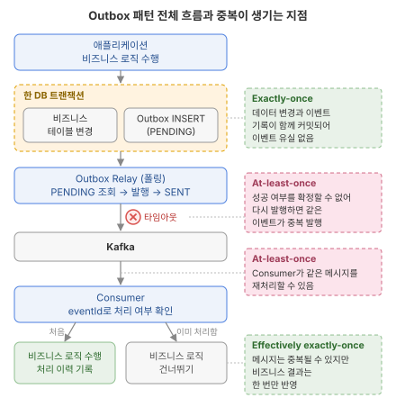

<!-- truncate -->

이번 포스트에서는 **Debezium(CDC)을 사용하지 않고**,  
Outbox 패턴을 활용해 **effectively exactly-once**를 보장하는 구조를 정리해보려고 합니다.

분산 시스템에서  
**“메시지를 정확히 한 번 처리한다(Exactly-Once)”** 는 요구사항은 매우 흔하지만,  
이를 **end-to-end로 완벽하게 보장하는 것은 현실적으로 거의 불가능**합니다.

Kafka, DB, 외부 API는 각각 독립적인 시스템이며  
이들을 하나의 트랜잭션으로 묶을 수 없기 때문입니다.

그래서 실무에서는 보통 다음을 목표로 합니다.

> **중복은 허용하되,  
> 최종 비즈니스 결과(effect)는 정확히 한 번만 반영되도록 설계한다.**

## 1. 문제 배경
### DB update → Kafka produce
이 구조에서는 다음 문제가 발생할 수 있습니다.
- DB는 반영됐지만 Kafka 발행 실패 → 이벤트 유실
- Kafka는 발행됐지만 DB 트랜잭션 롤백 → 잘못된 이벤트 전파
- 네트워크 장애로 성공/실패 여부를 알 수 없음

➡️ **DB와 Kafka 사이의 정합성이 깨짐**

---

## 2. Outbox 패턴 개요

Outbox 패턴의 핵심 아이디어는 단순합니다.
> **이벤트 발행을 DB 트랜잭션의 일부로 만든다.**

즉,
- 비즈니스 데이터 변경
- 발행할 이벤트 기록

을 **같은 트랜잭션 안에서 처리**합니다.

Kafka 발행은 이후 **비동기 Relay(배치/스케줄러)** 가 담당합니다.

---

## 3. 전체 아키텍처 흐름

아래 그림은 애플리케이션에서 Consumer까지의 흐름과, 구간별 보장 수준 및 중복이 생길 수 있는 지점을 함께 보여 줍니다.

<details>
<summary>SVG 코드</summary>

```svg
<svg xmlns="http://www.w3.org/2000/svg" width="440" height="442" viewBox="0 0 440 442" font-family="-apple-system, 'Segoe UI', 'Noto Sans KR', sans-serif">
<defs><marker id="ah" viewBox="0 0 10 10" refX="9" refY="5" markerWidth="7" markerHeight="7" orient="auto-start-reverse"><path d="M0,0 L10,5 L0,10 z" fill="#888"/></marker></defs>
<rect x="0" y="0" width="440" height="442" fill="#FFFFFF"/>
<text x="220.0" y="22" font-size="13" fill="#333" text-anchor="middle" font-weight="bold">Outbox 패턴 전체 흐름과 중복이 생기는 지점</text>
<rect x="16" y="38" width="236" height="40" rx="6" fill="#EEF3FB" stroke="#4C7FE0"/>
<text x="134.0" y="54.4" font-size="11" fill="#26508F" text-anchor="middle">애플리케이션</text>
<text x="134.0" y="69.3" font-size="11" fill="#26508F" text-anchor="middle">비즈니스 로직 수행</text>
<line x1="134.0" y1="78" x2="134.0" y2="92" stroke="#888" stroke-width="1.2" marker-end="url(#ah)"/>
<rect x="16" y="94" width="236" height="74" rx="6" fill="#FFF3E0" stroke="#E0A000" stroke-dasharray="4 3"/>
<text x="26" y="110" font-size="10.5" fill="#8A6400" text-anchor="start" font-weight="bold">한 DB 트랜잭션</text>
<rect x="26" y="120" width="104" height="38" rx="6" fill="#F7F7F7" stroke="#999999"/>
<text x="78" y="135.4" font-size="10.5" fill="#333" text-anchor="middle">비즈니스</text>
<text x="78" y="149.9" font-size="10.5" fill="#333" text-anchor="middle">테이블 변경</text>
<rect x="138" y="120" width="104" height="38" rx="6" fill="#F7F7F7" stroke="#999999"/>
<text x="190" y="135.4" font-size="10.5" fill="#333" text-anchor="middle">Outbox INSERT</text>
<text x="190" y="149.9" font-size="10.5" fill="#333" text-anchor="middle">(PENDING)</text>
<rect x="272" y="98" width="152" height="66" rx="4" fill="#E9F2E9" stroke="#8FBF8F" stroke-dasharray="4 3"/>
<text x="280" y="113" font-size="10.5" fill="#2E6B2E" text-anchor="start" font-weight="bold">Exactly-once</text>
<text x="280" y="129" font-size="10" fill="#333" text-anchor="start">데이터 변경과 이벤트</text>
<text x="280" y="143" font-size="10" fill="#333" text-anchor="start">기록이 함께 커밋되어</text>
<text x="280" y="157" font-size="10" fill="#333" text-anchor="start">이벤트 유실 없음</text>
<line x1="252" y1="131" x2="272" y2="131" stroke="#BBB" stroke-dasharray="2 2"/>
<line x1="134.0" y1="168" x2="134.0" y2="184" stroke="#888" stroke-width="1.2" marker-end="url(#ah)"/>
<rect x="16" y="186" width="236" height="40" rx="6" fill="#EEF3FB" stroke="#4C7FE0"/>
<text x="134.0" y="202.3" font-size="11" fill="#26508F" text-anchor="middle">Outbox Relay (폴링)</text>
<text x="134.0" y="217.3" font-size="11" fill="#26508F" text-anchor="middle">PENDING 조회 → 발행 → SENT</text>
<line x1="134.0" y1="226" x2="134.0" y2="256" stroke="#888" stroke-width="1.2" marker-end="url(#ah)"/>
<circle cx="148.0" cy="241" r="8" fill="#FDECEC" stroke="#D9534F" stroke-width="1.5"/><path d="M144.5,237.5 L151.5,244.5 M151.5,237.5 L144.5,244.5" stroke="#D9534F" stroke-width="1.8"/>
<text x="160.0" y="245" font-size="10" fill="#B52B27" text-anchor="start">타임아웃</text>
<rect x="272" y="192" width="152" height="66" rx="4" fill="#FCE4EC" stroke="#D06A86" stroke-dasharray="4 3"/>
<text x="280" y="207" font-size="10.5" fill="#9E3A57" text-anchor="start" font-weight="bold">At-least-once</text>
<text x="280" y="223" font-size="10" fill="#333" text-anchor="start">성공 여부를 확정할 수 없어</text>
<text x="280" y="237" font-size="10" fill="#333" text-anchor="start">다시 발행하면 같은</text>
<text x="280" y="251" font-size="10" fill="#333" text-anchor="start">이벤트가 중복 발행</text>
<line x1="210.0" y1="241" x2="272" y2="241" stroke="#BBB" stroke-dasharray="2 2"/>
<rect x="16" y="258" width="236" height="32" rx="6" fill="#F7F7F7" stroke="#999999"/>
<text x="134.0" y="278" font-size="11" fill="#333" text-anchor="middle" font-weight="bold">Kafka</text>
<line x1="134.0" y1="290" x2="134.0" y2="316" stroke="#888" stroke-width="1.2" marker-end="url(#ah)"/>
<rect x="272" y="276" width="152" height="52" rx="4" fill="#FCE4EC" stroke="#D06A86" stroke-dasharray="4 3"/>
<text x="280" y="291" font-size="10.5" fill="#9E3A57" text-anchor="start" font-weight="bold">At-least-once</text>
<text x="280" y="307" font-size="10" fill="#333" text-anchor="start">Consumer가 같은 메시지를</text>
<text x="280" y="321" font-size="10" fill="#333" text-anchor="start">재처리할 수 있음</text>
<line x1="134.0" y1="303" x2="272" y2="303" stroke="#BBB" stroke-dasharray="2 2"/>
<rect x="16" y="318" width="236" height="40" rx="6" fill="#EEF3FB" stroke="#4C7FE0"/>
<text x="134.0" y="334.4" font-size="11" fill="#26508F" text-anchor="middle">Consumer</text>
<text x="134.0" y="349.4" font-size="11" fill="#26508F" text-anchor="middle">eventId로 처리 여부 확인</text>
<line x1="84.0" y1="358" x2="72" y2="379" stroke="#888" stroke-width="1.2" marker-end="url(#ah)"/>
<text x="72.0" y="372" font-size="9.5" fill="#888" text-anchor="end">처음</text>
<line x1="184.0" y1="358" x2="196" y2="379" stroke="#888" stroke-width="1.2" marker-end="url(#ah)"/>
<text x="196.0" y="372" font-size="9.5" fill="#888" text-anchor="start">이미 처리함</text>
<rect x="16" y="380" width="112" height="46" rx="6" fill="#E9F2E9" stroke="#8FBF8F"/>
<text x="72" y="399.4" font-size="10.5" fill="#2E6B2E" text-anchor="middle">비즈니스 로직 수행</text>
<text x="72" y="413.9" font-size="10.5" fill="#2E6B2E" text-anchor="middle">처리 이력 기록</text>
<rect x="140" y="380" width="112" height="46" rx="6" fill="#F7F7F7" stroke="#999999"/>
<text x="196" y="399.4" font-size="10.5" fill="#555" text-anchor="middle">비즈니스 로직</text>
<text x="196" y="413.9" font-size="10.5" fill="#555" text-anchor="middle">건너뛰기</text>
<rect x="272" y="372" width="152" height="66" rx="4" fill="#E9F2E9" stroke="#8FBF8F" stroke-dasharray="4 3"/>
<text x="280" y="387" font-size="10.5" fill="#2E6B2E" text-anchor="start" font-weight="bold">Effectively exactly-once</text>
<text x="280" y="403" font-size="10" fill="#333" text-anchor="start">메시지는 중복될 수 있지만</text>
<text x="280" y="417" font-size="10" fill="#333" text-anchor="start">비즈니스 결과는</text>
<text x="280" y="431" font-size="10" fill="#333" text-anchor="start">한 번만 반영</text>
<line x1="252" y1="403" x2="272" y2="403" stroke="#BBB" stroke-dasharray="2 2"/>
</svg>
```

</details>

<figure style={{textAlign: 'center', margin: '1.5rem 0'}}>
  
</figure>

### 1) Producer (Application)
- 비즈니스 로직 수행
- Outbox 테이블에 이벤트 INSERT
- 한 DB 트랜잭션으로 커밋

이 단계에서:
- Kafka 장애와 무관하게 이벤트는 DB에 안전하게 저장됩니다
- 애플리케이션 장애가 발생해도 이벤트 유실은 없습니다

---

### 2) Outbox Relay (폴링 기반)

- Outbox 테이블에서 `PENDING` 상태 이벤트 조회
- Kafka로 메시지 발행
- 성공 시 `SENT` 상태로 변경
- 실패 시 재시도

이 과정에서:

- 네트워크 오류, Kafka 장애로 발행 실패 가능
- 타임아웃으로 인한 **중복 발행 가능성 존재**
- 대신 <mark>**최소 한 번(at-least-once) 발행은 보장**</mark>

---

### 3) Consumer

- Kafka 메시지 소비
- `eventId` 기준으로 이미 처리된 이벤트인지 확인
- 처음 처리하는 이벤트만 비즈니스 로직 수행
- 처리 이력 DB에 기록

메시지는 중복 소비될 수 있지만,  
DB 멱등 처리로 **비즈니스 결과는 정확히 한 번만 반영**됩니다.

---

## 4. Outbox 테이블 예시

- `id` (PK)
- `event_id` (전역 유일)
- `payload`
- `status` (`PENDING`, `SENT`)
- `created_at`

실무에서는 Outbox row를 즉시 DELETE하기보다  
`SENT` 상태로 남긴 뒤 TTL 또는 배치로 정리하는 방식이 더 안전합니다.  
(감사 로그, 재처리, 리플레이 대응)

---

## 5. Consumer 멱등 처리 방식

Consumer는 반드시 **중복 처리를 방지**해야 합니다.

대표적인 방법:

- `processed_event` 테이블에 `event_id`를 PK로 저장
- 또는 비즈니스 테이블에 `event_id UNIQUE` 제약 추가

이렇게 하면:

- 동일 메시지가 여러 번 와도
- DB 반영은 **단 한 번만 발생**

---

## 6. 이 구조가 보장하는 수준

| 구간 | 보장 수준 |
|---|---|
| DB → Outbox | Exactly-once |
| Outbox → Kafka | At-least-once |
| Kafka → Consumer | At-least-once |
| 최종 비즈니스 결과 | Effectively exactly-once |

즉,
> **전달은 최소 한 번,  
> 결과는 정확히 한 번**

---

## 7. 왜 “완전한 Exactly-Once”가 아닐까?

- Kafka 발행은 중복될 수 있습니다
- Consumer는 재처리될 수 있습니다
- 네트워크 장애로 성공 여부를 확정할 수 없습니다

따라서 물리적인 의미의 `Exactly-once`는 아닙니다.

하지만,

- `eventId` 기반 멱등 처리
- 유니크 제약
- 처리 이력 관리

를 통해 **비즈니스 관점에서는 `Exactly-once`와 동일한 효과**를 얻게됩니다.

---

## 8. 주의사항

1. **`eventId` 설계가 가장 중요**
    - 재시도/재발행에도 동일해야 함
    - 전역 유일성 필수

2. **중복 발행은 정상 동작**
    - Consumer 멱등 처리는 선택이 아니라 필수

3. **외부 API 포함 시**
    - Idempotency-Key 지원 여부가 핵심
    - 없으면 호출 로그 + 재시도/보상 트랜잭션 필요

---

## 마치며

분산 시스템에서
물리적으로 정확한 `Exactly-once`를 end-to-end로 보장하는 것은 현실적으로 불가능합니다.

대신 실무에서는
이벤트 발행 과정에서의 유실을 막고,
<mark>중복 전달은 허용</mark>하되 <mark>비즈니스 결과는 한 번만 반영</mark>되도록 설계하는 것이 더 중요합니다.

이를 위해
Outbox 패턴으로 이벤트 발행을 최소 한 번 보장하고,
Consumer에서 `eventId` 기반 멱등 처리를 적용함으로써
end-to-end로는 결과가 정확히 한 번만 반영되도록 설계할 수 있습니다.

`Exactly-once`는 설정의 문제가 아니라,
어디에서 중복을 허용하고 어디에서 막을 것인지에 대한 설계의 문제입니다.