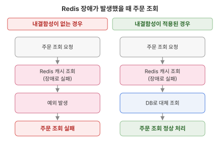
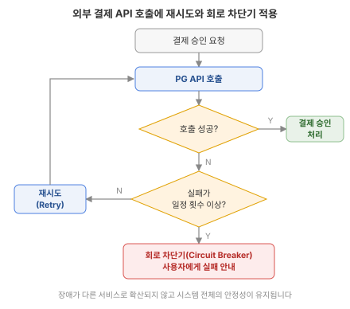

<!-- truncate -->

이번 포스트에서는 **내결함성(Fault Tolerance)** 과 **고가용성(High Availability)** 을 명확히 구분하고, 실제 서비스 사례를 통해 각각이 어떤 문제를 해결하는지 살펴보고자 합니다.

분산 시스템과 클라우드 환경에서 **내결함성(Fault Tolerance)** 과 **고가용성(High Availability)** 은 매우 중요한 개념입니다.  
두 용어는 종종 혼용되지만, 엄밀히 말하면 서로 다른 초점과 해결 방식을 가지고 있습니다.

---

## 내결함성(Fault Tolerance)이란?

**내결함성이란 시스템 일부에 장애가 발생하더라도 서비스 요청 처리를 계속할 수 있도록 하는 능력**을 의미합니다. 즉, 장애 상황에서도 사용자가 정상적인 응답을 받을 수 있도록 설계된 특성입니다.

---

## 내결함성 사례 – 장애 발생 시에도 서비스가 지속된다

### 사례 1: 주문 조회 서비스에서 캐시 장애

#### 상황
- 사용자가 주문 내역을 조회할 때, 시스템은 Redis 캐시를 우선 조회하고, 캐시에 데이터가 없으면 DB를 조회합니다.

#### 장애 발생
- Redis 서버가 장애를 일으킵니다.

#### 내결함성이 없는 경우
Redis 장애로 인해 예외가 발생하고, 주문 조회가 실패합니다.

#### 내결함성이 적용된 경우
Redis 장애가 발생해 캐시 조회에 실패하더라도 DB로 대체 조회를 수행하여 주문 조회가 정상적으로 처리됩니다.

**이처럼 장애가 발생했지만 서비스는 중단되지 않습니다.**

<details>
<summary>SVG 코드</summary>

```svg
<svg xmlns="http://www.w3.org/2000/svg" width="440" height="286" viewBox="0 0 440 286" font-family="-apple-system, 'Segoe UI', 'Noto Sans KR', sans-serif">
<defs><marker id="ah" viewBox="0 0 10 10" refX="9" refY="5" markerWidth="7" markerHeight="7" orient="auto-start-reverse"><path d="M0,0 L10,5 L0,10 z" fill="#888"/></marker></defs>
<rect x="0" y="0" width="440" height="286" fill="#FFFFFF"/>
<text x="220.0" y="22" font-size="13" fill="#333" text-anchor="middle" font-weight="bold">Redis 장애가 발생했을 때 주문 조회</text>
<rect x="15" y="36" width="200" height="24" rx="4" fill="#FDECEC" stroke="#D9534F"/>
<text x="115" y="52" font-size="11.5" fill="#B52B27" text-anchor="middle" font-weight="bold">내결함성이 없는 경우</text>
<rect x="30" y="74" width="170" height="40" rx="6" fill="#F7F7F7" stroke="#999999"/>
<text x="115" y="97.7" font-size="10.5" fill="#333" text-anchor="middle">주문 조회 요청</text>
<line x1="115" y1="114" x2="115" y2="128" stroke="#888" stroke-width="1.2" marker-end="url(#ah)"/>
<rect x="30" y="130" width="170" height="40" rx="6" fill="#FCE4EC" stroke="#D06A86"/>
<text x="115" y="146.4" font-size="10.5" fill="#333" text-anchor="middle">Redis 캐시 조회</text>
<text x="115" y="160.9" font-size="10.5" fill="#333" text-anchor="middle">(장애로 실패)</text>
<line x1="115" y1="170" x2="115" y2="184" stroke="#888" stroke-width="1.2" marker-end="url(#ah)"/>
<rect x="30" y="186" width="170" height="40" rx="6" fill="#FCE4EC" stroke="#D06A86"/>
<text x="115" y="209.7" font-size="10.5" fill="#333" text-anchor="middle">예외 발생</text>
<line x1="115" y1="226" x2="115" y2="240" stroke="#888" stroke-width="1.2" marker-end="url(#ah)"/>
<rect x="30" y="242" width="170" height="30" rx="6" fill="#FDECEC" stroke="#D9534F"/>
<text x="115" y="261" font-size="11.5" fill="#B52B27" text-anchor="middle" font-weight="bold">주문 조회 실패</text>
<rect x="225" y="36" width="200" height="24" rx="4" fill="#E9F2E9" stroke="#8FBF8F"/>
<text x="325" y="52" font-size="11.5" fill="#2E6B2E" text-anchor="middle" font-weight="bold">내결함성이 적용된 경우</text>
<rect x="240" y="74" width="170" height="40" rx="6" fill="#F7F7F7" stroke="#999999"/>
<text x="325" y="97.7" font-size="10.5" fill="#333" text-anchor="middle">주문 조회 요청</text>
<line x1="325" y1="114" x2="325" y2="128" stroke="#888" stroke-width="1.2" marker-end="url(#ah)"/>
<rect x="240" y="130" width="170" height="40" rx="6" fill="#FCE4EC" stroke="#D06A86"/>
<text x="325" y="146.4" font-size="10.5" fill="#333" text-anchor="middle">Redis 캐시 조회</text>
<text x="325" y="160.9" font-size="10.5" fill="#333" text-anchor="middle">(장애로 실패)</text>
<line x1="325" y1="170" x2="325" y2="184" stroke="#888" stroke-width="1.2" marker-end="url(#ah)"/>
<rect x="240" y="186" width="170" height="40" rx="6" fill="#EEF3FB" stroke="#4C7FE0"/>
<text x="325" y="209.7" font-size="10.5" fill="#333" text-anchor="middle">DB로 대체 조회</text>
<line x1="325" y1="226" x2="325" y2="240" stroke="#888" stroke-width="1.2" marker-end="url(#ah)"/>
<rect x="240" y="242" width="170" height="30" rx="6" fill="#E9F2E9" stroke="#8FBF8F"/>
<text x="325" y="261" font-size="11.5" fill="#2E6B2E" text-anchor="middle" font-weight="bold">주문 조회 정상 처리</text>
</svg>
```

</details>

<figure style={{textAlign: 'center', margin: '1.5rem 0'}}>
  
</figure>

### 사례 2: 외부 결제 API 호출 실패

#### 상황
- 결제 승인 시 외부 결제 대행사(PG) API를 호출합니다.

#### 장애 발생
- 일시적인 네트워크 타임아웃이 발생합니다.

#### 내결함성 적용
재시도(Retry)와 회로 차단기(Circuit Breaker) 패턴을 도입하여 1차 호출 실패 시 재시도를 수행하고, 일정 횟수 이상 실패하면 사용자에게 실패를 안내합니다.

이를 통해 장애가 다른 서비스로 확산되지 않고 시스템 전체의 안정성이 유지됩니다.

<details>
<summary>SVG 코드</summary>

```svg
<svg xmlns="http://www.w3.org/2000/svg" width="440" height="388" viewBox="0 0 440 388" font-family="-apple-system, 'Segoe UI', 'Noto Sans KR', sans-serif">
<defs><marker id="ah" viewBox="0 0 10 10" refX="9" refY="5" markerWidth="7" markerHeight="7" orient="auto-start-reverse"><path d="M0,0 L10,5 L0,10 z" fill="#888"/></marker></defs>
<rect x="0" y="0" width="440" height="388" fill="#FFFFFF"/>
<text x="220.0" y="22" font-size="13" fill="#333" text-anchor="middle" font-weight="bold">외부 결제 API 호출에 재시도와 회로 차단기 적용</text>
<rect x="170" y="36" width="160" height="30" rx="6" fill="#F7F7F7" stroke="#999999"/>
<text x="250" y="55" font-size="11" fill="#333" text-anchor="middle">결제 승인 요청</text>
<line x1="250" y1="66" x2="250" y2="84" stroke="#888" stroke-width="1.2" marker-end="url(#ah)"/>
<rect x="170" y="84" width="160" height="30" rx="6" fill="#EEF3FB" stroke="#4C7FE0"/>
<text x="250" y="103" font-size="11" fill="#26508F" text-anchor="middle" font-weight="bold">PG API 호출</text>
<line x1="250" y1="114" x2="250" y2="132" stroke="#888" stroke-width="1.2" marker-end="url(#ah)"/>
<polygon points="250,132.0 325.0,162 250,192.0 175.0,162" fill="#FFF3E0" stroke="#E0A000"/>
<text x="250" y="166" font-size="11" fill="#333" text-anchor="middle">호출 성공?</text>
<line x1="325" y1="162" x2="360" y2="162" stroke="#888" stroke-width="1.2" marker-end="url(#ah)"/>
<text x="340" y="155" font-size="10" fill="#888" text-anchor="middle">Y</text>
<rect x="360" y="146" width="72" height="32" rx="6" fill="#E9F2E9" stroke="#8FBF8F"/>
<text x="396" y="158.4" font-size="10.5" fill="#2E6B2E" text-anchor="middle" font-weight="bold">결제 승인</text>
<text x="396" y="172.9" font-size="10.5" fill="#2E6B2E" text-anchor="middle" font-weight="bold">처리</text>
<line x1="250" y1="192" x2="250" y2="214" stroke="#888" stroke-width="1.2" marker-end="url(#ah)"/>
<text x="258" y="207" font-size="10" fill="#888" text-anchor="start">N</text>
<polygon points="250,215.0 335.0,250 250,285.0 165.0,250" fill="#FFF3E0" stroke="#E0A000"/>
<text x="250" y="246.4" font-size="10.5" fill="#333" text-anchor="middle">실패가</text>
<text x="250" y="260.9" font-size="10.5" fill="#333" text-anchor="middle">일정 횟수 이상?</text>
<line x1="165" y1="250" x2="108" y2="250" stroke="#888" stroke-width="1.2" marker-end="url(#ah)"/>
<text x="150" y="243" font-size="10" fill="#888" text-anchor="middle">N</text>
<rect x="18" y="232" width="90" height="36" rx="6" fill="#EEF3FB" stroke="#4C7FE0"/>
<text x="63" y="246.4" font-size="10.5" fill="#26508F" text-anchor="middle" font-weight="bold">재시도</text>
<text x="63" y="260.9" font-size="10.5" fill="#26508F" text-anchor="middle" font-weight="bold">(Retry)</text>
<polyline points="63,232 63,99 168,99" fill="none" stroke="#888" stroke-width="1.2" marker-end="url(#ah)"/>
<line x1="250" y1="285" x2="250" y2="306" stroke="#888" stroke-width="1.2" marker-end="url(#ah)"/>
<text x="258" y="300" font-size="10" fill="#888" text-anchor="start">Y</text>
<rect x="155" y="306" width="190" height="44" rx="6" fill="#FDECEC" stroke="#D9534F"/>
<text x="250" y="324.4" font-size="10.5" fill="#B52B27" text-anchor="middle" font-weight="bold">회로 차단기(Circuit Breaker)</text>
<text x="250" y="338.9" font-size="10.5" fill="#B52B27" text-anchor="middle" font-weight="bold">사용자에게 실패 안내</text>
<text x="220.0" y="374" font-size="10" fill="#888" text-anchor="middle">장애가 다른 서비스로 확산되지 않고 시스템 전체의 안정성이 유지됩니다</text>
</svg>
```

</details>

<figure style={{textAlign: 'center', margin: '1.5rem 0'}}>
  
</figure>

---

## 고가용성(High Availability)이란?
**고가용성이란 시스템이 가능한 한 오랜 시간 동안 중단 없이 서비스를 제공하는 특성**을 의미합니다.  
즉, 서비스가 얼마나 자주 그리고 얼마나 오래 정상적으로 운영되는지를 나타냅니다.

---

## 고가용성 사례 – 장애 발생 후 빠른 복구

### 사례 1: 웹 서버 장애

#### 상황
- 웹 서버 3대가 로드밸런서 뒤에서 서비스를 제공합니다.

```
                ┌─────────────┐
                │    User     │
                └─────────────┘
                       │
                       ▼
              ┌─────────────────┐
              │  Load Balancer  │
              └─────────────────┘
                       │
      ┌────────────────┴───────────────┐
      │                │               │
      ▼                ▼               ▼
┌─────────────┐ ┌─────────────┐ ┌─────────────┐
│  Server A   │ │  Server B   │ │  Server C   │
│             │ │   (DOWN)    │ │             │
└─────────────┘ └─────────────┘ └─────────────┘
```

**장애 발생**
- Server B가 다운됩니다.

#### 고가용성 적용
헬스체크를 통해 Server B의 장애를 감지하고, 로드밸런서가 해당 서버를 트래픽 분배 대상에서 제외합니다.  
이후 트래픽은 Server A와 Server C로 재분배됩니다.

**이로 인해 일부 서버가 장애를 겪었지만, 사용자는 거의 장애를 느끼지 못합니다.**

---

### 사례 2: 배치 서버 장애

#### 상황
- 하루에 한 번 실행되는 배치 작업이 서버 1대에서 수행됩니다.

#### 문제
- 배치 실행 중 서버가 다운되면 작업이 실패합니다.

#### 고가용성 적용
- 배치 서버를 다중화하고 Quartz Cluster 또는 Kubernetes CronJob과 같은 클러스터링 기술을 도입합니다. 
- 서버 A에 장애가 발생하면 서버 B가 다음 스케줄을 대신 실행하여 배치 작업이 특정 서버에 종속되지 않도록 합니다.

---

## 내결함성과 고가용성의 차이

| 구분 | 내결함성 | 고가용성 |
|---|---|---|
| 초점 | 장애를 견디는 능력 | 장애 후 빠른 복구 |
| 관점 | 요청 처리의 지속성 | 서비스 중단 시간 최소화 |
| 접근 방식 | 설계 중심 | 운영 및 인프라 중심 |
| 목표 | 기능 유지 | 최대한의 업타임 확보 |

- 내결함성은 타이어가 펑크 나도 예비 타이어로 계속 주행하는 자동차와 같습니다.
- 고가용성은 사고가 나면 즉시 다른 차량으로 갈아타는 렌터카 서비스와 같습니다.

---

## 실무에서 내결함성과 고가용성의 병행 적용

**내결함성과 고가용성은 서로 경쟁하는 개념이 아니라 상호 보완적인 관계입니다.**

### 사례: 추천 서비스 장애 대응

- 내결함성 측면에서는 추천 서버 장애 시 기본 추천 목록을 제공하여 서비스 연속성을 유지합니다.
- 고가용성 측면에서는 장애 인스턴스를 자동으로 제거하고 신규 인스턴스를 신속히 생성하여 빠른 복구를 지원합니다.

**결과적으로 장애를 견디면서 동시에 빠르게 복구하는 시스템을 구현할 수 있습니다.**

---

## 현실적인 설계 전략

모든 기능을 완벽한 내결함성으로 설계하면 비용과 시스템 복잡도가 크게 증가합니다. 따라서 실무에서는 다음과 같은 전략을 권장합니다.

- 핵심 비즈니스 흐름에는 탄탄한 내결함성을 적용합니다.
- 부가 기능에는 고가용성과 점진적 서비스 저하(Graceful Degradation)를 적용합니다.

---

## 마치며

**내결함성은 장애 발생 시에도 요청 처리를 지속할 수 있는 능력이며, 고가용성은 장애 발생 후 빠른 복구를 통해 서비스 중단 시간을 최소화하는 개념입니다.** 실무에서는 두 개념을 함께 적용하여 서비스의 연속성과 안정성을 확보합니다.

분산 시스템에서는 장애를 완전히 제거하는 것은 현실적으로 불가능합니다. 중요한 것은 장애를 어떻게 견디고, 얼마나 신속하게 복구하는가 입니다. 내결함성과 고가용성을 정확히 이해하고 적절히 적용하는 것이 안정적인 시스템 설계의 출발점입니다.