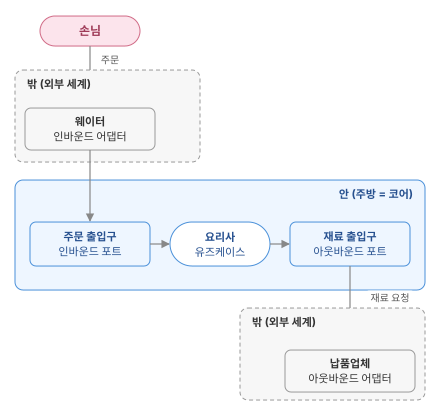
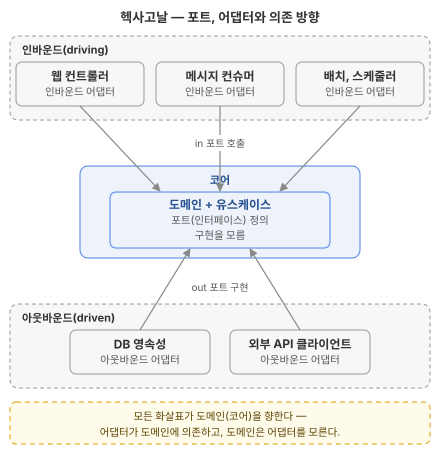
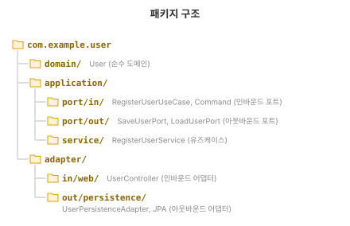
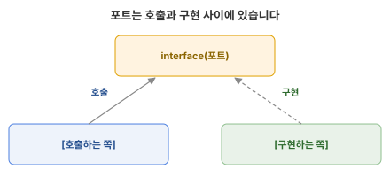
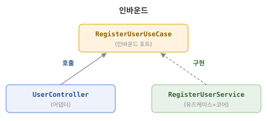
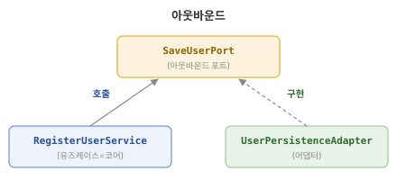
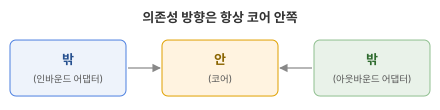

<!-- truncate -->

헥사고날 아키텍처(포트 앤 어댑터, Ports and Adapters)를 처음 접하면 **유즈케이스, 포트, 인바운드/아웃바운드 어댑터**의 관계가 가장 헷갈립니다. 이 글에서는 식당 비유와 자바 예제로 이 관계를 하나씩 정리합니다.

---

## 1. 유즈케이스 vs 어댑터, 한 줄 요약

핵심은 **"안(도메인/코어)"과 "밖(외부 세계)"의 경계**입니다. <mark>유즈케이스는 안쪽, 어댑터는 외부입니다.</mark>

### 유즈케이스 (Use Case)
- 애플리케이션 코어(안쪽)에 위치하는 **비즈니스 로직**
- "이 시스템이 무엇을 할 수 있는가"를 표현 (예: `회원가입`, `주문생성`, `게시글작성`)
- **포트(Port) 인터페이스에만 의존**하고, 외부 기술(DB, HTTP, 카프카)은 전혀 모름
- 순수 도메인 규칙과 흐름을 조율(orchestration)

### 어댑터 (Adapter)
- 외부(인프라)에 위치하며 **특정 기술과 도메인을 연결**
- "어떻게 외부와 통신하는가"를 담당
- 두 종류:
  - **인바운드(Driving) 어댑터** — 외부 요청을 유즈케이스로 전달 (REST 컨트롤러, CLI, 메시지 컨슈머)
  - **아웃바운드(Driven) 어댑터** — 유즈케이스가 필요로 하는 외부 작업 구현 (JPA 리포지토리, 외부 API 클라이언트, 이메일 발송)

| | 유즈케이스 | 어댑터 |
|---|---|---|
| 위치 | 코어(안) | 인프라(밖) |
| 책임 | 비즈니스 규칙 "무엇" | 기술 연동 "어떻게" |
| 의존 방향 | 포트에만 의존 | 도메인/포트에 의존 |
| 교체 가능성 | 안정적, 잘 안 바뀜 | 기술 바뀌면 교체 |

**핵심 원칙**: <mark>의존성은 항상 외부(어댑터) → 안(유즈케이스) 방향으로만 향합니다.</mark> 그래서 DB를 MySQL에서 MongoDB로 바꿔도, HTTP를 gRPC로 바꿔도 유즈케이스 코드는 그대로 유지됩니다.

---

## 2. 식당 비유로 한 번에 이해하기 🍽️

**유즈케이스 = 주방(요리사)**
- 실제 요리를 만드는 곳. "무엇을 하는지"의 핵심.
- 손님이 누군지, 재료가 어느 마트에서 오는지 관심 없음. 그냥 요리만 잘함.

**포트 = 주방의 출입구**
- 주방에는 출입구가 딱 2개 있음.
- **주문 받는 출입구(인바운드 포트)**: "이러한 주문을 넣을 수 있어요"라는 메뉴판
- **재료 요청 출입구(아웃바운드 포트)**: "나는 이러한 재료가 필요해요"라는 주문서

**어댑터 = 출입구로 드나드는 사람**
- **웨이터(인바운드 어댑터)**: 손님 주문을 받아서 → 주방 출입구에 넣어줌
- **식자재 납품업체(아웃바운드 어댑터)**: 주방이 요청한 재료 출입구에 → 실제 재료를 갖다줌

<details>
<summary>SVG 코드</summary>

```svg
<svg xmlns="http://www.w3.org/2000/svg" width="440" height="410" viewBox="0 0 440 410" font-family="-apple-system, 'Segoe UI', 'Noto Sans KR', sans-serif">
<defs><marker id="ah" viewBox="0 0 10 10" refX="9" refY="5" markerWidth="7" markerHeight="7" orient="auto-start-reverse"><path d="M0,0 L10,5 L0,10 z" fill="#888"/></marker></defs>
<rect x="0" y="0" width="440" height="410" fill="#FFFFFF"/>
<rect x="40" y="16" width="100" height="30" rx="15" fill="#FCE4EC" stroke="#D06A86"/>
<text x="90" y="35" font-size="12" fill="#9E3A57" text-anchor="middle" font-weight="bold">손님</text>
<line x1="90" y1="46" x2="90" y2="107" stroke="#888" stroke-width="1.2" marker-end="url(#ah)"/>
<rect x="96.0" y="52.5" width="28" height="15" rx="3" fill="#FFFFFF"/>
<text x="110" y="63.5" font-size="10" fill="#555" text-anchor="middle">주문</text>
<rect x="15" y="70" width="185" height="92" rx="8" fill="#F7F7F7" stroke="#999999" stroke-dasharray="4 3"/>
<text x="27" y="88" font-size="11" fill="#333" text-anchor="start" font-weight="bold">밖 (외부 세계)</text>
<rect x="25" y="108" width="130" height="42" rx="6" fill="#F7F7F7" stroke="#999999"/>
<text x="90.0" y="125.46" font-size="11" fill="#333" text-anchor="middle" font-weight="bold">웨이터</text>
<text x="90.0" y="140.45999999999998" font-size="11" fill="#333" text-anchor="middle">인바운드 어댑터</text>
<rect x="15" y="180" width="410" height="110" rx="8" fill="#EEF6FF" stroke="#4A90D9"/>
<text x="413" y="198" font-size="11" fill="#26508F" text-anchor="end" font-weight="bold">안 (주방 = 코어)</text>
<line x1="90" y1="150" x2="90" y2="221" stroke="#888" stroke-width="1.2" marker-end="url(#ah)"/>
<rect x="30" y="222" width="120" height="44" rx="6" fill="#EEF6FF" stroke="#4A90D9"/>
<text x="90.0" y="240.46" font-size="11" fill="#26508F" text-anchor="middle" font-weight="bold">주문 출입구</text>
<text x="90.0" y="255.46" font-size="11" fill="#26508F" text-anchor="middle">인바운드 포트</text>
<rect x="170" y="222" width="100" height="44" rx="22" fill="#FFFFFF" stroke="#4A90D9"/>
<text x="220" y="241" font-size="11" fill="#26508F" text-anchor="middle" font-weight="bold">요리사</text>
<text x="220" y="256" font-size="11" fill="#26508F" text-anchor="middle">유즈케이스</text>
<rect x="290" y="222" width="120" height="44" rx="6" fill="#EEF6FF" stroke="#4A90D9"/>
<text x="350.0" y="240.46" font-size="11" fill="#26508F" text-anchor="middle" font-weight="bold">재료 출입구</text>
<text x="350.0" y="255.46" font-size="11" fill="#26508F" text-anchor="middle">아웃바운드 포트</text>
<line x1="150" y1="244" x2="169" y2="244" stroke="#888" stroke-width="1.2" marker-end="url(#ah)"/>
<line x1="270" y1="244" x2="289" y2="244" stroke="#888" stroke-width="1.2" marker-end="url(#ah)"/>
<line x1="350" y1="266" x2="350" y2="349" stroke="#888" stroke-width="1.2" marker-end="url(#ah)"/>
<rect x="366.0" y="290.5" width="48" height="15" rx="3" fill="#FFFFFF"/>
<text x="390" y="301.5" font-size="10" fill="#555" text-anchor="middle">재료 요청</text>
<rect x="240" y="308" width="185" height="92" rx="8" fill="#F7F7F7" stroke="#999999" stroke-dasharray="4 3"/>
<text x="252" y="326" font-size="11" fill="#333" text-anchor="start" font-weight="bold">밖 (외부 세계)</text>
<rect x="285" y="350" width="130" height="42" rx="6" fill="#F7F7F7" stroke="#999999"/>
<text x="350.0" y="367.46" font-size="11" fill="#333" text-anchor="middle" font-weight="bold">납품업체</text>
<text x="350.0" y="382.46" font-size="11" fill="#333" text-anchor="middle">아웃바운드 어댑터</text>
</svg>
```

</details>

<figure style={{textAlign: 'center', margin: '1.5rem 0'}}>
  
</figure>

### 핵심 규칙 3가지

1. **포트는 "출입구/약속", 어댑터는 "그 출입구로 드나드는 실제 물건"**
   - 포트 = `interface` (약속만 정의)
   - 어댑터 = 그 interface를 실제로 구현한 코드

2. **방향으로 인/아웃을 구분**
   - **인바운드** = 밖에서 → 안으로 들어옴 (주문이 들어온다). 웹 요청, 버튼 클릭
   - **아웃바운드** = 안에서 → 밖으로 나감 (재료를 요청한다). DB 저장, 이메일 발송

3. **주방(유즈케이스)은 밖을 절대 모른다**
   - 웨이터가 애플리케이션이든 전화든 상관없음
   - 재료가 이마트에서 오든 쿠팡에서 오든 상관없음
   - → <mark>그래서 웹을 애플리케이션으로 바꿔도, DB를 바꿔도 주방 코드는 그대로</mark>

| 비유 | 역할 | 자바 |
|---|---|---|
| 메뉴판 | 인바운드 포트 | `interface RegisterUserUseCase` |
| 요리사 | 유즈케이스 | `class RegisterUserService` |
| 재료 주문서 | 아웃바운드 포트 | `interface SaveUserPort` |
| 웨이터 | 인바운드 어댑터 | `class UserController` |
| 납품업체 | 아웃바운드 어댑터 | `class UserPersistenceAdapter` |

<details>
<summary>SVG 코드</summary>

```svg
<svg xmlns="http://www.w3.org/2000/svg" width="440" height="452" viewBox="0 0 440 452" font-family="-apple-system, 'Segoe UI', 'Noto Sans KR', sans-serif">
<defs><marker id="ah" viewBox="0 0 10 10" refX="9" refY="5" markerWidth="7" markerHeight="7" orient="auto-start-reverse"><path d="M0,0 L10,5 L0,10 z" fill="#888"/></marker></defs>
<rect x="0" y="0" width="440" height="452" fill="#FFFFFF"/>
<text x="220.0" y="22" font-size="13" fill="#333" text-anchor="middle" font-weight="bold">헥사고날 — 포트, 어댑터와 의존 방향</text>
<rect x="10" y="36" width="420" height="84" rx="8" fill="#F7F7F7" stroke="#999999" stroke-dasharray="4 3"/>
<text x="22" y="54" font-size="11" fill="#333" text-anchor="start" font-weight="bold">인바운드(driving)</text>
<rect x="16.0" y="62" width="128" height="44" rx="6" fill="#F7F7F7" stroke="#999999"/>
<text x="80" y="80.5" font-size="12" fill="#333" text-anchor="middle" font-weight="bold">웹 컨트롤러</text>
<text x="80" y="95.5" font-size="10.5" fill="#555" text-anchor="middle">인바운드 어댑터</text>
<rect x="156.0" y="62" width="128" height="44" rx="6" fill="#F7F7F7" stroke="#999999"/>
<text x="220" y="80.5" font-size="12" fill="#333" text-anchor="middle" font-weight="bold">메시지 컨슈머</text>
<text x="220" y="95.5" font-size="10.5" fill="#555" text-anchor="middle">인바운드 어댑터</text>
<rect x="296.0" y="62" width="128" height="44" rx="6" fill="#F7F7F7" stroke="#999999"/>
<text x="360" y="80.5" font-size="12" fill="#333" text-anchor="middle" font-weight="bold">배치, 스케줄러</text>
<text x="360" y="95.5" font-size="10.5" fill="#555" text-anchor="middle">인바운드 어댑터</text>
<rect x="80" y="166" width="280" height="92" rx="8" fill="#EEF3FB" stroke="#4C7FE0"/>
<text x="220.0" y="184" font-size="11" fill="#26508F" text-anchor="middle" font-weight="bold">코어</text>
<rect x="110.0" y="192" width="220" height="56" rx="6" fill="#EEF3FB" stroke="#4C7FE0"/>
<text x="220" y="209.0" font-size="12" fill="#26508F" text-anchor="middle" font-weight="bold">도메인 + 유스케이스</text>
<text x="220" y="224.0" font-size="10.5" fill="#555" text-anchor="middle">포트(인터페이스) 정의</text>
<text x="220" y="239.0" font-size="10.5" fill="#555" text-anchor="middle">구현을 모름</text>
<line x1="80" y1="106" x2="160" y2="191" stroke="#888" stroke-width="1.2" marker-end="url(#ah)"/>
<line x1="220" y1="106" x2="220" y2="191" stroke="#888" stroke-width="1.2" marker-end="url(#ah)"/>
<line x1="360" y1="106" x2="280" y2="191" stroke="#888" stroke-width="1.2" marker-end="url(#ah)"/>
<rect x="185.0" y="135" width="70" height="16" fill="#FFFFFF"/>
<text x="220" y="147" font-size="10" fill="#555" text-anchor="middle">in 포트 호출</text>
<rect x="10" y="304" width="420" height="84" rx="8" fill="#F7F7F7" stroke="#999999" stroke-dasharray="4 3"/>
<text x="22" y="322" font-size="11" fill="#333" text-anchor="start" font-weight="bold">아웃바운드(driven)</text>
<rect x="70.0" y="330" width="140" height="44" rx="6" fill="#F7F7F7" stroke="#999999"/>
<text x="140" y="348.5" font-size="12" fill="#333" text-anchor="middle" font-weight="bold">DB 영속성</text>
<text x="140" y="363.5" font-size="10.5" fill="#555" text-anchor="middle">아웃바운드 어댑터</text>
<rect x="230.0" y="330" width="140" height="44" rx="6" fill="#F7F7F7" stroke="#999999"/>
<text x="300" y="348.5" font-size="12" fill="#333" text-anchor="middle" font-weight="bold">외부 API 클라이언트</text>
<text x="300" y="363.5" font-size="10.5" fill="#555" text-anchor="middle">아웃바운드 어댑터</text>
<line x1="140" y1="330" x2="190" y2="249" stroke="#888" stroke-width="1.2" marker-end="url(#ah)"/>
<line x1="300" y1="330" x2="250" y2="249" stroke="#888" stroke-width="1.2" marker-end="url(#ah)"/>
<rect x="182.0" y="279" width="76" height="16" fill="#FFFFFF"/>
<text x="220" y="291" font-size="10" fill="#555" text-anchor="middle">out 포트 구현</text>
<rect x="10" y="402" width="420" height="42" rx="6" fill="#FFFBEA" stroke="#E0A000" stroke-dasharray="5 4"/>
<text x="220.0" y="420" font-size="10.5" fill="#5A4300" text-anchor="middle">모든 화살표가 도메인(코어)을 향한다 —</text>
<text x="220.0" y="436" font-size="10.5" fill="#5A4300" text-anchor="middle">어댑터가 도메인에 의존하고, 도메인은 어댑터를 모른다.</text>
</svg>
```

</details>

<figure style={{textAlign: 'center', margin: '1.5rem 0'}}>
  
</figure>

---

## 3. 자바 예제 (회원가입 기능)

### 3-1. 도메인 (코어 안쪽)

```java
// domain/User.java
public class User {
    private final String id;
    private final String email;
    private final String password;

    public User(String id, String email, String password) {
        this.id = id;
        this.email = email;
        this.password = password;
    }
    // getters...
}
```

### 3-2. 인바운드 포트 (유즈케이스 인터페이스)

```java
// application/port/in/RegisterUserUseCase.java
public interface RegisterUserUseCase {
    User register(RegisterUserCommand command);
}

// application/port/in/RegisterUserCommand.java
public record RegisterUserCommand(String email, String password) {}
```

### 3-3. 아웃바운드 포트 (유즈케이스가 필요로 하는 외부 작업)

```java
// application/port/out/SaveUserPort.java
public interface SaveUserPort {
    User save(User user);
}

// application/port/out/LoadUserPort.java
public interface LoadUserPort {
    Optional<User> findByEmail(String email);
}
```

### 3-4. 유즈케이스 구현 (코어 — 기술을 전혀 모름)

```java
// application/service/RegisterUserService.java
@Service
public class RegisterUserService implements RegisterUserUseCase {

    private final SaveUserPort saveUserPort;      // 인터페이스에만 의존
    private final LoadUserPort loadUserPort;
    private final PasswordEncoder passwordEncoder;

    public RegisterUserService(SaveUserPort saveUserPort,
                               LoadUserPort loadUserPort,
                               PasswordEncoder passwordEncoder) {
        this.saveUserPort = saveUserPort;
        this.loadUserPort = loadUserPort;
        this.passwordEncoder = passwordEncoder;
    }

    @Override
    public User register(RegisterUserCommand command) {
        // 비즈니스 규칙: 중복 이메일 금지
        if (loadUserPort.findByEmail(command.email()).isPresent()) {
            throw new IllegalStateException("이미 가입된 이메일입니다.");
        }
        User user = new User(
            UUID.randomUUID().toString(),
            command.email(),
            passwordEncoder.encode(command.password())
        );
        return saveUserPort.save(user);   // DB가 뭔지 모름
    }
}
```

### 3-5. 인바운드 어댑터 (REST 컨트롤러 — 유즈케이스를 호출)

```java
// adapter/in/web/UserController.java
@RestController
@RequestMapping("/api/users")
public class UserController {

    private final RegisterUserUseCase registerUserUseCase;  // 포트에만 의존

    public UserController(RegisterUserUseCase registerUserUseCase) {
        this.registerUserUseCase = registerUserUseCase;
    }

    @PostMapping
    public ResponseEntity<UserResponse> register(@RequestBody RegisterUserRequest req) {
        User user = registerUserUseCase.register(
            new RegisterUserCommand(req.email(), req.password())
        );
        return ResponseEntity.ok(new UserResponse(user.getId(), user.getEmail()));
    }
}

record RegisterUserRequest(String email, String password) {}
record UserResponse(String id, String email) {}
```

### 3-6. 아웃바운드 어댑터 (JPA — 아웃바운드 포트를 구현)

```java
// adapter/out/persistence/UserPersistenceAdapter.java
@Component
public class UserPersistenceAdapter implements SaveUserPort, LoadUserPort {

    private final UserJpaRepository repository;

    public UserPersistenceAdapter(UserJpaRepository repository) {
        this.repository = repository;
    }

    @Override
    public User save(User user) {
        UserJpaEntity saved = repository.save(UserJpaEntity.from(user));
        return saved.toDomain();
    }

    @Override
    public Optional<User> findByEmail(String email) {
        return repository.findByEmail(email).map(UserJpaEntity::toDomain);
    }
}

// adapter/out/persistence/UserJpaRepository.java
interface UserJpaRepository extends JpaRepository<UserJpaEntity, String> {
    Optional<UserJpaEntity> findByEmail(String email);
}
```

### 패키지 구조 요약

<details>
<summary>SVG 코드</summary>

```svg
<svg xmlns="http://www.w3.org/2000/svg" width="440" height="284" viewBox="0 0 440 284" font-family="-apple-system, 'Segoe UI', 'Noto Sans KR', sans-serif">
<defs><marker id="ah" viewBox="0 0 10 10" refX="9" refY="5" markerWidth="7" markerHeight="7" orient="auto-start-reverse"><path d="M0,0 L10,5 L0,10 z" fill="#888"/></marker></defs>
<rect x="0" y="0" width="440" height="284" fill="#FFFFFF"/>
<text x="220.0" y="22" font-size="13" fill="#333" text-anchor="middle" font-weight="bold">패키지 구조</text>
<line x1="22" y1="80" x2="36" y2="80" stroke="#BBBBBB"/>
<line x1="22" y1="63" x2="22" y2="80" stroke="#BBBBBB"/>
<line x1="22" y1="104" x2="36" y2="104" stroke="#BBBBBB"/>
<line x1="22" y1="80" x2="22" y2="104" stroke="#BBBBBB"/>
<line x1="44" y1="128" x2="58" y2="128" stroke="#BBBBBB"/>
<line x1="44" y1="111" x2="44" y2="128" stroke="#BBBBBB"/>
<line x1="44" y1="152" x2="58" y2="152" stroke="#BBBBBB"/>
<line x1="44" y1="128" x2="44" y2="152" stroke="#BBBBBB"/>
<line x1="44" y1="176" x2="58" y2="176" stroke="#BBBBBB"/>
<line x1="44" y1="152" x2="44" y2="176" stroke="#BBBBBB"/>
<line x1="22" y1="200" x2="36" y2="200" stroke="#BBBBBB"/>
<line x1="22" y1="104" x2="22" y2="200" stroke="#BBBBBB"/>
<line x1="44" y1="224" x2="58" y2="224" stroke="#BBBBBB"/>
<line x1="44" y1="207" x2="44" y2="224" stroke="#BBBBBB"/>
<line x1="44" y1="248" x2="58" y2="248" stroke="#BBBBBB"/>
<line x1="44" y1="224" x2="44" y2="248" stroke="#BBBBBB"/>
<path d="M16 51 h5 l1.5 1.5 h6.5 v8.5 h-13 z" fill="#FFF3E0" stroke="#E0A000"/>
<text x="34" y="60" font-size="11" fill="#8A6400" text-anchor="start" font-weight="bold" font-family="Menlo, Consolas, monospace">com.example.user</text>
<path d="M38 75 h5 l1.5 1.5 h6.5 v8.5 h-13 z" fill="#FFF3E0" stroke="#E0A000"/>
<text x="56" y="84" font-size="11" fill="#8A6400" text-anchor="start" font-weight="bold" font-family="Menlo, Consolas, monospace">domain/</text>
<text x="112.19999999999999" y="83.5" font-size="9.5" fill="#888" text-anchor="start">User (순수 도메인)</text>
<path d="M38 99 h5 l1.5 1.5 h6.5 v8.5 h-13 z" fill="#FFF3E0" stroke="#E0A000"/>
<text x="56" y="108" font-size="11" fill="#8A6400" text-anchor="start" font-weight="bold" font-family="Menlo, Consolas, monospace">application/</text>
<path d="M60 123 h5 l1.5 1.5 h6.5 v8.5 h-13 z" fill="#FFF3E0" stroke="#E0A000"/>
<text x="78" y="132" font-size="11" fill="#8A6400" text-anchor="start" font-weight="bold" font-family="Menlo, Consolas, monospace">port/in/</text>
<text x="140.8" y="131.5" font-size="9.5" fill="#888" text-anchor="start">RegisterUserUseCase, Command (인바운드 포트)</text>
<path d="M60 147 h5 l1.5 1.5 h6.5 v8.5 h-13 z" fill="#FFF3E0" stroke="#E0A000"/>
<text x="78" y="156" font-size="11" fill="#8A6400" text-anchor="start" font-weight="bold" font-family="Menlo, Consolas, monospace">port/out/</text>
<text x="147.4" y="155.5" font-size="9.5" fill="#888" text-anchor="start">SaveUserPort, LoadUserPort (아웃바운드 포트)</text>
<path d="M60 171 h5 l1.5 1.5 h6.5 v8.5 h-13 z" fill="#FFF3E0" stroke="#E0A000"/>
<text x="78" y="180" font-size="11" fill="#8A6400" text-anchor="start" font-weight="bold" font-family="Menlo, Consolas, monospace">service/</text>
<text x="140.8" y="179.5" font-size="9.5" fill="#888" text-anchor="start">RegisterUserService (유즈케이스)</text>
<path d="M38 195 h5 l1.5 1.5 h6.5 v8.5 h-13 z" fill="#FFF3E0" stroke="#E0A000"/>
<text x="56" y="204" font-size="11" fill="#8A6400" text-anchor="start" font-weight="bold" font-family="Menlo, Consolas, monospace">adapter/</text>
<path d="M60 219 h5 l1.5 1.5 h6.5 v8.5 h-13 z" fill="#FFF3E0" stroke="#E0A000"/>
<text x="78" y="228" font-size="11" fill="#8A6400" text-anchor="start" font-weight="bold" font-family="Menlo, Consolas, monospace">in/web/</text>
<text x="134.2" y="227.5" font-size="9.5" fill="#888" text-anchor="start">UserController (인바운드 어댑터)</text>
<path d="M60 243 h5 l1.5 1.5 h6.5 v8.5 h-13 z" fill="#FFF3E0" stroke="#E0A000"/>
<text x="78" y="252" font-size="11" fill="#8A6400" text-anchor="start" font-weight="bold" font-family="Menlo, Consolas, monospace">out/persistence/</text>
<text x="78" y="266" font-size="9.5" fill="#888" text-anchor="start">UserPersistenceAdapter, JPA (아웃바운드 어댑터)</text>
</svg>
```

</details>

<figure style={{textAlign: 'center', margin: '1.5rem 0'}}>
  
</figure>

---

## 4. 가장 헷갈리는 포인트: "호출 ↔ 구현"이 뒤집힌다

interface(포트)가 있을 때 코드는 두 가지 일을 합니다.

- **호출한다(call / 사용한다)** = 그 메서드를 가져다 사용함. `port.save(user)` ← 호출하는 쪽
- **구현한다(implement / 만든다)** = 그 메서드의 실제 내용을 채움. `implements` ← 만드는 쪽

포트는 항상 이 둘 사이에 껴 있습니다:

<details>
<summary>SVG 코드</summary>

```svg
<svg xmlns="http://www.w3.org/2000/svg" width="440" height="200" viewBox="0 0 440 200" font-family="-apple-system, 'Segoe UI', 'Noto Sans KR', sans-serif">
<defs><marker id="ah" viewBox="0 0 10 10" refX="9" refY="5" markerWidth="7" markerHeight="7" orient="auto-start-reverse"><path d="M0,0 L10,5 L0,10 z" fill="#888"/></marker></defs>
<rect x="0" y="0" width="440" height="200" fill="#FFFFFF"/>
<text x="220.0" y="22" font-size="13" fill="#333" text-anchor="middle" font-weight="bold">포트는 호출과 구현 사이에 있습니다</text>
<rect x="130" y="40" width="180" height="46" rx="6" fill="#FFF3E0" stroke="#E0A000"/>
<text x="220" y="67" font-size="11" fill="#8A6400" text-anchor="middle" font-weight="bold">interface(포트)</text>
<rect x="10" y="140" width="180" height="46" rx="6" fill="#EEF3FB" stroke="#4C7FE0"/>
<text x="100" y="167" font-size="11" fill="#26508F" text-anchor="middle" font-weight="bold">[호출하는 쪽]</text>
<rect x="250" y="140" width="180" height="46" rx="6" fill="#E9F2E9" stroke="#8FBF8F"/>
<text x="340" y="167" font-size="11" fill="#2E6B2E" text-anchor="middle" font-weight="bold">[구현하는 쪽]</text>
<line x1="100" y1="140" x2="175" y2="88" stroke="#888" stroke-width="1.2" marker-end="url(#ah)"/>
<text x="122" y="108" font-size="10.5" fill="#26508F" text-anchor="end" font-weight="bold">호출</text>
<line x1="340" y1="140" x2="265" y2="88" stroke="#888" stroke-width="1.2" stroke-dasharray="4 3" marker-end="url(#ah)"/>
<text x="318" y="108" font-size="10.5" fill="#2E6B2E" text-anchor="start" font-weight="bold">구현</text>
</svg>
```

</details>

<figure style={{textAlign: 'center', margin: '1.5rem 0'}}>
  
</figure>

### 인바운드일 때

<details>
<summary>SVG 코드</summary>

```svg
<svg xmlns="http://www.w3.org/2000/svg" width="440" height="200" viewBox="0 0 440 200" font-family="-apple-system, 'Segoe UI', 'Noto Sans KR', sans-serif">
<defs><marker id="ah" viewBox="0 0 10 10" refX="9" refY="5" markerWidth="7" markerHeight="7" orient="auto-start-reverse"><path d="M0,0 L10,5 L0,10 z" fill="#888"/></marker></defs>
<rect x="0" y="0" width="440" height="200" fill="#FFFFFF"/>
<text x="220.0" y="22" font-size="13" fill="#333" text-anchor="middle" font-weight="bold">인바운드</text>
<rect x="130" y="40" width="180" height="46" rx="6" fill="#FFF3E0" stroke="#E0A000"/>
<text x="220" y="60" font-size="11" fill="#8A6400" text-anchor="middle" font-weight="bold" font-family="Menlo, Consolas, monospace">RegisterUserUseCase</text>
<text x="220" y="76" font-size="9.5" fill="#888" text-anchor="middle">(인바운드 포트)</text>
<rect x="10" y="140" width="180" height="46" rx="6" fill="#EEF3FB" stroke="#4C7FE0"/>
<text x="100" y="160" font-size="11" fill="#26508F" text-anchor="middle" font-weight="bold" font-family="Menlo, Consolas, monospace">UserController</text>
<text x="100" y="176" font-size="9.5" fill="#888" text-anchor="middle">(어댑터)</text>
<rect x="250" y="140" width="180" height="46" rx="6" fill="#E9F2E9" stroke="#8FBF8F"/>
<text x="340" y="160" font-size="11" fill="#2E6B2E" text-anchor="middle" font-weight="bold" font-family="Menlo, Consolas, monospace">RegisterUserService</text>
<text x="340" y="176" font-size="9.5" fill="#888" text-anchor="middle">(유즈케이스=코어)</text>
<line x1="100" y1="140" x2="175" y2="88" stroke="#888" stroke-width="1.2" marker-end="url(#ah)"/>
<text x="122" y="108" font-size="10.5" fill="#26508F" text-anchor="end" font-weight="bold">호출</text>
<line x1="340" y1="140" x2="265" y2="88" stroke="#888" stroke-width="1.2" stroke-dasharray="4 3" marker-end="url(#ah)"/>
<text x="318" y="108" font-size="10.5" fill="#2E6B2E" text-anchor="start" font-weight="bold">구현</text>
</svg>
```

</details>

<figure style={{textAlign: 'center', margin: '1.5rem 0'}}>
  
</figure>

- 어댑터(Controller)가 **호출하는 쪽**
- 코어(Service)가 **구현하는 쪽**

### 아웃바운드일 때

<details>
<summary>SVG 코드</summary>

```svg
<svg xmlns="http://www.w3.org/2000/svg" width="440" height="200" viewBox="0 0 440 200" font-family="-apple-system, 'Segoe UI', 'Noto Sans KR', sans-serif">
<defs><marker id="ah" viewBox="0 0 10 10" refX="9" refY="5" markerWidth="7" markerHeight="7" orient="auto-start-reverse"><path d="M0,0 L10,5 L0,10 z" fill="#888"/></marker></defs>
<rect x="0" y="0" width="440" height="200" fill="#FFFFFF"/>
<text x="220.0" y="22" font-size="13" fill="#333" text-anchor="middle" font-weight="bold">아웃바운드</text>
<rect x="130" y="40" width="180" height="46" rx="6" fill="#FFF3E0" stroke="#E0A000"/>
<text x="220" y="60" font-size="11" fill="#8A6400" text-anchor="middle" font-weight="bold" font-family="Menlo, Consolas, monospace">SaveUserPort</text>
<text x="220" y="76" font-size="9.5" fill="#888" text-anchor="middle">(아웃바운드 포트)</text>
<rect x="10" y="140" width="180" height="46" rx="6" fill="#EEF3FB" stroke="#4C7FE0"/>
<text x="100" y="160" font-size="11" fill="#26508F" text-anchor="middle" font-weight="bold" font-family="Menlo, Consolas, monospace">RegisterUserService</text>
<text x="100" y="176" font-size="9.5" fill="#888" text-anchor="middle">(유즈케이스=코어)</text>
<rect x="250" y="140" width="180" height="46" rx="6" fill="#E9F2E9" stroke="#8FBF8F"/>
<text x="340" y="160" font-size="11" fill="#2E6B2E" text-anchor="middle" font-weight="bold" font-family="Menlo, Consolas, monospace">UserPersistenceAdapter</text>
<text x="340" y="176" font-size="9.5" fill="#888" text-anchor="middle">(어댑터)</text>
<line x1="100" y1="140" x2="175" y2="88" stroke="#888" stroke-width="1.2" marker-end="url(#ah)"/>
<text x="122" y="108" font-size="10.5" fill="#26508F" text-anchor="end" font-weight="bold">호출</text>
<line x1="340" y1="140" x2="265" y2="88" stroke="#888" stroke-width="1.2" stroke-dasharray="4 3" marker-end="url(#ah)"/>
<text x="318" y="108" font-size="10.5" fill="#2E6B2E" text-anchor="start" font-weight="bold">구현</text>
</svg>
```

</details>

<figure style={{textAlign: 'center', margin: '1.5rem 0'}}>
  
</figure>

- 코어(Service)가 **호출하는 쪽**
- 어댑터(Persistence)가 **구현하는 쪽**

### "뒤집혀 있다"는 게 이 말

| | 어댑터가 하는 일 | 코어가 하는 일 |
|---|---|---|
| **인바운드** | 포트를 **호출** | 포트를 **구현** |
| **아웃바운드** | 포트를 **구현** | 포트를 **호출** |

→ <mark>어댑터가 인바운드에서는 "호출하는 쪽", 아웃바운드에서는 "만드는 쪽" — 정확히 역할이 반대(뒤집힘)</mark>. 코어도 마찬가지로 반대.

### 왜 이렇게 뒤집힐까? (핵심 이유)

기준은 딱 한 가지: **"화살표(의존성)는 항상 코어 안쪽을 향해야 한다."**

<details>
<summary>SVG 코드</summary>

```svg
<svg xmlns="http://www.w3.org/2000/svg" width="440" height="110" viewBox="0 0 440 110" font-family="-apple-system, 'Segoe UI', 'Noto Sans KR', sans-serif">
<defs><marker id="ah" viewBox="0 0 10 10" refX="9" refY="5" markerWidth="7" markerHeight="7" orient="auto-start-reverse"><path d="M0,0 L10,5 L0,10 z" fill="#888"/></marker></defs>
<rect x="0" y="0" width="440" height="110" fill="#FFFFFF"/>
<text x="220.0" y="22" font-size="13" fill="#333" text-anchor="middle" font-weight="bold">의존성 방향은 항상 코어 안쪽</text>
<rect x="10" y="40" width="116" height="56" rx="6" fill="#EEF3FB" stroke="#4C7FE0"/>
<text x="68" y="64" font-size="13" fill="#26508F" text-anchor="middle" font-weight="bold">밖</text>
<text x="68" y="82" font-size="9.5" fill="#555" text-anchor="middle">(인바운드 어댑터)</text>
<rect x="162" y="40" width="116" height="56" rx="6" fill="#FFF3E0" stroke="#E0A000"/>
<text x="220" y="64" font-size="13" fill="#8A6400" text-anchor="middle" font-weight="bold">안</text>
<text x="220" y="82" font-size="9.5" fill="#555" text-anchor="middle">(코어)</text>
<rect x="314" y="40" width="116" height="56" rx="6" fill="#E9F2E9" stroke="#8FBF8F"/>
<text x="372" y="64" font-size="13" fill="#2E6B2E" text-anchor="middle" font-weight="bold">밖</text>
<text x="372" y="82" font-size="9.5" fill="#555" text-anchor="middle">(아웃바운드 어댑터)</text>
<line x1="128" y1="68" x2="160" y2="68" stroke="#888" stroke-width="1.2" marker-end="url(#ah)"/>
<line x1="312" y1="68" x2="280" y2="68" stroke="#888" stroke-width="1.2" marker-end="url(#ah)"/>
</svg>
```

</details>

<figure style={{textAlign: 'center', margin: '1.5rem 0'}}>
  
</figure>

- 인바운드: 밖(어댑터)이 안(코어)을 부르니까 → 자연스럽게 화살표가 안쪽으로 감. 그냥 호출하면 됨.
- 아웃바운드: 안(코어)이 밖(DB)을 사용해야 하는데… 이러면 화살표가 **밖으로** 나가버림. ❌ 규칙 위반!

그래서 아웃바운드에서는 **트릭**을 사용합니다:
- 코어가 자기 안에 `SaveUserPort` 인터페이스를 **직접 소유**하고, 그걸 호출만 함.
- 실제 구현(어댑터)은 밖에 배치하고, 그 어댑터가 코어의 인터페이스를 **구현하러 들어옴**.
- 결과적으로 화살표가 다시 **안쪽을 향함**. ✅

<mark>이게 **의존성 역전(DIP, Dependency Inversion Principle)** 이고, 어댑터의 역할이 뒤집히는 핵심 이유입니다.</mark>

> **한 문장 요약**: 포트는 언제나 "호출 ↔ 구현" 사이에 끼는데, **인바운드는 어댑터가 호출과 코어가 구현**, **아웃바운드는 코어가 호출과 어댑터가 구현** — 화살표를 항상 코어 쪽으로 유지하려다 보니 어댑터의 역할이 서로 반대가 됩니다.

---

## 5. 왜 인바운드 포트는 이름이 "Port"가 아니고 "UseCase"일까?

### 결론 먼저

<mark>인바운드 포트는 그 자체가 **"이 애플리케이션이 할 수 있는 일(=유즈케이스)"의 목록**이라서, `~Port`보다 `~UseCase`라고 하는 것이 의미가 더 잘 나타나기 때문입니다.</mark> **둘 다 맞는 이름**인데, 관례적으로 인바운드는 `UseCase`를 사용합니다.

### 왜 그런지

포트는 "코어가 외부 세계와 통신하는 출입구"인데, 인바운드와 아웃바운드는 출입구의 **성격이 다릅니다.**

**인바운드 포트 = "우리가 제공하는 기능 메뉴"**
- 외부에서 "너 뭐 할 수 있어?"라고 물었을 때 내미는 메뉴판
- 그 메뉴 한 줄 한 줄이 바로 **유즈케이스**(회원가입, 주문생성…)
- 즉 인바운드 포트 ≈ 유즈케이스 그 자체 → 이름을 `RegisterUserUseCase`로 지으면 의도가 명확

```java
public interface RegisterUserUseCase {   // "회원가입 할 수 있음" = 기능 목록
    User register(RegisterUserCommand command);
}
```

**아웃바운드 포트 = "우리가 남에게 부탁하는 요청서"**
- 이건 기능(유즈케이스)이 아니라, 코어가 일을 하다가 필요한 도움
- "저장 좀 해줘", "메일 좀 보내줘" 같은 요청 → `SaveUserPort`, `SendEmailPort`
- 유즈케이스가 아니니까 그냥 `~Port`

```java
public interface SaveUserPort {   // 기능이 아니라 코어의 '요청'
    User save(User user);
}
```

| | 정식 명칭 | 흔히 사용하는 이름 | 왜? |
|---|---|---|---|
| 인바운드 포트 | Inbound/Driving Port | **`~UseCase`** | 포트 = 제공 기능 목록 = 유즈케이스 그 자체 |
| 아웃바운드 포트 | Outbound/Driven Port | **`~Port`** | 기능이 아니라 코어가 밖에 보내는 요청 |

> **주의**: 이건 강제 규칙이 아니라 **관례**입니다. 팀에 따라 인바운드도 `~Port`로 통일하기도 합니다. 다만 대부분의 헥사고날 책/예제(특히 *Get Your Hands Dirty on Clean Architecture*)가 인바운드=`UseCase`, 아웃바운드=`Port`로 사용하다 보니 표준처럼 굳어졌습니다.

---

## 마치며

헥사고날 아키텍처의 핵심은 결국 한 가지입니다.

> **의존성은 항상 코어 안쪽을 향한다.**

이 규칙 한 가지를 지키기 위해 포트(interface)를 경계에 배치하고, 어댑터가 인바운드에서는 호출하고 아웃바운드에서는 구현하는 형태로 역할이 뒤집힙니다. 그 덕분에 웹 프레임워크나 DB 같은 "기술"이 바뀌어도 비즈니스 로직(유즈케이스)은 흔들리지 않고, 테스트도 포트만 교체하면 쉽게 할 수 있게 됩니다.
