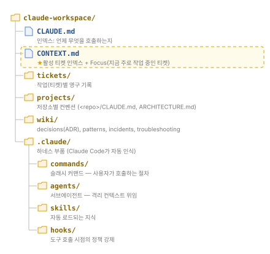
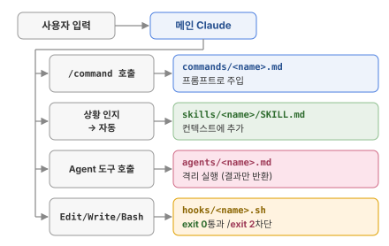
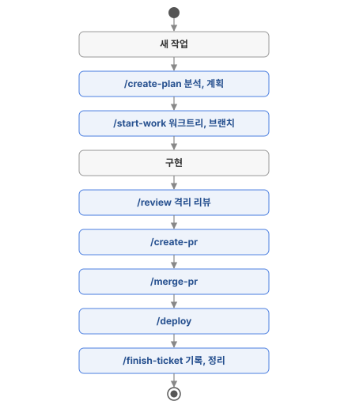

<!-- truncate -->

AI 코딩 어시스턴트를 실무에 사용하다 보면 매번 같은 문제를 겪습니다. **세션이 바뀌면 맥락이 날아가고, 어제와 오늘의 작업 방식이 달라집니다.** 머릿속으로 지키던 절차를 어시스턴트도 매번 똑같이 따르게 하려면 어떻게 해야 할까요? 이 글에서는 제가 실무에서 구축해 사용하고 있는 **AI 엔지니어링 하네스(harness)** — Claude Code용 메타 워크스페이스 — 의 구조와 방식을 예시와 폴더 구조로 정리합니다.

---

## 왜 "하네스"가 필요한가

LLM은 세션마다 아무 맥락 없이 시작합니다. 프로세스를 모델의 기억에 맡기면, 오늘은 리뷰를 건너뛰고 내일은 브랜치 규칙을 잊는 식으로 매번 달라집니다.

해법은 발상을 뒤집는 것입니다. <mark>프로세스, 상태, 규칙, 안전장치를 모델의 기억이 아니라 파일 시스템에 명시해 두면, 세션이 바뀌어도 같은 절차가 재현됩니다.</mark>

그래서 만든 것이 **하네스**입니다. 코드 저장소 위에 올린 최소한의 메타 레이어로, 코드 자체는 전혀 건드리지 않고 *"어떻게 일할지"* 만 정의합니다. 말(馬)이 아니라 마구(馬具, harness) — 방향을 정해 주는 장치입니다.

---

## 전체 그림: 코드 위에 올린 메타 워크스페이스

워크스페이스는 세 가지 영역으로 나뉩니다 — **상태, 기록, 하네스 부품**.

<details>
<summary>SVG 코드</summary>

```svg
<svg xmlns="http://www.w3.org/2000/svg" width="440" height="414" viewBox="0 0 440 414" font-family="-apple-system, 'Segoe UI', 'Noto Sans KR', sans-serif">
<defs><marker id="ah" viewBox="0 0 10 10" refX="9" refY="5" markerWidth="7" markerHeight="7" orient="auto-start-reverse"><path d="M0,0 L10,5 L0,10 z" fill="#888"/></marker></defs>
<rect x="0" y="0" width="440" height="414" fill="#FFFFFF"/>
<rect x="34" y="76" width="396" height="34" rx="4" fill="#FFFBEA" stroke="#E0A000" stroke-dasharray="5 4"/>
<line x1="25" y1="34" x2="25" y2="231" stroke="#BBBBBB" stroke-width="1"/>
<line x1="25" y1="51" x2="38" y2="51" stroke="#BBBBBB" stroke-width="1"/>
<line x1="25" y1="87" x2="38" y2="87" stroke="#BBBBBB" stroke-width="1"/>
<line x1="25" y1="123" x2="38" y2="123" stroke="#BBBBBB" stroke-width="1"/>
<line x1="25" y1="159" x2="38" y2="159" stroke="#BBBBBB" stroke-width="1"/>
<line x1="25" y1="195" x2="38" y2="195" stroke="#BBBBBB" stroke-width="1"/>
<line x1="25" y1="231" x2="38" y2="231" stroke="#BBBBBB" stroke-width="1"/>
<line x1="47" y1="236" x2="47" y2="375" stroke="#BBBBBB" stroke-width="1"/>
<line x1="47" y1="267" x2="60" y2="267" stroke="#BBBBBB" stroke-width="1"/>
<line x1="47" y1="303" x2="60" y2="303" stroke="#BBBBBB" stroke-width="1"/>
<line x1="47" y1="339" x2="60" y2="339" stroke="#BBBBBB" stroke-width="1"/>
<line x1="47" y1="375" x2="60" y2="375" stroke="#BBBBBB" stroke-width="1"/>
<path d="M18,25 h5 l1.5,-2 h7.5 v11 h-14 z" fill="#FFF3E0" stroke="#E0A000" stroke-width="1"/>
<text x="38" y="33" font-size="11.5" fill="#8A6400" text-anchor="start" font-weight="bold" font-family="Menlo, Consolas, monospace">claude-workspace/</text>
<path d="M41,44 h8 l4,4 v10 h-12 z" fill="#EEF3FB" stroke="#4C7FE0" stroke-width="1"/>
<text x="60" y="55" font-size="11.5" fill="#26508F" text-anchor="start" font-weight="bold" font-family="Menlo, Consolas, monospace">CLAUDE.md</text>
<text x="60" y="70" font-size="9.5" fill="#777777" text-anchor="start">인덱스: 언제 무엇을 호출하는지</text>
<path d="M41,80 h8 l4,4 v10 h-12 z" fill="#EEF3FB" stroke="#4C7FE0" stroke-width="1"/>
<text x="60" y="91" font-size="11.5" fill="#26508F" text-anchor="start" font-weight="bold" font-family="Menlo, Consolas, monospace">CONTEXT.md</text>
<text x="60" y="106" font-size="9.5" text-anchor="start"><tspan fill="#E0A000">★</tspan><tspan fill="#777777"> 활성 티켓 인덱스 + Focus(지금 주로 작업 중인 티켓)</tspan></text>
<path d="M40,119 h5 l1.5,-2 h7.5 v11 h-14 z" fill="#FFF3E0" stroke="#E0A000" stroke-width="1"/>
<text x="60" y="127" font-size="11.5" fill="#8A6400" text-anchor="start" font-weight="bold" font-family="Menlo, Consolas, monospace">tickets/</text>
<text x="60" y="142" font-size="9.5" fill="#777777" text-anchor="start">작업(티켓)별 영구 기록</text>
<path d="M40,155 h5 l1.5,-2 h7.5 v11 h-14 z" fill="#FFF3E0" stroke="#E0A000" stroke-width="1"/>
<text x="60" y="163" font-size="11.5" fill="#8A6400" text-anchor="start" font-weight="bold" font-family="Menlo, Consolas, monospace">projects/</text>
<text x="60" y="178" font-size="9.5" fill="#777777" text-anchor="start">저장소별 컨벤션 (&lt;repo&gt;/CLAUDE.md, ARCHITECTURE.md)</text>
<path d="M40,191 h5 l1.5,-2 h7.5 v11 h-14 z" fill="#FFF3E0" stroke="#E0A000" stroke-width="1"/>
<text x="60" y="199" font-size="11.5" fill="#8A6400" text-anchor="start" font-weight="bold" font-family="Menlo, Consolas, monospace">wiki/</text>
<text x="60" y="214" font-size="9.5" fill="#777777" text-anchor="start">decisions(ADR), patterns, incidents, troubleshooting</text>
<path d="M40,227 h5 l1.5,-2 h7.5 v11 h-14 z" fill="#FFF3E0" stroke="#E0A000" stroke-width="1"/>
<text x="60" y="235" font-size="11.5" fill="#8A6400" text-anchor="start" font-weight="bold" font-family="Menlo, Consolas, monospace">.claude/</text>
<text x="60" y="250" font-size="9.5" fill="#777777" text-anchor="start">하네스 부품 (Claude Code가 자동 인식)</text>
<path d="M62,263 h5 l1.5,-2 h7.5 v11 h-14 z" fill="#FFF3E0" stroke="#E0A000" stroke-width="1"/>
<text x="82" y="271" font-size="11.5" fill="#8A6400" text-anchor="start" font-weight="bold" font-family="Menlo, Consolas, monospace">commands/</text>
<text x="82" y="286" font-size="9.5" fill="#777777" text-anchor="start">슬래시 커맨드 — 사용자가 호출하는 절차</text>
<path d="M62,299 h5 l1.5,-2 h7.5 v11 h-14 z" fill="#FFF3E0" stroke="#E0A000" stroke-width="1"/>
<text x="82" y="307" font-size="11.5" fill="#8A6400" text-anchor="start" font-weight="bold" font-family="Menlo, Consolas, monospace">agents/</text>
<text x="82" y="322" font-size="9.5" fill="#777777" text-anchor="start">서브에이전트 — 격리 컨텍스트 위임</text>
<path d="M62,335 h5 l1.5,-2 h7.5 v11 h-14 z" fill="#FFF3E0" stroke="#E0A000" stroke-width="1"/>
<text x="82" y="343" font-size="11.5" fill="#8A6400" text-anchor="start" font-weight="bold" font-family="Menlo, Consolas, monospace">skills/</text>
<text x="82" y="358" font-size="9.5" fill="#777777" text-anchor="start">자동 로드되는 지식</text>
<path d="M62,371 h5 l1.5,-2 h7.5 v11 h-14 z" fill="#FFF3E0" stroke="#E0A000" stroke-width="1"/>
<text x="82" y="379" font-size="11.5" fill="#8A6400" text-anchor="start" font-weight="bold" font-family="Menlo, Consolas, monospace">hooks/</text>
<text x="82" y="394" font-size="9.5" fill="#777777" text-anchor="start">도구 호출 시점의 정책 강제</text>
</svg>
```

</details>

<figure style={{textAlign: 'center', margin: '1.5rem 0'}}>
  
</figure>

핵심은 경계입니다. 코드 원본은 읽기 전용으로, 실제 작업은 워크트리 사본에서 이뤄지고, <mark>"일하는 방식"은 전부 이 메타 워크스페이스가 소유합니다.</mark> 코드와 프로세스를 물리적으로 분리하는 것이 출발점입니다.

---

## 상태 추적: 활성 티켓 인덱스

하네스는 여러 티켓을 **병렬로** 추적합니다. 작업 공간부터가 티켓별로 나뉘어 있어서요 — 티켓마다 워크트리가 따로 있어(뒤에서 볼 워크트리 격리) 여러 티켓을 동시에 체크아웃, 빌드, 커밋합니다. 이 물리적 병렬을 추적이 그대로 따라가도록, 상태를 세 가지로 나눕니다.

- **`CONTEXT.md` = 활성 티켓 인덱스.** 활성 티켓을 한 줄씩 정리한 표. 라이브 상세는 각 티켓 파일에 위임합니다.

```markdown
# Current Context — 활성 티켓 인덱스

## Focus
- TICKET-4352   ← 지금 주로 작업 중인 티켓 (인자 없이 스킬을 부르면 이 티켓이 대상)

## Active Tickets
| 티켓 | repo | 브랜치 | 상태 | 다음 액션 |
|------|------|--------|------|-----------|
| TICKET-4185 | order-service | feature/TICKET-4185 | 스테이징·미커밋 | 커밋 → PR |
| TICKET-4352 | order-service | feature/TICKET-4352 | 계획 중 | /start-work |
```

- **라이브 상태 = `tickets/<티켓>.md`.** 각 티켓의 Goal, 진행 상태, 다음 액션과 이력을 기록하는 **상시 상태 파일**. 인덱스에는 한 줄 요약만, 상세는 여기에 기록합니다.
- **스킬은 대상 티켓을 인자로 받습니다.** `/start-work TICKET-4352`처럼 티켓 키를 붙여 호출합니다. 인자가 없으면 → 활성이 1건이면 그것, 여럿이면 **`Focus`(지금 주로 작업 중인 티켓)** 를 따르고, 그것도 없으면 사용자에게 묻습니다.

<mark>상태는 세 곳이 나눠 답합니다 — 활성 티켓 목록은 `CONTEXT.md`(인덱스), 각 티켓의 라이브 상태는 `tickets/<티켓>.md`, 대상 지정은 스킬의 티켓 인자. 워크트리가 티켓별로 병렬이므로 추적도 병렬입니다.</mark>

`pause`/`resume`은 인덱스에서 티켓을 **등록 해제 / 다시 등록**하고 Focus를 전환합니다(상태 자체는 티켓 파일에 상시 남아 삭제되지 않습니다). 리뷰 대기 티켓과 신규 착수 티켓을 동시에 든 채, 각 스킬 호출에서 대상만 명시하면 워크트리 혼동 없이 병렬로 진행됩니다.

```bash
# TICKET-4185는 리뷰/커밋 대기, TICKET-4352 신규 착수를 동시에
/create-plan   TICKET-4352     # 인덱스에 4352 추가(계획 중), Focus=4352
/start-work    TICKET-4352     # 4352 워크트리·브랜치 생성 → 구현
/create-pr     TICKET-4185     # 대기 중이던 4185를 커밋·PR (대상 명시)
/finish-ticket TICKET-4185     # 인덱스에서 4185 제거, 4352는 계속 활성
```

트레이드오프는 있습니다. **스킬 호출 때 대상 티켓 명시가 원칙**이고(모호하면 질문), 활성 티켓이 쌓이면 인덱스가 방치될 수 있어 `/finish-ticket`, `/pause-ticket`로 제때 정리해 인덱스를 가볍게 유지합니다.

---

## 하네스의 4가지 부품

`.claude/` 아래 네 종류의 부품이 서로 다른 역할을 맡습니다. 구분 기준은 **누가 발동하는가**와 **컨텍스트를 격리하는가**입니다.

| 부품 | 무엇 | 누가 발동 | 격리 |
|---|---|---|---|
| `commands/` | 슬래시 커맨드 — 절차 프롬프트 | **사용자**가 `/이름`으로 명시 호출 | 메인 |
| `agents/` | 서브에이전트 — 작은 Claude | **메인 Claude**가 도구로 호출 | 분리 |
| `skills/` | 자동 로드되는 지식 모음 | **모델**이 상황 보고 자동 | 메인 |
| `hooks/` | 정책 강제 셸 스크립트 | **시스템**이 도구 호출 직전 | OS 프로세스 |

이 네 가지가 이렇게 맞물립니다.

<details>
<summary>SVG 코드</summary>

```svg
<svg xmlns="http://www.w3.org/2000/svg" width="440" height="278" viewBox="0 0 440 278" font-family="-apple-system, 'Segoe UI', 'Noto Sans KR', sans-serif">
<defs><marker id="ah" viewBox="0 0 10 10" refX="9" refY="5" markerWidth="7" markerHeight="7" orient="auto-start-reverse"><path d="M0,0 L10,5 L0,10 z" fill="#888"/></marker></defs>
<rect x="0" y="0" width="440" height="278" fill="#FFFFFF"/>
<rect x="20" y="14" width="110" height="30" rx="6" fill="#F7F7F7" stroke="#999999"/>
<text x="75" y="33" font-size="11.5" fill="#333" text-anchor="middle" font-weight="bold">사용자 입력</text>
<line x1="130" y1="29" x2="168" y2="29" stroke="#888" stroke-width="1.2" marker-end="url(#ah)"/>
<rect x="170" y="14" width="120" height="30" rx="6" fill="#EEF3FB" stroke="#4C7FE0"/>
<text x="230" y="33" font-size="11.5" fill="#26508F" text-anchor="middle" font-weight="bold">메인 Claude</text>
<line x1="40" y1="56" x2="40" y2="245" stroke="#888" stroke-width="1.2"/>
<line x1="40" y1="56" x2="230" y2="56" stroke="#888" stroke-width="1.2"/>
<line x1="230" y1="44" x2="230" y2="56" stroke="#888" stroke-width="1.2"/>
<line x1="40" y1="83" x2="54" y2="83" stroke="#888" stroke-width="1.2" marker-end="url(#ah)"/>
<rect x="56" y="62" width="118" height="42" rx="6" fill="#F7F7F7" stroke="#999999"/>
<text x="115" y="86.7" font-size="10.5" fill="#333" text-anchor="middle" font-weight="bold" font-family="Menlo, Consolas, monospace">/command 호출</text>
<line x1="174" y1="83" x2="194" y2="83" stroke="#888" stroke-width="1.2" marker-end="url(#ah)"/>
<rect x="196" y="62" width="232" height="42" rx="6" fill="#EEF3FB" stroke="#4C7FE0"/>
<text x="206" y="79" font-size="10.5" fill="#26508F" text-anchor="start" font-weight="bold" font-family="Menlo, Consolas, monospace">commands/&lt;name&gt;.md</text>
<text x="206" y="95" font-size="10.5" fill="#333" text-anchor="start">프롬프트로 주입</text>
<line x1="40" y1="137" x2="54" y2="137" stroke="#888" stroke-width="1.2" marker-end="url(#ah)"/>
<rect x="56" y="116" width="118" height="42" rx="6" fill="#F7F7F7" stroke="#999999"/>
<text x="115" y="133.4" font-size="10.5" fill="#333" text-anchor="middle" font-weight="bold">상황 인지</text>
<text x="115" y="147.9" font-size="10.5" fill="#333" text-anchor="middle" font-weight="bold">→ 자동</text>
<line x1="174" y1="137" x2="194" y2="137" stroke="#888" stroke-width="1.2" marker-end="url(#ah)"/>
<rect x="196" y="116" width="232" height="42" rx="6" fill="#E9F2E9" stroke="#8FBF8F"/>
<text x="206" y="133" font-size="10.5" fill="#2E6B2E" text-anchor="start" font-weight="bold" font-family="Menlo, Consolas, monospace">skills/&lt;name&gt;/SKILL.md</text>
<text x="206" y="149" font-size="10.5" fill="#333" text-anchor="start">컨텍스트에 추가</text>
<line x1="40" y1="191" x2="54" y2="191" stroke="#888" stroke-width="1.2" marker-end="url(#ah)"/>
<rect x="56" y="170" width="118" height="42" rx="6" fill="#F7F7F7" stroke="#999999"/>
<text x="115" y="194.7" font-size="10.5" fill="#333" text-anchor="middle" font-weight="bold">Agent 도구 호출</text>
<line x1="174" y1="191" x2="194" y2="191" stroke="#888" stroke-width="1.2" marker-end="url(#ah)"/>
<rect x="196" y="170" width="232" height="42" rx="6" fill="#FCE4EC" stroke="#D06A86"/>
<text x="206" y="187" font-size="10.5" fill="#9E3A57" text-anchor="start" font-weight="bold" font-family="Menlo, Consolas, monospace">agents/&lt;name&gt;.md</text>
<text x="206" y="203" font-size="10.5" fill="#333" text-anchor="start">격리 실행 (결과만 반환)</text>
<line x1="40" y1="245" x2="54" y2="245" stroke="#888" stroke-width="1.2" marker-end="url(#ah)"/>
<rect x="56" y="224" width="118" height="42" rx="6" fill="#F7F7F7" stroke="#999999"/>
<text x="115" y="248.7" font-size="10.5" fill="#333" text-anchor="middle" font-weight="bold" font-family="Menlo, Consolas, monospace">Edit/Write/Bash</text>
<line x1="174" y1="245" x2="194" y2="245" stroke="#888" stroke-width="1.2" marker-end="url(#ah)"/>
<rect x="196" y="224" width="232" height="42" rx="6" fill="#FFF3E0" stroke="#E0A000"/>
<text x="206" y="241" font-size="10.5" fill="#8A6400" text-anchor="start" font-weight="bold" font-family="Menlo, Consolas, monospace">hooks/&lt;name&gt;.sh</text>
<text x="206" y="257" font-size="10.5" text-anchor="start"><tspan fill="#2E6B2E" font-weight="bold">exit 0</tspan><tspan fill="#333"> 통과 / </tspan><tspan fill="#9E3A57" font-weight="bold">exit 2</tspan><tspan fill="#333"> 차단</tspan></text>
</svg>
```

</details>

<figure style={{textAlign: 'center', margin: '1.5rem 0'}}>
  
</figure>

<mark>같은 일을 두 부품에 넣지 않는 것이 핵심 — 호출 주체(사용자, 모델, 시스템)와 격리 여부로 부품이 나뉩니다.</mark> 예를 들어 "사용자가 명시적으로 호출하는 절차"는 command, "AI가 알아서 로드해야 할 지식"은 skill입니다.

예시로, 슬래시 커맨드 하나(`create-plan`)는 이러한 모습입니다.

```markdown
---
description: 티켓을 분석하고 작업 계획을 작성한다. 승인 전까지 코드 수정 금지.
---

## 절차
1. ticket-analyzer 에이전트로 티켓 분석을 격리 위임
2. 시나리오(일반/장기/핫픽스)를 사용자에게 확인
3. 계획 작성 후 승인 대기 — 승인 전 코드 수정 금지
```

프론트매터의 `description` 한 줄이 명령의 정체성이고, 본문이 Claude가 따를 절차입니다.

---

## 루프: 작업 하나가 진행되는 길

작업(티켓) 하나는 정해진 슬래시 커맨드를 따라 한 방향으로 진행됩니다.

<details>
<summary>SVG 코드</summary>

```svg
<svg xmlns="http://www.w3.org/2000/svg" width="440" height="512" viewBox="0 0 440 512" font-family="-apple-system, 'Segoe UI', 'Noto Sans KR', sans-serif">
<defs><marker id="ah" viewBox="0 0 10 10" refX="9" refY="5" markerWidth="7" markerHeight="7" orient="auto-start-reverse"><path d="M0,0 L10,5 L0,10 z" fill="#888"/></marker></defs>
<rect x="0" y="0" width="440" height="512" fill="#FFFFFF"/>
<circle cx="220" cy="16" r="7" fill="#555"/>
<line x1="220" y1="23" x2="220" y2="39" stroke="#888" stroke-width="1.2" marker-end="url(#ah)"/>
<rect x="100.0" y="40" width="240" height="32" rx="6" fill="#F7F7F7" stroke="#999999"/>
<text x="220" y="60.0" font-size="12" fill="#333" text-anchor="middle" font-weight="bold">새 작업</text>
<line x1="220" y1="72" x2="220" y2="89" stroke="#888" stroke-width="1.2" marker-end="url(#ah)"/>
<rect x="100.0" y="90" width="240" height="32" rx="6" fill="#EEF3FB" stroke="#4C7FE0"/>
<text x="220" y="110.0" font-size="12" fill="#26508F" text-anchor="middle" font-weight="bold">/create-plan 분석, 계획</text>
<line x1="220" y1="122" x2="220" y2="139" stroke="#888" stroke-width="1.2" marker-end="url(#ah)"/>
<rect x="100.0" y="140" width="240" height="32" rx="6" fill="#EEF3FB" stroke="#4C7FE0"/>
<text x="220" y="160.0" font-size="12" fill="#26508F" text-anchor="middle" font-weight="bold">/start-work 워크트리, 브랜치</text>
<line x1="220" y1="172" x2="220" y2="189" stroke="#888" stroke-width="1.2" marker-end="url(#ah)"/>
<rect x="100.0" y="190" width="240" height="32" rx="6" fill="#F7F7F7" stroke="#999999"/>
<text x="220" y="210.0" font-size="12" fill="#333" text-anchor="middle" font-weight="bold">구현</text>
<line x1="220" y1="222" x2="220" y2="239" stroke="#888" stroke-width="1.2" marker-end="url(#ah)"/>
<rect x="100.0" y="240" width="240" height="32" rx="6" fill="#EEF3FB" stroke="#4C7FE0"/>
<text x="220" y="260.0" font-size="12" fill="#26508F" text-anchor="middle" font-weight="bold">/review 격리 리뷰</text>
<line x1="220" y1="272" x2="220" y2="289" stroke="#888" stroke-width="1.2" marker-end="url(#ah)"/>
<rect x="100.0" y="290" width="240" height="32" rx="6" fill="#EEF3FB" stroke="#4C7FE0"/>
<text x="220" y="310.0" font-size="12" fill="#26508F" text-anchor="middle" font-weight="bold">/create-pr</text>
<line x1="220" y1="322" x2="220" y2="339" stroke="#888" stroke-width="1.2" marker-end="url(#ah)"/>
<rect x="100.0" y="340" width="240" height="32" rx="6" fill="#EEF3FB" stroke="#4C7FE0"/>
<text x="220" y="360.0" font-size="12" fill="#26508F" text-anchor="middle" font-weight="bold">/merge-pr</text>
<line x1="220" y1="372" x2="220" y2="389" stroke="#888" stroke-width="1.2" marker-end="url(#ah)"/>
<rect x="100.0" y="390" width="240" height="32" rx="6" fill="#EEF3FB" stroke="#4C7FE0"/>
<text x="220" y="410.0" font-size="12" fill="#26508F" text-anchor="middle" font-weight="bold">/deploy</text>
<line x1="220" y1="422" x2="220" y2="439" stroke="#888" stroke-width="1.2" marker-end="url(#ah)"/>
<rect x="100.0" y="440" width="240" height="32" rx="6" fill="#EEF3FB" stroke="#4C7FE0"/>
<text x="220" y="460.0" font-size="12" fill="#26508F" text-anchor="middle" font-weight="bold">/finish-ticket 기록, 정리</text>
<line x1="220" y1="472" x2="220" y2="489" stroke="#888" stroke-width="1.2" marker-end="url(#ah)"/>
<circle cx="220" cy="498" r="8" fill="#FFFFFF" stroke="#555" stroke-width="1.5"/>
<circle cx="220" cy="498" r="4.5" fill="#555"/>
</svg>
```

</details>

<figure style={{textAlign: 'center', margin: '1.5rem 0'}}>
  
</figure>

<mark>작업 하나가 계획 → 구현 → 리뷰 → PR → 배포 → 마무리까지 정해진 커맨드를 따라 진행됩니다.</mark> 각 단계가 끝날 때마다 `CONTEXT.md`의 상태 필드가 즉시 갱신되므로, 중간에 세션이 종료되어도 다음 세션이 "어디까지 왔는지"를 파일에서 그대로 읽습니다.

무거운 일은 이 루프 중간에서 **격리 컨텍스트로 위임**합니다. 예를 들어 `/review`는 `code-reviewer` 서브에이전트를 호출해 diff 점검을 별도 컨텍스트에서 돌리고, 결과 요약 한 통만 메인으로 돌려받습니다. 메인 대화가 리뷰 로그로 오염되지 않습니다.

---

## 기록은 목적별로 나눈다

가장 많이 실수하는 지점이 "기록을 한 군데 몰아넣는" 것입니다. 이 하네스는 기록을 목적별로 쪼갭니다.

| 위치 | 무엇을 담나 | 수명 |
|---|---|---|
| `CONTEXT.md` | 지금 활성 작업의 상태 | 짧음 (분~일) |
| `tickets/<키>.md` | 그 작업에서 *무엇을 했나* (요약, 영향, 발견) | 영구 |
| `projects/<repo>/` | 그 저장소는 *어떻게 동작하나* (스택, 컨벤션) | 지속 |
| `wiki/decisions/` | *왜 그렇게 정했나* (ADR) | 영구 |

<mark>"지금 어디까지 왔나"와 "무엇을 했나"와 "이 저장소는 어떻게 동작하나"와 "왜 그렇게 정했나"를 각각 다른 파일이 책임집니다.</mark>

특히 `wiki/decisions/`의 ADR(Architecture Decision Record)이 중요합니다. 코드만 봐서는 알 수 없는 *선택의 맥락*을 박제해, 미래의 나와 새 합류자(그리고 Claude)가 "왜 이렇게 됐는가"를 판단할 수 있게 합니다. 반복되는 작업 절차는 `patterns/`, 운영 장애 회고는 `incidents/`, 자주 겪는 에러는 `troubleshooting/`으로 나눕니다.

---

## 안전장치는 훅으로 강제한다

"규칙을 잘 지키자"는 다짐만으로는 언젠가 문제가 생깁니다. 그래서 되돌리기 어려운 행동은 **훅으로 물리적으로 막습니다.**

- `main`, `develop` 같은 보호 브랜치로의 직접 push 차단
- 읽기 전용 원본 저장소 파일 수정 차단 (워크트리 강제)
- 코드 저장소에 문서 파일 커밋 차단

훅은 도구 호출 직전에 실행되는 셸 스크립트로, `exit 0`이면 통과, `exit 2`면 차단 후 안내 메시지를 띄웁니다.

```bash
# 예: 보호 브랜치 push 차단 (PreToolUse hook)
branch=$(git rev-parse --abbrev-ref HEAD)
case "$branch" in
  main|develop)
    echo "[차단] $branch 직접 push 금지 — PR로 진행하세요." >&2
    exit 2 ;;   # 도구 호출 자체를 막음
esac
exit 0
```

<mark>규칙은 "잘 지키자"는 다짐이 아니라, 도구 호출 시점에 훅이 실제로 차단해야 지켜집니다.</mark> 프롬프트에 적어둔 규칙은 모델이 잊을 수 있지만, 훅은 시스템이 실행하므로 잊히지 않습니다.

---

## 정리 — 설계 원칙 5가지

- **프로세스는 모델 밖 파일에** — 세션이 바뀌어도 같은 절차가 재현되도록.
- **상태는 인덱스로 모으고, 상세는 티켓별로** — 활성 티켓 목록은 `CONTEXT.md`(인덱스), 각 티켓의 진행은 `tickets/<티켓>.md`가 답합니다. 워크트리가 병렬이면 추적도 병렬로.
- **무겁고 시끄러운 일은 격리 컨텍스트(agent)로** — 메인 대화를 깨끗하게.
- **지식은 자동 로드(skill), 절차는 명시 호출(command)** — 호출 주체로 부품을 나눕니다.
- **규칙은 훅으로 강제** — 다짐이 아니라 시스템이 막습니다.

결국 하네스의 목표는 한 가지입니다. **AI를 더 똑똑하게 만드는 게 아니라, 어떤 세션에서 시작하든 팀의 프로세스를 그대로 따르게 만드는 것.** 모델의 능력이 아니라 *주변 구조*에 투자하는 것입니다.
