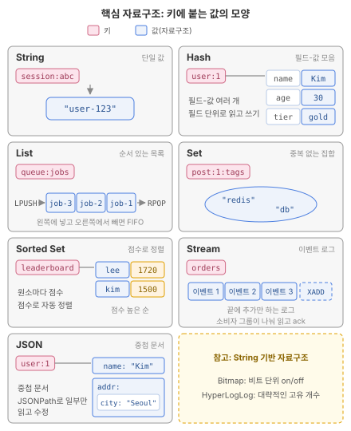
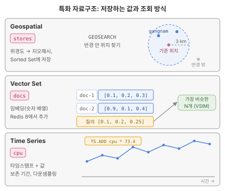

<!-- truncate -->

Redis를 "빠른 key-value 캐시" 정도로만 사용하는 경우가 많습니다. 하지만 Redis는 **값의 종류(자료구조)마다 전용 명령어**를 제공해서, 큐, 리더보드, 위치 검색, 벡터 검색까지 데이터베이스 한 대로 처리할 수 있습니다. <mark>"무엇을 저장하느냐"가 아니라 "어떤 자료구조로 저장하느냐"가 Redis 활용의 핵심입니다.</mark> Redis 8 기준으로 알아두면 좋은 10가지를 용도, 명령어, 사용 사례와 함께 정리합니다.

## 한눈에 보기

크게 **핵심(자주 사용하는 것)** 과 **특화(용도가 정해진 것)** 로 나뉩니다.

<details>
<summary>SVG 코드</summary>

```svg
<svg xmlns="http://www.w3.org/2000/svg" width="440" height="540" viewBox="0 0 440 540" font-family="-apple-system, 'Segoe UI', 'Noto Sans KR', sans-serif">
<defs><marker id="ah" viewBox="0 0 10 10" refX="9" refY="5" markerWidth="7" markerHeight="7" orient="auto-start-reverse"><path d="M0,0 L10,5 L0,10 z" fill="#888"/></marker></defs>
<rect x="0" y="0" width="440" height="540" fill="#FFFFFF"/>
<text x="220.0" y="22" font-size="13" fill="#333" text-anchor="middle" font-weight="bold">핵심 자료구조: 키에 붙는 값의 모양</text>
<rect x="110" y="32" width="14" height="12" rx="2" fill="#FCE4EC" stroke="#D06A86"/>
<text x="130" y="42" font-size="9.5" fill="#555" text-anchor="start">키</text>
<rect x="170" y="32" width="14" height="12" rx="2" fill="#EEF3FB" stroke="#4C7FE0"/>
<text x="190" y="42" font-size="9.5" fill="#555" text-anchor="start">값(자료구조)</text>
<rect x="10" y="58" width="206" height="112" rx="6" fill="#F7F7F7" stroke="#999999"/>
<text x="20" y="76" font-size="12" fill="#333" text-anchor="start" font-weight="bold">String</text>
<text x="206" y="76" font-size="9.5" fill="#888" text-anchor="end">단일 값</text>
<rect x="20" y="86" width="79.1" height="18" rx="4" fill="#FCE4EC" stroke="#D06A86"/>
<text x="59.55" y="99" font-size="10" fill="#9E3A57" text-anchor="middle" font-family="Menlo, Consolas, monospace">session:abc</text>
<line x1="113.0" y1="106" x2="113.0" y2="118" stroke="#888" stroke-width="1.2" marker-end="url(#ah)"/>
<rect x="58" y="122" width="110" height="28" rx="6" fill="#EEF3FB" stroke="#4C7FE0"/>
<text x="113" y="140" font-size="11" fill="#26508F" text-anchor="middle" font-family="Menlo, Consolas, monospace">"user-123"</text>
<rect x="224" y="58" width="206" height="112" rx="6" fill="#F7F7F7" stroke="#999999"/>
<text x="234" y="76" font-size="12" fill="#333" text-anchor="start" font-weight="bold">Hash</text>
<text x="420" y="76" font-size="9.5" fill="#888" text-anchor="end">필드-값 모음</text>
<rect x="234" y="86" width="48.599999999999994" height="18" rx="4" fill="#FCE4EC" stroke="#D06A86"/>
<text x="258.3" y="99" font-size="10" fill="#9E3A57" text-anchor="middle" font-family="Menlo, Consolas, monospace">user:1</text>
<line x1="282.6" y1="95" x2="332" y2="95" stroke="#888" stroke-width="1.2"/>
<rect x="334" y="88" width="42" height="20" rx="3" fill="#FFFFFF" stroke="#B9CBE8"/>
<text x="355" y="102" font-size="10" fill="#555" text-anchor="middle" font-family="Menlo, Consolas, monospace">name</text>
<rect x="378" y="88" width="42" height="20" rx="3" fill="#EEF3FB" stroke="#4C7FE0"/>
<text x="399" y="102" font-size="10" fill="#26508F" text-anchor="middle" font-family="Menlo, Consolas, monospace">Kim</text>
<rect x="334" y="112" width="42" height="20" rx="3" fill="#FFFFFF" stroke="#B9CBE8"/>
<text x="355" y="126" font-size="10" fill="#555" text-anchor="middle" font-family="Menlo, Consolas, monospace">age</text>
<rect x="378" y="112" width="42" height="20" rx="3" fill="#EEF3FB" stroke="#4C7FE0"/>
<text x="399" y="126" font-size="10" fill="#26508F" text-anchor="middle" font-family="Menlo, Consolas, monospace">30</text>
<rect x="334" y="136" width="42" height="20" rx="3" fill="#FFFFFF" stroke="#B9CBE8"/>
<text x="355" y="150" font-size="10" fill="#555" text-anchor="middle" font-family="Menlo, Consolas, monospace">tier</text>
<rect x="378" y="136" width="42" height="20" rx="3" fill="#EEF3FB" stroke="#4C7FE0"/>
<text x="399" y="150" font-size="10" fill="#26508F" text-anchor="middle" font-family="Menlo, Consolas, monospace">gold</text>
<text x="236" y="130" font-size="10" fill="#555" text-anchor="start">필드-값 여러 개</text>
<text x="236" y="146" font-size="10" fill="#555" text-anchor="start">필드 단위로 읽고 쓰기</text>
<rect x="10" y="178" width="206" height="112" rx="6" fill="#F7F7F7" stroke="#999999"/>
<text x="20" y="196" font-size="12" fill="#333" text-anchor="start" font-weight="bold">List</text>
<text x="206" y="196" font-size="9.5" fill="#888" text-anchor="end">순서 있는 목록</text>
<rect x="20" y="206" width="73.0" height="18" rx="4" fill="#FCE4EC" stroke="#D06A86"/>
<text x="56.5" y="219" font-size="10" fill="#9E3A57" text-anchor="middle" font-family="Menlo, Consolas, monospace">queue:jobs</text>
<rect x="58" y="242" width="36" height="24" rx="3" fill="#EEF3FB" stroke="#4C7FE0"/>
<text x="76" y="258" font-size="9.5" fill="#26508F" text-anchor="middle" font-family="Menlo, Consolas, monospace">job-3</text>
<rect x="96" y="242" width="36" height="24" rx="3" fill="#EEF3FB" stroke="#4C7FE0"/>
<text x="114" y="258" font-size="9.5" fill="#26508F" text-anchor="middle" font-family="Menlo, Consolas, monospace">job-2</text>
<rect x="134" y="242" width="36" height="24" rx="3" fill="#EEF3FB" stroke="#4C7FE0"/>
<text x="152" y="258" font-size="9.5" fill="#26508F" text-anchor="middle" font-family="Menlo, Consolas, monospace">job-1</text>
<text x="18" y="258" font-size="9.5" fill="#555" text-anchor="start" font-family="Menlo, Consolas, monospace">LPUSH</text>
<line x1="48" y1="254" x2="56" y2="254" stroke="#888" stroke-width="1.2" marker-end="url(#ah)"/>
<line x1="172" y1="254" x2="182" y2="254" stroke="#888" stroke-width="1.2" marker-end="url(#ah)"/>
<text x="185" y="258" font-size="9.5" fill="#555" text-anchor="start" font-family="Menlo, Consolas, monospace">RPOP</text>
<text x="113.0" y="282" font-size="9.5" fill="#888" text-anchor="middle">왼쪽에 넣고 오른쪽에서 빼면 FIFO</text>
<rect x="224" y="178" width="206" height="112" rx="6" fill="#F7F7F7" stroke="#999999"/>
<text x="234" y="196" font-size="12" fill="#333" text-anchor="start" font-weight="bold">Set</text>
<text x="420" y="196" font-size="9.5" fill="#888" text-anchor="end">중복 없는 집합</text>
<rect x="234" y="206" width="79.1" height="18" rx="4" fill="#FCE4EC" stroke="#D06A86"/>
<text x="273.55" y="219" font-size="10" fill="#9E3A57" text-anchor="middle" font-family="Menlo, Consolas, monospace">post:1:tags</text>
<ellipse cx="327.0" cy="256" rx="70" ry="22" fill="#EEF3FB" stroke="#4C7FE0"/>
<text x="299.0" y="254" font-size="10" fill="#26508F" text-anchor="middle" font-family="Menlo, Consolas, monospace">"redis"</text>
<text x="357.0" y="266" font-size="10" fill="#26508F" text-anchor="middle" font-family="Menlo, Consolas, monospace">"db"</text>
<rect x="10" y="298" width="206" height="112" rx="6" fill="#F7F7F7" stroke="#999999"/>
<text x="20" y="316" font-size="12" fill="#333" text-anchor="start" font-weight="bold">Sorted Set</text>
<text x="206" y="316" font-size="9.5" fill="#888" text-anchor="end">점수로 정렬</text>
<rect x="20" y="326" width="79.1" height="18" rx="4" fill="#FCE4EC" stroke="#D06A86"/>
<text x="59.55" y="339" font-size="10" fill="#9E3A57" text-anchor="middle" font-family="Menlo, Consolas, monospace">leaderboard</text>
<line x1="99.1" y1="335" x2="118" y2="335" stroke="#888" stroke-width="1.2"/>
<rect x="120" y="328" width="42" height="20" rx="3" fill="#EEF3FB" stroke="#4C7FE0"/>
<text x="141" y="342" font-size="10" fill="#26508F" text-anchor="middle" font-family="Menlo, Consolas, monospace">lee</text>
<rect x="164" y="328" width="42" height="20" rx="3" fill="#FFF3E0" stroke="#E0A000"/>
<text x="185" y="342" font-size="10" fill="#8A6400" text-anchor="middle" font-family="Menlo, Consolas, monospace">1720</text>
<rect x="120" y="352" width="42" height="20" rx="3" fill="#EEF3FB" stroke="#4C7FE0"/>
<text x="141" y="366" font-size="10" fill="#26508F" text-anchor="middle" font-family="Menlo, Consolas, monospace">kim</text>
<rect x="164" y="352" width="42" height="20" rx="3" fill="#FFF3E0" stroke="#E0A000"/>
<text x="185" y="366" font-size="10" fill="#8A6400" text-anchor="middle" font-family="Menlo, Consolas, monospace">1500</text>
<text x="163" y="392" font-size="9.5" fill="#888" text-anchor="middle">점수 높은 순</text>
<text x="22" y="370" font-size="10" fill="#555" text-anchor="start">원소마다 점수</text>
<text x="22" y="386" font-size="10" fill="#555" text-anchor="start">점수로 자동 정렬</text>
<rect x="224" y="298" width="206" height="112" rx="6" fill="#F7F7F7" stroke="#999999"/>
<text x="234" y="316" font-size="12" fill="#333" text-anchor="start" font-weight="bold">Stream</text>
<text x="420" y="316" font-size="9.5" fill="#888" text-anchor="end">이벤트 로그</text>
<rect x="234" y="326" width="48.599999999999994" height="18" rx="4" fill="#FCE4EC" stroke="#D06A86"/>
<text x="258.3" y="339" font-size="10" fill="#9E3A57" text-anchor="middle" font-family="Menlo, Consolas, monospace">orders</text>
<rect x="236" y="354" width="44" height="22" rx="3" fill="#EEF3FB" stroke="#4C7FE0"/>
<text x="258" y="369" font-size="9.5" fill="#26508F" text-anchor="middle">이벤트 1</text>
<rect x="282" y="354" width="44" height="22" rx="3" fill="#EEF3FB" stroke="#4C7FE0"/>
<text x="304" y="369" font-size="9.5" fill="#26508F" text-anchor="middle">이벤트 2</text>
<rect x="328" y="354" width="44" height="22" rx="3" fill="#EEF3FB" stroke="#4C7FE0"/>
<text x="350" y="369" font-size="9.5" fill="#26508F" text-anchor="middle">이벤트 3</text>
<rect x="376" y="354" width="40" height="22" rx="3" fill="#EEF3FB" stroke="#4C7FE0" stroke-dasharray="4 3"/>
<text x="396" y="369" font-size="9" fill="#26508F" text-anchor="middle" font-family="Menlo, Consolas, monospace">XADD</text>
<text x="327.0" y="392" font-size="9.5" fill="#888" text-anchor="middle">끝에 추가만 하는 로그</text>
<text x="327.0" y="406" font-size="9.5" fill="#888" text-anchor="middle">소비자 그룹이 나눠 읽고 ack</text>
<rect x="10" y="418" width="206" height="112" rx="6" fill="#F7F7F7" stroke="#999999"/>
<text x="20" y="436" font-size="12" fill="#333" text-anchor="start" font-weight="bold">JSON</text>
<text x="206" y="436" font-size="9.5" fill="#888" text-anchor="end">중첩 문서</text>
<rect x="20" y="446" width="48.599999999999994" height="18" rx="4" fill="#FCE4EC" stroke="#D06A86"/>
<text x="44.3" y="459" font-size="10" fill="#9E3A57" text-anchor="middle" font-family="Menlo, Consolas, monospace">user:1</text>
<line x1="68.6" y1="455" x2="114" y2="455" stroke="#888" stroke-width="1.2"/>
<rect x="116" y="448" width="90" height="20" rx="3" fill="#EEF3FB" stroke="#4C7FE0"/>
<text x="161" y="462" font-size="9.5" fill="#26508F" text-anchor="middle" font-family="Menlo, Consolas, monospace">name: "Kim"</text>
<rect x="116" y="474" width="90" height="48" rx="3" fill="#EEF3FB" stroke="#4C7FE0"/>
<text x="122" y="488" font-size="9.5" fill="#26508F" text-anchor="start" font-family="Menlo, Consolas, monospace">addr:</text>
<rect x="122" y="494" width="78" height="20" rx="3" fill="#FFFFFF" stroke="#B9CBE8"/>
<text x="161" y="508" font-size="9" fill="#26508F" text-anchor="middle" font-family="Menlo, Consolas, monospace">city: "Seoul"</text>
<text x="22" y="490" font-size="10" fill="#555" text-anchor="start">중첩 문서</text>
<text x="22" y="506" font-size="10" fill="#555" text-anchor="start">JSONPath로 일부만</text>
<text x="22" y="520" font-size="10" fill="#555" text-anchor="start">읽고 수정</text>
<rect x="224" y="418" width="206" height="112" rx="6" fill="#FFFBEA" stroke="#E0A000" stroke-dasharray="4 3"/>
<text x="327.0" y="452" font-size="10.5" fill="#8A6400" text-anchor="middle" font-weight="bold">참고: String 기반 자료구조</text>
<text x="327.0" y="480.5" font-size="10" fill="#555" text-anchor="middle">Bitmap: 비트 단위 on/off</text>
<text x="327.0" y="498.5" font-size="10" fill="#555" text-anchor="middle">HyperLogLog: 대략적인 고유 개수</text>
</svg>
```

</details>

<figure style={{textAlign: 'center', margin: '1.5rem 0'}}>
  
</figure>

| 구분 | 자료구조 | 한 줄 용도 |
|---|---|---|
| 핵심 | **String** | 키 하나에 값 하나(문자열, 숫자) |
| 핵심 | **Hash** | 키 하나에 필드-값 여러 개(객체) |
| 핵심 | **List** | 순서 있는 목록(양쪽 끝 입출력) |
| 핵심 | **Set** | 중복 없는 집합 |
| 핵심 | **Sorted Set** | 점수로 자동 정렬되는 집합 |
| 핵심 | **Stream** | 추가 전용 이벤트 로그(소비자 그룹) |
| 핵심 | **JSON** | 중첩 JSON 문서 |
| 특화 | **Geospatial** | 위경도 기반 위치 검색 |
| 특화 | **Vector Set** | 임베딩 벡터 유사도 검색 |
| 특화 | **Time Series** | 타임스탬프 시계열 데이터 |

## 핵심 자료구조

### 1. String — 값 하나

가장 기본. 문자열, 숫자, 직렬화한 바이트를 저장합니다. 숫자면 원자적 증감이 됩니다.

```bash
SET session:abc "user-123"        # 세션 토큰
INCR page:view:home               # 조회수 +1 (원자적)
SET cache:key "..." EX 60         # 60초 TTL 캐시
```

<mark>세션, 캐시, 카운터처럼 "키 하나에 값 하나"면 String입니다.</mark>

### 2. Hash — 객체 하나

키 하나 밑에 **필드-값 쌍 여러 개**. 객체의 일부 필드만 읽고 쓸 수 있어 낭비가 적습니다.

```bash
HSET user:1 name "Kim" age 30 tier "gold"
HGET user:1 age                   # 30
HINCRBY user:1 age 1              # 나이만 +1
```

전체를 그대로 직렬화(String)하는 대신, **부분 갱신이 잦은 프로필, 설정**에 사용합니다.

### 3. List — 순서 있는 목록

양쪽 끝에서 넣고 빼는 시퀀스. 큐(FIFO)나 스택(LIFO), 최근 목록에 맞습니다.

```bash
LPUSH queue:jobs "job-1"          # 왼쪽에 넣고
RPOP queue:jobs                   # 오른쪽에서 빼면 큐(FIFO)
LRANGE recent:search 0 9          # 최근 검색어 10개
```

<mark>`BRPOP`(블로킹 pop)을 사용하면 별도 폴링 없이 간단한 작업 큐가 됩니다.</mark>

### 4. Set — 중복 없는 집합

순서 없이 **고유값만** 저장합니다. 포함 여부 확인과 집합 연산(교집합, 합집합)이 빠릅니다.

```bash
SADD post:1:tags "redis" "db"
SISMEMBER post:1:tags "redis"     # 1 (있음)
SINTER user:1:follow user:2:follow  # 공통 팔로우
```

태그, 중복 제거, "함께 아는 친구" 같은 집합 연산에.

### 5. Sorted Set — 점수로 정렬되는 집합

각 원소에 **점수(score)** 를 붙여 자동 정렬합니다. 순위 조회가 로그 시간에 됩니다.

```bash
ZADD leaderboard 1500 "kim" 1720 "lee"
ZREVRANGE leaderboard 0 9 WITHSCORES   # 상위 10명
ZREVRANK leaderboard "kim"             # 내 순위
```

<mark>리더보드, 우선순위 큐, "상위 N개"는 Sorted Set이 정석입니다.</mark>

### 6. Stream — 이벤트 로그

시간순으로 쌓이는 **추가 전용 로그**. **소비자 그룹**을 지원해, 여러 소비자가 나눠 처리하고 처리 확인(ack)까지 합니다.

```bash
XADD orders * type "created" id "A-99"   # 이벤트 추가
XREADGROUP GROUP g1 c1 COUNT 10 STREAMS orders >
XACK orders g1 <id>                       # 처리 완료 표시
```

카프카식 메시지 큐가 필요하지만 별도 브로커까지는 과할 때 유용합니다.

### 7. JSON — 중첩 문서

중첩된 JSON 문서를 저장하고 **JSONPath로 일부만** 읽고 씁니다(Redis 8부터 코어 내장).

```bash
JSON.SET user:1 $ '{"name":"Kim","addr":{"city":"Seoul"}}'
JSON.GET user:1 $.addr.city              # "Seoul"
JSON.SET user:1 $.addr.city '"Busan"'    # 일부만 수정
```

문서 구조가 복잡하고 부분 수정이 잦으면 Hash보다 JSON이 편합니다.

## 특화 자료구조

특화 3가지가 저장하는 값과 조회 방식은 다음과 같습니다.

<details>
<summary>SVG 코드</summary>

```svg
<svg xmlns="http://www.w3.org/2000/svg" width="440" height="374" viewBox="0 0 440 374" font-family="-apple-system, 'Segoe UI', 'Noto Sans KR', sans-serif">
<defs><marker id="ah" viewBox="0 0 10 10" refX="9" refY="5" markerWidth="7" markerHeight="7" orient="auto-start-reverse"><path d="M0,0 L10,5 L0,10 z" fill="#888"/></marker></defs>
<rect x="0" y="0" width="440" height="374" fill="#FFFFFF"/>
<text x="220.0" y="22" font-size="13" fill="#333" text-anchor="middle" font-weight="bold">특화 자료구조: 저장하는 값과 조회 방식</text>
<rect x="10" y="36" width="420" height="104" rx="6" fill="#F7F7F7" stroke="#999999"/>
<text x="20" y="56" font-size="12" fill="#333" text-anchor="start" font-weight="bold">Geospatial</text>
<rect x="20" y="66" width="48.599999999999994" height="18" rx="4" fill="#FCE4EC" stroke="#D06A86"/>
<text x="44.3" y="79" font-size="10" fill="#9E3A57" text-anchor="middle" font-family="Menlo, Consolas, monospace">stores</text>
<text x="20" y="104" font-size="10" fill="#555" text-anchor="start">위경도 → 지오해시,</text>
<text x="20" y="120" font-size="10" fill="#555" text-anchor="start">Sorted Set에 저장</text>
<circle cx="330" cy="88" r="40" fill="#EEF3FB" stroke="#4C7FE0" stroke-dasharray="4 3"/>
<circle cx="330" cy="88" r="3" fill="#D06A86"/>
<text x="330" y="103" font-size="9.5" fill="#9E3A57" text-anchor="middle">기준 위치</text>
<circle cx="310" cy="70" r="3" fill="#4C7FE0"/>
<text x="310" y="64" font-size="9" fill="#26508F" text-anchor="middle" font-family="Menlo, Consolas, monospace">gangnam</text>
<circle cx="346" cy="62" r="3" fill="#4C7FE0"/>
<circle cx="388" cy="116" r="3" fill="#BBB"/>
<text x="388" y="130" font-size="9" fill="#888" text-anchor="middle">반경 밖</text>
<line x1="330" y1="88" x2="370" y2="88" stroke="#888" stroke-width="1.2" stroke-dasharray="3 3"/>
<text x="354" y="84" font-size="9" fill="#555" text-anchor="middle">3 km</text>
<text x="200" y="76" font-size="10" fill="#555" text-anchor="middle" font-family="Menlo, Consolas, monospace">GEOSEARCH</text>
<text x="200" y="92" font-size="10" fill="#555" text-anchor="middle">반경 안 위치 찾기</text>
<rect x="10" y="148" width="420" height="104" rx="6" fill="#F7F7F7" stroke="#999999"/>
<text x="20" y="168" font-size="12" fill="#333" text-anchor="start" font-weight="bold">Vector Set</text>
<rect x="20" y="178" width="36.4" height="18" rx="4" fill="#FCE4EC" stroke="#D06A86"/>
<text x="38.2" y="191" font-size="10" fill="#9E3A57" text-anchor="middle" font-family="Menlo, Consolas, monospace">docs</text>
<text x="20" y="216" font-size="10" fill="#555" text-anchor="start">임베딩(숫자 배열)</text>
<text x="20" y="232" font-size="10" fill="#555" text-anchor="start">Redis 8에서 추가</text>
<rect x="150" y="176" width="40" height="20" rx="3" fill="#FFFFFF" stroke="#B9CBE8"/>
<text x="170" y="190" font-size="9.5" fill="#555" text-anchor="middle" font-family="Menlo, Consolas, monospace">doc-1</text>
<rect x="192" y="176" width="108" height="20" rx="3" fill="#EEF3FB" stroke="#4C7FE0"/>
<text x="246" y="190" font-size="9.5" fill="#26508F" text-anchor="middle" font-family="Menlo, Consolas, monospace">[0.1, 0.2, 0.3]</text>
<rect x="150" y="202" width="40" height="20" rx="3" fill="#FFFFFF" stroke="#B9CBE8"/>
<text x="170" y="216" font-size="9.5" fill="#555" text-anchor="middle" font-family="Menlo, Consolas, monospace">doc-2</text>
<rect x="192" y="202" width="108" height="20" rx="3" fill="#EEF3FB" stroke="#4C7FE0"/>
<text x="246" y="216" font-size="9.5" fill="#26508F" text-anchor="middle" font-family="Menlo, Consolas, monospace">[0.9, 0.1, 0.4]</text>
<rect x="150" y="228" width="150" height="20" rx="3" fill="#FFF3E0" stroke="#E0A000"/>
<text x="225" y="242" font-size="9.5" fill="#8A6400" text-anchor="middle" font-family="Menlo, Consolas, monospace">질의 [0.1, 0.2, 0.25]</text>
<line x1="300" y1="238" x2="346" y2="200" stroke="#888" stroke-width="1.2" marker-end="url(#ah)"/>
<rect x="348" y="186" width="74" height="30" rx="6" fill="#E9F2E9" stroke="#8FBF8F"/>
<text x="385" y="197.6" font-size="9.5" fill="#2E6B2E" text-anchor="middle">가장 비슷한</text>
<text x="385" y="211.1" font-size="9.5" fill="#2E6B2E" text-anchor="middle">N개 (VSIM)</text>
<rect x="10" y="260" width="420" height="104" rx="6" fill="#F7F7F7" stroke="#999999"/>
<text x="20" y="280" font-size="12" fill="#333" text-anchor="start" font-weight="bold">Time Series</text>
<rect x="20" y="290" width="30.299999999999997" height="18" rx="4" fill="#FCE4EC" stroke="#D06A86"/>
<text x="35.15" y="303" font-size="10" fill="#9E3A57" text-anchor="middle" font-family="Menlo, Consolas, monospace">cpu</text>
<text x="20" y="328" font-size="10" fill="#555" text-anchor="start">타임스탬프 + 값</text>
<text x="20" y="344" font-size="10" fill="#555" text-anchor="start">보존 기간, 다운샘플링</text>
<line x1="160" y1="346" x2="420" y2="346" stroke="#999" stroke-width="1.2"/>
<text x="420" y="358" font-size="9" fill="#888" text-anchor="end">시간 →</text>
<polyline points="170,316 200,304 230,310 260,288 290,298 320,284 350,291 380,276 410,282" fill="none" stroke="#4C7FE0" stroke-width="1.5"/>
<circle cx="170" cy="316" r="2.5" fill="#4C7FE0"/>
<circle cx="200" cy="304" r="2.5" fill="#4C7FE0"/>
<circle cx="230" cy="310" r="2.5" fill="#4C7FE0"/>
<circle cx="260" cy="288" r="2.5" fill="#4C7FE0"/>
<circle cx="290" cy="298" r="2.5" fill="#4C7FE0"/>
<circle cx="320" cy="284" r="2.5" fill="#4C7FE0"/>
<circle cx="350" cy="291" r="2.5" fill="#4C7FE0"/>
<circle cx="380" cy="276" r="2.5" fill="#4C7FE0"/>
<circle cx="410" cy="282" r="2.5" fill="#4C7FE0"/>
<rect x="166" y="268" width="110" height="16" rx="3" fill="#FFF3E0" stroke="#E0A000"/>
<text x="221" y="280" font-size="8.5" fill="#8A6400" text-anchor="middle" font-family="Menlo, Consolas, monospace">TS.ADD cpu * 73.4</text>
</svg>
```

</details>

<figure style={{textAlign: 'center', margin: '1.5rem 0'}}>
  
</figure>

### 8. Geospatial — 위치 검색

위경도를 넣고 **반경/영역 검색**을 합니다. 내부적으로는 지오해시를 Sorted Set에 저장하는 방식입니다.

```bash
GEOADD stores 127.02 37.50 "gangnam"
GEOSEARCH stores FROMLONLAT 127.0 37.5 BYRADIUS 3 km ASC
```

"내 주변 매장", "반경 N km 안" 같은 위치 기반 기능에.

### 9. Vector Set — 벡터 유사도 검색

텍스트와 이미지를 숫자 배열(**임베딩**)로 바꿔 넣고, **가장 비슷한 것**을 찾습니다(근사 최근접 이웃, ANN). Redis 8에서 새로 들어온 타입입니다.

```bash
VADD docs VALUES 3 0.1 0.2 0.3 "doc-1"   # 벡터 추가
VSIM docs VALUES 3 0.1 0.2 0.25 COUNT 5  # 가장 비슷한 5개
```

<mark>LLM의 검색 보강(RAG)에서 "관련 문서 찾기"를 이 Vector Set로 처리합니다.</mark> 임베딩, RAG 개념은 [AI 개념 글](./ai-concepts-llm-agent-mcp)에서 설명했습니다.

### 10. Time Series — 시계열

타임스탬프가 붙은 값을 쌓고, **보존 기간, 다운샘플링**을 내장 지원합니다.

```bash
TS.CREATE cpu RETENTION 86400000        # 1일 보존
TS.ADD cpu * 73.4                        # 현재 시각에 값 추가
TS.RANGE cpu - + AGGREGATION avg 60000   # 1분 평균
```

서버 메트릭, IoT 센서처럼 "시간에 따라 계속 쌓이는 수치"에.

## 보너스 — String 위에 올린 것들

따로 자료구조는 아니지만 자주 사용하는 두 가지도 알아두면 좋습니다(내부적으로 String 기반).

- **Bitmap** — 비트 하나로 on/off. `SETBIT user:active 1001 1` → "N일차 출석" 같은 대량 플래그를 아주 작은 메모리로.
- **HyperLogLog** — **대략적인** 고유 개수 세기. `PFADD visitors user1` → 오차 ~1%로 수억 개 UV를 몇 KB로 카운트.

## Spring Boot에서 사용하기 — `RedisTemplate` 매핑

Spring Data Redis는 각 자료구조를 `opsForX()`로 노출합니다. `StringRedisTemplate`(또는 `RedisTemplate`)을 주입해서 사용합니다.

| 자료구조 | API |
|---|---|
| String | `opsForValue()` |
| Hash | `opsForHash()` |
| List | `opsForList()` |
| Set | `opsForSet()` |
| Sorted Set | `opsForZSet()` |
| Stream | `opsForStream()` |
| Geospatial | `opsForGeo()` |

```java
private final StringRedisTemplate redis;   // 주입

// String — 캐시·카운터
redis.opsForValue().set("session:abc", "user-123", Duration.ofSeconds(60));
redis.opsForValue().increment("page:view:home");                 // INCR

// Hash — 객체 부분 갱신
redis.opsForHash().put("user:1", "tier", "gold");                // HSET
redis.opsForHash().increment("user:1", "age", 1);                // HINCRBY

// List — 큐(FIFO)
redis.opsForList().leftPush("queue:jobs", "job-1");              // LPUSH
String job = redis.opsForList().rightPop("queue:jobs");          // RPOP

// Set — 집합 연산
redis.opsForSet().add("post:1:tags", "redis", "db");             // SADD
Set<String> common = redis.opsForSet().intersect("u:1:follow", "u:2:follow"); // SINTER

// Sorted Set — 리더보드
redis.opsForZSet().add("leaderboard", "kim", 1500);              // ZADD
Set<String> top10 = redis.opsForZSet().reverseRange("leaderboard", 0, 9); // 상위 10
Long myRank = redis.opsForZSet().reverseRank("leaderboard", "kim");        // 내 순위

// Stream — 이벤트 추가
redis.opsForStream().add("orders", Map.of("type", "created", "id", "A-99")); // XADD

// Geospatial — 반경 검색
redis.opsForGeo().add("stores", new Point(127.02, 37.50), "gangnam");        // GEOADD
```

<mark>핵심 7개와 Geospatial은 `opsForX()`로 바로 매핑됩니다.</mark> **JSON, Time Series, Vector Set** 은 코어 `RedisTemplate`에 없고 각각 모듈(RedisJSON, RedisTimeSeries, Redis 8 Vector Set)이 필요합니다 — **Redis OM Spring**이나 RediSearch 클라이언트를 사용하거나, `redis.execute(...)`로 원시 명령을 보냅니다.

## 어떤 걸 언제 쓰나

| 하고 싶은 것 | 자료구조 |
|---|---|
| 캐시, 세션, 카운터 | String |
| 부분 수정 잦은 객체 | Hash / JSON |
| 작업 큐, 최근 목록 | List |
| 중복 제거, 집합 연산 | Set |
| 리더보드, 우선순위 | Sorted Set |
| 이벤트 스트림, 메시지 큐 | Stream |
| 주변 검색, 반경 | Geospatial |
| 유사도(임베딩) 검색 | Vector Set |
| 메트릭, 센서 시계열 | Time Series |
| 대량 on/off, 근사 카운트 | Bitmap, HyperLogLog |

## 정리

- Redis는 단순 key-value가 아니라 **자료구조마다 전용 명령어**를 제공하는 도구입니다.
- 핵심 7가지(String, Hash, List, Set, Sorted Set, Stream, JSON)로 대부분의 캐시, 큐, 순위, 문서 요구를 처리합니다.
- 특화 3가지(Geospatial, Vector Set, Time Series)로 위치, 벡터, 시계열까지 커버합니다.

<mark>"이 데이터에 가장 맞는 자료구조가 무엇인가"를 먼저 선택하면, Redis 명령어 하나로 끝날 일을 애플리케이션 코드로 힘들게 구현하지 않게 됩니다.</mark>

> 이 글은 [cloudbro.ai — 엔지니어라면 반드시 알아야 할 Redis 자료구조 10가지](https://www.cloudbro.ai/t/%F0%9F%9A%80-%EC%97%94%EC%A7%80%EB%8B%88%EC%96%B4%EB%9D%BC%EB%A9%B4-%EB%B0%98%EB%93%9C%EC%8B%9C-%EC%95%8C%EC%95%84%EC%95%BC-%ED%95%A0-redis-%EC%9E%90%EB%A3%8C%EA%B5%AC%EC%A1%B0-10%EA%B0%80%EC%A7%80-%EC%B4%9D%EC%A0%95%EB%A6%AC/4498)를 바탕으로 명령어 예시를 더해 정리한 것입니다.
