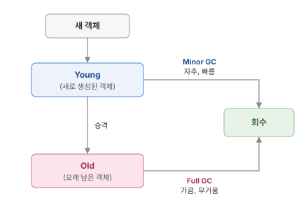
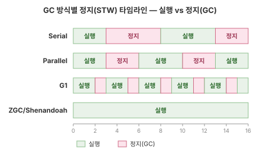
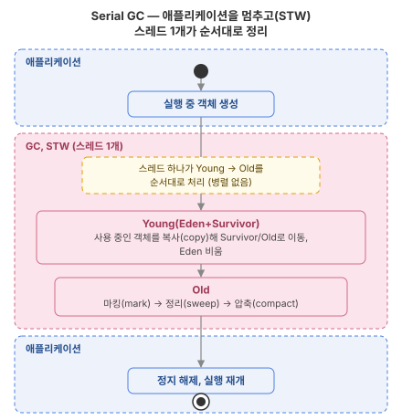
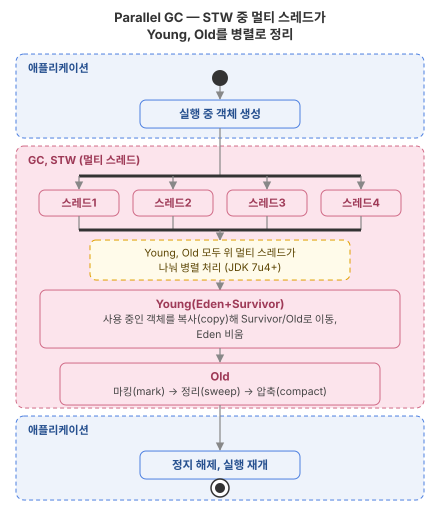
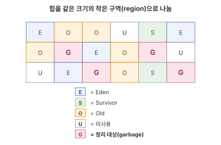
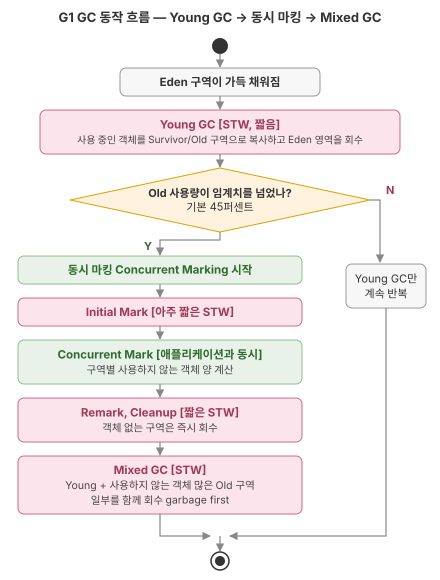
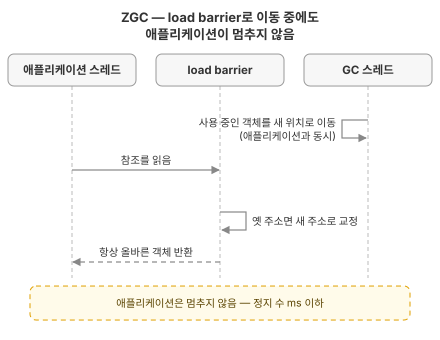
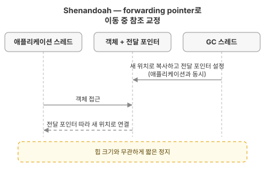
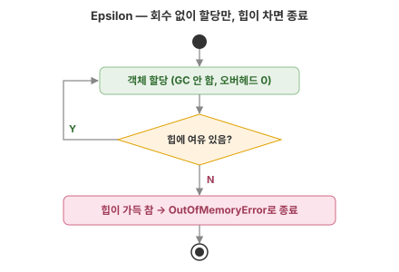
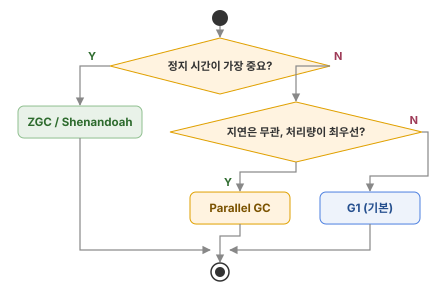

import {AnimatedBars} from '@site/src/components/blog/MonitorCharts';

<!-- truncate -->

가비지 컬렉터(GC)는 애플리케이션이 사용하지 않는 객체를 대신 정리해 주는 일입니다. **애플리케이션을 달리는 자동차**에 비유하면 GC는 그 차를 **세차**하는 것과 같아, 세차 방식이 여러 가지고 "차를 얼마나 멈추는지와 얼마나 빨리 세차하는지"가 성능을 좌우합니다. <mark>핵심 기준은 하나입니다 — "세차를 빠르게 끝내기(처리량)" vs "세차하느라 차를 멈추는 시간 줄이기(정지 시간)".</mark> 이 글은 이 기준으로 GC 종류를 최대한 쉽게 정리합니다. (실제 튜닝 상황은 [JVM 튜닝 시나리오](./jvm-tuning-scenarios) 참고)

## GC가 하는 일 — 1분 복습

객체는 대부분 **생성 직후 짧게 쓰이고 버려집니다**(임시 객체가 많습니다). GC는 이 성질을 이용해 메모리를 두 구역으로 나눠 관리합니다.

<details>
<summary>SVG 코드</summary>

```svg
<svg xmlns="http://www.w3.org/2000/svg" width="440" height="300" viewBox="0 0 440 300" font-family="-apple-system, 'Segoe UI', 'Noto Sans KR', sans-serif">
<defs><marker id="ah" viewBox="0 0 10 10" refX="9" refY="5" markerWidth="7" markerHeight="7" orient="auto-start-reverse"><path d="M0,0 L10,5 L0,10 z" fill="#888"/></marker></defs>
<rect x="0" y="0" width="440" height="300" fill="#FFFFFF"/>
<rect x="65" y="20" width="120" height="34" rx="6" fill="#F7F7F7" stroke="#999999"/>
<text x="125.0" y="41.0" font-size="12" fill="#333" text-anchor="middle" font-weight="bold">새 객체</text>
<line x1="125" y1="54" x2="125" y2="89" stroke="#888" stroke-width="1.2" marker-end="url(#ah)"/>
<rect x="45" y="90" width="160" height="48" rx="6" fill="#EEF3FB" stroke="#4C7FE0"/>
<text x="125.0" y="111.0" font-size="12" fill="#26508F" text-anchor="middle" font-weight="bold">Young</text>
<text x="125.0" y="127.0" font-size="10.5" fill="#555" text-anchor="middle">(새로 생성된 객체)</text>
<line x1="125" y1="138" x2="125" y2="219" stroke="#888" stroke-width="1.2" marker-end="url(#ah)"/>
<text x="135" y="183" font-size="10.5" fill="#333" text-anchor="start">승격</text>
<rect x="45" y="220" width="160" height="48" rx="6" fill="#FCE4EC" stroke="#D06A86"/>
<text x="125.0" y="241.0" font-size="12" fill="#9E3A57" text-anchor="middle" font-weight="bold">Old</text>
<text x="125.0" y="257.0" font-size="10.5" fill="#555" text-anchor="middle">(오래 남은 객체)</text>
<rect x="320" y="155" width="100" height="40" rx="6" fill="#E9F2E9" stroke="#8FBF8F"/>
<text x="370.0" y="179.0" font-size="12" fill="#2E6B2E" text-anchor="middle" font-weight="bold">회수</text>
<path d="M205,114 L370,114 L370,154" fill="none" stroke="#888" stroke-width="1.2" marker-end="url(#ah)"/>
<text x="285" y="92" font-size="10.5" fill="#26508F" text-anchor="middle" font-weight="bold">Minor GC</text>
<text x="285" y="106" font-size="10.5" fill="#333" text-anchor="middle">자주, 빠름</text>
<path d="M205,244 L370,244 L370,196" fill="none" stroke="#888" stroke-width="1.2" marker-end="url(#ah)"/>
<text x="285" y="262" font-size="10.5" fill="#9E3A57" text-anchor="middle" font-weight="bold">Full GC</text>
<text x="285" y="276" font-size="10.5" fill="#333" text-anchor="middle">가끔, 무거움</text>
</svg>
```

</details>

<figure style={{textAlign: 'center', margin: '1.5rem 0'}}>
  
</figure>

- **Minor GC (Young 영역)** — 새로 생성된 영역을 **자주, 빠르게** 정리합니다. 대부분 여기서 끝납니다.
- **Major/Full GC (Old 영역)** — 오래 남은 영역까지 **가끔 크게** 정리합니다. 무겁고 느립니다.

<mark>"오래된 부분까지 크게 하는 Full GC"가 길어질 때가 문제라, GC 종류마다 이걸 어떻게 처리하는지가 달라집니다.</mark> 세차하려고 **달리던 차(애플리케이션)를 잠깐 멈추는 것**을 **stop-the-world(STW)** 라고 합니다.

## 핵심 기준 하나 — 처리량 vs 정지 시간

GC를 선택하는 기준은 사실상 이 둘 사이의 **트레이드오프**입니다.

- **처리량(throughput)** — 같은 시간에 애플리케이션이 실제 일한 비율. GC에 시간을 적게 뺏길수록 높음.
- **정지 시간(pause)** — 세차하느라 차(애플리케이션)가 멈추는 시간. 짧을수록 사용자가 느끼는 지연이 작음.

<AnimatedBars
  title="처리량 — 높을수록 좋음(개념 예시)"
  labels={['Serial', 'Parallel', 'G1', 'ZGC, Shenandoah']}
  data={[55, 100, 90, 82]}
  yMax={100}
  unit="처리량(상대)"
/>

<AnimatedBars
  title="정지 시간 — 짧을수록 좋음(개념 예시)"
  labels={['Serial', 'Parallel', 'G1', 'ZGC, Shenandoah']}
  data={[95, 80, 35, 3]}
  yMax={100}
  unit="정지 시간(상대)"
  tone="accent2"
/>

<mark>둘을 동시에 만족하는 방식은 없습니다 — 처리량을 높이면 정지가 다소 길어지고, 정지를 줄이면 처리량이 약간 낮아집니다.</mark> 그래서 "내 서비스가 무엇을 더 중요하게 여기나"가 선택의 출발점입니다.

### 정지 시간이 어떻게 다른지 — STW 타임라인

같은 시간 흐름에서 **애플리케이션이 실행되는 구간**과 **GC 때문에 멈추는 구간(정지)** 을 함께 그려 보면 방식 차이가 한눈에 보입니다.

<details>
<summary>SVG 코드</summary>

```svg
<svg xmlns="http://www.w3.org/2000/svg" width="440" height="256" viewBox="0 0 440 256" font-family="-apple-system, 'Segoe UI', 'Noto Sans KR', sans-serif">
<defs><marker id="ah" viewBox="0 0 10 10" refX="9" refY="5" markerWidth="7" markerHeight="7" orient="auto-start-reverse"><path d="M0,0 L10,5 L0,10 z" fill="#888"/></marker></defs>
<rect x="0" y="0" width="440" height="256" fill="#FFFFFF"/>
<text x="220.0" y="22" font-size="13" fill="#333" text-anchor="middle" font-weight="bold">GC 방식별 정지(STW) 타임라인 — 실행 vs 정지(GC)</text>
<text x="114" y="65" font-size="11.5" fill="#333" text-anchor="end" font-weight="bold">Serial</text>
<rect x="124.0" y="48" width="55.5" height="26" fill="#E9F2E9" stroke="#8FBF8F"/>
<text x="151.75" y="65" font-size="10.5" fill="#2E6B2E" text-anchor="middle" font-weight="bold">실행</text>
<rect x="179.5" y="48" width="92.5" height="26" fill="#FCE4EC" stroke="#D06A86"/>
<text x="225.75" y="65" font-size="10.5" fill="#9E3A57" text-anchor="middle" font-weight="bold">정지</text>
<rect x="272.0" y="48" width="92.5" height="26" fill="#E9F2E9" stroke="#8FBF8F"/>
<text x="318.25" y="65" font-size="10.5" fill="#2E6B2E" text-anchor="middle" font-weight="bold">실행</text>
<rect x="364.5" y="48" width="55.5" height="26" fill="#FCE4EC" stroke="#D06A86"/>
<text x="392.25" y="65" font-size="10.5" fill="#9E3A57" text-anchor="middle" font-weight="bold">정지</text>
<text x="114" y="107" font-size="11.5" fill="#333" text-anchor="end" font-weight="bold">Parallel</text>
<rect x="124.0" y="90" width="55.5" height="26" fill="#E9F2E9" stroke="#8FBF8F"/>
<text x="151.75" y="107" font-size="10.5" fill="#2E6B2E" text-anchor="middle" font-weight="bold">실행</text>
<rect x="179.5" y="90" width="55.5" height="26" fill="#FCE4EC" stroke="#D06A86"/>
<text x="207.25" y="107" font-size="10.5" fill="#9E3A57" text-anchor="middle" font-weight="bold">정지</text>
<rect x="235.0" y="90" width="74.0" height="26" fill="#E9F2E9" stroke="#8FBF8F"/>
<text x="272.0" y="107" font-size="10.5" fill="#2E6B2E" text-anchor="middle" font-weight="bold">실행</text>
<rect x="309.0" y="90" width="55.5" height="26" fill="#FCE4EC" stroke="#D06A86"/>
<text x="336.75" y="107" font-size="10.5" fill="#9E3A57" text-anchor="middle" font-weight="bold">정지</text>
<rect x="364.5" y="90" width="55.5" height="26" fill="#E9F2E9" stroke="#8FBF8F"/>
<text x="392.25" y="107" font-size="10.5" fill="#2E6B2E" text-anchor="middle" font-weight="bold">실행</text>
<text x="114" y="149" font-size="11.5" fill="#333" text-anchor="end" font-weight="bold">G1</text>
<rect x="124.0" y="132" width="37.0" height="26" fill="#E9F2E9" stroke="#8FBF8F"/>
<text x="142.5" y="149" font-size="10.5" fill="#2E6B2E" text-anchor="middle" font-weight="bold">실행</text>
<rect x="161.0" y="132" width="18.5" height="26" fill="#FCE4EC" stroke="#D06A86"/>
<rect x="179.5" y="132" width="37.0" height="26" fill="#E9F2E9" stroke="#8FBF8F"/>
<text x="198.0" y="149" font-size="10.5" fill="#2E6B2E" text-anchor="middle" font-weight="bold">실행</text>
<rect x="216.5" y="132" width="18.5" height="26" fill="#FCE4EC" stroke="#D06A86"/>
<rect x="235.0" y="132" width="37.0" height="26" fill="#E9F2E9" stroke="#8FBF8F"/>
<text x="253.5" y="149" font-size="10.5" fill="#2E6B2E" text-anchor="middle" font-weight="bold">실행</text>
<rect x="272.0" y="132" width="18.5" height="26" fill="#FCE4EC" stroke="#D06A86"/>
<rect x="290.5" y="132" width="37.0" height="26" fill="#E9F2E9" stroke="#8FBF8F"/>
<text x="309.0" y="149" font-size="10.5" fill="#2E6B2E" text-anchor="middle" font-weight="bold">실행</text>
<rect x="327.5" y="132" width="18.5" height="26" fill="#FCE4EC" stroke="#D06A86"/>
<rect x="346.0" y="132" width="37.0" height="26" fill="#E9F2E9" stroke="#8FBF8F"/>
<text x="364.5" y="149" font-size="10.5" fill="#2E6B2E" text-anchor="middle" font-weight="bold">실행</text>
<rect x="383.0" y="132" width="18.5" height="26" fill="#FCE4EC" stroke="#D06A86"/>
<rect x="401.5" y="132" width="18.5" height="26" fill="#E9F2E9" stroke="#8FBF8F"/>
<text x="114" y="191" font-size="11.5" fill="#333" text-anchor="end" font-weight="bold">ZGC/Shenandoah</text>
<rect x="124.0" y="174" width="296.0" height="26" fill="#E9F2E9" stroke="#8FBF8F"/>
<text x="272.0" y="191" font-size="10.5" fill="#2E6B2E" text-anchor="middle" font-weight="bold">실행</text>
<line x1="124" y1="210" x2="420.0" y2="210" stroke="#999"/>
<line x1="124.0" y1="210" x2="124.0" y2="214" stroke="#999"/>
<text x="124.0" y="225" font-size="9.5" fill="#888" text-anchor="middle">0</text>
<line x1="161.0" y1="210" x2="161.0" y2="214" stroke="#999"/>
<text x="161.0" y="225" font-size="9.5" fill="#888" text-anchor="middle">2</text>
<line x1="198.0" y1="210" x2="198.0" y2="214" stroke="#999"/>
<text x="198.0" y="225" font-size="9.5" fill="#888" text-anchor="middle">4</text>
<line x1="235.0" y1="210" x2="235.0" y2="214" stroke="#999"/>
<text x="235.0" y="225" font-size="9.5" fill="#888" text-anchor="middle">6</text>
<line x1="272.0" y1="210" x2="272.0" y2="214" stroke="#999"/>
<text x="272.0" y="225" font-size="9.5" fill="#888" text-anchor="middle">8</text>
<line x1="309.0" y1="210" x2="309.0" y2="214" stroke="#999"/>
<text x="309.0" y="225" font-size="9.5" fill="#888" text-anchor="middle">10</text>
<line x1="346.0" y1="210" x2="346.0" y2="214" stroke="#999"/>
<text x="346.0" y="225" font-size="9.5" fill="#888" text-anchor="middle">12</text>
<line x1="383.0" y1="210" x2="383.0" y2="214" stroke="#999"/>
<text x="383.0" y="225" font-size="9.5" fill="#888" text-anchor="middle">14</text>
<line x1="420.0" y1="210" x2="420.0" y2="214" stroke="#999"/>
<text x="420.0" y="225" font-size="9.5" fill="#888" text-anchor="middle">16</text>
<rect x="130" y="239" width="14" height="10" fill="#E9F2E9" stroke="#8FBF8F"/>
<text x="150" y="248" font-size="10.5" fill="#333" text-anchor="start">실행</text>
<rect x="200" y="239" width="14" height="10" fill="#FCE4EC" stroke="#D06A86"/>
<text x="220" y="248" font-size="10.5" fill="#333" text-anchor="start">정지(GC)</text>
</svg>
```

</details>

<figure style={{textAlign: 'center', margin: '1.5rem 0'}}>
  
</figure>

<mark>Parallel은 총 정지 시간이 짧아 처리량이 유리하고, ZGC, Shenandoah는 **한 번의 정지**가 가장 짧습니다(막대가 중간에 비지 않고 이어짐 = 애플리케이션과 **동시에** 정리). G1은 그 사이의 균형입니다.</mark> STW 방식(Serial, Parallel, G1)은 "멈추고 → 정리 → 다시 실행"을 반복하지만, 동시(concurrent) 방식(ZGC, Shenandoah)은 애플리케이션을 멈추지 않고 GC가 나란히 실행됩니다.

## 종류별로 — 어떻게 세차하나

**Serial GC** — 작업자 **한 명**이 차를 세워 놓고 혼자 세차합니다.<br />
- 원리: GC 스레드 **하나**가 모든 작업을 합니다. Young은 사용 중인 객체만 다른 영역으로 **복사(copy)** 한 뒤 Eden 영역을 회수하고, Old는 **마킹(mark) → 제거(sweep) → 압축(compact)** 순으로 정리합니다. 작업 내내 애플리케이션을 멈춥니다(STW).
- 특징: 단순, 가벼움. 힙이 작으면 충분. 힙이 크면 정지가 길어짐.
- 언제: 아주 작은 애플리케이션, CLI 도구, 메모리 적은 환경.
- 플래그: `-XX:+UseSerialGC`

<details>
<summary>SVG 코드</summary>

```svg
<svg xmlns="http://www.w3.org/2000/svg" width="440" height="460" viewBox="0 0 440 460" font-family="-apple-system, 'Segoe UI', 'Noto Sans KR', sans-serif">
<defs><marker id="ah" viewBox="0 0 10 10" refX="9" refY="5" markerWidth="7" markerHeight="7" orient="auto-start-reverse"><path d="M0,0 L10,5 L0,10 z" fill="#888"/></marker></defs>
<rect x="0" y="0" width="440" height="460" fill="#FFFFFF"/>
<text x="220" y="22" font-size="13" fill="#333" text-anchor="middle" font-weight="bold">Serial GC — 애플리케이션을 멈추고(STW)</text>
<text x="220" y="39" font-size="13" fill="#333" text-anchor="middle" font-weight="bold">스레드 1개가 순서대로 정리</text>
<rect x="16" y="54" width="408" height="84" rx="8" fill="#EEF3FB" stroke="#4C7FE0" stroke-dasharray="4 3"/>
<text x="28" y="72" font-size="11" fill="#26508F" text-anchor="start" font-weight="bold">애플리케이션</text>
<rect x="16" y="146" width="408" height="214" rx="8" fill="#FCE4EC" stroke="#D06A86" stroke-dasharray="4 3"/>
<text x="28" y="164" font-size="11" fill="#9E3A57" text-anchor="start" font-weight="bold">GC, STW (스레드 1개)</text>
<rect x="16" y="368" width="408" height="84" rx="8" fill="#EEF3FB" stroke="#4C7FE0" stroke-dasharray="4 3"/>
<text x="28" y="386" font-size="11" fill="#26508F" text-anchor="start" font-weight="bold">애플리케이션</text>
<circle cx="220" cy="78" r="8" fill="#333"/>
<line x1="220" y1="86" x2="220" y2="99" stroke="#888" stroke-width="1.2" marker-end="url(#ah)"/>
<rect x="140" y="100" width="160" height="28" rx="6" fill="#EEF3FB" stroke="#4C7FE0"/>
<text x="220.0" y="118.0" font-size="11.5" fill="#26508F" text-anchor="middle" font-weight="bold">실행 중 객체 생성</text>
<line x1="220" y1="128" x2="220" y2="230" stroke="#888" stroke-width="1.2" marker-end="url(#ah)"/>
<rect x="90" y="172" width="260" height="40" rx="6" fill="#FFFBEA" stroke="#E0A000" stroke-dasharray="5 4"/>
<text x="220.0" y="188.5" font-size="10.5" fill="#5A4300" text-anchor="middle">스레드 하나가 Young → Old를</text>
<text x="220.0" y="203.5" font-size="10.5" fill="#5A4300" text-anchor="middle">순서대로 처리 (병렬 없음)</text>
<rect x="40" y="231" width="360" height="58" rx="6" fill="#FCE4EC" stroke="#D06A86"/>
<text x="220.0" y="249.0" font-size="11.5" fill="#9E3A57" text-anchor="middle" font-weight="bold">Young(Eden+Survivor)</text>
<text x="220.0" y="264.0" font-size="10.5" fill="#444" text-anchor="middle">사용 중인 객체를 복사(copy)해 Survivor/Old로 이동,</text>
<text x="220.0" y="279.0" font-size="10.5" fill="#444" text-anchor="middle">Eden 비움</text>
<line x1="220" y1="289" x2="220" y2="303" stroke="#888" stroke-width="1.2" marker-end="url(#ah)"/>
<rect x="60" y="304" width="320" height="42" rx="6" fill="#FCE4EC" stroke="#D06A86"/>
<text x="220.0" y="321.5" font-size="11.5" fill="#9E3A57" text-anchor="middle" font-weight="bold">Old</text>
<text x="220.0" y="336.5" font-size="10.5" fill="#444" text-anchor="middle">마킹(mark) → 정리(sweep) → 압축(compact)</text>
<line x1="220" y1="346" x2="220" y2="402" stroke="#888" stroke-width="1.2" marker-end="url(#ah)"/>
<rect x="140" y="403" width="160" height="28" rx="6" fill="#EEF3FB" stroke="#4C7FE0"/>
<text x="220.0" y="421.0" font-size="11.5" fill="#26508F" text-anchor="middle" font-weight="bold">정지 해제, 실행 재개</text>
<line x1="220" y1="431" x2="220" y2="439" stroke="#888" stroke-width="1.2" marker-end="url(#ah)"/>
<circle cx="220" cy="440" r="9" fill="#FFFFFF" stroke="#333" stroke-width="1.5"/>
<circle cx="220" cy="440" r="5" fill="#333"/>
</svg>
```

</details>

<figure style={{textAlign: 'center', margin: '1.5rem 0'}}>
  
</figure>

**Parallel GC** — 작업자 **여러 명**이 차를 세워 놓고 **한꺼번에 빠르게** 세차합니다.<br />
- 원리: Serial과 같은 방식(Young 복사, Old 마킹-정리-압축)을 **멀티 스레드가 병렬로** 처리합니다. 같은 양을 나눠 처리하니 **GC에 사용하는 전체 시간이 줄어** 처리량이 높습니다. 다만 **정지 시간 상한을 목표로 설정하지는 않아서**, 세대가 차면 그 세대 전체를 한 번의 STW로 수거합니다.
- 참고: 예전(**JDK 7 업데이트 4**, 즉 `7u4`, 2012년 이전)엔 **Young만 병렬**이고 Old는 단일 스레드였지만, **`7u4`부터 `-XX:+UseParallelGC`가 `UseParallelOldGC`를 함께 적용해** Young, Old를 모두 병렬로 수거합니다(Young만 병렬로 두려면 `-XX:-UseParallelOldGC`).
- 특징: **총 처리량(GC에 사용하는 전체 시간)이 가장 좋음**. 대신 정지 시간을 목표로 설정하지 않아, **큰 힙에선 한 번의 정지(특히 Full GC)가 길어질 수 있음**.
- 언제: **지연은 상관없고 처리량이 중요한 배치**, 백그라운드 작업.
- 플래그: `-XX:+UseParallelGC`

> **`JDK 7u4`란?**
>
> `JDK 7u4`는 "JDK 7 Update 4", 즉 **Java 7의 4번째 업데이트 릴리스**(2012년)입니다. 메이저 버전은 **7**이고 `u4`는 그 안의 **마이너 업데이트 번호**입니다. 그래서 "`7u4` 이전"은 **Java 6, 그리고 Java 7 초기(u1~u3)까지**를 가리킵니다 — 같은 Java 7이라도 업데이트 번호에 따라 기본 동작(여기선 Old 세대 병렬 여부)이 달라집니다.

<details>
<summary>SVG 코드</summary>

```svg
<svg xmlns="http://www.w3.org/2000/svg" width="440" height="508" viewBox="0 0 440 508" font-family="-apple-system, 'Segoe UI', 'Noto Sans KR', sans-serif">
<defs><marker id="ah" viewBox="0 0 10 10" refX="9" refY="5" markerWidth="7" markerHeight="7" orient="auto-start-reverse"><path d="M0,0 L10,5 L0,10 z" fill="#888"/></marker></defs>
<rect x="0" y="0" width="440" height="508" fill="#FFFFFF"/>
<text x="220" y="22" font-size="13" fill="#333" text-anchor="middle" font-weight="bold">Parallel GC — STW 중 멀티 스레드가</text>
<text x="220" y="39" font-size="13" fill="#333" text-anchor="middle" font-weight="bold">Young, Old를 병렬로 정리</text>
<rect x="16" y="54" width="408" height="84" rx="8" fill="#EEF3FB" stroke="#4C7FE0" stroke-dasharray="4 3"/>
<text x="28" y="72" font-size="11" fill="#26508F" text-anchor="start" font-weight="bold">애플리케이션</text>
<rect x="16" y="146" width="408" height="262" rx="8" fill="#FCE4EC" stroke="#D06A86" stroke-dasharray="4 3"/>
<text x="28" y="164" font-size="11" fill="#9E3A57" text-anchor="start" font-weight="bold">GC, STW (멀티 스레드)</text>
<rect x="16" y="416" width="408" height="84" rx="8" fill="#EEF3FB" stroke="#4C7FE0" stroke-dasharray="4 3"/>
<text x="28" y="434" font-size="11" fill="#26508F" text-anchor="start" font-weight="bold">애플리케이션</text>
<circle cx="220" cy="78" r="8" fill="#333"/>
<line x1="220" y1="86" x2="220" y2="99" stroke="#888" stroke-width="1.2" marker-end="url(#ah)"/>
<rect x="140" y="100" width="160" height="28" rx="6" fill="#EEF3FB" stroke="#4C7FE0"/>
<text x="220.0" y="118.0" font-size="11.5" fill="#26508F" text-anchor="middle" font-weight="bold">실행 중 객체 생성</text>
<line x1="220" y1="128" x2="220" y2="176" stroke="#888" stroke-width="1.2"/>
<line x1="79.0" y1="176" x2="361.0" y2="176" stroke="#333" stroke-width="3"/>
<line x1="79.0" y1="176" x2="79.0" y2="189" stroke="#888" stroke-width="1.2" marker-end="url(#ah)"/>
<rect x="39.0" y="190" width="80" height="26" rx="6" fill="#FCE4EC" stroke="#D06A86"/>
<text x="79.0" y="207.0" font-size="11" fill="#9E3A57" text-anchor="middle" font-weight="bold">스레드1</text>
<line x1="79.0" y1="216" x2="79.0" y2="230" stroke="#888" stroke-width="1.2"/>
<line x1="173.0" y1="176" x2="173.0" y2="189" stroke="#888" stroke-width="1.2" marker-end="url(#ah)"/>
<rect x="133.0" y="190" width="80" height="26" rx="6" fill="#FCE4EC" stroke="#D06A86"/>
<text x="173.0" y="207.0" font-size="11" fill="#9E3A57" text-anchor="middle" font-weight="bold">스레드2</text>
<line x1="173.0" y1="216" x2="173.0" y2="230" stroke="#888" stroke-width="1.2"/>
<line x1="267.0" y1="176" x2="267.0" y2="189" stroke="#888" stroke-width="1.2" marker-end="url(#ah)"/>
<rect x="227.0" y="190" width="80" height="26" rx="6" fill="#FCE4EC" stroke="#D06A86"/>
<text x="267.0" y="207.0" font-size="11" fill="#9E3A57" text-anchor="middle" font-weight="bold">스레드3</text>
<line x1="267.0" y1="216" x2="267.0" y2="230" stroke="#888" stroke-width="1.2"/>
<line x1="361.0" y1="176" x2="361.0" y2="189" stroke="#888" stroke-width="1.2" marker-end="url(#ah)"/>
<rect x="321.0" y="190" width="80" height="26" rx="6" fill="#FCE4EC" stroke="#D06A86"/>
<text x="361.0" y="207.0" font-size="11" fill="#9E3A57" text-anchor="middle" font-weight="bold">스레드4</text>
<line x1="361.0" y1="216" x2="361.0" y2="230" stroke="#888" stroke-width="1.2"/>
<line x1="79.0" y1="230" x2="361.0" y2="230" stroke="#333" stroke-width="3"/>
<line x1="220" y1="230" x2="220" y2="240" stroke="#888" stroke-width="1.2" marker-end="url(#ah)"/>
<rect x="90" y="240" width="260" height="40" rx="6" fill="#FFFBEA" stroke="#E0A000" stroke-dasharray="5 4"/>
<text x="220.0" y="256.5" font-size="10.5" fill="#5A4300" text-anchor="middle">Young, Old 모두 위 멀티 스레드가</text>
<text x="220.0" y="271.5" font-size="10.5" fill="#5A4300" text-anchor="middle">나눠 병렬 처리 (JDK 7u4+)</text>
<line x1="220" y1="280" x2="220" y2="290" stroke="#888" stroke-width="1.2" marker-end="url(#ah)"/>
<rect x="40" y="290" width="360" height="58" rx="6" fill="#FCE4EC" stroke="#D06A86"/>
<text x="220.0" y="308.0" font-size="11.5" fill="#9E3A57" text-anchor="middle" font-weight="bold">Young(Eden+Survivor)</text>
<text x="220.0" y="323.0" font-size="10.5" fill="#444" text-anchor="middle">사용 중인 객체를 복사(copy)해 Survivor/Old로 이동,</text>
<text x="220.0" y="338.0" font-size="10.5" fill="#444" text-anchor="middle">Eden 비움</text>
<line x1="220" y1="348" x2="220" y2="362" stroke="#888" stroke-width="1.2" marker-end="url(#ah)"/>
<rect x="60" y="363" width="320" height="42" rx="6" fill="#FCE4EC" stroke="#D06A86"/>
<text x="220.0" y="380.5" font-size="11.5" fill="#9E3A57" text-anchor="middle" font-weight="bold">Old</text>
<text x="220.0" y="395.5" font-size="10.5" fill="#444" text-anchor="middle">마킹(mark) → 정리(sweep) → 압축(compact)</text>
<line x1="220" y1="405" x2="220" y2="450" stroke="#888" stroke-width="1.2" marker-end="url(#ah)"/>
<rect x="140" y="451" width="160" height="28" rx="6" fill="#EEF3FB" stroke="#4C7FE0"/>
<text x="220.0" y="469.0" font-size="11.5" fill="#26508F" text-anchor="middle" font-weight="bold">정지 해제, 실행 재개</text>
<line x1="220" y1="479" x2="220" y2="487" stroke="#888" stroke-width="1.2" marker-end="url(#ah)"/>
<circle cx="220" cy="488" r="9" fill="#FFFFFF" stroke="#333" stroke-width="1.5"/>
<circle cx="220" cy="488" r="5" fill="#333"/>
</svg>
```

</details>

<figure style={{textAlign: 'center', margin: '1.5rem 0'}}>
  
</figure>

**G1 GC (기본값)** — 차를 **여러 구역으로 나눠** 더러운 곳부터 조금씩 세차합니다.<br />
- 원리: 힙을 같은 크기의 **작은 구역(region) 수천 개**로 나누고, 백그라운드에서 어느 구역에 사용하지 않는 객체가 많은지 마킹합니다(concurrent marking). 그다음 **사용하지 않는 객체가 많은 구역부터(garbage first)** 선별해 사용 중인 객체만 다른 구역으로 복사해 회수합니다. 한 번에 **일부 구역만** 처리해 정지 시간을 목표치(`MaxGCPauseMillis`) 안에 맞춥니다.
- 특징: **정지 시간과 처리량의 균형**. "정지를 이 정도로 맞춰 줘"라는 목표를 줄 수 있음.
- 언제: **대부분의 일반 서비스**(고민되면 우선 이것).
- 플래그: `-XX:+UseG1GC` (JDK 9부터 기본), 목표 정지 `-XX:MaxGCPauseMillis=100`

G1의 **구역(region)** 개념을 그림으로 보면 이렇습니다. 힙을 작은 구역들로 나누고, 사용하지 않는 객체가 많은 구역부터 선별해 회수합니다.

<details>
<summary>SVG 코드</summary>

```svg
<svg xmlns="http://www.w3.org/2000/svg" width="440" height="288" viewBox="0 0 440 288" font-family="-apple-system, 'Segoe UI', 'Noto Sans KR', sans-serif">
<defs><marker id="ah" viewBox="0 0 10 10" refX="9" refY="5" markerWidth="7" markerHeight="7" orient="auto-start-reverse"><path d="M0,0 L10,5 L0,10 z" fill="#888"/></marker></defs>
<rect x="0" y="0" width="440" height="288" fill="#FFFFFF"/>
<text x="220.0" y="22" font-size="13" fill="#333" text-anchor="middle" font-weight="bold">힙을 같은 크기의 작은 구역(region)으로 나눔</text>
<rect x="52" y="44" width="56" height="40" fill="#EEF3FB" stroke="#4C7FE0"/>
<text x="80.0" y="69" font-size="12" fill="#26508F" text-anchor="middle">E</text>
<rect x="108" y="44" width="56" height="40" fill="#FFF3E0" stroke="#E0A000"/>
<text x="136.0" y="69" font-size="12" fill="#7A5200" text-anchor="middle">O</text>
<rect x="164" y="44" width="56" height="40" fill="#FFF3E0" stroke="#E0A000"/>
<text x="192.0" y="69" font-size="12" fill="#7A5200" text-anchor="middle">O</text>
<rect x="220" y="44" width="56" height="40" fill="#FFFFFF" stroke="#999999"/>
<text x="248.0" y="69" font-size="12" fill="#333" text-anchor="middle">U</text>
<rect x="276" y="44" width="56" height="40" fill="#E9F2E9" stroke="#8FBF8F"/>
<text x="304.0" y="69" font-size="12" fill="#2E6B2E" text-anchor="middle">S</text>
<rect x="332" y="44" width="56" height="40" fill="#EEF3FB" stroke="#4C7FE0"/>
<text x="360.0" y="69" font-size="12" fill="#26508F" text-anchor="middle">E</text>
<rect x="52" y="84" width="56" height="40" fill="#FFF3E0" stroke="#E0A000"/>
<text x="80.0" y="109" font-size="12" fill="#7A5200" text-anchor="middle">O</text>
<rect x="108" y="84" width="56" height="40" fill="#FCE4EC" stroke="#D06A86"/>
<text x="136.0" y="109" font-size="14" fill="#9E3A57" text-anchor="middle" font-weight="bold">G</text>
<rect x="164" y="84" width="56" height="40" fill="#EEF3FB" stroke="#4C7FE0"/>
<text x="192.0" y="109" font-size="12" fill="#26508F" text-anchor="middle">E</text>
<rect x="220" y="84" width="56" height="40" fill="#FFF3E0" stroke="#E0A000"/>
<text x="248.0" y="109" font-size="12" fill="#7A5200" text-anchor="middle">O</text>
<rect x="276" y="84" width="56" height="40" fill="#FCE4EC" stroke="#D06A86"/>
<text x="304.0" y="109" font-size="14" fill="#9E3A57" text-anchor="middle" font-weight="bold">G</text>
<rect x="332" y="84" width="56" height="40" fill="#FFFFFF" stroke="#999999"/>
<text x="360.0" y="109" font-size="12" fill="#333" text-anchor="middle">U</text>
<rect x="52" y="124" width="56" height="40" fill="#FFFFFF" stroke="#999999"/>
<text x="80.0" y="149" font-size="12" fill="#333" text-anchor="middle">U</text>
<rect x="108" y="124" width="56" height="40" fill="#EEF3FB" stroke="#4C7FE0"/>
<text x="136.0" y="149" font-size="12" fill="#26508F" text-anchor="middle">E</text>
<rect x="164" y="124" width="56" height="40" fill="#FCE4EC" stroke="#D06A86"/>
<text x="192.0" y="149" font-size="14" fill="#9E3A57" text-anchor="middle" font-weight="bold">G</text>
<rect x="220" y="124" width="56" height="40" fill="#FFF3E0" stroke="#E0A000"/>
<text x="248.0" y="149" font-size="12" fill="#7A5200" text-anchor="middle">O</text>
<rect x="276" y="124" width="56" height="40" fill="#E9F2E9" stroke="#8FBF8F"/>
<text x="304.0" y="149" font-size="12" fill="#2E6B2E" text-anchor="middle">S</text>
<rect x="332" y="124" width="56" height="40" fill="#FCE4EC" stroke="#D06A86"/>
<text x="360.0" y="149" font-size="14" fill="#9E3A57" text-anchor="middle" font-weight="bold">G</text>
<rect x="150" y="174" width="20" height="16" fill="#EEF3FB" stroke="#4C7FE0"/>
<text x="160" y="187" font-size="10.5" fill="#26508F" text-anchor="middle" font-weight="bold">E</text>
<text x="180" y="187" font-size="11" fill="#333" text-anchor="start">= Eden</text>
<rect x="150" y="195" width="20" height="16" fill="#E9F2E9" stroke="#8FBF8F"/>
<text x="160" y="208" font-size="10.5" fill="#2E6B2E" text-anchor="middle" font-weight="bold">S</text>
<text x="180" y="208" font-size="11" fill="#333" text-anchor="start">= Survivor</text>
<rect x="150" y="216" width="20" height="16" fill="#FFF3E0" stroke="#E0A000"/>
<text x="160" y="229" font-size="10.5" fill="#7A5200" text-anchor="middle" font-weight="bold">O</text>
<text x="180" y="229" font-size="11" fill="#333" text-anchor="start">= Old</text>
<rect x="150" y="237" width="20" height="16" fill="#FFFFFF" stroke="#999999"/>
<text x="160" y="250" font-size="10.5" fill="#333" text-anchor="middle" font-weight="bold">U</text>
<text x="180" y="250" font-size="11" fill="#333" text-anchor="start">= 미사용</text>
<rect x="150" y="258" width="20" height="16" fill="#FCE4EC" stroke="#D06A86"/>
<text x="160" y="271" font-size="10.5" fill="#9E3A57" text-anchor="middle" font-weight="bold">G</text>
<text x="180" y="271" font-size="11" fill="#333" text-anchor="start" font-weight="bold">= 정리 대상(garbage)</text>
</svg>
```

</details>

<figure style={{textAlign: 'center', margin: '1.5rem 0'}}>
  
</figure>

→ 사용하지 않는 객체가 많은 구역(**G**)부터 선별해, 사용 중인 객체만 다른 구역으로 옮기고 한꺼번에 회수합니다(garbage first).

**G1의 동작 과정** — 크게 세 단계입니다.

1. **Young GC (STW, 짧음)** — Eden 구역이 가득 채워지면 발생합니다. 사용 중인 객체만 Survivor/Old 구역으로 **복사(evacuation)** 하고 Eden 영역을 회수합니다. 대부분의 회수는 여기서 끝납니다.
2. **동시 마킹(Concurrent Marking)** — Old 사용량이 임계치(기본 45%)를 넘으면 시작합니다. **애플리케이션과 동시에** 객체 그래프를 따라가며 구역마다 **사용하지 않는 객체가 얼마나 있는지** 계산합니다. 시작과 마무리에만 아주 짧은 STW(Initial Mark, Remark)가 발생하고, Cleanup에서 객체가 하나도 없는 구역은 곧바로 회수합니다.
3. **Mixed GC (STW)** — 마킹이 끝나면 이후 Young GC가 Young 구역 + **사용하지 않는 객체가 많은 Old 구역 일부**를 **함께** 회수합니다(그래서 "mixed"). **사용하지 않는 객체가 많은 구역부터(garbage first)** 선별하고, 목표 정지 시간(`MaxGCPauseMillis`, 기본 200ms) 안에 끝낼 만큼만 선별해 회수합니다. G1은 예측 모델로 "몇 구역을 회수해야 목표를 지킬까"를 계산합니다.

> 공간이 정말 부족하면 전체를 멈추는 **Full GC**가 실행되는데, 이건 피해야 할 상황입니다(대개 힙을 늘리거나 튜닝으로 예방).

<details>
<summary>SVG 코드</summary>

```svg
<svg xmlns="http://www.w3.org/2000/svg" width="440" height="580" viewBox="0 0 440 580" font-family="-apple-system, 'Segoe UI', 'Noto Sans KR', sans-serif">
<defs><marker id="ah" viewBox="0 0 10 10" refX="9" refY="5" markerWidth="7" markerHeight="7" orient="auto-start-reverse"><path d="M0,0 L10,5 L0,10 z" fill="#888"/></marker></defs>
<rect x="0" y="0" width="440" height="580" fill="#FFFFFF"/>
<text x="220" y="22" font-size="13" fill="#333" text-anchor="middle" font-weight="bold">G1 GC 동작 흐름 — Young GC → 동시 마킹 → Mixed GC</text>
<circle cx="220" cy="46" r="8" fill="#333"/>
<line x1="220" y1="54" x2="220" y2="67" stroke="#888" stroke-width="1.2" marker-end="url(#ah)"/>
<rect x="120" y="68" width="200" height="28" rx="6" fill="#F7F7F7" stroke="#999999"/>
<text x="220.0" y="86.0" font-size="11.5" fill="#333" text-anchor="middle" font-weight="bold">Eden 구역이 가득 채워짐</text>
<line x1="220" y1="96" x2="220" y2="109" stroke="#888" stroke-width="1.2" marker-end="url(#ah)"/>
<rect x="40" y="110" width="360" height="44" rx="6" fill="#FCE4EC" stroke="#D06A86"/>
<text x="220.0" y="128.5" font-size="11.5" fill="#9E3A57" text-anchor="middle" font-weight="bold">Young GC [STW, 짧음]</text>
<text x="220.0" y="143.5" font-size="10" fill="#444" text-anchor="middle">사용 중인 객체를 Survivor/Old 구역으로 복사하고 Eden 영역을 회수</text>
<line x1="220" y1="154" x2="220" y2="167" stroke="#888" stroke-width="1.2" marker-end="url(#ah)"/>
<polygon points="220,168.0 370.0,200 220,232.0 70.0,200" fill="#FFF3E0" stroke="#E0A000"/>
<text x="220" y="197" font-size="11" fill="#333" text-anchor="middle" font-weight="bold">Old 사용량이 임계치를 넘었나?</text>
<text x="220" y="211" font-size="11" fill="#333" text-anchor="middle">기본 45퍼센트</text>
<polyline points="220,232 220,240 160,240 160,255" fill="none" stroke="#888" stroke-width="1.2" marker-end="url(#ah)"/>
<text x="152" y="250" font-size="11" fill="#2E6B2E" text-anchor="end" font-weight="bold">Y</text>
<polyline points="370,200 380,200 380,262" fill="none" stroke="#888" stroke-width="1.2" marker-end="url(#ah)"/>
<text x="386" y="194" font-size="11" fill="#9E3A57" text-anchor="start" font-weight="bold">N</text>
<rect x="346" y="264" width="80" height="44" rx="6" fill="#F7F7F7" stroke="#999999"/>
<text x="386.0" y="282.5" font-size="11" fill="#333" text-anchor="middle">Young GC만</text>
<text x="386.0" y="297.5" font-size="11" fill="#333" text-anchor="middle">계속 반복</text>
<rect x="18" y="256" width="284" height="28" rx="6" fill="#E9F2E9" stroke="#8FBF8F"/>
<text x="160.0" y="274.0" font-size="11.5" fill="#2E6B2E" text-anchor="middle" font-weight="bold">동시 마킹 Concurrent Marking 시작</text>
<line x1="160" y1="284" x2="160" y2="297" stroke="#888" stroke-width="1.2" marker-end="url(#ah)"/>
<rect x="18" y="298" width="284" height="28" rx="6" fill="#FCE4EC" stroke="#D06A86"/>
<text x="160.0" y="316.0" font-size="11.5" fill="#9E3A57" text-anchor="middle" font-weight="bold">Initial Mark [아주 짧은 STW]</text>
<line x1="160" y1="326" x2="160" y2="339" stroke="#888" stroke-width="1.2" marker-end="url(#ah)"/>
<rect x="18" y="340" width="284" height="44" rx="6" fill="#E9F2E9" stroke="#8FBF8F"/>
<text x="160.0" y="358.5" font-size="11.5" fill="#2E6B2E" text-anchor="middle" font-weight="bold">Concurrent Mark [애플리케이션과 동시]</text>
<text x="160.0" y="373.5" font-size="10.5" fill="#444" text-anchor="middle">구역별 사용하지 않는 객체 양 계산</text>
<line x1="160" y1="384" x2="160" y2="397" stroke="#888" stroke-width="1.2" marker-end="url(#ah)"/>
<rect x="18" y="398" width="284" height="44" rx="6" fill="#FCE4EC" stroke="#D06A86"/>
<text x="160.0" y="416.5" font-size="11.5" fill="#9E3A57" text-anchor="middle" font-weight="bold">Remark, Cleanup [짧은 STW]</text>
<text x="160.0" y="431.5" font-size="10.5" fill="#444" text-anchor="middle">객체 없는 구역은 즉시 회수</text>
<line x1="160" y1="442" x2="160" y2="455" stroke="#888" stroke-width="1.2" marker-end="url(#ah)"/>
<rect x="18" y="456" width="284" height="58" rx="6" fill="#FCE4EC" stroke="#D06A86"/>
<text x="160.0" y="474.0" font-size="11.5" fill="#9E3A57" text-anchor="middle" font-weight="bold">Mixed GC [STW]</text>
<text x="160.0" y="489.0" font-size="10.5" fill="#444" text-anchor="middle">Young + 사용하지 않는 객체 많은 Old 구역</text>
<text x="160.0" y="504.0" font-size="10.5" fill="#444" text-anchor="middle">일부를 함께 회수 garbage first</text>
<polyline points="160,514 160,536 210,536" fill="none" stroke="#888" stroke-width="1.2" marker-end="url(#ah)"/>
<polyline points="386,308 386,536 230,536" fill="none" stroke="#888" stroke-width="1.2" marker-end="url(#ah)"/>
<line x1="220" y1="536" x2="220" y2="551" stroke="#888" stroke-width="1.2" marker-end="url(#ah)"/>
<circle cx="220" cy="561" r="9" fill="#FFFFFF" stroke="#333" stroke-width="1.5"/>
<circle cx="220" cy="561" r="5" fill="#333"/>
</svg>
```

</details>

<figure style={{textAlign: 'center', margin: '1.5rem 0'}}>
  
</figure>

**ZGC** — 차를 거의 **멈추지 않고** 달리는 중에 세차합니다.<br />
- 원리: 마킹과 객체 이동(relocation)을 **대부분 애플리케이션과 동시에(concurrent)** 진행합니다. 참조 포인터에 표식을 넣어 두고 그 참조를 **읽는 순간 위치를 바로잡는**(load barrier) 방식이라, 객체를 옮기는 도중에도 애플리케이션이 계속 돌 수 있습니다. 그래서 힙이 커져도 정지가 거의 안 늘어납니다.
- 특징: 힙이 수십~수백 GB로 커도 **정지가 수 ms 이하**. 최신 저지연 방식.
- 언제: **정지 시간 목표(SLO)가 엄격한** 대용량, 저지연 서비스.
- 플래그: `-XX:+UseZGC` (JDK 15 정식화. 세대 구분(generational) ZGC는 JDK 21 도입 → JDK 23부터 기본)

<details>
<summary>SVG 코드</summary>

```svg
<svg xmlns="http://www.w3.org/2000/svg" width="440" height="340" viewBox="0 0 440 340" font-family="-apple-system, 'Segoe UI', 'Noto Sans KR', sans-serif">
<defs><marker id="ah" viewBox="0 0 10 10" refX="9" refY="5" markerWidth="7" markerHeight="7" orient="auto-start-reverse"><path d="M0,0 L10,5 L0,10 z" fill="#888"/></marker></defs>
<rect x="0" y="0" width="440" height="340" fill="#FFFFFF"/>
<text x="220" y="22" font-size="13" fill="#333" text-anchor="middle" font-weight="bold">ZGC — load barrier로 이동 중에도</text>
<text x="220" y="39" font-size="13" fill="#333" text-anchor="middle" font-weight="bold">애플리케이션이 멈추지 않음</text>
<line x1="72" y1="86" x2="72" y2="278" stroke="#BBBBBB" stroke-dasharray="4 3"/>
<rect x="8.0" y="54" width="128" height="32" rx="6" fill="#F7F7F7" stroke="#999999"/>
<text x="72.0" y="74.0" font-size="11.5" fill="#333" text-anchor="middle" font-weight="bold">애플리케이션 스레드</text>
<line x1="220" y1="86" x2="220" y2="278" stroke="#BBBBBB" stroke-dasharray="4 3"/>
<rect x="156.0" y="54" width="128" height="32" rx="6" fill="#F7F7F7" stroke="#999999"/>
<text x="220.0" y="74.0" font-size="11.5" fill="#333" text-anchor="middle" font-weight="bold">load barrier</text>
<line x1="368" y1="86" x2="368" y2="278" stroke="#BBBBBB" stroke-dasharray="4 3"/>
<rect x="304.0" y="54" width="128" height="32" rx="6" fill="#F7F7F7" stroke="#999999"/>
<text x="368.0" y="74.0" font-size="11.5" fill="#333" text-anchor="middle" font-weight="bold">GC 스레드</text>
<polyline points="368,120 342,120 342,138 366,138" fill="none" stroke="#888" stroke-width="1.2" marker-end="url(#ah)"/>
<text x="336" y="126.5" font-size="10.5" fill="#333" text-anchor="end">사용 중인 객체를 새 위치로 이동</text>
<text x="336" y="139.5" font-size="10.5" fill="#333" text-anchor="end">(애플리케이션과 동시)</text>
<line x1="72" y1="170" x2="219" y2="170" stroke="#888" stroke-width="1.2" marker-end="url(#ah)"/>
<text x="146.0" y="164" font-size="10.5" fill="#333" text-anchor="middle">참조를 읽음</text>
<polyline points="220,212 246,212 246,230 222,230" fill="none" stroke="#888" stroke-width="1.2" marker-end="url(#ah)"/>
<text x="252" y="225.0" font-size="10.5" fill="#333" text-anchor="start">옛 주소면 새 주소로 교정</text>
<line x1="220" y1="262" x2="73" y2="262" stroke="#888" stroke-width="1.2" stroke-dasharray="5 4" marker-end="url(#ah)"/>
<text x="146.0" y="256" font-size="10.5" fill="#333" text-anchor="middle">항상 올바른 객체 반환</text>
<rect x="30" y="286" width="380" height="34" rx="6" fill="#FFFBEA" stroke="#E0A000" stroke-dasharray="5 4"/>
<text x="220.0" y="307.0" font-size="10.5" fill="#5A4300" text-anchor="middle">애플리케이션은 멈추지 않음 — 정지 수 ms 이하</text>
</svg>
```

</details>

<figure style={{textAlign: 'center', margin: '1.5rem 0'}}>
  
</figure>

**Shenandoah** — ZGC처럼 차를 **거의 멈추지 않는** 저지연 방식(OpenJDK 계열).<br />
- 원리: 마킹과 압축(compaction)을 **애플리케이션과 동시에** 수행합니다. 객체마다 새 위치를 가리키는 **전달 포인터(forwarding pointer)** 를 유지하고, 애플리케이션이 그 객체를 **읽을 때 JVM이 자동으로 끼워 넣는 검사 코드(배리어)** 가 전달 포인터를 따라가 항상 올바른(옮겨진) 객체로 연결합니다. 접근 방식은 다르지만 목표(힙 크기와 무관한 짧은 정지)는 ZGC와 같습니다.
- 특징: 힙 크기와 무관하게 짧은 정지. ZGC의 대안.
- 언제: 저지연이 필요하고 OpenJDK 배포판을 사용할 때.
- 플래그: `-XX:+UseShenandoahGC`

<details>
<summary>SVG 코드</summary>

```svg
<svg xmlns="http://www.w3.org/2000/svg" width="440" height="290" viewBox="0 0 440 290" font-family="-apple-system, 'Segoe UI', 'Noto Sans KR', sans-serif">
<defs><marker id="ah" viewBox="0 0 10 10" refX="9" refY="5" markerWidth="7" markerHeight="7" orient="auto-start-reverse"><path d="M0,0 L10,5 L0,10 z" fill="#888"/></marker></defs>
<rect x="0" y="0" width="440" height="290" fill="#FFFFFF"/>
<text x="220" y="22" font-size="13" fill="#333" text-anchor="middle" font-weight="bold">Shenandoah — forwarding pointer로</text>
<text x="220" y="39" font-size="13" fill="#333" text-anchor="middle" font-weight="bold">이동 중 참조 교정</text>
<line x1="72" y1="86" x2="72" y2="228" stroke="#BBBBBB" stroke-dasharray="4 3"/>
<rect x="8.0" y="54" width="128" height="32" rx="6" fill="#F7F7F7" stroke="#999999"/>
<text x="72.0" y="74.0" font-size="11.5" fill="#333" text-anchor="middle" font-weight="bold">애플리케이션 스레드</text>
<line x1="220" y1="86" x2="220" y2="228" stroke="#BBBBBB" stroke-dasharray="4 3"/>
<rect x="156.0" y="54" width="128" height="32" rx="6" fill="#F7F7F7" stroke="#999999"/>
<text x="220.0" y="74.0" font-size="11.5" fill="#333" text-anchor="middle" font-weight="bold">객체 + 전달 포인터</text>
<line x1="368" y1="86" x2="368" y2="228" stroke="#BBBBBB" stroke-dasharray="4 3"/>
<rect x="304.0" y="54" width="128" height="32" rx="6" fill="#F7F7F7" stroke="#999999"/>
<text x="368.0" y="74.0" font-size="11.5" fill="#333" text-anchor="middle" font-weight="bold">GC 스레드</text>
<line x1="368" y1="133" x2="221" y2="133" stroke="#888" stroke-width="1.2" marker-end="url(#ah)"/>
<text x="294.0" y="114" font-size="10.5" fill="#333" text-anchor="middle">새 위치로 복사하고 전달 포인터 설정</text>
<text x="294.0" y="127" font-size="10.5" fill="#333" text-anchor="middle">(애플리케이션과 동시)</text>
<line x1="72" y1="175" x2="219" y2="175" stroke="#888" stroke-width="1.2" marker-end="url(#ah)"/>
<text x="146.0" y="169" font-size="10.5" fill="#333" text-anchor="middle">객체 접근</text>
<line x1="220" y1="217" x2="73" y2="217" stroke="#888" stroke-width="1.2" stroke-dasharray="5 4" marker-end="url(#ah)"/>
<text x="146.0" y="211" font-size="10.5" fill="#333" text-anchor="middle">전달 포인터 따라 새 위치로 연결</text>
<rect x="30" y="236" width="380" height="34" rx="6" fill="#FFFBEA" stroke="#E0A000" stroke-dasharray="5 4"/>
<text x="220.0" y="257.0" font-size="10.5" fill="#5A4300" text-anchor="middle">힙 크기와 무관하게 짧은 정지</text>
</svg>
```

</details>

<figure style={{textAlign: 'center', margin: '1.5rem 0'}}>
  
</figure>

**Epsilon** — **아예 세차하지 않는** 방식(세차 안 함).<br />
- 원리: 메모리를 **할당만 하고 회수는 전혀 하지 않습니다.** 힙이 다 차면 그대로 종료합니다. GC 오버헤드가 0이라, 순수 실행 성능이나 할당량을 재는 실험에만 사용합니다.
- 특징: 메모리가 차면 그냥 종료. 오직 성능 측정, 아주 짧게 실행되고 끝나는 작업용.
- 언제: 벤치마크, 실험. 일반 서비스엔 사용하지 않음.
- 플래그: `-XX:+UseEpsilonGC`

<details>
<summary>SVG 코드</summary>

```svg
<svg xmlns="http://www.w3.org/2000/svg" width="440" height="300" viewBox="0 0 440 300" font-family="-apple-system, 'Segoe UI', 'Noto Sans KR', sans-serif">
<defs><marker id="ah" viewBox="0 0 10 10" refX="9" refY="5" markerWidth="7" markerHeight="7" orient="auto-start-reverse"><path d="M0,0 L10,5 L0,10 z" fill="#888"/></marker></defs>
<rect x="0" y="0" width="440" height="300" fill="#FFFFFF"/>
<text x="220.0" y="22" font-size="13" fill="#333" text-anchor="middle" font-weight="bold">Epsilon — 회수 없이 할당만, 힙이 차면 종료</text>
<circle cx="220" cy="46" r="8" fill="#333"/>
<line x1="220" y1="54" x2="220" y2="73" stroke="#888" stroke-width="1.2" marker-end="url(#ah)"/>
<rect x="110" y="74" width="220" height="30" rx="6" fill="#E9F2E9" stroke="#8FBF8F"/>
<text x="220.0" y="93.0" font-size="11.5" fill="#2E6B2E" text-anchor="middle" font-weight="bold">객체 할당 (GC 안 함, 오버헤드 0)</text>
<line x1="220" y1="104" x2="220" y2="125" stroke="#888" stroke-width="1.2" marker-end="url(#ah)"/>
<polygon points="220,126.0 310.0,154 220,182.0 130.0,154" fill="#FFF3E0" stroke="#E0A000"/>
<text x="220" y="158" font-size="11" fill="#333" text-anchor="middle" font-weight="bold">힙에 여유 있음?</text>
<polyline points="130,154 70,154 70,89 108,89" fill="none" stroke="#888" stroke-width="1.2" marker-end="url(#ah)"/>
<text x="76" y="146" font-size="11" fill="#2E6B2E" text-anchor="start" font-weight="bold">Y</text>
<line x1="220" y1="182" x2="220" y2="215" stroke="#888" stroke-width="1.2" marker-end="url(#ah)"/>
<text x="228" y="202" font-size="11" fill="#9E3A57" text-anchor="start" font-weight="bold">N</text>
<rect x="70" y="216" width="300" height="32" rx="6" fill="#FCE4EC" stroke="#D06A86"/>
<text x="220.0" y="236.0" font-size="11.5" fill="#9E3A57" text-anchor="middle" font-weight="bold">힙이 가득 참 → OutOfMemoryError로 종료</text>
<line x1="220" y1="248" x2="220" y2="268" stroke="#888" stroke-width="1.2" marker-end="url(#ah)"/>
<circle cx="220" cy="278" r="9" fill="#FFFFFF" stroke="#333" stroke-width="1.5"/>
<circle cx="220" cy="278" r="5" fill="#333"/>
</svg>
```

</details>

<figure style={{textAlign: 'center', margin: '1.5rem 0'}}>
  
</figure>

## 상황별로 무엇을 선택할까

| 상황 | 추천 | 왜 |
|---|---|---|
| 일반 웹 서비스(고민되면) | **G1** | 정지, 처리량 균형, 기본값 |
| 야간 배치, 대량 처리(지연 무관) | Parallel | 총 처리량 최고 |
| 응답 지연 SLO가 엄격함 | ZGC / Shenandoah | 정지 수 ms |
| 대용량 힙(수십 GB+)인데 정지 싫음 | ZGC | 힙 커도 짧은 정지 |
| 아주 작은 애플리케이션, CLI | Serial | 단순, 가벼움 |
| 성능 측정, 초단명 작업 | Epsilon | 세차 오버헤드 0 |

간단한 결정 흐름으로 보면 이렇습니다.

<details>
<summary>SVG 코드</summary>

```svg
<svg xmlns="http://www.w3.org/2000/svg" width="440" height="290" viewBox="0 0 440 290" font-family="-apple-system, 'Segoe UI', 'Noto Sans KR', sans-serif">
<defs><marker id="ah" viewBox="0 0 10 10" refX="9" refY="5" markerWidth="7" markerHeight="7" orient="auto-start-reverse"><path d="M0,0 L10,5 L0,10 z" fill="#888"/></marker></defs>
<rect x="0" y="0" width="440" height="290" fill="#FFFFFF"/>
<circle cx="220" cy="18" r="8" fill="#333"/>
<line x1="220" y1="26" x2="220" y2="37" stroke="#888" stroke-width="1.2" marker-end="url(#ah)"/>
<polygon points="220,38.0 330.0,66 220,94.0 110.0,66" fill="#FFF3E0" stroke="#E0A000"/>
<text x="220" y="70" font-size="11" fill="#333" text-anchor="middle" font-weight="bold">정지 시간이 가장 중요?</text>
<polyline points="110,66 80,66 80,105" fill="none" stroke="#888" stroke-width="1.2" marker-end="url(#ah)"/>
<text x="88" y="60" font-size="11" fill="#2E6B2E" text-anchor="start" font-weight="bold">Y</text>
<rect x="18" y="106" width="124" height="32" rx="6" fill="#E9F2E9" stroke="#8FBF8F"/>
<text x="80.0" y="126.0" font-size="11.5" fill="#2E6B2E" text-anchor="middle" font-weight="bold">ZGC / Shenandoah</text>
<polyline points="330,66 296,66 296,101" fill="none" stroke="#888" stroke-width="1.2" marker-end="url(#ah)"/>
<text x="334" y="60" font-size="11" fill="#9E3A57" text-anchor="start" font-weight="bold">N</text>
<polygon points="296,102.0 422.0,132 296,162.0 170.0,132" fill="#FFF3E0" stroke="#E0A000"/>
<text x="296" y="136" font-size="11" fill="#333" text-anchor="middle" font-weight="bold">지연은 무관, 처리량이 최우선?</text>
<polyline points="296,162 296,172 240,172 240,191" fill="none" stroke="#888" stroke-width="1.2" marker-end="url(#ah)"/>
<text x="232" y="186" font-size="11" fill="#2E6B2E" text-anchor="end" font-weight="bold">Y</text>
<rect x="190" y="192" width="100" height="32" rx="6" fill="#FFF3E0" stroke="#E0A000"/>
<text x="240.0" y="212.0" font-size="11.5" fill="#7A5200" text-anchor="middle" font-weight="bold">Parallel GC</text>
<polyline points="422,132 428,132 428,176 370,176 370,191" fill="none" stroke="#888" stroke-width="1.2" marker-end="url(#ah)"/>
<text x="418" y="124" font-size="11" fill="#9E3A57" text-anchor="end" font-weight="bold">N</text>
<rect x="320" y="192" width="100" height="32" rx="6" fill="#EEF3FB" stroke="#4C7FE0"/>
<text x="370.0" y="212.0" font-size="11.5" fill="#26508F" text-anchor="middle" font-weight="bold">G1 (기본)</text>
<polyline points="80,138 80,250 210,250" fill="none" stroke="#888" stroke-width="1.2" marker-end="url(#ah)"/>
<polyline points="240,224 240,236 220,236 220,244" fill="none" stroke="#888" stroke-width="1.2"/>
<polyline points="370,224 370,250 230,250" fill="none" stroke="#888" stroke-width="1.2" marker-end="url(#ah)"/>
<line x1="220" y1="244" x2="220" y2="262" stroke="#888" stroke-width="1.2" marker-end="url(#ah)"/>
<circle cx="220" cy="272" r="9" fill="#FFFFFF" stroke="#333" stroke-width="1.5"/>
<circle cx="220" cy="272" r="5" fill="#333"/>
</svg>
```

</details>

<figure style={{textAlign: 'center', margin: '1.5rem 0'}}>
  
</figure>

## 버전, 기본값 주의

- **JDK 9부터 기본 GC는 G1**입니다(그 이전 기본은 Parallel). 특별한 이유 없이 옛 플래그로 Parallel을 강제하고 있지 않은지 확인하세요.
- **ZGC/Shenandoah**는 비교적 최신이라 JDK 버전과 배포판(OpenJDK 등)을 확인해야 합니다.
- <mark>대부분은 기본 G1로 충분하고, "정지가 목표치를 넘는다"가 지표로 확인될 때만 ZGC/Shenandoah로 옮기면 됩니다.</mark> 지표 보는 법은 [서버 지표 읽기](./server-monitoring-analysis).

## 정리

- GC 선택은 **처리량 vs 정지 시간** 트레이드오프 하나로 요약됩니다.
- **Serial**(작은 애플리케이션), **Parallel**(처리량 배치), **G1**(균형, 기본), **ZGC/Shenandoah**(저지연), **Epsilon**(측정용).
- 고민되면 **G1**, 지연이 중요하면 **ZGC**, 배치면 **Parallel**.
- <mark>먼저 기본값으로 유지하고, 문제를 지표로 확인한 뒤 변경하는 순서가 정답입니다.</mark>

GC가 트래픽에 밀려 나빠지는 양상은 [트래픽이 늘면 어디부터 문제가 생기나](./traffic-growth-problems), 누수로 인한 잦은 Full GC는 [힙 덤프 분석](./jvm-heap-dump-analysis)을 함께 보세요.

### 용어 한 줄 정리

| 용어 | 쉬운 뜻 |
|---|---|
| Young / Old | 새로 생성된 객체 구역 / 오래 남은 구역 |
| Minor GC | Young 영역을 자주, 빠르게 세차 |
| Major/Full GC | Old 영역까지 크게 세차(무겁고 느림) |
| stop-the-world | 세차하느라 차(애플리케이션)를 잠깐 멈추는 구간 |
| 처리량 | 같은 시간에 애플리케이션이 실제 일한 비율 |
| 정지 시간 | 세차로 차(애플리케이션)가 멈추는 시간(짧을수록 좋음) |
