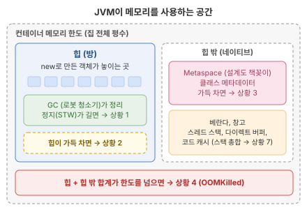
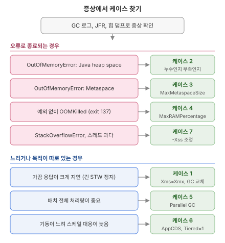

import {AnimatedLineChart, AnimatedBars} from '@site/src/components/blog/MonitorCharts';

<!-- truncate -->

JVM 튜닝이라고 하면 옵션을 잔뜩 붙이는 걸 떠올리기 쉬운데, 실무의 출발점은 반대입니다. <mark>요즘 JVM 기본값은 대체로 충분하고, 튜닝은 "증상이 있을 때 지표를 근거로" 하는 것입니다.</mark> 감으로 플래그를 붙이면 오히려 나빠지기 쉽습니다. 그래서 이 글은 **어떤 케이스에 무엇이 필요한지**를 증상별로 정리합니다. (누수 분석은 [JVM 힙 덤프 분석](./jvm-heap-dump-analysis), 지표 읽기는 [서버 지표 읽기](./server-monitoring-analysis) 참고)

## 먼저 — JVM 메모리와 GC를 1분만

아래 케이스를 이해하려면 "JVM이 메모리를 어디에 사용하는지"만 알면 됩니다. **집**에 비유하면 쉽습니다.

- **힙(heap)** — 물건이 쌓이는 **방**. 우리가 `new`로 만든 객체가 여기 놓입니다. 방이 가득 차면 [케이스 2](#케이스-2--힙-outofmemoryerror).
- **GC(가비지 컬렉션)** — 사용하지 않는 물건을 치워 주는 **로봇 청소기**. 돌리는 짧은 순간엔 방을 사용하지 못하는데(잠깐 문이 잠김), 이 정지가 **stop-the-world(STW)** 입니다. 이 정지가 길면 [케이스 1](#케이스-1--gc-정지가-길다지연-스파이크).
- **Metaspace** — 물건이 아니라 그 물건의 **설계도**(클래스)를 보관하는 작은 책꽂이. 방과는 별개 공간이라, 설계도 종류가 계속 늘면 여기가 차서 [케이스 3](#케이스-3--metaspace-outofmemoryerror).
- **네이티브(힙 밖) 메모리** — 방 말고도 사용하는 **베란다, 창고**(연장, 상자 = 스레드 스택, 버퍼 등). 집 전체 평수(=컨테이너 메모리)엔 방 + 베란다가 **전부** 포함돼서, 합이 넘으면 [케이스 4](#케이스-4--컨테이너에서-oomkilled).

<mark>즉 문제는 늘 "집의 어느 공간이 부족한가"로 나뉩니다 — 부족한 곳은 방(힙), 설계도 책꽂이(Metaspace), 베란다까지 합친 전체 평수(컨테이너) 중 하나입니다.</mark> 이 그림만 있으면 아래 케이스들이 한눈에 들어옵니다.

<details>
<summary>SVG 코드</summary>

```svg
<svg xmlns="http://www.w3.org/2000/svg" width="440" height="304" viewBox="0 0 440 304" font-family="-apple-system, 'Segoe UI', 'Noto Sans KR', sans-serif">
<defs><marker id="ah" viewBox="0 0 10 10" refX="9" refY="5" markerWidth="7" markerHeight="7" orient="auto-start-reverse"><path d="M0,0 L10,5 L0,10 z" fill="#888"/></marker></defs>
<rect x="0" y="0" width="440" height="304" fill="#FFFFFF"/>
<text x="220.0" y="22" font-size="13" fill="#333" text-anchor="middle" font-weight="bold">JVM이 메모리를 사용하는 공간</text>
<rect x="10" y="34" width="420" height="258" rx="8" fill="#F7F7F7" stroke="#999999" stroke-dasharray="4 3"/>
<text x="22" y="52" font-size="11" fill="#555" text-anchor="start" font-weight="bold">컨테이너 메모리 한도 (집 전체 평수)</text>
<rect x="22" y="62" width="200" height="170" rx="6" fill="#EEF3FB" stroke="#4C7FE0"/>
<text x="122" y="82" font-size="12" fill="#26508F" text-anchor="middle" font-weight="bold">힙 (방)</text>
<text x="122" y="99" font-size="10.5" fill="#333" text-anchor="middle">new로 만든 객체가 놓이는 곳</text>
<rect x="40" y="110" width="18" height="14" rx="2" fill="#D6E4FB" stroke="#B9CBE8"/>
<rect x="64" y="110" width="18" height="14" rx="2" fill="#D6E4FB" stroke="#B9CBE8"/>
<rect x="88" y="110" width="18" height="14" rx="2" fill="#D6E4FB" stroke="#B9CBE8"/>
<rect x="112" y="110" width="18" height="14" rx="2" fill="#D6E4FB" stroke="#B9CBE8"/>
<rect x="136" y="110" width="18" height="14" rx="2" fill="#D6E4FB" stroke="#B9CBE8"/>
<rect x="160" y="110" width="18" height="14" rx="2" fill="#D6E4FB" stroke="#B9CBE8"/>
<rect x="184" y="110" width="18" height="14" rx="2" fill="#D6E4FB" stroke="#B9CBE8"/>
<rect x="34" y="136" width="176" height="44" rx="6" fill="#E9F2E9" stroke="#8FBF8F"/>
<text x="122" y="154.4" font-size="10.5" fill="#2E6B2E" text-anchor="middle">GC (로봇 청소기)가 정리</text>
<text x="122" y="168.9" font-size="10.5" fill="#2E6B2E" text-anchor="middle">정지(STW)가 길면 → 케이스 1</text>
<rect x="34" y="190" width="176" height="30" rx="6" fill="#FFFBEA" stroke="#E0A000" stroke-dasharray="4 3"/>
<text x="122" y="209" font-size="10.5" fill="#8A6400" text-anchor="middle" font-weight="bold">힙이 가득 차면 → 케이스 2</text>
<rect x="232" y="62" width="188" height="170" rx="6" fill="#FFFFFF" stroke="#999999" stroke-dasharray="4 3"/>
<text x="326" y="79" font-size="11" fill="#555" text-anchor="middle" font-weight="bold">힙 밖 (네이티브)</text>
<rect x="242" y="88" width="168" height="62" rx="6" fill="#FCE4EC" stroke="#D06A86"/>
<text x="326" y="108.2" font-size="10.5" fill="#9E3A57" text-anchor="middle">Metaspace (설계도 책꽂이)</text>
<text x="326" y="122.7" font-size="10.5" fill="#9E3A57" text-anchor="middle">클래스 메타데이터</text>
<text x="326" y="137.2" font-size="10.5" fill="#9E3A57" text-anchor="middle">가득 차면 → 케이스 3</text>
<rect x="242" y="158" width="168" height="64" rx="6" fill="#FFF3E0" stroke="#E8C98F"/>
<text x="326" y="179.5" font-size="10" fill="#333" text-anchor="middle">베란다, 창고</text>
<text x="326" y="193.5" font-size="10" fill="#333" text-anchor="middle">스레드 스택, 다이렉트 버퍼,</text>
<text x="326" y="207.5" font-size="10" fill="#333" text-anchor="middle">코드 캐시 (스택 총합 → 케이스 7)</text>
<rect x="22" y="244" width="398" height="36" rx="6" fill="#FDECEC" stroke="#D9534F"/>
<text x="221" y="266" font-size="11" fill="#B52B27" text-anchor="middle" font-weight="bold">힙 + 힙 밖 합계가 한도를 넘으면 → 케이스 4 (OOMKilled)</text>
</svg>
```

</details>

<figure style={{textAlign: 'center', margin: '1.5rem 0'}}>
  
</figure>

## 튜닝 전에 — 측정부터

옵션을 바꾸기 전에 **무슨 일이 발생하는지부터** 봅니다. 이 셋은 운영에 항상 활성화해 두는 걸 권합니다.

```bash
# GC 로그(통합 로깅, JDK 9+) — 정지 시간·빈도·원인 확인
-Xlog:gc*:file=/var/log/app/gc.log:time,uptime,level,tags:filecount=5,filesize=10M

# OOM 순간 힙 덤프 자동 저장 — 사후 분석의 핵심
-XX:+HeapDumpOnOutOfMemoryError -XX:HeapDumpPath=/var/log/app/

# 상시 프로파일링 — 오버헤드 낮은 Flight Recorder
-XX:+FlightRecorder
```

<mark>측정 없이 하는 튜닝은 추측입니다 — GC 로그, JFR, 힙 덤프로 원인을 먼저 특정한 뒤, 옵션은 한 번에 하나씩만 변경해 효과를 확인합니다.</mark>

측정으로 확인한 증상이 아래 케이스 중 어디에 해당하는지는 다음 흐름으로 찾습니다.

<details>
<summary>SVG 코드</summary>

```svg
<svg xmlns="http://www.w3.org/2000/svg" width="440" height="476" viewBox="0 0 440 476" font-family="-apple-system, 'Segoe UI', 'Noto Sans KR', sans-serif">
<defs><marker id="ah" viewBox="0 0 10 10" refX="9" refY="5" markerWidth="7" markerHeight="7" orient="auto-start-reverse"><path d="M0,0 L10,5 L0,10 z" fill="#888"/></marker></defs>
<rect x="0" y="0" width="440" height="476" fill="#FFFFFF"/>
<text x="220.0" y="22" font-size="13" fill="#333" text-anchor="middle" font-weight="bold">증상에서 케이스 찾기</text>
<rect x="80" y="34" width="280" height="32" rx="6" fill="#F7F7F7" stroke="#999999"/>
<text x="220" y="54" font-size="11" fill="#333" text-anchor="middle">GC 로그, JFR, 힙 덤프로 증상 확인</text>
<line x1="220" y1="66" x2="220" y2="78" stroke="#888" stroke-width="1.2" marker-end="url(#ah)"/>
<text x="20" y="94" font-size="11" fill="#9E3A57" text-anchor="start" font-weight="bold">오류로 종료되는 경우</text>
<line x1="20" y1="100" x2="420" y2="100" stroke="#D06A86" stroke-width="0.8"/>
<rect x="20" y="108" width="250" height="38" rx="6" fill="#FCE4EC" stroke="#D06A86"/>
<text x="145" y="130.7" font-size="10.5" fill="#333" text-anchor="middle">OutOfMemoryError: Java heap space</text>
<line x1="270" y1="127" x2="292" y2="127" stroke="#888" stroke-width="1.2" marker-end="url(#ah)"/>
<rect x="294" y="108" width="126" height="38" rx="6" fill="#E9F2E9" stroke="#8FBF8F"/>
<text x="357" y="124" font-size="11" fill="#2E6B2E" text-anchor="middle" font-weight="bold">케이스 2</text>
<text x="357" y="139" font-size="9.5" fill="#555" text-anchor="middle">누수인지 부족인지</text>
<rect x="20" y="154" width="250" height="38" rx="6" fill="#FCE4EC" stroke="#D06A86"/>
<text x="145" y="176.7" font-size="10.5" fill="#333" text-anchor="middle">OutOfMemoryError: Metaspace</text>
<line x1="270" y1="173" x2="292" y2="173" stroke="#888" stroke-width="1.2" marker-end="url(#ah)"/>
<rect x="294" y="154" width="126" height="38" rx="6" fill="#E9F2E9" stroke="#8FBF8F"/>
<text x="357" y="170" font-size="11" fill="#2E6B2E" text-anchor="middle" font-weight="bold">케이스 3</text>
<text x="357" y="185" font-size="9.5" fill="#555" text-anchor="middle">MaxMetaspaceSize</text>
<rect x="20" y="200" width="250" height="38" rx="6" fill="#FCE4EC" stroke="#D06A86"/>
<text x="145" y="222.7" font-size="10.5" fill="#333" text-anchor="middle">예외 없이 OOMKilled (exit 137)</text>
<line x1="270" y1="219" x2="292" y2="219" stroke="#888" stroke-width="1.2" marker-end="url(#ah)"/>
<rect x="294" y="200" width="126" height="38" rx="6" fill="#E9F2E9" stroke="#8FBF8F"/>
<text x="357" y="216" font-size="11" fill="#2E6B2E" text-anchor="middle" font-weight="bold">케이스 4</text>
<text x="357" y="231" font-size="9.5" fill="#555" text-anchor="middle">MaxRAMPercentage</text>
<rect x="20" y="246" width="250" height="38" rx="6" fill="#FCE4EC" stroke="#D06A86"/>
<text x="145" y="268.7" font-size="10.5" fill="#333" text-anchor="middle">StackOverflowError, 스레드 과다</text>
<line x1="270" y1="265" x2="292" y2="265" stroke="#888" stroke-width="1.2" marker-end="url(#ah)"/>
<rect x="294" y="246" width="126" height="38" rx="6" fill="#E9F2E9" stroke="#8FBF8F"/>
<text x="357" y="262" font-size="11" fill="#2E6B2E" text-anchor="middle" font-weight="bold">케이스 7</text>
<text x="357" y="277" font-size="9.5" fill="#555" text-anchor="middle">-Xss 조정</text>
<text x="20" y="314" font-size="11" fill="#26508F" text-anchor="start" font-weight="bold">느리거나 목적이 따로 있는 경우</text>
<line x1="20" y1="320" x2="420" y2="320" stroke="#4C7FE0" stroke-width="0.8"/>
<rect x="20" y="328" width="250" height="38" rx="6" fill="#EEF3FB" stroke="#4C7FE0"/>
<text x="145" y="350.7" font-size="10.5" fill="#333" text-anchor="middle">가끔 응답이 크게 지연 (긴 STW 정지)</text>
<line x1="270" y1="347" x2="292" y2="347" stroke="#888" stroke-width="1.2" marker-end="url(#ah)"/>
<rect x="294" y="328" width="126" height="38" rx="6" fill="#E9F2E9" stroke="#8FBF8F"/>
<text x="357" y="344" font-size="11" fill="#2E6B2E" text-anchor="middle" font-weight="bold">케이스 1</text>
<text x="357" y="359" font-size="9.5" fill="#555" text-anchor="middle">Xms=Xmx, GC 교체</text>
<rect x="20" y="374" width="250" height="38" rx="6" fill="#EEF3FB" stroke="#4C7FE0"/>
<text x="145" y="396.7" font-size="10.5" fill="#333" text-anchor="middle">배치 전체 처리량이 중요</text>
<line x1="270" y1="393" x2="292" y2="393" stroke="#888" stroke-width="1.2" marker-end="url(#ah)"/>
<rect x="294" y="374" width="126" height="38" rx="6" fill="#E9F2E9" stroke="#8FBF8F"/>
<text x="357" y="390" font-size="11" fill="#2E6B2E" text-anchor="middle" font-weight="bold">케이스 5</text>
<text x="357" y="405" font-size="9.5" fill="#555" text-anchor="middle">Parallel GC</text>
<rect x="20" y="420" width="250" height="38" rx="6" fill="#EEF3FB" stroke="#4C7FE0"/>
<text x="145" y="442.7" font-size="10.5" fill="#333" text-anchor="middle">기동이 느려 스케일 대응이 늦음</text>
<line x1="270" y1="439" x2="292" y2="439" stroke="#888" stroke-width="1.2" marker-end="url(#ah)"/>
<rect x="294" y="420" width="126" height="38" rx="6" fill="#E9F2E9" stroke="#8FBF8F"/>
<text x="357" y="436" font-size="11" fill="#2E6B2E" text-anchor="middle" font-weight="bold">케이스 6</text>
<text x="357" y="451" font-size="9.5" fill="#555" text-anchor="middle">AppCDS, Tiered=1</text>
</svg>
```

</details>

<figure style={{textAlign: 'center', margin: '1.5rem 0'}}>
  
</figure>

## 케이스 1 — GC 정지가 길다(지연 스파이크)

**증상**: 평상시 빠른데 가끔 응답이 크게 지연된다. GC 로그에 수백 ms~초 단위 stop-the-world 정지가 보인다.

<AnimatedLineChart
  title="GC 정지 순간 응답시간이 급증한다(개념 예시)"
  data={[30, 32, 28, 33, 210, 31, 29, 35, 240, 30, 33, 195, 31, 30]}
  yMax={260}
  unit="응답시간(ms)"
/>

GC 로그를 열면 이러한 줄이 보입니다 — 맨 끝 `830.5ms`가 그 순간 애플리케이션이 멈춘 시간입니다(830ms면 그동안 모든 요청이 대기).

```text
[gc] GC(42) Pause Young (Normal) 1856M->512M(2048M) 830.5ms
```

**대응**: 먼저 힙과 GC 종류를 봅니다. 힙이 너무 작아 자주 도는 거면 키우고, 저지연이 필요하면 **저지연 GC로 교체**합니다.

```bash
-Xms4g -Xmx4g                 # 시작·최대 힙을 같게(리사이징으로 인한 정지 방지)
-XX:MaxGCPauseMillis=100      # G1의 목표 정지 시간(기본 200ms)
# 정지가 여전히 문제면 저지연 GC로:
-XX:+UseZGC                   # 대용량 힙에서도 정지 수 ms 목표
```

<mark>`Xms`와 `Xmx`를 같게 설정하는 것만으로도 힙을 늘였다 줄였다 하며 생기는 정지가 사라집니다.</mark> 정지 자체가 서비스 목표(SLO)를 못 지키면 G1 → ZGC/Shenandoah로 교체합니다.

## 케이스 2 — 힙 OutOfMemoryError

**증상**: `java.lang.OutOfMemoryError: Java heap space`로 애플리케이션이 종료된다.

**판단이 먼저입니다** — 실제로 메모리가 부족한 건지, **누수**인지 구분해야 합니다. GC 로그에서 Full GC 뒤에도 사용량이 계속 우상향하면 누수 신호입니다.

<AnimatedLineChart
  title="누수 — Full GC 뒤에도 힙 사용률이 우상향(개념 예시)"
  data={[40, 58, 46, 64, 52, 70, 60, 78, 68, 86, 76, 94]}
  yMax={100}
  unit="Full GC 후 힙(%)"
  trend={[42, 96]}
  tone="accent2"
/>

누수면 GC 로그가 이렇게 보입니다 — 가장 강한 청소(Full GC)를 해도 사용량이 **거의 안 줄어듭니다.**

```text
[gc] GC(88) Pause Full (Allocation Failure) 1980M->1905M(2048M)  ← 2GB 중 1.9GB가 그대로
java.lang.OutOfMemoryError: Java heap space
```

- **누수라면** — `Xmx`를 올려도 시간만 벌 뿐 다시 OOM이 발생합니다. 힙 덤프로 원인 객체를 찾아 **코드를 고칩니다**([힙 덤프 분석](./jvm-heap-dump-analysis)).
- **실제로 부족하다면** — 워크로드에 맞게 `-Xmx`를 올립니다.

```bash
-XX:+HeapDumpOnOutOfMemoryError -XX:HeapDumpPath=/var/log/app/  # 종료되는 순간 스냅샷
-Xmx6g                                                          # 부족이 확실할 때만 상향
```

<mark>OOM의 절반 이상은 부족이 아니라 누수라, `-Xmx`를 키우는 건 근본 해결이 아닌 경우가 많습니다.</mark>

## 케이스 3 — Metaspace OutOfMemoryError

**증상**: `OutOfMemoryError: Metaspace`. 힙이 아니라 **클래스 메타데이터** 영역이 찬 것이다.

**원인**: 클래스를 과도하게 로드하거나(동적 프록시, 코드 생성, 스크립팅), 배포를 반복하며 **클래스로더가 회수되지 않는 누수**. 무작정 늘리기 전에 클래스 로딩 추이를 봅니다.

<AnimatedLineChart
  title="클래스로더 누수 — 로드된 클래스가 계속 증가(개념 예시)"
  data={[18, 27, 36, 44, 53, 62, 70, 79, 88, 97]}
  yMax={100}
  unit="로드된 클래스(천 개)"
  trend={[18, 97]}
  tone="accent2"
/>

```bash
-XX:MaxMetaspaceSize=512m     # 상한을 둬 무한 증가로 호스트를 먹는 걸 방지
-Xlog:class+load,class+unload # 어떤 클래스가 계속 로드/언로드되는지 추적
```

<mark>Metaspace는 힙과 별개 영역이라 `-Xmx`로는 해결되지 않습니다 — 상한을 두되, 계속 는다면 클래스로더 누수를 의심합니다.</mark>

## 케이스 4 — 컨테이너에서 OOMKilled

**증상**: 힙 OOM은 없는데 컨테이너가 `OOMKilled`(exit 137)로 종료된다. **JVM 전체 메모리가 컨테이너 한도를 넘은 것**이다.

쿠버네티스라면 이렇게 확인합니다 — 힙 OOM 예외 없이 파드가 `137`로 종료됩니다.

```text
$ kubectl describe pod my-app-xxxx
    Last State:  Terminated
      Reason:    OOMKilled
      Exit Code: 137
```

**핵심**: 프로세스 메모리 = 힙 + **힙 밖(네이티브)**. 메타스페이스, 스레드 스택, 다이렉트 버퍼, 코드 캐시가 다 포함됩니다. 힙만 한도에 맞추면 나머지가 한도를 초과해 커널이 강제 종료합니다.

<AnimatedBars
  title="프로세스 메모리 구성 — 힙은 일부일 뿐(개념 예시)"
  labels={['힙', '메타스페이스', '스레드 스택', '다이렉트 버퍼', '코드 캐시']}
  data={[1000, 256, 400, 256, 120]}
  yMax={1100}
  unit="MB"
/>

```bash
-XX:MaxRAMPercentage=75.0     # 컨테이너 메모리의 %로 힙 지정(컨테이너 인식)
-Xss512k                      # 스레드 많으면 스택 총합이 커지니 조정
-XX:MaxDirectMemorySize=256m  # NIO·네티 다이렉트 버퍼 상한
```

<mark>컨테이너에선 `-Xmx` 고정값보다 `-XX:MaxRAMPercentage`로 비율 지정이 안전하고, 힙 밖 메모리 몫을 남겨 둬야 OOMKilled를 피합니다.</mark> 스레드 수가 많은 애플리케이션은 스택 총합도 무시 못 한다([스레드 풀](./spring-boot-thread-pools)).

## 케이스 5 — 처리량이 최우선인 배치

**증상이 아니라 목적**: 야간 배치처럼 **개별 지연은 상관없고 전체 처리량**이 중요합니다.

이땐 저지연 GC가 오히려 불리합니다. 정지가 다소 길어도 **총 GC 오버헤드가 낮은** Parallel GC가 유리합니다.

<AnimatedBars
  title="배치 처리량 — Parallel GC가 유리(개념 예시)"
  labels={['G1', 'Parallel GC']}
  data={[88, 97]}
  yMax={100}
  unit="처리량(상대 %)"
/>

```bash
-XX:+UseParallelGC            # 처리량 지향 GC
-Xms8g -Xmx8g                 # 큰 힙으로 GC 빈도 자체를 낮춤
```

<mark>지연이 목표가 아니면 저지연 GC를 붙일 이유가 없습니다 — 처리량 배치엔 Parallel GC + 큰 힙이 맞습니다.</mark>

## 케이스 6 — 기동 시간을 줄여야 한다

**증상**: 오토스케일, 서버리스, 롤링 배포에서 **기동에 오래 걸려** 스케일 대응이 느리다.

```bash
-XX:TieredStopAtLevel=1       # JIT을 C1까지만 — 기동 빠름(대신 최고 성능은 포기)
-XX:SharedArchiveFile=app.jsa # AppCDS — 클래스 메타를 미리 만들어 로딩 단축
```

여기에 스프링 부트 3.2+의 **CRaC**(체크포인트/복원)나 AOT를 더하면 기동 시간이 크게 줄어듭니다.

<AnimatedBars
  title="기동 시간 — 옵션에 따른 단축(개념 예시)"
  labels={['기본', 'Tiered=1', '+AppCDS', '+CRaC']}
  data={[100, 72, 58, 18]}
  yMax={110}
  unit="기동 시간(상대)"
/> <mark>단, `TieredStopAtLevel=1`은 오래 도는 서버의 최대 성능은 낮추므로, 기동이 실제 병목일 때만 사용합니다.</mark>

## 케이스 7 — 스레드, 스택 관련

**증상**: `StackOverflowError`(깊은 재귀) 또는 스레드가 매우 많아 스택 총합이 메모리를 압박.

```bash
-Xss1m       # 깊은 재귀로 StackOverflow면 상향
-Xss256k     # 스레드 수천 개면 하향해 총합을 줄임
```

스택 크기는 **한 스레드용**이라, 스레드 수만큼 늘어나 전체 메모리에 영향을 줍니다. 방향이 케이스마다 반대인 점만 주의합니다.

## GC 종류 고르기

| GC | 성격 | 언제 |
|---|---|---|
| Serial | 단일 스레드, 작은 힙 | 아주 작은 애플리케이션, CLI |
| Parallel | 처리량 최우선 | 배치, 백그라운드 작업 |
| **G1 (기본)** | 정지, 처리량 균형 | 대부분의 서비스(기본값) |
| ZGC | 초저지연, 대용량 힙 | 정지 SLO가 엄격할 때 |
| Shenandoah | 초저지연(OpenJDK) | ZGC 대안 |

<mark>특별한 이유가 없으면 기본 G1을 사용하고, "정지가 SLO를 넘는다"가 확인될 때만 ZGC/Shenandoah로 옮깁니다.</mark>

## 정리

- **측정 먼저** — GC 로그, JFR, `HeapDumpOnOutOfMemoryError`를 활성화하고 원인을 특정합니다.
- **한 번에 하나씩** 바꾸고 지표로 확인, 컨테이너는 **비율(%) 기반**으로.

증상별로 무엇을 조절하는지 한눈에:

| 증상 | 조절할 것 |
|---|---|
| GC 정지가 길다 | GC 선택(G1 → ZGC), `Xms=Xmx` |
| 힙 OutOfMemoryError | 누수인지 부족인지 판별 후 대응 |
| Metaspace OOM | `MaxMetaspaceSize`, 클래스로더 누수 점검 |
| 컨테이너 OOMKilled | `MaxRAMPercentage` + 힙 밖(네이티브) 메모리 |
| 처리량 배치 | Parallel GC |
| 기동 시간 단축 | AppCDS, CDS |
- <mark>기본값만으로 대체로 충분합니다 — 튜닝은 문제를 재현, 측정한 뒤의 마지막 단계입니다.</mark>

GC가 트래픽 증가로 어떻게 나빠지는지는 [트래픽이 늘면 어디부터 문제가 생기나](./traffic-growth-problems)도 함께 보세요.

### 용어 한 줄 정리

| 용어 | 쉬운 뜻 |
|---|---|
| stop-the-world | GC가 애플리케이션 스레드를 잠시 멈추는 구간 |
| 힙 / 네이티브 | 객체 저장 영역 / 그 밖(메타, 스택, 버퍼) 메모리 |
| Metaspace | 클래스 메타데이터를 저장하는 힙 밖 영역 |
| OOMKilled | 컨테이너 메모리 한도 초과로 커널이 종료(137) |
| MaxRAMPercentage | 컨테이너 메모리의 %로 힙을 설정하는 옵션 |
| AppCDS | 클래스 데이터를 미리 만들어 기동을 앞당김 |
