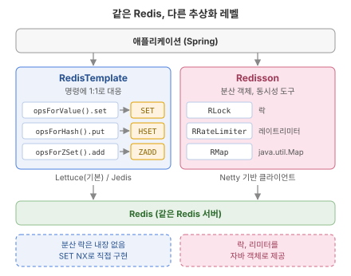
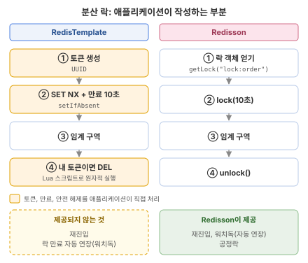

<!-- truncate -->

Spring에서 Redis를 다룰 때 흔히 두 가지를 만납니다 — Spring Data Redis의 **`RedisTemplate`**, 그리고 별도 클라이언트인 **Redisson**. 같은 Redis를 쓰지만 결이 다릅니다. <mark>`RedisTemplate`은 Redis "명령"에 거의 1:1로 대응하는 저수준 래퍼이고, Redisson은 분산 락, 컬렉션 같은 걸 "자바 객체"로 감싼 고수준 클라이언트입니다.</mark> 어떤 상황에 무엇을 고르면 좋은지 비교합니다. (자료구조 기본은 [Redis 자료구조 총정리](./redis-data-structures), 분산락 배경은 [Redis 분산락](./redis-distributed-lock) 참고)

## 결론부터

- **단순 캐시, 카운터, 명령 위주** → `RedisTemplate` (가볍고 Spring 네이티브)
- **분산 락, 레이트리미터 등 동시성 제어, 다양한 분산 컬렉션** → Redisson
- 둘은 **한 프로젝트에서 공존**할 수 있습니다.

## RedisTemplate — 명령에 1:1로 대응하는 저수준 래퍼

Spring Data Redis가 제공하며, Lettuce(기본)나 Jedis 위에서 동작합니다. `opsForValue`, `opsForHash`처럼 **Redis 명령과 거의 1:1**로 매핑되고, 직렬화는 `RedisSerializer`로 정합니다.

```java
redis.opsForValue().set("session:abc", "user-123", Duration.ofSeconds(60));
redis.opsForZSet().add("leaderboard", "kim", 1500);
```

<mark>가볍고 Redis에 가깝지만, 분산 락 같은 "고수준 기능"은 내장돼 있지 않습니다</mark> — 필요하면 직접 `SET NX`로 구현하거나 Spring Integration의 `RedisLockRegistry`를 사용합니다.

## Redisson — 분산 객체, 동시성 프리미티브

이름이 어렵지만 핵심은 하나입니다. <mark>평소 서버 한 대(JVM 하나) 안에서만 쓰던 자바 도구를, 여러 서버가 함께 쓰도록 "분산" 버전으로 만들어 주는 것</mark>입니다.

- **"분산 객체"란?** 보통 `HashMap`이나 `ReentrantLock`은 그 프로세스 안에서만 유효합니다 — 서버가 여러 대면 각자 따로 존재하죠. Redisson의 `RMap`, `RLock`은 겉보기엔 똑같은 자바 인터페이스지만, 실제 상태를 **Redis에 저장**해서 **모든 서버가 하나의 객체처럼 공유**합니다.
- **"동시성 프리미티브"란?** 여러 주체가 한 자원을 동시에 다툴 때 순서를 정해 주는 기본 도구(락, 세마포어, 카운터 등)입니다. 자바 표준(`ReentrantLock`, `Semaphore`)은 한 JVM 안에서만 통하는데, Redisson은 이걸 **서버를 넘나드는** 버전으로 제공합니다.

예를 들어 서버 3대가 같은 재고를 건드릴 때, 자바 `ReentrantLock`으론 각 서버 *내부의* 스레드끼리만 막힐 뿐 서버 사이 경쟁은 못 막습니다. Redisson `RLock`은 세 서버가 같은 Redis를 보고 잠그므로 **전체에서 한 번에 하나만** 임계 구역에 들어갑니다.

Netty 기반 클라이언트로, 이러한 "분산 도구"들을 폭넓게 제공합니다.

- **동시성 프리미티브**: `RLock`(재진입, 공정, 멀티락), `RSemaphore`, `RRateLimiter`, `RCountDownLatch`
- **분산 컬렉션**: `RMap`, `RList`, `RSet`(각각 `java.util` 인터페이스 구현), 엔트리별 TTL, near-cache(`RMapCache`, `RLocalCachedMap`)
- **기타**: `RBloomFilter`, `RAtomicLong`, `RTopic`(pub/sub), 분산 실행 서비스 등
- **여러 API 스타일**: 같은 기능을 **동기**(결과가 올 때까지 기다림), **비동기**(`RFuture`로 나중에 받기), **리액티브**(Reactor `Mono`/`Flux`), **RxJava** 중 선택해 호출할 수 있습니다. WebFlux 같은 논블로킹 스택과도 맞물립니다.
- **코덱(codec)**: 자바 객체를 Redis에 저장할 때의 **직렬화 방식**(JSON, Kryo 등)을 지정합니다. `RedisTemplate`의 `RedisSerializer`에 해당하는 개념입니다.

즉 Redisson은 "Redis 명령"이 아니라 **"여러 서버가 공유하는 자료구조, 동시성 도구"** 로 접근하는 관점입니다.

두 클라이언트의 추상화 레벨을 나란히 놓으면 다음과 같습니다.

<details>
<summary>SVG 코드</summary>

```svg
<svg xmlns="http://www.w3.org/2000/svg" width="440" height="346" viewBox="0 0 440 346" font-family="-apple-system, 'Segoe UI', 'Noto Sans KR', sans-serif">
<defs><marker id="ah" viewBox="0 0 10 10" refX="9" refY="5" markerWidth="7" markerHeight="7" orient="auto-start-reverse"><path d="M0,0 L10,5 L0,10 z" fill="#888"/></marker></defs>
<rect x="0" y="0" width="440" height="346" fill="#FFFFFF"/>
<text x="220.0" y="22" font-size="13" fill="#333" text-anchor="middle" font-weight="bold">같은 Redis, 다른 추상화 레벨</text>
<rect x="20" y="36" width="400" height="30" rx="6" fill="#F7F7F7" stroke="#999999"/>
<text x="220" y="56" font-size="11" fill="#333" text-anchor="middle" font-weight="bold">애플리케이션 (Spring)</text>
<line x1="117.0" y1="66" x2="117.0" y2="82" stroke="#888" stroke-width="1.2" marker-end="url(#ah)"/>
<line x1="323.0" y1="66" x2="323.0" y2="82" stroke="#888" stroke-width="1.2" marker-end="url(#ah)"/>
<rect x="20" y="84" width="194" height="128" rx="6" fill="#EEF3FB" stroke="#4C7FE0"/>
<text x="117.0" y="102" font-size="12" fill="#26508F" text-anchor="middle" font-weight="bold">RedisTemplate</text>
<text x="117.0" y="118" font-size="10" fill="#555" text-anchor="middle">명령에 1:1로 대응</text>
<rect x="28" y="128" width="120" height="20" rx="3" fill="#FFFFFF" stroke="#B9CBE8"/>
<text x="88" y="142" font-size="9" fill="#333" text-anchor="middle" font-family="Menlo, Consolas, monospace">opsForValue().set</text>
<line x1="150" y1="138" x2="162" y2="138" stroke="#888" stroke-width="1.2" marker-end="url(#ah)"/>
<rect x="164" y="128" width="42" height="20" rx="3" fill="#FFF3E0" stroke="#E0A000"/>
<text x="185" y="142" font-size="9.5" fill="#8A6400" text-anchor="middle" font-family="Menlo, Consolas, monospace">SET</text>
<rect x="28" y="154" width="120" height="20" rx="3" fill="#FFFFFF" stroke="#B9CBE8"/>
<text x="88" y="168" font-size="9" fill="#333" text-anchor="middle" font-family="Menlo, Consolas, monospace">opsForHash().put</text>
<line x1="150" y1="164" x2="162" y2="164" stroke="#888" stroke-width="1.2" marker-end="url(#ah)"/>
<rect x="164" y="154" width="42" height="20" rx="3" fill="#FFF3E0" stroke="#E0A000"/>
<text x="185" y="168" font-size="9.5" fill="#8A6400" text-anchor="middle" font-family="Menlo, Consolas, monospace">HSET</text>
<rect x="28" y="180" width="120" height="20" rx="3" fill="#FFFFFF" stroke="#B9CBE8"/>
<text x="88" y="194" font-size="9" fill="#333" text-anchor="middle" font-family="Menlo, Consolas, monospace">opsForZSet().add</text>
<line x1="150" y1="190" x2="162" y2="190" stroke="#888" stroke-width="1.2" marker-end="url(#ah)"/>
<rect x="164" y="180" width="42" height="20" rx="3" fill="#FFF3E0" stroke="#E0A000"/>
<text x="185" y="194" font-size="9.5" fill="#8A6400" text-anchor="middle" font-family="Menlo, Consolas, monospace">ZADD</text>
<rect x="226" y="84" width="194" height="128" rx="6" fill="#FCE4EC" stroke="#D06A86"/>
<text x="323.0" y="102" font-size="12" fill="#9E3A57" text-anchor="middle" font-weight="bold">Redisson</text>
<text x="323.0" y="118" font-size="10" fill="#555" text-anchor="middle">분산 객체, 동시성 도구</text>
<rect x="234" y="128" width="82" height="20" rx="3" fill="#FFFFFF" stroke="#B9CBE8"/>
<text x="275" y="142" font-size="9.5" fill="#333" text-anchor="middle" font-family="Menlo, Consolas, monospace">RLock</text>
<text x="324" y="142" font-size="9.5" fill="#555" text-anchor="start">락</text>
<rect x="234" y="154" width="82" height="20" rx="3" fill="#FFFFFF" stroke="#B9CBE8"/>
<text x="275" y="168" font-size="9.5" fill="#333" text-anchor="middle" font-family="Menlo, Consolas, monospace">RRateLimiter</text>
<text x="324" y="168" font-size="9.5" fill="#555" text-anchor="start">레이트리미터</text>
<rect x="234" y="180" width="82" height="20" rx="3" fill="#FFFFFF" stroke="#B9CBE8"/>
<text x="275" y="194" font-size="9.5" fill="#333" text-anchor="middle" font-family="Menlo, Consolas, monospace">RMap</text>
<text x="324" y="194" font-size="9.5" fill="#555" text-anchor="start">java.util.Map</text>
<text x="117.0" y="226" font-size="10" fill="#555" text-anchor="middle">Lettuce(기본) / Jedis</text>
<text x="323.0" y="226" font-size="10" fill="#555" text-anchor="middle">Netty 기반 클라이언트</text>
<line x1="117.0" y1="232" x2="117.0" y2="250" stroke="#888" stroke-width="1.2" marker-end="url(#ah)"/>
<line x1="323.0" y1="232" x2="323.0" y2="250" stroke="#888" stroke-width="1.2" marker-end="url(#ah)"/>
<rect x="20" y="252" width="400" height="30" rx="6" fill="#E9F2E9" stroke="#8FBF8F"/>
<text x="220" y="272" font-size="11" fill="#2E6B2E" text-anchor="middle" font-weight="bold">Redis (같은 Redis 서버)</text>
<rect x="20" y="294" width="194" height="40" rx="6" fill="#EEF3FB" stroke="#4C7FE0" stroke-dasharray="4 3"/>
<text x="117.0" y="310.5" font-size="10" fill="#26508F" text-anchor="middle">분산 락은 내장 없음</text>
<text x="117.0" y="324.5" font-size="10" fill="#26508F" text-anchor="middle">SET NX로 직접 구현</text>
<rect x="226" y="294" width="194" height="40" rx="6" fill="#FCE4EC" stroke="#D06A86" stroke-dasharray="4 3"/>
<text x="323.0" y="310.5" font-size="10" fill="#9E3A57" text-anchor="middle">락, 리미터를</text>
<text x="323.0" y="324.5" font-size="10" fill="#9E3A57" text-anchor="middle">자바 객체로 제공</text>
</svg>
```

</details>

<figure style={{textAlign: 'center', margin: '1.5rem 0'}}>
  
</figure>

## 같은 작업, 두 방식 — ① 분산 락

가장 차이가 나타나는 예입니다.

**RedisTemplate** — `SET NX`로 직접. 만료, 안전 해제(내 토큰일 때만 삭제)를 스스로 챙겨야 하고, **재진입, 자동 연장(워치독)은 없습니다.**

```java
String token = UUID.randomUUID().toString();
Boolean ok = redis.opsForValue().setIfAbsent("lock:order", token, Duration.ofSeconds(10));
if (Boolean.TRUE.equals(ok)) {
    try {
        // ... 임계 구역
    } finally {
        // 안전 해제는 "내 토큰이면 DEL" 을 원자적으로(Lua) 해야 한다
        redis.execute(unlockScript, List.of("lock:order"), token);
    }
}
```

**Redisson** — `RLock` 한 객체로 끝. 재진입, 락 만료 자동 연장(워치독), 공정락까지 제공합니다.

```java
RLock lock = redisson.getLock("lock:order");
lock.lock(10, TimeUnit.SECONDS);   // 재진입·워치독 지원
try {
    // ... 임계 구역
} finally {
    lock.unlock();
}
```

두 방식에서 애플리케이션이 직접 처리하는 부분을 비교하면 다음과 같습니다.

<details>
<summary>SVG 코드</summary>

```svg
<svg xmlns="http://www.w3.org/2000/svg" width="440" height="376" viewBox="0 0 440 376" font-family="-apple-system, 'Segoe UI', 'Noto Sans KR', sans-serif">
<defs><marker id="ah" viewBox="0 0 10 10" refX="9" refY="5" markerWidth="7" markerHeight="7" orient="auto-start-reverse"><path d="M0,0 L10,5 L0,10 z" fill="#888"/></marker></defs>
<rect x="0" y="0" width="440" height="376" fill="#FFFFFF"/>
<text x="220.0" y="22" font-size="13" fill="#333" text-anchor="middle" font-weight="bold">분산 락: 애플리케이션이 작성하는 부분</text>
<rect x="14" y="34" width="198" height="24" rx="4" fill="#EEF3FB" stroke="#4C7FE0"/>
<text x="113.0" y="50" font-size="11" fill="#26508F" text-anchor="middle" font-weight="bold">RedisTemplate</text>
<rect x="228" y="34" width="198" height="24" rx="4" fill="#FCE4EC" stroke="#D06A86"/>
<text x="327.0" y="50" font-size="11" fill="#9E3A57" text-anchor="middle" font-weight="bold">Redisson</text>
<rect x="14" y="70" width="198" height="40" rx="6" fill="#FFF3E0" stroke="#E0A000"/>
<text x="113.0" y="87" font-size="11" fill="#333" text-anchor="middle" font-weight="bold">① 토큰 생성</text>
<text x="113.0" y="102" font-size="9" fill="#555" text-anchor="middle" font-family="Menlo, Consolas, monospace">UUID</text>
<line x1="113.0" y1="110" x2="113.0" y2="120" stroke="#888" stroke-width="1.2" marker-end="url(#ah)"/>
<rect x="14" y="122" width="198" height="40" rx="6" fill="#FFF3E0" stroke="#E0A000"/>
<text x="113.0" y="139" font-size="11" fill="#333" text-anchor="middle" font-weight="bold">② SET NX + 만료 10초</text>
<text x="113.0" y="154" font-size="9" fill="#555" text-anchor="middle" font-family="Menlo, Consolas, monospace">setIfAbsent</text>
<line x1="113.0" y1="162" x2="113.0" y2="172" stroke="#888" stroke-width="1.2" marker-end="url(#ah)"/>
<rect x="14" y="174" width="198" height="40" rx="6" fill="#FFFFFF" stroke="#B9CBE8"/>
<text x="113.0" y="199" font-size="11" fill="#333" text-anchor="middle" font-weight="bold">③ 임계 구역</text>
<line x1="113.0" y1="214" x2="113.0" y2="224" stroke="#888" stroke-width="1.2" marker-end="url(#ah)"/>
<rect x="14" y="226" width="198" height="40" rx="6" fill="#FFF3E0" stroke="#E0A000"/>
<text x="113.0" y="243" font-size="11" fill="#333" text-anchor="middle" font-weight="bold">④ 내 토큰이면 DEL</text>
<text x="113.0" y="258" font-size="9" fill="#555" text-anchor="middle">Lua 스크립트로 원자적 실행</text>
<rect x="228" y="70" width="198" height="40" rx="6" fill="#FFFFFF" stroke="#B9CBE8"/>
<text x="327.0" y="87" font-size="11" fill="#333" text-anchor="middle" font-weight="bold">① 락 객체 얻기</text>
<text x="327.0" y="102" font-size="9" fill="#555" text-anchor="middle" font-family="Menlo, Consolas, monospace">getLock("lock:order")</text>
<line x1="327.0" y1="110" x2="327.0" y2="120" stroke="#888" stroke-width="1.2" marker-end="url(#ah)"/>
<rect x="228" y="122" width="198" height="40" rx="6" fill="#FFFFFF" stroke="#B9CBE8"/>
<text x="327.0" y="147" font-size="11" fill="#333" text-anchor="middle" font-weight="bold">② lock(10초)</text>
<line x1="327.0" y1="162" x2="327.0" y2="172" stroke="#888" stroke-width="1.2" marker-end="url(#ah)"/>
<rect x="228" y="174" width="198" height="40" rx="6" fill="#FFFFFF" stroke="#B9CBE8"/>
<text x="327.0" y="199" font-size="11" fill="#333" text-anchor="middle" font-weight="bold">③ 임계 구역</text>
<line x1="327.0" y1="214" x2="327.0" y2="224" stroke="#888" stroke-width="1.2" marker-end="url(#ah)"/>
<rect x="228" y="226" width="198" height="40" rx="6" fill="#FFFFFF" stroke="#B9CBE8"/>
<text x="327.0" y="251" font-size="11" fill="#333" text-anchor="middle" font-weight="bold">④ unlock()</text>
<rect x="14" y="278" width="14" height="12" rx="2" fill="#FFF3E0" stroke="#E0A000"/>
<text x="34" y="288" font-size="9.5" fill="#555" text-anchor="start">토큰, 만료, 안전 해제를 애플리케이션이 직접 처리</text>
<rect x="14" y="300" width="198" height="64" rx="6" fill="#FFFBEA" stroke="#E0A000" stroke-dasharray="4 3"/>
<text x="113.0" y="318" font-size="10.5" fill="#8A6400" text-anchor="middle" font-weight="bold">제공되지 않는 것</text>
<text x="113.0" y="338.5" font-size="10" fill="#555" text-anchor="middle">재진입</text>
<text x="113.0" y="352.5" font-size="10" fill="#555" text-anchor="middle">락 만료 자동 연장(워치독)</text>
<rect x="228" y="300" width="198" height="64" rx="6" fill="#E9F2E9" stroke="#8FBF8F"/>
<text x="327.0" y="318" font-size="10.5" fill="#2E6B2E" text-anchor="middle" font-weight="bold">Redisson이 제공</text>
<text x="327.0" y="338.5" font-size="10" fill="#555" text-anchor="middle">재진입, 워치독(자동 연장)</text>
<text x="327.0" y="352.5" font-size="10" fill="#555" text-anchor="middle">공정락</text>
</svg>
```

</details>

<figure style={{textAlign: 'center', margin: '1.5rem 0'}}>
  
</figure>

<mark>분산 락처럼 "제대로 만들기 어려운" 기능은 Redisson이 압도적으로 편합니다.</mark>

## 같은 작업, 두 방식 — ② 레이트리미터

**RedisTemplate**은 `INCR` + `EXPIRE`(또는 Lua)로 카운팅 로직을 직접 작성합니다. **Redisson**은 객체 하나로 끝납니다.

```java
RRateLimiter limiter = redisson.getRateLimiter("api:rate");
limiter.trySetRate(RateType.OVERALL, 100, 1, RateIntervalUnit.SECONDS); // 초당 100
if (limiter.tryAcquire()) {
    // 허용
}
```

## 자료구조 사용감

`RedisTemplate`은 `opsForHash` 같은 raw 명령에 가깝고, Redisson은 컬렉션을 **자바 `Map`처럼** 사용합니다.

```java
RMap<String, Product> cache = redisson.getMap("products");
cache.put("p1", product);                 // java.util.Map 처럼
Product p = cache.get("p1");

// 엔트리별 TTL이 필요하면 RMapCache
RMapCache<String, Product> c2 = redisson.getMapCache("products");
c2.put("p1", product, 10, TimeUnit.MINUTES);
```

Redis의 기본 자료구조엔 "필드별 TTL"이 없는데, Redisson은 `RMapCache`로 그런 편의를 더해 줍니다(내부적으로 별도 관리).

## 직렬화, 런타임, 규모

| 항목 | RedisTemplate (Spring Data Redis) | Redisson |
|---|---|---|
| 추상화 | 명령 중심(`opsForX`) | 객체, 동시성 프리미티브 |
| 분산 락/세마포어/리미터 | 내장 없음(직접, Spring Integration) | 내장 지원 |
| 자료구조 | raw 명령에 밀착 | `java.util` 인터페이스 구현 |
| 직렬화 | `RedisSerializer`(String, JSON, JDK) | 코덱(JSON, Kryo 등) |
| 런타임 | Lettuce/Jedis | Netty |
| API | 동기, 리액티브 | 동기, 비동기, 리액티브, RxJava |
| 규모 | 가벼움, Spring 네이티브 | 기능 많고 의존성 큼 |

Redisson도 **Spring Boot 스타터**가 있어 통합이 쉽고, Spring Cache 백엔드로도 쓸 수 있습니다. <mark>그리고 둘은 배타적이지 않습니다 — 캐시는 `RedisTemplate`, 분산 락만 Redisson처럼 함께 사용하는 구성이 흔합니다.</mark>

## 선택 가이드

| 상황 | 추천 |
|---|---|
| 캐시, 세션, 카운터, 단순 명령 | RedisTemplate |
| 리액티브 스택에서 가벼운 Redis 접근 | RedisTemplate(Lettuce) |
| 분산 락, 세마포어, 레이트리미터 | Redisson |
| `Map`/`List`처럼 사용하는 분산 컬렉션, near-cache | Redisson |
| 블룸필터, 분산 실행 등 고급 기능 | Redisson |
| 최소 의존성과 Redis에 밀착 | RedisTemplate |

## 정리

- <mark>`RedisTemplate`은 "명령", Redisson은 "분산 객체, 동시성 도구"</mark> — 추상화 레벨이 다릅니다.
- 단순 캐시와 명령은 `RedisTemplate`, 분산 락, 리미터, 다양한 컬렉션은 Redisson이 편합니다.
- 직접 만들기 어려운 기능(락, 리미터, 블룸필터)일수록 Redisson의 가치가 커집니다.
- 둘은 공존 가능 — 대부분은 `RedisTemplate`로 캐시하고, 필요한 지점만 Redisson으로.

명령, 자료구조 자체가 궁금하면 [Redis 자료구조 총정리](./redis-data-structures), 대용량에서의 주의점은 [대용량 Redis 대응](./redis-large-scale-pitfalls)을 함께 보세요.
