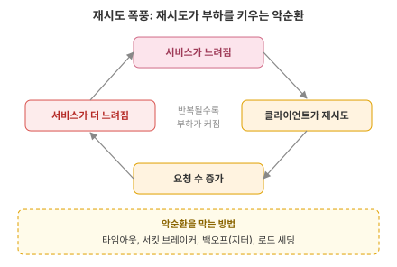
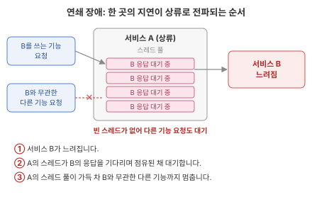

import {AnimatedLineChart} from '@site/src/components/blog/MonitorCharts';

<!-- truncate -->

트래픽이 2배가 됐다고 문제가 2배로 늘지는 않습니다. <mark>평소엔 멀쩡하다가 어느 지점을 넘는 순간 갑자기 성능이 급락하는 게 스케일 문제의 특징입니다.</mark> "어디가 먼저, 왜 문제가 생기는지"를 스택별로 훑고, 대응 원칙을 정리합니다. 각 항목의 자세한 내용은 관련 글로 링크했습니다.

## 왜 "갑자기" 문제가 발생하나 — 포화의 비선형성

자원(스레드, 커넥션, CPU)이 여유로울 땐 부하가 늘어도 지연이 완만하게 오릅니다. 그런데 **포화(100%)에 가까워지면 대기가 급증해 지연이 가파르게 오릅니다.** 이 "임계점(knee)"을 넘으면 작은 트래픽 증가가 급격한 성능 저하로 이어집니다.

<AnimatedLineChart
  title="부하가 포화에 가까워지면 지연이 급상승(임계점 곡선)"
  data={[10, 11, 12, 14, 17, 22, 32, 60, 120, 240]}
  yMax={250}
  xLabel="부하 →"
  unit="지연(ms)"
/>

<mark>그래서 "지금 여유 있어 보임"이 안전을 뜻하지 않습니다 — 임계점 바로 앞일 수 있습니다.</mark> 아래에서 다룰 문제들은 대부분, 이 자원 포화(고갈)가 스택의 어느 부분에서 가장 먼저 나타나는지에 관한 것입니다.

이 임계점은 감이 아니라 **대기행렬 이론으로 설명되는 현상**입니다. 가장 단순한 M/M/1 모델에서 평균 응답시간은 대략 `R = S / (1 − ρ)` 꼴이라(S=서비스 시간, ρ=이용률), 이용률 ρ가 100%에 가까워지면 응답시간이 **쌍곡선으로 발산**합니다. 도착, 처리 시간의 변동성까지 반영한 **Kingman 공식**은 대기시간이 `ρ / (1 − ρ)`에 비례한다고 말하고, 병렬 시스템에서는 **Universal Scalability Law(USL)** 가 경합(contention), 코히런시(coherency) 비용 때문에 어느 지점 뒤로는 처리량이 오히려 **감소(retrograde)** 한다고 설명합니다.

- M/M/1 대기행렬 — 응답시간이 `1 / (1 − ρ)`로 발산: [Wikipedia: M/M/1 queue](https://en.wikipedia.org/wiki/M/M/1_queue)
- Kingman 공식 — 변동성을 반영한 대기시간 근사(포화 근처에서 특히 정확): [Wikipedia: Kingman's formula](https://en.wikipedia.org/wiki/Kingman%27s_formula)
- Universal Scalability Law — 경합과 코히런시로 인한 처리량 한계와 역행: [N. J. Gunther, Performance Dynamics](https://www.perfdynamics.com/Manifesto/USLscalability.html)

## 스택별로 어디부터 문제가 생기나

**① 커넥션, 스레드 풀 고갈**<br />
가장 먼저 한계에 닿는 지점. 처리시간이 조금만 늘어도 동시 요청이 불어나 풀이 고갈됩니다(리틀의 법칙: 동시 요청 = 유입 × 처리시간). 그러면 요청이 큐에서 대기하다 타임아웃. 자세히는 [서버 지표 읽기](./server-monitoring-analysis)의 리틀의 법칙 부분.

**② 캐시 — 히트율 저하, 스탬피드, 핫키**<br />
트래픽이 늘면 캐시 미스가 왜 함께 늘까요? 이유는 크게 두 가지입니다.

- **미스 개수**: 히트율이 그대로여도 요청 수가 늘면 미스의 **절대 개수**가 비례해 늘어, 캐시가 막아 주던 원본(DB) 부하도 그만큼 커집니다(히트율 90%여도 요청이 10배면 미스도 10배).
- **히트율 자체**: 트래픽이 늘수록 더 다양한 키가 유입돼 캐시 용량을 넘기면 **에빅션**(오래된 키 제거)이 빈번해지고, 재사용되기 전에 밀려난 키는 다음에 다시 미스가 됩니다. 즉 트래픽 증가가 히트율까지 끌어내려 미스가 이중으로 늘어납니다.

여기에 두 패턴이 더해집니다. 인기 키가 만료되는 짧은 순간 다수 요청이 동시에 미스 나 원본으로 몰리는 **캐시 스탬피드**, 특정 키에 요청이 집중돼 그 키를 보관한 노드가 과부하되는 **핫키**입니다. 결국 캐시가 흡수하던 부하가 DB로 전가되고, 캐시가 완충 역할을 못 하는 순간 DB가 앞서 말한 임계점을 넘습니다. → [커머스 캐시 트래픽 대응](./commerce-cache-traffic-strategy).

**③ DB 병목**<br />
대개 최종 병목은 DB입니다. 슬로 쿼리, 인덱스 부재가 트래픽과 함께 커지고, 락 경합이 심해지며, 읽기 복제본은 **복제 지연**이 벌어집니다. 커넥션 상한도 먼저 찹니다.

**④ 큐 적체, 백프레셔(backpressure)**<br />
유입이 처리 속도를 앞서면 큐가 계속 쌓입니다. 방치하면 메모리까지 밀어붙이죠. → [대용량 Redis 대응](./redis-large-scale-pitfalls), [서버 지표 읽기](./server-monitoring-analysis).

**⑤ CPU, 메모리, GC 포화**<br />
CPU가 차면 런 큐가 길어지고, 힙 압박으로 **GC가 자주, 오래** 실행돼 지연을 키우다 OOM으로 갑니다. → [JVM 힙 덤프 분석](./jvm-heap-dump-analysis).

**⑥ 팬아웃, P99 레이턴시 증폭**<br />
한 요청이 내부적으로 여러 번 호출하면(fan-out), 그중 하나만 느려도 전체가 느려집니다. 트래픽이 늘수록 내부 호출이 늘어, 하나라도 느린 호출에 걸릴 확률이 높아지고 그만큼 **P99 레이턴시**가 빠르게 나빠집니다. → [서버 지표 읽기](./server-monitoring-analysis).

**⑦ 부하 불균형(핫 파티션)**<br />
샤딩과 파티셔닝을 해도 특정 키, 샤드에 트래픽이 쏠리면 그 노드만 포화됩니다. 평균은 여유인데 한 곳이 멈추는 형태.

## 부하가 부하를 낳는다 — 연쇄 장애

트래픽 증가의 가장 무서운 형태는 **스스로 커지는 실패**입니다.

- **재시도 폭풍(retry storm)** — 느려진 서비스에 클라이언트가 재시도하면, 그 재시도가 부하를 더 키워 더 느려지는 악순환.
- **연쇄 장애(cascading failure)** — 한 컴포넌트가 느려지면 그걸 기다리는 상류가 함께 밀리고, 스레드가 점유된 채 대기해 다른 기능까지 정지.
- **동시 쇄도(thundering herd)** — 캐시 만료, 재시작 직후 수많은 요청이 한꺼번에 몰림.

재시도 폭풍과 연쇄 장애가 전파되는 순서는 다음과 같습니다.

<details>
<summary>SVG 코드</summary>

```svg
<svg xmlns="http://www.w3.org/2000/svg" width="440" height="296" viewBox="0 0 440 296" font-family="-apple-system, 'Segoe UI', 'Noto Sans KR', sans-serif">
<defs><marker id="ah" viewBox="0 0 10 10" refX="9" refY="5" markerWidth="7" markerHeight="7" orient="auto-start-reverse"><path d="M0,0 L10,5 L0,10 z" fill="#888"/></marker><marker id="ahb" viewBox="0 0 10 10" refX="9" refY="5" markerWidth="7" markerHeight="7" orient="auto-start-reverse"><path d="M0,0 L10,5 L0,10 z" fill="#4C7FE0"/></marker></defs>
<rect x="0" y="0" width="440" height="296" fill="#FFFFFF"/>
<text x="220.0" y="22" font-size="13" fill="#333" text-anchor="middle" font-weight="bold">재시도 폭풍: 재시도가 부하를 키우는 악순환</text>
<rect x="148" y="41" width="144" height="34" rx="6" fill="#FCE4EC" stroke="#D06A86"/>
<text x="220" y="62" font-size="11" fill="#9E3A57" text-anchor="middle" font-weight="bold">서비스가 느려짐</text>
<rect x="268" y="111" width="144" height="34" rx="6" fill="#FFF3E0" stroke="#E0A000"/>
<text x="340" y="132" font-size="11" fill="#333" text-anchor="middle" font-weight="bold">클라이언트가 재시도</text>
<rect x="148" y="181" width="144" height="34" rx="6" fill="#FFF3E0" stroke="#E0A000"/>
<text x="220" y="202" font-size="11" fill="#333" text-anchor="middle" font-weight="bold">요청 수 증가</text>
<rect x="28" y="111" width="144" height="34" rx="6" fill="#FDECEC" stroke="#D9534F"/>
<text x="100" y="132" font-size="11" fill="#B52B27" text-anchor="middle" font-weight="bold">서비스가 더 느려짐</text>
<line x1="292" y1="58" x2="340" y2="109" stroke="#888" stroke-width="1.2" marker-end="url(#ah)"/>
<line x1="340" y1="145" x2="292" y2="198" stroke="#888" stroke-width="1.2" marker-end="url(#ah)"/>
<line x1="148" y1="198" x2="100" y2="147" stroke="#888" stroke-width="1.2" marker-end="url(#ah)"/>
<line x1="100" y1="111" x2="148" y2="58" stroke="#888" stroke-width="1.2" marker-end="url(#ah)"/>
<text x="220" y="126" font-size="10" fill="#888" text-anchor="middle">반복될수록</text>
<text x="220" y="141" font-size="10" fill="#888" text-anchor="middle">부하가 커짐</text>
<rect x="20" y="232" width="400" height="50" rx="6" fill="#FFFBEA" stroke="#E0A000" stroke-dasharray="4 3"/>
<text x="220" y="252" font-size="10.5" fill="#8A6400" text-anchor="middle" font-weight="bold">악순환을 막는 방법</text>
<text x="220" y="270" font-size="10.5" fill="#333" text-anchor="middle">타임아웃, 서킷 브레이커, 백오프(지터), 로드 셰딩</text>
</svg>
```

</details>

<figure style={{textAlign: 'center', margin: '1.5rem 0'}}>
  
</figure>

<details>
<summary>SVG 코드</summary>

```svg
<svg xmlns="http://www.w3.org/2000/svg" width="440" height="278" viewBox="0 0 440 278" font-family="-apple-system, 'Segoe UI', 'Noto Sans KR', sans-serif">
<defs><marker id="ah" viewBox="0 0 10 10" refX="9" refY="5" markerWidth="7" markerHeight="7" orient="auto-start-reverse"><path d="M0,0 L10,5 L0,10 z" fill="#888"/></marker><marker id="ahb" viewBox="0 0 10 10" refX="9" refY="5" markerWidth="7" markerHeight="7" orient="auto-start-reverse"><path d="M0,0 L10,5 L0,10 z" fill="#4C7FE0"/></marker></defs>
<rect x="0" y="0" width="440" height="278" fill="#FFFFFF"/>
<text x="220.0" y="22" font-size="13" fill="#333" text-anchor="middle" font-weight="bold">연쇄 장애: 한 곳의 지연이 상류로 전파되는 순서</text>
<rect x="10" y="52" width="96" height="40" rx="6" fill="#EEF3FB" stroke="#4C7FE0"/>
<text x="58" y="68.5" font-size="10" fill="#26508F" text-anchor="middle">B를 쓰는 기능</text>
<text x="58" y="82.5" font-size="10" fill="#26508F" text-anchor="middle">요청</text>
<rect x="10" y="118" width="96" height="40" rx="6" fill="#EEF3FB" stroke="#4C7FE0"/>
<text x="58" y="134.5" font-size="10" fill="#26508F" text-anchor="middle">B와 무관한</text>
<text x="58" y="148.5" font-size="10" fill="#26508F" text-anchor="middle">다른 기능 요청</text>
<rect x="132" y="40" width="160" height="130" rx="6" fill="#F7F7F7" stroke="#999999"/>
<text x="212" y="58" font-size="11" fill="#333" text-anchor="middle" font-weight="bold">서비스 A (상류)</text>
<text x="212" y="74" font-size="9.5" fill="#888" text-anchor="middle">스레드 풀</text>
<rect x="150" y="82" width="124" height="16" rx="3" fill="#FCE4EC" stroke="#D06A86"/>
<text x="212" y="94" font-size="9.5" fill="#9E3A57" text-anchor="middle">B 응답 대기 중</text>
<rect x="150" y="102" width="124" height="16" rx="3" fill="#FCE4EC" stroke="#D06A86"/>
<text x="212" y="114" font-size="9.5" fill="#9E3A57" text-anchor="middle">B 응답 대기 중</text>
<rect x="150" y="122" width="124" height="16" rx="3" fill="#FCE4EC" stroke="#D06A86"/>
<text x="212" y="134" font-size="9.5" fill="#9E3A57" text-anchor="middle">B 응답 대기 중</text>
<rect x="150" y="142" width="124" height="16" rx="3" fill="#FCE4EC" stroke="#D06A86"/>
<text x="212" y="154" font-size="9.5" fill="#9E3A57" text-anchor="middle">B 응답 대기 중</text>
<rect x="322" y="72" width="108" height="52" rx="6" fill="#FDECEC" stroke="#D9534F"/>
<text x="376" y="94.3" font-size="11" fill="#B52B27" text-anchor="middle" font-weight="bold">서비스 B</text>
<text x="376" y="109.3" font-size="11" fill="#B52B27" text-anchor="middle" font-weight="bold">느려짐</text>
<line x1="106" y1="72" x2="148" y2="90" stroke="#888" stroke-width="1.2" marker-end="url(#ah)"/>
<line x1="274" y1="98" x2="320" y2="98" stroke="#888" stroke-width="1.2" marker-end="url(#ah)"/>
<line x1="106" y1="138" x2="146" y2="138" stroke="#D9534F" stroke-width="1.2" stroke-dasharray="3 2"/>
<text x="126" y="142" font-size="13" fill="#D9534F" text-anchor="middle" font-weight="bold">✕</text>
<text x="212" y="188" font-size="10" fill="#B52B27" text-anchor="middle" font-weight="bold">빈 스레드가 없어 다른 기능 요청도 대기</text>
<text x="20" y="214" font-size="11" fill="#B52B27" text-anchor="start" font-weight="bold">①</text>
<text x="38" y="214" font-size="10.5" fill="#333" text-anchor="start">서비스 B가 느려집니다.</text>
<text x="20" y="234" font-size="11" fill="#B52B27" text-anchor="start" font-weight="bold">②</text>
<text x="38" y="234" font-size="10.5" fill="#333" text-anchor="start">A의 스레드가 B의 응답을 기다리며 점유된 채 대기합니다.</text>
<text x="20" y="254" font-size="11" fill="#B52B27" text-anchor="start" font-weight="bold">③</text>
<text x="38" y="254" font-size="10.5" fill="#333" text-anchor="start">A의 스레드 풀이 가득 차 B와 무관한 다른 기능까지 멈춥니다.</text>
</svg>
```

</details>

<figure style={{textAlign: 'center', margin: '1.5rem 0'}}>
  
</figure>

<mark>이걸 막으려면 "실패를 빨리, 국소적으로" 만들어야 합니다 — 타임아웃, 서킷 브레이커, 백오프, 로드 셰딩.</mark> 관련 개념은 [내결함성과 고가용성](./fault-tolerance-high-availability).

## 대응 원칙

증상별 대처가 아니라 방향만 요약하면:

- **여유(headroom)를 두고 임계점 전에 확장** — 자원 사용률을 100%가 아니라 여유 구간에서 운영, 오토스케일은 웜업 시간을 감안.
- **캐시, 풀 튜닝** — 히트율, 풀 크기와 타임아웃을 부하에 맞게.
- **백프레셔, 로드 셰딩** — 못 받을 요청은 빨리 거절(`429 Too Many Requests`)해 전체를 지킴.
- **서킷 브레이커, 타임아웃, 백오프(지터)** — 재시도 폭풍, 연쇄 장애 차단.
- **수평 확장, 샤딩 + 핫키 분산** — 단일 노드 포화 회피.
- **비동기와 큐로 평탄화** — 스파이크를 큐로 흡수(대신 적체 관리).
- **관측과 부하 테스트** — [지표로 임계점을 미리 보고](./server-monitoring-analysis), 부하 테스트로 한계를 먼저 찾습니다.

## 정리

- 스케일 문제는 선형이 아니라 **임계점을 넘으면 급격히** 나빠집니다.
- 보통 **커넥션/풀 → 캐시 → DB** 순으로 먼저 문제가 생기고, CPU, GC, 큐, 핫키가 뒤따릅니다.
- 최악은 **재시도 폭풍, 연쇄 장애**로, 실패를 빨리와 국소적으로 만드는 장치가 필수입니다.
- <mark>대비의 핵심은 "여유를 두고, 실패를 빨리 끊고, 병목을 분산하고, 지표로 미리 본다"입니다.</mark>

메시지 큐로 스파이크를 완충하는 선택은 [메시지 큐 비교](./message-queue-comparison)도 함께 보세요.

### 용어 한 줄 정리

| 용어 | 쉬운 뜻 |
|---|---|
| 임계점(knee) | 포화 직전, 지연이 급격히 오르기 시작하는 지점 |
| 백프레셔(backpressure) | 처리보다 유입이 빨라 큐가 쌓이는 상태 |
| 로드 셰딩(load shedding) | 초과 요청을 빨리 거절해 전체를 살리기 |
| 재시도 폭풍 | 재시도가 부하를 더 키워 악화되는 악순환 |
| 연쇄 장애 | 한 곳의 지연이 상류로 번져 함께 장애로 이어짐 |
| P99 레이턴시 | 상위 1%가 겪는 응답시간 — 팬아웃이 많을수록 크게 증폭 |
