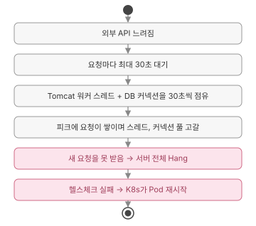

<!-- truncate -->

**상황** — 결제 단계에서 외부 결제 승인 API 호출에 read timeout(30초)이 나기 시작하더니, **몇 분 뒤 서버 전체가 응답 불가(Hang)** 가 됐습니다. 결국 Kubernetes가 헬스체크 실패로 Pod를 재시작했습니다. <mark>느려진 건 외부 API 하나인데 왜 서버 전체가 멈췄을까요?</mark> (Spring Boot 3.x, Kotlin, MySQL 8.0, Kubernetes)

```text
ERROR c.e.PaymentService : payment approval failed
org.springframework.web.client.ResourceAccessException:
  I/O error on POST request for "https://pay-api.example.com/v1/approve": Read timed out;
  nested exception is java.net.SocketTimeoutException: Read timed out
    at o.s.web.client.RestTemplate.postForEntity(...)
    at c.e.PaymentApproveClient.approve(PaymentApproveClient.java:78)
    at c.e.OrderService.approvePayment(OrderService.java:245)
    at c.e.OrderService.placeOrder(OrderService.java:178)
```

## 무슨 일이 벌어졌나

문제 코드의 특징은 두 가지였습니다 — **동기 블로킹 호출**(RestTemplate)을, 그것도 **트랜잭션 안에서** 했다는 점.

```java
@Transactional
public void placeOrder(...) {
    // ...
    approvePayment(...); // 내부에서 RestTemplate으로 외부 결제 승인 API 동기 호출(read timeout 30s)
    // ...
}
```

외부 API가 느려지자 이러한 연쇄가 발생했습니다.

<details>
<summary>SVG 코드</summary>

```svg
<svg xmlns="http://www.w3.org/2000/svg" width="360" height="318" viewBox="0 0 360 318" font-family="-apple-system, 'Segoe UI', 'Noto Sans KR', sans-serif">
<defs><marker id="ah" viewBox="0 0 10 10" refX="9" refY="5" markerWidth="7" markerHeight="7" orient="auto-start-reverse"><path d="M0,0 L10,5 L0,10 z" fill="#888"/></marker></defs>
<rect x="0" y="0" width="360" height="318" fill="#FFFFFF"/>
<circle cx="180" cy="14" r="7" fill="#444"/>
<line x1="180" y1="21" x2="180" y2="31" stroke="#888" stroke-width="1.2" marker-end="url(#ah)"/>
<rect x="20" y="32" width="320" height="30" rx="6" fill="#F7F7F7" stroke="#999999"/>
<text x="180" y="51" font-size="11" fill="#333" text-anchor="middle">외부 API 느려짐</text>
<line x1="180" y1="62" x2="180" y2="75" stroke="#888" stroke-width="1.2" marker-end="url(#ah)"/>
<rect x="20" y="76" width="320" height="30" rx="6" fill="#F7F7F7" stroke="#999999"/>
<text x="180" y="95" font-size="11" fill="#333" text-anchor="middle">요청마다 최대 30초 대기</text>
<line x1="180" y1="106" x2="180" y2="119" stroke="#888" stroke-width="1.2" marker-end="url(#ah)"/>
<rect x="20" y="120" width="320" height="30" rx="6" fill="#F7F7F7" stroke="#999999"/>
<text x="180" y="139" font-size="11" fill="#333" text-anchor="middle">Tomcat 워커 스레드 + DB 커넥션을 30초씩 점유</text>
<line x1="180" y1="150" x2="180" y2="163" stroke="#888" stroke-width="1.2" marker-end="url(#ah)"/>
<rect x="20" y="164" width="320" height="30" rx="6" fill="#F7F7F7" stroke="#999999"/>
<text x="180" y="183" font-size="11" fill="#333" text-anchor="middle">피크에 요청이 쌓이며 스레드, 커넥션 풀 고갈</text>
<line x1="180" y1="194" x2="180" y2="207" stroke="#888" stroke-width="1.2" marker-end="url(#ah)"/>
<rect x="20" y="208" width="320" height="30" rx="6" fill="#FCE4EC" stroke="#D06A86"/>
<text x="180" y="227" font-size="11" fill="#9E3A57" text-anchor="middle">새 요청을 못 받음 → 서버 전체 Hang</text>
<line x1="180" y1="238" x2="180" y2="251" stroke="#888" stroke-width="1.2" marker-end="url(#ah)"/>
<rect x="20" y="252" width="320" height="30" rx="6" fill="#FCE4EC" stroke="#D06A86"/>
<text x="180" y="271" font-size="11" fill="#9E3A57" text-anchor="middle">헬스체크 실패 → K8s가 Pod 재시작</text>
<line x1="180" y1="282" x2="180" y2="291" stroke="#888" stroke-width="1.2" marker-end="url(#ah)"/>
<circle cx="180" cy="300" r="8" fill="#FFFFFF" stroke="#444" stroke-width="1.5"/>
<circle cx="180" cy="300" r="4.5" fill="#444"/>
</svg>
```

</details>

<figure style={{textAlign: 'center', margin: '1.5rem 0'}}>
  
</figure>

<mark>느린 외부 호출 하나가 요청마다 공유 자원(스레드, DB 커넥션)을 30초씩 점유하고, 피크에 그게 쌓이며 풀이 고갈돼 서버 전체가 멈춘 것</mark>입니다. 특히 트랜잭션 안에서 호출해 **DB 커넥션까지** 30초씩 점유하고 있었던 게 컸습니다.

## 왜 "하나 느려졌는데 전체가"

서버의 동시 처리량은 **스레드 풀, 커넥션 풀 크기**로 정해집니다(리틀의 법칙: 동시 처리 = 유입 × 처리시간 — [서버 지표 읽기](./server-monitoring-analysis)). 처리시간이 30초로 늘면 같은 유입에도 동시 점유가 폭증해 풀이 금방 고갈됩니다. 풀이 고갈되면 그 뒤 요청은 전부 대기 → 전체 Hang. <mark>타임아웃 30초는 "실패를 30초나 늦게 인정"하는 설정이라, 장애 시 자원을 오래 점유하는 위험 요소가 됩니다.</mark>

## 해결 — 빨리 차단하고, 분리하고, 격리한다

- **타임아웃을 짧게** — connect/read를 나눠 초 단위로. 외부가 느리면 빨리 실패해 자원을 즉시 해제합니다.
- **외부 호출을 트랜잭션 밖으로** — DB 커넥션을 외부 응답 동안 점유하지 않게. (rollback-only 문제도 함께 피함 — [try-catch로 처리했는데 왜 롤백될까](./spring-transaction-rollback-only))
- **서킷 브레이커** — 외부가 계속 실패하면 잠깐 호출을 차단해 빠르게 대체 응답(전파 차단).
- **벌크헤드(격리)** — 외부 호출용 스레드 풀을 따로 배치해, 그게 막혀도 나머지 요청은 지킵니다.
- **타임아웃 예산** — 외부일수록 길게, 안쪽일수록 짧게 차등. 재시도는 백오프+상한.

```java
var factory = new SimpleClientHttpRequestFactory();
factory.setConnectTimeout(1000); // 1s
factory.setReadTimeout(2000);    // 2s — 30s는 너무 길다
```

<mark>외부 의존은 "언젠가 느려진다"를 전제로, 빨리 실패하고 번지지 않게 격리하도록 설계해야 합니다.</mark>

## 정리

- 동기 외부 호출이 느려지면 **요청마다 스레드와 커넥션을 오래 점유** → 풀 고갈 → 서버 전체 Hang.
- **긴 타임아웃 + 트랜잭션 안 외부 호출**이 손실을 키웁니다.
- 해결은 **짧은 타임아웃, 트랜잭션 밖 호출, 서킷 브레이커, 벌크헤드, 백오프 재시도**.
- 부하가 늘 때 어디부터 문제가 생기는지는 [트래픽이 늘면 어디부터 문제가 생기나](./traffic-growth-problems), 풀 사이징은 [스레드 풀](./spring-boot-thread-pools) 참고.

### 용어 한 줄 정리

| 용어 | 쉬운 뜻 |
|---|---|
| read timeout | 응답을 기다리는 최대 시간(초과 시 실패) |
| 풀 고갈 | 스레드와 커넥션이 다 점유돼 새 요청을 못 받는 상태 |
| 서킷 브레이커 | 계속 실패하면 잠깐 호출을 차단해 전파를 막는 장치 |
| 벌크헤드 | 자원을 칸막이로 나눠 한 곳 장애가 전체로 안 번지게 |
