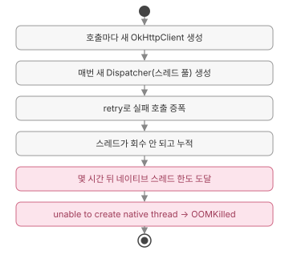

<!-- truncate -->

**상황** — 배포 후 **반나절쯤 지나** 간헐적으로 Pod가 `OOMKilled`로 재시작됐습니다. 트래픽은 평소와 큰 차이가 없었고, 최근 변경은 **외부 추천 API 호출을 OkHttp로 추가하고 retry, timeout을 설정**한 것뿐이었습니다. <mark>힙을 아무리 봐도 여유가 있는데 왜 OOM이 날까요?</mark> (Spring Boot 3.x, Kotlin 1.9.x, Java 17, OkHttp, Kubernetes)

```text
ERROR c.e.RecommendController : Unexpected error
java.lang.OutOfMemoryError: unable to create native thread:
  possibly out of memory or process/resource limits reached
    at java.base/java.lang.Thread.start0(Native Method)
    at java.base/java.lang.Thread.start(Thread.java:809)
    at java.base/j.u.concurrent.ThreadPoolExecutor.addWorker(ThreadPoolExecutor.java:945)
    at java.base/j.u.concurrent.ThreadPoolExecutor.execute(ThreadPoolExecutor.java:1364)
    at okhttp3.Dispatcher.enqueue(Dispatcher.kt)
    at okhttp3.RealCall.enqueue(RealCall.kt)
    at c.e.RecommendApiClient.fetchAsync(RecommendApiClient.java:87)
```

## 이 OOM은 "힙 부족"이 아니다

이름은 `OutOfMemoryError`지만, `unable to create native thread`는 **힙이 부족한 게 아니라 스레드를 더 못 만드는 것**입니다. 스레드 하나는 힙 밖 **네이티브 메모리(스레드 스택)** 를 쓰고, OS의 **스레드/프로세스 개수 한도**도 있습니다. <mark>스레드가 계속 쌓여 이 한도에 도달하면 이 예외가 나고, 그 스택들이 컨테이너 메모리를 넘기면 커널이 `OOMKilled`로 종료합니다.</mark> 힙과 별개라 힙 그래프만 봐선 안 보입니다. (힙 밖 메모리 이야기는 [JVM 튜닝 시나리오](./jvm-tuning-scenarios) 상황 4 참고)

## 무슨 일이 벌어졌나

`OkHttp Dispatcher`의 스레드가 계속 쌓이는 구조였습니다. 흔한 원인 두 가지:

- **OkHttpClient를 호출마다 새로 생성** — `OkHttpClient`는 자체 `Dispatcher`(스레드 풀)와 커넥션 풀을 가집니다. 요청마다 새로 만들면 스레드 풀도 계속 생겨 **회수되지 않고 누적**됩니다.
- **비동기 `enqueue`를 상한 없이 + retry 증폭** — 실패가 재시도로 늘어나 대기, 실행 스레드가 더 쌓입니다.

<details>
<summary>SVG 코드</summary>

```svg
<svg xmlns="http://www.w3.org/2000/svg" width="360" height="318" viewBox="0 0 360 318" font-family="-apple-system, 'Segoe UI', 'Noto Sans KR', sans-serif">
<defs><marker id="ah" viewBox="0 0 10 10" refX="9" refY="5" markerWidth="7" markerHeight="7" orient="auto-start-reverse"><path d="M0,0 L10,5 L0,10 z" fill="#888"/></marker></defs>
<rect x="0" y="0" width="360" height="318" fill="#FFFFFF"/>
<circle cx="180" cy="14" r="7" fill="#444"/>
<line x1="180" y1="21" x2="180" y2="31" stroke="#888" stroke-width="1.2" marker-end="url(#ah)"/>
<rect x="20" y="32" width="320" height="30" rx="6" fill="#F7F7F7" stroke="#999999"/>
<text x="180" y="51" font-size="11" fill="#333" text-anchor="middle">호출마다 새 OkHttpClient 생성</text>
<line x1="180" y1="62" x2="180" y2="75" stroke="#888" stroke-width="1.2" marker-end="url(#ah)"/>
<rect x="20" y="76" width="320" height="30" rx="6" fill="#F7F7F7" stroke="#999999"/>
<text x="180" y="95" font-size="11" fill="#333" text-anchor="middle">매번 새 Dispatcher(스레드 풀) 생성</text>
<line x1="180" y1="106" x2="180" y2="119" stroke="#888" stroke-width="1.2" marker-end="url(#ah)"/>
<rect x="20" y="120" width="320" height="30" rx="6" fill="#F7F7F7" stroke="#999999"/>
<text x="180" y="139" font-size="11" fill="#333" text-anchor="middle">retry로 실패 호출 증폭</text>
<line x1="180" y1="150" x2="180" y2="163" stroke="#888" stroke-width="1.2" marker-end="url(#ah)"/>
<rect x="20" y="164" width="320" height="30" rx="6" fill="#F7F7F7" stroke="#999999"/>
<text x="180" y="183" font-size="11" fill="#333" text-anchor="middle">스레드가 회수 안 되고 누적</text>
<line x1="180" y1="194" x2="180" y2="207" stroke="#888" stroke-width="1.2" marker-end="url(#ah)"/>
<rect x="20" y="208" width="320" height="30" rx="6" fill="#FCE4EC" stroke="#D06A86"/>
<text x="180" y="227" font-size="11" fill="#9E3A57" text-anchor="middle">몇 시간 뒤 네이티브 스레드 한도 도달</text>
<line x1="180" y1="238" x2="180" y2="251" stroke="#888" stroke-width="1.2" marker-end="url(#ah)"/>
<rect x="20" y="252" width="320" height="30" rx="6" fill="#FCE4EC" stroke="#D06A86"/>
<text x="180" y="271" font-size="11" fill="#9E3A57" text-anchor="middle">unable to create native thread → OOMKilled</text>
<line x1="180" y1="282" x2="180" y2="291" stroke="#888" stroke-width="1.2" marker-end="url(#ah)"/>
<circle cx="180" cy="300" r="8" fill="#FFFFFF" stroke="#444" stroke-width="1.5"/>
<circle cx="180" cy="300" r="4.5" fill="#444"/>
</svg>
```

</details>

<figure style={{textAlign: 'center', margin: '1.5rem 0'}}>
  
</figure>

<mark>트래픽이 그대로여도, 스레드가 조금씩 누적되면 몇 시간에 걸쳐 한도에 도달합니다 — 그래서 배포 직후가 아니라 반나절쯤 지나 발생한 것</mark>입니다.

## 어떻게 찾나

- **스레드 수 추이**를 본다 — 시간이 지날수록 우상향이면 스레드 누수. (`jcmd <pid> Thread.print`, 리눅스면 `/proc/<pid>/status`의 `Threads`)
- 스레드 덤프에서 `OkHttp Dispatcher` 같은 이름의 스레드가 **수천 개**로 불어나 있는지 확인.

## 해결 — 클라이언트는 재사용, 동시성엔 상한

- **`OkHttpClient`는 싱글톤으로 재사용** — 애플리케이션 전체가 하나(또는 소수)를 공유해 `Dispatcher`, 커넥션 풀을 재사용합니다. **호출마다 생성 금지.**
- **Dispatcher에 동시 요청 상한** — `maxRequests` / `maxRequestsPerHost`로 폭증을 막습니다.
- **retry는 상한 + 백오프** — 무한, 중첩 재시도 금지.
- **컨테이너 자원 한도 고려** — 스레드 스택(`-Xss`), `ulimit`, 컨테이너 메모리. 힙은 `-XX:MaxRAMPercentage`로 잡되 **힙 밖 몫을 남긴다**([JVM 튜닝](./jvm-tuning-scenarios)).

```java
@Bean
OkHttpClient okHttpClient() { // 애플리케이션당 하나만
    var client = new OkHttpClient.Builder()
            .connectTimeout(Duration.ofSeconds(1))
            .readTimeout(Duration.ofSeconds(2))
            .build();
    client.dispatcher().setMaxRequests(64);
    client.dispatcher().setMaxRequestsPerHost(16);
    return client;
}
```

<mark>클라이언트는 재사용하고 동시성엔 상한을 설정하는 것 — 이 둘이면 스레드 폭증은 거의 사라집니다.</mark>

## 정리

- `unable to create native thread`는 **힙이 아니라 네이티브 스레드 한도** 문제입니다. `OOMKilled`도 힙 밖 메모리 초과입니다.
- 원인은 **OkHttpClient 재생성, 상한 없는 비동기, retry 증폭**으로 스레드가 몇 시간에 걸쳐 누적된 것입니다.
- 해결은 **클라이언트 싱글톤 재사용, Dispatcher 상한, retry 상한, 컨테이너 자원 한도 고려**.
- <mark>배포 직후가 아니라 몇 시간 뒤 발생하는 건 "천천히 쌓이는" 누수의 전형입니다.</mark>

느린 외부 호출이 유발하는 다른 장애는 [외부 API 하나가 느려지자 서버 전체가 멈췄다](./external-api-timeout-server-hang)도 함께 보세요.

### 용어 한 줄 정리

| 용어 | 쉬운 뜻 |
|---|---|
| 네이티브 스레드 | JVM 힙 밖, OS가 관리하는 실제 스레드(스택 메모리 사용) |
| unable to create native thread | 스레드를 더 못 만드는 상태(개수, 네이티브 메모리 한도) |
| OOMKilled | 컨테이너 메모리 한도 초과로 커널이 종료(exit 137) |
| Dispatcher | OkHttp가 요청을 실행하는 스레드 풀, 큐 |
