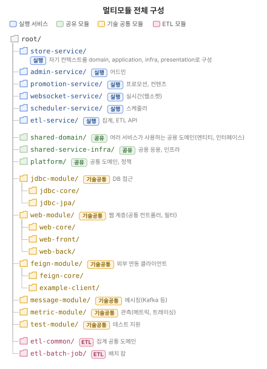
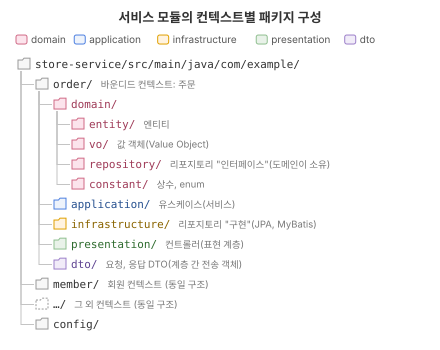
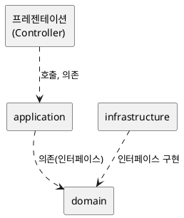
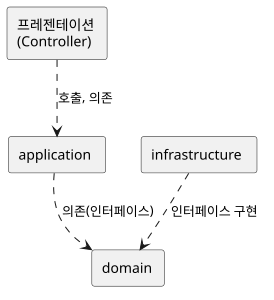
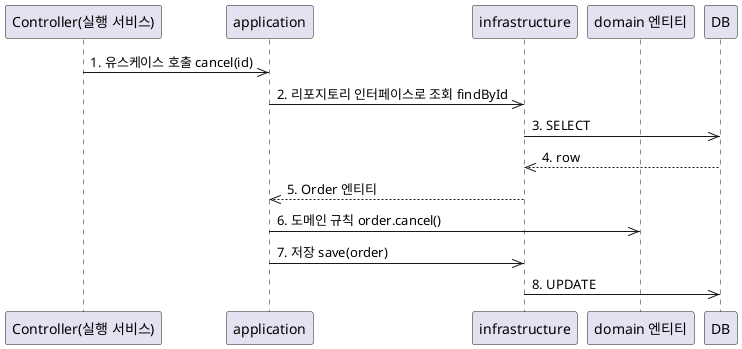
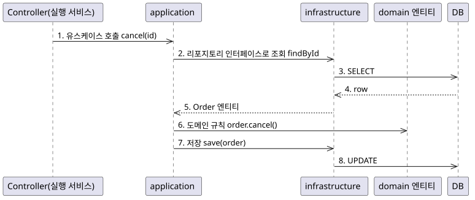

<!-- truncate -->

서비스가 커지면 하나의 거대한 모듈로는 빌드가 느려지고, 계층 간 의존성이 뒤엉키며, 책임 경계가 허물어집니다. 여러 실행 서비스(API, 배치, 스케줄러 등)와 공통 도메인을 **한 저장소의 멀티모듈**로 관리하되, 각 도메인을 **도메인, 애플리케이션, 인프라 레이어**로 나누는 DDD 기반 레이어드 멀티모듈 구성을 정리합니다. DDD는 [에릭 에반스(Eric Evans)](https://www.domainlanguage.com/)가 2003년 저서 『Domain-Driven Design: Tackling Complexity in the Heart of Software』에서 정립한 접근이고, 도메인을 계층으로 나누는 레이어드 구성은 [마틴 파울러의 PoEAA](https://martinfowler.com/eaaCatalog/) 등에서도 정리된 고전적 패턴입니다.

<mark>멀티모듈은 책임, 의존성 경계를 물리적으로 강제하고, 레이어드는 그 경계 안에서 의존성이 도메인 쪽으로만 향하게 만듭니다.</mark>

## 왜 멀티모듈 + 레이어드인가

단일 모듈은 처음엔 편하지만 커질수록 문제가 생깁니다. 전체가 한 번에 컴파일돼 빌드가 느리고, 웹 계층이 도메인을 우회해 DB를 직접 호출하는 식으로 **계층 경계가 쉽게 허물어집니다.** 모듈을 나누면 "이 모듈은 저 모듈을 의존할 수 없다"는 규칙을 **빌드 도구가 강제**하므로, 경계가 코드 리뷰가 아니라 구조로 지켜집니다.

<mark>경계를 사람의 규율이 아니라 모듈 의존성으로 강제하는 것이 멀티모듈의 핵심 가치입니다.</mark>

## 전체 구성 한눈에

모듈은 크게 세 부류입니다. (1) 실행 가능한 **서비스 모듈** — 각 서비스가 맡은 도메인을 컨텍스트별로 `domain`, `application`, `infrastructure`, `presentation` **4계층으로 직접** 구성합니다. (2) 여러 서비스가 함께 사용하는 **공유 도메인, 응용 모듈**. (3) **기술 공통 모듈**입니다.

<details>
<summary>SVG 코드</summary>

```svg
<svg xmlns="http://www.w3.org/2000/svg" width="440" height="608" viewBox="0 0 440 608" font-family="-apple-system, 'Segoe UI', 'Noto Sans KR', sans-serif">
<defs><marker id="ah" viewBox="0 0 10 10" refX="9" refY="5" markerWidth="7" markerHeight="7" orient="auto-start-reverse"><path d="M0,0 L10,5 L0,10 z" fill="#888"/></marker></defs>
<rect x="0" y="0" width="440" height="608" fill="#FFFFFF"/>
<text x="220.0" y="22" font-size="13" fill="#333" text-anchor="middle" font-weight="bold">멀티모듈 전체 구성</text>
<rect x="16" y="35" width="11" height="9" rx="2" fill="#EEF3FB" stroke="#4C7FE0"/>
<text x="31" y="43" font-size="10" fill="#555" text-anchor="start">실행 서비스</text>
<rect x="93.14" y="35" width="11" height="9" rx="2" fill="#E9F2E9" stroke="#8FBF8F"/>
<text x="108.14" y="43" font-size="10" fill="#555" text-anchor="start">공유 모듈</text>
<rect x="161.46" y="35" width="11" height="9" rx="2" fill="#FFF3E0" stroke="#E0A000"/>
<text x="176.46" y="43" font-size="10" fill="#555" text-anchor="start">기술 공통 모듈</text>
<rect x="252.46" y="35" width="11" height="9" rx="2" fill="#FCE4EC" stroke="#D06A86"/>
<text x="267.46000000000004" y="43" font-size="10" fill="#555" text-anchor="start">ETL 모듈</text>
<path d="M21,71 V84.5 H31" fill="none" stroke="#C4C4C4" stroke-width="1"/>
<path d="M21,71 V118.5 H31" fill="none" stroke="#C4C4C4" stroke-width="1"/>
<path d="M21,71 V138.5 H31" fill="none" stroke="#C4C4C4" stroke-width="1"/>
<path d="M21,71 V158.5 H31" fill="none" stroke="#C4C4C4" stroke-width="1"/>
<path d="M21,71 V178.5 H31" fill="none" stroke="#C4C4C4" stroke-width="1"/>
<path d="M21,71 V198.5 H31" fill="none" stroke="#C4C4C4" stroke-width="1"/>
<path d="M21,71 V226.5 H31" fill="none" stroke="#C4C4C4" stroke-width="1"/>
<path d="M21,71 V246.5 H31" fill="none" stroke="#C4C4C4" stroke-width="1"/>
<path d="M21,71 V266.5 H31" fill="none" stroke="#C4C4C4" stroke-width="1"/>
<path d="M21,71 V294.5 H31" fill="none" stroke="#C4C4C4" stroke-width="1"/>
<path d="M36,301 V314.5 H46" fill="none" stroke="#C4C4C4" stroke-width="1"/>
<path d="M36,301 V334.5 H46" fill="none" stroke="#C4C4C4" stroke-width="1"/>
<path d="M21,71 V354.5 H31" fill="none" stroke="#C4C4C4" stroke-width="1"/>
<path d="M36,361 V374.5 H46" fill="none" stroke="#C4C4C4" stroke-width="1"/>
<path d="M36,361 V394.5 H46" fill="none" stroke="#C4C4C4" stroke-width="1"/>
<path d="M36,361 V414.5 H46" fill="none" stroke="#C4C4C4" stroke-width="1"/>
<path d="M21,71 V434.5 H31" fill="none" stroke="#C4C4C4" stroke-width="1"/>
<path d="M36,441 V454.5 H46" fill="none" stroke="#C4C4C4" stroke-width="1"/>
<path d="M36,441 V474.5 H46" fill="none" stroke="#C4C4C4" stroke-width="1"/>
<path d="M21,71 V494.5 H31" fill="none" stroke="#C4C4C4" stroke-width="1"/>
<path d="M21,71 V514.5 H31" fill="none" stroke="#C4C4C4" stroke-width="1"/>
<path d="M21,71 V534.5 H31" fill="none" stroke="#C4C4C4" stroke-width="1"/>
<path d="M21,71 V562.5 H31" fill="none" stroke="#C4C4C4" stroke-width="1"/>
<path d="M21,71 V582.5 H31" fill="none" stroke="#C4C4C4" stroke-width="1"/>
<path d="M18,60.0 h4.5 l1.5,-1.8 h6 v10.8 h-12 z" fill="#F7F7F7" stroke="#999999" stroke-width="1"/>
<text x="35" y="68" font-size="11" fill="#333" text-anchor="start" font-family="Menlo, Consolas, monospace">root/</text>
<path d="M33,80.0 h4.5 l1.5,-1.8 h6 v10.8 h-12 z" fill="#EEF3FB" stroke="#4C7FE0" stroke-width="1"/>
<text x="50" y="88" font-size="11" fill="#26508F" text-anchor="start" font-family="Menlo, Consolas, monospace">store-service/</text>
<rect x="50" y="93.5" width="25.6" height="13" rx="3" fill="#EEF3FB" stroke="#4C7FE0" stroke-width="0.8"/><text x="62.8" y="102.9" font-size="9" fill="#26508F" text-anchor="middle" font-weight="bold">실행</text>
<text x="80.6" y="102" font-size="9.5" fill="#777" text-anchor="start">자기 컨텍스트를 domain, application, infra, presentation로 구성</text>
<path d="M33,114.0 h4.5 l1.5,-1.8 h6 v10.8 h-12 z" fill="#EEF3FB" stroke="#4C7FE0" stroke-width="1"/>
<text x="50" y="122" font-size="11" fill="#26508F" text-anchor="start" font-family="Menlo, Consolas, monospace">admin-service/</text>
<rect x="150.708" y="113.5" width="25.6" height="13" rx="3" fill="#EEF3FB" stroke="#4C7FE0" stroke-width="0.8"/><text x="163.5" y="122.9" font-size="9" fill="#26508F" text-anchor="middle" font-weight="bold">실행</text>
<text x="181.3" y="122" font-size="9.5" fill="#777" text-anchor="start">어드민</text>
<path d="M33,134.0 h4.5 l1.5,-1.8 h6 v10.8 h-12 z" fill="#EEF3FB" stroke="#4C7FE0" stroke-width="1"/>
<text x="50" y="142" font-size="11" fill="#26508F" text-anchor="start" font-family="Menlo, Consolas, monospace">promotion-service/</text>
<rect x="177.196" y="133.5" width="25.6" height="13" rx="3" fill="#EEF3FB" stroke="#4C7FE0" stroke-width="0.8"/><text x="190.0" y="142.9" font-size="9" fill="#26508F" text-anchor="middle" font-weight="bold">실행</text>
<text x="207.8" y="142" font-size="9.5" fill="#777" text-anchor="start">프로모션, 컨텐츠</text>
<path d="M33,154.0 h4.5 l1.5,-1.8 h6 v10.8 h-12 z" fill="#EEF3FB" stroke="#4C7FE0" stroke-width="1"/>
<text x="50" y="162" font-size="11" fill="#26508F" text-anchor="start" font-family="Menlo, Consolas, monospace">websocket-service/</text>
<rect x="177.196" y="153.5" width="25.6" height="13" rx="3" fill="#EEF3FB" stroke="#4C7FE0" stroke-width="0.8"/><text x="190.0" y="162.9" font-size="9" fill="#26508F" text-anchor="middle" font-weight="bold">실행</text>
<text x="207.8" y="162" font-size="9.5" fill="#777" text-anchor="start">실시간(웹소켓)</text>
<path d="M33,174.0 h4.5 l1.5,-1.8 h6 v10.8 h-12 z" fill="#EEF3FB" stroke="#4C7FE0" stroke-width="1"/>
<text x="50" y="182" font-size="11" fill="#26508F" text-anchor="start" font-family="Menlo, Consolas, monospace">scheduler-service/</text>
<rect x="177.196" y="173.5" width="25.6" height="13" rx="3" fill="#EEF3FB" stroke="#4C7FE0" stroke-width="0.8"/><text x="190.0" y="182.9" font-size="9" fill="#26508F" text-anchor="middle" font-weight="bold">실행</text>
<text x="207.8" y="182" font-size="9.5" fill="#777" text-anchor="start">스케줄러</text>
<path d="M33,194.0 h4.5 l1.5,-1.8 h6 v10.8 h-12 z" fill="#EEF3FB" stroke="#4C7FE0" stroke-width="1"/>
<text x="50" y="202" font-size="11" fill="#26508F" text-anchor="start" font-family="Menlo, Consolas, monospace">etl-service/</text>
<rect x="137.464" y="193.5" width="25.6" height="13" rx="3" fill="#EEF3FB" stroke="#4C7FE0" stroke-width="0.8"/><text x="150.3" y="202.9" font-size="9" fill="#26508F" text-anchor="middle" font-weight="bold">실행</text>
<text x="168.1" y="202" font-size="9.5" fill="#777" text-anchor="start">집계, ETL API</text>
<path d="M33,222.0 h4.5 l1.5,-1.8 h6 v10.8 h-12 z" fill="#E9F2E9" stroke="#8FBF8F" stroke-width="1"/>
<text x="50" y="230" font-size="11" fill="#2E6B2E" text-anchor="start" font-family="Menlo, Consolas, monospace">shared-domain/</text>
<rect x="150.708" y="221.5" width="25.6" height="13" rx="3" fill="#E9F2E9" stroke="#8FBF8F" stroke-width="0.8"/><text x="163.5" y="230.9" font-size="9" fill="#2E6B2E" text-anchor="middle" font-weight="bold">공유</text>
<text x="181.3" y="230" font-size="9.5" fill="#777" text-anchor="start">여러 서비스가 쓰는 공용 도메인(엔티티, 인터페이스)</text>
<path d="M33,242.0 h4.5 l1.5,-1.8 h6 v10.8 h-12 z" fill="#E9F2E9" stroke="#8FBF8F" stroke-width="1"/>
<text x="50" y="250" font-size="11" fill="#2E6B2E" text-anchor="start" font-family="Menlo, Consolas, monospace">shared-service-infra/</text>
<rect x="197.062" y="241.5" width="25.6" height="13" rx="3" fill="#E9F2E9" stroke="#8FBF8F" stroke-width="0.8"/><text x="209.9" y="250.9" font-size="9" fill="#2E6B2E" text-anchor="middle" font-weight="bold">공유</text>
<text x="227.7" y="250" font-size="9.5" fill="#777" text-anchor="start">공용 응용, 인프라</text>
<path d="M33,262.0 h4.5 l1.5,-1.8 h6 v10.8 h-12 z" fill="#E9F2E9" stroke="#8FBF8F" stroke-width="1"/>
<text x="50" y="270" font-size="11" fill="#2E6B2E" text-anchor="start" font-family="Menlo, Consolas, monospace">platform/</text>
<rect x="117.598" y="261.5" width="25.6" height="13" rx="3" fill="#E9F2E9" stroke="#8FBF8F" stroke-width="0.8"/><text x="130.4" y="270.9" font-size="9" fill="#2E6B2E" text-anchor="middle" font-weight="bold">공유</text>
<text x="148.2" y="270" font-size="9.5" fill="#777" text-anchor="start">공통 도메인, 정책</text>
<path d="M33,290.0 h4.5 l1.5,-1.8 h6 v10.8 h-12 z" fill="#FFF3E0" stroke="#E0A000" stroke-width="1"/>
<text x="50" y="298" font-size="11" fill="#8A6400" text-anchor="start" font-family="Menlo, Consolas, monospace">jdbc-module/</text>
<rect x="137.464" y="289.5" width="43.3" height="13" rx="3" fill="#FFF3E0" stroke="#E0A000" stroke-width="0.8"/><text x="159.1" y="298.9" font-size="9" fill="#8A6400" text-anchor="middle" font-weight="bold">기술공통</text>
<text x="185.8" y="298" font-size="9.5" fill="#777" text-anchor="start">DB 접근</text>
<path d="M48,310.0 h4.5 l1.5,-1.8 h6 v10.8 h-12 z" fill="#FFF3E0" stroke="#E0A000" stroke-width="1"/>
<text x="65" y="318" font-size="11" fill="#8A6400" text-anchor="start" font-family="Menlo, Consolas, monospace">jdbc-core/</text>
<path d="M48,330.0 h4.5 l1.5,-1.8 h6 v10.8 h-12 z" fill="#FFF3E0" stroke="#E0A000" stroke-width="1"/>
<text x="65" y="338" font-size="11" fill="#8A6400" text-anchor="start" font-family="Menlo, Consolas, monospace">jdbc-jpa/</text>
<path d="M33,350.0 h4.5 l1.5,-1.8 h6 v10.8 h-12 z" fill="#FFF3E0" stroke="#E0A000" stroke-width="1"/>
<text x="50" y="358" font-size="11" fill="#8A6400" text-anchor="start" font-family="Menlo, Consolas, monospace">web-module/</text>
<rect x="130.84199999999998" y="349.5" width="43.3" height="13" rx="3" fill="#FFF3E0" stroke="#E0A000" stroke-width="0.8"/><text x="152.5" y="358.9" font-size="9" fill="#8A6400" text-anchor="middle" font-weight="bold">기술공통</text>
<text x="179.1" y="358" font-size="9.5" fill="#777" text-anchor="start">웹 계층(공통 컨트롤러, 필터)</text>
<path d="M48,370.0 h4.5 l1.5,-1.8 h6 v10.8 h-12 z" fill="#FFF3E0" stroke="#E0A000" stroke-width="1"/>
<text x="65" y="378" font-size="11" fill="#8A6400" text-anchor="start" font-family="Menlo, Consolas, monospace">web-core/</text>
<path d="M48,390.0 h4.5 l1.5,-1.8 h6 v10.8 h-12 z" fill="#FFF3E0" stroke="#E0A000" stroke-width="1"/>
<text x="65" y="398" font-size="11" fill="#8A6400" text-anchor="start" font-family="Menlo, Consolas, monospace">web-front/</text>
<path d="M48,410.0 h4.5 l1.5,-1.8 h6 v10.8 h-12 z" fill="#FFF3E0" stroke="#E0A000" stroke-width="1"/>
<text x="65" y="418" font-size="11" fill="#8A6400" text-anchor="start" font-family="Menlo, Consolas, monospace">web-back/</text>
<path d="M33,430.0 h4.5 l1.5,-1.8 h6 v10.8 h-12 z" fill="#FFF3E0" stroke="#E0A000" stroke-width="1"/>
<text x="50" y="438" font-size="11" fill="#8A6400" text-anchor="start" font-family="Menlo, Consolas, monospace">feign-module/</text>
<rect x="144.086" y="429.5" width="43.3" height="13" rx="3" fill="#FFF3E0" stroke="#E0A000" stroke-width="0.8"/><text x="165.7" y="438.9" font-size="9" fill="#8A6400" text-anchor="middle" font-weight="bold">기술공통</text>
<text x="192.4" y="438" font-size="9.5" fill="#777" text-anchor="start">외부 연동 클라이언트</text>
<path d="M48,450.0 h4.5 l1.5,-1.8 h6 v10.8 h-12 z" fill="#FFF3E0" stroke="#E0A000" stroke-width="1"/>
<text x="65" y="458" font-size="11" fill="#8A6400" text-anchor="start" font-family="Menlo, Consolas, monospace">feign-core/</text>
<path d="M48,470.0 h4.5 l1.5,-1.8 h6 v10.8 h-12 z" fill="#FFF3E0" stroke="#E0A000" stroke-width="1"/>
<text x="65" y="478" font-size="11" fill="#8A6400" text-anchor="start" font-family="Menlo, Consolas, monospace">example-client/</text>
<path d="M33,490.0 h4.5 l1.5,-1.8 h6 v10.8 h-12 z" fill="#FFF3E0" stroke="#E0A000" stroke-width="1"/>
<text x="50" y="498" font-size="11" fill="#8A6400" text-anchor="start" font-family="Menlo, Consolas, monospace">message-module/</text>
<rect x="157.32999999999998" y="489.5" width="43.3" height="13" rx="3" fill="#FFF3E0" stroke="#E0A000" stroke-width="0.8"/><text x="179.0" y="498.9" font-size="9" fill="#8A6400" text-anchor="middle" font-weight="bold">기술공통</text>
<text x="205.6" y="498" font-size="9.5" fill="#777" text-anchor="start">메시징(Kafka 등)</text>
<path d="M33,510.0 h4.5 l1.5,-1.8 h6 v10.8 h-12 z" fill="#FFF3E0" stroke="#E0A000" stroke-width="1"/>
<text x="50" y="518" font-size="11" fill="#8A6400" text-anchor="start" font-family="Menlo, Consolas, monospace">metric-module/</text>
<rect x="150.708" y="509.5" width="43.3" height="13" rx="3" fill="#FFF3E0" stroke="#E0A000" stroke-width="0.8"/><text x="172.4" y="518.9" font-size="9" fill="#8A6400" text-anchor="middle" font-weight="bold">기술공통</text>
<text x="199.0" y="518" font-size="9.5" fill="#777" text-anchor="start">관측(메트릭, 트레이싱)</text>
<path d="M33,530.0 h4.5 l1.5,-1.8 h6 v10.8 h-12 z" fill="#FFF3E0" stroke="#E0A000" stroke-width="1"/>
<text x="50" y="538" font-size="11" fill="#8A6400" text-anchor="start" font-family="Menlo, Consolas, monospace">test-module/</text>
<rect x="137.464" y="529.5" width="43.3" height="13" rx="3" fill="#FFF3E0" stroke="#E0A000" stroke-width="0.8"/><text x="159.1" y="538.9" font-size="9" fill="#8A6400" text-anchor="middle" font-weight="bold">기술공통</text>
<text x="185.8" y="538" font-size="9.5" fill="#777" text-anchor="start">테스트 지원</text>
<path d="M33,558.0 h4.5 l1.5,-1.8 h6 v10.8 h-12 z" fill="#FCE4EC" stroke="#D06A86" stroke-width="1"/>
<text x="50" y="566" font-size="11" fill="#9E3A57" text-anchor="start" font-family="Menlo, Consolas, monospace">etl-common/</text>
<rect x="130.84199999999998" y="557.5" width="23.1" height="13" rx="3" fill="#FCE4EC" stroke="#D06A86" stroke-width="0.8"/><text x="142.4" y="566.9" font-size="9" fill="#9E3A57" text-anchor="middle" font-weight="bold">ETL</text>
<text x="158.9" y="566" font-size="9.5" fill="#777" text-anchor="start">집계 공통 도메인</text>
<path d="M33,578.0 h4.5 l1.5,-1.8 h6 v10.8 h-12 z" fill="#FCE4EC" stroke="#D06A86" stroke-width="1"/>
<text x="50" y="586" font-size="11" fill="#9E3A57" text-anchor="start" font-family="Menlo, Consolas, monospace">etl-batch-job/</text>
<rect x="150.708" y="577.5" width="23.1" height="13" rx="3" fill="#FCE4EC" stroke="#D06A86" stroke-width="0.8"/><text x="162.3" y="586.9" font-size="9" fill="#9E3A57" text-anchor="middle" font-weight="bold">ETL</text>
<text x="178.8" y="586" font-size="9.5" fill="#777" text-anchor="start">배치 잡</text>
</svg>
```

</details>

<figure style={{textAlign: 'center', margin: '1.5rem 0'}}>
  
</figure>

각 실행 서비스는 자기 컨텍스트의 4계층을 직접 담고, 여러 서비스가 공통으로 사용하는 도메인, 응용만 `shared-*` 모듈로 뺍니다. <mark>레이어드는 서비스 모듈 안에서 컨텍스트별 4계층으로 구현되고, 공용 도메인, 응용은 별도 공유 모듈로 재사용합니다.</mark>

## 레이어 구성과 계층 배치

DDD의 레이어드 아키텍처는 본래 **표현(Presentation) → 응용(Application) → 도메인(Domain) → 인프라(Infrastructure)** 네 계층입니다. Controller는 이 중 맨 위 **표현 계층**에 속합니다.

한 서비스 모듈은 자기가 맡은 **바운디드 컨텍스트(주문, 회원, 결제 등)별로 이 4계층을 모두** 포함합니다. 컨텍스트 폴더 하나 안에 `domain`, `application`, `infrastructure`, `presentation`가 나란히 들어갑니다.

<details>
<summary>SVG 코드</summary>

```svg
<svg xmlns="http://www.w3.org/2000/svg" width="440" height="350" viewBox="0 0 440 350" font-family="-apple-system, 'Segoe UI', 'Noto Sans KR', sans-serif">
<defs><marker id="ah" viewBox="0 0 10 10" refX="9" refY="5" markerWidth="7" markerHeight="7" orient="auto-start-reverse"><path d="M0,0 L10,5 L0,10 z" fill="#888"/></marker></defs>
<rect x="0" y="0" width="440" height="350" fill="#FFFFFF"/>
<text x="220.0" y="22" font-size="13" fill="#333" text-anchor="middle" font-weight="bold">서비스 모듈의 컨텍스트별 패키지 구성</text>
<rect x="16" y="35" width="11" height="9" rx="2" fill="#FCE4EC" stroke="#D06A86"/>
<text x="31" y="43" font-size="10" fill="#555" text-anchor="start">domain</text>
<rect x="74.24000000000001" y="35" width="11" height="9" rx="2" fill="#EEF3FB" stroke="#4C7FE0"/>
<text x="89.24000000000001" y="43" font-size="10" fill="#555" text-anchor="start">application</text>
<rect x="157.68" y="35" width="11" height="9" rx="2" fill="#FFF3E0" stroke="#E0A000"/>
<text x="172.68" y="43" font-size="10" fill="#555" text-anchor="start">infrastructure</text>
<rect x="256.24" y="35" width="11" height="9" rx="2" fill="#E9F2E9" stroke="#8FBF8F"/>
<text x="271.24" y="43" font-size="10" fill="#555" text-anchor="start">presentation</text>
<rect x="344.72" y="35" width="11" height="9" rx="2" fill="#F1ECF8" stroke="#9C7FC9"/>
<text x="359.72" y="43" font-size="10" fill="#555" text-anchor="start">dto</text>
<path d="M21,71 V84.5 H34" fill="none" stroke="#C4C4C4" stroke-width="1"/>
<path d="M39,91 V104.5 H52" fill="none" stroke="#C4C4C4" stroke-width="1"/>
<path d="M57,111 V124.5 H70" fill="none" stroke="#C4C4C4" stroke-width="1"/>
<path d="M57,111 V144.5 H70" fill="none" stroke="#C4C4C4" stroke-width="1"/>
<path d="M57,111 V164.5 H70" fill="none" stroke="#C4C4C4" stroke-width="1"/>
<path d="M57,111 V184.5 H70" fill="none" stroke="#C4C4C4" stroke-width="1"/>
<path d="M39,91 V204.5 H52" fill="none" stroke="#C4C4C4" stroke-width="1"/>
<path d="M39,91 V224.5 H52" fill="none" stroke="#C4C4C4" stroke-width="1"/>
<path d="M39,91 V244.5 H52" fill="none" stroke="#C4C4C4" stroke-width="1"/>
<path d="M39,91 V264.5 H52" fill="none" stroke="#C4C4C4" stroke-width="1"/>
<path d="M21,71 V284.5 H34" fill="none" stroke="#C4C4C4" stroke-width="1"/>
<path d="M21,71 V304.5 H34" fill="none" stroke="#C4C4C4" stroke-width="1"/>
<path d="M21,71 V324.5 H34" fill="none" stroke="#C4C4C4" stroke-width="1"/>
<path d="M18,60.0 h4.5 l1.5,-1.8 h6 v10.8 h-12 z" fill="#F7F7F7" stroke="#999999" stroke-width="1"/>
<text x="35" y="68" font-size="11" fill="#333" text-anchor="start" font-family="Menlo, Consolas, monospace">store-service/src/main/java/com/example/</text>
<path d="M36,80.0 h4.5 l1.5,-1.8 h6 v10.8 h-12 z" fill="#F7F7F7" stroke="#999999" stroke-width="1"/>
<text x="53" y="88" font-size="11" fill="#333" text-anchor="start" font-family="Menlo, Consolas, monospace">order/</text>
<text x="100.7" y="88" font-size="9.5" fill="#777" text-anchor="start">바운디드 컨텍스트: 주문</text>
<path d="M54,100.0 h4.5 l1.5,-1.8 h6 v10.8 h-12 z" fill="#FCE4EC" stroke="#D06A86" stroke-width="1"/>
<text x="71" y="108" font-size="11" fill="#9E3A57" text-anchor="start" font-family="Menlo, Consolas, monospace">domain/</text>
<path d="M72,120.0 h4.5 l1.5,-1.8 h6 v10.8 h-12 z" fill="#FCE4EC" stroke="#D06A86" stroke-width="1"/>
<text x="89" y="128" font-size="11" fill="#9E3A57" text-anchor="start" font-family="Menlo, Consolas, monospace">entity/</text>
<text x="143.4" y="128" font-size="9.5" fill="#777" text-anchor="start">엔티티</text>
<path d="M72,140.0 h4.5 l1.5,-1.8 h6 v10.8 h-12 z" fill="#FCE4EC" stroke="#D06A86" stroke-width="1"/>
<text x="89" y="148" font-size="11" fill="#9E3A57" text-anchor="start" font-family="Menlo, Consolas, monospace">vo/</text>
<text x="116.9" y="148" font-size="9.5" fill="#777" text-anchor="start">값 객체(Value Object)</text>
<path d="M72,160.0 h4.5 l1.5,-1.8 h6 v10.8 h-12 z" fill="#FCE4EC" stroke="#D06A86" stroke-width="1"/>
<text x="89" y="168" font-size="11" fill="#9E3A57" text-anchor="start" font-family="Menlo, Consolas, monospace">repository/</text>
<text x="169.8" y="168" font-size="9.5" fill="#777" text-anchor="start">리포지토리 "인터페이스"(도메인이 소유)</text>
<path d="M72,180.0 h4.5 l1.5,-1.8 h6 v10.8 h-12 z" fill="#FCE4EC" stroke="#D06A86" stroke-width="1"/>
<text x="89" y="188" font-size="11" fill="#9E3A57" text-anchor="start" font-family="Menlo, Consolas, monospace">constant/</text>
<text x="156.6" y="188" font-size="9.5" fill="#777" text-anchor="start">상수, enum</text>
<path d="M54,200.0 h4.5 l1.5,-1.8 h6 v10.8 h-12 z" fill="#EEF3FB" stroke="#4C7FE0" stroke-width="1"/>
<text x="71" y="208" font-size="11" fill="#26508F" text-anchor="start" font-family="Menlo, Consolas, monospace">application/</text>
<text x="158.5" y="208" font-size="9.5" fill="#777" text-anchor="start">유스케이스(서비스)</text>
<path d="M54,220.0 h4.5 l1.5,-1.8 h6 v10.8 h-12 z" fill="#FFF3E0" stroke="#E0A000" stroke-width="1"/>
<text x="71" y="228" font-size="11" fill="#8A6400" text-anchor="start" font-family="Menlo, Consolas, monospace">infrastructure/</text>
<text x="178.3" y="228" font-size="9.5" fill="#777" text-anchor="start">리포지토리 "구현"(JPA, MyBatis)</text>
<path d="M54,240.0 h4.5 l1.5,-1.8 h6 v10.8 h-12 z" fill="#E9F2E9" stroke="#8FBF8F" stroke-width="1"/>
<text x="71" y="248" font-size="11" fill="#2E6B2E" text-anchor="start" font-family="Menlo, Consolas, monospace">presentation/</text>
<text x="165.1" y="248" font-size="9.5" fill="#777" text-anchor="start">컨트롤러(표현 계층)</text>
<path d="M54,260.0 h4.5 l1.5,-1.8 h6 v10.8 h-12 z" fill="#F1ECF8" stroke="#9C7FC9" stroke-width="1"/>
<text x="71" y="268" font-size="11" fill="#5E4391" text-anchor="start" font-family="Menlo, Consolas, monospace">dto/</text>
<text x="105.5" y="268" font-size="9.5" fill="#777" text-anchor="start">요청, 응답 DTO(계층 간 전송 객체)</text>
<path d="M36,280.0 h4.5 l1.5,-1.8 h6 v10.8 h-12 z" fill="#F7F7F7" stroke="#999999" stroke-width="1"/>
<text x="53" y="288" font-size="11" fill="#333" text-anchor="start" font-family="Menlo, Consolas, monospace">member/</text>
<text x="107.4" y="288" font-size="9.5" fill="#777" text-anchor="start">회원 컨텍스트 (동일 구조)</text>
<path d="M36,300.0 h4.5 l1.5,-1.8 h6 v10.8 h-12 z" fill="#FFFFFF" stroke="#999999" stroke-width="1" stroke-dasharray="2 1.5"/>
<text x="53" y="308" font-size="11" fill="#333" text-anchor="start" font-family="Menlo, Consolas, monospace">…/</text>
<text x="74.2" y="308" font-size="9.5" fill="#777" text-anchor="start">그 외 컨텍스트 (동일 구조)</text>
<path d="M36,320.0 h4.5 l1.5,-1.8 h6 v10.8 h-12 z" fill="#F7F7F7" stroke="#999999" stroke-width="1"/>
<text x="53" y="328" font-size="11" fill="#333" text-anchor="start" font-family="Menlo, Consolas, monospace">config/</text>
</svg>
```

</details>

<figure style={{textAlign: 'center', margin: '1.5rem 0'}}>
  
</figure>

여러 서비스가 공통으로 사용하는 도메인, 응용은 `shared-domain`, `shared-service-infra` 모듈로 빼서 재사용합니다. 핵심은 **리포지토리 인터페이스를 `domain` 패키지에 배치하고, 그 구현을 `infrastructure` 패키지에 배치하는 것**입니다. 그러면 `application`, `domain`은 JPA, MyBatis 같은 기술을 모른 채 인터페이스에만 의존하고, 기술 세부는 `infrastructure`에서 교체할 수 있습니다.

- **presentation**: 컨트롤러(요청, 응답 처리).
- **application**: 유스케이스 구성(트랜잭션 경계, 여러 도메인 오케스트레이션).
- **domain**: 엔티티, VO, 리포지토리 인터페이스(순수 비즈니스, 규칙, 불변식).
- **infrastructure**: 도메인 인터페이스의 구현(영속성, 외부 연동).
- **dto**: 요청, 응답 등 계층 간 전송 객체(엔티티를 그대로 노출하지 않도록 분리).

코드로 보면 세 레이어의 역할과 의존 방향이 분명해집니다.

```java
// [domain] 엔티티: 규칙은 엔티티 안에
public class Order {
    private OrderStatus status;
    public void cancel() {
        if (status == OrderStatus.SHIPPED) throw new IllegalStateException("배송 후 취소 불가");
        this.status = OrderStatus.CANCELED;
    }
}

// [domain] 리포지토리 "인터페이스"를 도메인이 소유
public interface OrderRepository {
    Order findById(Long id);
    void save(Order order);
}

// [application] 유스케이스: 도메인 인터페이스에만 의존 (구현은 모름)
public class OrderService {
    private final OrderRepository orderRepository;
    public void cancel(Long id) {
        Order order = orderRepository.findById(id);
        order.cancel();               // 도메인 규칙 호출
        orderRepository.save(order);
    }
}

// [infrastructure] 도메인 인터페이스를 JPA로 "구현"
public class OrderJpaRepository implements OrderRepository {
    public Order findById(Long id) { /* JPA 조회 */ return null; }
    public void save(Order order)  { /* JPA 저장 */ }
}
```

<mark>리포지토리 인터페이스를 도메인에 배치하고 구현을 인프라에 배치하면, 의존성이 도메인 쪽으로 뒤집혀(의존성 역전) 도메인이 기술로부터 독립합니다.</mark>

## 의존성 방향

**application도 infrastructure도 `domain`을 향해 의존**하고, `domain`은 아무것도 의존하지 않는 것이 목표입니다(의존성 역전, DIP). application은 infrastructure를 참조하지 않고, infrastructure가 domain의 인터페이스를 구현합니다.

<details>
<summary>PlantUML 코드</summary>



</details>



import ArchifyEmbed from '@site/src/components/ArchifyEmbed';

<ArchifyEmbed src="/diagrams/ddd-layered-dependency.html" title="DDD 레이어드 의존 방향 DIP (인터랙티브)" height="460px" />

모든 계층이 `domain`을 향해 의존하고, `domain`은 아무것도 의존하지 않습니다. 그래서 도메인 코드는 어떤 실행 환경(API든 배치든)에도 그대로 재사용됩니다.

한 컨텍스트 안에서 `presentation`, `application`은 `domain`의 리포지토리 인터페이스에 의존하고, `infrastructure`가 그 인터페이스를 **구현**합니다. `application`은 구현체(`infrastructure`)를 직접 import하지 않고, 실제 구현은 **Spring이 런타임에 주입**합니다. 그래서 `application`, `domain`은 구현이 JPA인지 MyBatis인지 모릅니다.

## 요청 하나가 계층을 지나는 순서

"주문 취소" 요청이 들어왔을 때 계층을 지나는 큰 흐름입니다.

<details>
<summary>PlantUML 코드</summary>



</details>



1. **Controller**(실행 서비스)가 요청을 받아 `application` 유스케이스를 호출합니다.
2. `application`은 `domain`의 **리포지토리 인터페이스**로 조회를 요청합니다(실제 구현은 `infrastructure`가 담당).
3. `infrastructure`가 DB에서 읽은 엔티티를 돌려줍니다.
4. `application`이 그 엔티티에 **도메인 규칙**(`order.cancel()`)을 실행하고, 다시 인터페이스로 저장합니다.

각 단계가 어느 계층과 디렉토리에 있는지 대응하면 이렇습니다.

| 단계 | 계층 | 위치(디렉토리) |
|---|---|---|
| ① 요청 수신 | 표현 | store-service/…/order/<mark>presentation</mark>/OrderController |
| ② 유스케이스 호출 | 응용 | store-service/…/order/<mark>application</mark>/OrderService |
| ③ 조회(인터페이스) | 도메인 | store-service/…/order/<mark>domain</mark>/repository/OrderRepository |
| ④ 규칙 실행 | 도메인 | store-service/…/order/<mark>domain</mark>/entity/Order |
| ⑤ 실제 조회, 저장 | 인프라 | store-service/…/order/<mark>infrastructure</mark>/OrderJpaRepository |

여기서 헷갈리기 쉬운 것이 **Controller의 계층**입니다. Controller는 **프레젠테이션(표현) 계층**으로, 별도 모듈이 아니라 **같은 컨텍스트 폴더 안**에서 `domain`, `application`, `infrastructure`와 나란히 있습니다(`order/presentation`). 계층 순서는 `presentation → application → domain`이고, `infrastructure`는 `domain`의 인터페이스를 구현하며 뒤에서 붙습니다.

<mark>presentation, application, domain, infrastructure가 한 컨텍스트 폴더에 모여 있고, 의존성은 모두 안쪽 domain을 향합니다. 비즈니스 규칙은 엔티티 안에서 실행됩니다.</mark>

## 기술 공통 모듈로 중복 제거

DB 접근, 웹 공통 설정, 외부 클라이언트, 메시징, 관측, 테스트 지원처럼 **모든 서비스가 똑같이 필요로 하는 것**은 기술 공통 모듈로 뺍니다. 서비스마다 다시 만들지 않고, 버전과 정책을 한곳에서 변경합니다.

<mark>비즈니스는 도메인 모듈에, 반복되는 기술 기반은 공통 모듈로 통합해 "서비스 = 도메인 + 공통의 조합"으로 단순해집니다.</mark>

## 정리

- 모듈을 **실행 서비스 / 공유 도메인, 응용 / 기술 공통**으로 나눕니다.
- 각 **서비스 모듈**은 컨텍스트별로 `domain`, `application`, `infrastructure`, `presentation` 4계층을 담고, 공용 도메인, 응용만 `shared-*` 모듈로 뺍니다.
- 리포지토리 인터페이스를 `domain` 패키지에 두어 **의존성을 도메인 쪽으로** 통제합니다.

도메인을 인프라로부터 더 강하게 분리하는 **헥사고날(포트, 어댑터)** 구성은 [헥사고날 아키텍처로 멀티모듈 구성하기](./hexagonal-multimodule)에서 이어집니다. 헥사고날의 개념 자체는 [헥사고날 아키텍처](./hexagonal-architecture)를 참고하세요.

## 용어 한 줄 정리

| 용어 | 쉬운 뜻 |
|---|---|
| 멀티모듈 | 한 저장소를 여러 빌드 단위(모듈)로 나눠 의존성 경계를 강제하는 구성 |
| 바운디드 컨텍스트 | 하나의 일관된 도메인 경계(주문, 회원, 결제 등 단위) |
| 레이어드 아키텍처 | domain, application, infrastructure로 수직 분리한 계층 구조 |
| 의존성 역전(DIP) | 인터페이스를 도메인이 소유하고 구현을 외부에 배치해, 의존 방향을 도메인으로 뒤집는 것 |
