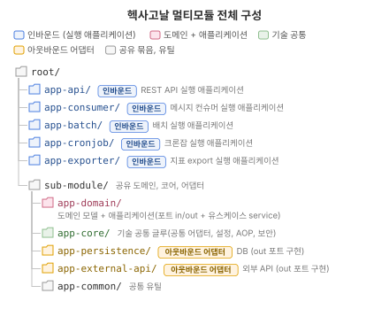
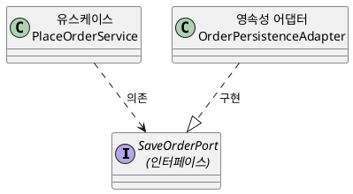
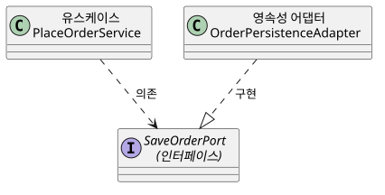
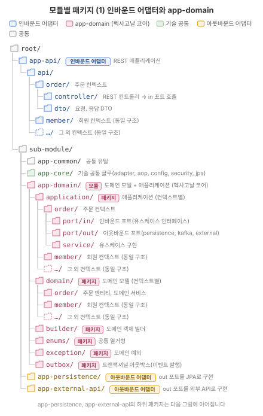
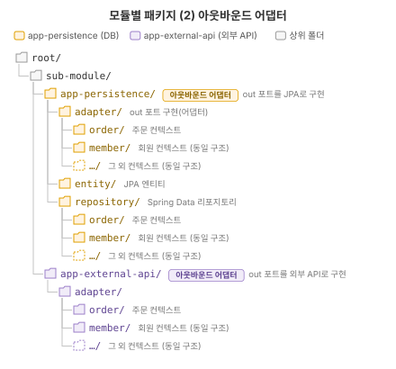
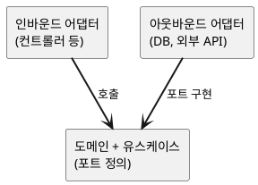
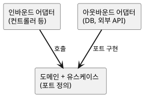
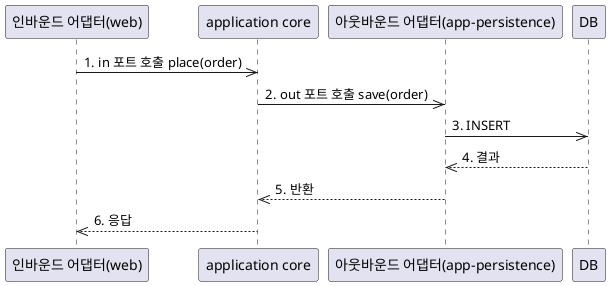
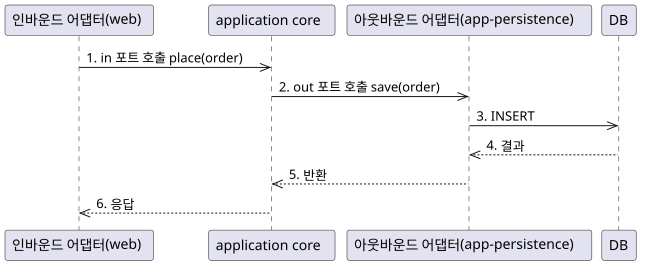

<!-- truncate -->

헥사고날 아키텍처는 **도메인을 가운데 배치하고, 웹, DB, 외부 API 같은 외부를 어댑터로 연결해 어댑터만 교체하면 되게 하는** 구조입니다. 개념을 코드로만 나누면 경계가 모호해지기 쉬워서, 아예 **멀티모듈로 물리적으로 분리**해 도메인이 인프라를 의존하지 못하게 강제한 구성을 정리합니다. 헥사고날 아키텍처는 [앨리스터 코오번(Alistair Cockburn)](https://alistair.cockburn.us/hexagonal-architecture/)이 2005년 제안한 패턴으로, 원래 이름은 **포트와 어댑터(Ports and Adapters)** 입니다.

<mark>헥사고날의 목표는 "도메인은 외부를 모르고, 외부가 도메인의 포트(인터페이스)를 구현한다"입니다.</mark>

## 핵심: 도메인은 가운데, 어댑터는 외부

외부와의 연결을 두 방향으로 나눕니다.

- **인바운드 어댑터(driving)**: 외부가 도메인을 호출하는 입구. 웹 컨트롤러, 메시지 컨슈머, 배치, 스케줄러.
- **아웃바운드 어댑터(driven)**: 도메인이 외부를 호출하는 출구. DB 영속성, 외부 API 클라이언트.
- **포트(port)**: 도메인, 코어가 정의한 인터페이스. 어댑터가 이 포트를 구현하거나 호출합니다.

헥사고날의 개념 자체는 [헥사고날 아키텍처](./hexagonal-architecture)에서 설명했습니다. 이 글은 그것을 **모듈 경계로 어떻게 강제하는지**에 집중합니다.

<mark>포트라는 인터페이스가 도메인과 어댑터 사이의 유일한 접점이라, 어댑터는 언제든 교체, 모킹할 수 있습니다.</mark>

## 전체 구성 한눈에

실행 가능한 애플리케이션(인바운드 어댑터)들과, 그들이 공유하는 도메인, 코어, 아웃바운드 어댑터 모듈로 나눕니다.

<details>
<summary>SVG 코드</summary>

```svg
<svg xmlns="http://www.w3.org/2000/svg" width="440" height="349" viewBox="0 0 440 349" font-family="-apple-system, 'Segoe UI', 'Noto Sans KR', sans-serif">
<defs><marker id="ah" viewBox="0 0 10 10" refX="9" refY="5" markerWidth="7" markerHeight="7" orient="auto-start-reverse"><path d="M0,0 L10,5 L0,10 z" fill="#888"/></marker></defs>
<rect x="0" y="0" width="440" height="349" fill="#FFFFFF"/>
<text x="220.0" y="22" font-size="13" fill="#333" text-anchor="middle" font-weight="bold">헥사고날 멀티모듈 전체 구성</text>
<rect x="16" y="35" width="11" height="9" rx="2" fill="#EEF3FB" stroke="#4C7FE0"/>
<text x="31" y="43" font-size="10" fill="#555" text-anchor="start">인바운드 (실행 애플리케이션)</text>
<rect x="170.0" y="35" width="11" height="9" rx="2" fill="#FCE4EC" stroke="#D06A86"/>
<text x="185.0" y="43" font-size="10" fill="#555" text-anchor="start">도메인 + 애플리케이션</text>
<rect x="292.5" y="35" width="11" height="9" rx="2" fill="#E9F2E9" stroke="#8FBF8F"/>
<text x="307.5" y="43" font-size="10" fill="#555" text-anchor="start">기술 공통</text>
<rect x="16" y="52" width="11" height="9" rx="2" fill="#FFF3E0" stroke="#E0A000"/>
<text x="31" y="60" font-size="10" fill="#555" text-anchor="start">아웃바운드 어댑터</text>
<rect x="119.60000000000001" y="52" width="11" height="9" rx="2" fill="#F7F7F7" stroke="#999999"/>
<text x="134.60000000000002" y="60" font-size="10" fill="#555" text-anchor="start">공유 코드, 유틸</text>
<path d="M21,88 V101.5 H31" fill="none" stroke="#C4C4C4" stroke-width="1"/>
<path d="M21,88 V121.5 H31" fill="none" stroke="#C4C4C4" stroke-width="1"/>
<path d="M21,88 V141.5 H31" fill="none" stroke="#C4C4C4" stroke-width="1"/>
<path d="M21,88 V161.5 H31" fill="none" stroke="#C4C4C4" stroke-width="1"/>
<path d="M21,88 V181.5 H31" fill="none" stroke="#C4C4C4" stroke-width="1"/>
<path d="M21,88 V209.5 H31" fill="none" stroke="#C4C4C4" stroke-width="1"/>
<path d="M36,216 V229.5 H46" fill="none" stroke="#C4C4C4" stroke-width="1"/>
<path d="M36,216 V263.5 H46" fill="none" stroke="#C4C4C4" stroke-width="1"/>
<path d="M36,216 V283.5 H46" fill="none" stroke="#C4C4C4" stroke-width="1"/>
<path d="M36,216 V303.5 H46" fill="none" stroke="#C4C4C4" stroke-width="1"/>
<path d="M36,216 V323.5 H46" fill="none" stroke="#C4C4C4" stroke-width="1"/>
<path d="M18,77.0 h4.5 l1.5,-1.8 h6 v10.8 h-12 z" fill="#F7F7F7" stroke="#999999" stroke-width="1"/>
<text x="35" y="85" font-size="11" fill="#333" text-anchor="start" font-family="Menlo, Consolas, monospace">root/</text>
<path d="M33,97.0 h4.5 l1.5,-1.8 h6 v10.8 h-12 z" fill="#EEF3FB" stroke="#4C7FE0" stroke-width="1"/>
<text x="50" y="105" font-size="11" fill="#26508F" text-anchor="start" font-family="Menlo, Consolas, monospace">app-api/</text>
<rect x="110.976" y="96.5" width="43.3" height="13" rx="3" fill="#EEF3FB" stroke="#4C7FE0" stroke-width="0.8"/><text x="132.6" y="105.9" font-size="9" fill="#26508F" text-anchor="middle" font-weight="bold">인바운드</text>
<text x="159.3" y="105" font-size="9.5" fill="#777" text-anchor="start">REST API 실행 애플리케이션</text>
<path d="M33,117.0 h4.5 l1.5,-1.8 h6 v10.8 h-12 z" fill="#EEF3FB" stroke="#4C7FE0" stroke-width="1"/>
<text x="50" y="125" font-size="11" fill="#26508F" text-anchor="start" font-family="Menlo, Consolas, monospace">app-consumer/</text>
<rect x="144.086" y="116.5" width="43.3" height="13" rx="3" fill="#EEF3FB" stroke="#4C7FE0" stroke-width="0.8"/><text x="165.7" y="125.9" font-size="9" fill="#26508F" text-anchor="middle" font-weight="bold">인바운드</text>
<text x="192.4" y="125" font-size="9.5" fill="#777" text-anchor="start">메시지 컨슈머 실행 애플리케이션</text>
<path d="M33,137.0 h4.5 l1.5,-1.8 h6 v10.8 h-12 z" fill="#EEF3FB" stroke="#4C7FE0" stroke-width="1"/>
<text x="50" y="145" font-size="11" fill="#26508F" text-anchor="start" font-family="Menlo, Consolas, monospace">app-batch/</text>
<rect x="124.22" y="136.5" width="43.3" height="13" rx="3" fill="#EEF3FB" stroke="#4C7FE0" stroke-width="0.8"/><text x="145.9" y="145.9" font-size="9" fill="#26508F" text-anchor="middle" font-weight="bold">인바운드</text>
<text x="172.5" y="145" font-size="9.5" fill="#777" text-anchor="start">배치 실행 애플리케이션</text>
<path d="M33,157.0 h4.5 l1.5,-1.8 h6 v10.8 h-12 z" fill="#EEF3FB" stroke="#4C7FE0" stroke-width="1"/>
<text x="50" y="165" font-size="11" fill="#26508F" text-anchor="start" font-family="Menlo, Consolas, monospace">app-cronjob/</text>
<rect x="137.464" y="156.5" width="43.3" height="13" rx="3" fill="#EEF3FB" stroke="#4C7FE0" stroke-width="0.8"/><text x="159.1" y="165.9" font-size="9" fill="#26508F" text-anchor="middle" font-weight="bold">인바운드</text>
<text x="185.8" y="165" font-size="9.5" fill="#777" text-anchor="start">크론잡 실행 애플리케이션</text>
<path d="M33,177.0 h4.5 l1.5,-1.8 h6 v10.8 h-12 z" fill="#EEF3FB" stroke="#4C7FE0" stroke-width="1"/>
<text x="50" y="185" font-size="11" fill="#26508F" text-anchor="start" font-family="Menlo, Consolas, monospace">app-exporter/</text>
<rect x="144.086" y="176.5" width="43.3" height="13" rx="3" fill="#EEF3FB" stroke="#4C7FE0" stroke-width="0.8"/><text x="165.7" y="185.9" font-size="9" fill="#26508F" text-anchor="middle" font-weight="bold">인바운드</text>
<text x="192.4" y="185" font-size="9.5" fill="#777" text-anchor="start">지표 export 실행 애플리케이션</text>
<path d="M33,205.0 h4.5 l1.5,-1.8 h6 v10.8 h-12 z" fill="#F7F7F7" stroke="#999999" stroke-width="1"/>
<text x="50" y="213" font-size="11" fill="#333" text-anchor="start" font-family="Menlo, Consolas, monospace">sub-module/</text>
<text x="130.8" y="213" font-size="9.5" fill="#777" text-anchor="start">공유 도메인, 코어, 어댑터</text>
<path d="M48,225.0 h4.5 l1.5,-1.8 h6 v10.8 h-12 z" fill="#FCE4EC" stroke="#D06A86" stroke-width="1"/>
<text x="65" y="233" font-size="11" fill="#9E3A57" text-anchor="start" font-family="Menlo, Consolas, monospace">app-domain/</text>
<text x="65" y="247" font-size="9.5" fill="#777" text-anchor="start">도메인 모델 + 애플리케이션(포트 in/out + 유스케이스 service)</text>
<path d="M48,259.0 h4.5 l1.5,-1.8 h6 v10.8 h-12 z" fill="#E9F2E9" stroke="#8FBF8F" stroke-width="1"/>
<text x="65" y="267" font-size="11" fill="#2E6B2E" text-anchor="start" font-family="Menlo, Consolas, monospace">app-core/</text>
<text x="132.6" y="267" font-size="9.5" fill="#777" text-anchor="start">기술 공통 글루(공통 어댑터, 설정, AOP, 보안)</text>
<path d="M48,279.0 h4.5 l1.5,-1.8 h6 v10.8 h-12 z" fill="#FFF3E0" stroke="#E0A000" stroke-width="1"/>
<text x="65" y="287" font-size="11" fill="#8A6400" text-anchor="start" font-family="Menlo, Consolas, monospace">app-persistence/</text>
<rect x="178.952" y="278.5" width="83.6" height="13" rx="3" fill="#FFF3E0" stroke="#E0A000" stroke-width="0.8"/><text x="220.8" y="287.9" font-size="9" fill="#8A6400" text-anchor="middle" font-weight="bold">아웃바운드 어댑터</text>
<text x="267.6" y="287" font-size="9.5" fill="#777" text-anchor="start">DB (out 포트 구현)</text>
<path d="M48,299.0 h4.5 l1.5,-1.8 h6 v10.8 h-12 z" fill="#FFF3E0" stroke="#E0A000" stroke-width="1"/>
<text x="65" y="307" font-size="11" fill="#8A6400" text-anchor="start" font-family="Menlo, Consolas, monospace">app-external-api/</text>
<rect x="185.574" y="298.5" width="83.6" height="13" rx="3" fill="#FFF3E0" stroke="#E0A000" stroke-width="0.8"/><text x="227.4" y="307.9" font-size="9" fill="#8A6400" text-anchor="middle" font-weight="bold">아웃바운드 어댑터</text>
<text x="274.2" y="307" font-size="9.5" fill="#777" text-anchor="start">외부 API (out 포트 구현)</text>
<path d="M48,319.0 h4.5 l1.5,-1.8 h6 v10.8 h-12 z" fill="#F7F7F7" stroke="#999999" stroke-width="1"/>
<text x="65" y="327" font-size="11" fill="#333" text-anchor="start" font-family="Menlo, Consolas, monospace">app-common/</text>
<text x="145.8" y="327" font-size="9.5" fill="#777" text-anchor="start">공통 유틸</text>
</svg>
```

</details>

<figure style={{textAlign: 'center', margin: '1.5rem 0'}}>
  
</figure>

여기서 핵심은 **유스케이스와 포트가 `app-domain` 모듈에 있다**는 점입니다. `app-domain` 모듈이 도메인 모델과 애플리케이션(포트, 유스케이스)을 함께 담고, `app-core`는 여러 모듈이 함께 사용하는 **기술 글루**(공통 어댑터, 설정, 보안)입니다. 각 실행 애플리케이션은 `app-domain`, `app-core`에 필요한 아웃바운드 어댑터(`app-persistence`, `app-external-api`)를 조합해 만듭니다. **`app-domain`과 `app-core`는 어댑터 모듈을 의존하지 않고**, 반대로 어댑터가 이들을 의존합니다.

말로만 보면 헷갈리니 "주문을 저장한다"는 기능으로 예를 들어 보겠습니다. 저장이 **필요하다**는 사실은 `app-domain`이 인터페이스(포트)로 선언하고, 그 인터페이스를 **어떻게** 저장하는지는 `app-persistence` 어댑터가 구현합니다. 유스케이스(`app-domain`의 `application/service`)는 인터페이스만 알 뿐 구현을 모릅니다.

```java
// [app-domain · application/order/port/in] 인바운드 포트: 컨트롤러가 호출할 유스케이스 "계약"
public interface PlaceOrderUseCase {
    void place(Order order);
}

// [app-domain · application/order/port/out] 아웃바운드 포트: "무엇이 필요한지"만 인터페이스로 선언
public interface SaveOrderPort {
    void save(Order order);
}

// [app-domain · application/order/service] 유스케이스 구현: in 포트를 구현하고 out 포트에만 의존
public class PlaceOrderService implements PlaceOrderUseCase {
    private final SaveOrderPort saveOrderPort;
    public void place(Order order) {
        // ...도메인 규칙 검증...
        saveOrderPort.save(order);   // out 포트(인터페이스) 호출 — 구현이 JPA인지 모름
    }
}

// [app-api · api/order/controller] 인바운드 어댑터: 구현체가 아니라 in 포트(인터페이스)만 호출
public class OrderController {
    private final PlaceOrderUseCase placeOrderUseCase;   // in 포트에 의존
    public void create(OrderRequest req) {
        placeOrderUseCase.place(req.toOrder());          // ② in 포트 호출 → 구현체 PlaceOrderService 실행
    }
}

// [app-persistence · adapter/order] out 포트를 "구현". app-domain을 의존하지만 그 반대는 없음
public class OrderPersistenceAdapter implements SaveOrderPort {
    public void save(Order order) { /* JPA로 저장 */ }
}
```

화살표 방향이 핵심입니다. 유스케이스(`app-domain`의 `application/service`)도 `app-persistence`도 **둘 다 `app-domain`의 포트(인터페이스)를 향합니다.** 그래서 유스케이스가 `app-persistence`를 import하는 일이 없고, 실제 구현체를 주입하는 것은 실행 애플리케이션(구성 지점)이 DI로 합니다.

<details>
<summary>PlantUML 코드</summary>



</details>



유스케이스와 어댑터가 **둘 다 인터페이스(포트)를 향합니다.** 유스케이스는 `app-persistence`를 import하지 않고, 실제 구현체는 실행 애플리케이션이 DI로 주입합니다. 그래서 저장소를 JPA에서 다른 것으로 바꿔도 유스케이스, 도메인 코드는 그대로입니다.

<mark>실행 애플리케이션은 "어떤 어댑터를 끼울지"만 구성할 뿐, 비즈니스 규칙은 app-domain 모듈(모델, 유스케이스)에 있습니다.</mark>

## 모듈별 책임과 패키지

포트를 `in`(인바운드)과 `out`(아웃바운드)으로 나눠, 각 어댑터가 어떤 포트를 구현/호출하는지 명확히 합니다.

모듈별 역할과 대표 패키지를 앞의 전체 구성과 같은 트리로 펼치면 이렇습니다.

<details>
<summary>SVG 코드</summary>

```svg
<svg xmlns="http://www.w3.org/2000/svg" width="440" height="695" viewBox="0 0 440 695" font-family="-apple-system, 'Segoe UI', 'Noto Sans KR', sans-serif">
<defs><marker id="ah" viewBox="0 0 10 10" refX="9" refY="5" markerWidth="7" markerHeight="7" orient="auto-start-reverse"><path d="M0,0 L10,5 L0,10 z" fill="#888"/></marker></defs>
<rect x="0" y="0" width="440" height="695" fill="#FFFFFF"/>
<text x="220.0" y="22" font-size="13" fill="#333" text-anchor="middle" font-weight="bold">모듈별 패키지 (1) 인바운드 어댑터와 app-domain</text>
<rect x="16" y="35" width="11" height="9" rx="2" fill="#EEF3FB" stroke="#4C7FE0"/>
<text x="31" y="43" font-size="10" fill="#555" text-anchor="start">인바운드 어댑터</text>
<rect x="110.78" y="35" width="11" height="9" rx="2" fill="#FCE4EC" stroke="#D06A86"/>
<text x="125.78" y="43" font-size="10" fill="#555" text-anchor="start">app-domain (헥사고날 코어)</text>
<rect x="262.26" y="35" width="11" height="9" rx="2" fill="#E9F2E9" stroke="#8FBF8F"/>
<text x="277.26" y="43" font-size="10" fill="#555" text-anchor="start">기술 공통</text>
<rect x="330.58" y="35" width="11" height="9" rx="2" fill="#FFF3E0" stroke="#E0A000"/>
<text x="345.58" y="43" font-size="10" fill="#555" text-anchor="start">아웃바운드 어댑터</text>
<rect x="16" y="52" width="11" height="9" rx="2" fill="#F7F7F7" stroke="#999999"/>
<text x="31" y="60" font-size="10" fill="#555" text-anchor="start">공통</text>
<path d="M21,88 V101.5 H30" fill="none" stroke="#C4C4C4" stroke-width="1"/>
<path d="M35,108 V121.5 H44" fill="none" stroke="#C4C4C4" stroke-width="1"/>
<path d="M49,128 V141.5 H58" fill="none" stroke="#C4C4C4" stroke-width="1"/>
<path d="M63,148 V161.5 H72" fill="none" stroke="#C4C4C4" stroke-width="1"/>
<path d="M63,148 V181.5 H72" fill="none" stroke="#C4C4C4" stroke-width="1"/>
<path d="M49,128 V201.5 H58" fill="none" stroke="#C4C4C4" stroke-width="1"/>
<path d="M49,128 V221.5 H58" fill="none" stroke="#C4C4C4" stroke-width="1"/>
<path d="M21,88 V249.5 H30" fill="none" stroke="#C4C4C4" stroke-width="1"/>
<path d="M35,256 V269.5 H44" fill="none" stroke="#C4C4C4" stroke-width="1"/>
<path d="M35,256 V289.5 H44" fill="none" stroke="#C4C4C4" stroke-width="1"/>
<path d="M35,256 V309.5 H44" fill="none" stroke="#C4C4C4" stroke-width="1"/>
<path d="M49,316 V329.5 H58" fill="none" stroke="#C4C4C4" stroke-width="1"/>
<path d="M63,336 V349.5 H72" fill="none" stroke="#C4C4C4" stroke-width="1"/>
<path d="M77,356 V369.5 H86" fill="none" stroke="#C4C4C4" stroke-width="1"/>
<path d="M77,356 V389.5 H86" fill="none" stroke="#C4C4C4" stroke-width="1"/>
<path d="M77,356 V409.5 H86" fill="none" stroke="#C4C4C4" stroke-width="1"/>
<path d="M63,336 V429.5 H72" fill="none" stroke="#C4C4C4" stroke-width="1"/>
<path d="M63,336 V449.5 H72" fill="none" stroke="#C4C4C4" stroke-width="1"/>
<path d="M49,316 V469.5 H58" fill="none" stroke="#C4C4C4" stroke-width="1"/>
<path d="M63,476 V489.5 H72" fill="none" stroke="#C4C4C4" stroke-width="1"/>
<path d="M63,476 V509.5 H72" fill="none" stroke="#C4C4C4" stroke-width="1"/>
<path d="M63,476 V529.5 H72" fill="none" stroke="#C4C4C4" stroke-width="1"/>
<path d="M49,316 V549.5 H58" fill="none" stroke="#C4C4C4" stroke-width="1"/>
<path d="M49,316 V569.5 H58" fill="none" stroke="#C4C4C4" stroke-width="1"/>
<path d="M49,316 V589.5 H58" fill="none" stroke="#C4C4C4" stroke-width="1"/>
<path d="M49,316 V609.5 H58" fill="none" stroke="#C4C4C4" stroke-width="1"/>
<path d="M35,256 V629.5 H44" fill="none" stroke="#C4C4C4" stroke-width="1"/>
<path d="M35,256 V649.5 H44" fill="none" stroke="#C4C4C4" stroke-width="1"/>
<path d="M18,77.0 h4.5 l1.5,-1.8 h6 v10.8 h-12 z" fill="#F7F7F7" stroke="#999999" stroke-width="1"/>
<text x="35" y="85" font-size="11" fill="#333" text-anchor="start" font-family="Menlo, Consolas, monospace">root/</text>
<path d="M32,97.0 h4.5 l1.5,-1.8 h6 v10.8 h-12 z" fill="#EEF3FB" stroke="#4C7FE0" stroke-width="1"/>
<text x="49" y="105" font-size="11" fill="#26508F" text-anchor="start" font-family="Menlo, Consolas, monospace">app-api/</text>
<rect x="109.976" y="96.5" width="74.8" height="13" rx="3" fill="#EEF3FB" stroke="#4C7FE0" stroke-width="0.8"/><text x="147.4" y="105.9" font-size="9" fill="#26508F" text-anchor="middle" font-weight="bold">인바운드 어댑터</text>
<text x="189.8" y="105" font-size="9.5" fill="#777" text-anchor="start">REST 애플리케이션</text>
<path d="M46,117.0 h4.5 l1.5,-1.8 h6 v10.8 h-12 z" fill="#EEF3FB" stroke="#4C7FE0" stroke-width="1"/>
<text x="63" y="125" font-size="11" fill="#26508F" text-anchor="start" font-family="Menlo, Consolas, monospace">api/</text>
<path d="M60,137.0 h4.5 l1.5,-1.8 h6 v10.8 h-12 z" fill="#EEF3FB" stroke="#4C7FE0" stroke-width="1"/>
<text x="77" y="145" font-size="11" fill="#26508F" text-anchor="start" font-family="Menlo, Consolas, monospace">order/</text>
<text x="124.7" y="145" font-size="9.5" fill="#777" text-anchor="start">주문 컨텍스트</text>
<path d="M74,157.0 h4.5 l1.5,-1.8 h6 v10.8 h-12 z" fill="#EEF3FB" stroke="#4C7FE0" stroke-width="1"/>
<text x="91" y="165" font-size="11" fill="#26508F" text-anchor="start" font-family="Menlo, Consolas, monospace">controller/</text>
<text x="171.8" y="165" font-size="9.5" fill="#777" text-anchor="start">REST 컨트롤러 → in 포트 호출</text>
<path d="M74,177.0 h4.5 l1.5,-1.8 h6 v10.8 h-12 z" fill="#EEF3FB" stroke="#4C7FE0" stroke-width="1"/>
<text x="91" y="185" font-size="11" fill="#26508F" text-anchor="start" font-family="Menlo, Consolas, monospace">dto/</text>
<text x="125.5" y="185" font-size="9.5" fill="#777" text-anchor="start">요청, 응답 DTO</text>
<path d="M60,197.0 h4.5 l1.5,-1.8 h6 v10.8 h-12 z" fill="#EEF3FB" stroke="#4C7FE0" stroke-width="1"/>
<text x="77" y="205" font-size="11" fill="#26508F" text-anchor="start" font-family="Menlo, Consolas, monospace">member/</text>
<text x="131.4" y="205" font-size="9.5" fill="#777" text-anchor="start">회원 컨텍스트 (동일 구조)</text>
<path d="M60,217.0 h4.5 l1.5,-1.8 h6 v10.8 h-12 z" fill="#FFFFFF" stroke="#4C7FE0" stroke-width="1" stroke-dasharray="2 1.5"/>
<text x="77" y="225" font-size="11" fill="#26508F" text-anchor="start" font-family="Menlo, Consolas, monospace">…/</text>
<text x="98.2" y="225" font-size="9.5" fill="#777" text-anchor="start">그 외 컨텍스트 (동일 구조)</text>
<path d="M32,245.0 h4.5 l1.5,-1.8 h6 v10.8 h-12 z" fill="#F7F7F7" stroke="#999999" stroke-width="1"/>
<text x="49" y="253" font-size="11" fill="#333" text-anchor="start" font-family="Menlo, Consolas, monospace">sub-module/</text>
<path d="M46,265.0 h4.5 l1.5,-1.8 h6 v10.8 h-12 z" fill="#F7F7F7" stroke="#999999" stroke-width="1"/>
<text x="63" y="273" font-size="11" fill="#333" text-anchor="start" font-family="Menlo, Consolas, monospace">app-common/</text>
<text x="143.8" y="273" font-size="9.5" fill="#777" text-anchor="start">공통 유틸</text>
<path d="M46,285.0 h4.5 l1.5,-1.8 h6 v10.8 h-12 z" fill="#E9F2E9" stroke="#8FBF8F" stroke-width="1"/>
<text x="63" y="293" font-size="11" fill="#2E6B2E" text-anchor="start" font-family="Menlo, Consolas, monospace">app-core/</text>
<text x="130.6" y="293" font-size="9.5" fill="#777" text-anchor="start">기술 공통 글루(adapter, aop, config, security, jpa)</text>
<path d="M46,305.0 h4.5 l1.5,-1.8 h6 v10.8 h-12 z" fill="#FCE4EC" stroke="#D06A86" stroke-width="1"/>
<text x="63" y="313" font-size="11" fill="#9E3A57" text-anchor="start" font-family="Menlo, Consolas, monospace">app-domain/</text>
<rect x="143.84199999999998" y="304.5" width="25.6" height="13" rx="3" fill="#FCE4EC" stroke="#D06A86" stroke-width="0.8"/><text x="156.6" y="313.9" font-size="9" fill="#9E3A57" text-anchor="middle" font-weight="bold">모듈</text>
<text x="174.4" y="313" font-size="9.5" fill="#777" text-anchor="start">도메인 모델 + 애플리케이션 (헥사고날 코어)</text>
<path d="M60,325.0 h4.5 l1.5,-1.8 h6 v10.8 h-12 z" fill="#FCE4EC" stroke="#D06A86" stroke-width="1"/>
<text x="77" y="333" font-size="11" fill="#9E3A57" text-anchor="start" font-family="Menlo, Consolas, monospace">application/</text>
<rect x="164.464" y="324.5" width="34.5" height="13" rx="3" fill="#FCE4EC" stroke="#D06A86" stroke-width="0.8"/><text x="181.7" y="333.9" font-size="9" fill="#9E3A57" text-anchor="middle" font-weight="bold">패키지</text>
<text x="204.0" y="333" font-size="9.5" fill="#777" text-anchor="start">애플리케이션 (컨텍스트별)</text>
<path d="M74,345.0 h4.5 l1.5,-1.8 h6 v10.8 h-12 z" fill="#FCE4EC" stroke="#D06A86" stroke-width="1"/>
<text x="91" y="353" font-size="11" fill="#9E3A57" text-anchor="start" font-family="Menlo, Consolas, monospace">order/</text>
<text x="138.7" y="353" font-size="9.5" fill="#777" text-anchor="start">주문 컨텍스트</text>
<path d="M88,365.0 h4.5 l1.5,-1.8 h6 v10.8 h-12 z" fill="#FCE4EC" stroke="#D06A86" stroke-width="1"/>
<text x="105" y="373" font-size="11" fill="#9E3A57" text-anchor="start" font-family="Menlo, Consolas, monospace">port/in/</text>
<text x="166.0" y="373" font-size="9.5" fill="#777" text-anchor="start">인바운드 포트(유스케이스 인터페이스)</text>
<path d="M88,385.0 h4.5 l1.5,-1.8 h6 v10.8 h-12 z" fill="#FCE4EC" stroke="#D06A86" stroke-width="1"/>
<text x="105" y="393" font-size="11" fill="#9E3A57" text-anchor="start" font-family="Menlo, Consolas, monospace">port/out/</text>
<text x="172.6" y="393" font-size="9.5" fill="#777" text-anchor="start">아웃바운드 포트(persistence, kafka, external)</text>
<path d="M88,405.0 h4.5 l1.5,-1.8 h6 v10.8 h-12 z" fill="#FCE4EC" stroke="#D06A86" stroke-width="1"/>
<text x="105" y="413" font-size="11" fill="#9E3A57" text-anchor="start" font-family="Menlo, Consolas, monospace">service/</text>
<text x="166.0" y="413" font-size="9.5" fill="#777" text-anchor="start">유스케이스 구현</text>
<path d="M74,425.0 h4.5 l1.5,-1.8 h6 v10.8 h-12 z" fill="#FCE4EC" stroke="#D06A86" stroke-width="1"/>
<text x="91" y="433" font-size="11" fill="#9E3A57" text-anchor="start" font-family="Menlo, Consolas, monospace">member/</text>
<text x="145.4" y="433" font-size="9.5" fill="#777" text-anchor="start">회원 컨텍스트 (동일 구조)</text>
<path d="M74,445.0 h4.5 l1.5,-1.8 h6 v10.8 h-12 z" fill="#FFFFFF" stroke="#D06A86" stroke-width="1" stroke-dasharray="2 1.5"/>
<text x="91" y="453" font-size="11" fill="#9E3A57" text-anchor="start" font-family="Menlo, Consolas, monospace">…/</text>
<text x="112.2" y="453" font-size="9.5" fill="#777" text-anchor="start">그 외 컨텍스트 (동일 구조)</text>
<path d="M60,465.0 h4.5 l1.5,-1.8 h6 v10.8 h-12 z" fill="#FCE4EC" stroke="#D06A86" stroke-width="1"/>
<text x="77" y="473" font-size="11" fill="#9E3A57" text-anchor="start" font-family="Menlo, Consolas, monospace">domain/</text>
<rect x="131.35399999999998" y="464.5" width="34.5" height="13" rx="3" fill="#FCE4EC" stroke="#D06A86" stroke-width="0.8"/><text x="148.6" y="473.9" font-size="9" fill="#9E3A57" text-anchor="middle" font-weight="bold">패키지</text>
<text x="170.9" y="473" font-size="9.5" fill="#777" text-anchor="start">도메인 모델 (컨텍스트별)</text>
<path d="M74,485.0 h4.5 l1.5,-1.8 h6 v10.8 h-12 z" fill="#FCE4EC" stroke="#D06A86" stroke-width="1"/>
<text x="91" y="493" font-size="11" fill="#9E3A57" text-anchor="start" font-family="Menlo, Consolas, monospace">order/</text>
<text x="138.7" y="493" font-size="9.5" fill="#777" text-anchor="start">주문 엔티티, 도메인 서비스</text>
<path d="M74,505.0 h4.5 l1.5,-1.8 h6 v10.8 h-12 z" fill="#FCE4EC" stroke="#D06A86" stroke-width="1"/>
<text x="91" y="513" font-size="11" fill="#9E3A57" text-anchor="start" font-family="Menlo, Consolas, monospace">member/</text>
<text x="145.4" y="513" font-size="9.5" fill="#777" text-anchor="start">회원 컨텍스트 (동일 구조)</text>
<path d="M74,525.0 h4.5 l1.5,-1.8 h6 v10.8 h-12 z" fill="#FFFFFF" stroke="#D06A86" stroke-width="1" stroke-dasharray="2 1.5"/>
<text x="91" y="533" font-size="11" fill="#9E3A57" text-anchor="start" font-family="Menlo, Consolas, monospace">…/</text>
<text x="112.2" y="533" font-size="9.5" fill="#777" text-anchor="start">그 외 컨텍스트 (동일 구조)</text>
<path d="M60,545.0 h4.5 l1.5,-1.8 h6 v10.8 h-12 z" fill="#FCE4EC" stroke="#D06A86" stroke-width="1"/>
<text x="77" y="553" font-size="11" fill="#9E3A57" text-anchor="start" font-family="Menlo, Consolas, monospace">builder/</text>
<rect x="137.976" y="544.5" width="34.5" height="13" rx="3" fill="#FCE4EC" stroke="#D06A86" stroke-width="0.8"/><text x="155.2" y="553.9" font-size="9" fill="#9E3A57" text-anchor="middle" font-weight="bold">패키지</text>
<text x="177.5" y="553" font-size="9.5" fill="#777" text-anchor="start">도메인 객체 빌더</text>
<path d="M60,565.0 h4.5 l1.5,-1.8 h6 v10.8 h-12 z" fill="#FCE4EC" stroke="#D06A86" stroke-width="1"/>
<text x="77" y="573" font-size="11" fill="#9E3A57" text-anchor="start" font-family="Menlo, Consolas, monospace">enums/</text>
<rect x="124.732" y="564.5" width="34.5" height="13" rx="3" fill="#FCE4EC" stroke="#D06A86" stroke-width="0.8"/><text x="142.0" y="573.9" font-size="9" fill="#9E3A57" text-anchor="middle" font-weight="bold">패키지</text>
<text x="164.2" y="573" font-size="9.5" fill="#777" text-anchor="start">공통 열거형</text>
<path d="M60,585.0 h4.5 l1.5,-1.8 h6 v10.8 h-12 z" fill="#FCE4EC" stroke="#D06A86" stroke-width="1"/>
<text x="77" y="593" font-size="11" fill="#9E3A57" text-anchor="start" font-family="Menlo, Consolas, monospace">exception/</text>
<rect x="151.22" y="584.5" width="34.5" height="13" rx="3" fill="#FCE4EC" stroke="#D06A86" stroke-width="0.8"/><text x="168.5" y="593.9" font-size="9" fill="#9E3A57" text-anchor="middle" font-weight="bold">패키지</text>
<text x="190.7" y="593" font-size="9.5" fill="#777" text-anchor="start">도메인 예외</text>
<path d="M60,605.0 h4.5 l1.5,-1.8 h6 v10.8 h-12 z" fill="#FCE4EC" stroke="#D06A86" stroke-width="1"/>
<text x="77" y="613" font-size="11" fill="#9E3A57" text-anchor="start" font-family="Menlo, Consolas, monospace">outbox/</text>
<rect x="131.35399999999998" y="604.5" width="34.5" height="13" rx="3" fill="#FCE4EC" stroke="#D06A86" stroke-width="0.8"/><text x="148.6" y="613.9" font-size="9" fill="#9E3A57" text-anchor="middle" font-weight="bold">패키지</text>
<text x="170.9" y="613" font-size="9.5" fill="#777" text-anchor="start">트랜잭셔널 아웃박스(이벤트 발행)</text>
<path d="M46,625.0 h4.5 l1.5,-1.8 h6 v10.8 h-12 z" fill="#FFF3E0" stroke="#E0A000" stroke-width="1"/>
<text x="63" y="633" font-size="11" fill="#8A6400" text-anchor="start" font-family="Menlo, Consolas, monospace">app-persistence/</text>
<rect x="176.952" y="624.5" width="83.6" height="13" rx="3" fill="#FFF3E0" stroke="#E0A000" stroke-width="0.8"/><text x="218.8" y="633.9" font-size="9" fill="#8A6400" text-anchor="middle" font-weight="bold">아웃바운드 어댑터</text>
<text x="265.6" y="633" font-size="9.5" fill="#777" text-anchor="start">out 포트를 JPA로 구현</text>
<path d="M46,645.0 h4.5 l1.5,-1.8 h6 v10.8 h-12 z" fill="#FFF3E0" stroke="#E0A000" stroke-width="1"/>
<text x="63" y="653" font-size="11" fill="#8A6400" text-anchor="start" font-family="Menlo, Consolas, monospace">app-external-api/</text>
<rect x="183.574" y="644.5" width="83.6" height="13" rx="3" fill="#FFF3E0" stroke="#E0A000" stroke-width="0.8"/><text x="225.4" y="653.9" font-size="9" fill="#8A6400" text-anchor="middle" font-weight="bold">아웃바운드 어댑터</text>
<text x="272.2" y="653" font-size="9.5" fill="#777" text-anchor="start">out 포트를 외부 API로 구현</text>
<text x="220.0" y="679" font-size="9.5" fill="#888" text-anchor="middle">app-persistence, app-external-api의 하위 패키지는 다음 그림에 이어집니다</text>
</svg>
```

</details>

<figure style={{textAlign: 'center', margin: '1.5rem 0'}}>
  
</figure>

<details>
<summary>SVG 코드</summary>

```svg
<svg xmlns="http://www.w3.org/2000/svg" width="440" height="410" viewBox="0 0 440 410" font-family="-apple-system, 'Segoe UI', 'Noto Sans KR', sans-serif">
<defs><marker id="ah" viewBox="0 0 10 10" refX="9" refY="5" markerWidth="7" markerHeight="7" orient="auto-start-reverse"><path d="M0,0 L10,5 L0,10 z" fill="#888"/></marker></defs>
<rect x="0" y="0" width="440" height="410" fill="#FFFFFF"/>
<text x="220.0" y="22" font-size="13" fill="#333" text-anchor="middle" font-weight="bold">모듈별 패키지 (2) 아웃바운드 어댑터</text>
<rect x="16" y="35" width="11" height="9" rx="2" fill="#FFF3E0" stroke="#E0A000"/>
<text x="31" y="43" font-size="10" fill="#555" text-anchor="start">app-persistence (DB)</text>
<rect x="144.8" y="35" width="11" height="9" rx="2" fill="#F1ECF8" stroke="#9C7FC9"/>
<text x="159.8" y="43" font-size="10" fill="#555" text-anchor="start">app-external-api (외부 API)</text>
<rect x="306.36" y="35" width="11" height="9" rx="2" fill="#F7F7F7" stroke="#999999"/>
<text x="321.36" y="43" font-size="10" fill="#555" text-anchor="start">상위 폴더</text>
<path d="M21,71 V84.5 H32" fill="none" stroke="#C4C4C4" stroke-width="1"/>
<path d="M37,91 V104.5 H48" fill="none" stroke="#C4C4C4" stroke-width="1"/>
<path d="M53,111 V124.5 H64" fill="none" stroke="#C4C4C4" stroke-width="1"/>
<path d="M69,131 V144.5 H80" fill="none" stroke="#C4C4C4" stroke-width="1"/>
<path d="M69,131 V164.5 H80" fill="none" stroke="#C4C4C4" stroke-width="1"/>
<path d="M69,131 V184.5 H80" fill="none" stroke="#C4C4C4" stroke-width="1"/>
<path d="M53,111 V204.5 H64" fill="none" stroke="#C4C4C4" stroke-width="1"/>
<path d="M53,111 V224.5 H64" fill="none" stroke="#C4C4C4" stroke-width="1"/>
<path d="M69,231 V244.5 H80" fill="none" stroke="#C4C4C4" stroke-width="1"/>
<path d="M69,231 V264.5 H80" fill="none" stroke="#C4C4C4" stroke-width="1"/>
<path d="M69,231 V284.5 H80" fill="none" stroke="#C4C4C4" stroke-width="1"/>
<path d="M37,91 V304.5 H48" fill="none" stroke="#C4C4C4" stroke-width="1"/>
<path d="M53,311 V324.5 H64" fill="none" stroke="#C4C4C4" stroke-width="1"/>
<path d="M69,331 V344.5 H80" fill="none" stroke="#C4C4C4" stroke-width="1"/>
<path d="M69,331 V364.5 H80" fill="none" stroke="#C4C4C4" stroke-width="1"/>
<path d="M69,331 V384.5 H80" fill="none" stroke="#C4C4C4" stroke-width="1"/>
<path d="M18,60.0 h4.5 l1.5,-1.8 h6 v10.8 h-12 z" fill="#F7F7F7" stroke="#999999" stroke-width="1"/>
<text x="35" y="68" font-size="11" fill="#333" text-anchor="start" font-family="Menlo, Consolas, monospace">root/</text>
<path d="M34,80.0 h4.5 l1.5,-1.8 h6 v10.8 h-12 z" fill="#F7F7F7" stroke="#999999" stroke-width="1"/>
<text x="51" y="88" font-size="11" fill="#333" text-anchor="start" font-family="Menlo, Consolas, monospace">sub-module/</text>
<path d="M50,100.0 h4.5 l1.5,-1.8 h6 v10.8 h-12 z" fill="#FFF3E0" stroke="#E0A000" stroke-width="1"/>
<text x="67" y="108" font-size="11" fill="#8A6400" text-anchor="start" font-family="Menlo, Consolas, monospace">app-persistence/</text>
<rect x="180.952" y="99.5" width="83.6" height="13" rx="3" fill="#FFF3E0" stroke="#E0A000" stroke-width="0.8"/><text x="222.8" y="108.9" font-size="9" fill="#8A6400" text-anchor="middle" font-weight="bold">아웃바운드 어댑터</text>
<text x="269.6" y="108" font-size="9.5" fill="#777" text-anchor="start">out 포트를 JPA로 구현</text>
<path d="M66,120.0 h4.5 l1.5,-1.8 h6 v10.8 h-12 z" fill="#FFF3E0" stroke="#E0A000" stroke-width="1"/>
<text x="83" y="128" font-size="11" fill="#8A6400" text-anchor="start" font-family="Menlo, Consolas, monospace">adapter/</text>
<text x="144.0" y="128" font-size="9.5" fill="#777" text-anchor="start">out 포트 구현(어댑터)</text>
<path d="M82,140.0 h4.5 l1.5,-1.8 h6 v10.8 h-12 z" fill="#FFF3E0" stroke="#E0A000" stroke-width="1"/>
<text x="99" y="148" font-size="11" fill="#8A6400" text-anchor="start" font-family="Menlo, Consolas, monospace">order/</text>
<text x="146.7" y="148" font-size="9.5" fill="#777" text-anchor="start">주문 컨텍스트</text>
<path d="M82,160.0 h4.5 l1.5,-1.8 h6 v10.8 h-12 z" fill="#FFF3E0" stroke="#E0A000" stroke-width="1"/>
<text x="99" y="168" font-size="11" fill="#8A6400" text-anchor="start" font-family="Menlo, Consolas, monospace">member/</text>
<text x="153.4" y="168" font-size="9.5" fill="#777" text-anchor="start">회원 컨텍스트 (동일 구조)</text>
<path d="M82,180.0 h4.5 l1.5,-1.8 h6 v10.8 h-12 z" fill="#FFFFFF" stroke="#E0A000" stroke-width="1" stroke-dasharray="2 1.5"/>
<text x="99" y="188" font-size="11" fill="#8A6400" text-anchor="start" font-family="Menlo, Consolas, monospace">…/</text>
<text x="120.2" y="188" font-size="9.5" fill="#777" text-anchor="start">그 외 컨텍스트 (동일 구조)</text>
<path d="M66,200.0 h4.5 l1.5,-1.8 h6 v10.8 h-12 z" fill="#FFF3E0" stroke="#E0A000" stroke-width="1"/>
<text x="83" y="208" font-size="11" fill="#8A6400" text-anchor="start" font-family="Menlo, Consolas, monospace">entity/</text>
<text x="137.4" y="208" font-size="9.5" fill="#777" text-anchor="start">JPA 엔티티</text>
<path d="M66,220.0 h4.5 l1.5,-1.8 h6 v10.8 h-12 z" fill="#FFF3E0" stroke="#E0A000" stroke-width="1"/>
<text x="83" y="228" font-size="11" fill="#8A6400" text-anchor="start" font-family="Menlo, Consolas, monospace">repository/</text>
<text x="163.8" y="228" font-size="9.5" fill="#777" text-anchor="start">Spring Data 리포지토리</text>
<path d="M82,240.0 h4.5 l1.5,-1.8 h6 v10.8 h-12 z" fill="#FFF3E0" stroke="#E0A000" stroke-width="1"/>
<text x="99" y="248" font-size="11" fill="#8A6400" text-anchor="start" font-family="Menlo, Consolas, monospace">order/</text>
<text x="146.7" y="248" font-size="9.5" fill="#777" text-anchor="start">주문 컨텍스트</text>
<path d="M82,260.0 h4.5 l1.5,-1.8 h6 v10.8 h-12 z" fill="#FFF3E0" stroke="#E0A000" stroke-width="1"/>
<text x="99" y="268" font-size="11" fill="#8A6400" text-anchor="start" font-family="Menlo, Consolas, monospace">member/</text>
<text x="153.4" y="268" font-size="9.5" fill="#777" text-anchor="start">회원 컨텍스트 (동일 구조)</text>
<path d="M82,280.0 h4.5 l1.5,-1.8 h6 v10.8 h-12 z" fill="#FFFFFF" stroke="#E0A000" stroke-width="1" stroke-dasharray="2 1.5"/>
<text x="99" y="288" font-size="11" fill="#8A6400" text-anchor="start" font-family="Menlo, Consolas, monospace">…/</text>
<text x="120.2" y="288" font-size="9.5" fill="#777" text-anchor="start">그 외 컨텍스트 (동일 구조)</text>
<path d="M50,300.0 h4.5 l1.5,-1.8 h6 v10.8 h-12 z" fill="#F1ECF8" stroke="#9C7FC9" stroke-width="1"/>
<text x="67" y="308" font-size="11" fill="#5E4391" text-anchor="start" font-family="Menlo, Consolas, monospace">app-external-api/</text>
<rect x="187.574" y="299.5" width="83.6" height="13" rx="3" fill="#F1ECF8" stroke="#9C7FC9" stroke-width="0.8"/><text x="229.4" y="308.9" font-size="9" fill="#5E4391" text-anchor="middle" font-weight="bold">아웃바운드 어댑터</text>
<text x="276.2" y="308" font-size="9.5" fill="#777" text-anchor="start">out 포트를 외부 API로 구현</text>
<path d="M66,320.0 h4.5 l1.5,-1.8 h6 v10.8 h-12 z" fill="#F1ECF8" stroke="#9C7FC9" stroke-width="1"/>
<text x="83" y="328" font-size="11" fill="#5E4391" text-anchor="start" font-family="Menlo, Consolas, monospace">adapter/</text>
<path d="M82,340.0 h4.5 l1.5,-1.8 h6 v10.8 h-12 z" fill="#F1ECF8" stroke="#9C7FC9" stroke-width="1"/>
<text x="99" y="348" font-size="11" fill="#5E4391" text-anchor="start" font-family="Menlo, Consolas, monospace">order/</text>
<text x="146.7" y="348" font-size="9.5" fill="#777" text-anchor="start">주문 컨텍스트</text>
<path d="M82,360.0 h4.5 l1.5,-1.8 h6 v10.8 h-12 z" fill="#F1ECF8" stroke="#9C7FC9" stroke-width="1"/>
<text x="99" y="368" font-size="11" fill="#5E4391" text-anchor="start" font-family="Menlo, Consolas, monospace">member/</text>
<text x="153.4" y="368" font-size="9.5" fill="#777" text-anchor="start">회원 컨텍스트 (동일 구조)</text>
<path d="M82,380.0 h4.5 l1.5,-1.8 h6 v10.8 h-12 z" fill="#FFFFFF" stroke="#9C7FC9" stroke-width="1" stroke-dasharray="2 1.5"/>
<text x="99" y="388" font-size="11" fill="#5E4391" text-anchor="start" font-family="Menlo, Consolas, monospace">…/</text>
<text x="120.2" y="388" font-size="9.5" fill="#777" text-anchor="start">그 외 컨텍스트 (동일 구조)</text>
</svg>
```

</details>

<figure style={{textAlign: 'center', margin: '1.5rem 0'}}>
  
</figure>

한 가지 구분할 점: **모듈 `app-domain`과 그 안의 `domain/` 패키지는 서로 다른 단위입니다.** 모듈(`app-domain`)은 빌드 단위로 애플리케이션(`application/`)과 도메인 모델(`domain/`)을 함께 담고, 그 아래 `builder`, `enums`, `exception`, `outbox`는 도메인 모델을 뒷받침하는 형제 패키지입니다. 즉 `app-domain`은 **모듈**, 그 안의 `domain/`은 그 모듈의 **도메인 모델 패키지**입니다.

흐름은 단순합니다. 컨트롤러(인바운드 어댑터)가 **in 포트**를 호출하면 `app-domain` 모듈의 유스케이스(`application/…/service`)가 그 포트를 구현하면서 필요할 때 **out 포트**를 호출하고, 그 구현은 `app-persistence`, `app-external-api` 어댑터가 담당합니다.

<mark>유스케이스는 "무엇을 저장한다, 호출한다"는 out 포트 인터페이스만 알고, 그게 DB인지 외부 API인지는 모릅니다.</mark>

## 의존성 방향

모든 화살표가 안쪽(도메인)을 향합니다. 어댑터는 포트를 구현할 뿐, 도메인이 어댑터를 의존하지 않습니다.

<details>
<summary>PlantUML 코드</summary>



</details>



import ArchifyEmbed from '@site/src/components/ArchifyEmbed';

<ArchifyEmbed src="/diagrams/hexagonal-multimodule.html" title="헥사고날 멀티모듈 의존 방향 (인터랙티브)" height="460px" />

화살표가 **둘 다 안쪽(도메인)을 향한다**는 게 핵심입니다. 인바운드 어댑터는 도메인의 유스케이스를 호출하고, 아웃바운드 어댑터는 도메인의 포트를 구현합니다. 어느 쪽도 도메인이 외부를 의존하지 않으므로, DB를 바꾸거나 외부 API를 교체해도 도메인, 유스케이스 코드는 그대로입니다.

## 요청이 어댑터와 포트를 지나는 순서

"주문 생성" 요청의 큰 흐름입니다.

<details>
<summary>PlantUML 코드</summary>



</details>



1. **인바운드 어댑터**(웹 컨트롤러)가 요청을 받아 **in 포트**(유스케이스)를 호출합니다.
2. `app-domain` 모듈의 유스케이스(`application/service`)가 도메인 규칙을 처리하고, 저장이 필요하면 **out 포트**(인터페이스)를 호출합니다.
3. out 포트의 구현인 **아웃바운드 어댑터**(app-persistence)가 실제 DB에 접근합니다.
4. 결과가 반대 순서로 돌아와 응답이 됩니다.

각 단계가 어느 모듈과 디렉토리에 있는지 대응하면 이렇습니다.

| 단계 | 역할 | 위치(모듈/디렉토리) |
|---|---|---|
| ① 요청 수신 | 인바운드 어댑터 | <mark>app-api</mark>/…/api/order/<mark>controller</mark>/OrderController |
| ② in 포트 호출 | 인바운드 포트 | <mark>app-domain</mark>/…/application/order/<mark>port/in</mark>/PlaceOrderUseCase |
| ③ 유스케이스 실행 | 애플리케이션(app-domain) | <mark>app-domain</mark>/…/application/order/<mark>service</mark>/PlaceOrderService |
| ④ out 포트 호출 | 아웃바운드 포트 | <mark>app-domain</mark>/…/application/order/<mark>port/out</mark>/SaveOrderPort |
| ⑤ 실제 저장 | 아웃바운드 어댑터 | <mark>app-persistence</mark>/…/<mark>adapter</mark>/order/OrderPersistenceAdapter |

유스케이스는 out 포트라는 인터페이스만 호출할 뿐, 그 구현이 어떤 어댑터인지는 실행 애플리케이션이 주입해 줍니다.

<mark>인바운드 어댑터 → in 포트 → 유스케이스 → out 포트 → 아웃바운드 어댑터 → DB 순으로 이어지고, 유스케이스는 포트(인터페이스)만 알고 어댑터 구현은 모릅니다.</mark>

## 레이어드와 무엇이 다른가

[DDD 레이어드 멀티모듈](./ddd-layered-multimodule)이 `domain → application → infrastructure`의 **수직 계층**이라면, 헥사고날은 도메인을 중심에 배치하고 **모든 어댑터를 포트로 대칭 연결**합니다.

- 레이어드: 위에서 아래로 향하는 계층. 인프라가 맨 아래.
- 헥사고날: 도메인이 중심. 웹이든 DB든 외부 API든 전부 "외부의 어댑터"로 동등하게 취급.

<mark>헥사고날은 인프라(웹, DB, 외부 API)를 도메인의 "하위 계층"이 아니라 **언제든 교체할 수 있는 외부 요소**로 봅니다 — 그래서 인프라를 바꾸기 쉽고, 도메인만 분리해 단위 테스트하기도 쉽습니다.</mark>

## 정리

- 실행 애플리케이션(**인바운드 어댑터**) + 공유 `app-domain`, `app-core` + **아웃바운드 어댑터**(`app-persistence`, `app-external-api`)로 모듈을 나눕니다.
- 포트를 `in`, `out`으로 나눠 도메인과 어댑터의 접점을 인터페이스로만 정의합니다.
- 의존성은 항상 **도메인 안쪽**으로 향하게 해, 인프라를 교체해도 도메인이 흔들리지 않게 합니다.

## 용어 한 줄 정리

| 용어 | 쉬운 뜻 |
|---|---|
| 포트(port) | 도메인, 코어가 정의한 인터페이스(접점) |
| 어댑터(adapter) | 포트를 구현/호출하는 외부 코드(웹, DB, 외부 API) |
| 인바운드(driving) | 외부가 도메인을 호출하는 입구(웹, 컨슈머, 배치) |
| 아웃바운드(driven) | 도메인이 외부를 호출하는 출구(영속성, 외부 API) |
| 의존성 역전(DIP) | 어댑터가 도메인 포트를 구현해, 의존이 도메인 안쪽으로 향하게 하는 것 |
