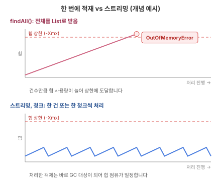
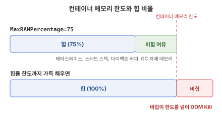

<!-- truncate -->

대용량 데이터를 처리하는 서버(대량 메시지를 소비하는 Kafka 컨슈머, 배치 잡, 큰 JSON을 주고받는 API)를 이야기하면 결국 **메모리**로 귀결됩니다. "처리량이 커지면 메모리에 압박이 오고, 그때 어떻게 대응할지" — GC 정책은 무엇을 사용하는지, 힙은 어떻게 설정하는지, 왜 그렇게 판단했는지에 대한 질문입니다. 이 글은 그 질문에 답하기 위한 관점을 정리합니다.

<mark>대용량 처리에서 메모리 문제는 "힙을 얼마나 크게 설정하는지"가 아니라 "한 번에 얼마나 메모리에 올리는지(할당률)와, 그걸 어떤 GC로 어떻게 비우는지"의 문제입니다.</mark>

GC의 기본 동작, 알고리즘 자체는 이 글에서 다시 설명하지 않습니다. 배경은 [GC 알고리즘](/wiki/java/java-gc-algorithm), [G1 GC 동작 과정](/wiki/java/java-gc-g1gc), [GC 종류와 선택](/blog/java-gc-types)을 참고하세요. 여기서는 **대용량 처리라는 상황에서의 선택**에 집중합니다.

## 왜 대용량 처리에서 메모리가 부족해지나

핵심은 **할당률(allocation rate)** 입니다. 요청, 메시지 하나를 처리할 때 만들어지는 객체(역직렬화된 DTO, 중간 컬렉션, 문자열)가 쌓이는 속도입니다. 처리량이 늘면 초당 만들어지는 객체가 급증하고, 이게 **Young 영역을 빠르게 채워** GC가 자주 돌게 만듭니다.

특히 위험한 패턴은 **"한 번에 다 메모리에 올리는" 코드**입니다.

```java
// 위험: 100만 행을 한 번에 List로 — 힙에 통째로 적재
List<Order> all = orderRepository.findAll();
for (Order o : all) { process(o); }
```

데이터가 작을 땐 문제없지만, 건수가 커지면 이 `List` 하나가 힙을 가득 채워 `OutOfMemoryError`로 이어집니다. 힙을 키워도 데이터가 더 커지면 결국 다시 한계에 도달하므로, **근본 해법은 힙 증설이 아니라 "한 번에 올리는 양"을 줄이는 것**입니다.

<mark>힙 크기는 상한일 뿐입니다. 한 번에 처리하는 데이터가 힙에 다 들어가야 한다는 설계 자체가 문제라면, 힙을 키우는 건 한계에 도달하는 시점을 미룰 뿐입니다.</mark>

## 1) 한 번에 올리는 양을 줄인다 — 스트리밍, 청크

가장 먼저 볼 것은 GC 옵션이 아니라 **처리 방식**입니다.

- **DB 조회**: 전체를 `List`로 받지 말고 **페이징**하거나 **커서/스트림**으로 한 건씩 처리합니다. 배치라면 청크(chunk) 단위로 읽고-처리하고-비웁니다. Spring Batch에서 대용량을 안전하게 읽는 방법은 [커스텀 ItemReader로 대용량 읽기](/blog/spring-batch-custom-itemreader)에서 설명했습니다.
- **Kafka 컨슈머**: `max.poll.records`(한 번에 가져오는 레코드 수)와 배치 크기를 처리 속도와 메모리에 맞게 조정합니다. 배치를 너무 크게 설정하면 한 번 poll에 수천 건이 메모리에 올라오고, 처리 시간이 길어져 `max.poll.interval.ms`를 넘기면 리밸런싱까지 유발합니다.
- **큰 JSON**: 전체를 객체 트리로 한꺼번에 바인딩하면 payload 크기에 비례해 메모리 사용량이 급증합니다. 아주 큰 문서는 **스트리밍 파서**(Jackson `JsonParser`)로 필요한 부분만 읽어 중간 객체를 줄입니다. 일반 API의 `@RequestBody` 정도는 문제되지 않지만, "수 MB짜리 배열을 그대로 받는" 엔드포인트라면 스트리밍을 고려합니다.

```java
// 스트리밍 처리: 한 건씩 처리해 힙 점유를 상수로 유지
try (Stream<Order> stream = orderRepository.streamAll()) {   // 커서 기반
    stream.forEach(this::process);   // 처리 후 바로 GC 대상이 됨
}
```

<details>
<summary>SVG 코드</summary>

```svg
<svg xmlns="http://www.w3.org/2000/svg" width="440" height="366" viewBox="0 0 440 366" font-family="-apple-system, 'Segoe UI', 'Noto Sans KR', sans-serif">
<defs><marker id="ah" viewBox="0 0 10 10" refX="9" refY="5" markerWidth="7" markerHeight="7" orient="auto-start-reverse"><path d="M0,0 L10,5 L0,10 z" fill="#888"/></marker></defs>
<rect x="0" y="0" width="440" height="366" fill="#FFFFFF"/>
<text x="220.0" y="22" font-size="13" fill="#333" text-anchor="middle" font-weight="bold">한 번에 적재 vs 스트리밍 (개념 예시)</text>
<text x="20" y="46" font-size="11" fill="#9E3A57" text-anchor="start" font-weight="bold">findAll(): 전체를 List로 받음</text>
<line x1="50" y1="154" x2="420" y2="154" stroke="#999"/>
<line x1="50" y1="58" x2="50" y2="154" stroke="#999"/>
<line x1="50" y1="74" x2="420" y2="74" stroke="#D9534F" stroke-dasharray="5 4"/>
<text x="56" y="70" font-size="9.5" fill="#B52B27" text-anchor="start">힙 상한 (-Xmx)</text>
<text x="44" y="110.0" font-size="9.5" fill="#888" text-anchor="end">힙</text>
<text x="420" y="168" font-size="9.5" fill="#888" text-anchor="end">처리 진행 →</text>
<polyline points="50.0,149.2 72.2,141.0 94.4,132.9 116.6,124.7 138.8,116.6 161.0,108.4 183.2,100.2 205.4,92.1 227.6,83.9 249.8,75.8 272.0,67.6" fill="none" stroke="#D06A86" stroke-width="2"/>
<circle cx="272.0" cy="67.6" r="5" fill="#FDECEC" stroke="#D9534F"/>
<rect x="282.0" y="63.6" width="112" height="22" rx="4" fill="#FDECEC" stroke="#D9534F"/>
<text x="338.0" y="78.6" font-size="10" fill="#B52B27" text-anchor="middle" font-weight="bold">OutOfMemoryError</text>
<text x="58" y="184" font-size="10" fill="#555" text-anchor="start">건수만큼 힙 사용량이 늘어 상한에 도달합니다</text>
<text x="20" y="214" font-size="11" fill="#26508F" text-anchor="start" font-weight="bold">스트리밍, 청크: 한 건 또는 한 청크씩 처리</text>
<line x1="50" y1="322" x2="420" y2="322" stroke="#999"/>
<line x1="50" y1="226" x2="50" y2="322" stroke="#999"/>
<line x1="50" y1="242" x2="420" y2="242" stroke="#D9534F" stroke-dasharray="5 4"/>
<text x="56" y="238" font-size="9.5" fill="#B52B27" text-anchor="start">힙 상한 (-Xmx)</text>
<text x="44" y="278.0" font-size="9.5" fill="#888" text-anchor="end">힙</text>
<text x="420" y="336" font-size="9.5" fill="#888" text-anchor="end">처리 진행 →</text>
<polyline points="50.0,310.5 87.0,293.2 96.2,310.5 133.2,293.2 142.5,310.5 179.5,293.2 188.8,310.5 225.8,293.2 235.0,310.5 272.0,293.2 281.2,310.5 318.2,293.2 327.5,310.5 364.5,293.2 373.8,310.5 410.8,293.2 420.0,310.5" fill="none" stroke="#4C7FE0" stroke-width="2"/>
<text x="58" y="352" font-size="10" fill="#555" text-anchor="start">처리한 객체는 바로 GC 대상이 되어 힙 점유가 일정합니다</text>
</svg>
```

</details>

<figure style={{textAlign: 'center', margin: '1.5rem 0'}}>
  
</figure>

<mark>메모리 문제의 8할은 GC 옵션이 아니라 "전부 메모리에 올리는 코드"를 스트리밍과 청크로 변경하면 해결됩니다.</mark>

## 2) 힙 크기 — 컨테이너에서는 비율로 설정한다

그다음이 힙 크기입니다. 전통적으로 `-Xms`(초기), `-Xmx`(최대)로 고정값을 설정했습니다.

```
java -Xms2g -Xmx2g -jar app.jar   # 초기·최대를 같게 → 런타임 중 힙 리사이징 비용 제거
```

`-Xms`와 `-Xmx`를 같게 설정하는 건 흔한 관례입니다. 힙이 도중에 늘었다 줄었다 하며 생기는 비용을 없애고, 시작부터 최대 힙을 확보해 예측 가능하게 만듭니다.

문제는 **컨테이너(쿠버네티스 등)** 입니다. `-Xmx2g`를 하드코딩하면, 파드 메모리 한도를 바꿔도 JVM은 여전히 2g만 사용합니다. 반대로 컨테이너 한도보다 크게 설정하면 **OOM Kill**(컨테이너 전체가 강제 종료)당합니다. 그래서 고정값 대신 **한도 대비 비율**로 설정합니다.

```
# 컨테이너 메모리 한도의 75%를 힙 최대로 — 한도가 바뀌면 힙도 따라 감
java -XX:InitialRAMPercentage=75 -XX:MaxRAMPercentage=75 -jar app.jar
```

100%가 아니라 75% 정도만 힙에 주는 이유는, JVM이 힙 외에도 **메타스페이스, 스레드 스택, 다이렉트 버퍼, GC 자체 메모리**를 쓰기 때문입니다. 힙을 한도까지 가득 채우면 이 비힙(off-heap) 영역이 한도를 넘겨 OOM Kill로 이어집니다. (네이티브 메모리 고갈로 스레드조차 못 만드는 사례는 [OOM: unable to create native thread](/blog/oom-unable-to-create-native-thread) 참고.)

<details>
<summary>SVG 코드</summary>

```svg
<svg xmlns="http://www.w3.org/2000/svg" width="440" height="226" viewBox="0 0 440 226" font-family="-apple-system, 'Segoe UI', 'Noto Sans KR', sans-serif">
<defs><marker id="ah" viewBox="0 0 10 10" refX="9" refY="5" markerWidth="7" markerHeight="7" orient="auto-start-reverse"><path d="M0,0 L10,5 L0,10 z" fill="#888"/></marker></defs>
<rect x="0" y="0" width="440" height="226" fill="#FFFFFF"/>
<text x="220.0" y="22" font-size="13" fill="#333" text-anchor="middle" font-weight="bold">컨테이너 메모리 한도와 힙 비율</text>
<line x1="350" y1="40" x2="350" y2="192" stroke="#D9534F" stroke-dasharray="5 4"/>
<text x="350" y="36" font-size="9.5" fill="#B52B27" text-anchor="middle">컨테이너 메모리 한도</text>
<text x="20" y="62" font-size="11" fill="#333" text-anchor="start" font-weight="bold" font-family="Menlo, Consolas, monospace">MaxRAMPercentage=75</text>
<rect x="20" y="70" width="247.5" height="34" rx="4" fill="#EEF3FB" stroke="#4C7FE0"/>
<text x="143.75" y="92" font-size="11" fill="#26508F" text-anchor="middle" font-weight="bold">힙 (75%)</text>
<rect x="267.5" y="70" width="82.5" height="34" rx="4" fill="#E9F2E9" stroke="#8FBF8F"/>
<text x="308.75" y="92" font-size="10.5" fill="#2E6B2E" text-anchor="middle" font-weight="bold">비힙 여유</text>
<text x="342" y="120" font-size="9.5" fill="#555" text-anchor="end">메타스페이스, 스레드 스택, 다이렉트 버퍼, GC 자체 메모리</text>
<text x="20" y="150" font-size="11" fill="#333" text-anchor="start" font-weight="bold">힙을 한도까지 가득 채우면</text>
<rect x="20" y="158" width="330" height="34" rx="4" fill="#EEF3FB" stroke="#4C7FE0"/>
<text x="185.0" y="180" font-size="11" fill="#26508F" text-anchor="middle" font-weight="bold">힙 (100%)</text>
<rect x="350" y="158" width="72" height="34" rx="4" fill="#FDECEC" stroke="#D9534F"/>
<text x="386" y="180" font-size="10.5" fill="#B52B27" text-anchor="middle" font-weight="bold">비힙</text>
<text x="420" y="216" font-size="10" fill="#B52B27" text-anchor="end" font-weight="bold">비힙이 한도를 넘어 OOM Kill</text>
</svg>
```

</details>

<figure style={{textAlign: 'center', margin: '1.5rem 0'}}>
  
</figure>

<mark>컨테이너에서는 `-Xmx` 고정값 대신 `MaxRAMPercentage`로 한도 대비 비율(예: 75%)을 설정해, 파드 스펙이 바뀌어도 힙이 따라오고 비힙 여유도 남기게 합니다.</mark>

## 3) GC 선택 — 처리량과 지연 중 무엇을 우선할지

GC는 상황에 맞게 선택합니다. 대용량 처리에서 나뉘는 기준은 **"정지(pause) 시간을 줄이고 싶은가, 총 처리량을 높이고 싶은가"** 입니다.

| GC | 성격 | 대용량 처리에서 |
|---|---|---|
| **G1 GC** (기본) | 처리량과 지연의 균형 | 대부분의 서비스 기본값. 목표 pause(`MaxGCPauseMillis`)를 설정하고 맞춰 감 |
| **ZGC** | 초저지연(대개 수 ms 이하), 대용량 힙 | 힙이 크고(수십 GB~) pause를 짧게 유지해야 하는 지연 민감 서비스 |
| **Parallel GC** | 최대 처리량, pause는 감수 | 지연이 덜 중요한 **배치**성 작업 — 총 처리 시간을 줄이는 데 유리 |

```
# 지연이 중요한 온라인 서버 — G1에 목표 pause 지정
java -XX:+UseG1GC -XX:MaxGCPauseMillis=200 ...

# 큰 힙 + 초저지연이 필요할 때 — ZGC
java -XX:+UseZGC ...

# 지연보다 총 처리량이 중요한 배치 — Parallel
java -XX:+UseParallelGC ...
```

실제로는 **기본값(G1)으로 시작해, 측정 후 필요할 때만 변경하는 것**이 정석입니다. GC 정책 변경은 근거(측정된 pause, 처리량 문제) 없이 먼저 손대는 튜닝이 아닙니다. 각 GC의 특성, 선택 기준은 [GC 종류와 선택](/blog/java-gc-types)에, 시나리오별 튜닝은 [JVM 튜닝 시나리오](/blog/jvm-tuning-scenarios)에 정리돼 있습니다.

<mark>GC는 "온라인=G1/ZGC(지연), 배치=Parallel(처리량)"이 큰 기준이고, 기본값으로 시작해 지표로 근거를 잡은 뒤에만 변경합니다.</mark>

## 4) 스케일 업 vs 스케일 아웃

메모리 압박이 왔을 때 서버 스펙을 올릴지(스케일 업), 인스턴스를 늘릴지(스케일 아웃)의 선택도 자주 묻습니다.

- **스케일 업(스펙 업)**: 힙을 키우면 GC 주기는 늘지만, 한 번 도는 GC의 **pause가 길어지고** 처리량 상한도 크게 오르진 않습니다. "큰 객체 하나를 힙에 담지 못해 `OutOfMemoryError`가 나는" 경우가 아니면 처리량 개선 효과가 제한적입니다.
- **스케일 아웃**: 인스턴스(또는 Kafka 컨슈머)를 늘려 작업을 나눕니다. 처리량 확장에는 대개 이쪽이 유효합니다. 단 Kafka는 **파티션 수가 컨슈머 병렬성의 상한**이라, 컨슈머만 늘려도 파티션이 부족하면 더 이상 나눠지지 않습니다(파티션 수 결정은 [Kafka 파티션 개수 정하기](/blog/kafka-partition-count) 참고).

정리하면, **처리량 부족 → 스케일 아웃(+필요 시 파티션 증설, 배치 크기 조정)**, **단일 메시지가 커서 힙 사용량이 급증하는 상황 → 스펙 업**이 일반적 판단입니다.

<mark>처리량이 모자라면 스케일 아웃이 먼저입니다. 스펙 업은 "큰 데이터 하나가 힙을 초과해 `OutOfMemoryError`가 나는" 종류의 문제에 적용합니다.</mark>

## 5) 어떻게 확인하나 — 지표부터

옵션을 바꾸기 전에 **무엇이 문제인지**부터 지표로 확인합니다.

- **GC 로그, 지표**: GC 빈도와 pause 시간, 그리고 **Old 영역이 GC 후에도 계속 우상향**하는지. 계속 늘면 메모리 누수 신호입니다.
- **힙 덤프**: 무엇이 힙을 점유하는지 실제로 봅니다. 분석 절차는 [JVM 힙 덤프 분석](/blog/jvm-heap-dump-analysis)에 정리했습니다.
- **관측 도구**: Actuator + Micrometer로 힙 사용량, GC 지표를 노출해 Prometheus, Grafana로 추이를 봅니다([Spring Boot Actuator와 Micrometer](/wiki/spring-framework/spring-actuator-micrometer)).

<mark>"GC 후에도 Old가 계속 우상향"이면 누수, "pause가 길다"면 힙, GC 정책, "할당률이 높다"면 코드(한 번에 올리는 양)를 의심합니다 — 원인마다 손댈 곳이 다릅니다.</mark>

## 정리

- 대용량 처리 메모리 문제의 1순위 해법은 **코드**입니다. 전부 메모리에 올리지 말고 **스트리밍, 페이징, 청크**로 한 번에 올리는 양을 줄입니다.
- 힙은 컨테이너에서 `-Xmx` 고정 대신 **`MaxRAMPercentage`(예: 75%)** 로 설정해 비힙 여유를 남깁니다.
- GC는 **온라인=G1/ZGC(지연), 배치=Parallel(처리량)** 이 큰 기준. 기본값으로 시작해 **지표 근거** 후에만 변경합니다.
- 처리량 부족은 **스케일 아웃**(+파티션, 배치 조정), 큰 데이터로 인한 메모리 압박은 **스펙 업**.
- 무엇을 변경하든 **GC 지표, 힙 덤프로 원인을 먼저 특정**합니다.

결국 "힙을 얼마나 키울지"는 마지막 질문입니다. **한 번에 올리는 양을 줄이고, 컨테이너에 맞게 비율로 힙을 설정하고, 상황에 맞는 GC를 고르고, 지표로 검증**하는 순서가 대용량 처리의 메모리 대응입니다.
