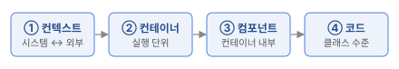
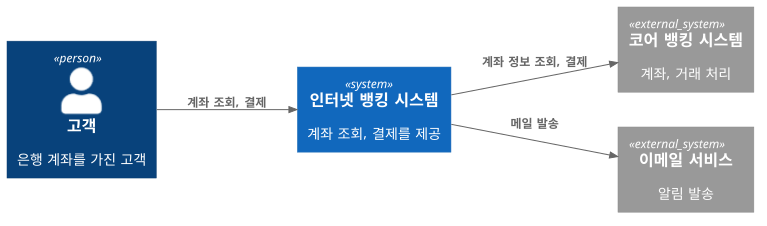
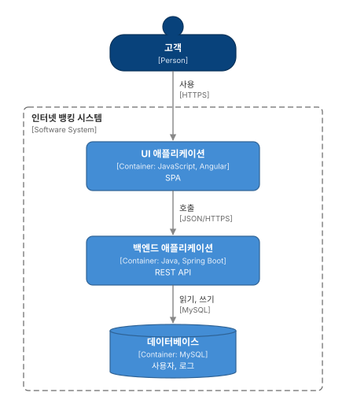
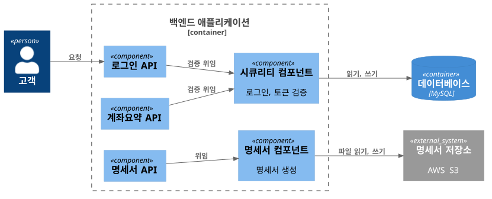
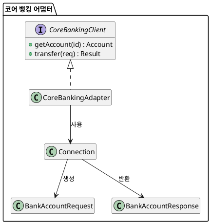
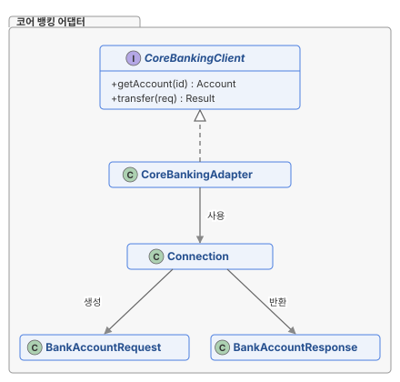

<!-- truncate -->

머릿속엔 설계가 다 있는데, 막상 그림으로 그리려 하면 "어디까지 그려야 하지? 이 정도면 되나?" 싶어 선뜻 손이 안 나갑니다. 개발은 곧잘 하는데 그걸 그림으로 표현하는 걸 어려워하는 경우가 많습니다. 업계에서 검증된 **C4 모델**로 설계를 시각화하는 방법을 정리합니다.

<mark>C4의 핵심은 하나입니다 — 구글 지도를 확대하듯, 아키텍처를 **네 단계의 추상화 수준**으로 나눠 그립니다. 전체 구조에서 시작해 점점 세부로 내려갑니다.</mark>

## 왜 C4인가 — 탄생 배경

C4 모델은 영국의 아키텍처 컨설턴트 **사이먼 브라운(Simon Brown)** 이 2000년대 중반 아키텍처 워크숍을 진행하며 만들었습니다. 그는 참가자들에게 **같은 요구사항**을 제시하고 설계시킨 뒤, 결과를 다이어그램으로 그려 보라고 했습니다. 그런데 나온 그림들을 **아무도 이해하지 못했습니다.** 표기법이 제각각이고, 박스 하나하나의 의미가 애매하고, 화살표에 설명이 없고, **한 그림에 서로 다른 추상화 레벨이 혼재되어** 있었습니다.

여기서 깨달음이 나옵니다. **"설계를 못하는 게 아니라, 설계한 것을 시각화하지 못하는 게 문제였다."** 마침 시대적 배경도 있었습니다. UML(클래스, 유스케이스, 시퀀스 다이어그램 등 표준 표기법)은 표현력은 강하지만 규칙이 무거웠고, **애자일** 확산과 함께 팀들이 UML을 버리고 박스와 선으로 단순하게 그리기 시작했습니다. 그 과정에서 개발자들이 "설계를 시각적으로 소통하는 능력"을 잃어버린 것이죠.

C4는 완전히 새로운 게 아니라, **UML과 4+1 뷰**에서 필요한 것만 뽑아 가볍게 만든 시각화 방법입니다. 아키텍처 문서화 프레임워크 **arc42**에도 인용되고 기술 레이더 보고서에도 소개될 만큼 검증됐습니다(공식 자료는 [c4model.com](https://c4model.com)).

<mark>C4는 "표기법"이 아닙니다 — 색, 도형에 정해진 규칙이 없어, Visio, draw.io 등 어떤 툴로 그려도 개념만 따르면 C4입니다.</mark>

## 4가지 구성 요소 — 포함 관계

C4는 시스템의 **정적 구조**를 네 요소로 봅니다. 상위가 하위를 포함합니다.

- **소프트웨어 시스템(Software System)** — 가장 높은 추상화. 사용자에게 가치를 제공하는 무언가(제품, 서비스). 우리가 만드는 시스템 + **의존하는 외부 시스템**까지.
- **컨테이너(Container)** — 시스템이 동작하려면 **실행되거나 저장돼야 하는 단위**(웹 애플리케이션, API 서버, DB 등). 독립적으로 실행과 배포되는 런타임 경계. **주의: 도커와 무관** — C4는 도커 이전부터 이 용어를 썼습니다.
- **컴포넌트(Component)** — 잘 정의된 인터페이스 뒤에 캡슐화된 관련 기능의 모음. **개별 배포 단위가 아니라**, 컨테이너 안에서 다른 컴포넌트들과 **하나의 프로세스**로 동작합니다.
- **코드(Code)** — 클래스, 인터페이스, 함수 등 언어의 기본 구성 요소로 실제 구현된 것.

## 지도 확대 — 4개의 다이어그램

이 네 요소로 **레벨을 확대해 가며** 네 종류의 다이어그램을 그립니다. 구글 지도가 전체 → 도시 → 동네 → 건물로 확대되듯이.

<details>
<summary>SVG 코드</summary>

```svg
<svg xmlns="http://www.w3.org/2000/svg" width="440" height="76" viewBox="0 0 440 76" font-family="-apple-system, 'Segoe UI', 'Noto Sans KR', sans-serif">
<defs><marker id="ah" viewBox="0 0 10 10" refX="9" refY="5" markerWidth="7" markerHeight="7" orient="auto-start-reverse"><path d="M0,0 L10,5 L0,10 z" fill="#888"/></marker></defs>
<rect x="0" y="0" width="440" height="76" fill="#FFFFFF"/>
<rect x="12.0" y="14" width="92" height="48" rx="6" fill="#EEF3FB" stroke="#4C7FE0"/>
<text x="58.0" y="35.0" font-size="12" fill="#26508F" text-anchor="middle" font-weight="bold">① 컨텍스트</text>
<text x="58.0" y="51.0" font-size="10.5" fill="#555" text-anchor="middle">시스템 ↔ 외부</text>
<line x1="105.0" y1="38" x2="119.0" y2="38" stroke="#888" stroke-width="1.2" marker-end="url(#ah)"/>
<rect x="120.0" y="14" width="92" height="48" rx="6" fill="#EEF3FB" stroke="#4C7FE0"/>
<text x="166.0" y="35.0" font-size="12" fill="#26508F" text-anchor="middle" font-weight="bold">② 컨테이너</text>
<text x="166.0" y="51.0" font-size="10.5" fill="#555" text-anchor="middle">실행 단위</text>
<line x1="213.0" y1="38" x2="227.0" y2="38" stroke="#888" stroke-width="1.2" marker-end="url(#ah)"/>
<rect x="228.0" y="14" width="92" height="48" rx="6" fill="#EEF3FB" stroke="#4C7FE0"/>
<text x="274.0" y="35.0" font-size="12" fill="#26508F" text-anchor="middle" font-weight="bold">③ 컴포넌트</text>
<text x="274.0" y="51.0" font-size="10.5" fill="#555" text-anchor="middle">컨테이너 내부</text>
<line x1="321.0" y1="38" x2="335.0" y2="38" stroke="#888" stroke-width="1.2" marker-end="url(#ah)"/>
<rect x="336.0" y="14" width="92" height="48" rx="6" fill="#EEF3FB" stroke="#4C7FE0"/>
<text x="382.0" y="35.0" font-size="12" fill="#26508F" text-anchor="middle" font-weight="bold">④ 코드</text>
<text x="382.0" y="51.0" font-size="10.5" fill="#555" text-anchor="middle">클래스 수준</text>
</svg>
```

</details>

<figure style={{textAlign: 'center', margin: '1.5rem 0'}}>
  
</figure>

| 레벨 | 다이어그램 | 무엇을 보여주나 | 대상 독자 |
|---|---|---|---|
| 1 | 시스템 컨텍스트 | 우리 시스템 ↔ 외부 사용자와 시스템의 관계 | 개발자 + 비개발자, 경영진 모두 |
| 2 | 컨테이너 | 시스템 내부의 큰 실행 단위와 기술, 통신 | 개발팀 + 운영팀 |
| 3 | 컴포넌트 | 컨테이너 하나를 열었을 때의 내부 구조 | 해당 컨테이너 담당 개발자 |
| 4 | 코드 | 클래스 다이어그램 수준 | 개발자(자동 생성 권장) |

<mark>"어떤 레벨로 그릴까"는 결국 "누구에게 보여줄까"의 문제입니다 — 경영진에겐 컨텍스트면 충분하고, 코드를 작성하는 개발자는 컴포넌트까지 내려가야 쓸모가 있습니다.</mark>

아래는 가상의 **인터넷 뱅킹 시스템** 예시로 각 레벨을 봅니다.

### 레벨 1 — 시스템 컨텍스트

가장 추상화된 그림. 우리 시스템을 가운데 배치하고, 상호작용하는 **사용자, 외부 시스템**만 그립니다. 기술 세부는 모두 생략해 비개발자도 이해할 수 있습니다. **시스템을 그리는 가장 좋은 출발점**입니다.

<details>
<summary>C4-PlantUML 코드 (같은 내용을 코드로 작성한 예)</summary>

```plantuml
@startuml
!include https://raw.githubusercontent.com/plantuml-stdlib/C4-PlantUML/master/C4_Context.puml
LAYOUT_LEFT_RIGHT()

Person(customer, "고객", "은행 계좌를 가진 고객")
System(ib, "인터넷 뱅킹 시스템", "계좌 조회, 결제를 제공")
System_Ext(core, "코어 뱅킹 시스템", "계좌, 거래 처리")
System_Ext(email, "이메일 서비스", "알림 발송")

Rel(customer, ib, "계좌 조회, 결제")
Rel(ib, core, "계좌 정보 조회, 결제")
Rel(ib, email, "메일 발송")
@enduml
```

</details>

<details>
<summary>SVG 코드</summary>

```svg
<svg xmlns="http://www.w3.org/2000/svg" width="440" height="400" viewBox="0 0 440 400" font-family="-apple-system, 'Segoe UI', 'Noto Sans KR', sans-serif">
<defs><marker id="ah" viewBox="0 0 10 10" refX="9" refY="5" markerWidth="7" markerHeight="7" orient="auto-start-reverse"><path d="M0,0 L10,5 L0,10 z" fill="#888"/></marker></defs>
<rect x="0" y="0" width="440" height="400" fill="#FFFFFF"/>
<circle cx="220" cy="34" r="13" fill="#08427B" stroke="#052E56" stroke-width="1.2"/>
<rect x="115.0" y="44" width="210" height="62" rx="18" fill="#08427B" stroke="#052E56" stroke-width="1.2"/>
<circle cx="220" cy="34" r="12.4" fill="#08427B"/>
<text x="220" y="65.5" font-size="12" fill="#FFFFFF" text-anchor="middle" font-weight="bold">고객</text>
<text x="220" y="80.5" font-size="9.5" fill="#DCE8F5" text-anchor="middle">[Person]</text>
<text x="220" y="95.5" font-size="10.5" fill="#FFFFFF" text-anchor="middle">은행 계좌를 가진 고객</text>
<line x1="220" y1="106" x2="220" y2="168" stroke="#707070" stroke-width="1.2" marker-end="url(#ah)"/>
<text x="226" y="141" font-size="10.5" fill="#333" text-anchor="start" stroke="#FFFFFF" stroke-width="4" paint-order="stroke">계좌 조회, 결제</text>
<rect x="110" y="170" width="220" height="66" rx="8" fill="#1168BD" stroke="#0B4884" stroke-width="1.2"/>
<text x="220.0" y="191.5" font-size="12" fill="#FFFFFF" text-anchor="middle" font-weight="bold">인터넷 뱅킹 시스템</text>
<text x="220.0" y="206.5" font-size="9.5" fill="#E3EEF9" text-anchor="middle">[Software System]</text>
<text x="220.0" y="221.5" font-size="10.5" fill="#FFFFFF" text-anchor="middle">계좌 조회, 결제를 제공</text>
<line x1="180" y1="236" x2="112" y2="318" stroke="#707070" stroke-width="1.2" marker-end="url(#ah)"/>
<text x="132" y="280" font-size="10.5" fill="#333" text-anchor="middle" stroke="#FFFFFF" stroke-width="4" paint-order="stroke">계좌 정보 조회, 결제</text>
<line x1="260" y1="236" x2="328" y2="318" stroke="#707070" stroke-width="1.2" marker-end="url(#ah)"/>
<text x="314" y="280" font-size="10.5" fill="#333" text-anchor="middle" stroke="#FFFFFF" stroke-width="4" paint-order="stroke">메일 발송</text>
<rect x="18" y="320" width="188" height="66" rx="8" fill="#999999" stroke="#6B6B6B" stroke-width="1.2"/>
<text x="112.0" y="341.5" font-size="12" fill="#FFFFFF" text-anchor="middle" font-weight="bold">코어 뱅킹 시스템</text>
<text x="112.0" y="356.5" font-size="9.5" fill="#F2F2F2" text-anchor="middle">[Software System]</text>
<text x="112.0" y="371.5" font-size="10.5" fill="#FFFFFF" text-anchor="middle">계좌, 거래 처리</text>
<rect x="234" y="320" width="188" height="66" rx="8" fill="#999999" stroke="#6B6B6B" stroke-width="1.2"/>
<text x="328.0" y="341.5" font-size="12" fill="#FFFFFF" text-anchor="middle" font-weight="bold">이메일 서비스</text>
<text x="328.0" y="356.5" font-size="9.5" fill="#F2F2F2" text-anchor="middle">[Software System]</text>
<text x="328.0" y="371.5" font-size="10.5" fill="#FFFFFF" text-anchor="middle">알림 발송</text>
</svg>
```

</details>

<figure style={{textAlign: 'center', margin: '1.5rem 0'}}>
  
</figure>

박스마다 **제목 + 설명**을, 화살표마다 **관계를 설명하는 라벨**을 붙이는 게 핵심입니다. **모든 개발팀에 권장**됩니다.

### 레벨 2 — 컨테이너

시스템 경계 안으로 한 단계 들어가, 어떤 **실행 단위**가 있고 책임이 어떻게 나뉘는지, 그리고 **기술 선택과 통신 프로토콜**을 표현합니다.

<details>
<summary>C4-PlantUML 코드 (같은 내용을 코드로 작성한 예)</summary>

```plantuml
@startuml
!include https://raw.githubusercontent.com/plantuml-stdlib/C4-PlantUML/master/C4_Container.puml
LAYOUT_LEFT_RIGHT()

Person(customer, "고객")
System_Boundary(ib, "인터넷 뱅킹 시스템") {
  Container(spa, "UI 애플리케이션", "JavaScript, Angular", "SPA")
  Container(api, "백엔드 애플리케이션", "Java, Spring Boot", "REST API")
  ContainerDb(db, "데이터베이스", "MySQL", "사용자, 로그")
}
Rel(customer, spa, "사용", "HTTPS")
Rel(spa, api, "호출", "JSON/HTTPS")
Rel(api, db, "읽기, 쓰기", "MySQL")
@enduml
```

</details>

<details>
<summary>SVG 코드</summary>

```svg
<svg xmlns="http://www.w3.org/2000/svg" width="440" height="508" viewBox="0 0 440 508" font-family="-apple-system, 'Segoe UI', 'Noto Sans KR', sans-serif">
<defs><marker id="ah" viewBox="0 0 10 10" refX="9" refY="5" markerWidth="7" markerHeight="7" orient="auto-start-reverse"><path d="M0,0 L10,5 L0,10 z" fill="#888"/></marker></defs>
<rect x="0" y="0" width="440" height="508" fill="#FFFFFF"/>
<circle cx="220" cy="34" r="13" fill="#08427B" stroke="#052E56" stroke-width="1.2"/>
<rect x="140.0" y="44" width="160" height="46" rx="18" fill="#08427B" stroke="#052E56" stroke-width="1.2"/>
<circle cx="220" cy="34" r="12.4" fill="#08427B"/>
<text x="220" y="65.0" font-size="12" fill="#FFFFFF" text-anchor="middle" font-weight="bold">고객</text>
<text x="220" y="80.0" font-size="9.5" fill="#DCE8F5" text-anchor="middle">[Person]</text>
<line x1="220" y1="90" x2="220" y2="178" stroke="#707070" stroke-width="1.2" marker-end="url(#ah)"/>
<text x="228" y="111" font-size="10.5" fill="#333" text-anchor="start" stroke="#FFFFFF" stroke-width="4" paint-order="stroke">사용</text>
<text x="228" y="124" font-size="9.5" fill="#666" text-anchor="start" stroke="#FFFFFF" stroke-width="4" paint-order="stroke">[HTTPS]</text>
<rect x="30" y="136" width="380" height="360" rx="6" fill="none" stroke="#666" stroke-width="1.2" stroke-dasharray="7 4"/>
<text x="40" y="154" font-size="11.5" fill="#333" text-anchor="start" font-weight="bold">인터넷 뱅킹 시스템</text>
<text x="40" y="168" font-size="9.5" fill="#666" text-anchor="start">[Software System]</text>
<rect x="110" y="180" width="220" height="62" rx="8" fill="#438DD5" stroke="#2E6295" stroke-width="1.2"/>
<text x="220.0" y="199.5" font-size="12" fill="#FFFFFF" text-anchor="middle" font-weight="bold">UI 애플리케이션</text>
<text x="220.0" y="214.5" font-size="9.5" fill="#EAF2FB" text-anchor="middle">[Container: JavaScript, Angular]</text>
<text x="220.0" y="229.5" font-size="10.5" fill="#FFFFFF" text-anchor="middle">SPA</text>
<line x1="220" y1="242" x2="220" y2="298" stroke="#707070" stroke-width="1.2" marker-end="url(#ah)"/>
<text x="228" y="268" font-size="10.5" fill="#333" text-anchor="start" stroke="#FFFFFF" stroke-width="4" paint-order="stroke">호출</text>
<text x="228" y="281" font-size="9.5" fill="#666" text-anchor="start" stroke="#FFFFFF" stroke-width="4" paint-order="stroke">[JSON/HTTPS]</text>
<rect x="110" y="300" width="220" height="62" rx="8" fill="#438DD5" stroke="#2E6295" stroke-width="1.2"/>
<text x="220.0" y="319.5" font-size="12" fill="#FFFFFF" text-anchor="middle" font-weight="bold">백엔드 애플리케이션</text>
<text x="220.0" y="334.5" font-size="9.5" fill="#EAF2FB" text-anchor="middle">[Container: Java, Spring Boot]</text>
<text x="220.0" y="349.5" font-size="10.5" fill="#FFFFFF" text-anchor="middle">REST API</text>
<line x1="220" y1="362" x2="220" y2="410" stroke="#707070" stroke-width="1.2" marker-end="url(#ah)"/>
<text x="228" y="384" font-size="10.5" fill="#333" text-anchor="start" stroke="#FFFFFF" stroke-width="4" paint-order="stroke">읽기, 쓰기</text>
<text x="228" y="397" font-size="9.5" fill="#666" text-anchor="start" stroke="#FFFFFF" stroke-width="4" paint-order="stroke">[MySQL]</text>
<path d="M140,420 V472 A80.0,8 0 0 0 300,472 V420" fill="#438DD5" stroke="#2E6295" stroke-width="1.2"/>
<ellipse cx="220.0" cy="420" rx="80.0" ry="8" fill="#438DD5" stroke="#2E6295" stroke-width="1.2"/>
<text x="220.0" y="438.5" font-size="12" fill="#FFFFFF" text-anchor="middle" font-weight="bold">데이터베이스</text>
<text x="220.0" y="453.5" font-size="9.5" fill="#EAF2FB" text-anchor="middle">[Container: MySQL]</text>
<text x="220.0" y="468.5" font-size="10.5" fill="#FFFFFF" text-anchor="middle">사용자, 로그</text>
</svg>
```

</details>

<figure style={{textAlign: 'center', margin: '1.5rem 0'}}>
  
</figure>

컨텍스트와 달리 **API, HTTPS, MySQL 프로토콜** 같은 기술 통신이 나타납니다. 다만 **클러스터링, 로드밸런싱, 장애조치 같은 배포 관점은 여기 넣지 않습니다**(환경마다 다르므로 뒤의 디플로이먼트 다이어그램으로). 역시 **모든 개발팀에 권장**됩니다.

### 레벨 3 — 컴포넌트

컨테이너 하나(여기선 **백엔드 애플리케이션**)를 열어 내부 컴포넌트를 봅니다.

<details>
<summary>C4-PlantUML 코드 (같은 내용을 코드로 작성한 예)</summary>

```plantuml
@startuml
!include https://raw.githubusercontent.com/plantuml-stdlib/C4-PlantUML/master/C4_Component.puml
LAYOUT_LEFT_RIGHT()

Person(customer, "고객")
Container_Boundary(be, "백엔드 애플리케이션") {
  Component(login, "로그인 API")
  Component(summary, "계좌요약 API")
  Component(stmt, "명세서 API")
  Component(sec, "시큐리티 컴포넌트", "", "로그인, 토큰 검증")
  Component(stmtc, "명세서 컴포넌트", "", "명세서 생성")
}
ContainerDb(db, "데이터베이스", "MySQL")
System_Ext(s3, "명세서 저장소", "AWS S3")

Rel(customer, login, "요청")
Rel(login, sec, "검증 위임")
Rel(summary, sec, "검증 위임")
Rel(stmt, stmtc, "위임")
Rel(sec, db, "읽기, 쓰기")
Rel(stmtc, s3, "파일 읽기, 쓰기")
@enduml
```

</details>

<details>
<summary>SVG 코드</summary>

```svg
<svg xmlns="http://www.w3.org/2000/svg" width="440" height="560" viewBox="0 0 440 560" font-family="-apple-system, 'Segoe UI', 'Noto Sans KR', sans-serif">
<defs><marker id="ah" viewBox="0 0 10 10" refX="9" refY="5" markerWidth="7" markerHeight="7" orient="auto-start-reverse"><path d="M0,0 L10,5 L0,10 z" fill="#888"/></marker></defs>
<rect x="0" y="0" width="440" height="560" fill="#FFFFFF"/>
<circle cx="86" cy="34" r="13" fill="#08427B" stroke="#052E56" stroke-width="1.2"/>
<rect x="16.0" y="44" width="140" height="46" rx="18" fill="#08427B" stroke="#052E56" stroke-width="1.2"/>
<circle cx="86" cy="34" r="12.4" fill="#08427B"/>
<text x="86" y="65.0" font-size="12" fill="#FFFFFF" text-anchor="middle" font-weight="bold">고객</text>
<text x="86" y="80.0" font-size="9.5" fill="#DCE8F5" text-anchor="middle">[Person]</text>
<line x1="86" y1="90" x2="86" y2="176" stroke="#707070" stroke-width="1.2" marker-end="url(#ah)"/>
<text x="94" y="114" font-size="10.5" fill="#333" text-anchor="start" stroke="#FFFFFF" stroke-width="4" paint-order="stroke">요청</text>
<rect x="10" y="134" width="420" height="274" rx="6" fill="none" stroke="#666" stroke-width="1.2" stroke-dasharray="7 4"/>
<text x="20" y="390" font-size="11.5" fill="#333" text-anchor="start" font-weight="bold">백엔드 애플리케이션</text>
<text x="20" y="404" font-size="9.5" fill="#666" text-anchor="start">[Container]</text>
<rect x="22" y="178" width="124" height="50" rx="8" fill="#85BBF0" stroke="#5D82A8" stroke-width="1.2"/>
<text x="84.0" y="199.0" font-size="12" fill="#0B2F55" text-anchor="middle" font-weight="bold">로그인 API</text>
<text x="84.0" y="214.0" font-size="9.5" fill="#1F3F66" text-anchor="middle">[Component]</text>
<rect x="158" y="178" width="124" height="50" rx="8" fill="#85BBF0" stroke="#5D82A8" stroke-width="1.2"/>
<text x="220.0" y="199.0" font-size="12" fill="#0B2F55" text-anchor="middle" font-weight="bold">계좌요약 API</text>
<text x="220.0" y="214.0" font-size="9.5" fill="#1F3F66" text-anchor="middle">[Component]</text>
<rect x="294" y="178" width="124" height="50" rx="8" fill="#85BBF0" stroke="#5D82A8" stroke-width="1.2"/>
<text x="356.0" y="199.0" font-size="12" fill="#0B2F55" text-anchor="middle" font-weight="bold">명세서 API</text>
<text x="356.0" y="214.0" font-size="9.5" fill="#1F3F66" text-anchor="middle">[Component]</text>
<rect x="22" y="300" width="260" height="62" rx="8" fill="#85BBF0" stroke="#5D82A8" stroke-width="1.2"/>
<text x="152.0" y="319.5" font-size="12" fill="#0B2F55" text-anchor="middle" font-weight="bold">시큐리티 컴포넌트</text>
<text x="152.0" y="334.5" font-size="9.5" fill="#1F3F66" text-anchor="middle">[Component]</text>
<text x="152.0" y="349.5" font-size="10.5" fill="#0B2F55" text-anchor="middle">로그인, 토큰 검증</text>
<rect x="294" y="300" width="124" height="62" rx="8" fill="#85BBF0" stroke="#5D82A8" stroke-width="1.2"/>
<text x="356.0" y="319.5" font-size="12" fill="#0B2F55" text-anchor="middle" font-weight="bold">명세서 컴포넌트</text>
<text x="356.0" y="334.5" font-size="9.5" fill="#1F3F66" text-anchor="middle">[Component]</text>
<text x="356.0" y="349.5" font-size="10.5" fill="#0B2F55" text-anchor="middle">명세서 생성</text>
<line x1="84.0" y1="228" x2="84.0" y2="298" stroke="#707070" stroke-width="1.2" marker-end="url(#ah)"/>
<text x="92.0" y="266" font-size="10.5" fill="#333" text-anchor="start" stroke="#FFFFFF" stroke-width="4" paint-order="stroke">검증 위임</text>
<line x1="220.0" y1="228" x2="220.0" y2="298" stroke="#707070" stroke-width="1.2" marker-end="url(#ah)"/>
<text x="228.0" y="266" font-size="10.5" fill="#333" text-anchor="start" stroke="#FFFFFF" stroke-width="4" paint-order="stroke">검증 위임</text>
<line x1="356.0" y1="228" x2="356.0" y2="298" stroke="#707070" stroke-width="1.2" marker-end="url(#ah)"/>
<text x="364.0" y="266" font-size="10.5" fill="#333" text-anchor="start" stroke="#FFFFFF" stroke-width="4" paint-order="stroke">위임</text>
<line x1="152.0" y1="362" x2="152.0" y2="466" stroke="#707070" stroke-width="1.2" marker-end="url(#ah)"/>
<text x="160.0" y="440" font-size="10.5" fill="#333" text-anchor="start" stroke="#FFFFFF" stroke-width="4" paint-order="stroke">읽기, 쓰기</text>
<line x1="356.0" y1="362" x2="356.0" y2="466" stroke="#707070" stroke-width="1.2" marker-end="url(#ah)"/>
<text x="356.0" y="440" font-size="10.5" fill="#333" text-anchor="middle" stroke="#FFFFFF" stroke-width="4" paint-order="stroke">파일 읽기, 쓰기</text>
<path d="M72.0,476 V522 A80.0,8 0 0 0 232.0,522 V476" fill="#438DD5" stroke="#2E6295" stroke-width="1.2"/>
<ellipse cx="152.0" cy="476" rx="80.0" ry="8" fill="#438DD5" stroke="#2E6295" stroke-width="1.2"/>
<text x="152.0" y="499.0" font-size="12" fill="#FFFFFF" text-anchor="middle" font-weight="bold">데이터베이스</text>
<text x="152.0" y="514.0" font-size="9.5" fill="#EAF2FB" text-anchor="middle">[Container: MySQL]</text>
<rect x="284" y="468" width="144" height="62" rx="8" fill="#999999" stroke="#6B6B6B" stroke-width="1.2"/>
<text x="356.0" y="487.5" font-size="12" fill="#FFFFFF" text-anchor="middle" font-weight="bold">명세서 저장소</text>
<text x="356.0" y="502.5" font-size="9.5" fill="#F2F2F2" text-anchor="middle">[Software System]</text>
<text x="356.0" y="517.5" font-size="10.5" fill="#FFFFFF" text-anchor="middle">AWS S3</text>
</svg>
```

</details>

<figure style={{textAlign: 'center', margin: '1.5rem 0'}}>
  
</figure>

핵심은 이 컴포넌트들이 **독립 배포 단위가 아니라** 백엔드라는 **한 컨테이너, 한 프로세스** 안의 논리적 역할이라는 점입니다. 컴포넌트 레벨은 **필수는 아니며**, 가치가 있을 때만 그립니다. 자주 바뀌므로 **장기 문서화는 자동화 도구**로 생성하는 편이 더 유리합니다.

### 레벨 4 — 코드

컴포넌트를 코드로 어떻게 구현했는지 — 과거 UML의 **클래스/ER 다이어그램** 수준입니다(그래서 C4-PlantUML이 아니라 일반 PlantUML 클래스 다이어그램으로 그립니다). 예로 앞의 **코어 뱅킹 어댑터** 컴포넌트를 열어 보면:

<details>
<summary>PlantUML 클래스 다이어그램 코드 (같은 내용을 코드로 작성한 예)</summary>



</details>

<details>
<summary>SVG 코드</summary>

```svg
<svg xmlns="http://www.w3.org/2000/svg" width="440" height="420" viewBox="0 0 440 420" font-family="-apple-system, 'Segoe UI', 'Noto Sans KR', sans-serif">
<defs><marker id="ah" viewBox="0 0 10 10" refX="9" refY="5" markerWidth="7" markerHeight="7" orient="auto-start-reverse"><path d="M0,0 L10,5 L0,10 z" fill="#888"/></marker><marker id="tri" viewBox="0 0 12 12" refX="11" refY="6" markerWidth="12" markerHeight="12" orient="auto"><path d="M1,1 L11,6 L1,11 z" fill="#FFFFFF" stroke="#666"/></marker></defs>
<rect x="0" y="0" width="440" height="420" fill="#FFFFFF"/>
<path d="M10,30 V22 Q10,18 14,18 H150 Q154,18 154,22 V30" fill="#F7F7F7" stroke="#999"/>
<rect x="10" y="30" width="420" height="380" rx="4" fill="#F7F7F7" stroke="#999"/>
<text x="18" y="28" font-size="11" fill="#333" text-anchor="start" font-weight="bold">코어 뱅킹 어댑터</text>
<rect x="110" y="50" width="220" height="70" rx="4" fill="#EEF3FB" stroke="#4C7FE0"/>
<circle cx="146.8" cy="64" r="8" fill="#B4A7E5" stroke="#666" stroke-width="0.8"/>
<text x="146.8" y="68" font-size="10" fill="#333" text-anchor="middle" font-weight="bold">I</text>
<text x="158.8" y="68" font-size="12" fill="#26508F" text-anchor="start" font-weight="bold" font-style="italic">CoreBankingClient</text>
<line x1="110" y1="78" x2="330" y2="78" stroke="#4C7FE0"/>
<text x="122" y="96" font-size="11" fill="#333" text-anchor="start">+getAccount(id) : Account</text>
<text x="122" y="112" font-size="11" fill="#333" text-anchor="start">+transfer(req) : Result</text>
<rect x="120" y="178" width="200" height="28" rx="4" fill="#EEF3FB" stroke="#4C7FE0"/>
<circle cx="143.2" cy="192" r="8" fill="#ADD1B2" stroke="#666" stroke-width="0.8"/>
<text x="143.2" y="196" font-size="10" fill="#333" text-anchor="middle" font-weight="bold">C</text>
<text x="155.2" y="196" font-size="12" fill="#26508F" text-anchor="start" font-weight="bold">CoreBankingAdapter</text>
<line x1="220" y1="178" x2="220" y2="121" stroke="#666" stroke-width="1.2" stroke-dasharray="5 4" marker-end="url(#tri)"/>
<rect x="140" y="268" width="160" height="28" rx="4" fill="#EEF3FB" stroke="#4C7FE0"/>
<circle cx="172.0" cy="282" r="8" fill="#ADD1B2" stroke="#666" stroke-width="0.8"/>
<text x="172.0" y="286" font-size="10" fill="#333" text-anchor="middle" font-weight="bold">C</text>
<text x="184.0" y="286" font-size="12" fill="#26508F" text-anchor="start" font-weight="bold">Connection</text>
<line x1="220" y1="206" x2="220" y2="267" stroke="#666" stroke-width="1.2" marker-end="url(#ah)"/>
<text x="228" y="241" font-size="10.5" fill="#333" text-anchor="start" stroke="#FFFFFF" stroke-width="4" paint-order="stroke">사용</text>
<rect x="22" y="368" width="186" height="28" rx="4" fill="#EEF3FB" stroke="#4C7FE0"/>
<circle cx="38.2" cy="382" r="8" fill="#ADD1B2" stroke="#666" stroke-width="0.8"/>
<text x="38.2" y="386" font-size="10" fill="#333" text-anchor="middle" font-weight="bold">C</text>
<text x="50.2" y="386" font-size="12" fill="#26508F" text-anchor="start" font-weight="bold">BankAccountRequest</text>
<rect x="232" y="368" width="186" height="28" rx="4" fill="#EEF3FB" stroke="#4C7FE0"/>
<circle cx="244.60000000000002" cy="382" r="8" fill="#ADD1B2" stroke="#666" stroke-width="0.8"/>
<text x="244.60000000000002" y="386" font-size="10" fill="#333" text-anchor="middle" font-weight="bold">C</text>
<text x="256.6" y="386" font-size="12" fill="#26508F" text-anchor="start" font-weight="bold">BankAccountResponse</text>
<line x1="190" y1="296" x2="115" y2="367" stroke="#666" stroke-width="1.2" marker-end="url(#ah)"/>
<text x="92" y="336" font-size="10.5" fill="#333" text-anchor="start" stroke="#FFFFFF" stroke-width="4" paint-order="stroke">생성</text>
<line x1="250" y1="296" x2="325" y2="367" stroke="#666" stroke-width="1.2" marker-end="url(#ah)"/>
<text x="296" y="336" font-size="10.5" fill="#333" text-anchor="start" stroke="#FFFFFF" stroke-width="4" paint-order="stroke">반환</text>
</svg>
```

</details>

<figure style={{textAlign: 'center', margin: '1.5rem 0'}}>
  
</figure>

인터페이스, 클래스, 꼭 필요한 메서드, 호출 관계 **정도까지만** 표현하고, 너무 세밀한 건 생략합니다. 변경이 잦으니 **IDE 등으로 자동 생성**하길 권합니다(필수 아님).

## 보완 다이어그램 세 가지

기본 4개 외에 상황에 따라 사용하는 보조 다이어그램이 있습니다.

- **시스템 랜드스케이프** — 앞 4개는 단일 시스템 표현입니다. 랜드스케이프는 **여러 시스템을 한꺼번에** 그려(ATM, 인터넷 뱅킹, 코어 뱅킹 등) 조직 전체를 조망합니다. 경계가 회사, 조직 단위입니다.
- **다이나믹 다이어그램** — 정적 구조가 아니라 **런타임 상호작용의 흐름**을 표현합니다(UML 시퀀스와 유사). 예: 로그인 요청이 UI → 로그인 API → 시큐리티 → DB로 전달되는 순서. 원칙적으로 금지인 **레벨 혼재를 유일하게 허용**하는 예외입니다(흐름을 보여주는 목적이라 컨테이너와 컴포넌트가 함께 등장).
- **디플로이먼트 다이어그램** — **배포 환경**(데이터센터, 로드밸런서, DNS, JVM, 브라우저 등)을 표현합니다. **환경마다 하나씩**(개발, 프로덕션…) 그립니다. 앞서 컨테이너 다이어그램에서 뺐던 클러스터링과 장애조치가 여기로 옵니다. **권장**됩니다.

## 어디까지 그릴까

- **컨텍스트 + 컨테이너**: 손으로 그려 유지할 가치가 큼 → **권장**.
- **컴포넌트 + 코드**: 자주 바뀌니 **자동화 도구**로(장기 문서화 시) → 필요할 때만.
- **디플로이먼트**: 환경별 1개씩 → **권장**.

절대적 공식은 아니고, **"누구와 어떤 다이어그램으로 소통할지"** 에 맞춰 고르면 됩니다.

## 다이어그램을 코드로 — C4-PlantUML

앞서 각 레벨 그림 위에 실은 코드가 보여 주듯, C4는 아예 **다이어그램을 코드로 작성**하기 좋은 모델입니다(각 레벨 그림 위의 코드는 같은 내용을 C4-PlantUML로 작성한 예입니다). 코드로 작성하면 **Git으로 버전 관리**하고, PR에서 리뷰하고, 요소가 바뀔 때 손으로 다시 그리지 않아도 됩니다. 위 예시는 **C4-PlantUML**(PlantUML에 C4 매크로를 더한 것)로, 레벨에 따라 `C4_Context.puml`, `C4_Container.puml`, `C4_Component.puml`을 include하고 `Person`, `System`, `Container`, `Component`, `Rel` 매크로만 바꿔 사용하면 됩니다.

도구는 취향껏 고르면 됩니다.

- **C4-PlantUML** — PlantUML에 C4 매크로를 더한 것. 배치가 정교하고 IDE, CI 생태계가 넓습니다.
- **Mermaid** — `C4Context` 등 C4 타입을 지원해 코드 블록으로 바로 렌더되지만, C4는 실험적이라 자동 배치가 다소 엉성할 수 있습니다.
- **Structurizr** — C4를 만든 사이먼 브라운의 공식 도구. **하나의 DSL 모델**에서 컨텍스트, 컨테이너, 컴포넌트 뷰를 **자동으로 여러 장** 뽑아 줍니다(모델 한 번, 뷰 여러 개).

<mark>다이어그램을 코드로 작성하면 설계 그림이 문서가 아니라 **버전 관리되는 산출물**이 됩니다 — 바뀔 때마다 새로 그리는 부담이 사라집니다.</mark>

## 다이어그램 체크리스트 & 자주 하는 실수

공식 사이트가 제안하는 점검 항목 — 점수용이 아니라 빠뜨리기 쉬운 항목을 확인하는 용도입니다.

- 다이어그램에 **제목**이 있나? 어떤 **유형**인지 명확한가? **범례(legend)** 가 있나?
- **모든 요소에 이름**이 있나? **색, 도형, 아이콘, 선(실선/점선/화살표)에 의미**가 있나?
- **모든 화살표에 관계를 설명하는 라벨**이 붙어 있나?

특히 자주 하는 실수 세 가지:

1. **한 다이어그램에 여러 추상화 레벨을 함께 표현한다.**
2. **화살표에 설명(라벨)이 없다.**
3. **시스템 경계가 불명확하다.**

## 정리

- C4는 아키텍처를 **컨텍스트 → 컨테이너 → 컴포넌트 → 코드**의 4단계로, 지도를 확대하듯 그립니다.
- 요소는 **시스템, 컨테이너(≠도커), 컴포넌트(≠배포 단위), 코드**.
- **레벨 선택 = 독자 선택**. 컨텍스트와 컨테이너는 권장, 컴포넌트와 코드는 자동화, 배포는 디플로이먼트로.
- **한 그림에 여러 레벨을 함께 표현하지 말고, 화살표에 라벨을 달고, 경계를 명확히** 합니다.

문제는 대개 설계가 아니라 **설계를 그림으로 그리는 것**이었습니다. <mark>좋은 아키텍트는 설계만 잘하는 사람이 아니라, 그 설계를 상대가 이해할 그림으로 그릴 줄 아는 사람입니다.</mark>
