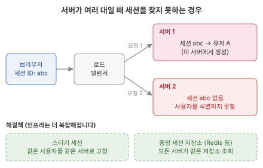
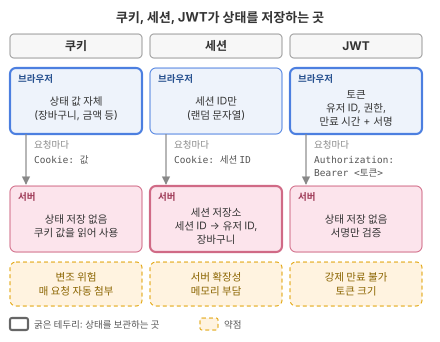

<!-- truncate -->

HTTP는 원래 상태를 기억하지 않는 **무상태(stateless)** 프로토콜입니다. 그 한계를 넘으려고 쿠키, 세션, JWT가 차례로 등장했습니다. 각 기술이 **어떤 문제에서 나왔고** 무엇인지 등장 순서대로 정리합니다.

<mark>쿠키, 세션, JWT는 서로 대체재가 아니라, 앞선 방식의 한계를 하나씩 보완하며 이어져 왔습니다. 이 흐름을 알면 언제 무엇을 쓸지 판단할 수 있습니다.</mark>

## HTTP는 무상태로 시작했다

팀 버너스리는 논문을 편하게 공유하려고 월드와이드웹(WWW)을 만들었고, 그 프로토콜이 HTTP입니다. 당시 목적은 단순했습니다 — **"문서만 잘 전달하면 된다."** 그래서 HTTP는 요청→응답 후 **연결을 바로 끊는** 구조, 즉 **비연결(connectionless), 무상태(stateless)** 로 설계됐습니다. 서버 입장에선 요청을 처리하고 바로 잊어버리면 되니 편했습니다.

문제는 웹이 단순 문서 공유를 넘어 **애플리케이션**으로 발전하면서입니다. 쇼핑몰에서 상품을 장바구니에 담고 결제 페이지로 넘어가면, 서버는 **"아까 담던 사람과 같은 사람인가?"** 를 전혀 모릅니다. HTTP가 이전 요청과 현재 요청의 관계를 기억하지 못하기 때문입니다. 연결이 끊겨도 사용자를 기억할 방법, 즉 **상태 관리**가 필요해졌습니다.

첫 시도는 URL에 정보를 붙이는 것이었습니다(`...?userId=xxx`). 하지만 아이디가 주소창에 노출되고, **그 링크를 공유하면 다른 사람이 내 계정으로 로그인**되며, 모든 링크에 아이디를 일일이 붙여야 했습니다. 인증 용도로는 부적합했죠.

## 쿠키 — 상태를 브라우저에 저장하자

1994년 넷스케이프의 루 몬툴리가 장바구니를 구현하려고 **쿠키**를 고안했습니다. 아이디어는 **상태를 서버가 아니라 브라우저에 저장**하는 것입니다.

- 서버가 응답에 **`Set-Cookie`** 헤더로 값을 내려줍니다.
- 브라우저가 저장하고, **이후 모든 요청마다 `Cookie` 헤더에 자동으로 실어** 보냅니다.

한동안 웹 상태 저장의 사실상 표준이었지만, 두 가지 약점이 있습니다.

- **변조 위험** — 클라이언트에 저장되니 사용자가 개발자 도구와 프록시로 값을 바꿀 수 있습니다. 과거 **결제 금액을 쿠키에 저장**했다가 사용자가 금액을 100원으로 낮춰 결제한 사례가 실제로 있었습니다. XSS(스크립트로 쿠키 탈취), CSRF(자동 전송을 악용)도 여기서 나옵니다.
- **네트워크 낭비** — 쿠키는 매 요청에 자동 첨부되니, 쿠키가 필요 없는 이미지, CSS 요청에도 늘 따라가 트래픽을 낭비합니다.

## 세션 — 중요한 건 서버가 기억하자

쿠키의 변조 위험을 풀려고 나온 게 **세션**입니다. 컨셉은 **"클라이언트는 못 믿겠으니, 중요한 건 서버가 기억하겠다"** 입니다.

- 서버가 의미 없는 랜덤 문자열 **세션 ID**를 만듭니다.
- **실제 정보(유저 ID, 장바구니 등)는 서버에 저장**하고 세션 ID와 매핑합니다.
- 클라이언트에는 **세션 ID만** 내려주고(보통 쿠키로), 브라우저는 매 요청에 세션 ID만 보냅니다.

중요 정보가 노출되지 않으니 변조가 무력화됩니다. ASP, PHP, JSP 시절 인증의 표준이었습니다. 하지만 한계도 있습니다.

- **서버 확장성** — 서버가 여러 대에 로드밸런서로 분산되면, 1번 서버에서 만든 세션을 다음 요청이 2번 서버로 가면 세션이 없어 사용자를 식별하지 못합니다. 해결책은 **스티키 세션**(같은 서버로 고정)이나 **Redis 같은 중앙 세션 저장소**인데, 인프라가 복잡해집니다.
- **메모리 부담** — 사용자가 많아지면 세션 객체도 그만큼 서버 메모리를 차지합니다.

<details>
<summary>SVG 코드</summary>

```svg
<svg xmlns="http://www.w3.org/2000/svg" width="440" height="282" viewBox="0 0 440 282" font-family="-apple-system, 'Segoe UI', 'Noto Sans KR', sans-serif">
<defs><marker id="ah" viewBox="0 0 10 10" refX="9" refY="5" markerWidth="7" markerHeight="7" orient="auto-start-reverse"><path d="M0,0 L10,5 L0,10 z" fill="#888"/></marker></defs>
<rect x="0" y="0" width="440" height="282" fill="#FFFFFF"/>
<text x="220.0" y="22" font-size="13" fill="#333" text-anchor="middle" font-weight="bold">서버가 여러 대일 때 세션을 찾지 못하는 경우</text>
<rect x="10" y="90" width="84" height="52" rx="6" fill="#EEF3FB" stroke="#4C7FE0"/>
<text x="52" y="112.4" font-size="10.5" fill="#26508F" text-anchor="middle">브라우저</text>
<text x="52" y="126.9" font-size="10.5" fill="#26508F" text-anchor="middle">세션 ID: abc</text>
<rect x="124" y="90" width="84" height="52" rx="6" fill="#F7F7F7" stroke="#999999"/>
<text x="166" y="112.4" font-size="10.5" fill="#333" text-anchor="middle">로드</text>
<text x="166" y="126.9" font-size="10.5" fill="#333" text-anchor="middle">밸런서</text>
<line x1="94" y1="116" x2="122" y2="116" stroke="#888" stroke-width="1.2" marker-end="url(#ah)"/>
<rect x="256" y="40" width="174" height="62" rx="6" fill="#FCE4EC" stroke="#D06A86"/>
<text x="266" y="57" font-size="10.5" fill="#9E3A57" text-anchor="start" font-weight="bold">서버 1</text>
<text x="343" y="76.7" font-size="10.5" fill="#333" text-anchor="middle">세션 abc → 유저 A</text>
<text x="343" y="90.7" font-size="10.5" fill="#333" text-anchor="middle">(이 서버에서 생성)</text>
<rect x="256" y="132" width="174" height="62" rx="6" fill="#FDECEC" stroke="#D9534F"/>
<text x="266" y="149" font-size="10.5" fill="#B52B27" text-anchor="start" font-weight="bold">서버 2</text>
<text x="343" y="168.7" font-size="10.5" fill="#B52B27" text-anchor="middle">세션 abc 없음</text>
<text x="343" y="182.7" font-size="10.5" fill="#B52B27" text-anchor="middle">사용자를 식별하지 못함</text>
<line x1="208" y1="104" x2="254" y2="74" stroke="#888" stroke-width="1.2" marker-end="url(#ah)"/>
<text x="226" y="80" font-size="9.5" fill="#888" text-anchor="middle">요청 1</text>
<line x1="208" y1="128" x2="254" y2="160" stroke="#888" stroke-width="1.2" marker-end="url(#ah)"/>
<text x="226" y="160" font-size="9.5" fill="#888" text-anchor="middle">요청 2</text>
<text x="10" y="214" font-size="10.5" fill="#333" text-anchor="start" font-weight="bold">해결책 (인프라는 더 복잡해집니다)</text>
<rect x="10" y="224" width="205" height="46" rx="6" fill="#E9F2E9" stroke="#8FBF8F" stroke-dasharray="4 3"/>
<text x="112.5" y="243.7" font-size="10.5" fill="#2E6B2E" text-anchor="middle">스티키 세션</text>
<text x="112.5" y="257.7" font-size="10.5" fill="#2E6B2E" text-anchor="middle">같은 사용자를 같은 서버로 고정</text>
<rect x="225" y="224" width="205" height="46" rx="6" fill="#E9F2E9" stroke="#8FBF8F" stroke-dasharray="4 3"/>
<text x="327.5" y="243.7" font-size="10.5" fill="#2E6B2E" text-anchor="middle">중앙 세션 저장소 (Redis 등)</text>
<text x="327.5" y="257.7" font-size="10.5" fill="#2E6B2E" text-anchor="middle">모든 서버가 같은 저장소 조회</text>
</svg>
```

</details>

<figure style={{textAlign: 'center', margin: '1.5rem 0'}}>
  
</figure>

> 분산 환경에서 세션을 사용하는 구체적 방법과 JWT를 선택하는 핵심 이유는 [JWT vs 세션(분산 인증)](./jwt-vs-session-distributed-auth)에서 자세히 설명했습니다.

## JWT — 상태를 다시 클라이언트로

세션의 확장성, 메모리 문제 때문에, 상태 관리를 **다시 클라이언트로** 돌려보낸 것이 **JWT(JSON Web Token)** 입니다.

- 토큰 안에 **유저 ID, 권한, 만료 시간**을 포함합니다.
- 서버는 **토큰의 서명만 검증**하고 별도로 상태를 기억하지 않습니다 → **DB 조회 없이 즉시 인증**.
- 요청 시 **`Authorization: Bearer <토큰>`** 형태로 보냅니다.

구조는 **헤더 . 페이로드 . 서명** 세 부분이고, 헤더와 페이로드는 암호화가 아니라 **Base64 인코딩**이라 **누구나 디코딩해 내용을 볼 수 있습니다.** 즉 <mark>JWT는 암호화 토큰이 아니라 서명 토큰입니다 — 내용은 공개되고 위, 변조만 막습니다.</mark>

서버가 상태를 안 가지니 **스케일 아웃이 쉽고**, 모바일, MSA 환경과 궁합이 좋습니다. 대신 약점이 있습니다.

- **크기** — 정보를 많이 포함할수록 매 요청 전송량이 커집니다.
- **강제 만료 불가**(가장 큰 문제) — 한 번 발급되면 만료 전까지 서버가 폐기할 수 없습니다. 탈취되면 만료까지 공격자가 계속 사용합니다.

완화책은 **리프레시 토큰**입니다. 액세스 토큰의 수명을 짧게 설정하고, 긴 수명의 리프레시 토큰으로 갱신합니다. 다만 무상태를 지향하는 JWT에서도 리프레시 토큰은 서버에 저장해야 하고, 이게 탈취되면 손실이 더 큽니다.

지금까지 본 세 방식을 브라우저와 서버 중 어디에 상태를 저장하는지, 요청마다 무엇을 보내는지 기준으로 비교하면 다음과 같습니다.

<details>
<summary>SVG 코드</summary>

```svg
<svg xmlns="http://www.w3.org/2000/svg" width="440" height="342" viewBox="0 0 440 342" font-family="-apple-system, 'Segoe UI', 'Noto Sans KR', sans-serif">
<defs><marker id="ah" viewBox="0 0 10 10" refX="9" refY="5" markerWidth="7" markerHeight="7" orient="auto-start-reverse"><path d="M0,0 L10,5 L0,10 z" fill="#888"/></marker></defs>
<rect x="0" y="0" width="440" height="342" fill="#FFFFFF"/>
<text x="220.0" y="22" font-size="13" fill="#333" text-anchor="middle" font-weight="bold">쿠키, 세션, JWT가 상태를 저장하는 곳</text>
<rect x="10" y="34" width="132" height="24" rx="4" fill="#F7F7F7" stroke="#999999"/>
<text x="76.0" y="50" font-size="12" fill="#333" text-anchor="middle" font-weight="bold">쿠키</text>
<rect x="10" y="68" width="132" height="66" rx="6" fill="#EEF3FB" stroke="#4C7FE0" stroke-width="2.2"/>
<text x="18" y="82" font-size="9.5" fill="#26508F" text-anchor="start" font-weight="bold">브라우저</text>
<text x="76.0" y="104.9" font-size="10.5" fill="#333" text-anchor="middle">상태 값 자체</text>
<text x="76.0" y="118.4" font-size="10.5" fill="#333" text-anchor="middle">(장바구니, 금액 등)</text>
<line x1="26" y1="134" x2="26" y2="184" stroke="#888" stroke-width="1.2" marker-end="url(#ah)"/>
<text x="34" y="148" font-size="9.5" fill="#888" text-anchor="start">요청마다</text>
<text x="34" y="163" font-size="9.5" fill="#555" text-anchor="start" font-family="Menlo, Consolas, monospace">Cookie: 값</text>
<rect x="10" y="186" width="132" height="66" rx="6" fill="#FCE4EC" stroke="#D06A86"/>
<text x="18" y="200" font-size="9.5" fill="#9E3A57" text-anchor="start" font-weight="bold">서버</text>
<text x="76.0" y="222.9" font-size="10.5" fill="#333" text-anchor="middle">상태 저장 없음</text>
<text x="76.0" y="236.4" font-size="10.5" fill="#333" text-anchor="middle">쿠키 값을 읽어 사용</text>
<rect x="10" y="262" width="132" height="44" rx="6" fill="#FFF3E0" stroke="#E0A000" stroke-dasharray="4 3"/>
<text x="76.0" y="280.7" font-size="10.5" fill="#8A6400" text-anchor="middle">변조 위험</text>
<text x="76.0" y="294.7" font-size="10.5" fill="#8A6400" text-anchor="middle">매 요청 자동 첨부</text>
<rect x="150" y="34" width="132" height="24" rx="4" fill="#F7F7F7" stroke="#999999"/>
<text x="216.0" y="50" font-size="12" fill="#333" text-anchor="middle" font-weight="bold">세션</text>
<rect x="150" y="68" width="132" height="66" rx="6" fill="#EEF3FB" stroke="#4C7FE0"/>
<text x="158" y="82" font-size="9.5" fill="#26508F" text-anchor="start" font-weight="bold">브라우저</text>
<text x="216.0" y="104.9" font-size="10.5" fill="#333" text-anchor="middle">세션 ID만</text>
<text x="216.0" y="118.4" font-size="10.5" fill="#333" text-anchor="middle">(랜덤 문자열)</text>
<line x1="166" y1="134" x2="166" y2="184" stroke="#888" stroke-width="1.2" marker-end="url(#ah)"/>
<text x="174" y="148" font-size="9.5" fill="#888" text-anchor="start">요청마다</text>
<text x="174" y="163" font-size="9.5" fill="#555" text-anchor="start" font-family="Menlo, Consolas, monospace">Cookie: 세션 ID</text>
<rect x="150" y="186" width="132" height="66" rx="6" fill="#FCE4EC" stroke="#D06A86" stroke-width="2.2"/>
<text x="158" y="200" font-size="9.5" fill="#9E3A57" text-anchor="start" font-weight="bold">서버</text>
<text x="216.0" y="216.2" font-size="10.5" fill="#333" text-anchor="middle">세션 저장소</text>
<text x="216.0" y="229.7" font-size="10.5" fill="#333" text-anchor="middle">세션 ID → 유저 ID,</text>
<text x="216.0" y="243.2" font-size="10.5" fill="#333" text-anchor="middle">장바구니</text>
<rect x="150" y="262" width="132" height="44" rx="6" fill="#FFF3E0" stroke="#E0A000" stroke-dasharray="4 3"/>
<text x="216.0" y="280.7" font-size="10.5" fill="#8A6400" text-anchor="middle">서버 확장성</text>
<text x="216.0" y="294.7" font-size="10.5" fill="#8A6400" text-anchor="middle">메모리 부담</text>
<rect x="290" y="34" width="132" height="24" rx="4" fill="#F7F7F7" stroke="#999999"/>
<text x="356.0" y="50" font-size="12" fill="#333" text-anchor="middle" font-weight="bold">JWT</text>
<rect x="290" y="68" width="132" height="66" rx="6" fill="#EEF3FB" stroke="#4C7FE0" stroke-width="2.2"/>
<text x="298" y="82" font-size="9.5" fill="#26508F" text-anchor="start" font-weight="bold">브라우저</text>
<text x="356.0" y="98.2" font-size="10.5" fill="#333" text-anchor="middle">토큰</text>
<text x="356.0" y="111.7" font-size="10.5" fill="#333" text-anchor="middle">유저 ID, 권한,</text>
<text x="356.0" y="125.2" font-size="10.5" fill="#333" text-anchor="middle">만료 시간 + 서명</text>
<line x1="306" y1="134" x2="306" y2="184" stroke="#888" stroke-width="1.2" marker-end="url(#ah)"/>
<text x="314" y="148" font-size="9.5" fill="#888" text-anchor="start">요청마다</text>
<text x="314" y="163" font-size="9.5" fill="#555" text-anchor="start" font-family="Menlo, Consolas, monospace">Authorization:</text>
<text x="314" y="176" font-size="9.5" fill="#555" text-anchor="start" font-family="Menlo, Consolas, monospace">Bearer &lt;토큰&gt;</text>
<rect x="290" y="186" width="132" height="66" rx="6" fill="#FCE4EC" stroke="#D06A86"/>
<text x="298" y="200" font-size="9.5" fill="#9E3A57" text-anchor="start" font-weight="bold">서버</text>
<text x="356.0" y="222.9" font-size="10.5" fill="#333" text-anchor="middle">상태 저장 없음</text>
<text x="356.0" y="236.4" font-size="10.5" fill="#333" text-anchor="middle">서명만 검증</text>
<rect x="290" y="262" width="132" height="44" rx="6" fill="#FFF3E0" stroke="#E0A000" stroke-dasharray="4 3"/>
<text x="356.0" y="280.7" font-size="10.5" fill="#8A6400" text-anchor="middle">강제 만료 불가</text>
<text x="356.0" y="294.7" font-size="10.5" fill="#8A6400" text-anchor="middle">토큰 크기</text>
<rect x="10" y="318" width="18" height="12" rx="2" fill="#FFFFFF" stroke="#666666" stroke-width="2.2"/>
<text x="34" y="328" font-size="9.5" fill="#555" text-anchor="start">굵은 테두리: 상태를 보관하는 곳</text>
<rect x="200" y="318" width="18" height="12" rx="2" fill="#FFF3E0" stroke="#E0A000" stroke-dasharray="4 3"/>
<text x="224" y="328" font-size="9.5" fill="#555" text-anchor="start">약점</text>
</svg>
```

</details>

<figure style={{textAlign: 'center', margin: '1.5rem 0'}}>
  
</figure>

## 현금과 같은 토큰 — Bearer의 의미

JWT의 성격을 가장 잘 보여주는 비유가 **현금**입니다. `Bearer`는 소유자가 아니라 **가지고 있는 사람(소지자)** 을 뜻합니다. 현금은 위조는 어렵지만 **가진 사람이 주인**이라, 도둑이 훔친 현금도 그대로 쓸 수 있습니다. JWT도 똑같습니다 — **토큰만 유효하면 누가 써도 막지 않습니다.** 이건 결함이 아니라 설계 의도입니다. 그래서 토큰은 **HTTPS로만 주고받고**, 로컬 스토리지 대신 **HttpOnly 쿠키**에 담고(XSS 완화), **SameSite**로 CSRF를 막고, 서버 로그에 `Authorization` 헤더가 남지 않게 하는 등 "훔치지 못하게" 하는 게 우선입니다.

## 세션 vs JWT — 무엇을 쓸까

요즘 인증은 JWT가 대세지만, **만병통치약은 없습니다.**

- **보안이 더 중요할 때** — 세션이 유리할 수 있습니다. 서버가 상태를 들고 있어 **즉시 무효화**가 됩니다.
- **확장성, 모바일** — JWT가 압도적으로 유리합니다.

<mark>중요한 건 기술이 아니라 맥락에 맞는 설계입니다.</mark>

## 정리

- **HTTP는 무상태** — 그 한계를 넘으려 상태 관리가 필요해졌습니다(URL 방식은 노출, 공유 문제로 부적합).
- **쿠키** — 상태를 브라우저에 저장(`Set-Cookie`/`Cookie`). 변조 위험 + 정적 리소스에도 자동 첨부.
- **세션** — 중요 정보는 서버에, 클라이언트엔 세션 ID만. 변조는 막지만 **서버 확장성, 메모리** 부담.
- **JWT** — 상태를 다시 클라이언트로. 서명 토큰(≠암호화), 무상태라 확장 쉬움. 대신 **강제 만료 불가** → 짧은 액세스 + 리프레시 토큰.
- **Bearer = 소지자가 주인** — 훔치지 못하게(HTTPS, HttpOnly, SameSite) 지키는 게 우선.

각 방식은 앞선 방식의 한계에서 나왔습니다. 흐름을 알면 "왜 이 방식인가"가 보이고, 그때 비로소 **상황에 맞는 선택**을 할 수 있습니다.
