import {AnimatedLineChart} from '@site/src/components/blog/MonitorCharts';

<!-- truncate -->

브로커, 파티션 리더/팔로워, 복제 계수, ISR, `min.insync.replicas`, 오프셋(로그, 커밋, 현재 위치), rack 배치, 리더 선출, 컨슈머 그룹 리밸런싱, 그룹 코디네이터, 하트비트와 `session.timeout.ms`… 카프카를 오래 사용해도 이 개념들이 서로 분리돼 있어서 장애 대응이나 설정을 만질 때마다 다시 헷갈리곤 합니다. 이 글은 따로 알던 개념들을 **쓰기가 성공하기까지 → 브로커에 장애가 발생하면 → 컨슈머가 나눠 읽기까지** 하나의 흐름으로 이어서 정리합니다.

<mark>카프카의 운영 개념은 "쓰기 내구성(복제, ISR, acks) → 장애 극복(리더 선출, rack) → 소비 분배(컨슈머 그룹, 리밸런싱)"라는 세 가지 기준으로 나눠 보면 서로 어떻게 연결되는지가 보입니다.</mark>

파티션 자체의 역할(병렬성, 순서, 분산의 단위)과 개수 산정은 [파티션 수, 브로커 대수 정하기](./kafka-partition-count)에서 정리했으니, 이 글은 **그 파티션들이 클러스터 위에서 복제되고 소비되는 동작**에 집중합니다.

## 먼저: 컨슈머 그룹이란?

**컨슈머 그룹(consumer group)** 은 하나의 토픽을 여러 컨슈머 인스턴스가 **나눠서** 병렬로 소비하려고 같은 `group.id`를 사용하는 컨슈머 집합입니다. 카프카는 그룹 안 컨슈머들에게 파티션을 중복 없이 배분해 **한 파티션은 그룹 안에서 한 컨슈머만** 읽게 합니다. <mark>그래서 컨슈머를 늘리면 처리량이 오르고(확장), 컨슈머 하나에 장애가 발생하면 그 파티션이 다른 컨슈머에게 넘어갑니다(장애 대응).</mark> 어디까지 읽었는지(오프셋)도 **그룹 단위**로 기록됩니다. 반대로 `group.id`가 다르면 같은 토픽을 각 그룹이 독립적으로 전부 소비합니다. 이 "나눠 읽기"를 **누가 어떻게 조율하고, 멤버가 바뀔 때 어떻게 다시 나누는지**가 이 글 후반의 [그룹 코디네이터](#coordinator), [리밸런싱](#rebalancing)입니다.

## 클러스터의 뼈대 — 브로커와 컨트롤러

**브로커(broker)** 는 카프카 서버 한 대입니다. 여러 브로커가 모여 **클러스터**를 이루고, 토픽의 파티션과 그 복제본이 브로커들에 나뉘어 올라갑니다. 클라이언트(프로듀서, 컨슈머)는 어느 브로커에 붙어도 되고, 브로커가 "어느 파티션의 리더가 어디 있는지"를 알려 줍니다.

이 "누가 무엇의 리더인가, 어느 브로커가 살아 있나" 같은 **메타데이터를 관리하고 파티션 리더를 선출하는 역할**이 **컨트롤러(controller)** 입니다.

<mark>예전에는 이 메타데이터를 별도 ZooKeeper 앙상블(Ensemble)이 맡았지만, Kafka 4.0(2025-03)부터는 ZooKeeper가 제거되고 **KRaft**(카프카 자체 합의 프로토콜)만 남았습니다.</mark> 컨트롤러 역할을 하는 브로커들이 Raft 기반 쿼럼으로 메타데이터를 직접 복제, 관리합니다. 운영 관점에서 달라지는 건 "관리할 클러스터가 하나로 줄었다"는 점 — 별도 ZooKeeper를 기동하고 튜닝할 필요가 없어졌습니다.

<details>
<summary>SVG 코드</summary>

```svg
<svg xmlns="http://www.w3.org/2000/svg" width="440" height="372" viewBox="0 0 440 372" font-family="-apple-system, 'Segoe UI', 'Noto Sans KR', sans-serif">
<defs><marker id="ah" viewBox="0 0 10 10" refX="9" refY="5" markerWidth="7" markerHeight="7" orient="auto-start-reverse"><path d="M0,0 L10,5 L0,10 z" fill="#888"/></marker></defs>
<rect x="0" y="0" width="440" height="372" fill="#FFFFFF"/>
<text x="220.0" y="22" font-size="13" fill="#333" text-anchor="middle" font-weight="bold">Kafka 클러스터 구성 (KRaft — ZooKeeper 없음)</text>
<rect x="145" y="38" width="150" height="42" rx="6" fill="#FFF3E0" stroke="#E0A000"/>
<text x="220.0" y="55.75" font-size="12" fill="#7A5200" text-anchor="middle" font-weight="bold">클라이언트</text>
<text x="220.0" y="70.25" font-size="10.5" fill="#555" text-anchor="middle">(프로듀서, 컨슈머)</text>
<rect x="15" y="104" width="410" height="254" rx="8" fill="#FFFFFF" stroke="#999999" stroke-dasharray="4 3"/>
<text x="25" y="120" font-size="10.5" fill="#555" text-anchor="start" font-weight="bold">Kafka 클러스터</text>
<line x1="220" y1="80" x2="220" y2="132" stroke="#888" stroke-width="1.2" marker-end="url(#ah)"/>
<text x="228" y="98" font-size="10.5" fill="#333" text-anchor="start">접속, 메타데이터 요청</text>
<rect x="160" y="134" width="120" height="44" rx="6" fill="#F7F7F7" stroke="#999999"/>
<text x="220.0" y="152.75" font-size="12" fill="#333" text-anchor="middle" font-weight="bold">Broker 1</text>
<text x="220.0" y="167.25" font-size="10.5" fill="#555" text-anchor="middle">(+ Controller)</text>
<rect x="35" y="236" width="120" height="44" rx="6" fill="#F7F7F7" stroke="#999999"/>
<text x="95.0" y="254.75" font-size="12" fill="#333" text-anchor="middle" font-weight="bold">Broker 2</text>
<text x="95.0" y="269.25" font-size="10.5" fill="#555" text-anchor="middle">(+ Controller)</text>
<rect x="285" y="236" width="120" height="44" rx="6" fill="#F7F7F7" stroke="#999999"/>
<text x="345.0" y="254.75" font-size="12" fill="#333" text-anchor="middle" font-weight="bold">Broker 3</text>
<text x="345.0" y="269.25" font-size="10.5" fill="#555" text-anchor="middle">(+ Controller)</text>
<polyline points="185,178 115,236" fill="none" stroke="#888" stroke-width="1.2" marker-start="url(#ah)" marker-end="url(#ah)"/>
<polyline points="155,258 285,258" fill="none" stroke="#888" stroke-width="1.2" marker-start="url(#ah)" marker-end="url(#ah)"/>
<polyline points="255,178 325,236" fill="none" stroke="#888" stroke-width="1.2" marker-start="url(#ah)" marker-end="url(#ah)"/>
<rect x="71.345" y="201.5" width="157.31" height="15.5" fill="#FFFFFF"/>
<text x="150" y="212" font-size="10.5" fill="#333" text-anchor="middle">메타데이터 복제 (Raft 쿼럼)</text>
<rect x="35" y="298" width="200" height="44" rx="6" fill="#FFFBEA" stroke="#E0A000" stroke-dasharray="5 4"/>
<text x="135.0" y="316" font-size="10.5" fill="#5A4300" text-anchor="middle">컨트롤러 쿼럼이</text>
<text x="135.0" y="332" font-size="10.5" fill="#5A4300" text-anchor="middle">리더 선출, 메타데이터 관리</text>
<line x1="95" y1="280" x2="95" y2="298" stroke="#E0A000" stroke-dasharray="3 3"/>
</svg>
```

</details>

<figure style={{textAlign: 'center', margin: '1.5rem 0'}}>
  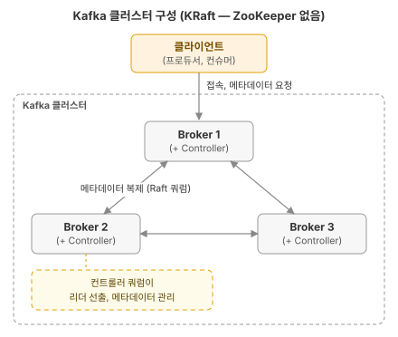
</figure>

## 복제 — 리더와 팔로워, 그리고 복제 계수

한 파티션은 **리더(leader) 1개 + 팔로워(follower) 여러 개**로 복제됩니다. 이 복제본의 총 개수가 **복제 계수(replication factor, RF)** 입니다. RF=3이면 같은 파티션이 서로 다른 브로커 3대에 사본으로 존재합니다.

동작의 핵심은 **읽기와 쓰기가 모두 리더로만 간다**는 것입니다.

- **프로듀서**는 리더에게만 씁니다.
- **컨슈머**도 기본적으로 리더에서만 읽습니다.
- **팔로워**는 리더의 로그를 **직접 fetch 해서 따라 씁니다** — 마치 팔로워가 리더를 구독하는 컨슈머처럼 동작합니다.

<details>
<summary>SVG 코드</summary>

```svg
<svg xmlns="http://www.w3.org/2000/svg" width="450" height="330" viewBox="0 0 450 330" font-family="-apple-system, 'Segoe UI', 'Noto Sans KR', sans-serif">
<defs><marker id="ah" viewBox="0 0 10 10" refX="9" refY="5" markerWidth="7" markerHeight="7" orient="auto-start-reverse"><path d="M0,0 L10,5 L0,10 z" fill="#888"/></marker></defs>
<rect x="0" y="0" width="450" height="330" fill="#FFFFFF"/>
<text x="225.0" y="22" font-size="13" fill="#333" text-anchor="middle" font-weight="bold">파티션 P0 복제 배치 (RF=3, rack로 zone 분산)</text>
<rect x="20" y="38" width="136" height="32" rx="6" fill="#FFF3E0" stroke="#E0A000"/>
<text x="88.0" y="58.0" font-size="12" fill="#7A5200" text-anchor="middle" font-weight="bold">프로듀서 / 컨슈머</text>
<rect x="15" y="104" width="126" height="140" rx="8" fill="#FFFFFF" stroke="#999999" stroke-dasharray="4 3"/>
<text x="25" y="120" font-size="10.5" fill="#555" text-anchor="start" font-weight="bold">Zone A</text>
<rect x="23" y="126" width="110" height="108" rx="6" fill="#F7F7F7" stroke="#999999"/>
<text x="78.0" y="142" font-size="11" fill="#333" text-anchor="middle" font-weight="bold">Broker 1</text>
<rect x="31" y="150" width="94" height="74" rx="6" fill="#EEF3FB" stroke="#4C7FE0"/>
<text x="78.0" y="183.75" font-size="12" fill="#26508F" text-anchor="middle" font-weight="bold">P0 리더</text>
<text x="78.0" y="198.25" font-size="10.5" fill="#555" text-anchor="middle">(ISR)</text>
<rect x="162" y="104" width="126" height="140" rx="8" fill="#FFFFFF" stroke="#999999" stroke-dasharray="4 3"/>
<text x="172" y="120" font-size="10.5" fill="#555" text-anchor="start" font-weight="bold">Zone B</text>
<rect x="170" y="126" width="110" height="108" rx="6" fill="#F7F7F7" stroke="#999999"/>
<text x="225.0" y="142" font-size="11" fill="#333" text-anchor="middle" font-weight="bold">Broker 2</text>
<rect x="178" y="150" width="94" height="74" rx="6" fill="#E9F2E9" stroke="#8FBF8F"/>
<text x="225.0" y="183.75" font-size="12" fill="#2E6B2E" text-anchor="middle" font-weight="bold">P0 팔로워</text>
<text x="225.0" y="198.25" font-size="10.5" fill="#555" text-anchor="middle">(ISR)</text>
<rect x="309" y="104" width="126" height="140" rx="8" fill="#FFFFFF" stroke="#999999" stroke-dasharray="4 3"/>
<text x="319" y="120" font-size="10.5" fill="#555" text-anchor="start" font-weight="bold">Zone C</text>
<rect x="317" y="126" width="110" height="108" rx="6" fill="#F7F7F7" stroke="#999999"/>
<text x="372.0" y="142" font-size="11" fill="#333" text-anchor="middle" font-weight="bold">Broker 3</text>
<rect x="325" y="150" width="94" height="74" rx="6" fill="#FCE4EC" stroke="#D06A86" stroke-dasharray="5 4"/>
<text x="372.0" y="183.75" font-size="12" fill="#9E3A57" text-anchor="middle" font-weight="bold">P0 팔로워</text>
<text x="372.0" y="198.25" font-size="10.5" fill="#555" text-anchor="middle">(ISR에서 이탈)</text>
<line x1="40" y1="70" x2="40" y2="148" stroke="#888" stroke-width="1.2" marker-end="url(#ah)"/>
<rect x="44" y="81.5" width="120.77" height="15.5" fill="#FFFFFF"/>
<text x="48" y="92" font-size="10.5" fill="#333" text-anchor="start">읽기, 쓰기는 리더로만</text>
<polyline points="74,224 74,272 225,272 225,226" fill="none" stroke="#888" stroke-width="1.2" marker-end="url(#ah)"/>
<polyline points="100,224 100,302 372,302 372,226" fill="none" stroke="#888" stroke-width="1.2" marker-end="url(#ah)"/>
<text x="160" y="266" font-size="10.5" fill="#333" text-anchor="middle">복제 (팔로워가 fetch)</text>
<text x="300" y="296" font-size="10.5" fill="#333" text-anchor="middle">복제 (지연되면 ISR 제외)</text>
</svg>
```

</details>

<figure style={{textAlign: 'center', margin: '1.5rem 0'}}>
  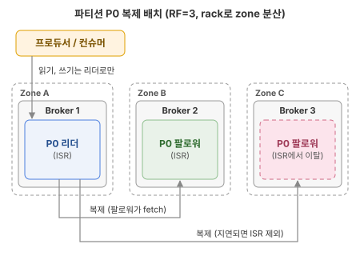
</figure>

<mark>모든 읽기와 쓰기는 리더가 처리하고, 팔로워는 리더를 따라 복제만 합니다 — 그래서 리더에 장애가 발생하면 팔로워 중 하나가 새 리더가 되어야 서비스가 이어집니다.</mark>

## ISR — 어디까지가 "믿을 수 있는 복제본"인가

복제본이 3개라고 다 최신 상태인 건 아닙니다. 네트워크나 부하로 특정 팔로워가 리더를 못 따라잡을 수 있습니다. 그래서 카프카는 **지금 리더를 충분히 따라잡은 복제본의 집합**을 따로 관리하는데, 이것이 **ISR(In-Sync Replicas)** 입니다.

- 리더는 항상 ISR에 포함됩니다.
- 팔로워는 `replica.lag.time.max.ms`(기본 30초) 안에 리더의 로그 끝까지 fetch 해 오면 ISR에 남고, 그보다 뒤처지면 **ISR에서 빠집니다.** 다시 따라잡으면 복귀합니다.

ISR이 중요한 이유는 **리더에 장애가 발생했을 때 ISR 안에서만 새 리더를 뽑기 때문**입니다. ISR 밖의(뒤처진) 복제본을 리더로 세우면 아직 복제 안 된 메시지가 사라지니까요.

아래 그림에서 **P0**는 "파티션 0", **LEO(Log End Offset)** 는 그 복제본이 마지막으로 기록한 위치(숫자가 클수록 최신)입니다. 리더와 같은 `LEO=100`까지 따라온 팔로워 A는 ISR에 남고, `LEO=72`로 뒤처진 팔로워 B는 ISR에서 빠집니다.

<mark>ISR은 "리더를 따라잡은 최신 복제본 집합"이고, 새 리더는 원칙적으로 이 집합 안에서만 선출됩니다.</mark>

<details>
<summary>SVG 코드</summary>

```svg
<svg xmlns="http://www.w3.org/2000/svg" width="440" height="304" viewBox="0 0 440 304" font-family="-apple-system, 'Segoe UI', 'Noto Sans KR', sans-serif">
<defs><marker id="ah" viewBox="0 0 10 10" refX="9" refY="5" markerWidth="7" markerHeight="7" orient="auto-start-reverse"><path d="M0,0 L10,5 L0,10 z" fill="#888"/></marker></defs>
<rect x="0" y="0" width="440" height="304" fill="#FFFFFF"/>
<text x="220.0" y="22" font-size="13" fill="#333" text-anchor="middle" font-weight="bold">파티션 P0의 ISR — 리더 + 따라잡은 팔로워만</text>
<rect x="20" y="40" width="400" height="106" rx="8" fill="#F5FAF5" stroke="#8FBF8F" stroke-dasharray="4 3"/>
<text x="30" y="56" font-size="10.5" fill="#2E6B2E" text-anchor="start" font-weight="bold">ISR (In-Sync)</text>
<rect x="45" y="70" width="130" height="56" rx="6" fill="#EEF3FB" stroke="#4C7FE0"/>
<text x="110.0" y="94.75" font-size="12" fill="#26508F" text-anchor="middle" font-weight="bold">리더</text>
<text x="110.0" y="109.25" font-size="10.5" fill="#555" text-anchor="middle">LEO=100</text>
<rect x="265" y="70" width="130" height="56" rx="6" fill="#E9F2E9" stroke="#8FBF8F"/>
<text x="330.0" y="94.75" font-size="12" fill="#2E6B2E" text-anchor="middle" font-weight="bold">팔로워 A</text>
<text x="330.0" y="109.25" font-size="10.5" fill="#555" text-anchor="middle">LEO=100 (최신)</text>
<line x1="175" y1="98" x2="263" y2="98" stroke="#888" stroke-width="1.2" marker-end="url(#ah)"/>
<text x="219" y="91" font-size="10.5" fill="#333" text-anchor="middle">fetch로 따라잡음</text>
<rect x="20" y="186" width="400" height="104" rx="8" fill="#FDF3F6" stroke="#D06A86" stroke-dasharray="4 3"/>
<text x="30" y="202" font-size="10.5" fill="#9E3A57" text-anchor="start" font-weight="bold">ISR 밖</text>
<rect x="45" y="216" width="130" height="56" rx="6" fill="#FCE4EC" stroke="#D06A86" stroke-dasharray="5 4"/>
<text x="110.0" y="240.75" font-size="12" fill="#9E3A57" text-anchor="middle" font-weight="bold">팔로워 B</text>
<text x="110.0" y="255.25" font-size="10.5" fill="#555" text-anchor="middle">LEO=72 (지연)</text>
<line x1="110" y1="126" x2="110" y2="214" stroke="#888" stroke-width="1.2" marker-end="url(#ah)"/>
<rect x="116" y="159.5" width="152.9" height="15.5" fill="#FFFFFF"/>
<text x="120" y="170" font-size="10.5" fill="#333" text-anchor="start">30초 넘게 지연 → ISR 제외</text>
</svg>
```

</details>

<figure style={{textAlign: 'center', margin: '1.5rem 0'}}>
  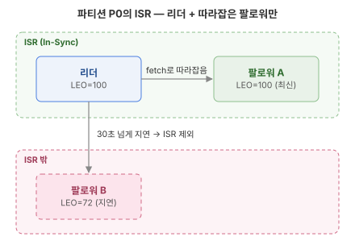
</figure>

## acks와 min.insync.replicas — 쓰기를 언제 "성공"으로 볼까

내구성은 **프로듀서의 `acks`** 와 **토픽의 `min.insync.replicas`** 두 설정이 함께 결정합니다.

`acks`는 프로듀서가 "몇 곳에 저장됐을 때 성공으로 칠지" 정합니다.

| acks | 성공 조건 | 특징 |
|---|---|---|
| `0` | 보내고 확인 안 함 | 가장 빠르지만 유실 가능 |
| `1` | **리더**가 기록하면 성공 | 리더가 복제 전에 장애가 발생하면 유실 가능 |
| `all`(`-1`) | **ISR 전체**가 기록하면 성공 | 가장 안전, 대신 지연 |

`acks=all`일 때 "ISR 전체"가 몇 개인지가 관건입니다. 여기서 **`min.insync.replicas`** 가 **쓰기를 받아 주기 위한 최소 ISR 크기**를 정합니다. ISR이 이 값보다 작아지면 리더는 쓰기를 거부하고 프로듀서에 `NotEnoughReplicas` 오류를 돌려줍니다 — **유실될 바에는 쓰기를 막는** 쪽을 택하는 것입니다.

가장 널리 사용하는 내구성 조합은 이렇습니다.

```properties
# 토픽/브로커
replication.factor=3
min.insync.replicas=2

# 프로듀서
acks=all
```

<mark>`RF=3`, `min.insync.replicas=2`, `acks=all`이면, 브로커 한 대에 장애가 발생해도(ISR 2개 유지) 쓰기가 계속되고 내구성도 지켜지는 균형점이 됩니다.</mark> 만약 두 대에 장애가 발생해 ISR이 1개가 되면 쓰기는 막히지만(가용성↓), 유실은 막습니다(내구성↑). 이 트레이드오프의 방향을 정하는 게 다음 절의 리더 선출입니다. 메시지가 실제로 몇 번 전달되는지(at-least-once/exactly-once)는 [전달 보장](./kafka-delivery-semantics)과 [트랜잭션, 멱등 프로듀서](./kafka-transactions-exactly-once)에서 이어집니다.

<details>
<summary>SVG 코드</summary>

```svg
<svg xmlns="http://www.w3.org/2000/svg" width="456" height="448" viewBox="0 0 456 448" font-family="-apple-system, 'Segoe UI', 'Noto Sans KR', sans-serif">
<defs><marker id="ah" viewBox="0 0 10 10" refX="9" refY="5" markerWidth="7" markerHeight="7" orient="auto-start-reverse"><path d="M0,0 L10,5 L0,10 z" fill="#888"/></marker></defs>
<rect x="0" y="0" width="456" height="448" fill="#FFFFFF"/>
<g transform="translate(0,-22)">
<rect x="12.0" y="36" width="92" height="34" rx="6" fill="#FFF3E0" stroke="#E0A000"/>
<text x="58.0" y="56.75" font-size="11.5" fill="#7A5200" text-anchor="middle" font-weight="bold">프로듀서</text>
<line x1="58" y1="70" x2="58" y2="456" stroke="#BBBBBB" stroke-dasharray="4 3"/>
<rect x="142.0" y="36" width="92" height="34" rx="6" fill="#EEF3FB" stroke="#4C7FE0"/>
<text x="188.0" y="56.75" font-size="11.5" fill="#26508F" text-anchor="middle" font-weight="bold">리더</text>
<line x1="188" y1="70" x2="188" y2="456" stroke="#BBBBBB" stroke-dasharray="4 3"/>
<rect x="252.0" y="36" width="92" height="34" rx="6" fill="#E9F2E9" stroke="#8FBF8F"/>
<text x="298.0" y="56.75" font-size="11.5" fill="#2E6B2E" text-anchor="middle" font-weight="bold">팔로워1 (ISR)</text>
<line x1="298" y1="70" x2="298" y2="456" stroke="#BBBBBB" stroke-dasharray="4 3"/>
<rect x="352.0" y="36" width="92" height="34" rx="6" fill="#E9F2E9" stroke="#8FBF8F"/>
<text x="398.0" y="56.75" font-size="11.5" fill="#2E6B2E" text-anchor="middle" font-weight="bold">팔로워2 (ISR)</text>
<line x1="398" y1="70" x2="398" y2="456" stroke="#BBBBBB" stroke-dasharray="4 3"/>
<line x1="10" y1="92" x2="446" y2="92" stroke="#BBBBBB"/>
<rect x="176.685" y="82" width="102.63" height="20" rx="4" fill="#F7F7F7" stroke="#999999"/>
<text x="228.0" y="96" font-size="10.5" fill="#333" text-anchor="middle" font-weight="bold">정상 (ISR 충분)</text>
<line x1="58" y1="128" x2="187" y2="128" stroke="#888" stroke-width="1.2" marker-end="url(#ah)"/>
<circle cx="70" cy="117" r="8" fill="#4C7FE0"/>
<text x="70" y="120.5" font-size="10" fill="#FFFFFF" text-anchor="middle" font-weight="bold">1</text>
<text x="83" y="122" font-size="10.5" fill="#333" text-anchor="start">produce (acks=all)</text>
<polyline points="188,146 216,146 216,162 189,162" fill="none" stroke="#888" stroke-width="1.2" marker-end="url(#ah)"/>
<circle cx="174" cy="154" r="8" fill="#4C7FE0"/>
<text x="174" y="157.5" font-size="10" fill="#FFFFFF" text-anchor="middle" font-weight="bold">2</text>
<text x="222" y="158" font-size="10.5" fill="#333" text-anchor="start">로그에 기록</text>
<line x1="298" y1="200" x2="189" y2="200" stroke="#888" stroke-width="1.2" marker-end="url(#ah)"/>
<circle cx="200" cy="189" r="8" fill="#4C7FE0"/>
<text x="200" y="192.5" font-size="10" fill="#FFFFFF" text-anchor="middle" font-weight="bold">3</text>
<text x="213" y="194" font-size="10.5" fill="#333" text-anchor="start">fetch (복제)</text>
<line x1="398" y1="232" x2="189" y2="232" stroke="#888" stroke-width="1.2" marker-end="url(#ah)"/>
<circle cx="200" cy="221" r="8" fill="#4C7FE0"/>
<text x="200" y="224.5" font-size="10" fill="#FFFFFF" text-anchor="middle" font-weight="bold">4</text>
<text x="213" y="226" font-size="10.5" fill="#333" text-anchor="start">fetch (복제)</text>
<rect x="48" y="246" width="300" height="26" rx="6" fill="#FFFBEA" stroke="#E0A000" stroke-dasharray="5 4"/>
<text x="198.0" y="264" font-size="10.5" fill="#5A4300" text-anchor="middle">ISR 수가 min.insync.replicas(2) 이상 → 성공 인정</text>
<line x1="188" y1="300" x2="59" y2="300" stroke="#888" stroke-width="1.2" marker-end="url(#ah)"/>
<circle cx="70" cy="289" r="8" fill="#4C7FE0"/>
<text x="70" y="292.5" font-size="10" fill="#FFFFFF" text-anchor="middle" font-weight="bold">5</text>
<text x="83" y="294" font-size="10.5" fill="#333" text-anchor="start">ack (성공)</text>
<line x1="10" y1="330" x2="446" y2="330" stroke="#BBBBBB"/>
<rect x="196.32" y="320" width="63.36" height="20" rx="4" fill="#F7F7F7" stroke="#999999"/>
<text x="228.0" y="334" font-size="10.5" fill="#333" text-anchor="middle" font-weight="bold">ISR 부족</text>
<line x1="58" y1="368" x2="187" y2="368" stroke="#888" stroke-width="1.2" marker-end="url(#ah)"/>
<circle cx="70" cy="357" r="8" fill="#4C7FE0"/>
<text x="70" y="360.5" font-size="10" fill="#FFFFFF" text-anchor="middle" font-weight="bold">6</text>
<text x="83" y="362" font-size="10.5" fill="#333" text-anchor="start">produce (acks=all)</text>
<rect x="78" y="382" width="220" height="26" rx="6" fill="#FFFBEA" stroke="#E0A000" stroke-dasharray="5 4"/>
<text x="188.0" y="400" font-size="10.5" fill="#5A4300" text-anchor="middle">ISR 수가 2 미만 → 유실 위험</text>
<line x1="188" y1="446" x2="59" y2="446" stroke="#888" stroke-width="1.2" marker-end="url(#ah)"/>
<circle cx="70" cy="435" r="8" fill="#4C7FE0"/>
<text x="70" y="438.5" font-size="10" fill="#FFFFFF" text-anchor="middle" font-weight="bold">7</text>
<text x="83" y="427" font-size="10.5" fill="#333" text-anchor="start">NotEnoughReplicas</text>
<text x="83" y="440" font-size="10.5" fill="#333" text-anchor="start">오류 (쓰기 거부)</text>
</g>
</svg>
```

</details>

<figure style={{textAlign: 'center', margin: '1.5rem 0'}}>
  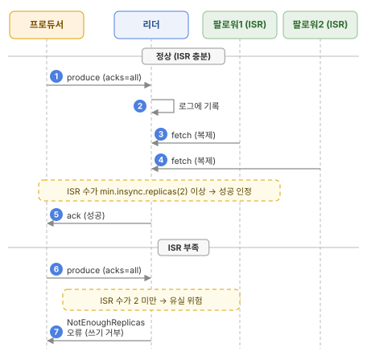
</figure>

## 오프셋 3종 — 로그 오프셋, 커밋 오프셋, 현재 위치

"오프셋"이 헷갈리는 건 사실 **성격이 다른 세 가지**를 같은 이름으로 지칭하기 때문입니다.

- **로그 오프셋 (브로커가 관리)** — 파티션 로그에서 각 메시지의 일련번호. 여기에 두 지표가 붙습니다.
  - **LEO(Log End Offset)**: 다음에 쓸 위치. 복제본마다 따로 있습니다.
  - **HW(High Watermark, 하이워터마크)**: **ISR 전체가 복제를 마친 지점.** 컨슈머는 HW까지만 읽을 수 있습니다. HW 아래는 "커밋된(committed) 메시지" — 리더에 장애가 발생해도 살아남는 지점입니다.
- **컨슈머 커밋 오프셋 (컨슈머 그룹이 관리)** — 이 그룹이 "여기까지 처리 끝냈다"고 기록한 위치. 내부 토픽 **`__consumer_offsets`** 에 저장돼, 컨슈머가 재시작해도 이어서 읽습니다.
- **현재 위치(position)** — 컨슈머가 다음에 fetch 할 위치(메모리상). 처리는 했지만 아직 커밋 안 한 구간이 커밋 오프셋과 현재 위치 사이입니다.

<details>
<summary>SVG 코드</summary>

```svg
<svg xmlns="http://www.w3.org/2000/svg" width="480" height="246" viewBox="0 0 480 246" font-family="-apple-system, 'Segoe UI', 'Noto Sans KR', sans-serif">
<defs><marker id="ah" viewBox="0 0 10 10" refX="9" refY="5" markerWidth="7" markerHeight="7" orient="auto-start-reverse"><path d="M0,0 L10,5 L0,10 z" fill="#888"/></marker></defs>
<rect x="0" y="0" width="480" height="246" fill="#FFFFFF"/>
<text x="240.0" y="22" font-size="13" fill="#333" text-anchor="middle" font-weight="bold">한 파티션 로그의 오프셋 — 세 위치를 구분</text>
<rect x="20" y="52" width="88" height="36" fill="#F7F7F7" stroke="#999999"/>
<text x="64.0" y="75" font-size="12" fill="#333" text-anchor="middle" font-weight="bold">..97</text>
<rect x="108" y="52" width="88" height="36" fill="#F7F7F7" stroke="#999999"/>
<text x="152.0" y="75" font-size="12" fill="#333" text-anchor="middle" font-weight="bold">98</text>
<rect x="196" y="52" width="88" height="36" fill="#F7F7F7" stroke="#999999"/>
<text x="240.0" y="75" font-size="12" fill="#333" text-anchor="middle" font-weight="bold">99</text>
<rect x="284" y="52" width="88" height="36" fill="#F7F7F7" stroke="#999999"/>
<text x="328.0" y="75" font-size="12" fill="#333" text-anchor="middle" font-weight="bold">100</text>
<rect x="372" y="52" width="88" height="36" fill="#F7F7F7" stroke="#999999"/>
<text x="416.0" y="75" font-size="12" fill="#333" text-anchor="middle" font-weight="bold">101</text>
<line x1="20" y1="102" x2="474" y2="102" stroke="#888" stroke-width="1.2" marker-end="url(#ah)"/>
<line x1="64.0" y1="96" x2="64.0" y2="108" stroke="#888" stroke-width="1.2"/>
<line x1="152.0" y1="96" x2="152.0" y2="108" stroke="#888" stroke-width="1.2"/>
<line x1="240.0" y1="96" x2="240.0" y2="108" stroke="#888" stroke-width="1.2"/>
<line x1="328.0" y1="96" x2="328.0" y2="108" stroke="#888" stroke-width="1.2"/>
<line x1="416.0" y1="96" x2="416.0" y2="108" stroke="#888" stroke-width="1.2"/>
<line x1="152.0" y1="108" x2="152.0" y2="122" stroke="#E0A000" stroke-width="1.2"/>
<circle cx="152.0" cy="102" r="4" fill="#E0A000"/>
<rect x="77.0" y="122" width="150" height="35" rx="5" fill="#FFF3E0" stroke="#E0A000"/>
<text x="152.0" y="137" font-size="11" fill="#7A5200" text-anchor="middle" font-weight="bold">커밋 오프셋</text>
<text x="152.0" y="152" font-size="10" fill="#555" text-anchor="middle">(그룹이 처리 완료로 기록)</text>
<line x1="328.0" y1="108" x2="328.0" y2="122" stroke="#4C7FE0" stroke-width="1.2"/>
<circle cx="328.0" cy="102" r="4" fill="#4C7FE0"/>
<rect x="263.0" y="122" width="130" height="50" rx="5" fill="#EEF3FB" stroke="#4C7FE0"/>
<text x="328.0" y="137" font-size="11" fill="#26508F" text-anchor="middle" font-weight="bold">HW</text>
<text x="328.0" y="152" font-size="10" fill="#555" text-anchor="middle">(ISR가 복제한 끝</text>
<text x="328.0" y="167" font-size="10" fill="#555" text-anchor="middle">= 읽기 가능 한계)</text>
<line x1="240.0" y1="108" x2="240.0" y2="200" stroke="#E0A000" stroke-width="1.2"/>
<circle cx="240.0" cy="102" r="4" fill="#E0A000"/>
<rect x="175.0" y="200" width="130" height="35" rx="5" fill="#FFF3E0" stroke="#E0A000"/>
<text x="240.0" y="215" font-size="11" fill="#7A5200" text-anchor="middle" font-weight="bold">현재 위치(position)</text>
<text x="240.0" y="230" font-size="10" fill="#555" text-anchor="middle">(다음 fetch 지점)</text>
<line x1="416.0" y1="108" x2="416.0" y2="200" stroke="#4C7FE0" stroke-width="1.2"/>
<circle cx="416.0" cy="102" r="4" fill="#4C7FE0"/>
<rect x="366.0" y="200" width="100" height="35" rx="5" fill="#EEF3FB" stroke="#4C7FE0"/>
<text x="416.0" y="215" font-size="11" fill="#26508F" text-anchor="middle" font-weight="bold">LEO</text>
<text x="416.0" y="230" font-size="10" fill="#555" text-anchor="middle">(다음에 쓸 위치)</text>
</svg>
```

</details>

<figure style={{textAlign: 'center', margin: '1.5rem 0'}}>
  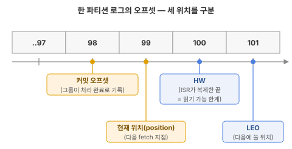
</figure>

이 셋을 구분하면 흔한 문제가 설명됩니다. **처리와 커밋의 순서가 맞지 않으면**, 처리 전에 커밋해 버리면(현재 위치만 앞서고 커밋이 먼저) 장애 시 **유실**, 처리 후 커밋인데 그 사이 재시작하면 **중복** 재처리가 됩니다.

<mark>HW는 "브로커가 안전하다고 보는 지점", 커밋 오프셋은 "컨슈머가 처리 끝냈다고 기록한 지점" — 성격이 다른 두 오프셋을 혼동하면 유실과 중복의 원인을 못 찾습니다.</mark>

## 리더 선출 — clean vs unclean

리더 브로커에 장애가 발생하면 컨트롤러가 **ISR 안의 팔로워 중 하나를 새 리더로 선출**합니다(clean election). ISR 안에서 뽑으니 커밋된(HW 이하) 메시지는 보존됩니다.

문제는 **ISR이 텅 비었을 때**입니다. 리더도 중단되고 따라잡은 팔로워도 없다면 두 선택지뿐입니다.

- **`unclean.leader.election.enable=false`(기본)** — ISR이 빌 때까지 기다립니다. 해당 파티션은 **읽기, 쓰기 불가(offline)** 가 되지만, 유실은 없습니다. → **내구성 우선.**
- **`unclean.leader.election.enable=true`** — 뒤처진(ISR 밖) 복제본이라도 리더로 세웁니다. 서비스는 이어지지만, 그 복제본에 없던 메시지는 **유실**됩니다. → **가용성 우선.**

<mark>unclean 리더 선출은 "잠깐 멈추고 유실 없음" vs "계속 동작하지만 일부 유실" 사이의 스위치입니다 — 대부분은 기본값(false, 내구성 우선)이 맞습니다.</mark>

<details>
<summary>SVG 코드</summary>

```svg
<svg xmlns="http://www.w3.org/2000/svg" width="445" height="304" viewBox="0 0 445 304" font-family="-apple-system, 'Segoe UI', 'Noto Sans KR', sans-serif">
<defs><marker id="ah" viewBox="0 0 10 10" refX="9" refY="5" markerWidth="7" markerHeight="7" orient="auto-start-reverse"><path d="M0,0 L10,5 L0,10 z" fill="#888"/></marker></defs>
<rect x="0" y="0" width="445" height="304" fill="#FFFFFF"/>
<g transform="translate(0,-22)">
<circle cx="115" cy="44" r="7" fill="#555"/>
<line x1="115" y1="51" x2="115" y2="62" stroke="#888" stroke-width="1.2" marker-end="url(#ah)"/>
<rect x="20" y="64" width="190" height="40" rx="6" fill="#F7F7F7" stroke="#999999"/>
<text x="115.0" y="80.75" font-size="12" fill="#333" text-anchor="middle" font-weight="bold">리더 브로커 장애 감지</text>
<text x="115.0" y="95.25" font-size="10.5" fill="#555" text-anchor="middle">(컨트롤러)</text>
<line x1="115" y1="104" x2="115" y2="124" stroke="#888" stroke-width="1.2" marker-end="url(#ah)"/>
<rect x="10" y="126" width="210" height="34" rx="6" fill="#FFF3E0" stroke="#E0A000"/>
<text x="115.0" y="146.75" font-size="11.5" fill="#7A5200" text-anchor="middle" font-weight="bold">ISR에 살아있는 복제본이 있나?</text>
<line x1="220" y1="143" x2="258" y2="143" stroke="#888" stroke-width="1.2" marker-end="url(#ah)"/>
<text x="239" y="137" font-size="10.5" fill="#2E6B2E" text-anchor="middle" font-weight="bold">Y</text>
<rect x="260" y="120" width="175" height="46" rx="6" fill="#E9F2E9" stroke="#8FBF8F"/>
<text x="347.5" y="139.25" font-size="11" fill="#2E6B2E" text-anchor="middle" font-weight="bold">ISR 중 하나를 새 리더로 선출</text>
<text x="347.5" y="153.75" font-size="10.5" fill="#555" text-anchor="middle">(clean, 커밋 데이터 보존)</text>
<line x1="115" y1="160" x2="115" y2="198" stroke="#888" stroke-width="1.2" marker-end="url(#ah)"/>
<text x="133" y="183" font-size="10.5" fill="#9E3A57" text-anchor="start" font-weight="bold">N</text>
<rect x="10" y="200" width="210" height="34" rx="6" fill="#FFF3E0" stroke="#E0A000"/>
<text x="115.0" y="220.75" font-size="11.5" fill="#7A5200" text-anchor="middle" font-weight="bold">unclean.leader.election.enable</text>
<line x1="220" y1="217" x2="258" y2="217" stroke="#888" stroke-width="1.2" marker-end="url(#ah)"/>
<text x="239" y="211" font-size="10.5" fill="#333" text-anchor="middle" font-weight="bold">true</text>
<rect x="260" y="194" width="175" height="46" rx="6" fill="#FCE4EC" stroke="#D06A86"/>
<text x="347.5" y="213.25" font-size="11" fill="#9E3A57" text-anchor="middle" font-weight="bold">ISR 밖 복제본을 리더로</text>
<text x="347.5" y="227.75" font-size="10.5" fill="#555" text-anchor="middle">(가용성 유지, 일부 유실)</text>
<line x1="115" y1="234" x2="115" y2="266" stroke="#888" stroke-width="1.2" marker-end="url(#ah)"/>
<text x="133" y="255" font-size="10.5" fill="#333" text-anchor="start" font-weight="bold">false, 기본</text>
<rect x="15" y="268" width="200" height="46" rx="6" fill="#F7F7F7" stroke="#999999"/>
<text x="115.0" y="287.25" font-size="11" fill="#333" text-anchor="middle" font-weight="bold">파티션 오프라인</text>
<text x="115.0" y="301.75" font-size="10.5" fill="#555" text-anchor="middle">(읽기, 쓰기 중단, 유실 없음)</text>
</g>
</svg>
```

</details>

<figure style={{textAlign: 'center', margin: '1.5rem 0'}}>
  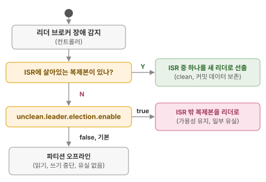
</figure>

## rack 배치 — region/zone 장애를 견디기

복제본을 3개 배치해도 **셋 다 같은 가용영역(AZ)에 있으면** 그 영역 전체가 내려갈 때 파티션 전체를 잃습니다. 그래서 브로커마다 **`broker.rack`** 에 자신의 zone/region을 지정하면, 카프카가 **복제본을 서로 다른 rack에 나눠 배치**합니다(아래 그림처럼 Zone A/B/C로 분산). 한 zone이 내려가도 다른 zone에 복제본이 남아 리더 선출이 가능합니다.

<details>
<summary>SVG 코드</summary>

```svg
<svg xmlns="http://www.w3.org/2000/svg" width="440" height="296" viewBox="0 0 440 296" font-family="-apple-system, 'Segoe UI', 'Noto Sans KR', sans-serif">
<defs><marker id="ah" viewBox="0 0 10 10" refX="9" refY="5" markerWidth="7" markerHeight="7" orient="auto-start-reverse"><path d="M0,0 L10,5 L0,10 z" fill="#888"/></marker></defs>
<rect x="0" y="0" width="440" height="296" fill="#FFFFFF"/>
<text x="220.0" y="22" font-size="13" fill="#333" text-anchor="middle" font-weight="bold">broker.rack — P0 복제본을 zone에 분산 (한 zone 장애 견딤)</text>
<rect x="15" y="40" width="120" height="124" rx="8" fill="#FFFFFF" stroke="#999999" stroke-dasharray="4 3"/>
<text x="25" y="56" font-size="10.5" fill="#555" text-anchor="start" font-weight="bold">Zone A</text>
<rect x="23" y="62" width="104" height="92" rx="6" fill="#F7F7F7" stroke="#999999"/>
<text x="75.0" y="78" font-size="11" fill="#333" text-anchor="middle" font-weight="bold">Broker 1</text>
<rect x="33" y="86" width="84" height="56" rx="6" fill="#EEF3FB" stroke="#4C7FE0"/>
<text x="75.0" y="117.75" font-size="11.5" fill="#26508F" text-anchor="middle" font-weight="bold">P0 리더</text>
<rect x="160" y="40" width="120" height="124" rx="8" fill="#FFFFFF" stroke="#999999" stroke-dasharray="4 3"/>
<text x="170" y="56" font-size="10.5" fill="#555" text-anchor="start" font-weight="bold">Zone B</text>
<rect x="168" y="62" width="104" height="92" rx="6" fill="#F7F7F7" stroke="#999999"/>
<text x="220.0" y="78" font-size="11" fill="#333" text-anchor="middle" font-weight="bold">Broker 2</text>
<rect x="178" y="86" width="84" height="56" rx="6" fill="#E9F2E9" stroke="#8FBF8F"/>
<text x="220.0" y="117.75" font-size="11.5" fill="#2E6B2E" text-anchor="middle" font-weight="bold">P0 팔로워</text>
<rect x="305" y="40" width="120" height="124" rx="8" fill="#FCE4EC" stroke="#D06A86" stroke-dasharray="4 3"/>
<text x="315" y="56" font-size="10.5" fill="#9E3A57" text-anchor="start" font-weight="bold">Zone C (장애)</text>
<rect x="313" y="62" width="104" height="92" rx="6" fill="#F7F7F7" stroke="#999999"/>
<text x="365.0" y="78" font-size="11" fill="#333" text-anchor="middle" font-weight="bold">Broker 3</text>
<rect x="323" y="86" width="84" height="56" rx="6" fill="#E9F2E9" stroke="#8FBF8F"/>
<text x="365.0" y="117.75" font-size="11.5" fill="#2E6B2E" text-anchor="middle" font-weight="bold">P0 팔로워</text>
<line x1="117" y1="114" x2="176" y2="114" stroke="#888" stroke-width="1.2" marker-end="url(#ah)"/>
<text x="147" y="107" font-size="10.5" fill="#333" text-anchor="middle">복제</text>
<polyline points="60,142 60,196 365,196 365,144" fill="none" stroke="#888" stroke-width="1.2" stroke-dasharray="5 4" marker-end="url(#ah)"/>
<rect x="271.955" y="189.5" width="56.09" height="15.5" fill="#FFFFFF"/>
<text x="300" y="200" font-size="10.5" fill="#333" text-anchor="middle">복제 중단</text>
<rect x="95" y="236" width="250" height="44" rx="6" fill="#FFFBEA" stroke="#E0A000" stroke-dasharray="5 4"/>
<text x="220.0" y="254" font-size="10.5" fill="#5A4300" text-anchor="middle">Zone C에 장애가 발생해도 A, B에</text>
<text x="220.0" y="270" font-size="10.5" fill="#5A4300" text-anchor="middle">복제본이 남아 리더 선출 가능</text>
<line x1="220" y1="164" x2="220" y2="236" stroke="#E0A000" stroke-dasharray="3 3"/>
</svg>
```

</details>

<figure style={{textAlign: 'center', margin: '1.5rem 0'}}>
  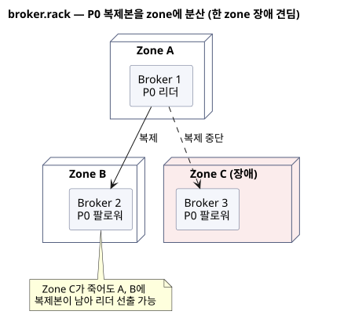
</figure>

한 가지 더, 멀티 AZ에서는 **크로스 AZ 트래픽 비용**이 문제입니다. 컨슈머가 항상 리더(다른 zone일 수 있음)에서 읽으면 비용이 커집니다. 이때 **`client.rack`** 을 지정하고 브로커에 rack-aware replica selector를 활성화하면, 컨슈머가 **같은 zone의 팔로워에서 읽어**(follower fetching) 크로스 AZ 트래픽을 줄일 수 있습니다.

<mark>`broker.rack`은 복제본을 zone에 분산해 영역 장애를 견디게 하고, `client.rack`(팔로워 읽기)은 크로스 AZ 트래픽 비용을 줄입니다.</mark>

<details>
<summary>SVG 코드</summary>

```svg
<svg xmlns="http://www.w3.org/2000/svg" width="460" height="250" viewBox="0 0 460 250" font-family="-apple-system, 'Segoe UI', 'Noto Sans KR', sans-serif">
<defs><marker id="ah" viewBox="0 0 10 10" refX="9" refY="5" markerWidth="7" markerHeight="7" orient="auto-start-reverse"><path d="M0,0 L10,5 L0,10 z" fill="#888"/></marker></defs>
<rect x="0" y="0" width="460" height="250" fill="#FFFFFF"/>
<text x="230.0" y="22" font-size="13" fill="#333" text-anchor="middle" font-weight="bold">client.rack — 같은 zone 팔로워에서 읽어 크로스 AZ 절감</text>
<rect x="15" y="40" width="205" height="196" rx="8" fill="#FFFFFF" stroke="#999999" stroke-dasharray="4 3"/>
<text x="25" y="56" font-size="10.5" fill="#555" text-anchor="start" font-weight="bold">Zone A</text>
<rect x="240" y="40" width="205" height="196" rx="8" fill="#FFFFFF" stroke="#999999" stroke-dasharray="4 3"/>
<text x="250" y="56" font-size="10.5" fill="#555" text-anchor="start" font-weight="bold">Zone B</text>
<rect x="27" y="66" width="110" height="34" rx="6" fill="#FFF3E0" stroke="#E0A000"/>
<text x="82.0" y="86.75" font-size="11.5" fill="#7A5200" text-anchor="middle" font-weight="bold">컨슈머 (rack=A)</text>
<rect x="252" y="66" width="110" height="34" rx="6" fill="#FFF3E0" stroke="#E0A000"/>
<text x="307.0" y="86.75" font-size="11.5" fill="#7A5200" text-anchor="middle" font-weight="bold">컨슈머 (rack=B)</text>
<rect x="27" y="176" width="110" height="40" rx="6" fill="#EEF3FB" stroke="#4C7FE0"/>
<text x="82.0" y="199.75" font-size="11.5" fill="#26508F" text-anchor="middle" font-weight="bold">리더 P0</text>
<rect x="252" y="176" width="110" height="40" rx="6" fill="#E9F2E9" stroke="#8FBF8F"/>
<text x="307.0" y="199.75" font-size="11.5" fill="#2E6B2E" text-anchor="middle" font-weight="bold">팔로워 P0</text>
<line x1="82" y1="100" x2="82" y2="174" stroke="#888" stroke-width="1.2" marker-end="url(#ah)"/>
<text x="90" y="141" font-size="10.5" fill="#333" text-anchor="start">같은 zone 리더에서 읽기</text>
<line x1="307" y1="100" x2="307" y2="174" stroke="#888" stroke-width="1.2" marker-end="url(#ah)"/>
<text x="315" y="141" font-size="10.5" fill="#333" text-anchor="start">같은 zone 팔로워에서 읽기</text>
<line x1="137" y1="196" x2="250" y2="196" stroke="#888" stroke-width="1.2" marker-end="url(#ah)"/>
<text x="194" y="189" font-size="10.5" fill="#333" text-anchor="middle">복제</text>
</svg>
```

</details>

<figure style={{textAlign: 'center', margin: '1.5rem 0'}}>
  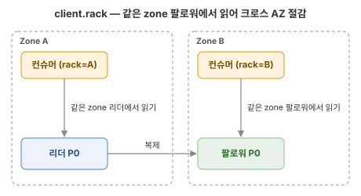
</figure>

## 컨슈머 그룹과 그룹 코디네이터 {#coordinator}

이제 소비 쪽입니다. **컨슈머 그룹**은 한 토픽을 나눠 읽는 컨슈머들의 집합이고, **한 파티션은 그룹 안에서 한 컨슈머만** 맡습니다(그래서 병렬성 상한이 파티션 수).

이 "누가 어느 파티션을 맡을지"를 조율하는 브로커가 **그룹 코디네이터(group coordinator)** 입니다. 그룹마다 코디네이터가 한 명 정해지고(`group.id`를 해시해 `__consumer_offsets`의 특정 파티션 → 그 리더 브로커), 멤버들의 조인, 이탈, 오프셋 커밋을 관리합니다.

주의할 점은 **"그룹 리더"와 "그룹 코디네이터"가 다르다**는 것입니다. 코디네이터는 브로커이고, **그룹 리더는 멤버(컨슈머) 중 하나** — 코디네이터가 지정한 이 컨슈머가 실제 파티션 할당을 계산합니다.

<mark>그룹 코디네이터(브로커)는 조율만 하고, 파티션 할당 계산은 코디네이터가 지정한 그룹 리더(컨슈머)가 합니다 — 둘은 다른 주체입니다.</mark>

<details>
<summary>SVG 코드</summary>

```svg
<svg xmlns="http://www.w3.org/2000/svg" width="470" height="300" viewBox="0 0 470 300" font-family="-apple-system, 'Segoe UI', 'Noto Sans KR', sans-serif">
<defs><marker id="ah" viewBox="0 0 10 10" refX="9" refY="5" markerWidth="7" markerHeight="7" orient="auto-start-reverse"><path d="M0,0 L10,5 L0,10 z" fill="#888"/></marker></defs>
<rect x="0" y="0" width="470" height="300" fill="#FFFFFF"/>
<text x="235.0" y="22" font-size="13" fill="#333" text-anchor="middle" font-weight="bold">그룹 코디네이터(브로커) vs 그룹 리더(컨슈머)</text>
<rect x="15" y="50" width="160" height="236" rx="6" fill="#F7F7F7" stroke="#999999"/>
<text x="95.0" y="164.5" font-size="11.5" fill="#333" text-anchor="middle" font-weight="bold">그룹 코디네이터 (브로커)</text>
<text x="95.0" y="179.0" font-size="10.5" fill="#555" text-anchor="middle">조인, 이탈, 오프셋 조율</text>
<rect x="310" y="50" width="145" height="86" rx="6" fill="#FFF3E0" stroke="#E0A000"/>
<text x="382.5" y="89.5" font-size="11.5" fill="#7A5200" text-anchor="middle" font-weight="bold">그룹 리더 (컨슈머 C1)</text>
<text x="382.5" y="104.0" font-size="10.5" fill="#555" text-anchor="middle">파티션 할당 계산</text>
<rect x="310" y="166" width="145" height="40" rx="6" fill="#FFF3E0" stroke="#E0A000"/>
<text x="382.5" y="189.75" font-size="11.5" fill="#7A5200" text-anchor="middle" font-weight="bold">멤버 (컨슈머 C2)</text>
<rect x="310" y="236" width="145" height="40" rx="6" fill="#FFF3E0" stroke="#E0A000"/>
<text x="382.5" y="259.75" font-size="11.5" fill="#7A5200" text-anchor="middle" font-weight="bold">멤버 (컨슈머 C3)</text>
<line x1="175" y1="76" x2="308" y2="76" stroke="#888" stroke-width="1.2" marker-end="url(#ah)"/>
<text x="242" y="70" font-size="10.5" fill="#333" text-anchor="middle">리더로 지정 + 멤버 목록</text>
<line x1="310" y1="124" x2="177" y2="124" stroke="#888" stroke-width="1.2" marker-end="url(#ah)"/>
<text x="242" y="104" font-size="10.5" fill="#333" text-anchor="middle">할당 결과 제출</text>
<text x="242" y="117" font-size="10.5" fill="#333" text-anchor="middle">(SyncGroup)</text>
<line x1="175" y1="186" x2="308" y2="186" stroke="#888" stroke-width="1.2" marker-end="url(#ah)"/>
<text x="242" y="180" font-size="10.5" fill="#333" text-anchor="middle">배정 파티션 전달</text>
<line x1="175" y1="256" x2="308" y2="256" stroke="#888" stroke-width="1.2" marker-end="url(#ah)"/>
<text x="242" y="250" font-size="10.5" fill="#333" text-anchor="middle">배정 파티션 전달</text>
</svg>
```

</details>

<figure style={{textAlign: 'center', margin: '1.5rem 0'}}>
  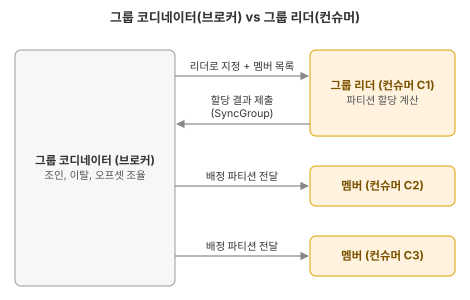
</figure>

## 멤버십 유지 — 하트비트, `session.timeout`, `max.poll.interval`

코디네이터가 "이 멤버가 살아 있나"를 판단하는 신호는 **두 가지**이고, 이 둘이 헷갈림의 단골입니다.

- **하트비트 — 별도 스레드가 보냄.** `heartbeat.interval.ms`(기본 3초)마다 보내고, `session.timeout.ms`(기본 45초, Kafka 3.0에서 10초→45초로 상향) 안에 하트비트가 없으면 코디네이터가 그 멤버를 **중단된 것으로 보고 리밸런스**를 일으킵니다. → **연결, 프로세스 생존** 신호.
- **poll 주기 — 처리 스레드가 보냄.** `max.poll.interval.ms`(기본 5분) 안에 `poll()`을 다시 호출하지 않으면, 하트비트가 살아 있어도 **처리가 멈춘 것으로 보고** 그 멤버를 그룹에서 제외합니다. → **실제 처리 진행** 신호.

<details>
<summary>SVG 코드</summary>

```svg
<svg xmlns="http://www.w3.org/2000/svg" width="480" height="280" viewBox="0 0 480 280" font-family="-apple-system, 'Segoe UI', 'Noto Sans KR', sans-serif">
<defs><marker id="ah" viewBox="0 0 10 10" refX="9" refY="5" markerWidth="7" markerHeight="7" orient="auto-start-reverse"><path d="M0,0 L10,5 L0,10 z" fill="#888"/></marker></defs>
<rect x="0" y="0" width="480" height="280" fill="#FFFFFF"/>
<text x="240.0" y="22" font-size="13" fill="#333" text-anchor="middle" font-weight="bold">멤버 생존을 판단하는 두 신호</text>
<rect x="15" y="42" width="165" height="224" rx="8" fill="#FFFAF2" stroke="#E0A000" stroke-dasharray="4 3"/>
<text x="27" y="60" font-size="11" fill="#7A5200" text-anchor="start" font-weight="bold">컨슈머 인스턴스</text>
<rect x="25" y="96" width="145" height="40" rx="6" fill="#FFF3E0" stroke="#E0A000"/>
<text x="97.5" y="119.75" font-size="11.5" fill="#7A5200" text-anchor="middle" font-weight="bold">하트비트 스레드</text>
<rect x="25" y="206" width="145" height="40" rx="6" fill="#FFF3E0" stroke="#E0A000"/>
<text x="97.5" y="229.75" font-size="11.5" fill="#7A5200" text-anchor="middle" font-weight="bold">처리 스레드 (poll 루프)</text>
<rect x="370" y="60" width="100" height="200" rx="6" fill="#F7F7F7" stroke="#999999"/>
<text x="420.0" y="163.75" font-size="11.5" fill="#333" text-anchor="middle" font-weight="bold">그룹 코디네이터</text>
<line x1="170" y1="116" x2="368" y2="116" stroke="#888" stroke-width="1.2" marker-end="url(#ah)"/>
<text x="275" y="72" font-size="10.5" fill="#333" text-anchor="middle">Heartbeat (기본 3초 주기)</text>
<text x="275" y="86" font-size="10.5" fill="#333" text-anchor="middle">중단되고 session.timeout(45초)</text>
<text x="275" y="100" font-size="10.5" fill="#333" text-anchor="middle">지나면 사망 판정</text>
<line x1="170" y1="226" x2="368" y2="226" stroke="#888" stroke-width="1.2" marker-end="url(#ah)"/>
<text x="275" y="182" font-size="10.5" fill="#333" text-anchor="middle">poll 재호출</text>
<text x="275" y="196" font-size="10.5" fill="#333" text-anchor="middle">max.poll.interval(5분) 넘기면</text>
<text x="275" y="210" font-size="10.5" fill="#333" text-anchor="middle">처리 정지 판정</text>
</svg>
```

</details>

<figure style={{textAlign: 'center', margin: '1.5rem 0'}}>
  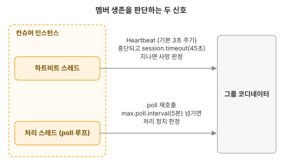
</figure>

둘을 나눈 이유가 있습니다. 하트비트만 있으면, 메시지 하나 처리가 오래 걸려(`poll` 사이가 길어져) 실제로는 일을 못 하는데도 "살아 있다"고 오인할 수 있습니다. 그래서 **생존(하트비트)** 과 **진행(poll)** 을 분리해 각각 감시합니다.

실무에서 자주 겪는 문제가 **"처리 로직이 무거워 `max.poll.interval.ms`를 넘겨 리밸런스가 반복되는"** 경우입니다. 한 번에 가져오는 레코드 수(`max.poll.records`)를 줄이거나, 무거운 작업을 별도 스레드로 빼서 poll 주기를 지켜야 합니다.

## 리밸런싱 — eager vs cooperative-sticky {#rebalancing}

멤버가 추가, 이탈하거나 파티션이 늘면, 파티션을 다시 나눠 맡는 **리밸런싱(rebalancing)** 이 발생합니다. 아래는 조인, 하트비트, 이탈의 전체 흐름입니다.

<details>
<summary>SVG 코드</summary>

```svg
<svg xmlns="http://www.w3.org/2000/svg" width="440" height="526" viewBox="0 0 440 526" font-family="-apple-system, 'Segoe UI', 'Noto Sans KR', sans-serif">
<defs><marker id="ah" viewBox="0 0 10 10" refX="9" refY="5" markerWidth="7" markerHeight="7" orient="auto-start-reverse"><path d="M0,0 L10,5 L0,10 z" fill="#888"/></marker></defs>
<rect x="0" y="0" width="440" height="526" fill="#FFFFFF"/>
<g transform="translate(0,-22)">
<rect x="7.0" y="36" width="110" height="40" rx="6" fill="#FFF3E0" stroke="#E0A000"/>
<text x="62.0" y="59.75" font-size="11.5" fill="#7A5200" text-anchor="middle" font-weight="bold">컨슈머 C1</text>
<line x1="62" y1="76" x2="62" y2="534" stroke="#BBBBBB" stroke-dasharray="4 3"/>
<rect x="135.0" y="36" width="110" height="40" rx="6" fill="#FFF3E0" stroke="#E0A000"/>
<text x="190.0" y="59.75" font-size="11.5" fill="#7A5200" text-anchor="middle" font-weight="bold">컨슈머 C2</text>
<line x1="190" y1="76" x2="190" y2="534" stroke="#BBBBBB" stroke-dasharray="4 3"/>
<rect x="305.0" y="36" width="110" height="40" rx="6" fill="#F7F7F7" stroke="#999999"/>
<text x="360.0" y="52.75" font-size="11.5" fill="#333" text-anchor="middle" font-weight="bold">그룹 코디네이터</text>
<text x="360.0" y="66.75" font-size="10" fill="#555" text-anchor="middle">(한 브로커)</text>
<line x1="360" y1="76" x2="360" y2="534" stroke="#BBBBBB" stroke-dasharray="4 3"/>
<line x1="10" y1="98" x2="430" y2="98" stroke="#BBBBBB"/>
<rect x="186.95499999999998" y="88" width="66.09" height="20" rx="4" fill="#F7F7F7" stroke="#999999"/>
<text x="220.0" y="102" font-size="10.5" fill="#333" text-anchor="middle" font-weight="bold">그룹 조인</text>
<line x1="62" y1="134" x2="359" y2="134" stroke="#888" stroke-width="1.2" marker-end="url(#ah)"/>
<circle cx="74" cy="123" r="8" fill="#4C7FE0"/>
<text x="74" y="126.5" font-size="10" fill="#FFFFFF" text-anchor="middle" font-weight="bold">1</text>
<text x="87" y="128" font-size="10.5" fill="#333" text-anchor="start">JoinGroup</text>
<line x1="190" y1="164" x2="359" y2="164" stroke="#888" stroke-width="1.2" marker-end="url(#ah)"/>
<circle cx="202" cy="153" r="8" fill="#4C7FE0"/>
<text x="202" y="156.5" font-size="10" fill="#FFFFFF" text-anchor="middle" font-weight="bold">2</text>
<text x="215" y="158" font-size="10.5" fill="#333" text-anchor="start">JoinGroup</text>
<line x1="360" y1="194" x2="63" y2="194" stroke="#888" stroke-width="1.2" marker-end="url(#ah)"/>
<circle cx="74" cy="183" r="8" fill="#4C7FE0"/>
<text x="74" y="186.5" font-size="10" fill="#FFFFFF" text-anchor="middle" font-weight="bold">3</text>
<text x="87" y="188" font-size="10.5" fill="#333" text-anchor="start">그룹 리더로 지정 + 멤버, 파티션 목록</text>
<polyline points="62,210 90,210 90,226 63,226" fill="none" stroke="#888" stroke-width="1.2" marker-end="url(#ah)"/>
<circle cx="48" cy="218" r="8" fill="#4C7FE0"/>
<text x="48" y="221.5" font-size="10" fill="#FFFFFF" text-anchor="middle" font-weight="bold">4</text>
<text x="96" y="222" font-size="10.5" fill="#333" text-anchor="start">파티션 할당 계산 (assignor)</text>
<line x1="62" y1="262" x2="359" y2="262" stroke="#888" stroke-width="1.2" marker-end="url(#ah)"/>
<circle cx="74" cy="251" r="8" fill="#4C7FE0"/>
<text x="74" y="254.5" font-size="10" fill="#FFFFFF" text-anchor="middle" font-weight="bold">5</text>
<text x="87" y="256" font-size="10.5" fill="#333" text-anchor="start">SyncGroup(할당안)</text>
<line x1="360" y1="292" x2="63" y2="292" stroke="#888" stroke-width="1.2" marker-end="url(#ah)"/>
<circle cx="74" cy="281" r="8" fill="#4C7FE0"/>
<text x="74" y="284.5" font-size="10" fill="#FFFFFF" text-anchor="middle" font-weight="bold">6</text>
<text x="87" y="286" font-size="10.5" fill="#333" text-anchor="start">배정된 파티션</text>
<line x1="360" y1="322" x2="191" y2="322" stroke="#888" stroke-width="1.2" marker-end="url(#ah)"/>
<circle cx="202" cy="311" r="8" fill="#4C7FE0"/>
<text x="202" y="314.5" font-size="10" fill="#FFFFFF" text-anchor="middle" font-weight="bold">7</text>
<text x="215" y="316" font-size="10.5" fill="#333" text-anchor="start">배정된 파티션</text>
<line x1="10" y1="350" x2="430" y2="350" stroke="#BBBBBB"/>
<rect x="186.95499999999998" y="340" width="66.09" height="20" rx="4" fill="#F7F7F7" stroke="#999999"/>
<text x="220.0" y="354" font-size="10.5" fill="#333" text-anchor="middle" font-weight="bold">정상 운영</text>
<line x1="62" y1="386" x2="359" y2="386" stroke="#888" stroke-width="1.2" marker-end="url(#ah)"/>
<circle cx="74" cy="375" r="8" fill="#4C7FE0"/>
<text x="74" y="378.5" font-size="10" fill="#FFFFFF" text-anchor="middle" font-weight="bold">8</text>
<text x="87" y="380" font-size="10.5" fill="#333" text-anchor="start">Heartbeat (heartbeat.interval.ms 주기)</text>
<line x1="190" y1="416" x2="359" y2="416" stroke="#888" stroke-width="1.2" marker-end="url(#ah)"/>
<circle cx="202" cy="405" r="8" fill="#4C7FE0"/>
<text x="202" y="408.5" font-size="10" fill="#FFFFFF" text-anchor="middle" font-weight="bold">9</text>
<text x="215" y="410" font-size="10.5" fill="#333" text-anchor="start">Heartbeat</text>
<line x1="10" y1="444" x2="430" y2="444" stroke="#BBBBBB"/>
<rect x="191.365" y="434" width="57.269999999999996" height="20" rx="4" fill="#F7F7F7" stroke="#999999"/>
<text x="220.0" y="448" font-size="10.5" fill="#333" text-anchor="middle" font-weight="bold">C2 이탈</text>
<line x1="190" y1="480" x2="330" y2="480" stroke="#888" stroke-width="1.2"/>
<path d="M325,475 L335,485 M325,485 L335,475" stroke="#D06A86" stroke-width="2"/>
<circle cx="202" cy="469" r="8" fill="#4C7FE0"/>
<text x="202" y="472.5" font-size="10" fill="#FFFFFF" text-anchor="middle" font-weight="bold">10</text>
<text x="215" y="474" font-size="10.5" fill="#333" text-anchor="start">Heartbeat 중단</text>
<rect x="120" y="490" width="200" height="18" fill="#FFFFFF"/>
<text x="220" y="503" font-size="10.5" fill="#888" text-anchor="middle">... session.timeout.ms 경과 ...</text>
<line x1="360" y1="530" x2="63" y2="530" stroke="#888" stroke-width="1.2" marker-end="url(#ah)"/>
<circle cx="74" cy="519" r="8" fill="#4C7FE0"/>
<text x="74" y="522.5" font-size="10" fill="#FFFFFF" text-anchor="middle" font-weight="bold">11</text>
<text x="87" y="524" font-size="10.5" fill="#333" text-anchor="start">리밸런스 시작 — C2 파티션 재배정</text>
</g>
</svg>
```

</details>

<figure style={{textAlign: 'center', margin: '1.5rem 0'}}>
  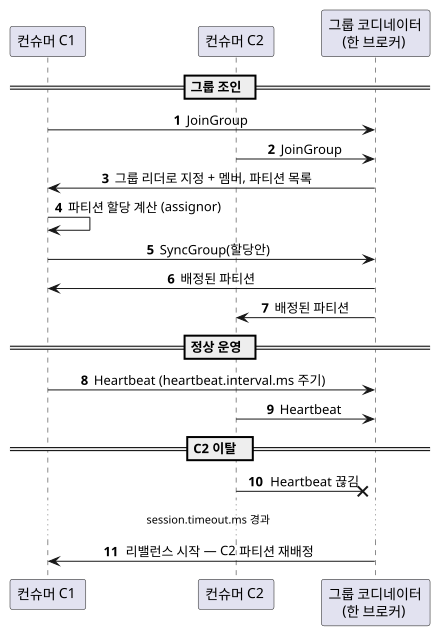
</figure>

리밸런싱을 **어떻게** 하는지가 안정성을 크게 좌우합니다.

- **eager(기본, RangeAssignor 등)** — 리밸런스가 시작되면 **모든 컨슈머가 자기 파티션을 전부 반납**하고, 다시 배정받을 때까지 **전원이 멈춥니다(stop-the-world).** 멤버 하나가 잠깐 재시작해도 그룹 전체가 처리를 멈추는 게 문제입니다.
- **cooperative-sticky(CooperativeStickyAssignor)** — **옮겨야 할 파티션만** 반납하고, 나머지는 계속 처리합니다(incremental). 리밸런스를 두 번에 나눠 하지만 전체 정지가 없어 훨씬 부드럽습니다. 협력적 리밸런싱을 사용하려면 `partition.assignment.strategy`를 이 assignor로 변경합니다.

<AnimatedLineChart
  title="리밸런스 중 그룹 처리량 — eager(전체 정지) vs cooperative(부분만 정지)"
  data={[80, 80, 5, 5, 80, 80, 80, 80]}
  data2={[80, 80, 62, 60, 78, 80, 80, 80]}
  yMax={90}
  tone="bad"
  tone2="good"
  xLabel="리밸런스 진행 →"
  unit="상대 처리량"
  legend={["eager(stop-the-world)", "cooperative-sticky"]}
/>

<mark>eager는 리밸런스마다 그룹 전체가 멈추고, cooperative-sticky는 이동하는 파티션만 잠깐 멈춰 나머지는 계속 처리합니다.</mark>

## 잦은 리밸런스 줄이기 — 정적 멤버십

롤링 배포나 파드 재시작처럼 **잠깐 나갔다 복귀하는** 경우에도 기본 동작은 매번 리밸런스를 유발합니다. **정적 멤버십(static membership)** 은 컨슈머에 **`group.instance.id`** 로 고정 신원을 부여해, 같은 ID의 멤버가 `session.timeout.ms` 안에 복귀하면 **리밸런스 없이** 이전 파티션을 그대로 이어받게 합니다.

```properties
group.instance.id=consumer-order-1   # 인스턴스마다 고정·고유
session.timeout.ms=45000
```

<mark>정적 멤버십은 "잠깐 재시작"을 그룹 변경으로 보지 않게 해, 배포, 재기동 때 불필요한 리밸런스를 없앱니다.</mark>

한 걸음 더 나아가, Kafka 4.0에서 GA된 **새 컨슈머 그룹 프로토콜(KIP-848)** 은 파티션 할당 계산을 **클라이언트가 아니라 브로커(코디네이터)로 넘겨** stop-the-world 리밸런스 자체를 없앱니다. 서버에는 기본 활성화돼 있고, 컨슈머가 `group.protocol=consumer`로 opt-in 하면 큰 그룹에서 리밸런스가 훨씬 안정적입니다. 큰 컨슈머 그룹을 운영한다면 눈여겨볼 방향입니다.

## 정리 — 기준별로 다시 보기

| 기준 | 핵심 개념 | 무엇을 정하나 |
|---|---|---|
| 쓰기 내구성 | 리더/팔로워, RF, **ISR**, `acks`, `min.insync.replicas` | 쓰기를 언제 성공으로 볼지, 몇 곳에 남길지 |
| 위치 관리 | **HW/LEO**(로그), 커밋 오프셋(`__consumer_offsets`), 현재 위치 | 어디까지 안전하고, 어디까지 처리했는지 |
| 장애 극복 | 컨트롤러 **리더 선출**(clean/unclean), **rack** 배치 | 리더에 장애가 발생하거나 zone이 내려갈 때 어떻게 이어갈지 |
| 소비 분배 | 컨슈머 그룹, **그룹 코디네이터**, 하트비트/`session.timeout`/`max.poll.interval`, **리밸런싱**(eager/cooperative), 정적 멤버십 | 파티션을 누가 맡고, 멤버 변화에 어떻게 대응할지 |

한 줄로 요약하면, **리더가 ISR로 내구성을 지키고(`acks`, `min.insync.replicas`), 컨트롤러가 rack에 분산된 복제본으로 장애를 넘기며(리더 선출), 컨슈머 그룹이 코디네이터의 조율로 파티션을 나눠 읽는다(리밸런싱)** — 이 세 문장이 카프카 클러스터 동작의 뼈대입니다.

## 용어 한 줄 정리

| 용어 | 쉬운 뜻 |
|---|---|
| 브로커 | 카프카 서버 한 대. 여러 대가 클러스터를 이룸 |
| 컨트롤러 | 메타데이터 관리, 리더 선출 담당. 4.0부터 KRaft(ZooKeeper 제거) |
| 리더/팔로워 | 파티션 복제본 중 읽기와 쓰기를 받는 하나(리더)와 따라 복제하는 나머지(팔로워) |
| 복제 계수(RF) | 파티션 사본 총 개수(보통 3) |
| ISR | 리더를 충분히 따라잡은 복제본 집합. 새 리더는 여기서 선출 |
| min.insync.replicas | `acks=all` 쓰기를 받기 위한 최소 ISR 크기 |
| HW(하이워터마크) | ISR 전체가 복제한 지점. 컨슈머는 여기까지만 읽음 |
| 커밋 오프셋 | 컨슈머 그룹이 "처리 끝"이라 기록한 위치(`__consumer_offsets`) |
| unclean 리더 선출 | ISR이 빌 때 뒤처진 복제본을 리더로 쓸지(가용성↑, 유실 위험) |
| broker.rack / client.rack | 복제본을 zone에 분산 / 같은 zone 팔로워에서 읽어 크로스 AZ 비용 절감 |
| 그룹 코디네이터 | 컨슈머 그룹의 조인, 이탈, 오프셋을 조율하는 브로커 |
| session.timeout.ms | 하트비트가 이 시간 없으면 멤버 사망 판정(기본 45초) |
| max.poll.interval.ms | poll 간격이 이 값을 넘으면 처리 정지로 보고 그룹에서 제외(기본 5분) |
| 리밸런싱 | 멤버, 파티션 변화 시 파티션을 재배정. eager(전체 정지) vs cooperative-sticky(부분) |
| 정적 멤버십 | `group.instance.id`로 고정 신원을 줘, 잠깐 재시작엔 리밸런스 생략 |
