import AnatomyEmbed from '@site/src/components/AnatomyEmbed';

물류, 공급망(SCM) 시스템은 겉보기엔 용어가 많아 복잡해 보입니다. 발주, 입고, 검수, 적치, 재고, 반품, 정산에, 시스템이 여러 개로 나뉘어 있고, 데이터 테이블 이름은 암호 같습니다. 하지만 그 안을 들여다보면 하는 일은 단순합니다 — **현실에서 물건이 움직이는 과정을, 데이터로 똑같이 따라 기록하는 것**입니다. 이 글은 물류 SCM을 처음 보는 사람도 이해하도록, **우유 100박스가 창고에 들어와 정산까지 가는 여정**을 따라가며 풀어 설명합니다.

<!-- truncate -->

<mark>SCM 시스템이 하는 일은 한 문장으로 요약됩니다 — 현실에서 발생하는 물건의 이동(주문, 입고, 재고, 반품)을 데이터로 똑같이 따라 기록하고, 그 결과로 공급사에 정확히 정산하는 것입니다.</mark>

예로 든 테이블 이름과 수치는 실제가 아니라 이해를 돕기 위한 것입니다.

## SCM이 뭔가요? — 동네 마트로 비유하면

**SCM(Supply Chain Management, 공급망 관리)** 은 "물건이 공급사에서 창고로 들어와, 보관됐다가, 문제가 있으면 돌려보내거나 버리고, 그 대가로 공급사에 돈을 정산하는 모든 과정"을 관리하는 일입니다. 동네 마트로 비유하면 이렇습니다.

- 마트가 우유 회사에 "우유 100박스 주세요" 주문 → **발주**
- 트럭이 우유를 싣고 도착 → **입고**
- "실제로 100박스 맞나? 상한 건 없나?" 확인 → **검수**
- 멀쩡한 우유를 냉장 창고 정해진 칸에 넣음 → **적치(재고 반영)**
- 상한 우유를 회사로 돌려보내거나 버림 → **반품 / 회송 / 폐기**
- 월말에 "실제로 받은 95박스 값만 지급" → **정산**

이 과정을 사람 손이 아니라 소프트웨어로 처리합니다. 물건은 실제 창고에서 움직이지만, "이 상품이 지금 어느 단계인지, 몇 개인지, 어디 있는지"는 전부 **데이터베이스**에 기록됩니다. 그래서 SCM 개발은 결국 **물건의 이동을 데이터로 정확히 따라 적는 일**입니다.

## 일을 나눠 맡는 4개의 시스템

이 큰 일을 하나의 프로그램으로 하지 않고, **역할별로 나눈 여러 시스템**이 나눠 맡습니다. 회사의 부서라고 생각하면 됩니다.

| 시스템 (역할) | 회사 부서로 치면 | 하는 일 |
|---|---|---|
| **구매, 정산 시스템** | 구매, 정산팀(공급사 창구) | 공급사와 주고받는 발주, 입고 확정, **돈 계산(정산)** |
| **입고 관제 시스템** | 입고 관제팀 | 입고 전체 진행을 지휘 — 검수, 입고 예약, "창고 어디에 넣어라" 지시 |
| **창고 관리 시스템(WMS)** | 창고 현장팀 | 실제 창고 재고를 관리 — 어느 칸에 몇 개 넣었는지 기록 |
| **반품, 정리 시스템** | 반품, 정리팀 | 반품, 회송, 폐기, 재고 실사 |

<details>
<summary>SVG 코드</summary>

```svg
<svg xmlns="http://www.w3.org/2000/svg" width="440" height="560" viewBox="0 0 440 560" font-family="-apple-system, 'Segoe UI', 'Noto Sans KR', sans-serif">
<defs><marker id="ah" viewBox="0 0 10 10" refX="9" refY="5" markerWidth="7" markerHeight="7" orient="auto-start-reverse"><path d="M0,0 L10,5 L0,10 z" fill="#888"/></marker></defs>
<rect x="0" y="0" width="440" height="560" fill="#FFFFFF"/>
<text x="220.0" y="22" font-size="13" fill="#333" text-anchor="middle" font-weight="bold">SCM 시스템 구성 — 역할별로 나뉜 4개 시스템</text>
<rect x="140" y="40" width="160" height="46" rx="6" fill="#F7F7F7" stroke="#999999"/>
<text x="220" y="59" font-size="12" fill="#333" text-anchor="middle" font-weight="bold">공급사</text>
<text x="220" y="76" font-size="10.5" fill="#555" text-anchor="middle">상품을 납품하는 협력사</text>
<line x1="220" y1="86" x2="220" y2="139" stroke="#888" stroke-width="1.2" marker-end="url(#ah)"/>
<text x="228" y="112" font-size="10.5" fill="#333" text-anchor="start">발주, 납품</text>
<rect x="12" y="98" width="416" height="450" rx="8" fill="#FAFAFA" stroke="#999999" stroke-dasharray="4 3"/>
<text x="24" y="116" font-size="11" fill="#333" text-anchor="start" font-weight="bold">SCM</text>
<rect x="100" y="140" width="240" height="66" rx="6" fill="#EEF3FB" stroke="#4C7FE0"/>
<text x="220.0" y="160" font-size="12" fill="#26508F" text-anchor="middle" font-weight="bold">구매, 정산 시스템</text>
<text x="220.0" y="176" font-size="10" fill="#777" text-anchor="middle">[발주, 입고확정, 정산]</text>
<text x="220.0" y="193" font-size="10.5" fill="#333" text-anchor="middle">공급사와 돈, 계약 담당</text>
<line x1="180" y1="206" x2="180" y2="285" stroke="#888" stroke-width="1.2" marker-end="url(#ah)"/>
<text x="172" y="240" font-size="10.5" fill="#333" text-anchor="end">발주 확정 이벤트</text>
<text x="172" y="254" font-size="10" fill="#777" text-anchor="end">Kafka (비동기)</text>
<line x1="260" y1="286" x2="260" y2="207" stroke="#888" stroke-width="1.2" marker-end="url(#ah)"/>
<text x="268" y="240" font-size="10.5" fill="#333" text-anchor="start">입고 확정 결과</text>
<text x="268" y="254" font-size="10" fill="#777" text-anchor="start">Kafka (비동기)</text>
<rect x="90" y="286" width="260" height="80" rx="6" fill="#EEF3FB" stroke="#4C7FE0"/>
<text x="220.0" y="306" font-size="12" fill="#26508F" text-anchor="middle" font-weight="bold">입고 관제 시스템</text>
<text x="220.0" y="322" font-size="10" fill="#777" text-anchor="middle">[입고 오케스트레이션]</text>
<text x="220.0" y="339" font-size="10.5" fill="#333" text-anchor="middle">검수, 입고예약(Capacity), 적치지시</text>
<text x="220.0" y="353" font-size="10.5" fill="#333" text-anchor="middle">= 논리 입고</text>
<line x1="120" y1="366" x2="120" y2="445" stroke="#888" stroke-width="1.2" marker-end="url(#ah)"/>
<text x="128" y="392" font-size="10.5" fill="#333" text-anchor="start">적치 지시,</text>
<text x="128" y="406" font-size="10.5" fill="#333" text-anchor="start">재고 확인</text>
<text x="128" y="420" font-size="10" fill="#777" text-anchor="start">REST (동기)</text>
<line x1="320" y1="366" x2="320" y2="445" stroke="#888" stroke-width="1.2" marker-end="url(#ah)"/>
<text x="312" y="399" font-size="10.5" fill="#333" text-anchor="end">불량품</text>
<text x="312" y="413" font-size="10.5" fill="#333" text-anchor="end">반품/회송/폐기</text>
<rect x="26" y="446" width="190" height="88" rx="6" fill="#EEF3FB" stroke="#4C7FE0"/>
<text x="121.0" y="466" font-size="12" fill="#26508F" text-anchor="middle" font-weight="bold">창고 관리 시스템 (WMS)</text>
<text x="121.0" y="482" font-size="10" fill="#777" text-anchor="middle">[물리 재고]</text>
<text x="121.0" y="499" font-size="10.5" fill="#333" text-anchor="middle">실제 창고 칸, 수량, 로트</text>
<text x="121.0" y="513" font-size="10.5" fill="#333" text-anchor="middle">= 물리 입고</text>
<rect x="226" y="446" width="190" height="88" rx="6" fill="#EEF3FB" stroke="#4C7FE0"/>
<text x="321.0" y="466" font-size="12" fill="#26508F" text-anchor="middle" font-weight="bold">반품, 정리 시스템</text>
<text x="321.0" y="482" font-size="10" fill="#777" text-anchor="middle">[반품, 회송, 폐기]</text>
<text x="321.0" y="499" font-size="10.5" fill="#333" text-anchor="middle">불량품 처리, 재고 실사</text>
</svg>
```

</details>

<figure style={{textAlign: 'center', margin: '1.5rem 0'}}>
  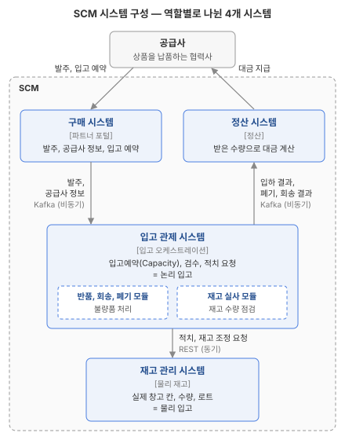
</figure>

**왜 나눴을까요?** 하나의 거대한 프로그램은 한 곳에 장애가 생기면 전부 멈춥니다. 역할별로 나누면 정산이 문제가 생겨도 입고는 계속 실행됩니다. 각 팀이 자기 일에만 집중해 빠르게 고칠 수도 있습니다. 모놀리스와 마이크로서비스의 이러한 트레이드오프는 [모놀리스 vs 마이크로서비스](./monolith-vs-microservices)에서 더 자세히 정리했습니다.

<mark>SCM은 하나의 큰 프로그램이 아니라, 발주, 입고, 창고, 반품을 역할별로 나눈 여러 시스템이 협력하는 구조입니다 — 한 시스템이 멈춰도 나머지는 계속 동작하게 하기 위해서입니다.</mark>

이러한 구조는 흔히 **하나의 큰 레거시 시스템**에서 출발합니다. 처음엔 입고, 반품, 재고를 한 시스템이 다 처리하다가, 너무 커지고 얽히면 **입고 같은 일부 도메인을 새 시스템으로 분리**하는 식입니다. 그 과도기에는 같은 이름의 데이터 저장소가 옛 시스템과 새 시스템에 함께 존재하기도 하는데, 잘못이 아니라 분리가 진행 중이라 그렇습니다.

## 데이터를 읽는 기본기 — 5가지만 알면 된다

시스템이 정보를 저장하는 곳이 데이터베이스이고, 그 안은 **테이블(표)** 들로 돼 있습니다. 다음 다섯 가지 개념만 알면 나머지 내용이 쉽게 이해됩니다.

### ① 테이블 = 엑셀 시트

- **테이블** = 엑셀 시트 한 장
- **컬럼** = 열(상품코드, 수량, 날짜)
- **행(레코드)** = 한 줄 = 실제 한 건의 데이터

예를 들어 발주 테이블(`purchase_order`)은 이렇게 생겼습니다. 한 줄이 발주 한 건입니다.

| 발주번호 | 공급사 | 입고예정일 |
|---|---|---|
| PO-20261020-001 | 우유회사 | 2026-10-22 |

### ② 헤더와 라인 = 영수증 구조

SCM 데이터에서 **가장 자주 나오는 패턴**입니다. 마트 영수증을 떠올리세요.

<details>
<summary>SVG 코드</summary>

```svg
<svg xmlns="http://www.w3.org/2000/svg" width="440" height="220" viewBox="0 0 440 220" font-family="-apple-system, 'Segoe UI', 'Noto Sans KR', sans-serif">
<defs><marker id="ah" viewBox="0 0 10 10" refX="9" refY="5" markerWidth="7" markerHeight="7" orient="auto-start-reverse"><path d="M0,0 L10,5 L0,10 z" fill="#888"/></marker></defs>
<rect x="0" y="0" width="440" height="220" fill="#FFFFFF"/>
<path d="M16,16 h196 v188 h-196 z" fill="#FFFFFF" stroke="#999999"/>
<text x="114.0" y="38" font-size="13" fill="#333" text-anchor="middle" font-weight="bold">영수증</text>
<line x1="26" y1="48" x2="202" y2="48" stroke="#999" stroke-dasharray="3 3"/>
<rect x="24" y="56" width="180" height="52" rx="4" fill="#EEF3FB" stroke="#4C7FE0"/>
<text x="34" y="77" font-size="11" fill="#26508F" text-anchor="start">날짜: 2026-10-20</text>
<text x="34" y="96" font-size="11" fill="#26508F" text-anchor="start">매장: 강남점</text>
<line x1="26" y1="118" x2="202" y2="118" stroke="#999" stroke-dasharray="3 3"/>
<rect x="24" y="128" width="180" height="24" rx="4" fill="#FBDCE4" stroke="#D06A86"/>
<text x="34" y="144" font-size="11" fill="#9E3A57" text-anchor="start">우유</text>
<text x="120" y="144" font-size="11" fill="#9E3A57" text-anchor="end">2개</text>
<text x="194" y="144" font-size="11" fill="#9E3A57" text-anchor="end">3,000원</text>
<rect x="24" y="158" width="180" height="24" rx="4" fill="#FBDCE4" stroke="#D06A86"/>
<text x="34" y="174" font-size="11" fill="#9E3A57" text-anchor="start">빵</text>
<text x="120" y="174" font-size="11" fill="#9E3A57" text-anchor="end">1개</text>
<text x="194" y="174" font-size="11" fill="#9E3A57" text-anchor="end">2,000원</text>
<line x1="26" y1="192" x2="202" y2="192" stroke="#999" stroke-dasharray="3 3"/>
<path d="M218,56 h6 v52 h-6" fill="none" stroke="#4C7FE0" stroke-width="1.5"/>
<line x1="224" y1="82" x2="240" y2="82" stroke="#4C7FE0" stroke-width="1.2"/>
<rect x="240" y="58" width="188" height="48" rx="6" fill="#EEF3FB" stroke="#4C7FE0"/>
<text x="250" y="77" font-size="11.5" fill="#26508F" text-anchor="start" font-weight="bold">윗부분 = 헤더</text>
<text x="250" y="95" font-size="10.5" fill="#333" text-anchor="start">거래 1건의 공통 정보</text>
<path d="M218,128 h6 v54 h-6" fill="none" stroke="#D06A86" stroke-width="1.5"/>
<line x1="224" y1="155" x2="240" y2="155" stroke="#D06A86" stroke-width="1.2"/>
<rect x="240" y="131" width="188" height="48" rx="6" fill="#FCE4EC" stroke="#D06A86"/>
<text x="250" y="150" font-size="11.5" fill="#9E3A57" text-anchor="start" font-weight="bold">아래 각 줄 = 라인</text>
<text x="250" y="168" font-size="10.5" fill="#333" text-anchor="start">품목별 상세</text>
</svg>
```

</details>

<figure style={{textAlign: 'center', margin: '1.5rem 0'}}>
  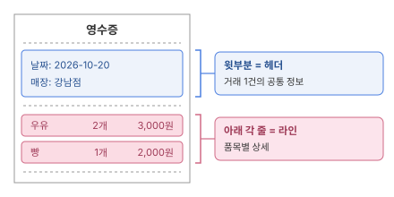
</figure>

- **헤더 테이블**: 거래 전체에 한 번만 있는 정보(날짜, 발주번호, 공급사)
- **라인 테이블**: 그 안의 품목마다 한 줄씩(상품A 10개, 상품B 5개…)

그래서 `purchase_order`(발주 헤더) ↔ `purchase_order_item`(발주 품목 라인), `inspection_header`(검수 헤더) ↔ `inspection_line`(검수 라인)처럼 **헤더–라인 짝**이 계속 나옵니다. 이름에 `item`, `line`이 붙으면 "그 안의 품목별 상세"라고 보면 됩니다.

<details>
<summary>SVG 코드</summary>

```svg
<svg xmlns="http://www.w3.org/2000/svg" width="440" height="160" viewBox="0 0 440 160" font-family="-apple-system, 'Segoe UI', 'Noto Sans KR', sans-serif">
<defs><marker id="ah" viewBox="0 0 10 10" refX="9" refY="5" markerWidth="7" markerHeight="7" orient="auto-start-reverse"><path d="M0,0 L10,5 L0,10 z" fill="#888"/></marker></defs>
<rect x="0" y="0" width="440" height="160" fill="#FFFFFF"/>
<text x="220.0" y="22" font-size="13" fill="#333" text-anchor="middle" font-weight="bold">헤더 1건에 라인 여러 건 — 영수증 구조</text>
<rect x="16" y="44" width="160" height="102" rx="4" fill="#FFFFFF" stroke="#4C7FE0"/>
<path d="M16,84 V48 Q16,44 20,44 H172 Q176,44 176,48 V84 Z" fill="#EEF3FB" stroke="#4C7FE0"/>
<text x="96.0" y="61" font-size="11.5" fill="#26508F" text-anchor="middle" font-weight="bold">purchase_order</text>
<text x="96.0" y="76" font-size="10" fill="#555" text-anchor="middle">(발주 헤더)</text>
<text x="26" y="100" font-size="10.5" fill="#333" text-anchor="start">발주번호</text>
<text x="26" y="118" font-size="10.5" fill="#333" text-anchor="start">공급사</text>
<text x="26" y="136" font-size="10.5" fill="#333" text-anchor="start">입고예정일</text>
<rect x="264" y="44" width="160" height="102" rx="4" fill="#FFFFFF" stroke="#4C7FE0"/>
<path d="M264,84 V48 Q264,44 268,44 H420 Q424,44 424,48 V84 Z" fill="#EEF3FB" stroke="#4C7FE0"/>
<text x="344.0" y="61" font-size="11.5" fill="#26508F" text-anchor="middle" font-weight="bold">purchase_order_item</text>
<text x="344.0" y="76" font-size="10" fill="#555" text-anchor="middle">(발주 라인)</text>
<text x="274" y="100" font-size="10.5" fill="#333" text-anchor="start">상품</text>
<text x="274" y="118" font-size="10.5" fill="#333" text-anchor="start">수량</text>
<text x="274" y="136" font-size="10.5" fill="#333" text-anchor="start">단가</text>
<line x1="176" y1="92" x2="263" y2="92" stroke="#888" stroke-width="1.2" marker-end="url(#ah)"/>
<text x="220" y="86" font-size="10.5" fill="#333" text-anchor="middle">품목마다 한 줄</text>
<text x="182" y="106" font-size="10" fill="#777" text-anchor="start" font-weight="bold">헤더 1</text>
<text x="256" y="106" font-size="10" fill="#777" text-anchor="end" font-weight="bold">라인 N</text>
</svg>
```

</details>

<figure style={{textAlign: 'center', margin: '1.5rem 0'}}>
  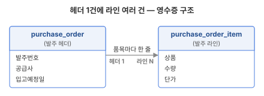
</figure>

### ③ 마스터와 트랜잭션 = 사전과 일기

- **마스터 데이터**: 잘 안 바뀌는 기준 정보. "사전"에 가깝습니다. 예: 상품 마스터(우유의 이름, 단위), 공급사(주소, 사업자번호), 창고, 로케이션.
- **트랜잭션 데이터**: 사건이 생길 때마다 쌓이는 기록. "일기"에 가깝습니다. 예: 입고 거래(오늘 우유 95박스 입고), 적치 거래(A-01 칸에 넣음).

**마스터는 참고하고, 트랜잭션은 쌓인다**고 기억하면 됩니다.

<details>
<summary>SVG 코드</summary>

```svg
<svg xmlns="http://www.w3.org/2000/svg" width="440" height="216" viewBox="0 0 440 216" font-family="-apple-system, 'Segoe UI', 'Noto Sans KR', sans-serif">
<defs><marker id="ah" viewBox="0 0 10 10" refX="9" refY="5" markerWidth="7" markerHeight="7" orient="auto-start-reverse"><path d="M0,0 L10,5 L0,10 z" fill="#888"/></marker></defs>
<rect x="0" y="0" width="440" height="216" fill="#FFFFFF"/>
<text x="220.0" y="22" font-size="13" fill="#333" text-anchor="middle" font-weight="bold">마스터(사전) vs 트랜잭션(일기)</text>
<rect x="16" y="40" width="196" height="46" rx="6" fill="#E9F2E9" stroke="#8FBF8F"/>
<text x="114.0" y="59.5" font-size="11.5" fill="#2E6B2E" text-anchor="middle" font-weight="bold">마스터 = 사전</text>
<text x="114.0" y="74.5" font-size="10.5" fill="#555" text-anchor="middle">잘 안 바뀌는 기준 정보</text>
<rect x="72" y="106" width="140" height="37" rx="6" fill="#FFFFFF" stroke="#999999"/>
<text x="142" y="128.5" font-size="11" fill="#333" text-anchor="middle">상품: 우유 (이름, 단위)</text>
<rect x="72" y="157" width="140" height="52" rx="6" fill="#FFFFFF" stroke="#999999"/>
<text x="142" y="179.5" font-size="11" fill="#333" text-anchor="middle">공급사: 우유회사</text>
<text x="142" y="194.5" font-size="11" fill="#333" text-anchor="middle">(주소, 사업자번호)</text>
<line x1="32" y1="86" x2="32" y2="183.0" stroke="#888" stroke-width="1.2"/>
<line x1="32" y1="124.5" x2="71" y2="124.5" stroke="#888" stroke-width="1.2" marker-end="url(#ah)"/>
<text x="52" y="119.5" font-size="10" fill="#555" text-anchor="middle">참고</text>
<line x1="32" y1="183.0" x2="71" y2="183.0" stroke="#888" stroke-width="1.2" marker-end="url(#ah)"/>
<text x="52" y="178.0" font-size="10" fill="#555" text-anchor="middle">참고</text>
<rect x="228" y="40" width="196" height="46" rx="6" fill="#FBF3E6" stroke="#E0A000"/>
<text x="326.0" y="59.5" font-size="11.5" fill="#7A5200" text-anchor="middle" font-weight="bold">트랜잭션 = 일기</text>
<text x="326.0" y="74.5" font-size="10.5" fill="#555" text-anchor="middle">사건마다 쌓이는 기록</text>
<rect x="284" y="106" width="140" height="37" rx="6" fill="#FFFFFF" stroke="#999999"/>
<text x="354" y="128.5" font-size="11" fill="#333" text-anchor="middle">10/22 우유 95박스 입고</text>
<rect x="284" y="157" width="140" height="37" rx="6" fill="#FFFFFF" stroke="#999999"/>
<text x="354" y="179.5" font-size="11" fill="#333" text-anchor="middle">A-01 칸에 적치</text>
<line x1="244" y1="86" x2="244" y2="175.5" stroke="#888" stroke-width="1.2"/>
<line x1="244" y1="124.5" x2="283" y2="124.5" stroke="#888" stroke-width="1.2" marker-end="url(#ah)"/>
<text x="264" y="119.5" font-size="10" fill="#555" text-anchor="middle">쌓임</text>
<line x1="244" y1="175.5" x2="283" y2="175.5" stroke="#888" stroke-width="1.2" marker-end="url(#ah)"/>
<text x="264" y="170.5" font-size="10" fill="#555" text-anchor="middle">쌓임</text>
</svg>
```

</details>

<figure style={{textAlign: 'center', margin: '1.5rem 0'}}>
  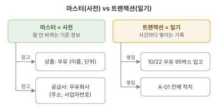
</figure>

### ④ 상태값 = 택배 송장

물건 한 건은 여러 단계를 거칩니다. 그걸 한 컬럼에 "지금 어디쯤"으로 적어 둡니다. 택배 송장의 "배송 준비 중 → 배송 중 → 배송 완료"와 똑같습니다.

<details>
<summary>SVG 코드</summary>

```svg
<svg xmlns="http://www.w3.org/2000/svg" width="440" height="440" viewBox="0 0 440 440" font-family="-apple-system, 'Segoe UI', 'Noto Sans KR', sans-serif">
<defs><marker id="ah" viewBox="0 0 10 10" refX="9" refY="5" markerWidth="7" markerHeight="7" orient="auto-start-reverse"><path d="M0,0 L10,5 L0,10 z" fill="#888"/></marker></defs>
<rect x="0" y="0" width="440" height="440" fill="#FFFFFF"/>
<text x="220.0" y="22" font-size="13" fill="#333" text-anchor="middle" font-weight="bold">검수 상태 흐름 — 상태값 예시 (택배 송장처럼)</text>
<circle cx="220" cy="46" r="7" fill="#333"/>
<line x1="220" y1="53" x2="220" y2="67" stroke="#888" stroke-width="1.2" marker-end="url(#ah)"/>
<rect x="145" y="68" width="150" height="40" rx="6" fill="#EEF3FB" stroke="#4C7FE0"/>
<text x="220.0" y="85.0" font-size="11.5" fill="#26508F" text-anchor="middle" font-weight="bold">검수대기</text>
<text x="220.0" y="99.0" font-size="10.5" fill="#555" text-anchor="middle">WAITING_FOR_CI</text>
<line x1="220" y1="108" x2="220" y2="147" stroke="#888" stroke-width="1.2" marker-end="url(#ah)"/>
<text x="228" y="132" font-size="10.5" fill="#333" text-anchor="start">개수 확인 (CI)</text>
<rect x="145" y="148" width="150" height="40" rx="6" fill="#EEF3FB" stroke="#4C7FE0"/>
<text x="220.0" y="165.0" font-size="11.5" fill="#26508F" text-anchor="middle" font-weight="bold">검품대기</text>
<text x="220.0" y="179.0" font-size="10.5" fill="#555" text-anchor="middle">WAITING_FOR_QI</text>
<polyline points="145,168 60,168 60,239" fill="none" stroke="#888" stroke-width="1.2" marker-end="url(#ah)"/>
<text x="102" y="162" font-size="10.5" fill="#333" text-anchor="middle">판단 보류</text>
<polyline points="295,168 380,168 380,239" fill="none" stroke="#888" stroke-width="1.2" marker-end="url(#ah)"/>
<text x="338" y="162" font-size="10.5" fill="#333" text-anchor="middle">입고 거부</text>
<line x1="220" y1="188" x2="220" y2="239" stroke="#888" stroke-width="1.2" marker-end="url(#ah)"/>
<text x="228" y="218" font-size="10.5" fill="#333" text-anchor="start">품질 확인 (QI)</text>
<rect x="12" y="240" width="96" height="40" rx="6" fill="#FFF3E0" stroke="#E0A000"/>
<text x="60.0" y="257.0" font-size="11.5" fill="#7A5200" text-anchor="middle" font-weight="bold">보류</text>
<text x="60.0" y="271.0" font-size="10.5" fill="#555" text-anchor="middle">HOLD</text>
<rect x="125" y="240" width="190" height="40" rx="6" fill="#EEF3FB" stroke="#4C7FE0"/>
<text x="220.0" y="257.0" font-size="11.5" fill="#26508F" text-anchor="middle" font-weight="bold">확정대기</text>
<text x="220.0" y="271.0" font-size="10.5" fill="#555" text-anchor="middle">WAITING_FOR_CONFIRMATION</text>
<rect x="332" y="240" width="96" height="40" rx="6" fill="#FCE4EC" stroke="#D06A86"/>
<text x="380.0" y="257.0" font-size="11.5" fill="#9E3A57" text-anchor="middle" font-weight="bold">반려</text>
<text x="380.0" y="271.0" font-size="10.5" fill="#555" text-anchor="middle">DISALLOW</text>
<line x1="190" y1="280" x2="122" y2="339" stroke="#888" stroke-width="1.2" marker-end="url(#ah)"/>
<text x="150" y="312" font-size="10.5" fill="#333" text-anchor="end">전량 정상 확정</text>
<line x1="250" y1="280" x2="318" y2="339" stroke="#888" stroke-width="1.2" marker-end="url(#ah)"/>
<text x="290" y="312" font-size="10.5" fill="#333" text-anchor="start">일부만 정상 확정</text>
<rect x="40" y="340" width="160" height="40" rx="6" fill="#E9F2E9" stroke="#8FBF8F"/>
<text x="120.0" y="357.0" font-size="11.5" fill="#2E6B2E" text-anchor="middle" font-weight="bold">입고완료</text>
<text x="120.0" y="371.0" font-size="10.5" fill="#555" text-anchor="middle">FULL_RECEIVED</text>
<rect x="240" y="340" width="160" height="40" rx="6" fill="#FFF3E0" stroke="#E0A000"/>
<text x="320.0" y="357.0" font-size="11.5" fill="#7A5200" text-anchor="middle" font-weight="bold">부분입고</text>
<text x="320.0" y="371.0" font-size="10.5" fill="#555" text-anchor="middle">PARTIAL_RECEIVED</text>
<line x1="120" y1="380" x2="211" y2="414" stroke="#888" stroke-width="1.2" marker-end="url(#ah)"/>
<line x1="320" y1="380" x2="229" y2="414" stroke="#888" stroke-width="1.2" marker-end="url(#ah)"/>
<circle cx="220" cy="418" r="9" fill="#FFFFFF" stroke="#333" stroke-width="1.5"/>
<circle cx="220" cy="418" r="5" fill="#333"/>
</svg>
```

</details>

<figure style={{textAlign: 'center', margin: '1.5rem 0'}}>
  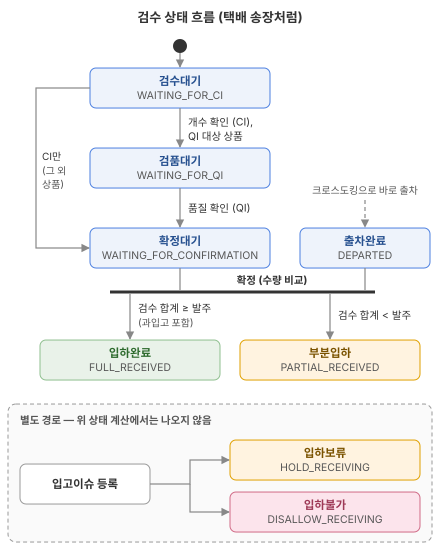
</figure>

시스템은 이 상태값을 보고 "다음에 뭘 해야 하는지" 판단합니다. 정상 흐름은 `검수대기 → 검품대기 → 확정대기 → 입고완료`이고, 품질검사(QI)에서 문제가 있으면 **보류(HOLD)** 나 **반려(DISALLOW)** 로, 일부만 정상이면 **부분입고(PARTIAL_RECEIVED)** 로 나뉩니다. (상태값 이름은 예시입니다.)

### ⑤ 인터페이스 테이블 = 시스템 사이의 우편함

한 시스템이 다른 시스템에 "이거 처리해 줘" 하고 데이터를 넘길 때, 중간에 **우편함 역할을 하는 테이블**을 배치합니다. 보내는 쪽이 편지를 넣으면, 받는 쪽이 하나씩 가져와 처리한 뒤 상태를 "처리 완료"로 변경합니다.

<details>
<summary>SVG 코드</summary>

```svg
<svg xmlns="http://www.w3.org/2000/svg" width="440" height="340" viewBox="0 0 440 340" font-family="-apple-system, 'Segoe UI', 'Noto Sans KR', sans-serif">
<defs><marker id="ah" viewBox="0 0 10 10" refX="9" refY="5" markerWidth="7" markerHeight="7" orient="auto-start-reverse"><path d="M0,0 L10,5 L0,10 z" fill="#888"/></marker></defs>
<rect x="0" y="0" width="440" height="340" fill="#FFFFFF"/>
<rect x="15" y="16" width="120" height="40" rx="6" fill="#EEF3FB" stroke="#4C7FE0"/>
<text x="75" y="33" font-size="11.5" fill="#26508F" text-anchor="middle" font-weight="bold">시스템 A</text>
<text x="75" y="48" font-size="10.5" fill="#555" text-anchor="middle">(입고 관제)</text>
<path d="M160,21 V53 A60.0,7 0 0 0 280,53 V21" fill="#FFF3E0" stroke="#E0A000"/>
<ellipse cx="220.0" cy="21" rx="60.0" ry="7" fill="#FFF3E0" stroke="#E0A000"/>
<text x="220" y="41" font-size="11.5" fill="#7A5200" text-anchor="middle" font-weight="bold">인터페이스 테이블</text>
<text x="220" y="56" font-size="10.5" fill="#555" text-anchor="middle">(우편함)</text>
<rect x="305" y="16" width="120" height="40" rx="6" fill="#FCE4EC" stroke="#D06A86"/>
<text x="365" y="33" font-size="11.5" fill="#9E3A57" text-anchor="middle" font-weight="bold">시스템 B</text>
<text x="365" y="48" font-size="10.5" fill="#555" text-anchor="middle">(창고 WMS)</text>
<line x1="75" y1="60" x2="75" y2="326" stroke="#BBBBBB" stroke-dasharray="4 3"/>
<line x1="220" y1="60" x2="220" y2="326" stroke="#BBBBBB" stroke-dasharray="4 3"/>
<line x1="365" y1="60" x2="365" y2="326" stroke="#BBBBBB" stroke-dasharray="4 3"/>
<line x1="75" y1="104" x2="219" y2="104" stroke="#888" stroke-width="1.2" marker-end="url(#ah)"/>
<text x="147.5" y="85" font-size="10" fill="#333" text-anchor="middle">편지 넣기</text>
<text x="147.5" y="98" font-size="10" fill="#333" text-anchor="middle">(적치 지시, 상태 '대기')</text>
<circle cx="87" cy="116" r="8" fill="#4C7FE0"/>
<text x="87" y="119.5" font-size="10" fill="#FFFFFF" text-anchor="middle" font-weight="bold">1</text>
<line x1="365" y1="160" x2="221" y2="160" stroke="#888" stroke-width="1.2" marker-end="url(#ah)"/>
<text x="292.5" y="141" font-size="10" fill="#333" text-anchor="middle">편지 가져오기</text>
<text x="292.5" y="154" font-size="10" fill="#333" text-anchor="middle">(주기적으로 확인)</text>
<circle cx="353" cy="172" r="8" fill="#4C7FE0"/>
<text x="353" y="175.5" font-size="10" fill="#FFFFFF" text-anchor="middle" font-weight="bold">2</text>
<polyline points="365,196 395,196 395,222 366,222" fill="none" stroke="#888" stroke-width="1.2" marker-end="url(#ah)"/>
<text x="357" y="202" font-size="10" fill="#333" text-anchor="end">처리</text>
<text x="357" y="215" font-size="10" fill="#333" text-anchor="end">(실제 재고 생성)</text>
<circle cx="410" cy="209" r="8" fill="#4C7FE0"/>
<text x="410" y="212.5" font-size="10" fill="#FFFFFF" text-anchor="middle" font-weight="bold">3</text>
<line x1="365" y1="262" x2="221" y2="262" stroke="#888" stroke-width="1.2" marker-end="url(#ah)"/>
<text x="292.5" y="256" font-size="10" fill="#333" text-anchor="middle">상태 '완료'로 변경</text>
<circle cx="353" cy="274" r="8" fill="#4C7FE0"/>
<text x="353" y="277.5" font-size="10" fill="#FFFFFF" text-anchor="middle" font-weight="bold">4</text>
<line x1="75" y1="308" x2="219" y2="308" stroke="#888" stroke-width="1.2" marker-end="url(#ah)"/>
<text x="147.5" y="289" font-size="10" fill="#333" text-anchor="middle">상태 조회 →</text>
<text x="147.5" y="302" font-size="10" fill="#333" text-anchor="middle">처리됐는지 확인</text>
<circle cx="87" cy="320" r="8" fill="#4C7FE0"/>
<text x="87" y="323.5" font-size="10" fill="#FFFFFF" text-anchor="middle" font-weight="bold">5</text>
</svg>
```

</details>

<figure style={{textAlign: 'center', margin: '1.5rem 0'}}>
  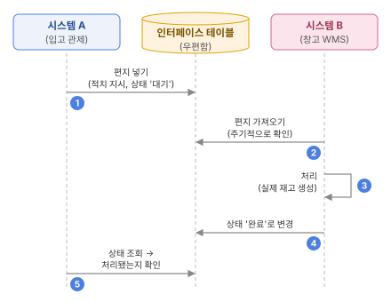
</figure>

<mark>다음과 같은 비유로 생각하면 SCM 데이터 구조가 쉽게 이해됩니다.</mark>

- **테이블** = 엑셀 시트
- **헤더–라인** = 영수증
- **마스터–트랜잭션** = 사전과 일기
- **상태값** = 택배 송장
- **인터페이스 테이블** = 우편함

## 시스템끼리 통신하는 법 — 전화 vs 게시판

시스템 A가 시스템 B에게 일을 시키는 방법은 크게 두 가지입니다. 이 차이가 중요합니다.

- **직접 전화하기 — REST(동기 호출)**: A가 B에게 전화해 "이거 지금 해 줘" 하고 **답을 기다립니다.** 즉시 결과가 필요할 때 사용합니다. 예: 입고팀 → 창고팀 "이 상품 적치돼서 재고 생겼어? 성공/실패 알려 줘".
- **게시판에 공지하기 — Kafka(비동기 이벤트)**: A가 "발주가 확정됐다!"라는 **공지(메시지)** 를 게시판에 붙이면, 관심 있는 시스템들이 각자 편한 때에 보고 반응합니다. A는 답을 기다리지 않습니다. 예: 구매팀이 "발주 확정!"을 게시 → 입고팀이 보고 입고예정을 만듦.

<mark>즉시 성공/실패 답이 필요하면 전화(REST), 그냥 알리고 각자 처리하게 하려면 게시판 공지(Kafka)입니다 — 물리 재고 생성처럼 실시간 검증이 필요한 명령은 REST, 발주 확정처럼 느슨히 전파하는 사건은 Kafka.</mark> 메시지 발행과 구독의 원리는 [Kafka는 왜 빠른가](./kafka-why-fast)에서, 동기, 비동기 선택 기준은 [메시지 큐 선택](./message-queue-comparison)에서 정리했습니다.

## 상품이 처리되는 과정 — 우유 100박스 따라가기 ★

이제 실제로 상품 하나가 시스템들을 어떻게 통과하는지, **우유 100박스**로 처음부터 끝까지 따라가 봅니다.

<details>
<summary>SVG 코드</summary>

```svg
<svg xmlns="http://www.w3.org/2000/svg" width="440" height="590" viewBox="0 0 440 590" font-family="-apple-system, 'Segoe UI', 'Noto Sans KR', sans-serif">
<defs><marker id="ah" viewBox="0 0 10 10" refX="9" refY="5" markerWidth="7" markerHeight="7" orient="auto-start-reverse"><path d="M0,0 L10,5 L0,10 z" fill="#888"/></marker></defs>
<rect x="0" y="0" width="440" height="590" fill="#FFFFFF"/>
<text x="220.0" y="22" font-size="13" fill="#333" text-anchor="middle" font-weight="bold">상품 처리 과정 — 우유 100박스</text>
<circle cx="220" cy="44" r="7" fill="#333"/>
<line x1="220" y1="51" x2="220" y2="59" stroke="#888" stroke-width="1.2" marker-end="url(#ah)"/>
<rect x="30" y="60" width="380" height="30" rx="6" fill="#EEF3FB" stroke="#4C7FE0"/>
<text x="220.0" y="79.0" font-size="11" fill="#333" text-anchor="middle">① 발주 — 공급사에 "우유 100박스" 주문</text>
<line x1="220" y1="90" x2="220" y2="105" stroke="#888" stroke-width="1.2" marker-end="url(#ah)"/>
<rect x="30" y="106" width="380" height="30" rx="6" fill="#EEF3FB" stroke="#4C7FE0"/>
<text x="220.0" y="125.0" font-size="11" fill="#333" text-anchor="middle">② 입고 예약 — 그날 창고 수용량(Capacity) 확인, 예약</text>
<line x1="220" y1="136" x2="220" y2="151" stroke="#888" stroke-width="1.2" marker-end="url(#ah)"/>
<rect x="30" y="152" width="380" height="30" rx="6" fill="#EEF3FB" stroke="#4C7FE0"/>
<text x="220.0" y="171.0" font-size="11" fill="#333" text-anchor="middle">③ 도착 — 트럭이 물류센터 도착</text>
<line x1="220" y1="182" x2="220" y2="197" stroke="#888" stroke-width="1.2" marker-end="url(#ah)"/>
<rect x="30" y="198" width="380" height="44" rx="6" fill="#EEF3FB" stroke="#4C7FE0"/>
<text x="220.0" y="216.5" font-size="11" fill="#333" text-anchor="middle">④ 검수 — 개수(CI), 품질(QI) 확인</text>
<text x="220.0" y="231.5" font-size="11" fill="#333" text-anchor="middle">95 정상 / 5 불량, 귀책 판정</text>
<line x1="220" y1="242" x2="220" y2="259" stroke="#888" stroke-width="1.2" marker-end="url(#ah)"/>
<polygon points="220,260 280,282 220,304 160,282" fill="#FFF3E0" stroke="#E0A000"/>
<text x="220" y="286" font-size="11" fill="#333" text-anchor="middle" font-weight="bold">검수 결과?</text>
<polyline points="160,282 120,282 120,335" fill="none" stroke="#888" stroke-width="1.2" marker-end="url(#ah)"/>
<text x="112" y="312" font-size="10.5" fill="#2E6B2E" text-anchor="end" font-weight="bold">정상 95박스</text>
<polyline points="280,282 330,282 330,335" fill="none" stroke="#888" stroke-width="1.2" marker-end="url(#ah)"/>
<text x="338" y="312" font-size="10.5" fill="#9E3A57" text-anchor="start" font-weight="bold">불량 5박스</text>
<rect x="22" y="336" width="196" height="30" rx="6" fill="#E9F2E9" stroke="#8FBF8F"/>
<text x="120.0" y="355.0" font-size="11" fill="#333" text-anchor="middle">⑤ 적치 지시 (논리 입고)</text>
<line x1="120" y1="366" x2="120" y2="381" stroke="#888" stroke-width="1.2" marker-end="url(#ah)"/>
<rect x="22" y="382" width="196" height="30" rx="6" fill="#E9F2E9" stroke="#8FBF8F"/>
<text x="120.0" y="401.0" font-size="11" fill="#333" text-anchor="middle">⑥ 창고 물리재고 생성 (WMS)</text>
<rect x="246" y="336" width="168" height="30" rx="6" fill="#FCE4EC" stroke="#D06A86"/>
<text x="330.0" y="355.0" font-size="11" fill="#333" text-anchor="middle">반품 / 회송 / 폐기</text>
<polyline points="120,412 120,438 212,438" fill="none" stroke="#888" stroke-width="1.2"/>
<polyline points="330,366 330,438 228,438" fill="none" stroke="#888" stroke-width="1.2"/>
<polygon points="220,430 228,438 220,446 212,438" fill="#FFF3E0" stroke="#E0A000"/>
<line x1="220" y1="446" x2="220" y2="461" stroke="#888" stroke-width="1.2" marker-end="url(#ah)"/>
<rect x="30" y="462" width="380" height="30" rx="6" fill="#EEF3FB" stroke="#4C7FE0"/>
<text x="220.0" y="481.0" font-size="11" fill="#333" text-anchor="middle">⑦ 입고 확정 — 실입고 95박스 통보</text>
<line x1="220" y1="492" x2="220" y2="507" stroke="#888" stroke-width="1.2" marker-end="url(#ah)"/>
<rect x="30" y="508" width="380" height="30" rx="6" fill="#EEF3FB" stroke="#4C7FE0"/>
<text x="220.0" y="527.0" font-size="11" fill="#333" text-anchor="middle">⑧ 정산 — 실입고금액 − 위약금 − 반품 + 장려금</text>
<line x1="220" y1="538" x2="220" y2="556" stroke="#888" stroke-width="1.2" marker-end="url(#ah)"/>
<circle cx="220" cy="566" r="9" fill="#FFFFFF" stroke="#333" stroke-width="1.5"/>
<circle cx="220" cy="566" r="5" fill="#333"/>
</svg>
```

</details>

<figure style={{textAlign: 'center', margin: '1.5rem 0'}}>
  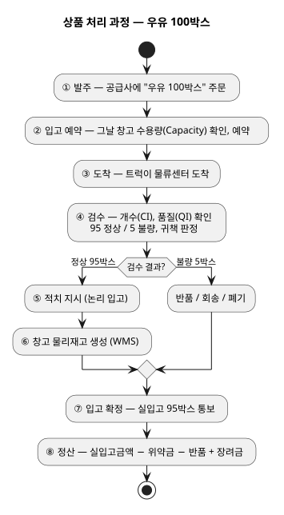
</figure>

같은 흐름을 층별 물류센터 모형으로 보면 다음과 같습니다. 1층에서 입차, 하차, 검수를 거쳐 정상 박스는 2층 냉장존에 적치하고, 4층 사무실에서 받은 수량으로 정산합니다. 이어서 주문이 들어오면 피킹, 포장, 상차를 거쳐 출고합니다.

<AnatomyEmbed name="scm-milk-flow" title="1층 입차와 검수, 2층 적치, 4층 정산, 피킹과 포장을 거쳐 출고 트럭에 싣는 층별 물류센터 모형" />

### 1. 주문한다 — 발주 (구매, 정산 시스템)

구매 담당자가 공급사에 "우유 100박스, 10월 22일까지 물류센터로 넣어 주세요" 주문합니다.

- **생기는 데이터**: 발주 헤더(공급사, 예정일, 센터) + 발주 라인(우유 100박스와 단가)
- **왜**: 나중에 "얼마 주문했는지"가 정산의 기준이 됩니다. 실제로 몇 개 받았는지와 비교해야 하니까요.
- 발주가 확정되면 **"발주 확정!"을 게시판에 공지합니다(Kafka).**

### 2. 받을 준비를 한다 — 입고 예약, Capacity (입고 관제 시스템)

입고팀 시스템이 그 공지를 보고 "10월 22일에 우유 100박스가 온다"를 자기 장부에 적습니다. 그리고 **Capacity 예약**을 합니다.

- **Capacity란?**: 창고는 하루에 받아 처리할 수 있는 양이 정해져 있습니다(사람, 공간, 시간 한계). 이 **"하루 입고 처리 능력"** 을 **Capacity(수용량)**, 현업에선 줄여서 **CAPA**라고 합니다.
- 그날 물류센터가 하루 1,000박스까지 받는데 이미 950박스가 예약됐다면, 우유 100박스는 **공간이 없어 거부**될 수 있습니다. 그래서 발주가 오면 먼저 그 날짜의 남은 수용량을 확인하고 공간을 **예약**합니다. 식당 예약과 똑같습니다.
- **왜**: 창고가 처리하지 못할 만큼 물건이 몰리는 것을 막기 위해서입니다.

### 3. 트럭이 온다 — 도착 (입고 관제 시스템)

트럭이 물류센터에 도착하면 도착 시각을 기록합니다. "예정보다 늦게 왔나", "언제 검수 시작하나"를 알기 위해서입니다.

### 4. 실제로 100박스 맞나 확인한다 — 검수 (입고 관제 / 반품, 정리 시스템)

직원이 박스를 열어 확인합니다. 검수는 두 종류입니다.

- **CI(계수검사)**: 개수가 맞나? (100박스 맞나?)
- **QI(품질검사)**: 상태가 괜찮나? (상한 건 없나, 유통기한 넉넉한가?)

확인 결과 **95박스는 정상, 5박스는 상함**이라고 합시다.

- **생기는 데이터**: 검수 헤더 + 검수 라인(정상 95, 불량 5, 상태값) + 불량 사유별 상세
- **귀책 판정**: 상한 5박스가 **누구의 책임인지**를 정합니다. 공급사가 상한 걸 보냈으면 **공급사 귀책**(공급사가 부담), 창고에서 옮기다 떨어뜨렸으면 **자사 귀책**(자사 손실). 이 판정이 나중에 **정산에서 누가 돈을 부담할지**를 정합니다.
- **왜**: 정확히 몇 개를, 어떤 상태로 받았는지가 재고와 정산의 근거이기 때문입니다.

### 5-A. 정상 95박스 → 논리 입고 vs 물리 입고

정상 95박스는 창고에 넣어야 합니다. 여기서 **가장 중요한 구분**이 나옵니다.

- **논리 입고 (입고 관제 시스템)**: "우유 95박스를 냉장존 A-01 칸에 넣어라"는 **지시, 계획**을 만듭니다. 서류상의 입고입니다.
- **물리 입고 (창고 관리 시스템, WMS)**: 그 지시를 받아 **실제 창고 재고**를 만듭니다. "A-01 칸에 우유 95개가 실제로 있다"는 사실입니다.

입고 관제 시스템이 창고 시스템에 **REST로 호출**해 "우유 95박스, A-01 칸에 넣어. 됐어?" 하고 지시하면, 창고 시스템이 실제 재고를 만들고 결과를 답합니다. 이때 **로트(Lot)** 단위로 재고를 관리합니다.

- **로트(Lot)란?**: 같은 제조일과 유통기한을 가진 상품 집합입니다. 10/22 들어온 우유와 10/29 들어온 우유는 유통기한이 다르니 **다른 로트**로 관리합니다. 그래야 오래된 것부터 내보낼 수 있습니다.

이제 **우유 95박스가 재고가 됐습니다.**

### 5-B. 불량 5박스 → 반품 / 회송 / 폐기 (반품, 정리 시스템)

상한 5박스는 창고에 보관할 수 없으니 처리합니다. 세 가지이고, 헷갈리기 쉬워 표로 정리합니다.

| 구분 | 뜻 | 예 |
|---|---|---|
| **반품(Return)** | 공급사에 "문제 있어요, 돌려줄게요" 접수하는 **절차(서류상 결정)** | 상한 우유 5박스 반품 접수 |
| **회송(RTS)** | 실제로 공급사(또는 다른 센터)로 **물건을 되돌려 보내는 물류 행위** | 반품 접수된 우유를 트럭에 실어 보냄 |
| **폐기(Scrap)** | 돌려보낼 수도 없어 **버리는 것**(재고 제거 + 손실 처리) | 완전히 상해 반품 불가한 우유 폐기 |

"반품은 서류상 결정, 회송은 실제 이동, 폐기는 버림"으로 기억하면 됩니다. 불량품이 재고에 포함되면 안 되고, 그 손실을 **정산에 반영**해야 하기 때문에 따로 처리합니다.

### 6. 결과를 구매팀에 알린다 — 입고 확정 (입고 관제 → 구매, 정산 시스템)

"우유는 주문 100박스 중 95박스 입고, 5박스 불량(공급사 귀책)"이라는 결과를 구매팀 시스템에 **게시판 공지(Kafka)** 로 알립니다. 정산은 **실제로 받은 수량** 기준으로 계산하기 때문입니다.

### 7. 돈을 계산한다 — 정산 (구매, 정산 시스템)

월말에 공급사에 줄 돈을 계산합니다. 단순히 "95박스 × 단가"가 아니라 여러 가감이 있습니다.

```
공급사에 줄 돈 =
    실입고금액        (95박스 × 단가)
  + 성장장려금        (많이 납품해 성장하면 주는 인센티브)
  − 미입고위약금      (주문 100 − 실입고 95 = 5박스 못 채운 것에 대한 벌점 성격 금액)
  − 반품 금액         (불량으로 돌려보낸 값)
```

이 규칙들(대상 여부, 비율)은 공급사마다 미리 설정돼 있어, 정산할 때 가져와 적용합니다. 결과로 거래명세서, 세금계산서를 만들고 대금을 지급합니다.

<mark>정산의 핵심은 "주문한 값이 아니라 실제로 받은 값 기준"이라는 점입니다 — 그래서 검수에서 정확히 몇 개를 어떤 귀책으로 받았는지가 곧바로 돈으로 이어집니다.</mark>

## 데이터 구조 한눈에 — 테이블과 컬럼 관계

앞 이야기에 나온 테이블들이 어떤 **컬럼으로 서로를 참조**하는지 봅니다. 각 컬럼은 **물리명(논리명)** 표기이고, **`PK`** 는 그 표를 식별하는 대표 컬럼, **`FK`** 는 다른 표를 가리키는 참조 컬럼입니다. 화살표는 **1:N 관계**(부모 1건 → 자식 여러 건)이고, 라벨이 연결에 쓰이는 컬럼입니다. 한 장에 다 넣으면 너무 커서 **공급사, 발주 / 검수 / 입고, 재고, 상품** 세 장으로 나눴고, **회색 상자**는 다른 장에 상세히 있는 연결 테이블입니다. (이름은 예시입니다.)

**① 공급사, 발주**

<details>
<summary>SVG 코드</summary>

```svg
<svg xmlns="http://www.w3.org/2000/svg" width="480" height="494" viewBox="0 0 480 494" font-family="-apple-system, 'Segoe UI', 'Noto Sans KR', sans-serif">
<defs><marker id="ah" viewBox="0 0 10 10" refX="9" refY="5" markerWidth="7" markerHeight="7" orient="auto-start-reverse"><path d="M0,0 L10,5 L0,10 z" fill="#888"/></marker></defs>
<rect x="0" y="0" width="480" height="494" fill="#FFFFFF"/>
<text x="240.0" y="22" font-size="13" fill="#333" text-anchor="middle" font-weight="bold">① 공급사, 발주 — 물리명(논리명), 1:N 관계, 라벨=참조 컬럼</text>
<rect x="140" y="40" width="200" height="84" rx="4" fill="#FFFFFF" stroke="#4C7FE0"/>
<path d="M140,80 V44 Q140,40 144,40 H336 Q340,40 340,44 V80 Z" fill="#EEF3FB" stroke="#4C7FE0"/>
<text x="240.0" y="57" font-size="11.5" fill="#26508F" text-anchor="middle" font-weight="bold">supplier</text>
<text x="240.0" y="72" font-size="10" fill="#555" text-anchor="middle">공급사 마스터</text>
<text x="150" y="96" font-size="10.5" fill="#333" text-anchor="start">supplier_id(공급사코드)</text>
<text x="330" y="96" font-size="9.5" fill="#B07A00" text-anchor="end" font-weight="bold">PK</text>
<text x="150" y="114" font-size="10.5" fill="#333" text-anchor="start">name(공급사명)</text>
<rect x="130" y="174" width="220" height="102" rx="4" fill="#FFFFFF" stroke="#4C7FE0"/>
<path d="M130,214 V178 Q130,174 134,174 H346 Q350,174 350,178 V214 Z" fill="#EEF3FB" stroke="#4C7FE0"/>
<text x="240.0" y="191" font-size="11.5" fill="#26508F" text-anchor="middle" font-weight="bold">purchase_order</text>
<text x="240.0" y="206" font-size="10" fill="#555" text-anchor="middle">발주 헤더</text>
<text x="140" y="230" font-size="10.5" fill="#333" text-anchor="start">purchase_order_code(발주번호)</text>
<text x="340" y="230" font-size="9.5" fill="#B07A00" text-anchor="end" font-weight="bold">PK</text>
<text x="140" y="248" font-size="10.5" fill="#333" text-anchor="start">supplier_id(공급사)</text>
<text x="340" y="248" font-size="9.5" fill="#9E3A57" text-anchor="end" font-weight="bold">FK</text>
<text x="140" y="266" font-size="10.5" fill="#333" text-anchor="start">receiving_expected_date(입고예정일)</text>
<line x1="240" y1="124" x2="240" y2="173" stroke="#888" stroke-width="1.2" marker-end="url(#ah)"/>
<text x="246" y="153.0" font-size="10" fill="#26508F" text-anchor="start">supplier_id</text>
<text x="234" y="137" font-size="10" fill="#777" text-anchor="end" font-weight="bold">1</text>
<text x="234" y="169" font-size="10" fill="#777" text-anchor="end" font-weight="bold">N</text>
<rect x="16" y="340" width="224" height="138" rx="4" fill="#FFFFFF" stroke="#4C7FE0"/>
<path d="M16,380 V344 Q16,340 20,340 H236 Q240,340 240,344 V380 Z" fill="#EEF3FB" stroke="#4C7FE0"/>
<text x="128.0" y="357" font-size="11.5" fill="#26508F" text-anchor="middle" font-weight="bold">purchase_order_item</text>
<text x="128.0" y="372" font-size="10" fill="#555" text-anchor="middle">발주 라인</text>
<text x="26" y="396" font-size="10.5" fill="#333" text-anchor="start">id(식별자)</text>
<text x="230" y="396" font-size="9.5" fill="#B07A00" text-anchor="end" font-weight="bold">PK</text>
<text x="26" y="414" font-size="10.5" fill="#333" text-anchor="start">purchase_order_code(발주참조)</text>
<text x="230" y="414" font-size="9.5" fill="#9E3A57" text-anchor="end" font-weight="bold">FK</text>
<text x="26" y="432" font-size="10.5" fill="#333" text-anchor="start">goods_id(상품)</text>
<text x="230" y="432" font-size="9.5" fill="#9E3A57" text-anchor="end" font-weight="bold">FK</text>
<text x="26" y="450" font-size="10.5" fill="#333" text-anchor="start">order_qty(주문수량)</text>
<text x="26" y="468" font-size="10.5" fill="#333" text-anchor="start">price(단가)</text>
<rect x="264" y="340" width="200" height="40" rx="4" fill="#EEEEEE" stroke="#999999"/>
<text x="364.0" y="357" font-size="11.5" fill="#555" text-anchor="middle" font-weight="bold">inspection_header</text>
<text x="364.0" y="372" font-size="10" fill="#777" text-anchor="middle">검수 헤더 (② 다이어그램)</text>
<line x1="150" y1="276" x2="150" y2="339" stroke="#888" stroke-width="1.2" marker-end="url(#ah)"/>
<text x="144" y="312.0" font-size="10" fill="#26508F" text-anchor="end">purchase_order_code</text>
<text x="156" y="289" font-size="10" fill="#777" text-anchor="start" font-weight="bold">1</text>
<text x="156" y="335" font-size="10" fill="#777" text-anchor="start" font-weight="bold">N</text>
<line x1="330" y1="276" x2="330" y2="339" stroke="#888" stroke-width="1.2" marker-end="url(#ah)"/>
<text x="336" y="312.0" font-size="10" fill="#26508F" text-anchor="start">purchase_order_code</text>
<text x="324" y="289" font-size="10" fill="#777" text-anchor="end" font-weight="bold">1</text>
<text x="324" y="335" font-size="10" fill="#777" text-anchor="end" font-weight="bold">N</text>
</svg>
```

</details>

<figure style={{textAlign: 'center', margin: '1.5rem 0'}}>
  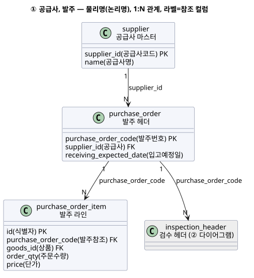
</figure>

**② 검수**

<details>
<summary>SVG 코드</summary>

```svg
<svg xmlns="http://www.w3.org/2000/svg" width="480" height="468" viewBox="0 0 480 468" font-family="-apple-system, 'Segoe UI', 'Noto Sans KR', sans-serif">
<defs><marker id="ah" viewBox="0 0 10 10" refX="9" refY="5" markerWidth="7" markerHeight="7" orient="auto-start-reverse"><path d="M0,0 L10,5 L0,10 z" fill="#888"/></marker></defs>
<rect x="0" y="0" width="480" height="468" fill="#FFFFFF"/>
<text x="240.0" y="22" font-size="13" fill="#333" text-anchor="middle" font-weight="bold">② 검수 — 물리명(논리명), 1:N 관계, 라벨=참조 컬럼</text>
<rect x="140" y="40" width="200" height="40" rx="4" fill="#EEEEEE" stroke="#999999"/>
<text x="240.0" y="57" font-size="11.5" fill="#555" text-anchor="middle" font-weight="bold">purchase_order</text>
<text x="240.0" y="72" font-size="10" fill="#777" text-anchor="middle">발주 헤더 (① 다이어그램)</text>
<rect x="130" y="130" width="220" height="102" rx="4" fill="#FFFFFF" stroke="#4C7FE0"/>
<path d="M130,170 V134 Q130,130 134,130 H346 Q350,130 350,134 V170 Z" fill="#EEF3FB" stroke="#4C7FE0"/>
<text x="240.0" y="147" font-size="11.5" fill="#26508F" text-anchor="middle" font-weight="bold">inspection_header</text>
<text x="240.0" y="162" font-size="10" fill="#555" text-anchor="middle">검수 헤더</text>
<text x="140" y="186" font-size="10.5" fill="#333" text-anchor="start">id(검수번호)</text>
<text x="340" y="186" font-size="9.5" fill="#B07A00" text-anchor="end" font-weight="bold">PK</text>
<text x="140" y="204" font-size="10.5" fill="#333" text-anchor="start">purchase_order_code(발주참조)</text>
<text x="340" y="204" font-size="9.5" fill="#9E3A57" text-anchor="end" font-weight="bold">FK</text>
<text x="140" y="222" font-size="10.5" fill="#333" text-anchor="start">status(상태)</text>
<line x1="240" y1="80" x2="240" y2="129" stroke="#888" stroke-width="1.2" marker-end="url(#ah)"/>
<text x="246" y="109.0" font-size="10" fill="#26508F" text-anchor="start">purchase_order_code</text>
<text x="234" y="93" font-size="10" fill="#777" text-anchor="end" font-weight="bold">1</text>
<text x="234" y="125" font-size="10" fill="#777" text-anchor="end" font-weight="bold">N</text>
<rect x="16" y="296" width="224" height="156" rx="4" fill="#FFFFFF" stroke="#4C7FE0"/>
<path d="M16,336 V300 Q16,296 20,296 H236 Q240,296 240,300 V336 Z" fill="#EEF3FB" stroke="#4C7FE0"/>
<text x="128.0" y="313" font-size="11.5" fill="#26508F" text-anchor="middle" font-weight="bold">inspection_line</text>
<text x="128.0" y="328" font-size="10" fill="#555" text-anchor="middle">검수 라인</text>
<text x="26" y="352" font-size="10.5" fill="#333" text-anchor="start">id(식별자)</text>
<text x="230" y="352" font-size="9.5" fill="#B07A00" text-anchor="end" font-weight="bold">PK</text>
<text x="26" y="370" font-size="10.5" fill="#333" text-anchor="start">inspection_header_id(검수참조)</text>
<text x="230" y="370" font-size="9.5" fill="#9E3A57" text-anchor="end" font-weight="bold">FK</text>
<text x="26" y="388" font-size="10.5" fill="#333" text-anchor="start">goods_id(상품)</text>
<text x="230" y="388" font-size="9.5" fill="#9E3A57" text-anchor="end" font-weight="bold">FK</text>
<text x="26" y="406" font-size="10.5" fill="#333" text-anchor="start">normal_qty(정상수량)</text>
<text x="26" y="424" font-size="10.5" fill="#333" text-anchor="start">defect_qty(불량수량)</text>
<text x="26" y="442" font-size="10.5" fill="#333" text-anchor="start">owner(귀책)</text>
<rect x="264" y="296" width="200" height="40" rx="4" fill="#EEEEEE" stroke="#999999"/>
<text x="364.0" y="313" font-size="11.5" fill="#555" text-anchor="middle" font-weight="bold">receiving_transaction</text>
<text x="364.0" y="328" font-size="10" fill="#777" text-anchor="middle">입고 라인 (③ 다이어그램)</text>
<line x1="150" y1="232" x2="150" y2="295" stroke="#888" stroke-width="1.2" marker-end="url(#ah)"/>
<text x="144" y="268.0" font-size="10" fill="#26508F" text-anchor="end">inspection_header_id</text>
<text x="156" y="245" font-size="10" fill="#777" text-anchor="start" font-weight="bold">1</text>
<text x="156" y="291" font-size="10" fill="#777" text-anchor="start" font-weight="bold">N</text>
<line x1="330" y1="232" x2="330" y2="295" stroke="#888" stroke-width="1.2" marker-end="url(#ah)"/>
<text x="336" y="268.0" font-size="10" fill="#26508F" text-anchor="start">inspection_header_id</text>
<text x="324" y="245" font-size="10" fill="#777" text-anchor="end" font-weight="bold">1</text>
<text x="324" y="291" font-size="10" fill="#777" text-anchor="end" font-weight="bold">N</text>
</svg>
```

</details>

<figure style={{textAlign: 'center', margin: '1.5rem 0'}}>
  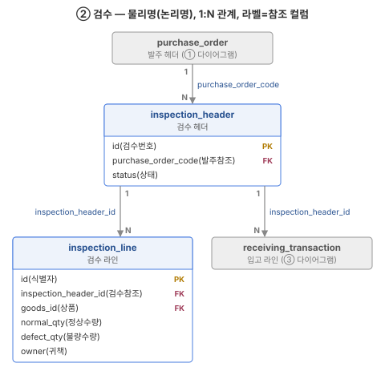
</figure>

**③ 입고, 재고, 상품**

<details>
<summary>SVG 코드</summary>

```svg
<svg xmlns="http://www.w3.org/2000/svg" width="480" height="384" viewBox="0 0 480 384" font-family="-apple-system, 'Segoe UI', 'Noto Sans KR', sans-serif">
<defs><marker id="ah" viewBox="0 0 10 10" refX="9" refY="5" markerWidth="7" markerHeight="7" orient="auto-start-reverse"><path d="M0,0 L10,5 L0,10 z" fill="#888"/></marker></defs>
<rect x="0" y="0" width="480" height="384" fill="#FFFFFF"/>
<text x="240.0" y="22" font-size="13" fill="#333" text-anchor="middle" font-weight="bold">③ 입고, 재고, 상품 — 물리명(논리명), 1:N 관계, 라벨=참조 컬럼</text>
<rect x="16" y="40" width="224" height="40" rx="4" fill="#EEEEEE" stroke="#999999"/>
<text x="128.0" y="57" font-size="11.5" fill="#555" text-anchor="middle" font-weight="bold">inspection_header</text>
<text x="128.0" y="72" font-size="10" fill="#777" text-anchor="middle">검수 헤더 (② 다이어그램)</text>
<rect x="264" y="40" width="200" height="102" rx="4" fill="#FFFFFF" stroke="#4C7FE0"/>
<path d="M264,80 V44 Q264,40 268,40 H460 Q464,40 464,44 V80 Z" fill="#EEF3FB" stroke="#4C7FE0"/>
<text x="364.0" y="57" font-size="11.5" fill="#26508F" text-anchor="middle" font-weight="bold">goods</text>
<text x="364.0" y="72" font-size="10" fill="#555" text-anchor="middle">상품 마스터</text>
<text x="274" y="96" font-size="10.5" fill="#333" text-anchor="start">id(상품코드)</text>
<text x="454" y="96" font-size="9.5" fill="#B07A00" text-anchor="end" font-weight="bold">PK</text>
<text x="274" y="114" font-size="10.5" fill="#333" text-anchor="start">name(상품명)</text>
<text x="274" y="132" font-size="10.5" fill="#333" text-anchor="start">unit(단위)</text>
<rect x="16" y="212" width="224" height="138" rx="4" fill="#FFFFFF" stroke="#4C7FE0"/>
<path d="M16,252 V216 Q16,212 20,212 H236 Q240,212 240,216 V252 Z" fill="#EEF3FB" stroke="#4C7FE0"/>
<text x="128.0" y="229" font-size="11.5" fill="#26508F" text-anchor="middle" font-weight="bold">receiving_transaction</text>
<text x="128.0" y="244" font-size="10" fill="#555" text-anchor="middle">입고 라인</text>
<text x="26" y="268" font-size="10.5" fill="#333" text-anchor="start">id(식별자)</text>
<text x="230" y="268" font-size="9.5" fill="#B07A00" text-anchor="end" font-weight="bold">PK</text>
<text x="26" y="286" font-size="10.5" fill="#333" text-anchor="start">inspection_header_id(검수참조)</text>
<text x="230" y="286" font-size="9.5" fill="#9E3A57" text-anchor="end" font-weight="bold">FK</text>
<text x="26" y="304" font-size="10.5" fill="#333" text-anchor="start">goods_id(상품)</text>
<text x="230" y="304" font-size="9.5" fill="#9E3A57" text-anchor="end" font-weight="bold">FK</text>
<text x="26" y="322" font-size="10.5" fill="#333" text-anchor="start">actual_qty(실입고수량)</text>
<text x="26" y="340" font-size="10.5" fill="#333" text-anchor="start">price(단가)</text>
<rect x="264" y="212" width="200" height="156" rx="4" fill="#FFFFFF" stroke="#4C7FE0"/>
<path d="M264,252 V216 Q264,212 268,212 H460 Q464,212 464,216 V252 Z" fill="#EEF3FB" stroke="#4C7FE0"/>
<text x="364.0" y="229" font-size="11.5" fill="#26508F" text-anchor="middle" font-weight="bold">warehouse_stock</text>
<text x="364.0" y="244" font-size="10" fill="#555" text-anchor="middle">창고 재고</text>
<text x="274" y="268" font-size="10.5" fill="#333" text-anchor="start">id(식별자)</text>
<text x="454" y="268" font-size="9.5" fill="#B07A00" text-anchor="end" font-weight="bold">PK</text>
<text x="274" y="286" font-size="10.5" fill="#333" text-anchor="start">goods_id(상품)</text>
<text x="454" y="286" font-size="9.5" fill="#9E3A57" text-anchor="end" font-weight="bold">FK</text>
<text x="274" y="304" font-size="10.5" fill="#333" text-anchor="start">warehouse(창고)</text>
<text x="274" y="322" font-size="10.5" fill="#333" text-anchor="start">location(로케이션)</text>
<text x="274" y="340" font-size="10.5" fill="#333" text-anchor="start">lot(로트)</text>
<text x="274" y="358" font-size="10.5" fill="#333" text-anchor="start">qty(수량)</text>
<line x1="70" y1="80" x2="70" y2="211" stroke="#888" stroke-width="1.2" marker-end="url(#ah)"/>
<text x="76" y="150.0" font-size="10" fill="#26508F" text-anchor="start">inspection_header_id</text>
<text x="64" y="93" font-size="10" fill="#777" text-anchor="end" font-weight="bold">1</text>
<text x="64" y="207" font-size="10" fill="#777" text-anchor="end" font-weight="bold">N</text>
<line x1="290" y1="142" x2="222" y2="211" stroke="#888" stroke-width="1.2" marker-end="url(#ah)"/>
<text x="264" y="179.0" font-size="10" fill="#26508F" text-anchor="start">goods_id</text>
<text x="296" y="155" font-size="10" fill="#777" text-anchor="start" font-weight="bold">1</text>
<text x="212" y="207" font-size="10" fill="#777" text-anchor="end" font-weight="bold">N</text>
<line x1="420" y1="142" x2="420" y2="211" stroke="#888" stroke-width="1.2" marker-end="url(#ah)"/>
<text x="414" y="181.0" font-size="10" fill="#26508F" text-anchor="end">goods_id</text>
<text x="426" y="155" font-size="10" fill="#777" text-anchor="start" font-weight="bold">1</text>
<text x="426" y="207" font-size="10" fill="#777" text-anchor="start" font-weight="bold">N</text>
</svg>
```

</details>

<figure style={{textAlign: 'center', margin: '1.5rem 0'}}>
  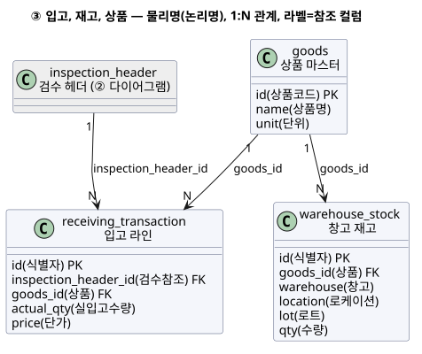
</figure>

> 세 그림은 **회색 상자**로 이어집니다 — **발주(①)** 가 `purchase_order_code`로 **검수(②)** 와, **검수(②)** 가 `inspection_header_id`로 **입고(③)** 와 연결됩니다. `goods_id`(상품 마스터)는 발주, 검수, 입고, 재고 여러 표가 공통으로 참조하는 컬럼이고, `id`는 각 표 자신의 대표 키(PK)입니다.

- **헤더–라인**: `purchase_order` 1건에 `purchase_order_item` 여러 줄(품목마다 한 줄).
- **연결 고리**: 발주번호, 상품(`goods_id`) 같은 값으로 검수, 입고, 재고가 서로를 참조합니다.
- **정산의 기준 컬럼**: 입고 라인의 `실입고수량`과 단가 — 여기서 최종 금액이 계산됩니다.

## 헷갈리는 개념 두 가지 더

### 창고의 구조 — 창고 > 존 > 로케이션 > 로트

창고 안의 위치는 건물 주소처럼 계층입니다. 존은 보관 온도로 나눈 구역으로, 냉동존(영하), 냉장존, 상온존이 대표적입니다.

<details>
<summary>SVG 코드</summary>

```svg
<svg xmlns="http://www.w3.org/2000/svg" width="440" height="268" viewBox="0 0 440 268" font-family="-apple-system, 'Segoe UI', 'Noto Sans KR', sans-serif">
<defs><marker id="ah" viewBox="0 0 10 10" refX="9" refY="5" markerWidth="7" markerHeight="7" orient="auto-start-reverse"><path d="M0,0 L10,5 L0,10 z" fill="#888"/></marker></defs>
<rect x="0" y="0" width="440" height="268" fill="#FFFFFF"/>
<rect x="16" y="14" width="170" height="30" rx="6" fill="#EEF3FB" stroke="#4C7FE0"/>
<text x="28" y="33.5" font-size="11.5" fill="#26508F" text-anchor="start" font-weight="bold">🏢 창고 (물류센터)</text>
<rect x="56" y="56" width="200" height="30" rx="6" fill="#EEF3FB" stroke="#4C7FE0"/>
<text x="68" y="75.5" font-size="11.5" fill="#26508F" text-anchor="start">❄️ 냉장존 (온도, 보관 구역)</text>
<rect x="96" y="98" width="236" height="30" rx="6" fill="#E9F2E9" stroke="#8FBF8F"/>
<text x="108" y="117.5" font-size="11.5" fill="#2E6B2E" text-anchor="start">🗄️ 로케이션 A-01-001 (선반 한 칸)</text>
<rect x="136" y="140" width="236" height="30" rx="6" fill="#FFF3E0" stroke="#E0A000"/>
<text x="148" y="159.5" font-size="11.5" fill="#7A5200" text-anchor="start">📦 로트 9/18 제조분 → 우유 95개</text>
<rect x="96" y="182" width="168" height="30" rx="6" fill="#E9F2E9" stroke="#8FBF8F"/>
<text x="108" y="201.5" font-size="11.5" fill="#2E6B2E" text-anchor="start">🗄️ 로케이션 A-01-002</text>
<rect x="56" y="224" width="100" height="30" rx="6" fill="#EEF3FB" stroke="#4C7FE0"/>
<text x="68" y="243.5" font-size="11.5" fill="#26508F" text-anchor="start">🌡️ 상온존</text>
<polyline points="36,44 36,71.0 56,71.0" fill="none" stroke="#999" stroke-width="1.2"/>
<polyline points="76,86 76,113.0 96,113.0" fill="none" stroke="#999" stroke-width="1.2"/>
<polyline points="116,128 116,155.0 136,155.0" fill="none" stroke="#999" stroke-width="1.2"/>
<polyline points="76,86 76,197.0 96,197.0" fill="none" stroke="#999" stroke-width="1.2"/>
<polyline points="36,44 36,239.0 56,239.0" fill="none" stroke="#999" stroke-width="1.2"/>
</svg>
```

</details>

<figure style={{textAlign: 'center', margin: '1.5rem 0'}}>
  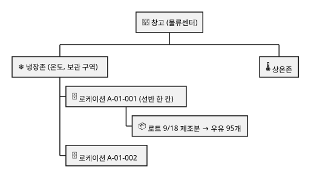
</figure>

아래 모형은 그림 1과 같은 센터에서 보관 위치만 따라간 것입니다(2층 냉장, 3층 냉동, 4층 상온). 창고, 존, 로케이션 A-01, 로트 순서로 좁혀 들어간 뒤, 확대창에서 같은 칸의 로트 두 개 중 유통기한이 이른 10/22 로트를 먼저 출고해 포장하고 출고 트럭에 싣습니다.

<AnatomyEmbed name="scm-warehouse" title="2층 냉장존, 3층 냉동존, 4층 상온존의 로케이션과 로트를 보여 주고, 유통기한이 이른 로트를 먼저 출고해 트럭에 싣는 층별 창고 모형" />

주문이 들어와 우유를 꺼낼 때, 시스템은 이 구조를 보고 "어느 칸에서 어떤 로트를 먼저 꺼낼지"(보통 유통기한이 임박한 것부터)를 정합니다.

### 왜 논리 입고와 물리 입고를 나눴나

입고 과정(검수, 귀책 판정)은 복잡하고 자주 바뀌지만, 창고 재고 관리(칸, 수량)는 정확하고 단순해야 합니다. 역할을 나누면 각자 잘하는 일에 집중할 수 있습니다. 그래서 입고 관제 시스템이 "지시"하고, 창고 시스템이 "실제 재고"를 만듭니다. 앞서 REST를 사용한 이유도 여기 있습니다 — 물리 재고 생성은 즉시 성공/실패를 확인해야 하니까요.

## 정리 — 전체 그림 다시 보기

- **SCM = 물건의 이동을 데이터로 따라 기록하고 정산하는 것.**
- **시스템은 역할별로 나뉜다**: 구매, 정산 / 입고 관제 / 창고(WMS) / 반품, 정리.
- **데이터는 다섯 패턴**: 테이블(엑셀), 헤더–라인(영수증), 마스터–트랜잭션(사전, 일기), 상태값(택배 송장), 인터페이스 테이블(우편함).
- **통신은 둘**: 즉시 답이 필요하면 REST(전화), 느슨히 알리면 Kafka(게시판 공지).
- **상품 처리 과정**: 발주 → Capacity 예약 → 도착 → 검수(CI, QI, 귀책) → 정상은 논리, 물리 입고로 재고화, 불량은 반품/회송/폐기 → 입고 확정 → 정산.
- **핵심 구분**: 논리 입고(지시, 계획) vs 물리 입고(실제 재고), 반품, 회송, 폐기, 정산은 실입고 기준.

처음엔 용어가 많아 복잡해 보이지만, **"현실의 물건 이동을 데이터로 따라 적는다"** 는 원리 하나만 이해하면 나머지는 그 안의 세부일 뿐입니다.

## 용어 한 줄 정리

| 용어 | 쉬운 뜻 |
|---|---|
| SCM | 공급망 관리. 발주\~입고\~재고\~반품\~정산 전 과정 |
| 발주(PO) | 공급사에 상품을 주문하는 것 |
| 입고 | 주문한 상품이 창고로 들어오는 것 |
| Capacity | 창고의 하루 입고 처리 능력(수용량). 초과 예약 거부 |
| 검수 / CI / QI | 들어온 상품 확인 / 개수 검사 / 품질 검사 |
| 귀책 | 불량의 책임이 공급사인지 자사인지 |
| 적치 | 검수 끝난 상품을 창고 칸에 넣는 것 |
| 논리 입고 / 물리 입고 | 지시, 계획(입고 관제) / 실제 창고 재고(WMS) |
| 로트(Lot) | 같은 제조일과 유통기한을 가진 상품 집합 |
| 창고 / 존 / 로케이션 | 상품 위치 계층(건물 → 구역 → 칸) |
| 반품 / 회송 / 폐기 | 문제 상품을: 돌려주기로 접수 / 실제로 되돌려 보냄 / 버림 |
| 정산 | 실제 받은 수량 기준으로 공급사에 대금 계산, 지급 |
| 성장장려금 / 미입고위약금 | 정산 가산(많이 납품) / 차감(주문보다 덜 옴) |
| 헤더 / 라인 | 거래 대표 정보 / 그 안 품목별 상세 |
| 마스터 / 트랜잭션 | 잘 안 바뀌는 기준 정보(사전) / 사건마다 쌓이는 기록(일기) |
| REST / Kafka | 전화(즉시 답) / 게시판 공지(붙여놓고 각자 확인) |
