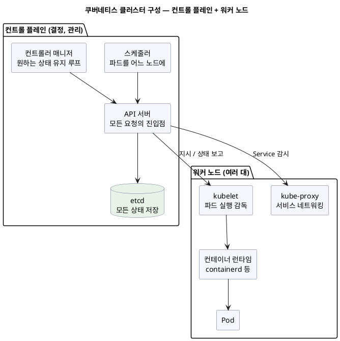
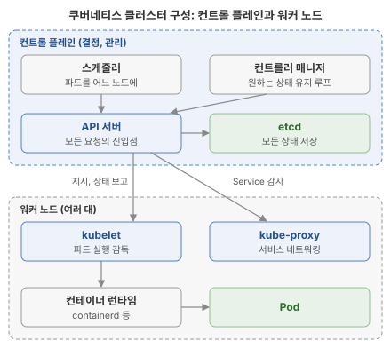
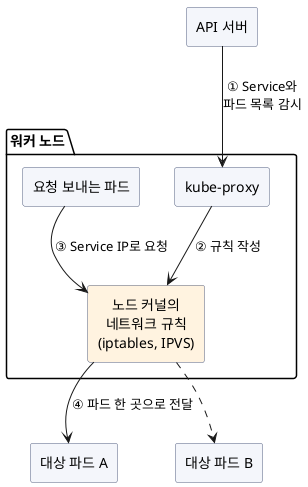
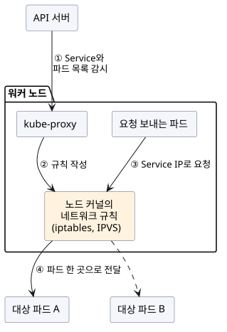
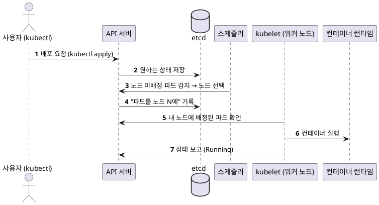
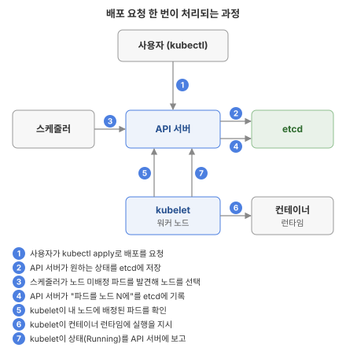

<!-- truncate -->

쿠버네티스에서는 `kubectl apply` 명령 한 줄로 컨테이너가 기동되지만, 그 사이에 어떤 과정을 거치는지는 명령만으로 알기 어렵습니다. 실제로는 클러스터 안의 **여러 부품이 역할을 나눠** 이 요청을 처리합니다. 이 글은 쿠버네티스 지식이 거의 없어도 이해하도록, **클러스터가 어떤 구성 요소로 이루어지고 각 부품이 무슨 일을 하는지**를 그림으로 풀어 설명합니다. (Pod, Deployment 같은 오브젝트를 실제로 어떻게 사용하는지와 GitOps 배포는 별도 주제이므로, 이 글은 **클러스터 내부 구조**에 집중합니다.)

<mark>쿠버네티스 클러스터는 크게 **결정을 내리는 컨트롤 플레인**과 **컨테이너를 실제로 실행하는 워커 노드**로 나뉩니다 — 이 두 부분과 각 부품의 역할만 알면 나머지가 쉽게 이해됩니다.</mark>

## 전체 구조 — 컨트롤 플레인과 워커 노드

**클러스터**는 여러 대의 컴퓨터를 한 시스템처럼 통합해 운영하는 단위이고, 그 안의 **컴퓨터 한 대를 노드(node)** 라고 합니다. 노드는 물리 서버일 수도 있고 가상 머신일 수도 있습니다. AWS라면 보통 **EC2 인스턴스 한 대가 노드 하나**입니다.

- 노드마다 자기 OS(보통 리눅스)와 CPU, 메모리가 있습니다.
- **파드(컨테이너 그룹)** 는 노드 위에서 실행되고, 노드 한 대에 파드 여러 개가 함께 올라갑니다.

예를 들어 EC2 3대로 클러스터를 만들면 노드가 3개입니다. 여기에 파드 10개를 배포하면, 쿠버네티스가 각 노드의 남은 CPU와 메모리를 보고 3대에 나눠 배치합니다.

노드를 여러 대로 구성하는 이유는 다음과 같습니다.

- **용량** — 컴퓨터 한 대의 CPU와 메모리에는 한계가 있습니다. 파드 한 개가 CPU 1코어를 사용하고 파드 40개가 필요하다면, 4코어 노드 10대가 필요합니다.
- **장애 대응** — 노드가 한 대뿐이면 그 컴퓨터가 멈출 때 서비스 전체가 멈춥니다. 여러 대면 다른 노드의 파드가 계속 요청을 처리하고, 쿠버네티스가 멈춘 노드의 파드를 남은 노드에 다시 기동합니다. 그래서 같은 서비스의 파드는 여러 노드, 나아가 여러 가용 영역(AZ)에 나눠 배치합니다.
- **확장** — 트래픽이 늘면 노드를 추가하고, 줄면 줄입니다. EKS에서는 Cluster Autoscaler나 Karpenter가 필요한 만큼 EC2를 자동으로 늘리고 줄입니다.
- **무중단 점검** — OS 패치나 인스턴스 교체 시 노드를 한 대씩 비우고(drain) 작업합니다. 그동안 파드는 다른 노드에서 다시 실행되므로 서비스가 계속 동작합니다.
- **용도별 장비 구분** — GPU가 필요한 작업은 GPU 노드에, 메모리를 많이 사용하는 작업은 메모리 최적화 노드에 배치하는 식으로 노드 종류를 나눌 수 있습니다.

<mark>노드가 여러 대이기 때문에 **"어느 노드에 파드를 배치할지"** 를 정하는 스케줄러와, **어느 노드에서 출발한 요청이든 파드에 도달하게 하는** kube-proxy 같은 부품이 필요합니다.</mark>

노드는 역할에 따라 두 종류입니다.

- **컨트롤 플레인(control plane)** — 클러스터의 **결정, 관리 담당**. "무엇을 어디에 얼마나 띄울지"를 결정하고, 전체 상태를 관리합니다. 직접 컨테이너를 실행하지는 않습니다. EKS 같은 관리형 서비스에서는 클라우드 사업자가 운영하므로 사용자에게 보이지 않습니다.
- **워커 노드(worker node)** — 실제 **실행 담당**. 컨트롤 플레인의 결정을 받아 **컨테이너(파드)를 실제로 실행**합니다.

<details>
<summary>PlantUML 코드</summary>



</details>



import ArchifyEmbed from '@site/src/components/ArchifyEmbed';

<ArchifyEmbed src="/diagrams/k8s-architecture.html" title="쿠버네티스 클러스터 구성 요소 (인터랙티브)" height="620px" />

## 컨트롤 플레인 — 결정, 관리 부품들

컨트롤 플레인은 네 개의 부품으로 나뉩니다. 각각 하는 일이 뚜렷합니다.

### API 서버 (kube-apiserver) — 모든 요청의 진입점

클러스터의 **정문**입니다. `kubectl`, 대시보드, 다른 부품까지 **모든 요청이 API 서버를 거칩니다.** 요청을 인증, 검증하고, 결과를 저장소에 반영합니다. **다른 부품끼리 직접 통신하지 않고, 항상 API 서버를 통해서만** 주고받습니다. 각 부품은 API 서버에 연결을 유지한 채 변경을 구독하는 [watch](#api-watch) 방식으로 필요한 정보를 받습니다.

### etcd — 모든 상태를 저장하는 곳

클러스터의 **장부**입니다. "지금 어떤 파드가 몇 개, 어느 노드에 있어야 하는지" 같은 **모든 상태를 저장**하는 키-값 데이터베이스입니다. **오직 API 서버만 etcd에 접근**합니다. etcd가 사라지면 클러스터는 자기 상태를 잃으므로, 보통 여러 대로 이중화합니다.

### 스케줄러 (kube-scheduler) — 파드를 어느 노드에

API 서버를 [watch](#api-watch)하다가 새로 만들어졌지만 **아직 노드가 정해지지 않은 파드**를 발견하면, **어느 워커 노드에 놓을지** 결정합니다. 노드의 남은 CPU, 메모리, 배치 규칙(어피니티) 등을 따져 가장 알맞은 노드를 선택한 뒤, "이 파드는 노드 N에"라고 API 서버에 기록합니다. **결정만 하고, 실제 실행은 하지 않습니다.**

### 컨트롤러 매니저 (kube-controller-manager) — 원하는 상태를 유지

여러 개의 **컨트롤러(제어 루프)** 를 돌립니다. 각 컨트롤러는 "원하는 상태와 현재 상태를 비교해, 다르면 맞추는" 일을 끊임없이 반복합니다. 예를 들어 **레플리카를 3개로 선언했는데 하나가 중단되면**, 컨트롤러가 [watch](#api-watch)로 그 변화를 감지해 새 파드를 만들도록 API 서버에 요청합니다. 클라우드에서는 로드밸런서, 볼륨을 관리하는 **클라우드 컨트롤러 매니저**가 따로 붙기도 합니다.

<mark>컨트롤 플레인의 규칙은 단순합니다 — 모든 소통은 API 서버를 통하고, 모든 상태는 etcd에 있고, 스케줄러는 배치를 결정하고, 컨트롤러는 원하는 상태를 계속 맞춥니다.</mark>

## 워커 노드 — 실행 부품들

워커 노드에는 실제로 컨테이너를 실행하기 위한 세 부품이 있습니다.

### kubelet — 노드의 현장 관리자

각 워커 노드에 하나씩 있는 **현장 감독**입니다. API 서버를 [watch](#api-watch)해 "내 노드에 배정된 파드가 무엇인지"를 확인하고, 그 파드의 컨테이너가 **실제로 기동해 정상 동작하는지** 책임집니다. 컨테이너가 중단되면 다시 기동시키고, 상태를 API 서버에 보고합니다. **kubelet은 컨테이너를 직접 만들지 않고, 컨테이너 런타임에게 시킵니다.**

### 컨테이너 런타임 — 실제로 컨테이너를 실행

이미지를 내려받아 **컨테이너를 실제로 실행**하는 소프트웨어입니다. 요즘은 **containerd**나 CRI-O를 사용합니다(예전의 도커 엔진 역할). kubelet이 표준 인터페이스(CRI)로 런타임에게 "이 이미지로 컨테이너 띄워"라고 지시합니다.

### kube-proxy — 서비스 네트워킹

파드는 중단되고 다시 기동하며 IP가 계속 바뀝니다. 그래서 파드 앞에 바뀌지 않는 주소인 **Service**를 배치합니다. 다른 파드는 파드 IP 대신 Service 주소(ClusterIP)로 요청합니다.

그런데 **Service는 실제로 실행되는 프로그램이 아니라 "주소와 대상 파드 목록"을 적어 둔 설정**입니다. Service 주소로 온 요청을 실제 파드로 보내려면 **모든 워커 노드**에 전달 규칙이 미리 만들어져 있어야 하고, 그 일을 하는 것이 **kube-proxy**입니다. kube-proxy는 워커 노드마다 한 개씩 실행되며, 각자 자기 노드에 같은 규칙을 작성합니다.

모든 노드에 규칙이 필요한 이유는, **요청을 보낸 파드가 있는 노드에서 목적지가 정해지기 때문**입니다. 예를 들어 노드가 3대이고 `order` Service 뒤의 파드가 노드 3에만 있다고 하겠습니다.

- 노드 1의 파드가 `order` Service 주소로 요청을 보내면, **노드 1의 커널**이 규칙을 보고 목적지를 노드 3의 파드 IP로 변경합니다.
- 그 뒤 패킷은 네트워크를 거쳐 노드 3으로 전달됩니다.

요청은 어느 노드의 파드에서든 출발할 수 있으므로, 대상 파드가 없는 노드에도 Service 규칙이 전부 있어야 합니다.

<details>
<summary>PlantUML 코드</summary>



</details>



1. kube-proxy는 API 서버를 감시([watch](#api-watch))하다가 Service가 생기거나 그 뒤의 파드 목록이 바뀌면 알게 됩니다.
2. 각 노드의 커널에 **"이 Service IP와 포트로 온 패킷은 이 파드들 중 한 곳으로 보낸다"** 는 규칙(iptables, IPVS 등)을 작성합니다.
3. 파드가 Service IP로 요청을 보내면,
4. 노드의 커널이 그 규칙에 따라 목적지를 파드 IP 한 곳으로 변경해 전달합니다.

<mark>kube-proxy는 트래픽이 거쳐 가는 중간 단계가 아니라, **트래픽이 따라갈 규칙을 미리 만드는 역할**입니다. 실제 패킷 전달은 노드의 커널이 그 규칙대로 처리합니다.</mark> 그래서 흐름도에서 "Service → 파드"로 표시된 구간이 kube-proxy가 담당하는 부분입니다. 포트 번호 기준으로 나눠 보내므로 **L4 라우팅**이라고 합니다.

쿠버네티스 공식 문서도 kube-proxy를 같은 방식으로 설명합니다.

> kube-proxy maintains network rules on nodes. These network rules allow network communication to your Pods from network sessions inside or outside of your cluster. kube-proxy uses the operating system packet filtering layer if there is one and it's available. Otherwise, kube-proxy forwards the traffic itself.

→ kube-proxy는 노드에 네트워크 규칙을 유지하고, 운영체제의 패킷 필터링 계층(리눅스의 iptables 등)을 사용할 수 있으면 전달은 그 계층에 맡깁니다. 직접 트래픽을 전달하는 것은 그 계층이 없을 때뿐입니다. ([Kubernetes — Cluster Components](https://kubernetes.io/docs/concepts/overview/components/#kube-proxy))

외부 HTTP 노출을 맡는 Service 타입과 Ingress는 아래에서 따로 정리합니다.

정리하면 워커 노드에서는 kubelet이 파드 실행을 지휘하고, 컨테이너 런타임이 실제로 실행하며, kube-proxy가 Service 트래픽이 파드에 도달하도록 노드의 전달 규칙을 관리합니다.

## 부품들이 API 서버를 감시하는 방식 — watch {#api-watch}

앞에서 스케줄러, 컨트롤러 매니저, kubelet, kube-proxy가 모두 API 서버를 "감시"한다고 설명했습니다. 이 감시는 주기적으로 다시 물어보는 폴링이 아니라, **변경이 생기면 알려 달라고 API 서버와의 연결을 유지하는 방식**입니다. 쿠버네티스에서는 이를 **watch**라고 합니다.

1. **처음 한 번 전체 목록을 받습니다(LIST).** 부품이 시작하면 자기에게 필요한 리소스 목록을 API 서버에 요청해 메모리에 저장합니다.
2. **그다음 변경 알림을 구독합니다(WATCH).** 요청에 `watch=true`를 붙이면 API 서버는 응답을 끝내지 않고 연결을 유지하다가, 변경이 생길 때마다 그 연결로 이벤트를 차례로 보냅니다.
3. **이벤트를 받으면 각자 맡은 일을 합니다.** 메모리의 목록을 갱신하고, 아래 표처럼 부품마다 정해진 동작을 실행합니다.

| 부품 | watch 대상 | 변경을 받으면 하는 일 |
|---|---|---|
| 스케줄러 | 노드가 정해지지 않은 파드 | 알맞은 노드를 선택해 API 서버에 기록 |
| 컨트롤러 매니저 | Deployment, ReplicaSet, 파드 등 | 원하는 상태와 다르면 파드 생성이나 삭제를 요청 |
| kubelet | 자기 노드에 배정된 파드 | 컨테이너 런타임에 실행이나 중지를 지시 |
| kube-proxy | Service, EndpointSlice | 노드 커널의 전달 규칙을 갱신 |

EndpointSlice는 "이 Service 뒤에 있는 파드 IP 목록"을 저장하는 리소스입니다. 예를 들어 kube-proxy의 watch 요청과, 그 연결로 들어오는 이벤트는 다음과 같은 형태입니다.

```text
GET /apis/discovery.k8s.io/v1/endpointslices?watch=true&resourceVersion=12345

{"type":"MODIFIED","object":{ ... "endpoints":[{"addresses":["10.0.3.17"], ...}] }}
{"type":"ADDED","object":{ ... }}
```

이 "LIST 후 WATCH, 연결이 끊기면 다시 연결" 처리는 쿠버네티스 Go 라이브러리(client-go)의 **informer**가 맡고, 각 부품은 이를 사용합니다.

여러 부품의 watch가 이어지는 예로, 파드 한 개가 새로 기동하면 다음 순서로 모든 노드의 kube-proxy 규칙에 반영됩니다.

1. 새 파드가 준비 완료(Ready)되면, 그 노드의 kubelet이 API 서버에 상태를 보고합니다.
2. 컨트롤러 매니저의 EndpointSlice 컨트롤러가 이를 watch로 받아, 해당 Service의 EndpointSlice에 새 파드 IP를 추가합니다.
3. 모든 노드의 kube-proxy가 이 변경을 watch로 받습니다.
4. 각 노드가 자기 커널 규칙에 새 파드 IP를 추가합니다. 이때부터 Service로 온 요청 일부가 새 파드로 전달됩니다.

<mark>부품끼리 서로 직접 호출하지 않고, **API 서버에 기록된 변경을 각자 watch로 구독해서 동작**합니다.</mark> 그래서 구성도의 화살표가 전부 API 서버로 모입니다. 이 구조는 아래 "배포 요청 한 번이 처리되는 과정"에서 다시 확인합니다.

## 외부 트래픽 경로 — Service 타입과 Ingress

앞의 kube-proxy가 하는 L4 라우팅 위에, 외부 노출 방식이 더해집니다. Service는 타입에 따라 노출 범위가 다릅니다.

- **ClusterIP**(기본) — 클러스터 **내부에서만** 접근(서비스 간 통신용).
- **NodePort** — 각 노드의 특정 포트로 노출.
- **LoadBalancer** — 클라우드 로드밸런서를 **서비스마다 하나씩** 붙여 노출 → 서비스가 많으면 LB 비용이 커집니다.

여기서 **Ingress**가 등장합니다. **하나의 진입점(HTTP/HTTPS, L7)에서 호스트와 경로 기준으로 여러 Service에 라우팅**하는 규칙입니다.

```yaml
apiVersion: networking.k8s.io/v1
kind: Ingress
metadata:
  name: web
spec:
  rules:
    - host: shop.example.com
      http:
        paths:
          - path: /api                # shop.example.com/api → api 서비스
            pathType: Prefix
            backend:
              service: { name: api, port: { number: 80 } }
          - path: /                    # 그 외 경로 → web 서비스
            pathType: Prefix
            backend:
              service: { name: web, port: { number: 80 } }
  tls:                                 # HTTPS 인증서 종료(TLS termination)
    - hosts: [ shop.example.com ]
      secretName: shop-tls
```

구성 요소 관점의 핵심은, **Ingress 자체는 규칙일 뿐**이고 실제 처리는 **Ingress Controller**(nginx, AWS Load Balancer Controller 등)가 맡는다는 점입니다 — 이 컨트롤러는 별도 부품이 아니라 **워커 노드 위에서 파드로 실행되어** Ingress 규칙을 읽어 L7 라우팅을 수행합니다. 그다음 **Service → 파드(L4)** 구간은 위에서 본 것처럼 kube-proxy가 노드에 만들어 둔 규칙으로 처리되므로, 외부 트래픽은 `Ingress Controller(파드) → Service → 파드` 순으로 전달됩니다.

<mark>Service는 L4(포트 단위 파드 부하 분산), Ingress는 L7(도메인, 경로 라우팅 + TLS 종료)입니다 — Ingress는 규칙일 뿐이라, 이를 실행하는 Ingress Controller(파드)가 있어야 실제로 동작합니다.</mark>

<ArchifyEmbed src="/diagrams/k8s-ingress-path.html" title="외부 트래픽 경로 Ingress→Service→파드 (인터랙티브)" height="440px" />

## 오브젝트는 무엇인가 — 부품이 관리하는 대상

지금까지가 **클러스터를 이루는 부품(프로세스)** 이라면, 우리가 `kubectl`로 만드는 **Pod, Deployment, Service** 등은 그 부품들이 **관리하는 대상(리소스)** 입니다. 아주 짧게만 정리합니다.

| 오브젝트 | 한 줄 |
|---|---|
| **Pod** | 컨테이너를 감싼 가장 작은 실행 단위(일회성) |
| **ReplicaSet** | 파드를 정해진 개수만큼 유지 |
| **Deployment** | 원하는 레플리카와 버전을 선언(내부적으로 ReplicaSet 관리) |
| **Service / Ingress** | 파드 앞의 고정 진입점, 부하 분산 / 외부 트래픽 경로 |
| **Namespace** | 리소스를 환경과 팀별로 나누는 격리 단위 |

즉 **부품(API 서버, 스케줄러, kubelet…)이 일을 하고, 오브젝트(Deployment, Pod…)는 그 일의 대상**입니다.

## 배포 요청 한 번이 처리되는 과정

부품들이 어떻게 협업하는지, `kubectl apply`로 파드 하나를 기동시키는 과정으로 따라가 봅니다.

<details>
<summary>PlantUML 코드</summary>



</details>



1. **사용자**가 `kubectl apply`로 "이러한 파드를 원한다"를 **API 서버**에 보냅니다.
2. API 서버가 그 원하는 상태를 **etcd**에 저장합니다. (이 시점엔 아직 어느 노드에 뜰지 미정)
3. **스케줄러**가 노드 미배정 파드를 발견해, 가장 알맞은 워커 노드를 선택해 API 서버에 기록합니다.
4. 배정된 노드의 **kubelet**이 "내 노드에 새 파드가 있다"를 확인하고, **컨테이너 런타임**에게 실행을 지시합니다.
5. 컨테이너가 기동하면 kubelet이 상태를 API 서버에 보고하고, 그 결과가 etcd에 반영됩니다.

<mark>모든 단계가 API 서버를 중심으로 동작합니다 — 각 부품은 서로 직접 명령하지 않고, "API 서버에 기록된 원하는 상태"를 각자 보고 자기 일을 합니다. 이 느슨한 협업이 쿠버네티스가 견고한 이유입니다.</mark>

## 정리

- 클러스터는 **컨트롤 플레인(결정, 관리) + 워커 노드(실행)** 로 나뉩니다.
- **컨트롤 플레인**: **API 서버**(모든 요청의 진입점), **etcd**(모든 상태 저장), **스케줄러**(파드를 어느 노드에), **컨트롤러 매니저**(원하는 상태 유지 루프).
- **워커 노드**: **kubelet**(파드 실행 감독), **컨테이너 런타임**(실제 실행, containerd 등), **kube-proxy**(서비스 네트워킹).
- **오브젝트**(Pod, Deployment, Service)는 부품들이 관리하는 **대상**입니다.
- 배포는 **API 서버 → etcd → 스케줄러 → kubelet → 런타임** 으로 이어지고, 모든 소통은 API 서버를 통합니다.

<mark>쿠버네티스는 저절로 되는 게 아니라 "역할을 나눈 부품들이 API 서버를 통해 원하는 상태를 맞추는" 구조입니다 — 각 부품이 무슨 일을 하는지 알면, 장애를 분석할 때 어디를 봐야 할지도 보입니다.</mark>

## 용어 한 줄 정리

| 용어 | 쉬운 뜻 |
|---|---|
| 클러스터 | 여러 노드를 한 시스템처럼 통합해 운영하는 단위 |
| 노드 | 클러스터에 속한 컴퓨터 한 대(물리 서버나 가상 머신, 예: EC2 한 대) |
| 컨트롤 플레인 | 클러스터의 결정, 상태 관리 담당 |
| 워커 노드 | 실제로 컨테이너(파드)를 실행하는 노드 |
| API 서버 | 모든 요청이 거치는 진입점 |
| etcd | 클러스터의 모든 상태를 저장하는 곳 |
| 스케줄러 | 파드를 어느 노드에 놓을지 결정 |
| 컨트롤러 매니저 | 원하는 상태와 현재 상태를 계속 맞추는 루프 |
| kubelet | 노드에서 파드 실행을 감독하는 현장 관리자 |
| 컨테이너 런타임 | 이미지를 받아 컨테이너를 실제 실행(containerd 등) |
| kube-proxy | Service 주소로 온 트래픽이 파드로 가도록 노드의 네트워크 규칙(iptables 등)을 만들고 갱신 |
| watch | API 서버와의 연결을 유지하며 변경 이벤트를 받는 구독 방식 |
| EndpointSlice | Service 뒤에 있는 파드 IP 목록을 저장하는 리소스 |
