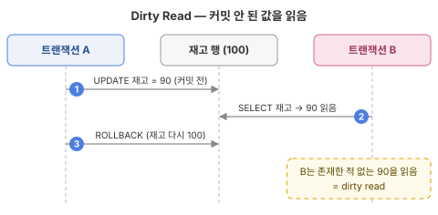
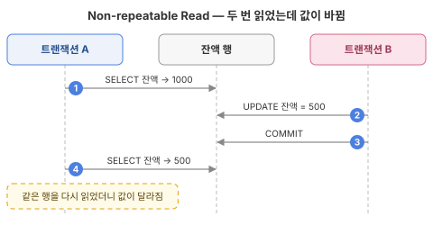
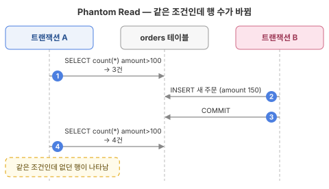
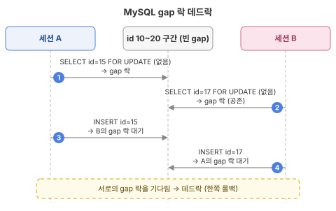

<!-- truncate -->

여러 트랜잭션이 **동시에** 같은 데이터를 읽고 쓰면 서로 간섭해 이상한 결과가 나옵니다. 완전히 격리(한 줄로 줄 세워 실행)하면 안전하지만 동시성이 떨어져 느립니다. <mark>그래서 DB는 "어디까지 간섭을 허용할지"를 **격리 수준(isolation level)** 이라는 몇 단계로 구분합니다 — 격리 수준이 높을수록 안전하지만 동시성은 떨어집니다. ACID의 **I**(격리성)에 해당합니다.</mark> 이 글은 이상 현상 → 표준 4단계 → DB별 구현 → 스프링 적용 순서로 살펴봅니다.

## 격리가 약하면 생기는 이상 현상

세 가지가 대표적입니다. 각각 "무엇이 문제인지"를 두 트랜잭션의 타임라인으로 봅니다.

### ① Dirty Read — 커밋 안 된 값을 읽음

<details>
<summary>SVG 코드</summary>

```svg
<svg xmlns="http://www.w3.org/2000/svg" width="480" height="236" viewBox="0 0 480 236" font-family="-apple-system, 'Segoe UI', 'Noto Sans KR', sans-serif">
<defs><marker id="ah" viewBox="0 0 10 10" refX="9" refY="5" markerWidth="7" markerHeight="7" orient="auto-start-reverse"><path d="M0,0 L10,5 L0,10 z" fill="#888"/></marker></defs>
<rect x="0" y="0" width="480" height="236" fill="#FFFFFF"/>
<text x="240.0" y="22" font-size="13" fill="#333" text-anchor="middle" font-weight="bold">Dirty Read — 커밋 안 된 값을 읽음</text>
<line x1="72" y1="72" x2="72" y2="224" stroke="#BBBBBB" stroke-dasharray="4 3"/>
<rect x="8.0" y="38" width="128" height="34" rx="6" fill="#EEF3FB" stroke="#4C7FE0"/>
<text x="72.0" y="59.14" font-size="11.5" fill="#26508F" text-anchor="middle" font-weight="bold">트랜잭션 A</text>
<line x1="240" y1="72" x2="240" y2="224" stroke="#BBBBBB" stroke-dasharray="4 3"/>
<rect x="176.0" y="38" width="128" height="34" rx="6" fill="#F7F7F7" stroke="#999999"/>
<text x="240.0" y="59.14" font-size="11.5" fill="#333" text-anchor="middle" font-weight="bold">재고 행 (100)</text>
<line x1="408" y1="72" x2="408" y2="224" stroke="#BBBBBB" stroke-dasharray="4 3"/>
<rect x="344.0" y="38" width="128" height="34" rx="6" fill="#FCE4EC" stroke="#D06A86"/>
<text x="408.0" y="59.14" font-size="11.5" fill="#9E3A57" text-anchor="middle" font-weight="bold">트랜잭션 B</text>
<line x1="72" y1="98" x2="239" y2="98" stroke="#888" stroke-width="1.2" marker-end="url(#ah)"/>
<rect x="101.3" y="83.0" width="127.3" height="12.0" fill="#FFFFFF"/>
<text x="165.0" y="92" font-size="10" fill="#333" text-anchor="middle">UPDATE 재고 = 90 (커밋 전)</text>
<line x1="408" y1="128" x2="241" y2="128" stroke="#888" stroke-width="1.2" marker-end="url(#ah)"/>
<rect x="258.9" y="113.0" width="112.2" height="12.0" fill="#FFFFFF"/>
<text x="315.0" y="122" font-size="10" fill="#333" text-anchor="middle">SELECT 재고 → 90 읽음</text>
<line x1="72" y1="158" x2="239" y2="158" stroke="#888" stroke-width="1.2" marker-end="url(#ah)"/>
<rect x="103.2" y="143.0" width="123.5" height="12.0" fill="#FFFFFF"/>
<text x="165.0" y="152" font-size="10" fill="#333" text-anchor="middle">ROLLBACK (재고 다시 100)</text>
<rect x="314.44" y="174" width="157.56" height="44" rx="6" fill="#FFFBEA" stroke="#E0A000" stroke-dasharray="5 4"/>
<text x="393.22" y="192" font-size="10.5" fill="#5A4300" text-anchor="middle">B는 존재한 적 없는 90을 읽음</text>
<text x="393.22" y="208" font-size="10.5" fill="#5A4300" text-anchor="middle">= dirty read</text>
<circle cx="84" cy="98" r="8" fill="#4C7FE0"/>
<text x="84" y="101.5" font-size="10" fill="#FFFFFF" text-anchor="middle" font-weight="bold">1</text>
<circle cx="396" cy="128" r="8" fill="#4C7FE0"/>
<text x="396" y="131.5" font-size="10" fill="#FFFFFF" text-anchor="middle" font-weight="bold">2</text>
<circle cx="84" cy="158" r="8" fill="#4C7FE0"/>
<text x="84" y="161.5" font-size="10" fill="#FFFFFF" text-anchor="middle" font-weight="bold">3</text>
</svg>
```

</details>

<figure style={{textAlign: 'center', margin: '1.5rem 0'}}>
  
</figure>

<mark>커밋되지 않아 언제든 롤백될 수 있는 값을 읽는 것이 dirty read입니다.</mark>

### ② Non-repeatable Read — 같은 행을 두 번 읽었는데 값이 바뀜

<details>
<summary>SVG 코드</summary>

```svg
<svg xmlns="http://www.w3.org/2000/svg" width="480" height="250" viewBox="0 0 480 250" font-family="-apple-system, 'Segoe UI', 'Noto Sans KR', sans-serif">
<defs><marker id="ah" viewBox="0 0 10 10" refX="9" refY="5" markerWidth="7" markerHeight="7" orient="auto-start-reverse"><path d="M0,0 L10,5 L0,10 z" fill="#888"/></marker></defs>
<rect x="0" y="0" width="480" height="250" fill="#FFFFFF"/>
<text x="240.0" y="22" font-size="13" fill="#333" text-anchor="middle" font-weight="bold">Non-repeatable Read — 두 번 읽었는데 값이 바뀜</text>
<line x1="72" y1="72" x2="72" y2="238" stroke="#BBBBBB" stroke-dasharray="4 3"/>
<rect x="8.0" y="38" width="128" height="34" rx="6" fill="#EEF3FB" stroke="#4C7FE0"/>
<text x="72.0" y="59.14" font-size="11.5" fill="#26508F" text-anchor="middle" font-weight="bold">트랜잭션 A</text>
<line x1="240" y1="72" x2="240" y2="238" stroke="#BBBBBB" stroke-dasharray="4 3"/>
<rect x="176.0" y="38" width="128" height="34" rx="6" fill="#F7F7F7" stroke="#999999"/>
<text x="240.0" y="59.14" font-size="11.5" fill="#333" text-anchor="middle" font-weight="bold">잔액 행</text>
<line x1="408" y1="72" x2="408" y2="238" stroke="#BBBBBB" stroke-dasharray="4 3"/>
<rect x="344.0" y="38" width="128" height="34" rx="6" fill="#FCE4EC" stroke="#D06A86"/>
<text x="408.0" y="59.14" font-size="11.5" fill="#9E3A57" text-anchor="middle" font-weight="bold">트랜잭션 B</text>
<line x1="72" y1="98" x2="239" y2="98" stroke="#888" stroke-width="1.2" marker-end="url(#ah)"/>
<rect x="114.4" y="83.0" width="101.2" height="12.0" fill="#FFFFFF"/>
<text x="165.0" y="92" font-size="10" fill="#333" text-anchor="middle">SELECT 잔액 → 1000</text>
<line x1="408" y1="128" x2="241" y2="128" stroke="#888" stroke-width="1.2" marker-end="url(#ah)"/>
<rect x="269.1" y="113.0" width="91.9" height="12.0" fill="#FFFFFF"/>
<text x="315.0" y="122" font-size="10" fill="#333" text-anchor="middle">UPDATE 잔액 = 500</text>
<line x1="408" y1="158" x2="241" y2="158" stroke="#888" stroke-width="1.2" marker-end="url(#ah)"/>
<rect x="294.4" y="143.0" width="41.2" height="12.0" fill="#FFFFFF"/>
<text x="315.0" y="152" font-size="10" fill="#333" text-anchor="middle">COMMIT</text>
<line x1="72" y1="188" x2="239" y2="188" stroke="#888" stroke-width="1.2" marker-end="url(#ah)"/>
<rect x="117.2" y="173.0" width="95.7" height="12.0" fill="#FFFFFF"/>
<text x="165.0" y="182" font-size="10" fill="#333" text-anchor="middle">SELECT 잔액 → 500</text>
<rect x="8" y="204" width="189.37499999999997" height="28" rx="6" fill="#FFFBEA" stroke="#E0A000" stroke-dasharray="5 4"/>
<text x="102.68749999999999" y="222" font-size="10.5" fill="#5A4300" text-anchor="middle">같은 행을 다시 읽었더니 값이 달라짐</text>
<circle cx="84" cy="98" r="8" fill="#4C7FE0"/>
<text x="84" y="101.5" font-size="10" fill="#FFFFFF" text-anchor="middle" font-weight="bold">1</text>
<circle cx="396" cy="128" r="8" fill="#4C7FE0"/>
<text x="396" y="131.5" font-size="10" fill="#FFFFFF" text-anchor="middle" font-weight="bold">2</text>
<circle cx="396" cy="158" r="8" fill="#4C7FE0"/>
<text x="396" y="161.5" font-size="10" fill="#FFFFFF" text-anchor="middle" font-weight="bold">3</text>
<circle cx="84" cy="188" r="8" fill="#4C7FE0"/>
<text x="84" y="191.5" font-size="10" fill="#FFFFFF" text-anchor="middle" font-weight="bold">4</text>
</svg>
```

</details>

<figure style={{textAlign: 'center', margin: '1.5rem 0'}}>
  
</figure>

한 트랜잭션 안에서 **같은 행**을 두 번 읽었는데, 그 사이 다른 트랜잭션의 **수정**이 커밋돼 값이 달라지는 경우입니다.

### ③ Phantom Read — 같은 조건인데 행 수가 바뀜

<details>
<summary>SVG 코드</summary>

```svg
<svg xmlns="http://www.w3.org/2000/svg" width="480" height="276" viewBox="0 0 480 276" font-family="-apple-system, 'Segoe UI', 'Noto Sans KR', sans-serif">
<defs><marker id="ah" viewBox="0 0 10 10" refX="9" refY="5" markerWidth="7" markerHeight="7" orient="auto-start-reverse"><path d="M0,0 L10,5 L0,10 z" fill="#888"/></marker></defs>
<rect x="0" y="0" width="480" height="276" fill="#FFFFFF"/>
<text x="240.0" y="22" font-size="13" fill="#333" text-anchor="middle" font-weight="bold">Phantom Read — 같은 조건인데 행 수가 바뀜</text>
<line x1="72" y1="72" x2="72" y2="264" stroke="#BBBBBB" stroke-dasharray="4 3"/>
<rect x="8.0" y="38" width="128" height="34" rx="6" fill="#EEF3FB" stroke="#4C7FE0"/>
<text x="72.0" y="59.14" font-size="11.5" fill="#26508F" text-anchor="middle" font-weight="bold">트랜잭션 A</text>
<line x1="240" y1="72" x2="240" y2="264" stroke="#BBBBBB" stroke-dasharray="4 3"/>
<rect x="176.0" y="38" width="128" height="34" rx="6" fill="#F7F7F7" stroke="#999999"/>
<text x="240.0" y="59.14" font-size="11.5" fill="#333" text-anchor="middle" font-weight="bold">orders 테이블</text>
<line x1="408" y1="72" x2="408" y2="264" stroke="#BBBBBB" stroke-dasharray="4 3"/>
<rect x="344.0" y="38" width="128" height="34" rx="6" fill="#FCE4EC" stroke="#D06A86"/>
<text x="408.0" y="59.14" font-size="11.5" fill="#9E3A57" text-anchor="middle" font-weight="bold">트랜잭션 B</text>
<line x1="72" y1="111" x2="239" y2="111" stroke="#888" stroke-width="1.2" marker-end="url(#ah)"/>
<rect x="93.8" y="83.0" width="142.3" height="12.0" fill="#FFFFFF"/>
<text x="165.0" y="92" font-size="10" fill="#333" text-anchor="middle">SELECT count(*) amount&gt;100</text>
<rect x="149.0" y="96.0" width="32.0" height="12.0" fill="#FFFFFF"/>
<text x="165.0" y="105" font-size="10" fill="#333" text-anchor="middle">→ 3건</text>
<line x1="408" y1="141" x2="241" y2="141" stroke="#888" stroke-width="1.2" marker-end="url(#ah)"/>
<rect x="245.8" y="126.0" width="138.3" height="12.0" fill="#FFFFFF"/>
<text x="315.0" y="135" font-size="10" fill="#333" text-anchor="middle">INSERT 새 주문 (amount 150)</text>
<line x1="408" y1="171" x2="241" y2="171" stroke="#888" stroke-width="1.2" marker-end="url(#ah)"/>
<rect x="294.4" y="156.0" width="41.2" height="12.0" fill="#FFFFFF"/>
<text x="315.0" y="165" font-size="10" fill="#333" text-anchor="middle">COMMIT</text>
<line x1="72" y1="214" x2="239" y2="214" stroke="#888" stroke-width="1.2" marker-end="url(#ah)"/>
<rect x="93.8" y="186.0" width="142.3" height="12.0" fill="#FFFFFF"/>
<text x="165.0" y="195" font-size="10" fill="#333" text-anchor="middle">SELECT count(*) amount&gt;100</text>
<rect x="149.0" y="199.0" width="32.0" height="12.0" fill="#FFFFFF"/>
<text x="165.0" y="208" font-size="10" fill="#333" text-anchor="middle">→ 4건</text>
<rect x="8" y="230" width="166.27499999999998" height="28" rx="6" fill="#FFFBEA" stroke="#E0A000" stroke-dasharray="5 4"/>
<text x="91.13749999999999" y="248" font-size="10.5" fill="#5A4300" text-anchor="middle">같은 조건인데 없던 행이 나타남</text>
<circle cx="84" cy="111" r="8" fill="#4C7FE0"/>
<text x="84" y="114.5" font-size="10" fill="#FFFFFF" text-anchor="middle" font-weight="bold">1</text>
<circle cx="396" cy="141" r="8" fill="#4C7FE0"/>
<text x="396" y="144.5" font-size="10" fill="#FFFFFF" text-anchor="middle" font-weight="bold">2</text>
<circle cx="396" cy="171" r="8" fill="#4C7FE0"/>
<text x="396" y="174.5" font-size="10" fill="#FFFFFF" text-anchor="middle" font-weight="bold">3</text>
<circle cx="84" cy="214" r="8" fill="#4C7FE0"/>
<text x="84" y="217.5" font-size="10" fill="#FFFFFF" text-anchor="middle" font-weight="bold">4</text>
</svg>
```

</details>

<figure style={{textAlign: 'center', margin: '1.5rem 0'}}>
  
</figure>

non-repeatable read가 **한 행의 값**이 바뀌는 문제라면, phantom read는 **조건에 맞는 행의 집합**이 바뀌는(없던 행이 새로 삽입되는) 문제입니다.

## SQL 표준 4단계

격리 수준이 높아질수록 위 현상을 더 많이 막지만, 그만큼 **동시성은 떨어집니다**. SQL 표준은 4단계로 정의합니다.

| 격리 수준 | Dirty Read | Non-repeatable Read | Phantom Read |
|---|---|---|---|
| **READ UNCOMMITTED** | 가능 | 가능 | 가능 |
| **READ COMMITTED** | 차단 | 가능 | 가능 |
| **REPEATABLE READ** | 차단 | 차단 | 가능(표준상) |
| **SERIALIZABLE** | 차단 | 차단 | 차단 |

<mark>격리 수준이 높을수록(표에서 아래로 갈수록) 안전하지만 잠금, 검증 비용이 커져 동시 처리량이 줄어듭니다 — "얼마나 안전해야 하나"와 "얼마나 빨라야 하나"의 트레이드오프입니다.</mark>

## 구현은 DB마다 다르다

여기서 **자주 하는 오해**가 하나 있습니다. 같은 이름의 격리 수준이라도 **DB마다 실제 막아 주는 범위가 다릅니다.**

- **MySQL (InnoDB)**
  - 기본: `REPEATABLE READ`
  - `REPEATABLE READ`에서 **next-key 락(gap 락)** 으로 새 행이 삽입되는 것까지 막아 **phantom read도 차단**합니다(표준 초과).
  - `READ COMMITTED`로 낮추면 gap 락이 없어 phantom이 다시 생길 수 있습니다.
- **PostgreSQL**
  - 기본: `READ COMMITTED`
  - `REPEATABLE READ`는 **스냅샷 격리(Snapshot Isolation)** 라 **phantom read도 막습니다**(표준 최소치 초과).
  - `READ UNCOMMITTED`를 요청해도 내부적으론 `READ COMMITTED`로 동작 → 실제로는 3단계.
  - `SERIALIZABLE`은 **SSI**(Serializable Snapshot Isolation)입니다.
- **Oracle**
  - 기본: `READ COMMITTED`
  - 전용 `REPEATABLE READ`, `READ UNCOMMITTED` 레벨이 **없습니다**.
  - `SERIALIZABLE`(스냅샷 기반)과 **`READ ONLY`**(읽기 전용) 모드를 제공합니다.

| DB | 기본 격리 | REPEATABLE READ | SERIALIZABLE |
|---|---|---|---|
| **MySQL(InnoDB)** | REPEATABLE READ | 있음 — next-key 락으로 **phantom까지 차단** | 있음(잠금 기반) |
| **PostgreSQL** | READ COMMITTED | 있음 — 스냅샷 격리, **phantom 차단** | SSI |
| **Oracle** | READ COMMITTED | **없음**(전용 레벨 X) | 있음(스냅샷) |

<mark>그래서 "REPEATABLE READ로 맞췄다"는 말은 DB를 밝히지 않으면 정확하지 않습니다 — MySQL의 RR과 Oracle(RR 없음)은 동작이 아예 다릅니다.</mark> (근거: [PostgreSQL 문서](https://www.postgresql.org/docs/current/transaction-iso.html), [MySQL 문서](https://dev.mysql.com/doc/refman/8.0/en/innodb-transaction-isolation-levels.html), [Oracle 문서](https://docs.oracle.com/en/database/oracle/oracle-database/19/cncpt/data-concurrency-and-consistency.html))

DB별 라이선스, 성격 차이는 [MySQL, PostgreSQL, Oracle 비교](./rdbms-comparison)에서 정리했습니다.

## REPEATABLE READ는 데드락이 더 잘 생길까 — MySQL의 gap 락

<mark>MySQL InnoDB에서는 그렇습니다. REPEATABLE READ가 phantom을 막으려고 사용하는 **gap(next-key) 락**이 잠금 대기와 데드락을 늘립니다.</mark> RR은 "행"만이 아니라 **"그 행 앞의 빈 구간(gap)"** 까지 잠가 새 행이 삽입되는 것을 막는데, 구간을 잠그다 보니 충돌 범위가 넓어집니다.

여기서 중요한 점이 하나 있습니다. <mark>gap 락은 **특정 값이 아니라, 인접한 두 인덱스 레코드 사이의 "구간" 전체**에 걸립니다.</mark> 예를 들어 테이블에 `id = 10`과 `id = 20`만 있으면 그 사이 **10~20이 하나의 gap**이고, 이 구간 안의 어떤 값(15든 17이든)으로 없는 행을 잠그면 **모두 같은 gap 락**을 획득합니다.

문제가 되는 조합은 **gap 락 + INSERT**입니다. gap 락끼리는 서로 **공존**할 수 있지만, `INSERT`가 획득하는 **insert intention 락**은 다른 트랜잭션이 보유한 gap 락과 **충돌해 대기**합니다.

```sql
-- (테이블엔 id = 10, 20만 있음 → 그 사이 10~20이 하나의 gap)
-- 세션 A                                   -- 세션 B
BEGIN;                                      BEGIN;
SELECT * FROM t WHERE id = 15 FOR UPDATE;   SELECT * FROM t WHERE id = 17 FOR UPDATE;
-- 15는 (10,20) gap → 그 gap에 락             -- 17도 같은 (10,20) gap → 같은 gap에 락(공존)
INSERT INTO t(id) VALUES (15);              INSERT INTO t(id) VALUES (17);
-- B가 보유한 gap 락 때문에 대기                    -- A가 보유한 gap 락 때문에 대기 → 데드락!
```

<mark>즉 15와 17은 **값은 다르지만 둘 다 같은 gap(10~20) 안**이라 같은 gap 락을 공유합니다.</mark> 그래서 각자 그 gap에 INSERT하려는 순간 서로의 gap 락을 기다려 데드락이 됩니다.

<details>
<summary>SVG 코드</summary>

```svg
<svg xmlns="http://www.w3.org/2000/svg" width="480" height="302" viewBox="0 0 480 302" font-family="-apple-system, 'Segoe UI', 'Noto Sans KR', sans-serif">
<defs><marker id="ah" viewBox="0 0 10 10" refX="9" refY="5" markerWidth="7" markerHeight="7" orient="auto-start-reverse"><path d="M0,0 L10,5 L0,10 z" fill="#888"/></marker></defs>
<rect x="0" y="0" width="480" height="302" fill="#FFFFFF"/>
<text x="240.0" y="22" font-size="13" fill="#333" text-anchor="middle" font-weight="bold">MySQL gap 락 데드락</text>
<line x1="72" y1="72" x2="72" y2="290" stroke="#BBBBBB" stroke-dasharray="4 3"/>
<rect x="8.0" y="38" width="128" height="34" rx="6" fill="#EEF3FB" stroke="#4C7FE0"/>
<text x="72.0" y="59.14" font-size="11.5" fill="#26508F" text-anchor="middle" font-weight="bold">세션 A</text>
<line x1="240" y1="72" x2="240" y2="290" stroke="#BBBBBB" stroke-dasharray="4 3"/>
<rect x="176.0" y="38" width="128" height="34" rx="6" fill="#F7F7F7" stroke="#999999"/>
<text x="240.0" y="59.14" font-size="11.5" fill="#333" text-anchor="middle" font-weight="bold">id 10~20 구간 (빈 gap)</text>
<line x1="408" y1="72" x2="408" y2="290" stroke="#BBBBBB" stroke-dasharray="4 3"/>
<rect x="344.0" y="38" width="128" height="34" rx="6" fill="#FCE4EC" stroke="#D06A86"/>
<text x="408.0" y="59.14" font-size="11.5" fill="#9E3A57" text-anchor="middle" font-weight="bold">세션 B</text>
<line x1="72" y1="111" x2="239" y2="111" stroke="#888" stroke-width="1.2" marker-end="url(#ah)"/>
<rect x="84.8" y="83.0" width="160.3" height="12.0" fill="#FFFFFF"/>
<text x="165.0" y="92" font-size="10" fill="#333" text-anchor="middle">SELECT id=15 FOR UPDATE (없음)</text>
<rect x="142.0" y="96.0" width="46.0" height="12.0" fill="#FFFFFF"/>
<text x="165.0" y="105" font-size="10" fill="#333" text-anchor="middle">→ gap 락</text>
<line x1="408" y1="154" x2="241" y2="154" stroke="#888" stroke-width="1.2" marker-end="url(#ah)"/>
<rect x="234.8" y="126.0" width="160.3" height="12.0" fill="#FFFFFF"/>
<text x="315.0" y="135" font-size="10" fill="#333" text-anchor="middle">SELECT id=17 FOR UPDATE (없음)</text>
<rect x="277.8" y="139.0" width="74.4" height="12.0" fill="#FFFFFF"/>
<text x="315.0" y="148" font-size="10" fill="#333" text-anchor="middle">→ gap 락 (공존)</text>
<line x1="72" y1="197" x2="239" y2="197" stroke="#888" stroke-width="1.2" marker-end="url(#ah)"/>
<rect x="129.9" y="169.0" width="70.1" height="12.0" fill="#FFFFFF"/>
<text x="165.0" y="178" font-size="10" fill="#333" text-anchor="middle">INSERT id=15</text>
<rect x="121.7" y="182.0" width="86.7" height="12.0" fill="#FFFFFF"/>
<text x="165.0" y="191" font-size="10" fill="#333" text-anchor="middle">→ B의 gap 락 대기</text>
<line x1="408" y1="240" x2="241" y2="240" stroke="#888" stroke-width="1.2" marker-end="url(#ah)"/>
<rect x="279.9" y="212.0" width="70.1" height="12.0" fill="#FFFFFF"/>
<text x="315.0" y="221" font-size="10" fill="#333" text-anchor="middle">INSERT id=17</text>
<rect x="271.6" y="225.0" width="86.7" height="12.0" fill="#FFFFFF"/>
<text x="315.0" y="234" font-size="10" fill="#333" text-anchor="middle">→ A의 gap 락 대기</text>
<rect x="52.0" y="256" width="376" height="28" rx="6" fill="#FFFBEA" stroke="#E0A000" stroke-dasharray="5 4"/>
<text x="240.0" y="274" font-size="10.5" fill="#5A4300" text-anchor="middle">서로의 gap 락을 기다림 → 데드락 (한쪽 롤백)</text>
<circle cx="84" cy="111" r="8" fill="#4C7FE0"/>
<text x="84" y="114.5" font-size="10" fill="#FFFFFF" text-anchor="middle" font-weight="bold">1</text>
<circle cx="396" cy="154" r="8" fill="#4C7FE0"/>
<text x="396" y="157.5" font-size="10" fill="#FFFFFF" text-anchor="middle" font-weight="bold">2</text>
<circle cx="84" cy="197" r="8" fill="#4C7FE0"/>
<text x="84" y="200.5" font-size="10" fill="#FFFFFF" text-anchor="middle" font-weight="bold">3</text>
<circle cx="396" cy="240" r="8" fill="#4C7FE0"/>
<text x="396" y="243.5" font-size="10" fill="#FFFFFF" text-anchor="middle" font-weight="bold">4</text>
</svg>
```

</details>

<figure style={{textAlign: 'center', margin: '1.5rem 0'}}>
  
</figure>

**READ COMMITTED로 낮추면** 검색, 인덱스 스캔에서 **gap 락이 비활성화**(외래키, 중복키 검사에만 사용)되어, 이러한 gap 데드락이 크게 줄어듭니다. 대신 phantom read가 다시 가능해지는 트레이드오프가 있습니다.

- **잠금 대기와 데드락이 자주 생긴다** → READ COMMITTED를 검토(단, phantom 재등장 감안). 실제로 gap 락 부담을 줄이려 RC로 운영하는 팀이 많습니다.
- **RR을 유지**한다면 → 트랜잭션이 여러 행을 **항상 같은 순서로** 접근하고, 범위 조건보다 **유니크 키 동등 조건**을 사용해 gap 경합을 줄입니다.
- 이건 **MySQL InnoDB 특유**입니다 — PostgreSQL, Oracle은 스냅샷 MVCC라 gap 락이 없어 이 데드락은 없습니다(대신 SERIALIZABLE에서는 직렬화 실패가 나 재시도로 처리). 근거: [InnoDB Locking](https://dev.mysql.com/doc/refman/8.0/en/innodb-locking.html).

접근 순서, 인덱스 때문에 생기는 또 다른 데드락은 [세컨더리 인덱스와 데드락](./index-deadlock)에서 정리했습니다.

## 스프링에서 격리 수준이 로직에 미치는 영향

스프링에서는 `@Transactional(isolation = ...)` 으로 격리 수준을 지정합니다. **같은 로직도 격리 수준에 따라 결과가 달라질 수 있습니다.** 잔액을 한 트랜잭션 안에서 두 번 조회하는 예를 보겠습니다.

```java
@Service
@RequiredArgsConstructor
public class BalanceService {

    private final AccountRepository accountRepository;

    // READ COMMITTED — 매 조회가 "그 시점의 최신 커밋"을 본다
    @Transactional(isolation = Isolation.READ_COMMITTED)
    public boolean isStable(Long id) {
        int first  = accountRepository.findBalance(id);   // 예: 1000
        heavyWork();                                       // 이 사이 다른 Tx가 500으로 UPDATE·COMMIT
        int second = accountRepository.findBalance(id);   // 500  ← 값이 달라짐
        return first == second;                            // false (non-repeatable read)
    }

    // REPEATABLE READ — 트랜잭션 시작 시점의 스냅샷을 끝까지 유지
    @Transactional(isolation = Isolation.REPEATABLE_READ)
    public boolean isStableRR(Long id) {
        int first  = accountRepository.findBalance(id);   // 1000
        heavyWork();                                       // 다른 Tx가 커밋해도
        int second = accountRepository.findBalance(id);   // 1000 ← 그대로
        return first == second;                            // true
    }
}
```

<mark>READ COMMITTED에서는 한 트랜잭션 안에서도 조회할 때마다 값이 달라질 수 있어, "읽은 값이 트랜잭션 내내 유지된다"고 가정한 로직(집계, 검증, 조건 분기)이 잘못될 수 있습니다.</mark>

### 주의할 점 하나 — 스프링 기본값은 "DB 기본값"이다

격리 수준을 지정하지 않으면 `Isolation.DEFAULT`이고, 이는 **연결된 DB의 기본값**을 그대로 따릅니다.

```java
@Transactional  // = @Transactional(isolation = Isolation.DEFAULT) = DB 기본값
public boolean report(Long id) { ... }
```

그래서 **똑같은 코드**가 DB에 따라 다르게 동작합니다 — **MySQL(기본 REPEATABLE READ)** 에서는 두 조회가 일치하지만, **PostgreSQL, Oracle(기본 READ COMMITTED)** 에서는 흔들릴 수 있습니다. 격리 수준에 의존하는 로직이라면 **명시적으로 지정**해 DB가 바뀌어도 같은 동작을 보장해야 합니다.

### REPEATABLE READ도 못 막는 것 — Lost Update

격리 수준을 높여도 **"읽고 → 계산 → 쓰기"** 패턴의 경합은 막지 못합니다.

```java
// REPEATABLE READ라도 아래 경합(lost update)은 그대로 발생
@Transactional(isolation = Isolation.REPEATABLE_READ)
public void withdraw(Long id, int amount) {
    int balance = accountRepository.findBalance(id);   // 1000 (스냅샷)
    // 그 사이 다른 Tx가 300을 인출·커밋 → 실제 잔액은 700
    accountRepository.updateBalance(id, balance - amount);  // 1000 - 200 = 800 으로 덮어씀
    // → 다른 Tx의 300 인출이 사라짐 (lost update)
}
```

스냅샷은 "읽은 값"을 고정할 뿐, 그 값을 근거로 한 쓰기가 다른 트랜잭션의 쓰기를 덮어쓰는 것은 막지 않습니다. 이때는 **잠금**이 필요합니다.

```java
// 해결 1) 비관적 락 — 조회 시점에 행을 잠가 다른 Tx를 대기시킨다 (SELECT ... FOR UPDATE)
@Lock(LockModeType.PESSIMISTIC_WRITE)
@Query("select a from Account a where a.id = :id")
Account findByIdForUpdate(@Param("id") Long id);
```

```java
// 해결 2) 낙관적 락 — @Version으로 충돌을 감지해 재시도한다
@Entity
class Account {
    @Version
    private long version;   // 갱신 시 버전이 다르면 예외 → 처리해 재시도
}
```

<mark>격리 수준은 "읽기 일관성"을 담당하고, 동시 갱신 경합은 **잠금(비관적, 낙관적)** 으로 따로 막아야 합니다.</mark> 잠금이 얽혀 생기는 데드락은 [인덱스와 데드락](./index-deadlock)에서 정리했습니다.

## 실무에서는 어떻게 정하나

- **대부분의 웹 서비스**는 기본값(READ COMMITTED 또는 REPEATABLE READ)으로 충분합니다. 무작정 SERIALIZABLE로 올리면 잠금과 재시도가 늘어 처리량이 떨어집니다.
- **한 트랜잭션 내내 읽은 값이 고정돼야 하는 로직**(집계 리포트, 여러 번 참조하는 검증)은 REPEATABLE READ가 안전합니다.
- **금전과 재고처럼 불변식을 지켜야 하는 갱신**은 격리 수준만 믿지 말고 **명시적 잠금**(FOR UPDATE)이나 **낙관적 락(@Version)**, 또는 **원자적 UPDATE**(`SET stock = stock - 1 WHERE stock >= 1`)로 처리합니다.

## 정리

- 격리 수준은 **dirty, non-repeatable, phantom read**를 어디까지 막을지의 단계입니다(READ UNCOMMITTED → SERIALIZABLE).
- <mark>같은 이름이라도 DB마다 다릅니다 — MySQL(기본 RR, phantom까지 차단), PostgreSQL(기본 RC, RR은 스냅샷), Oracle(기본 RC, RR 없음).</mark>
- 스프링 `@Transactional`의 기본은 **DB 기본값**을 따르므로, 격리에 의존하는 로직은 **수준을 명시**합니다.
- 격리 수준으로 **읽기 일관성**을 확보하고, **동시 갱신 경합(lost update)** 은 잠금으로 따로 막습니다.
