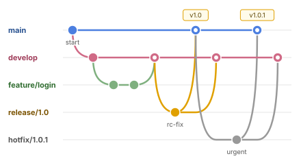
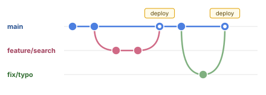
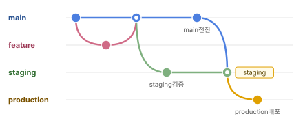
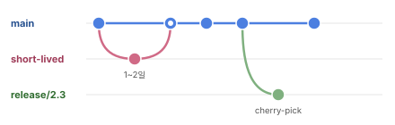
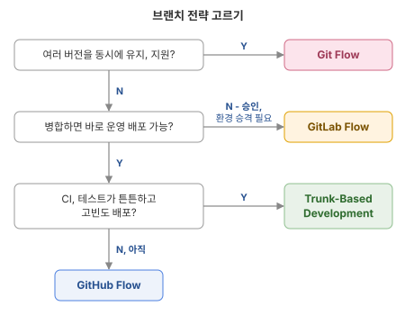

<!-- truncate -->

팀마다 "코드를 `main`에 언제, 어떻게 합치는지"가 다릅니다. 어떤 팀은 `develop`, `release`, `hotfix`까지 여러 브랜치를 유지하고, 어떤 팀은 `main` 하나에 계속 합칩니다. <mark>정답이 하나가 아니라 **배포 주기, 릴리스 방식, 팀 규모, CI 성숙도**에 따라 달라집니다.</mark> 대표적인 **4가지** — Git Flow, GitHub Flow, GitLab Flow, Trunk-Based Development — 를 구조, 장단점, 적합 상황으로 비교합니다.

## 먼저: 두 가지 기준으로 보기

브랜치 전략은 결국 두 가지 질문에 대한 답입니다.

- **브랜치를 얼마나 오래 유지하나?** — 오래 유지하는 브랜치가 많을수록 병합할 때 충돌이 누적됩니다. 수명이 짧을수록 통합이 자주 발생해 충돌이 적습니다.
- **배포를 어떻게 하나?** — **버전을 매겨 릴리스**하는가(예: v1.0, v1.1), 아니면 **`main`에 합치는 즉시 배포**하는가.

<mark>브랜치가 많고 오래 유지할수록 **정식 버전을 단계적으로 관리**하기에 유리하고, 브랜치가 적고 수명이 짧을수록 **자주, 빠르게 배포**하기에 유리합니다.</mark> 아래 4가지 전략은 이 두 기준을 **서로 다르게 조합**한 것입니다 — 예를 들어 Git Flow는 "브랜치 많음 + 버전 릴리스", Trunk-Based는 "브랜치 최소 + 즉시 배포" 쪽입니다.

## 1. Git Flow — 버전 릴리스에 맞춘 정석

2010년 Vincent Driessen이 정리한 모델([원문](https://nvie.com/posts/a-successful-git-branching-model/))로, 브랜치 역할을 가장 엄격하게 나눕니다.

- **`main`** — 운영에 배포된 코드. 여기의 모든 커밋이 하나의 릴리스입니다.
- **`develop`** — 다음 릴리스를 위한 통합 브랜치. 기능들이 여기로 모입니다.
- **`feature/*`** — `develop`에서 분기해 기능을 개발하고 다시 `develop`으로 병합.
- **`release/*`** — `develop`에서 분기해 릴리스를 준비(막판 버그 수정, 버전 번호). `main`과 `develop` **양쪽**으로 병합.
- **`hotfix/*`** — 운영 긴급 수정용. `main`에서 분기해 `main`과 `develop` 양쪽으로 병합.

<details>
<summary>SVG 코드</summary>

```svg
<svg xmlns="http://www.w3.org/2000/svg" width="440" height="238" viewBox="0 0 440 238" font-family="-apple-system, 'Segoe UI', 'Noto Sans KR', sans-serif">
<defs><marker id="ah" viewBox="0 0 10 10" refX="9" refY="5" markerWidth="7" markerHeight="7" orient="auto-start-reverse"><path d="M0,0 L10,5 L0,10 z" fill="#888"/></marker></defs>
<rect x="0" y="0" width="440" height="238" fill="#FFFFFF"/>
<line x1="92" y1="44" x2="426" y2="44" stroke="#E6E6E6" stroke-width="1"/>
<text x="12" y="48" font-size="11" fill="#26508F" text-anchor="start" font-weight="bold">main</text>
<line x1="92" y1="84" x2="426" y2="84" stroke="#E6E6E6" stroke-width="1"/>
<text x="12" y="88" font-size="11" fill="#9E3A57" text-anchor="start" font-weight="bold">develop</text>
<line x1="92" y1="124" x2="426" y2="124" stroke="#E6E6E6" stroke-width="1"/>
<text x="12" y="128" font-size="11" fill="#2E6B2E" text-anchor="start" font-weight="bold">feature/login</text>
<line x1="92" y1="164" x2="426" y2="164" stroke="#E6E6E6" stroke-width="1"/>
<text x="12" y="168" font-size="11" fill="#7A5200" text-anchor="start" font-weight="bold">release/1.0</text>
<line x1="92" y1="204" x2="426" y2="204" stroke="#E6E6E6" stroke-width="1"/>
<text x="12" y="208" font-size="11" fill="#555555" text-anchor="start" font-weight="bold">hotfix/1.0.1</text>
<path d="M106,44 C106,64.0 110.5,84 136,84 L136,84" fill="none" stroke="#D06A86" stroke-width="2.5"/>
<path d="M136,84 C136,104.0 140.5,124 166,124 L166,124" fill="none" stroke="#7FB07F" stroke-width="2.5"/>
<line x1="166" y1="124" x2="196" y2="124" stroke="#7FB07F" stroke-width="2.5"/>
<line x1="136" y1="84" x2="226" y2="84" stroke="#D06A86" stroke-width="2.5"/>
<path d="M196,124 L196,124 C221.5,124 226,104.0 226,84" fill="none" stroke="#7FB07F" stroke-width="2.5"/>
<path d="M226,84 C226,124.0 230.5,164 256,164 L256,164" fill="none" stroke="#E0A000" stroke-width="2.5"/>
<line x1="106" y1="44" x2="286" y2="44" stroke="#4C7FE0" stroke-width="2.5"/>
<path d="M256,164 L256,164 C281.5,164 286,104.0 286,44" fill="none" stroke="#E0A000" stroke-width="2.5"/>
<line x1="226" y1="84" x2="316" y2="84" stroke="#D06A86" stroke-width="2.5"/>
<path d="M256,164 L286,164 C311.5,164 316,124.0 316,84" fill="none" stroke="#E0A000" stroke-width="2.5"/>
<path d="M286,44 C286,124.0 290.5,204 316,204 L346,204" fill="none" stroke="#999999" stroke-width="2.5"/>
<line x1="286" y1="44" x2="376" y2="44" stroke="#4C7FE0" stroke-width="2.5"/>
<path d="M346,204 L346,204 C371.5,204 376,124.0 376,44" fill="none" stroke="#999999" stroke-width="2.5"/>
<line x1="316" y1="84" x2="406" y2="84" stroke="#D06A86" stroke-width="2.5"/>
<path d="M346,204 L376,204 C401.5,204 406,144.0 406,84" fill="none" stroke="#999999" stroke-width="2.5"/>
<circle cx="106" cy="44" r="7" fill="#4C7FE0" stroke="#FFFFFF" stroke-width="1.5"/>
<text x="106" y="65" font-size="9.5" fill="#555" text-anchor="middle" stroke="#FFFFFF" stroke-width="3" paint-order="stroke">start</text>
<circle cx="136" cy="84" r="7" fill="#D06A86" stroke="#FFFFFF" stroke-width="1.5"/>
<circle cx="166" cy="124" r="7" fill="#7FB07F" stroke="#FFFFFF" stroke-width="1.5"/>
<circle cx="196" cy="124" r="7" fill="#7FB07F" stroke="#FFFFFF" stroke-width="1.5"/>
<circle cx="226" cy="84" r="7" fill="#D06A86" stroke="#FFFFFF" stroke-width="1.5"/>
<circle cx="226" cy="84" r="3" fill="#FFFFFF"/>
<circle cx="256" cy="164" r="7" fill="#E0A000" stroke="#FFFFFF" stroke-width="1.5"/>
<text x="256" y="185" font-size="9.5" fill="#555" text-anchor="middle" stroke="#FFFFFF" stroke-width="3" paint-order="stroke">rc-fix</text>
<circle cx="286" cy="44" r="7" fill="#4C7FE0" stroke="#FFFFFF" stroke-width="1.5"/>
<circle cx="286" cy="44" r="3" fill="#FFFFFF"/>
<rect x="267.6" y="14" width="36.8" height="16" rx="3" fill="#FFFBEA" stroke="#E0A000"/>
<text x="286" y="25.5" font-size="9.5" fill="#5A4300" text-anchor="middle">v1.0</text>
<circle cx="316" cy="84" r="7" fill="#D06A86" stroke="#FFFFFF" stroke-width="1.5"/>
<circle cx="316" cy="84" r="3" fill="#FFFFFF"/>
<circle cx="346" cy="204" r="7" fill="#999999" stroke="#FFFFFF" stroke-width="1.5"/>
<text x="346" y="225" font-size="9.5" fill="#555" text-anchor="middle" stroke="#FFFFFF" stroke-width="3" paint-order="stroke">urgent</text>
<circle cx="376" cy="44" r="7" fill="#4C7FE0" stroke="#FFFFFF" stroke-width="1.5"/>
<circle cx="376" cy="44" r="3" fill="#FFFFFF"/>
<rect x="351.4" y="14" width="49.2" height="16" rx="3" fill="#FFFBEA" stroke="#E0A000"/>
<text x="376" y="25.5" font-size="9.5" fill="#5A4300" text-anchor="middle">v1.0.1</text>
<circle cx="406" cy="84" r="7" fill="#D06A86" stroke="#FFFFFF" stroke-width="1.5"/>
<circle cx="406" cy="84" r="3" fill="#FFFFFF"/>
</svg>
```

</details>

<figure style={{textAlign: 'center', margin: '1.5rem 0'}}>
  
</figure>

- **장점**: 역할이 명확하고, **QA, 릴리스 준비 단계**가 브랜치로 분리돼 있어 버전 관리가 체계적입니다.
- **단점**: 브랜치가 많고 병합 경로가 복잡합니다. 하루에도 여러 번 배포하는 팀엔 과합니다.
- **언제**: **명시적으로 버전을 매기는 소프트웨어**(모바일 애플리케이션, 라이브러리, 온프레미스 설치형 제품)나 **여러 버전을 동시에 지원**해야 할 때.

<mark>Driessen은 2020년 원문 상단에 성찰 노트를 덧붙였습니다 — "지속 배포(continuous delivery)를 한다면 git-flow를 억지로 끼우지 말고 **GitHub flow 같은 더 단순한 방식**을 권한다. 다만 **명시적으로 버전을 매기거나 여러 버전을 유지**해야 한다면 git-flow가 여전히 잘 맞을 수 있다."</mark>

## 2. GitHub Flow — `main` 하나, PR로 배포

GitHub이 제안한 단순한 모델([문서](https://docs.github.com/en/get-started/using-github/github-flow))입니다. <mark>오래 유지되는 브랜치는 **`main` 하나**뿐이고, `main`은 **항상 배포 가능한 상태**를 유지합니다.</mark>

1. `main`에서 짧은 **작업 브랜치**를 만듭니다.
2. 커밋하고 **Pull Request**를 엽니다 → 리뷰, CI 통과.
3. `main`에 병합하고 **바로 배포**합니다.

<details>
<summary>SVG 코드</summary>

```svg
<svg xmlns="http://www.w3.org/2000/svg" width="440" height="158" viewBox="0 0 440 158" font-family="-apple-system, 'Segoe UI', 'Noto Sans KR', sans-serif">
<defs><marker id="ah" viewBox="0 0 10 10" refX="9" refY="5" markerWidth="7" markerHeight="7" orient="auto-start-reverse"><path d="M0,0 L10,5 L0,10 z" fill="#888"/></marker></defs>
<rect x="0" y="0" width="440" height="158" fill="#FFFFFF"/>
<line x1="106" y1="44" x2="426" y2="44" stroke="#E6E6E6" stroke-width="1"/>
<text x="12" y="48" font-size="11" fill="#26508F" text-anchor="start" font-weight="bold">main</text>
<line x1="106" y1="84" x2="426" y2="84" stroke="#E6E6E6" stroke-width="1"/>
<text x="12" y="88" font-size="11" fill="#9E3A57" text-anchor="start" font-weight="bold">feature/search</text>
<line x1="106" y1="124" x2="426" y2="124" stroke="#E6E6E6" stroke-width="1"/>
<text x="12" y="128" font-size="11" fill="#2E6B2E" text-anchor="start" font-weight="bold">fix/typo</text>
<line x1="120" y1="44" x2="156" y2="44" stroke="#4C7FE0" stroke-width="2.5"/>
<path d="M156,44 C156,64.0 161.4,84 192,84 L192,84" fill="none" stroke="#D06A86" stroke-width="2.5"/>
<line x1="192" y1="84" x2="228" y2="84" stroke="#D06A86" stroke-width="2.5"/>
<line x1="156" y1="44" x2="264" y2="44" stroke="#4C7FE0" stroke-width="2.5"/>
<path d="M228,84 L228,84 C258.6,84 264,64.0 264,44" fill="none" stroke="#D06A86" stroke-width="2.5"/>
<line x1="264" y1="44" x2="300" y2="44" stroke="#4C7FE0" stroke-width="2.5"/>
<path d="M300,44 C300,84.0 305.4,124 336,124 L336,124" fill="none" stroke="#7FB07F" stroke-width="2.5"/>
<line x1="300" y1="44" x2="372" y2="44" stroke="#4C7FE0" stroke-width="2.5"/>
<path d="M336,124 L336,124 C366.6,124 372,84.0 372,44" fill="none" stroke="#7FB07F" stroke-width="2.5"/>
<circle cx="120" cy="44" r="7" fill="#4C7FE0" stroke="#FFFFFF" stroke-width="1.5"/>
<circle cx="156" cy="44" r="7" fill="#4C7FE0" stroke="#FFFFFF" stroke-width="1.5"/>
<circle cx="192" cy="84" r="7" fill="#D06A86" stroke="#FFFFFF" stroke-width="1.5"/>
<circle cx="228" cy="84" r="7" fill="#D06A86" stroke="#FFFFFF" stroke-width="1.5"/>
<circle cx="264" cy="44" r="7" fill="#4C7FE0" stroke="#FFFFFF" stroke-width="1.5"/>
<circle cx="264" cy="44" r="3" fill="#FFFFFF"/>
<rect x="239.4" y="14" width="49.2" height="16" rx="3" fill="#FFFBEA" stroke="#E0A000"/>
<text x="264" y="25.5" font-size="9.5" fill="#5A4300" text-anchor="middle">deploy</text>
<circle cx="300" cy="44" r="7" fill="#4C7FE0" stroke="#FFFFFF" stroke-width="1.5"/>
<circle cx="336" cy="124" r="7" fill="#7FB07F" stroke="#FFFFFF" stroke-width="1.5"/>
<circle cx="372" cy="44" r="7" fill="#4C7FE0" stroke="#FFFFFF" stroke-width="1.5"/>
<circle cx="372" cy="44" r="3" fill="#FFFFFF"/>
<rect x="347.4" y="14" width="49.2" height="16" rx="3" fill="#FFFBEA" stroke="#E0A000"/>
<text x="372" y="25.5" font-size="9.5" fill="#5A4300" text-anchor="middle">deploy</text>
</svg>
```

</details>

<figure style={{textAlign: 'center', margin: '1.5rem 0'}}>
  
</figure>

- **장점**: 배우기 쉽고, **PR 리뷰 중심**이며, 지속 배포에 자연스럽습니다.
- **단점**: **환경, 버전 구분 개념이 없습니다**(병합 = 배포). 스테이징 승격이나 여러 버전 유지가 필요하면 부족합니다.
- **언제**: **웹애플리케이션, SaaS**처럼 항상 최신 하나만 배포하고, 작은~중간 규모 팀이 지속 배포할 때.

## 3. GitLab Flow — GitHub Flow + 환경/릴리스 브랜치

GitHub Flow는 "병합하면 곧 운영 배포"인데, 현실에선 **배포를 바로 못 하는** 경우가 많습니다(배포 윈도우, 승인 절차, 스테이징 검증). <mark>GitLab Flow는 여기에 **환경 브랜치**(main → staging → production, 한 방향 승격) 또는 **릴리스 브랜치**를 더해 배포 시점을 제어합니다.</mark>

- **환경 브랜치 방식**: `main`(개발) → `staging` → `production` 순으로 코드가 **한 방향으로만 이동합니다**. 각 환경 브랜치로 병합하는 순간이 그 환경으로의 배포입니다.
- **릴리스 브랜치 방식**: 버전이 필요하면 `main`에서 `release/*`를 분기해 관리(Git Flow보다는 가볍게).

<details>
<summary>SVG 코드</summary>

```svg
<svg xmlns="http://www.w3.org/2000/svg" width="440" height="180" viewBox="0 0 440 180" font-family="-apple-system, 'Segoe UI', 'Noto Sans KR', sans-serif">
<defs><marker id="ah" viewBox="0 0 10 10" refX="9" refY="5" markerWidth="7" markerHeight="7" orient="auto-start-reverse"><path d="M0,0 L10,5 L0,10 z" fill="#888"/></marker></defs>
<rect x="0" y="0" width="440" height="180" fill="#FFFFFF"/>
<line x1="96" y1="26" x2="426" y2="26" stroke="#E6E6E6" stroke-width="1"/>
<text x="12" y="30" font-size="11" fill="#26508F" text-anchor="start" font-weight="bold">main</text>
<line x1="96" y1="66" x2="426" y2="66" stroke="#E6E6E6" stroke-width="1"/>
<text x="12" y="70" font-size="11" fill="#9E3A57" text-anchor="start" font-weight="bold">feature</text>
<line x1="96" y1="106" x2="426" y2="106" stroke="#E6E6E6" stroke-width="1"/>
<text x="12" y="110" font-size="11" fill="#2E6B2E" text-anchor="start" font-weight="bold">staging</text>
<line x1="96" y1="146" x2="426" y2="146" stroke="#E6E6E6" stroke-width="1"/>
<text x="12" y="150" font-size="11" fill="#7A5200" text-anchor="start" font-weight="bold">production</text>
<path d="M110,26 C110,46.0 116.6,66 154,66 L154,66" fill="none" stroke="#D06A86" stroke-width="2.5"/>
<line x1="110" y1="26" x2="198" y2="26" stroke="#4C7FE0" stroke-width="2.5"/>
<path d="M154,66 L154,66 C191.4,66 198,46.0 198,26" fill="none" stroke="#D06A86" stroke-width="2.5"/>
<path d="M198,26 C198,66.0 204.6,106 242,106 L242,106" fill="none" stroke="#7FB07F" stroke-width="2.5"/>
<line x1="198" y1="26" x2="286" y2="26" stroke="#4C7FE0" stroke-width="2.5"/>
<line x1="242" y1="106" x2="330" y2="106" stroke="#7FB07F" stroke-width="2.5"/>
<path d="M286,26 L286,26 C323.4,26 330,66.0 330,106" fill="none" stroke="#4C7FE0" stroke-width="2.5"/>
<path d="M330,106 C330,126.0 336.6,146 374,146 L374,146" fill="none" stroke="#E0A000" stroke-width="2.5"/>
<circle cx="110" cy="26" r="7" fill="#4C7FE0" stroke="#FFFFFF" stroke-width="1.5"/>
<circle cx="154" cy="66" r="7" fill="#D06A86" stroke="#FFFFFF" stroke-width="1.5"/>
<circle cx="198" cy="26" r="7" fill="#4C7FE0" stroke="#FFFFFF" stroke-width="1.5"/>
<circle cx="198" cy="26" r="3" fill="#FFFFFF"/>
<circle cx="242" cy="106" r="7" fill="#7FB07F" stroke="#FFFFFF" stroke-width="1.5"/>
<text x="242" y="127" font-size="9.5" fill="#555" text-anchor="middle" stroke="#FFFFFF" stroke-width="3" paint-order="stroke">staging검증</text>
<circle cx="286" cy="26" r="7" fill="#4C7FE0" stroke="#FFFFFF" stroke-width="1.5"/>
<text x="286" y="47" font-size="9.5" fill="#555" text-anchor="middle" stroke="#FFFFFF" stroke-width="3" paint-order="stroke">main전진</text>
<circle cx="330" cy="106" r="7" fill="#7FB07F" stroke="#FFFFFF" stroke-width="1.5"/>
<circle cx="330" cy="106" r="3" fill="#FFFFFF"/>
<rect x="342.0" y="98" width="55.4" height="16" rx="3" fill="#FFFBEA" stroke="#E0A000"/>
<text x="369.7" y="109.5" font-size="9.5" fill="#5A4300" text-anchor="middle">staging</text>
<circle cx="374" cy="146" r="7" fill="#E0A000" stroke="#FFFFFF" stroke-width="1.5"/>
<text x="374" y="167" font-size="9.5" fill="#555" text-anchor="middle" stroke="#FFFFFF" stroke-width="3" paint-order="stroke">production배포</text>
</svg>
```

</details>

<figure style={{textAlign: 'center', margin: '1.5rem 0'}}>
  
</figure>

위 그림에서 `staging`, `production` 브랜치의 커밋은 각 환경으로 **승격(배포)** 되는 지점입니다 — 코드는 새로 만들지 않고 항상 `main`에서 아래로 내려갑니다.

- **장점**: **배포 시점을 제어**할 수 있고, 환경별 승격이 브랜치로 나타납니다. 버전 릴리스도 커버합니다.
- **단점**: 환경 브랜치를 사람이 관리해야 하고, 하위 브랜치로 병합하는 흐름을 지켜야 합니다.
- **언제**: 병합 즉시 운영 배포가 **불가능**하고, **환경 승격 단계**나 가벼운 버전 릴리스가 필요한 팀. (배포를 Git 저장소 상태와 일치시키는 접근은 [쿠버네티스와 GitOps](./kubernetes-basics-to-gitops)와 함께 보면 좋습니다.)

## 4. Trunk-Based Development — trunk 하나에 자주 통합

모두가 **하나의 브랜치(trunk = `main`)** 에 **하루 한 번 이상** 통합하는 방식입니다([trunkbaseddevelopment.com](https://trunkbaseddevelopment.com/)). 긴 수명 브랜치를 만들지 않는 것이 핵심입니다.

- **작은 팀**: 리뷰 후 **trunk에 직접 커밋**.
- **규모가 커지면(scaled)**: **1~2일 안에 사라지는 짧은 브랜치**로 코드 리뷰와 CI만 거치고 곧바로 trunk로 병합.
- **미완성 기능**은 브랜치로 숨기지 않고 **기능 플래그(feature flag)** 로 꺼 둔 채 trunk에 합칩니다.
- **릴리스**는 필요할 때 trunk에서 **`release/*`를 잘라내(cut)** 안정화하거나, 아예 **trunk에서 바로 배포**하고 문제는 앞으로 고칩니다(fix forward).

<details>
<summary>SVG 코드</summary>

```svg
<svg xmlns="http://www.w3.org/2000/svg" width="440" height="140" viewBox="0 0 440 140" font-family="-apple-system, 'Segoe UI', 'Noto Sans KR', sans-serif">
<defs><marker id="ah" viewBox="0 0 10 10" refX="9" refY="5" markerWidth="7" markerHeight="7" orient="auto-start-reverse"><path d="M0,0 L10,5 L0,10 z" fill="#888"/></marker></defs>
<rect x="0" y="0" width="440" height="140" fill="#FFFFFF"/>
<line x1="96" y1="26" x2="426" y2="26" stroke="#E6E6E6" stroke-width="1"/>
<text x="12" y="30" font-size="11" fill="#26508F" text-anchor="start" font-weight="bold">main</text>
<line x1="96" y1="66" x2="426" y2="66" stroke="#E6E6E6" stroke-width="1"/>
<text x="12" y="70" font-size="11" fill="#9E3A57" text-anchor="start" font-weight="bold">short-lived</text>
<line x1="96" y1="106" x2="426" y2="106" stroke="#E6E6E6" stroke-width="1"/>
<text x="12" y="110" font-size="11" fill="#2E6B2E" text-anchor="start" font-weight="bold">release/2.3</text>
<path d="M110,26 C110,46.0 116.0,66 150,66 L150,66" fill="none" stroke="#D06A86" stroke-width="2.5"/>
<line x1="110" y1="26" x2="190" y2="26" stroke="#4C7FE0" stroke-width="2.5"/>
<path d="M150,66 L150,66 C184.0,66 190,46.0 190,26" fill="none" stroke="#D06A86" stroke-width="2.5"/>
<line x1="190" y1="26" x2="230" y2="26" stroke="#4C7FE0" stroke-width="2.5"/>
<line x1="230" y1="26" x2="270" y2="26" stroke="#4C7FE0" stroke-width="2.5"/>
<path d="M270,26 C270,66.0 276.0,106 310,106 L310,106" fill="none" stroke="#7FB07F" stroke-width="2.5"/>
<line x1="270" y1="26" x2="350" y2="26" stroke="#4C7FE0" stroke-width="2.5"/>
<circle cx="110" cy="26" r="7" fill="#4C7FE0" stroke="#FFFFFF" stroke-width="1.5"/>
<circle cx="150" cy="66" r="7" fill="#D06A86" stroke="#FFFFFF" stroke-width="1.5"/>
<text x="150" y="87" font-size="9.5" fill="#555" text-anchor="middle" stroke="#FFFFFF" stroke-width="3" paint-order="stroke">1~2일</text>
<circle cx="190" cy="26" r="7" fill="#4C7FE0" stroke="#FFFFFF" stroke-width="1.5"/>
<circle cx="190" cy="26" r="3" fill="#FFFFFF"/>
<circle cx="230" cy="26" r="7" fill="#4C7FE0" stroke="#FFFFFF" stroke-width="1.5"/>
<circle cx="270" cy="26" r="7" fill="#4C7FE0" stroke="#FFFFFF" stroke-width="1.5"/>
<circle cx="310" cy="106" r="7" fill="#7FB07F" stroke="#FFFFFF" stroke-width="1.5"/>
<text x="310" y="127" font-size="9.5" fill="#555" text-anchor="middle" stroke="#FFFFFF" stroke-width="3" paint-order="stroke">cherry-pick</text>
<circle cx="350" cy="26" r="7" fill="#4C7FE0" stroke="#FFFFFF" stroke-width="1.5"/>
</svg>
```

</details>

<figure style={{textAlign: 'center', margin: '1.5rem 0'}}>
  
</figure>

- **장점**: 브랜치가 짧아 **병합 충돌이 누적되지 않고**, 작은 배치로 자주 통합하니 **CI/CD를 극대화**합니다.
- **단점**: **규율**이 필요합니다 — 빠른 리뷰, 신뢰할 수 있는 CI, 테스트, 기능 플래그 설계. 긴 기능은 플래그로 나누는 노력이 듭니다.
- **언제**: **CI가 성숙**하고 **고빈도 배포**를 지향하는 팀.

<mark>Trunk-Based Development는 **지속 통합(CI)의 핵심 전제**입니다 — "모든 팀원이 최소 24시간에 한 번 trunk에 통합"해야 CI가 성립합니다.</mark> DORA 연구는 **활성 브랜치를 3개 이하로 유지하고 매일 trunk에 병합**하며 코드 프리즈를 피하는 팀이 **배포, 운영 성과(속도, 안정성, 가용성)** 가 높다고 보고합니다([DORA — Trunk-based development](https://dora.dev/capabilities/trunk-based-development/)).

> **DORA란?**
>
> DevOps Research and Assessment의 약자로, 『Accelerate』(2018)의 저자 Nicole Forsgren, Jez Humble, Gene Kim이 이끈 데브옵스 연구입니다(현재 Google 산하). 수천 개 팀의 데이터로 **어떤 개발 관행이 배포 성과와 상관있는지**를 분석하며, 성과를 재는 **4대 지표** — 배포 빈도, 변경 리드타임, 변경 실패율, 복구 시간(MTTR) — 으로 잘 알려져 있습니다.

## 한눈에 비교

| 전략 | 오래 유지되는 브랜치 | 배포 방식 | 병합 부담 | 적합 상황 |
|---|---|---|---|---|
| **Git Flow** | `main`, `develop` (+ release, hotfix) | 버전 릴리스 | 큼 | 버전 여러 개 유지, 설치형, 애플리케이션, 라이브러리 |
| **GitHub Flow** | `main` 하나 | 병합 = 배포 | 작음 | 웹애플리케이션, SaaS, 지속 배포, 소~중 팀 |
| **GitLab Flow** | `main` + 환경/릴리스 | 환경 승격 | 중간 | 배포 시점 제어, 환경 승격 필요 |
| **Trunk-Based** | 사실상 없음(짧은 브랜치) | trunk 배포 / release cut | 아주 작음 | 고빈도 배포, CI 성숙 |

## 어떻게 선택할까

전략을 일일이 따지기보다, 아래 질문에 **순서대로** 답하면 빠르게 정해집니다.

<details>
<summary>SVG 코드</summary>

```svg
<svg xmlns="http://www.w3.org/2000/svg" width="440" height="350" viewBox="0 0 440 350" font-family="-apple-system, 'Segoe UI', 'Noto Sans KR', sans-serif">
<defs><marker id="ah" viewBox="0 0 10 10" refX="9" refY="5" markerWidth="7" markerHeight="7" orient="auto-start-reverse"><path d="M0,0 L10,5 L0,10 z" fill="#888"/></marker></defs>
<rect x="0" y="0" width="440" height="350" fill="#FFFFFF"/>
<text x="220.0" y="22" font-size="13" fill="#333" text-anchor="middle" font-weight="bold">브랜치 전략 고르기</text>
<rect x="16" y="44" width="210" height="34" rx="6" fill="#FFFFFF" stroke="#999999"/>
<text x="121.0" y="64.9" font-size="11.5" fill="#333" text-anchor="middle">여러 버전을 동시에 유지, 지원?</text>
<rect x="316" y="44" width="120" height="34" rx="6" fill="#FCE4EC" stroke="#D06A86"/>
<text x="376.0" y="65.0" font-size="12" fill="#9E3A57" text-anchor="middle" font-weight="bold">Git Flow</text>
<line x1="226" y1="61.0" x2="315" y2="61.0" stroke="#888" stroke-width="1.2" marker-end="url(#ah)"/>
<text x="271.0" y="55.0" font-size="10.5" fill="#26508F" text-anchor="middle" font-weight="bold">Y</text>
<line x1="121.0" y1="78" x2="121.0" y2="123" stroke="#888" stroke-width="1.2" marker-end="url(#ah)"/>
<text x="129.0" y="105" font-size="10.5" fill="#26508F" text-anchor="start" font-weight="bold">N</text>
<rect x="16" y="124" width="210" height="34" rx="6" fill="#FFFFFF" stroke="#999999"/>
<text x="121.0" y="144.9" font-size="11.5" fill="#333" text-anchor="middle">병합하면 바로 운영 배포 가능?</text>
<rect x="316" y="124" width="120" height="34" rx="6" fill="#FFF3E0" stroke="#E0A000"/>
<text x="376.0" y="145.1" font-size="12" fill="#7A5200" text-anchor="middle" font-weight="bold">GitLab Flow</text>
<line x1="226" y1="141.0" x2="315" y2="141.0" stroke="#888" stroke-width="1.2" marker-end="url(#ah)"/>
<text x="271.0" y="122.0" font-size="10.5" fill="#26508F" text-anchor="middle" font-weight="bold">N - 승인,</text>
<text x="271.0" y="135.0" font-size="10.5" fill="#26508F" text-anchor="middle">환경 승격 필요</text>
<line x1="121.0" y1="158" x2="121.0" y2="203" stroke="#888" stroke-width="1.2" marker-end="url(#ah)"/>
<text x="129.0" y="185" font-size="10.5" fill="#26508F" text-anchor="start" font-weight="bold">Y</text>
<rect x="16" y="204" width="210" height="50" rx="6" fill="#FFFFFF" stroke="#999999"/>
<text x="121.0" y="225.1" font-size="11.5" fill="#333" text-anchor="middle">CI, 테스트가 튼튼하고</text>
<text x="121.0" y="240.6" font-size="11.5" fill="#333" text-anchor="middle">고빈도 배포?</text>
<rect x="316" y="204" width="120" height="50" rx="6" fill="#E9F2E9" stroke="#8FBF8F"/>
<text x="376.0" y="225.0" font-size="12" fill="#2E6B2E" text-anchor="middle" font-weight="bold">Trunk-Based</text>
<text x="376.0" y="241.2" font-size="12" fill="#2E6B2E" text-anchor="middle" font-weight="bold">Development</text>
<line x1="226" y1="229.0" x2="315" y2="229.0" stroke="#888" stroke-width="1.2" marker-end="url(#ah)"/>
<text x="271.0" y="223.0" font-size="10.5" fill="#26508F" text-anchor="middle" font-weight="bold">Y</text>
<line x1="121.0" y1="254" x2="121.0" y2="299" stroke="#888" stroke-width="1.2" marker-end="url(#ah)"/>
<text x="129.0" y="281" font-size="10.5" fill="#26508F" text-anchor="start" font-weight="bold">N, 아직</text>
<rect x="61.0" y="300" width="120" height="34" rx="6" fill="#EEF3FB" stroke="#4C7FE0"/>
<text x="121.0" y="321.0" font-size="12" fill="#26508F" text-anchor="middle" font-weight="bold">GitHub Flow</text>
</svg>
```

</details>

<figure style={{textAlign: 'center', margin: '1.5rem 0'}}>
  
</figure>

- **버전을 여러 개** 유지, 지원한다(모바일 애플리케이션, 라이브러리, 온프레미스) → **Git Flow**.
- 병합 즉시 배포가 **어렵고** 환경 승격, 승인 단계가 있다 → **GitLab Flow**.
- 지속 배포를 하는데 **CI가 아직 성숙하지 않았다** → **GitHub Flow**로 시작.
- **CI가 튼튼하고** 하루에도 여러 번 배포한다 → **Trunk-Based Development**.

## 정리

- 브랜치 전략은 **브랜치 수명**과 **배포 방식** 두 기준으로 이해하면 명확해집니다.
- **Git Flow**(버전 릴리스), **GitHub Flow**(단순 지속 배포), **GitLab Flow**(환경 승격), **Trunk-Based**(고빈도, CI 중심).
- <mark>정답은 팀 상황에 있습니다 — 배포를 자주 할수록 브랜치를 짧고 적게, 버전을 여럿 유지할수록 브랜치를 명확히 나눕니다.</mark>
- 원문/자료를 만든 사람들도 강조하듯, 만능은 없습니다. 지금 팀의 배포 주기, CI 성숙도, 릴리스 요구에 맞춰 선택하고, 상황이 바뀌면 전략도 변경하면 됩니다.
