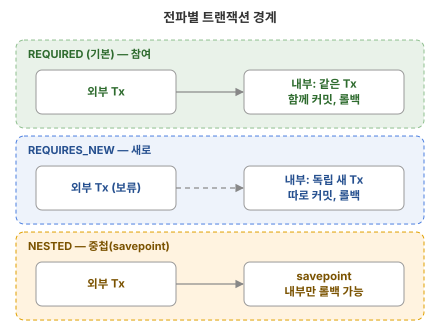
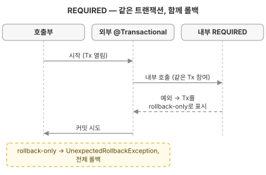
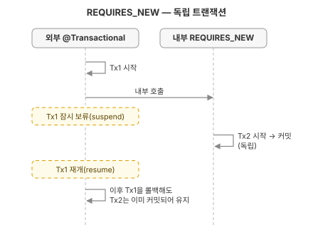

<!-- truncate -->

트랜잭션이 적용된 서비스 메서드가 **또 다른 트랜잭션 메서드를 호출**하면 트랜잭션이 어떻게 이어질까요? 새 트랜잭션이 따로 열릴까요, 기존 것에 합쳐질까요? <mark>이 규칙이 **전파(propagation)** 이고, `@Transactional(propagation = ...)` 으로 정합니다.</mark> 잘못 고르면 "내부에서 롤백했는데 전체가 같이 롤백"되거나 "따로 남겨야 할 로그가 본작업과 함께 사라지는" 문제가 생깁니다. 케이스별로 정리합니다.

## 핵심 질문: 참여할까, 새로 열까

전파는 결국 두 상황에서 어떻게 행동할지를 정합니다.

- **이미 진행 중인 트랜잭션이 있을 때** — 거기에 **참여**할까, **새로** 열까, **중첩**할까, 아니면 **예외**를 낼까.
- **진행 중인 트랜잭션이 없을 때** — **새로** 열까, **트랜잭션 없이** 실행할까, **예외**를 낼까.

<details>
<summary>SVG 코드</summary>

```svg
<svg xmlns="http://www.w3.org/2000/svg" width="440" height="330" viewBox="0 0 440 330" font-family="-apple-system, 'Segoe UI', 'Noto Sans KR', sans-serif">
<defs><marker id="ah" viewBox="0 0 10 10" refX="9" refY="5" markerWidth="7" markerHeight="7" orient="auto-start-reverse"><path d="M0,0 L10,5 L0,10 z" fill="#888"/></marker></defs>
<rect x="0" y="0" width="440" height="330" fill="#FFFFFF"/>
<text x="220.0" y="22" font-size="13" fill="#333" text-anchor="middle" font-weight="bold">전파별 트랜잭션 경계</text>
<rect x="16" y="40" width="408" height="88" rx="8" fill="#E9F2E9" stroke="#8FBF8F" stroke-dasharray="4 3"/>
<text x="28" y="58" font-size="11" fill="#2E6B2E" text-anchor="start" font-weight="bold">REQUIRED (기본) — 참여</text>
<rect x="36" y="70" width="140" height="44" rx="6" fill="#FFFFFF" stroke="#999999"/>
<text x="106.0" y="95.9" font-size="11.5" fill="#2E6B2E" text-anchor="middle" font-weight="bold">외부 Tx</text>
<rect x="244" y="70" width="160" height="44" rx="6" fill="#FFFFFF" stroke="#999999"/>
<text x="324.0" y="88.1" font-size="11.5" fill="#2E6B2E" text-anchor="middle" font-weight="bold">내부: 같은 Tx</text>
<text x="324.0" y="103.6" font-size="11.5" fill="#2E6B2E" text-anchor="middle" font-weight="bold">함께 커밋, 롤백</text>
<line x1="176" y1="92" x2="243" y2="92" stroke="#888" stroke-width="1.2" marker-end="url(#ah)"/>
<rect x="16" y="136" width="408" height="88" rx="8" fill="#EEF3FB" stroke="#4C7FE0" stroke-dasharray="4 3"/>
<text x="28" y="154" font-size="11" fill="#26508F" text-anchor="start" font-weight="bold">REQUIRES_NEW — 새로</text>
<rect x="36" y="166" width="140" height="44" rx="6" fill="#FFFFFF" stroke="#999999"/>
<text x="106.0" y="191.9" font-size="11.5" fill="#26508F" text-anchor="middle" font-weight="bold">외부 Tx (보류)</text>
<rect x="244" y="166" width="160" height="44" rx="6" fill="#FFFFFF" stroke="#999999"/>
<text x="324.0" y="184.1" font-size="11.5" fill="#26508F" text-anchor="middle" font-weight="bold">내부: 독립 새 Tx</text>
<text x="324.0" y="199.6" font-size="11.5" fill="#26508F" text-anchor="middle" font-weight="bold">따로 커밋, 롤백</text>
<line x1="176" y1="188" x2="243" y2="188" stroke="#888" stroke-width="1.2" stroke-dasharray="5 4" marker-end="url(#ah)"/>
<rect x="16" y="232" width="408" height="88" rx="8" fill="#FFF3E0" stroke="#E0A000" stroke-dasharray="4 3"/>
<text x="28" y="250" font-size="11" fill="#7A5200" text-anchor="start" font-weight="bold">NESTED — 중첩(savepoint)</text>
<rect x="36" y="262" width="140" height="44" rx="6" fill="#FFFFFF" stroke="#999999"/>
<text x="106.0" y="287.9" font-size="11.5" fill="#7A5200" text-anchor="middle" font-weight="bold">외부 Tx</text>
<rect x="244" y="262" width="160" height="44" rx="6" fill="#FFFFFF" stroke="#999999"/>
<text x="324.0" y="280.1" font-size="11.5" fill="#7A5200" text-anchor="middle" font-weight="bold">savepoint</text>
<text x="324.0" y="295.6" font-size="11.5" fill="#7A5200" text-anchor="middle" font-weight="bold">내부만 롤백 가능</text>
<line x1="176" y1="284" x2="243" y2="284" stroke="#888" stroke-width="1.2" marker-end="url(#ah)"/>
</svg>
```

</details>

<figure style={{textAlign: 'center', margin: '1.5rem 0'}}>
  
</figure>

## 7가지 전파 옵션 한눈에

| 전파 | 기존 트랜잭션이 있을 때 | 없을 때 |
|---|---|---|
| **REQUIRED**(기본) | 참여 | 새로 시작 |
| **REQUIRES_NEW** | 기존을 보류하고 **새 트랜잭션** | 새로 시작 |
| **NESTED** | **savepoint**로 중첩 | 새로 시작 |
| **SUPPORTS** | 참여 | 트랜잭션 없이 실행 |
| **NOT_SUPPORTED** | 기존을 보류, 트랜잭션 없이 실행 | 트랜잭션 없이 실행 |
| **MANDATORY** | 참여 | **예외** |
| **NEVER** | **예외** | 트랜잭션 없이 실행 |

아래에서는 실무에서 자주 사용하는 **REQUIRED, REQUIRES_NEW, NESTED** 세 가지를 케이스로 봅니다.

## ① REQUIRED (기본) — 하나의 트랜잭션으로 합친다

지정하지 않으면 이것입니다. 진행 중인 트랜잭션이 있으면 **그대로 참여**하고, 없으면 새로 시작합니다. 외부와 내부가 **하나의 트랜잭션**으로 묶여 함께 커밋되고 함께 롤백됩니다.

```java
@Service
@RequiredArgsConstructor
public class OrderService {
    private final PaymentService paymentService;

    @Transactional  // = REQUIRED
    public void placeOrder(Order order) {
        orderRepository.save(order);
        paymentService.pay(order);   // 아래 pay()도 REQUIRED → 같은 트랜잭션에 참여
    }
}

@Service
public class PaymentService {
    @Transactional  // = REQUIRED, 호출되면 placeOrder의 트랜잭션에 참여
    public void pay(Order order) { ... }
}
```

<mark>같은 트랜잭션이므로 **내부에서 예외로 롤백되면 외부까지 전부 롤백**됩니다.</mark> 특히 참여 중인 내부가 예외로 트랜잭션을 "rollback-only"로 표시하면, 외부가 정상 종료해 커밋하려는 순간 `UnexpectedRollbackException`이 납니다.

<details>
<summary>SVG 코드</summary>

```svg
<svg xmlns="http://www.w3.org/2000/svg" width="440" height="290" viewBox="0 0 440 290" font-family="-apple-system, 'Segoe UI', 'Noto Sans KR', sans-serif">
<defs><marker id="ah" viewBox="0 0 10 10" refX="9" refY="5" markerWidth="7" markerHeight="7" orient="auto-start-reverse"><path d="M0,0 L10,5 L0,10 z" fill="#888"/></marker></defs>
<rect x="0" y="0" width="440" height="290" fill="#FFFFFF"/>
<text x="220.0" y="22" font-size="13" fill="#333" text-anchor="middle" font-weight="bold">REQUIRED — 같은 트랜잭션, 함께 롤백</text>
<line x1="72" y1="67" x2="72" y2="228" stroke="#BBBBBB" stroke-dasharray="4 3"/>
<rect x="4.0" y="40" width="136" height="27" rx="6" fill="#F7F7F7" stroke="#999999"/>
<text x="72.0" y="57.4" font-size="11.5" fill="#333" text-anchor="middle" font-weight="bold">호출부</text>
<line x1="220" y1="67" x2="220" y2="228" stroke="#BBBBBB" stroke-dasharray="4 3"/>
<rect x="152.0" y="40" width="136" height="27" rx="6" fill="#F7F7F7" stroke="#999999"/>
<text x="220.0" y="57.4" font-size="11.5" fill="#333" text-anchor="middle" font-weight="bold">외부 @Transactional</text>
<line x1="368" y1="67" x2="368" y2="228" stroke="#BBBBBB" stroke-dasharray="4 3"/>
<rect x="300.0" y="40" width="136" height="27" rx="6" fill="#F7F7F7" stroke="#999999"/>
<text x="368.0" y="57.4" font-size="11.5" fill="#333" text-anchor="middle" font-weight="bold">내부 REQUIRED</text>
<line x1="72" y1="101" x2="219" y2="101" stroke="#888" stroke-width="1.2" marker-end="url(#ah)"/>
<rect x="109.9" y="85.5" width="72.2" height="13.5" fill="#FFFFFF"/>
<text x="146.0" y="96.0" font-size="10.5" fill="#333" text-anchor="middle">시작 (Tx 열림)</text>
<line x1="220" y1="137" x2="367" y2="137" stroke="#888" stroke-width="1.2" marker-end="url(#ah)"/>
<rect x="233.5" y="121.5" width="121.0" height="13.5" fill="#FFFFFF"/>
<text x="294.0" y="132.0" font-size="10.5" fill="#333" text-anchor="middle">내부 호출 (같은 Tx 참여)</text>
<line x1="368" y1="185" x2="221" y2="185" stroke="#888" stroke-width="1.2" stroke-dasharray="5 4" marker-end="url(#ah)"/>
<rect x="263.5" y="156.0" width="60.9" height="13.5" fill="#FFFFFF"/>
<text x="294.0" y="166.5" font-size="10.5" fill="#333" text-anchor="middle">예외 → Tx를</text>
<rect x="240.1" y="169.5" width="107.7" height="13.5" fill="#FFFFFF"/>
<text x="294.0" y="180.0" font-size="10.5" fill="#333" text-anchor="middle">rollback-only로 표시</text>
<line x1="220" y1="221" x2="73" y2="221" stroke="#888" stroke-width="1.2" marker-end="url(#ah)"/>
<rect x="121.3" y="205.5" width="49.4" height="13.5" fill="#FFFFFF"/>
<text x="146.0" y="216.0" font-size="10.5" fill="#333" text-anchor="middle">커밋 시도</text>
<rect x="11.0" y="237" width="270.0" height="39.0" rx="5" fill="#FFFBEA" stroke="#E0A000" stroke-dasharray="5 4"/>
<text x="146.0" y="253.5" font-size="10.5" fill="#5A4300" text-anchor="middle">rollback-only → UnexpectedRollbackException,</text>
<text x="146.0" y="268.0" font-size="10.5" fill="#5A4300" text-anchor="middle">전체 롤백</text>
</svg>
```

</details>

<figure style={{textAlign: 'center', margin: '1.5rem 0'}}>
  
</figure>

이 "부분 실패가 전체 롤백으로 이어지는" 문제와 대응은 [트랜잭션 rollback-only 이야기](./spring-transaction-rollback-only)에서 자세히 설명합니다.

## ② REQUIRES_NEW — 항상 새 트랜잭션(독립)

내부 메서드가 **자기만의 트랜잭션**을 엽니다. 기존 트랜잭션이 있으면 **잠시 보류(suspend)** 했다가, 내부가 끝나면 **재개(resume)** 합니다. 두 트랜잭션은 서로 독립이라 커밋과 롤백이 서로 분리돼 있습니다.

```java
@Service
public class OrderService {
    @Transactional  // 본작업 트랜잭션
    public void placeOrder(Order order) {
        orderRepository.save(order);
        auditService.record("주문 시도: " + order.getId());  // 아래는 REQUIRES_NEW
        paymentService.pay(order);   // 여기서 실패해 placeOrder가 롤백돼도…
    }
}

@Service
public class AuditService {
    @Transactional(propagation = Propagation.REQUIRES_NEW)
    public void record(String message) {
        auditRepository.save(new Audit(message));  // …이 이력은 이미 커밋되어 남는다
    }
}
```

<mark>내부(REQUIRES_NEW)는 독립이라, **외부가 롤백해도 이미 커밋한 내부는 남고**, 내부가 롤백해도 외부에는 영향이 없습니다.</mark> 그래서 "본작업이 실패해도 반드시 남겨야 하는" **감사 로그, 이력, 알림 기록**에 적합합니다. 다만 외부를 보류한 채 새 트랜잭션을 열므로 **DB 커넥션을 잠시 2개** 점유한다는 점은 유의합니다.

<details>
<summary>SVG 코드</summary>

```svg
<svg xmlns="http://www.w3.org/2000/svg" width="440" height="330" viewBox="0 0 440 330" font-family="-apple-system, 'Segoe UI', 'Noto Sans KR', sans-serif">
<defs><marker id="ah" viewBox="0 0 10 10" refX="9" refY="5" markerWidth="7" markerHeight="7" orient="auto-start-reverse"><path d="M0,0 L10,5 L0,10 z" fill="#888"/></marker></defs>
<rect x="0" y="0" width="440" height="330" fill="#FFFFFF"/>
<text x="220.0" y="22" font-size="13" fill="#333" text-anchor="middle" font-weight="bold">REQUIRES_NEW — 독립 트랜잭션</text>
<line x1="120" y1="67" x2="120" y2="316" stroke="#BBBBBB" stroke-dasharray="4 3"/>
<rect x="45.0" y="40" width="150" height="27" rx="6" fill="#F7F7F7" stroke="#999999"/>
<text x="120.0" y="57.4" font-size="11.5" fill="#333" text-anchor="middle" font-weight="bold">외부 @Transactional</text>
<line x1="300" y1="67" x2="300" y2="316" stroke="#BBBBBB" stroke-dasharray="4 3"/>
<rect x="225.0" y="40" width="150" height="27" rx="6" fill="#F7F7F7" stroke="#999999"/>
<text x="300.0" y="57.4" font-size="11.5" fill="#333" text-anchor="middle" font-weight="bold">내부 REQUIRES_NEW</text>
<polyline points="120,87 148,87 148,103 122,103" fill="none" stroke="#888" stroke-width="1.2" marker-end="url(#ah)"/>
<rect x="152.0" y="88.5" width="44.5" height="13.5" fill="#FFFFFF"/>
<text x="154" y="99.0" font-size="10.5" fill="#333" text-anchor="start">Tx1 시작</text>
<line x1="120" y1="137" x2="299" y2="137" stroke="#888" stroke-width="1.2" marker-end="url(#ah)"/>
<rect x="185.3" y="121.5" width="49.4" height="13.5" fill="#FFFFFF"/>
<text x="210.0" y="132.0" font-size="10.5" fill="#333" text-anchor="middle">내부 호출</text>
<rect x="45.0" y="151" width="150.0" height="24.5" rx="5" fill="#FFFBEA" stroke="#E0A000" stroke-dasharray="5 4"/>
<text x="120" y="167.5" font-size="10.5" fill="#5A4300" text-anchor="middle">Tx1 잠시 보류(suspend)</text>
<polyline points="300,189.5 328,189.5 328,205.5 302,205.5" fill="none" stroke="#888" stroke-width="1.2" marker-end="url(#ah)"/>
<rect x="332.0" y="184.2" width="80.7" height="13.5" fill="#FFFFFF"/>
<text x="334" y="194.75" font-size="10.5" fill="#333" text-anchor="start">Tx2 시작 → 커밋</text>
<rect x="332.0" y="197.8" width="31.7" height="13.5" fill="#FFFFFF"/>
<text x="334" y="208.25" font-size="10.5" fill="#333" text-anchor="start">(독립)</text>
<rect x="45.0" y="225.5" width="150.0" height="24.5" rx="5" fill="#FFFBEA" stroke="#E0A000" stroke-dasharray="5 4"/>
<text x="120" y="242.0" font-size="10.5" fill="#5A4300" text-anchor="middle">Tx1 재개(resume)</text>
<polyline points="120,266.0 148,266.0 148,282.0 122,282.0" fill="none" stroke="#888" stroke-width="1.2" marker-end="url(#ah)"/>
<rect x="152.0" y="260.8" width="100.4" height="13.5" fill="#FFFFFF"/>
<text x="154" y="271.25" font-size="10.5" fill="#333" text-anchor="start">이후 Tx1을 롤백해도</text>
<rect x="152.0" y="274.2" width="127.3" height="13.5" fill="#FFFFFF"/>
<text x="154" y="284.75" font-size="10.5" fill="#333" text-anchor="start">Tx2는 이미 커밋되어 유지</text>
</svg>
```

</details>

<figure style={{textAlign: 'center', margin: '1.5rem 0'}}>
  
</figure>

## ③ NESTED — savepoint로 부분 롤백

기존 트랜잭션 **안에서 savepoint**를 찍고 중첩 실행합니다. 내부에서 문제가 생기면 **savepoint까지만 롤백**하고 외부는 이어갈 수 있습니다.

```java
@Transactional  // 외부
public void importAll(List<Row> rows) {
    for (Row row : rows) {
        try {
            importOne(row);   // NESTED — 실패하면 이 행만 롤백하고 계속
        } catch (Exception e) {
            log.warn("행 건너뜀: {}", row.getId());
        }
    }
}

@Transactional(propagation = Propagation.NESTED)
public void importOne(Row row) { ... }
```

REQUIRES_NEW와 헷갈리기 쉬운데, 차이는 **외부와의 관계**입니다. <mark>NESTED는 외부의 일부라, **내부만 따로 롤백**할 수는 있어도 **외부가 롤백하면 내부도 함께 롤백**됩니다(REQUIRES_NEW는 완전히 독립).</mark> savepoint를 지원하는 트랜잭션 매니저, JDBC 드라이버에서만 동작합니다.

## 나머지 네 가지 (간단히)

- **SUPPORTS** — 트랜잭션이 있으면 참여, 없으면 트랜잭션 없이 실행. 조회 위주라 있으면 좋고 없어도 되는 경우.
- **NOT_SUPPORTED** — 트랜잭션 없이 실행(있으면 보류). 트랜잭션이 오히려 방해되는 오래 걸리는 작업 등.
- **MANDATORY** — 반드시 기존 트랜잭션 안에서만 호출돼야 하고, 없으면 예외. "혼자 실행되면 안 되는" 내부 로직 방어용.
- **NEVER** — 트랜잭션이 있으면 예외. 트랜잭션에서 절대 실행되면 안 되는 경우.

## 흔히 빠지는 지점 — 같은 클래스 내부 호출(self-invocation)

`@Transactional`은 스프링이 만든 **프록시**를 거쳐 동작합니다. 그런데 **같은 클래스 안에서 다른 메서드를 직접 호출**하면 프록시를 거치지 않아, 그 메서드에 붙은 전파(, 격리) 설정이 **무시**됩니다.

```java
@Service
public class OrderService {
    @Transactional
    public void placeOrder(Order order) {
        record("주문");   // ← this.record() 직접 호출 → 프록시 미경유
    }

    // REQUIRES_NEW로 독립 트랜잭션을 의도했지만, 위처럼 내부에서 부르면 적용 안 됨
    @Transactional(propagation = Propagation.REQUIRES_NEW)
    public void record(String msg) { ... }
}
```

<mark>내부 호출은 프록시를 건너뛰므로, 전파를 실제로 적용하려면 **다른 빈으로 분리해 주입**받아 호출해야 합니다.</mark>(위 REQUIRES_NEW 예시에서 `AuditService`를 별도 빈으로 둔 이유입니다.)

## 정리

- 전파는 "**기존 트랜잭션에 참여할지, 새로 열지, 중첩할지**"를 정하는 규칙입니다.
- **REQUIRED**(기본)는 하나로 합쳐 함께 커밋, 롤백, **REQUIRES_NEW**는 독립이라 따로, **NESTED**는 savepoint로 부분 롤백.
- <mark>"본작업과 함께 롤백되면 안 되는 로그, 이력"은 REQUIRES_NEW, "한 단위로 성공, 실패해야 하는 작업"은 REQUIRED가 맞습니다.</mark>
- 같은 클래스 내부 호출은 프록시를 안 거쳐 전파가 무시되니, 독립 트랜잭션이 필요하면 **빈을 분리**합니다.
- 격리 수준과 함께 보려면 [DB 트랜잭션 격리 수준](./db-isolation-levels)을 참고하세요.
