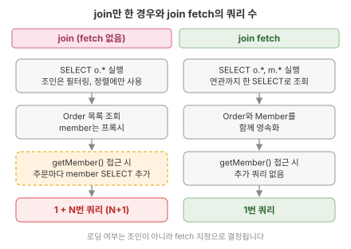
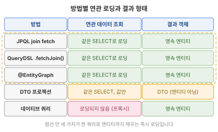

<!-- truncate -->

연관관계는 기본을 **지연 로딩(LAZY)** 으로 삼는 게 정석입니다. 그런데 특정 조회에서는 연관 엔티티를 **그 쿼리에서 함께** 가져와야 합니다(N+1, `LazyInitializationException` 방지). 문제는 "즉시 로딩"을 하는 방법이 접근 방식마다 다르고, **즉시 로딩될 거라 착각하기 쉬운 코드**가 많다는 점입니다. 방법별로 코드와 실제 쿼리를 보며 정리합니다.

<mark>핵심은 **"조인했다고 로딩되는 게 아니라, `fetch`로 연관 엔티티를 함께 영속화해야 로딩된다"** 는 점입니다 — 그래서 방법마다 fetch join에 해당하는 장치를 명시적으로 지정해야 합니다.</mark>

예시 엔티티는 이렇게 잡습니다 — `Order`는 `Member`(다대일)와 `OrderItem`(일대다)을 **LAZY** 로 참조합니다.

```java
@Entity
class Order {
    @Id @GeneratedValue Long id;

    @ManyToOne(fetch = FetchType.LAZY)
    @JoinColumn(name = "member_id")
    Member member;

    @OneToMany(mappedBy = "order", fetch = FetchType.LAZY)
    List<OrderItem> items = new ArrayList<>();
}
```

## 1. JPQL — `join fetch`

가장 표준적인 방법입니다. `join fetch`는 연관 엔티티를 **같은 SELECT로 함께 조회해 영속화**합니다.

```java
// 단건 연관(다대일) — 한 쿼리로 member까지 로딩
@Query("select o from Order o join fetch o.member where o.id = :id")
Order findWithMember(@Param("id") Long id);
```

```sql
select o.*, m.* from orders o join member m on m.id = o.member_id where o.id = ?;
```

컬렉션(일대다)은 조인 때문에 **행이 중복**되니 `distinct`로 엔티티를 정리합니다.

```java
@Query("select distinct o from Order o join fetch o.items where o.id = :id")
Order findWithItems(@Param("id") Long id);
```

> **컬렉션 fetch join의 두 제약**
>
> ① **둘 이상의 컬렉션을 동시에** fetch join하면 `MultipleBagFetchException`이 발생합니다(카테시안 곱). 하나만 fetch join하고 나머지는 `@BatchSize`/별도 조회로 해결합니다. ② **컬렉션 fetch join + 페이징**은 DB가 아니라 **메모리에서 페이징**됩니다(로그에 `HHH000104` 경고). 페이징이 필요하면 컬렉션은 fetch join하지 말고 `@BatchSize`나 2차 조회로 가져옵니다.

## 2. QueryDSL — `.fetchJoin()`

JPQL의 `join fetch`와 같은 동작을 타입 안전하게 표현합니다. **`join`/`leftJoin` 뒤에 `.fetchJoin()`을 반드시 붙여야** 로딩됩니다.

```java
queryFactory
    .selectFrom(order)
    .join(order.member, member).fetchJoin()   // fetchJoin() 없으면 로딩 안 됨
    .where(order.id.eq(id))
    .fetchOne();
```

<mark>`.fetchJoin()`을 빼고 `.join(order.member, member)`만 사용하면, 조인은 되지만 `member`는 **로딩되지 않고** 접근 시 추가 쿼리가 실행됩니다 — 가장 흔한 실수입니다.</mark>

## 3. Spring Data JPA — `@EntityGraph`

쿼리 문자열 없이 **어떤 연관관계를 함께 로딩할지 속성 경로로** 지정합니다. 내부적으로 fetch join(LEFT OUTER JOIN)으로 동작합니다.

```java
// 메서드 이름 쿼리에 그래프만 추가
@EntityGraph(attributePaths = {"member"})
Optional<Order> findById(Long id);

// @Query와 함께도 가능
@EntityGraph(attributePaths = {"member", "items"})
@Query("select o from Order o where o.id = :id")
Order findGraph(@Param("id") Long id);
```

페이징과 함께 쓰기 좋지만(단건 연관), **컬렉션을 그래프에 넣고 페이징하면** JPQL fetch join과 똑같이 메모리 페이징이 됩니다.

## 4. DTO 프로젝션 — 엔티티를 로딩하지 않고 "값만" 가져온다

필요한 필드만 DTO로 바로 뽑으면, 연관 데이터도 **같은 쿼리의 조인으로** 가져옵니다. 다만 이건 **엄밀히는 연관 엔티티의 "즉시 로딩"이 아닙니다** — 엔티티와 프록시를 만들지 않고 **스칼라 값**을 선택할 뿐입니다.

```java
// JPQL 생성자 표현식
@Query("select new com.example.OrderView(o.id, o.member.name) from Order o where o.id = :id")
OrderView findView(@Param("id") Long id);
```

```java
// QueryDSL Projections
queryFactory
    .select(Projections.constructor(OrderView.class, order.id, order.member.name))
    .from(order).join(order.member, member)
    .fetchOne();
```

`o.member.name`은 조인으로 한 쿼리에 들어오지만, **DTO에 담지 않은 다른 연관 필드는 존재하지 않습니다.** 조회 전용 화면에는 이 방식이 가장 가볍고, 지연 로딩 문제 자체가 사라집니다.

## 5. 네이티브 쿼리 — fetch join이 되지 않는다

네이티브 SQL은 **`join fetch`를 지원하지 않습니다.** 조인을 걸어 조회해도 반환 엔티티의 연관관계는 **여전히 프록시(지연)** 라, 접근하면 추가 쿼리가 실행됩니다.

```java
// member_id로 조인해도 order.member는 로딩되지 않는다
@Query(value = "select o.* from orders o join member m on m.id = o.member_id where o.id = :id",
       nativeQuery = true)
Order findNative(@Param("id") Long id);
```

연관까지 한 번에 채우려면 **`@SqlResultSetMapping`으로 두 엔티티를 각각 매핑**하거나(장황함), 애초에 **DTO로 받는** 편이 현실적입니다. 복잡한 연관 로딩이 목적이면 네이티브는 적합하지 않습니다.

```java
// 두 엔티티를 함께 매핑 — 컬럼을 모두 선택하고 결과 매핑을 선언
@SqlResultSetMapping(
    name = "OrderWithMember",
    entities = {
        @EntityResult(entityClass = Order.class),
        @EntityResult(entityClass = Member.class)
    })
```

## 즉시 로딩으로 착각하기 쉬운 경우

### ① `join`만 하고 `fetch`를 빠뜨린다

```java
// ✗ 조인은 되지만 member는 로딩 안 됨 → 접근 시 추가 쿼리
select o from Order o join o.member m where m.name = :name
// ✓ 함께 로딩하려면 fetch
select o from Order o join fetch o.member where o.member.name = :name
```

조인은 **필터링, 정렬용**이고, 로딩은 **`fetch`가 있어야** 합니다. 둘은 다릅니다.

주문 목록을 조회한 뒤 `member`에 접근할 때 두 쿼리의 실행 횟수는 다음과 같이 달라집니다.

<details>
<summary>SVG 코드</summary>

```svg
<svg xmlns="http://www.w3.org/2000/svg" width="440" height="312" viewBox="0 0 440 312" font-family="-apple-system, 'Segoe UI', 'Noto Sans KR', sans-serif">
<defs><marker id="ah" viewBox="0 0 10 10" refX="9" refY="5" markerWidth="7" markerHeight="7" orient="auto-start-reverse"><path d="M0,0 L10,5 L0,10 z" fill="#888"/></marker></defs>
<rect x="0" y="0" width="440" height="312" fill="#FFFFFF"/>
<text x="220.0" y="22" font-size="13" fill="#333" text-anchor="middle" font-weight="bold">join만 한 경우와 join fetch의 쿼리 수</text>
<rect x="15" y="36" width="200" height="24" rx="4" fill="#FCE4EC" stroke="#D06A86"/>
<text x="115" y="52" font-size="11.5" fill="#9E3A57" text-anchor="middle" font-weight="bold">join (fetch 없음)</text>
<rect x="20" y="74" width="190" height="42" rx="6" fill="#F7F7F7" stroke="#999999"/>
<text x="115" y="91.4" font-size="10.5" fill="#333" text-anchor="middle">SELECT o.* 실행</text>
<text x="115" y="105.9" font-size="10.5" fill="#333" text-anchor="middle">조인은 필터링, 정렬에만 사용</text>
<line x1="115" y1="116" x2="115" y2="130" stroke="#888" stroke-width="1.2" marker-end="url(#ah)"/>
<rect x="20" y="132" width="190" height="42" rx="6" fill="#F7F7F7" stroke="#999999"/>
<text x="115" y="149.4" font-size="10.5" fill="#333" text-anchor="middle">Order 목록 조회</text>
<text x="115" y="163.9" font-size="10.5" fill="#333" text-anchor="middle">member는 프록시</text>
<line x1="115" y1="174" x2="115" y2="188" stroke="#888" stroke-width="1.2" marker-end="url(#ah)"/>
<rect x="20" y="190" width="190" height="42" rx="6" fill="#FFF3E0" stroke="#E0A000" stroke-dasharray="4 3"/>
<text x="115" y="207.4" font-size="10.5" fill="#333" text-anchor="middle">getMember() 접근 시</text>
<text x="115" y="221.9" font-size="10.5" fill="#333" text-anchor="middle">주문마다 member SELECT 추가</text>
<line x1="115" y1="232" x2="115" y2="246" stroke="#888" stroke-width="1.2" marker-end="url(#ah)"/>
<rect x="20" y="248" width="190" height="30" rx="6" fill="#FDECEC" stroke="#D9534F"/>
<text x="115" y="267" font-size="11.5" fill="#B52B27" text-anchor="middle" font-weight="bold">1 + N번 쿼리 (N+1)</text>
<rect x="225" y="36" width="200" height="24" rx="4" fill="#E9F2E9" stroke="#8FBF8F"/>
<text x="325" y="52" font-size="11.5" fill="#2E6B2E" text-anchor="middle" font-weight="bold">join fetch</text>
<rect x="230" y="74" width="190" height="42" rx="6" fill="#F7F7F7" stroke="#999999"/>
<text x="325" y="91.4" font-size="10.5" fill="#333" text-anchor="middle">SELECT o.*, m.* 실행</text>
<text x="325" y="105.9" font-size="10.5" fill="#333" text-anchor="middle">연관까지 한 SELECT로 조회</text>
<line x1="325" y1="116" x2="325" y2="130" stroke="#888" stroke-width="1.2" marker-end="url(#ah)"/>
<rect x="230" y="132" width="190" height="42" rx="6" fill="#F7F7F7" stroke="#999999"/>
<text x="325" y="149.4" font-size="10.5" fill="#333" text-anchor="middle">Order와 Member를</text>
<text x="325" y="163.9" font-size="10.5" fill="#333" text-anchor="middle">함께 영속화</text>
<line x1="325" y1="174" x2="325" y2="188" stroke="#888" stroke-width="1.2" marker-end="url(#ah)"/>
<rect x="230" y="190" width="190" height="42" rx="6" fill="#F7F7F7" stroke="#999999"/>
<text x="325" y="207.4" font-size="10.5" fill="#333" text-anchor="middle">getMember() 접근 시</text>
<text x="325" y="221.9" font-size="10.5" fill="#333" text-anchor="middle">추가 쿼리 없음</text>
<line x1="325" y1="232" x2="325" y2="246" stroke="#888" stroke-width="1.2" marker-end="url(#ah)"/>
<rect x="230" y="248" width="190" height="30" rx="6" fill="#E9F2E9" stroke="#8FBF8F"/>
<text x="325" y="267" font-size="11.5" fill="#2E6B2E" text-anchor="middle" font-weight="bold">1번 쿼리</text>
<text x="220.0" y="300" font-size="10" fill="#888" text-anchor="middle">로딩 여부는 조인이 아니라 fetch 지정으로 결정됩니다</text>
</svg>
```

</details>

<figure style={{textAlign: 'center', margin: '1.5rem 0'}}>
  
</figure>

### ② `FetchType.EAGER`로 변경하면 JPQL도 한 번에 될 거라 생각한다

이게 가장 많이 속는 지점입니다. **JPQL 쿼리는 매핑의 `EAGER` 설정을 무시**합니다. `join fetch`가 없으면, JPQL로 `Order`를 가져온 뒤 **EAGER 연관관계를 각각 별도 SELECT로** 가져옵니다 — 즉 **EAGER인데도 N+1**이 발생합니다.

```java
// Order.member가 EAGER여도,
@Query("select o from Order o")   // fetch join 없음
List<Order> findAll();
// 실행: Order 목록 1번 + member를 Order 수만큼 추가 SELECT (N+1)
```

<mark>`EAGER`는 "항상 로딩"일 뿐 "항상 한 쿼리"가 아닙니다. 한 쿼리로 묶는 건 오직 fetch join(또는 EntityGraph)뿐입니다 — 그래서 전역 `EAGER`는 N+1을 숨겨 오히려 권장되지 않습니다.</mark>

### ③ `findById`/`findAll`로 가져오면 연관관계도 채워진 줄 안다

LAZY면 `findById`가 돌려준 엔티티의 연관 필드는 **프록시**입니다. 트랜잭션 안에서 접근하면 그제야 추가 쿼리로 로딩되고, **트랜잭션 밖에서 접근하면 `LazyInitializationException`** 이 발생합니다. "조회했으니 다 있겠지"가 가장 기본적인 착각입니다.

### ④ `@Transactional` 안에서 접근되니 "즉시 로딩"이라 여긴다

LAZY 연관을 **트랜잭션 안에서** 건드리면 `LazyInitializationException` 없이 값이 **채워지긴 합니다.** 그래서 "로딩됐다"고 여기기 쉽지만, 이건 **접근하는 순간 추가 SELECT가 한 번 더 실행되는** 지연 로딩이지 한 쿼리로 가져오는 즉시 로딩이 아닙니다.

```java
@Transactional
public void report() {
    List<Order> orders = orderRepository.findAll();   // ① 주문 목록 조회 — SELECT 1번
    for (Order o : orders) {
        o.getMember().getName();   // ② 주문마다 member 조회 SELECT가 또 나감
    }
    // 주문이 100건이면 1(목록) + 100(member) = 101번 쿼리 → 이게 N+1
}
```

만약 트랜잭션 밖이었다면 ②에서 `LazyInitializationException`이 났을 겁니다. 트랜잭션 안이라 "되긴 되는" 것일 뿐, 쿼리 수는 그대로입니다 — 즉시 로딩이 아닙니다.

### ⑤ DTO로 뽑으면 엔티티처럼 전부 들어있는 줄 안다

DTO는 **선택한 값만** 가진 평범한 객체입니다. `o.member.name`만 선택했다면 `member`의 다른 필드나 다른 연관관계는 없습니다. 엔티티가 아니므로 이후 지연 로딩도 되지 않습니다(영속성 컨텍스트 밖).

## 방법 요약

다섯 가지 방법을 연관 데이터 조회 방식과 결과 객체 기준으로 비교하면 다음과 같습니다.

<details>
<summary>SVG 코드</summary>

```svg
<svg xmlns="http://www.w3.org/2000/svg" width="440" height="266" viewBox="0 0 440 266" font-family="-apple-system, 'Segoe UI', 'Noto Sans KR', sans-serif">
<defs><marker id="ah" viewBox="0 0 10 10" refX="9" refY="5" markerWidth="7" markerHeight="7" orient="auto-start-reverse"><path d="M0,0 L10,5 L0,10 z" fill="#888"/></marker></defs>
<rect x="0" y="0" width="440" height="266" fill="#FFFFFF"/>
<text x="220.0" y="22" font-size="13" fill="#333" text-anchor="middle" font-weight="bold">방법별 연관 로딩과 결과 형태</text>
<rect x="9" y="36" width="126" height="26" rx="4" fill="#EEF3FB" stroke="#4C7FE0"/>
<text x="72.0" y="53" font-size="11" fill="#26508F" text-anchor="middle" font-weight="bold">방법</text>
<rect x="137" y="36" width="148" height="26" rx="4" fill="#EEF3FB" stroke="#4C7FE0"/>
<text x="211.0" y="53" font-size="11" fill="#26508F" text-anchor="middle" font-weight="bold">연관 데이터 조회</text>
<rect x="287" y="36" width="144" height="26" rx="4" fill="#EEF3FB" stroke="#4C7FE0"/>
<text x="359.0" y="53" font-size="11" fill="#26508F" text-anchor="middle" font-weight="bold">결과 객체</text>
<rect x="9" y="68" width="126" height="30" rx="4" fill="#F7F7F7" stroke="#999999"/>
<text x="72.0" y="87" font-size="10.5" fill="#333" text-anchor="middle" font-weight="bold">JPQL join fetch</text>
<rect x="137" y="68" width="148" height="30" rx="4" fill="#E9F2E9" stroke="#8FBF8F"/>
<text x="211.0" y="87" font-size="10.5" fill="#2E6B2E" text-anchor="middle">같은 SELECT로 로딩</text>
<rect x="287" y="68" width="144" height="30" rx="4" fill="#E9F2E9" stroke="#8FBF8F"/>
<text x="359.0" y="87" font-size="10.5" fill="#2E6B2E" text-anchor="middle">영속 엔티티</text>
<rect x="9" y="102" width="126" height="30" rx="4" fill="#F7F7F7" stroke="#999999"/>
<text x="72.0" y="121" font-size="10.5" fill="#333" text-anchor="middle" font-weight="bold">QueryDSL .fetchJoin()</text>
<rect x="137" y="102" width="148" height="30" rx="4" fill="#E9F2E9" stroke="#8FBF8F"/>
<text x="211.0" y="121" font-size="10.5" fill="#2E6B2E" text-anchor="middle">같은 SELECT로 로딩</text>
<rect x="287" y="102" width="144" height="30" rx="4" fill="#E9F2E9" stroke="#8FBF8F"/>
<text x="359.0" y="121" font-size="10.5" fill="#2E6B2E" text-anchor="middle">영속 엔티티</text>
<rect x="9" y="136" width="126" height="30" rx="4" fill="#F7F7F7" stroke="#999999"/>
<text x="72.0" y="155" font-size="10.5" fill="#333" text-anchor="middle" font-weight="bold">@EntityGraph</text>
<rect x="137" y="136" width="148" height="30" rx="4" fill="#E9F2E9" stroke="#8FBF8F"/>
<text x="211.0" y="155" font-size="10.5" fill="#2E6B2E" text-anchor="middle">같은 SELECT로 로딩</text>
<rect x="287" y="136" width="144" height="30" rx="4" fill="#E9F2E9" stroke="#8FBF8F"/>
<text x="359.0" y="155" font-size="10.5" fill="#2E6B2E" text-anchor="middle">영속 엔티티</text>
<rect x="9" y="170" width="126" height="30" rx="4" fill="#F7F7F7" stroke="#999999"/>
<text x="72.0" y="189" font-size="10.5" fill="#333" text-anchor="middle" font-weight="bold">DTO 프로젝션</text>
<rect x="137" y="170" width="148" height="30" rx="4" fill="#FFF3E0" stroke="#E0A000"/>
<text x="211.0" y="189" font-size="10.5" fill="#8A6400" text-anchor="middle">같은 SELECT, 값만</text>
<rect x="287" y="170" width="144" height="30" rx="4" fill="#FFF3E0" stroke="#E0A000"/>
<text x="359.0" y="189" font-size="10.5" fill="#8A6400" text-anchor="middle">DTO (엔티티 아님)</text>
<rect x="9" y="204" width="126" height="30" rx="4" fill="#F7F7F7" stroke="#999999"/>
<text x="72.0" y="223" font-size="10.5" fill="#333" text-anchor="middle" font-weight="bold">네이티브 쿼리</text>
<rect x="137" y="204" width="148" height="30" rx="4" fill="#FCE4EC" stroke="#D06A86"/>
<text x="211.0" y="223" font-size="10.5" fill="#9E3A57" text-anchor="middle">로딩되지 않음 (프록시)</text>
<rect x="287" y="204" width="144" height="30" rx="4" fill="#E9F2E9" stroke="#8FBF8F"/>
<text x="359.0" y="223" font-size="10.5" fill="#2E6B2E" text-anchor="middle">영속 엔티티</text>
<rect x="4" y="66" width="432" height="102" rx="6" fill="none" stroke="#E0A000" stroke-dasharray="5 4"/>
<text x="220.0" y="254" font-size="10" fill="#888" text-anchor="middle">점선 안 세 가지가 한 쿼리로 엔티티까지 채우는 즉시 로딩입니다</text>
</svg>
```

</details>

<figure style={{textAlign: 'center', margin: '1.5rem 0'}}>
  
</figure>

| 방법 | 즉시 로딩 장치 | 비고 |
|---|---|---|
| JPQL | `join fetch` | 컬렉션은 `distinct`, 다중 컬렉션, 페이징 주의 |
| QueryDSL | `.fetchJoin()` | 빠뜨리면 조인만 되고 로딩되지 않음 |
| `@EntityGraph` | `attributePaths` | 쿼리 없이 그래프 지정, 컬렉션+페이징은 메모리 페이징 |
| DTO 프로젝션 | 조인 + 값 선택 | 엔티티 로딩이 아님(값만), 조회 전용에 최적 |
| 네이티브 쿼리 | (fetch join 불가) | `@SqlResultSetMapping` 또는 DTO로 우회 |

## 정리

- 기본은 **LAZY**, 즉시 로딩은 조회할 때마다 **`join fetch`, `.fetchJoin()`, `@EntityGraph` 중 하나를 명시**해야 합니다.
- **JPQL `join fetch` / QueryDSL `.fetchJoin()` / `@EntityGraph`** 가 실제 "한 쿼리 즉시 로딩"입니다.
- **DTO 프로젝션**은 값만 가져오는 것이라 지연 로딩 문제 자체가 없지만, 엔티티는 아닙니다.
- **네이티브 쿼리**는 fetch join이 되지 않아, 연관 로딩에는 적합하지 않습니다.
- 자주 하는 착각:
  - `join`과 `join fetch`는 다릅니다 — `fetch`가 있어야 로딩됩니다.
  - `EAGER`로 변경해도 JPQL은 fetch join이 없으면 N+1입니다.
  - `findById`가 돌려준 엔티티의 연관은 프록시입니다(트랜잭션 밖이면 예외).
  - 트랜잭션 안에서 LAZY 연관에 접근하면 예외 없이 되긴 하지만, 즉시 로딩이 아니라 **접근할 때마다 실행되는 추가 쿼리**(N+1)입니다.

## 참고

- [Hibernate ORM User Guide — Fetching (`join fetch`, EntityGraph)](https://docs.hibernate.org/orm/current/userguide/html_single/Hibernate_User_Guide.html#fetching)
- [Spring Data JPA — `@EntityGraph`](https://docs.spring.io/spring-data/jpa/docs/current/reference/html/#jpa.entity-graph)
