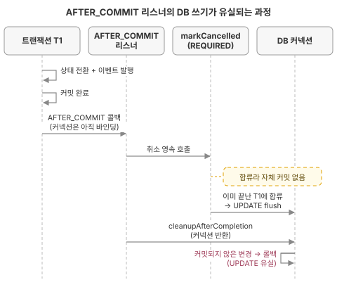
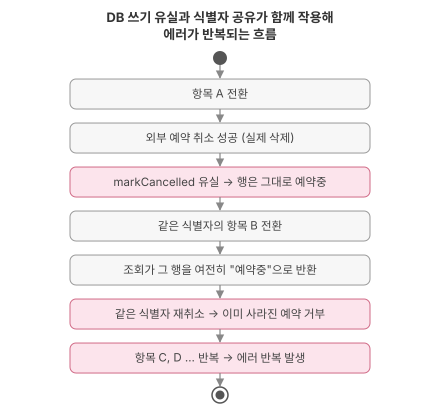

<!-- truncate -->

상태가 바뀔 때 외부 알림 서비스의 예약 메시지를 취소하고 그 결과를 DB에 "취소됨"으로 기록하는 기능이 있었습니다. 그런데 **외부 취소는 실제로 전송되는데 DB의 취소 표시만 매번 사라졌습니다 — 예외도 없이 조용히.** 원인은 외부 연동이 아니라 **`@TransactionalEventListener(AFTER_COMMIT)` 안에서의 DB 쓰기가 기본 전파로는 커밋되지 않는다**는, 트랜잭션 전파와 커밋 타이밍의 문제였습니다.

<mark>핵심은 **"AFTER_COMMIT 시점엔 원 트랜잭션이 이미 커밋돼 있는데, 기본 전파(`REQUIRED`)로 DB를 갱신하면 그 끝난 트랜잭션에 합류만 할 뿐 자체 커밋이 없어 정리 단계에서 롤백된다"** 는 점입니다.</mark>

## 상황 — 커밋 뒤에 외부 호출 + DB 갱신

상태 전환은 트랜잭션 안에서 발생하고, 전환이 **실제로 커밋된 뒤에만** 후속 처리(예약 취소)가 동작해야 합니다. 커밋 전에 외부로 취소를 보냈다가 트랜잭션이 롤백되면, 멀쩡한 예약을 삭제해 버리기 때문입니다. 그래서 후속 처리를 `AFTER_COMMIT` 리스너에 배치하는 건 자연스러운 선택입니다.

```java
@TransactionalEventListener(phase = TransactionPhase.AFTER_COMMIT)
public void cancelOnTransition(ItemTransitionedEvent event) {
    List<Reserved> reserved = port.findReserved(event.itemIds());   // 발송 전(미래) 예약분
    List<Long> cancelled = new ArrayList<>();
    for (Reserved r : reserved) {
        notifier.cancelScheduled(r.scheduledId());  // ① 외부 알림 예약 취소 (HTTP)
        cancelled.add(r.historyId());
    }
    port.markCancelled(cancelled, "상태 전환으로 예약 취소");   // ② DB에 취소 표시
}
```

```java
// 어댑터 — 전파는 기본값 REQUIRED
@Transactional
public void markCancelled(List<Long> ids, String reason) {
    repository.findAllById(ids).forEach(e -> e.cancelScheduled(reason)); // dirty checking
}
```

## 증상 — 외부는 취소되는데 DB 표시는 0건

운영 DB를 조사했더니, **"상태 전환으로 예약 취소" 사유를 가진 행이 테이블 전체에 단 한 건도 없었습니다.** `send_yn=false`인 행은 전부 *발송 실패*분이지 *취소*분이 아니었고, 취소 대상 행들의 `updated_at`은 **전부 `created_at`과 같아** 생성 후 한 번도 변경되지 않았습니다.

> **"취소가 성공했다면 취소 표시 행이 남아야 하지 않나?"**
>
> 이 질문이 핵심을 정확히 가리켰습니다. 외부로는 취소가 나갔는데(알림은 실제로 사라졌는데) DB에는 취소 흔적이 전혀 없었습니다. 외부와 DB 사이의 이 비대칭이 "DB 쓰기만 유실된다"를 가리킵니다.

## 왜 AFTER_COMMIT에서 `REQUIRED` 쓰기는 커밋되지 않나

`markCancelled`가 한 번도 반영되지 않은 이유는 **실행 위치와 전파 속성**에 있었습니다.

### 타이밍 — 콜백은 커밋 직후, 자원 정리 직전

`@TransactionalEventListener(AFTER_COMMIT)` 리스너는 원 트랜잭션 **T1이 커밋된 뒤** 실행됩니다. 정확히는 Spring이 커밋 직후 자원 정리(`cleanupAfterCompletion`) **직전에** AFTER_COMMIT 콜백을 호출합니다. 그 순간:

- **물리 트랜잭션 T1은 이미 커밋 완료** — 다시 커밋할 일이 없습니다.
- 그런데 **커넥션, 영속성 컨텍스트는 아직 스레드에 바인딩**돼 있습니다(정리 전이라).

### `REQUIRED`는 "이미 끝난 트랜잭션에 합류"한다

`markCancelled`는 전파가 기본값 `REQUIRED`입니다. `REQUIRED`는 "활성 트랜잭션이 있으면 **합류**, 없으면 새로 생성"입니다([전파 속성 정리](./spring-transaction-propagation)).

- AFTER_COMMIT 시점엔 자원이 아직 바인딩돼 있어 Spring이 "트랜잭션이 있다"고 판단합니다 → 새로 만들지 않고 **이미 커밋된 T1에 합류(participating)** 합니다.
- 합류한 트랜잭션은 메서드 종료 시 **물리 커밋을 하지 않습니다**(최외곽만 커밋하는데, 그 최외곽 = T1은 이미 끝남).

### UPDATE는 나가도 커밋이 없어 폐기

`markCancelled`는 dirty checking이라, 엔티티를 로드해 변경하면 Hibernate가 flush 때 `UPDATE`를 커넥션에 내보낼 수는 있어도 **뒤따르는 커밋이 없습니다.** 이어서 `cleanupAfterCompletion`이 커넥션을 풀로 반환하는데, autocommit=false 커넥션이라 **커밋되지 않은 변경은 반환 시 롤백**됩니다. → UPDATE 유실.

<details>
<summary>SVG 코드</summary>

```svg
<svg xmlns="http://www.w3.org/2000/svg" width="480" height="408" viewBox="0 0 480 408" font-family="-apple-system, 'Segoe UI', 'Noto Sans KR', sans-serif">
<defs><marker id="ah" viewBox="0 0 10 10" refX="9" refY="5" markerWidth="7" markerHeight="7" orient="auto-start-reverse"><path d="M0,0 L10,5 L0,10 z" fill="#888"/></marker></defs>
<rect x="0" y="0" width="480" height="408" fill="#FFFFFF"/>
<text x="240.0" y="22" font-size="13" fill="#333" text-anchor="middle" font-weight="bold">AFTER_COMMIT 리스너의 DB 쓰기가 유실되는 과정</text>
<rect x="6.0" y="38" width="108" height="40" rx="6" fill="#F7F7F7" stroke="#999999"/>
<text x="60.0" y="62.0" font-size="11.5" fill="#333" text-anchor="middle" font-weight="bold">트랜잭션 T1</text>
<line x1="60" y1="78" x2="60" y2="396" stroke="#BBBBBB" stroke-dasharray="4 3"/>
<rect x="126.0" y="38" width="108" height="40" rx="6" fill="#F7F7F7" stroke="#999999"/>
<text x="180.0" y="55.0" font-size="11.5" fill="#333" text-anchor="middle" font-weight="bold">AFTER_COMMIT</text>
<text x="180.0" y="69.0" font-size="11.5" fill="#333" text-anchor="middle" font-weight="bold">리스너</text>
<line x1="180" y1="78" x2="180" y2="396" stroke="#BBBBBB" stroke-dasharray="4 3"/>
<rect x="246.0" y="38" width="108" height="40" rx="6" fill="#F7F7F7" stroke="#999999"/>
<text x="300.0" y="55.0" font-size="11.5" fill="#333" text-anchor="middle" font-weight="bold">markCancelled</text>
<text x="300.0" y="69.0" font-size="11.5" fill="#333" text-anchor="middle" font-weight="bold">(REQUIRED)</text>
<line x1="300" y1="78" x2="300" y2="396" stroke="#BBBBBB" stroke-dasharray="4 3"/>
<rect x="366.0" y="38" width="108" height="40" rx="6" fill="#F7F7F7" stroke="#999999"/>
<text x="420.0" y="62.0" font-size="11.5" fill="#333" text-anchor="middle" font-weight="bold">DB 커넥션</text>
<line x1="420" y1="78" x2="420" y2="396" stroke="#BBBBBB" stroke-dasharray="4 3"/>
<polyline points="60,100 80,100 80,114 62,114" fill="none" stroke="#888" stroke-width="1.2" marker-end="url(#ah)"/>
<rect x="84.0" y="94.5" width="128.9" height="13.5" fill="#FFFFFF"/>
<text x="86" y="104" font-size="10.5" fill="#333" text-anchor="start">상태 전환 + 이벤트 발행</text>
<polyline points="60,132 80,132 80,146 62,146" fill="none" stroke="#888" stroke-width="1.2" marker-end="url(#ah)"/>
<rect x="84.0" y="126.5" width="52.1" height="13.5" fill="#FFFFFF"/>
<text x="86" y="136" font-size="10.5" fill="#333" text-anchor="start">커밋 완료</text>
<line x1="60" y1="190" x2="179" y2="190" stroke="#888" stroke-width="1.2" marker-end="url(#ah)"/>
<rect x="67.9" y="161.5" width="104.2" height="13.5" fill="#FFFFFF"/>
<text x="120.0" y="171" font-size="10.5" fill="#333" text-anchor="middle">AFTER_COMMIT 콜백</text>
<rect x="58.6" y="174.5" width="122.9" height="13.5" fill="#FFFFFF"/>
<text x="120.0" y="184" font-size="10.5" fill="#333" text-anchor="middle">(커넥션은 아직 바인딩)</text>
<line x1="180" y1="222" x2="299" y2="222" stroke="#888" stroke-width="1.2" marker-end="url(#ah)"/>
<rect x="200.4" y="206.5" width="79.2" height="13.5" fill="#FFFFFF"/>
<text x="240.0" y="216" font-size="10.5" fill="#333" text-anchor="middle">취소 영속 호출</text>
<line x1="300" y1="251" x2="318" y2="251" stroke="#E0A000" stroke-dasharray="3 3"/>
<rect x="318" y="238" width="140" height="26" rx="6" fill="#FFFBEA" stroke="#E0A000" stroke-dasharray="5 4"/>
<text x="388.0" y="256" font-size="10.5" fill="#5A4300" text-anchor="middle">합류라 자체 커밋 없음</text>
<line x1="300" y1="302" x2="419" y2="302" stroke="#888" stroke-width="1.2" marker-end="url(#ah)"/>
<rect x="306.0" y="273.5" width="108.0" height="13.5" fill="#FFFFFF"/>
<text x="360.0" y="283" font-size="10.5" fill="#333" text-anchor="middle">이미 끝난 T1에 합류</text>
<rect x="313.2" y="286.5" width="93.7" height="13.5" fill="#FFFFFF"/>
<text x="360.0" y="296" font-size="10.5" fill="#333" text-anchor="middle">→ UPDATE flush</text>
<line x1="180" y1="344" x2="419" y2="344" stroke="#888" stroke-width="1.2" marker-end="url(#ah)"/>
<rect x="231.0" y="315.5" width="138.0" height="13.5" fill="#FFFFFF"/>
<text x="300.0" y="325" font-size="10.5" fill="#333" text-anchor="middle">cleanupAfterCompletion</text>
<rect x="262.6" y="328.5" width="74.8" height="13.5" fill="#FFFFFF"/>
<text x="300.0" y="338" font-size="10.5" fill="#333" text-anchor="middle">(커넥션 반환)</text>
<polyline points="420,360 400,360 400,374 418,374" fill="none" stroke="#888" stroke-width="1.2" marker-end="url(#ah)"/>
<line x1="400" y1="360" x2="420" y2="360" stroke="#888" stroke-width="1.2"/>
<rect x="252.1" y="355.5" width="143.9" height="13.5" fill="#FFFFFF"/>
<text x="394" y="365" font-size="10.5" fill="#9E3A57" text-anchor="end">커밋되지 않은 변경 → 롤백</text>
<rect x="316.2" y="368.5" width="79.8" height="13.5" fill="#FFFFFF"/>
<text x="394" y="378" font-size="10.5" fill="#9E3A57" text-anchor="end">(UPDATE 유실)</text>
</svg>
```

</details>

<figure style={{textAlign: 'center', margin: '1.5rem 0'}}>
  
</figure>

<mark>예외도 안 나고 조용히 사라지기 때문에 로그에도 남지 않아 오래 나타나지 않았습니다.</mark> 반면 외부 취소 호출은 **HTTP**라 DB 트랜잭션과 무관하게 즉시 반영됩니다. 그래서 **외부 알림은 실제로 삭제되는데 DB의 취소 표시만 유실**되는 비대칭이 생깁니다 — 운영 DB에서 본 "취소 사유 0건"과 정확히 맞습니다.

## 왜 테스트로도 발견하지 못했나

이 유실은 단위 테스트로 재현하기 어렵습니다. 리스너 핸들러를 **직접 호출**하면, `markCancelled`가 테스트 트랜잭션에 합류해 UPDATE가 그 안에서 적용된 것처럼 보이고, 애초에 **AFTER_COMMIT 정리 단계를 거치지 않습니다.** 그래서 **유실이 재현되지 않아 테스트는 초록불로 통과**합니다 — 테스트가 틀린 게 아니라, 이 경로로는 버그가 나타나지 않을 뿐입니다. 실제 **이벤트 발행 → 커밋 → 리스너(AFTER_COMMIT)** 전체 경로를 재현해야 유실이 나타납니다.

## 해결 — AFTER_COMMIT에서 쓰려면 새 트랜잭션으로

AFTER_COMMIT 시점의 "이미 끝난 트랜잭션"을 피하고, **자체적으로 커밋하는 트랜잭션**에서 DB를 갱신하면 됩니다.

- **`REQUIRES_NEW`** — `markCancelled`에 `@Transactional(propagation = Propagation.REQUIRES_NEW)`를 붙입니다. `REQUIRES_NEW`는 기존(이미 끝난) 트랜잭션을 **잠시 멈추고 새 물리 트랜잭션**을 열어 자체 커밋하므로 UPDATE가 반영됩니다.
- **`TransactionTemplate`** — 리스너 안에서 새 트랜잭션을 명시적으로 열어 그 안에서 갱신합니다.
- **AFTER_COMMIT 밖으로 분리** — 외부 호출만 리스너에 남기고, DB 갱신은 별도 경로(후속 커맨드)로 옮깁니다.

```java
// 가장 간단한 해결: 취소 영속만 새 트랜잭션으로
@Transactional(propagation = Propagation.REQUIRES_NEW)
public void markCancelled(List<Long> ids, String reason) {
    repository.findAllById(ids).forEach(e -> e.cancelScheduled(reason));
}
```

> **`BEFORE_COMMIT`은 왜 안 되나**
>
> "커밋 전"에 쓰면 원 트랜잭션에 포함돼 함께 커밋됩니다. 하지만 이 경우엔 외부 취소를 **커밋이 확정된 뒤에** 보내야 하므로(롤백 시 멀쩡한 예약을 지우면 안 됨) `AFTER_COMMIT`이 맞고, 대신 DB 갱신만 새 트랜잭션으로 분리하는 게 안전합니다.

## 또 다른 문제 — 외부 호출은 멱등하지 않을 수 있다

이 장애에는 다른 문제도 함께 있었습니다. 외부 예약 식별자(`scheduledId`)가 **여러 이력 행에 공유**되는 구조라, 취소 리스너가 행 단위로 처리하며 **같은 식별자를 반복 취소**했습니다. 첫 취소는 성공하지만 그다음 같은 식별자 취소는 "이미 사라진 예약"으로 거부됩니다. 여기에 위의 DB 쓰기 유실까지 함께 발생하니, 행이 영원히 "예약중"으로 남아 **중복 취소가 끝없이 재시도**됐습니다.

<details>
<summary>SVG 코드</summary>

```svg
<svg xmlns="http://www.w3.org/2000/svg" width="440" height="406" viewBox="0 0 440 406" font-family="-apple-system, 'Segoe UI', 'Noto Sans KR', sans-serif">
<defs><marker id="ah" viewBox="0 0 10 10" refX="9" refY="5" markerWidth="7" markerHeight="7" orient="auto-start-reverse"><path d="M0,0 L10,5 L0,10 z" fill="#888"/></marker></defs>
<rect x="0" y="0" width="440" height="406" fill="#FFFFFF"/>
<text x="220" y="22" font-size="13" fill="#333" font-weight="bold" text-anchor="middle">DB 쓰기 유실과 식별자 공유가 함께 작용해</text>
<text x="220" y="39" font-size="13" fill="#333" font-weight="bold" text-anchor="middle">에러가 반복되는 흐름</text>
<circle cx="220" cy="58" r="7" fill="#555"/>
<line x1="220" y1="65" x2="220" y2="78" stroke="#888" stroke-width="1.2" marker-end="url(#ah)"/>
<rect x="70" y="79" width="300" height="30" rx="6" fill="#F7F7F7" stroke="#999999"/>
<text x="220.0" y="98.0" font-size="11.5" fill="#444" text-anchor="middle">항목 A 전환</text>
<line x1="220" y1="109" x2="220" y2="122" stroke="#888" stroke-width="1.2" marker-end="url(#ah)"/>
<rect x="70" y="123" width="300" height="30" rx="6" fill="#F7F7F7" stroke="#999999"/>
<text x="220.0" y="142.0" font-size="11.5" fill="#444" text-anchor="middle">외부 예약 취소 성공 (실제 삭제)</text>
<line x1="220" y1="153" x2="220" y2="166" stroke="#888" stroke-width="1.2" marker-end="url(#ah)"/>
<rect x="70" y="167" width="300" height="30" rx="6" fill="#FCE4EC" stroke="#D06A86"/>
<text x="220.0" y="186.0" font-size="11.5" fill="#444" text-anchor="middle">markCancelled 유실 → 행은 그대로 예약중</text>
<line x1="220" y1="197" x2="220" y2="210" stroke="#888" stroke-width="1.2" marker-end="url(#ah)"/>
<rect x="70" y="211" width="300" height="30" rx="6" fill="#F7F7F7" stroke="#999999"/>
<text x="220.0" y="230.0" font-size="11.5" fill="#444" text-anchor="middle">같은 식별자의 항목 B 전환</text>
<line x1="220" y1="241" x2="220" y2="254" stroke="#888" stroke-width="1.2" marker-end="url(#ah)"/>
<rect x="70" y="255" width="300" height="30" rx="6" fill="#F7F7F7" stroke="#999999"/>
<text x="220.0" y="274.0" font-size="11.5" fill="#444" text-anchor="middle">조회가 그 행을 여전히 "예약중"으로 반환</text>
<line x1="220" y1="285" x2="220" y2="298" stroke="#888" stroke-width="1.2" marker-end="url(#ah)"/>
<rect x="70" y="299" width="300" height="30" rx="6" fill="#FCE4EC" stroke="#D06A86"/>
<text x="220.0" y="318.0" font-size="11.5" fill="#444" text-anchor="middle">같은 식별자 재취소 → 이미 사라진 예약 거부</text>
<line x1="220" y1="329" x2="220" y2="342" stroke="#888" stroke-width="1.2" marker-end="url(#ah)"/>
<rect x="70" y="343" width="300" height="30" rx="6" fill="#FCE4EC" stroke="#D06A86"/>
<text x="220.0" y="362.0" font-size="11.5" fill="#444" text-anchor="middle">항목 C, D … 반복 → 에러 반복 발생</text>
<line x1="220" y1="373" x2="220" y2="386" stroke="#888" stroke-width="1.2" marker-end="url(#ah)"/>
<circle cx="220" cy="395" r="8" fill="#FFFFFF" stroke="#555" stroke-width="1.5"/>
<circle cx="220" cy="395" r="4.5" fill="#555"/>
</svg>
```

</details>

<figure style={{textAlign: 'center', margin: '1.5rem 0'}}>
  
</figure>

그래서 전파 수정(원인 ①)과 함께 다음을 적용했습니다.

- **식별자 단위로 중복 제거** — 같은 식별자는 **한 번만** 취소하고, 그 식별자를 공유하는 행은 **한꺼번에 취소 표시**합니다.
- **"이미 처리됨" 응답을 정상으로 흡수** — 이미 사라진 예약을 다시 취소하면 나오는 거부 응답을 에러가 아니라 "이미 취소됨"으로 처리하고, 그 행들도 취소 표시합니다.

핵심은 **외부 API가 멱등하다고(같은 요청을 여러 번 보내도 결과가 같다고) 가정하지 않는 것**입니다.

## 정리

- `@TransactionalEventListener(AFTER_COMMIT)` 리스너는 **원 트랜잭션이 이미 커밋된 뒤** 실행됩니다.
- 그 안에서 **기본 전파(`REQUIRED`)로 DB를 갱신하면** 끝난 트랜잭션에 합류만 할 뿐 자체 커밋이 없어 **정리 단계에서 롤백**됩니다 — 예외 없이 조용히 유실됩니다.
- 외부 호출(HTTP)은 반영되는데 DB 갱신만 사라져 **상태가 서로 맞지 않게 됩니다** — 외부 연동과 DB 갱신을 한 리스너에서 할 때 특히 위험합니다.
- 해결은 **`REQUIRES_NEW`**(또는 `TransactionTemplate`, AFTER_COMMIT 밖 분리)로 DB 갱신을 **자체 커밋되는 새 트랜잭션**에서 수행합니다.
- 핸들러를 직접 호출하는 테스트는 **AFTER_COMMIT 경로를 거치지 않아 이 유실을 재현하지 못한 채 통과**하니, 실제 이벤트→커밋→리스너 경로로 검증합니다.

## 참고

- [Spring — `@TransactionalEventListener` (Transaction-bound Events)](https://docs.spring.io/spring-framework/reference/data-access/transaction/event.html)
- [Spring — Transaction Propagation](https://docs.spring.io/spring-framework/reference/data-access/transaction/declarative/tx-propagation.html)
