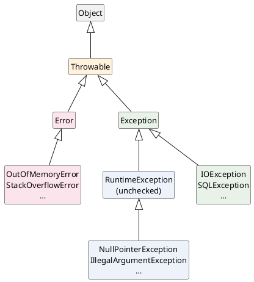

<!-- truncate -->

`try-catch`를 사용하다 보면 `catch (Exception e)`는 자주 보는데, 어떤 코드에서는 `catch (Throwable t)`가 등장합니다. 둘은 비슷해 보이지만 **처리하는 범위가 다르고, 잘못 고르면 처리하지 말아야 할 문제까지 묻어 버립니다.** <mark>차이를 이해하는 핵심은 **예외 계층 구조** — `Throwable`이 최상위이고, 그 아래 `Error`와 `Exception`이 성격이 전혀 다른 두 부류로 나뉜다는 점입니다.</mark>

## 계층 구조 한눈에

Java에서 `throw`로 던지고 `catch`로 처리할 수 있는 모든 것은 `Throwable`을 상속합니다. 그 아래로 크게 두 가지로 나뉩니다 — `Error`와 `Exception`.

<details>
<summary>PlantUML 코드</summary>



</details>


정리하면 이렇습니다.

- **`Throwable`** — 던지고 처리할 수 있는 모든 것의 **최상위 클래스**. `Error`와 `Exception`의 공통 부모.
- **`Error`** — JVM 수준의 **심각한 문제**. 어플리케이션이 복구하기 어렵습니다.
- **`Exception`** — 어플리케이션이 **다룰 수 있는** 문제. 다시 checked와 unchecked(`RuntimeException`)로 나뉩니다.

## Throwable — 던지고 처리하는 모든 것의 최상위

`Throwable`은 "예외"라는 개념 자체를 대표하는 클래스입니다. <mark>`throw` 문에 올 수 있고 `catch`로 처리할 수 있는 건 오직 `Throwable`과 그 하위 타입뿐입니다</mark> — 예컨대 `throw "문자열"`은 컴파일되지 않습니다.

예외를 다룰 때 사용하는 메서드도 전부 이 클래스에 정의돼 있습니다.

```java
public class Throwable {
    public String getMessage();        // 예외 메시지
    public Throwable getCause();       // 원인 예외 (예외 체이닝)
    public StackTraceElement[] getStackTrace();  // 스택 트레이스
    public void printStackTrace();
    // ...
}
```

즉 `getMessage()`·`getCause()`·스택 트레이스 같은 기능은 `Error`든 `Exception`이든 **모두 공통으로** 가집니다. 둘의 차이는 기능이 아니라 **"어플리케이션이 이걸 처리해야 하는가"** 라는 용도에 있습니다.

## Error — 처리하지 말아야 할 심각한 문제

`Error`는 **JVM이나 시스템 수준에서 발생하는, 어플리케이션이 복구하기 어려운 심각한 상황**을 나타냅니다. 대표적으로 `OutOfMemoryError`(힙 고갈), `StackOverflowError`(무한 재귀로 스택 초과), `NoClassDefFoundError`가 있습니다.

<mark>`Error`는 **처리하라고 만든 게 아닙니다.**</mark> 메모리가 바닥난 상황을 `catch` 한들 어플리케이션이 할 수 있는 일은 거의 없고, 억지로 무시하면 오히려 비정상 상태로 계속 동작하다가 더 큰 문제를 만듭니다. 그래서 `Error`는 보통 **그대로 전파시켜** JVM이 스레드를 종료하도록 둡니다.

```java
void recurse(int n) {
    recurse(n + 1);   // 끝없는 재귀 → 결국 StackOverflowError
}
```

이런 `StackOverflowError`를 `catch`로 막는다고 근본 원인(잘못된 재귀)이 사라지지는 않습니다. `Error`가 보이면 처리할 게 아니라 코드를 고쳐야 한다는 신호로 읽는 편이 맞습니다.

## Exception — 어플리케이션이 다루는 문제

`Exception`은 **어플리케이션 로직에서 충분히 발생할 수 있고, 처리할 가치가 있는** 문제입니다. 파일이 없거나, 네트워크가 끊기거나, 입력값이 잘못된 상황이 여기 속합니다. 그리고 `Exception`은 다시 두 가지로 나뉩니다.

### 1. checked 예외

`Exception`을 상속하되 `RuntimeException`은 아닌 것들(`IOException`, `SQLException` 등)입니다. <mark>컴파일러가 **반드시 `try-catch`로 처리하거나 `throws`로 전파하도록 강제**합니다.</mark> 처리하지 않으면 컴파일 자체가 안 됩니다.

```java
void read() throws IOException {   // throws로 전파를 명시하거나
    Files.readAllLines(path);
}

void read2() {
    try {
        Files.readAllLines(path);  // 또는 여기서 직접 처리해야 컴파일된다
    } catch (IOException e) {
        // 복구 로직
    }
}
```

### 2. unchecked 예외

`RuntimeException`과 그 하위 타입(`NullPointerException`, `IllegalArgumentException`, `IndexOutOfBoundsException` 등)입니다. 컴파일러가 처리를 강제하지 않습니다. 주로 **프로그래밍 실수**로 발생하므로, 일일이 처리하기보다 **코드를 고쳐 애초에 안 나게** 하는 쪽이 맞습니다.

> checked와 unchecked를 가르는 기준은 상속 관계 하나뿐입니다 — `RuntimeException`을 상속하면 unchecked, `Exception`만 상속하면 checked. `Error`도 unchecked로 분류됩니다(컴파일러가 처리를 강제하지 않는다는 의미에서).

## catch (Throwable) vs catch (Exception)

이제 처음 질문으로 돌아오면, 둘의 차이는 **처리하는 범위**입니다.

- `catch (Exception e)` — `Exception`과 그 하위(checked + unchecked)만 처리합니다. **`Error`는 그대로 전파됩니다.**
- `catch (Throwable t)` — `Exception`뿐 아니라 **`Error`까지 전부** 처리합니다.

```java
try {
    doSomething();
} catch (Throwable t) {   // OutOfMemoryError·StackOverflowError까지 무시한다
    log.error("무언가 실패", t);
}
```

<mark>이 코드는 `OutOfMemoryError`처럼 **그냥 종료되는 편이 나은 상황까지 처리하려다** 어플리케이션을 비정상 상태로 유지시킵니다.</mark> 그래서 일반적인 예외 처리에서는 `catch (Throwable)`을 사용하지 않고 `catch (Exception)`을 사용합니다.

`Throwable`을 처리해야 하는 경우는 많지 않습니다 — 스레드 풀·프레임워크처럼 **작업 하나가 어떤 이유로든 실패해도 전체가 멈추면 안 되는** 최상위 경계에서, 로그를 남긴 뒤 다시 던지는(rethrow) 식으로 제한적으로 사용합니다. 그마저도 보통은 `Exception`으로 충분합니다.

## 한 줄 정리

| 구분 | 한마디로 | 대표 예 | 어떻게 대하나 |
|---|---|---|---|
| `Throwable` | 던지고 처리할 수 있는 모든 것의 **최상위** | (`Error`·`Exception`의 부모) | 직접 처리하지 않음 |
| `Error` | JVM 수준의 **심각한 문제**(복구 불가) | `OutOfMemoryError`<br />`StackOverflowError` | ❌ 처리하지 말고 그대로 전파 |
| `Exception`<br />(**checked**) | 충분히 예상되는 **외부 상황** | `IOException`<br />`SQLException` | ✅ `try-catch`로 처리하거나 `throws`<br />(컴파일러가 강제) |
| `RuntimeException`<br />(**unchecked**) | 주로 **프로그래밍 실수** | `NullPointerException`<br />`IllegalArgumentException` | △ 처리하기보다 코드로 예방<br />(강제 없음) |

핵심만 요약하면 이렇습니다. <mark>`Throwable`은 최상위, `Error`는 처리하지 않고 전파할 심각한 문제, `Exception`은 처리할 문제 — 그리고 평소 예외 처리는 `catch (Exception)`이 기본입니다.</mark>
