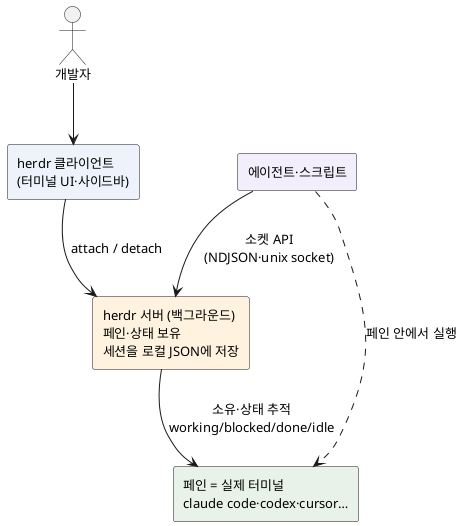

import HerdrMockup from '@site/src/components/blog/HerdrMockup';

<!-- truncate -->

코딩 에이전트를 하나만 돌릴 때는 터미널 하나면 충분합니다. 그런데 Claude Code로 리팩터링을 시키고, 옆에서 Codex로 테스트를 짜게 하고, 또 다른 저장소에서 Cursor를 돌리기 시작하면 금방 터미널 탭이 여기저기 늘어납니다. 그리고 정작 문제는 <mark>"지금 **어느 에이전트가 멈춰서 내 승인을 기다리는지**"를 탭을 일일이 열어 보기 전엔 알 수 없다는 점입니다.</mark> `Herdr`은 바로 이 지점에 초점을 둔 도구입니다 — 한 줄로 요약하면 **"코딩 에이전트용 tmux"** 입니다. (에이전트·MCP 같은 기초 용어는 [AI 용어 정리](./ai-concepts-llm-agent-mcp) 글을 참고하세요.)

## Herdr이란 — 에이전트를 아는 멀티플렉서

Herdr([herdrdev/herdr](https://github.com/herdrdev/herdr))은 **Rust로 만든 단일 바이너리** 터미널 멀티플렉서입니다. 공식 설명은 "the runtime your coding agents live on"(코딩 에이전트가 사는 런타임)이고, 라이선스는 Apache-2.0, 깃허브 스타는 4만여 개입니다(2026-10 기준).

여기서 **멀티플렉서(multiplexer)** 란 터미널 하나를 여러 칸으로 나누고 세션을 유지해 주는 도구를 말합니다 — `tmux`가 대표적입니다. Herdr도 화면을 나누고 세션을 유지한다는 점은 같습니다. <mark>차이는 Herdr은 **각 칸(페인) 안에서 에이전트가 지금 무엇을 하는지**를 안다는 것입니다</mark> — 작업 중인지(working), 내 입력을 기다리며 막혀 있는지(blocked), 끝났는지(done)를 실시간으로 구분해 보여 줍니다. `tmux`는 그 안이 셸이든 에이전트든 신경 쓰지 않지만, Herdr은 그 안을 "이해"합니다.

중요한 전제가 둘 있습니다.

- **기존 도구를 감싸거나 대체하지 않습니다.** `claude code`·`codex`·`cursor`·`opencode`·`grok` 같은 걸 평소처럼 실행하되, 그 터미널을 Herdr이 **소유**할 뿐입니다. 목록에 없는 에이전트도 평범한 멀티플렉서로서 그대로 동작합니다.
- **전부 로컬에서 돕니다.** 세션 상태는 로컬 디스크의 JSON 파일이고, 클라우드로 보내는 것이 없습니다. Electron이 아니라 **단일 Rust 바이너리**라 쓰던 터미널에서 바로 실행됩니다.

## 구조 — 클라이언트·서버와 세 단계 계층

Herdr은 **백그라운드 서버 + 클라이언트** 구조입니다. 서버가 페인과 프로세스 상태를 들고 있고, 클라이언트는 그걸 보여 주는 터미널 UI일 뿐입니다. 그래서 <mark>클라이언트를 닫거나 SSH 연결이 끊겨도 **서버와 에이전트는 계속 돕니다**(detach).</mark> 나중에 `herdr`로 다시 붙으면(reattach) 하던 작업이 그대로 이어집니다.

PlantUML 코드

화면 구성은 세 단계 계층으로 정리됩니다.

- **Workspace(워크스페이스)** — 프로젝트 단위 묶음. 탭과 페인을 소유하고, **그 안의 에이전트 상태가 위로 모여(roll up)** 사이드바에 표시됩니다. 그래서 "어느 프로젝트가 지금 손이 필요한지"가 바로 보입니다.
- **Tab(탭)** — 워크스페이스 안의 레이아웃 묶음(에이전트·로그·서버 등).
- **Pane(페인)** — 실제 터미널 프로세스 하나. 오른쪽/아래로 나누고, 이름을 바꾸고, CLI로 읽거나 입력을 보낼 수 있습니다.

에이전트 상태는 다음처럼 분류되고, 하위(페인)의 상태가 상위(탭·워크스페이스)로 모입니다.

| 상태 | 뜻 |
|---|---|
| `working` | 지금 실행 중 |
| `blocked` | 입력·승인·결정이 필요해 멈춰 있음 |
| `done` | 끝났지만 아직 안 봄 |
| `idle` | 끝났거나 대기 중 — 이미 확인함 |
| `unknown` | 확실히 분류하지 못함 |

## UI — 사이드바에서 "막힌 하나"를 바로 찾는다

아래는 Herdr 화면을 재현한 목업입니다(실제 스크린샷이 아니라 직접 그린 예시). 왼쪽 사이드바에 워크스페이스와 페인이 상태 점과 함께 나오고, 오른쪽에 포커스된 에이전트 터미널이 보입니다.

<HerdrMockup />

핵심은 왼쪽입니다. <mark>`api-server` 워크스페이스가 **blocked**로 표시된 건, 그 안의 Claude Code 페인이 파일 변경 승인을 기다리며 멈춰 있기 때문입니다</mark> — 하위 상태가 위로 모여, 탭을 열어 보지 않아도 "저 프로젝트가 날 기다린다"를 알 수 있습니다. 여러 에이전트를 동시에 돌릴 때 **멈춘 하나를 찾아 헤매지 않게** 하는 것이 Herdr UI의 요점입니다.

## 활용 시 이점

실무에서 체감되는 이점을 정리하면 이렇습니다.

- **멈춘 에이전트를 즉시 발견** — 위에서 본 상태 롤업 덕분입니다. "하나 돌려 놓고 다른 일 하다가, 승인 대기 중인 걸 한참 뒤에 발견"하는 낭비가 줄어듭니다.
- **끊겨도 작업이 안 죽는다** — 클라이언트와 서버가 분리돼 있어, 노트북을 닫거나 SSH가 끊겨도 에이전트는 서버에서 계속 돕니다. `ctrl+b q`로 떼었다가(detach) `herdr`로 다시 붙으면 됩니다.
- **여러 머신을 한 창에서** — 로컬 작업과 SSH로 연결한 원격 머신을 **하나의 에이전트 목록**으로 묶어 보고, 각자 독립적으로 재접속할 수 있습니다.
- **기존 에이전트 그대로** — 쓰던 코딩 에이전트를 바꿀 필요가 없습니다. Herdr은 실행 방식만 바꿀 뿐, 도구 자체는 그대로입니다.
- **키보드·마우스 모두 완전히 지원** — `tmux` 스타일 prefix 키(`ctrl+b`)와 클릭·드래그·분할을 **상황에 따라 골라** 쓸 수 있습니다.

### agent-native — 에이전트가 Herdr을 조종한다

가장 특징적인 건 <mark>에이전트가 **소켓 API**로 Herdr 자체를 조종할 수 있다는 점입니다</mark> — 페인을 새로 띄우고, 다른 에이전트에게 프롬프트를 보내고, **다른 에이전트가 정말로 막힐(blocked) 때까지 기다리는** 식의 흐름을 짤 수 있습니다. 이는 로컬 소켓 위에서 **줄 단위 JSON(NDJSON)** 으로 오갑니다(유닉스 도메인 소켓, 기본 경로 `~/.config/herdr/herdr.sock`). 스크립트나 상위 에이전트가 하위 에이전트들을 지휘하는 "오케스트레이션"을 터미널 안에서 구성할 수 있다는 뜻입니다. 이런 식으로 AI 작업을 잡·상태·의존으로 엮는 설계는 [AI 작업을 그래프로 설계하기](./graph-engineering-ai-workflow) 글의 관점과도 맞닿아 있습니다.

## 하네스를 쓰면 Herdr은 필요 없을까

예상되는 질문 하나 — 전에 다룬 [AI 엔지니어링 하네스](./ai-engineering-harness)는 "규칙·스킬·훅을 파일로 정의해 에이전트가 세션이 바뀌어도 일관되게 일하게" 하는 장치입니다. 그럼 하네스가 있으면 Herdr은 안 써도 될까요? <mark>답은 "둘은 다루는 영역이 달라 대체 관계가 아니다"입니다.</mark>

- **하네스**는 에이전트 **한 명의 행동**을 다룹니다 — 무엇을·어떤 순서로·어떤 안전장치 아래 일할지를 파일(규칙·스킬·훅)로 고정합니다. "에이전트가 제대로 일하게" 만드는 영역입니다.
- **Herdr**은 그런 에이전트 **여러 프로세스**를 다룹니다 — 여러 개를 띄우고, 누가 막혔는지 관찰하고, 끊겨도 유지하고, 소켓 API로 서로 조종하게 하는 런타임입니다. "에이전트들을 한눈에 몰 수 있게" 만드는 영역입니다.

그래서 하네스로 에이전트를 아무리 잘 길들여도, **동시에 여러 개를 돌리는 순간** "지금 어느 터미널이 승인을 기다리나 · 끊긴 세션을 어떻게 다시 연결하나"는 그대로 남습니다 — 이건 Herdr의 영역입니다. 반대로 Herdr로 여러 에이전트를 잘 관측해도, 각 에이전트의 작업 방식이 세션마다 달라지는 문제는 하네스가 해결합니다. 한 명을 잘 일하게 하는 하네스와 여러 명을 잘 몰 수 있게 하는 Herdr은 **함께 쓸 때 서로를 보완**합니다.

## 언제 쓰고, 무엇을 조심하나

에이전트를 **한두 개** 가끔 돌리는 정도라면 터미널 탭만으로 충분하고 Herdr의 이점이 크지 않습니다. 반대로 **여러 에이전트·여러 저장소를 동시에** 돌리거나, 원격 머신에서 장시간 작업을 재접속하며 다뤄야 한다면 효과가 분명합니다.

다만 자동화 도구인 만큼 몇 가지는 짚고 넘어가야 합니다.

- **에이전트가 에이전트를 띄운다 = 통제가 필요하다.** 소켓 API로 상위 에이전트가 페인을 생성하고 프롬프트를 보낼 수 있으므로, 파일 변경·명령 실행에는 **사람의 승인(human-in-the-loop)** 지점을 남겨야 합니다. `blocked`(승인 대기) 상태가 바로 그 지점을 가시화해 주는 장치이기도 합니다.
- **상태 추정은 완벽하지 않다.** 상태는 페인 출력 등을 보고 추정하는 것이라 `unknown`으로 빠질 수 있습니다. 상태 배지를 "참고 신호"로 보되 중요한 결정은 직접 확인하는 편이 안전합니다.
- **재시작 시 프로세스는 되살아나지 않는다.** 서버나 머신이 재시작되면 Herdr은 **저장된 레이아웃을 복원**하고 지원되는 에이전트 세션을 **재개(resume)** 할 수 있지만, **원래 프로세스 자체가 살아남는 것은 아닙니다.** "세션이 복원된다"를 "실행 중이던 명령이 중단 없이 이어진다"로 오해하지 않아야 합니다.

설치는 간단합니다 — `brew install herdr`(또는 `curl -fsSL https://herdr.dev/install.sh | sh`) 후 작업 디렉터리에서 `herdr`을 실행하면 됩니다.

## 정리

<mark>Herdr은 "에이전트를 아는 멀티플렉서"입니다 — `tmux`처럼 화면을 나누고 세션을 유지하되, 각 페인의 에이전트가 **working·blocked·done** 중 무엇인지까지 알려 줍니다.</mark> 여러 코딩 에이전트를 동시에 몰 때 "멈춘 하나"를 놓치지 않게 해 주고, detach/재접속으로 작업을 끊기지 않게 하며, 소켓 API로 에이전트끼리 오케스트레이션까지 열어 줍니다. 다만 에이전트가 에이전트를 조종할 수 있는 만큼 승인 지점을 남기고, 상태 추정·세션 복원의 한계를 알고 쓰는 것이 좋습니다. 여러 에이전트를 본격적으로 다루기 시작했다면 한 번쯤 들여 볼 만한 도구입니다.
