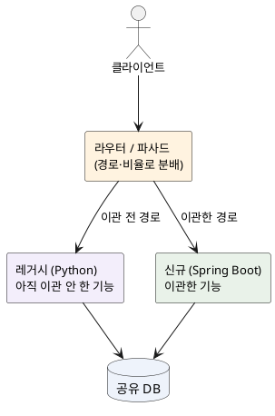
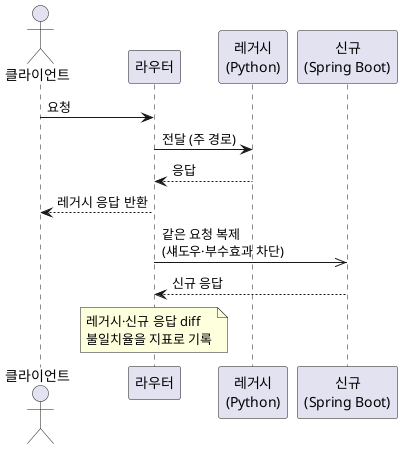

<!-- truncate -->

기존 서비스를 다른 언어·프레임워크로 이관하는 일, 즉 **포팅(porting)** 은 "다시 만들기(rewrite)"처럼 보이지만 성격이 다릅니다. 새로 만드는 게 아니라 <mark>**겉으로 드러나는 동작은 그대로 둔 채 내부 구현만 교체하는** 작업이기 때문입니다.</mark> 그래서 가장 큰 위험은 명백한 버그가 아니라, 아무도 모르게 결과가 조금 달라지는 **감지하기 어려운 동작 차이**입니다. 이 글에서는 Python으로 된 서비스를 Java Spring Boot로 포팅하는 상황을 예로, 작업 범위와 절차를 어떻게 정하고 이관 후 어떻게 검증·안정화하는지 정리합니다.

## 먼저 정할 것 — 목표와 성공 기준

포팅을 시작하기 전에 "왜 포팅하나"와 "무엇을 성공으로 볼 것인가"부터 분명히 정해야 합니다. 언어를 변경하는 것 자체는 목표가 아닙니다 — 유지보수성·성능·팀 역량·라이브러리 지원 같은 **실제 이유**가 있어야 하고, 그 이유가 그대로 성공 기준이 됩니다.

성공 기준은 보통 세 가지로 잡습니다.

- **동작 동일성** — 같은 입력에 같은 출력. 포팅의 1차 목표입니다.
- **성능·운영성** — 지연(p99)·처리량·자원 사용이 기존과 같거나 더 개선되어야 합니다.
- **데이터 정합성** — 이관 과정에서 데이터가 유실·중복·변질되지 않아야 합니다.

<mark>이 기준을 숫자로 명시하는 것이 중요합니다</mark> — "비슷하게"가 아니라 "불일치율 0.01% 이하, p99 200ms 이하"처럼 측정 가능한 선을 정해야 나중에 "이관해도 되나"를 판단할 수 있습니다.

## 작업 범위 선정 — 무엇을, 어떤 순서로

### 1. 인벤토리부터 만든다

이관할 대상의 전체 목록을 먼저 작성합니다. 눈에 보이는 HTTP 엔드포인트만이 전부가 아닙니다.

- **진입점** — REST/gRPC 엔드포인트, 메시지 컨슈머, 배치·스케줄러(cron)
- **외부 연동** — 호출하는 외부 API, 호출받는 쪽(누가 이 서비스를 쓰나)
- **데이터 접근** — 읽고 쓰는 테이블·캐시·큐
- **숨은 동작** — 로깅 포맷, 응답 헤더, 에러 코드 체계처럼 **계약의 일부지만 문서에 없는 것**

이 목록이 곧 **계약(contract)** 의 범위입니다. 포팅이란 결국 "이 계약을 그대로 지키는 새 구현"을 만드는 일입니다.

### 2. 경계를 나누고 우선순위를 정한다

한 번에 전부 이관하지 않습니다. 의존성이 적고 위험이 낮은 기능부터, 또는 반대로 **효과가 큰 병목 기능**부터 분리해 이관합니다. 기준은 보통 이렇습니다.

- 외부 의존이 적고 입출력이 명확한 기능 → 먼저 (연습 겸 파이프라인 검증)
- 트래픽이 크거나 성능 이점이 큰 기능 → 우선순위 상향
- 다른 기능이 많이 의존하는 공용 모듈 → 신중히, 뒤로

## 절차 — 스트랭글러 피그로 점진 이관

큰 서비스를 한 번에 전부 교체하는 "빅뱅 이관"은 위험이 한곳에 몰립니다. 대신 **스트랭글러 피그(Strangler Fig)** 패턴 — 기존 시스템을 감싸는 라우터를 앞에 배치하고, 기능을 하나씩 새 구현으로 이관하다가 결국 옛 시스템을 폐기하는 방식 — 을 사용합니다([Martin Fowler의 정의](https://martinfowler.com/bliki/StranglerFigApplication.html)).

PlantUML 코드

이관은 대체로 이 단계를 밟습니다.

1. **현행 동작 고정** — 이관하기 전에 기존 구현의 입출력을 **샘플로 수집**하고, 핵심 시나리오를 테스트로 박제합니다(특성화 테스트, characterization test). "지금 이렇게 동작한다"를 증거로 남기는 단계입니다.
2. **경계 세우기** — 서비스 앞에 라우터/프록시를 배치해, 경로별로 레거시·신규 중 어디로 보낼지 제어할 수 있게 합니다.
3. **기능 단위 재구현** — Spring Boot로 **같은 계약**을 만족하는 구현을 만듭니다. 이때 동작을 "개선"하려는 유혹을 참아야 합니다 — 포팅 단계에서는 **동작을 바꾸지 않는 것**이 원칙입니다(개선은 이관 완료 후 별도로).
4. **섀도우 비교** — 실제 트래픽을 신규 구현에도 복제해 전달하고, 두 결과를 비교합니다(아래에서 설명).
5. **점진 이관(카나리)** — 라우터에서 신규로 보내는 트래픽 비율을 1% → 10% → 50% → 100%로 올립니다.
6. **레거시 폐기** — 100% 이관이 안정적으로 유지되면 레거시를 제거합니다.

## 검증 — "같다"를 어떻게 증명하나

포팅 검증의 핵심 질문은 하나입니다 — **"새 구현이 레거시와 정말 같게 동작하는가?"** 이걸 말이 아니라 데이터로 보여야 합니다.

### 섀도우 트래픽으로 실제 입력을 비교한다

가장 확실한 방법은 **운영 트래픽을 그대로 두 구현에 전달해 결과를 비교**하는 것입니다. 사용자에게는 레거시 응답을 돌려주되, 같은 요청을 신규 구현에도 복제해 보내고 두 응답의 차이를 기록합니다.

PlantUML 코드

<mark>섀도우 실행에서 신규 구현은 **부수 효과를 차단**해야 합니다</mark> — DB 쓰기·외부 호출·알림 발송을 실제로 수행하면 데이터가 이중으로 변경됩니다. 읽기는 그대로 두되 쓰기는 막거나 별도 샌드박스로 보내야 안전합니다. 이렇게 모은 **불일치율**이 성공 기준(예: 0.01% 이하)에 들어오면, 남은 차이를 하나씩 들여다보며 원인을 없앱니다.

### 그 밖의 검증 층

섀도우만으로는 부족합니다. 여러 방법을 함께 사용합니다.

- **골든 테스트(계약 테스트)** — 1단계에서 수집한 입출력 샘플을 고정값으로 삼고, 신규 구현이 같은 출력을 반환하는지 자동 검증합니다.
- **회귀 테스트** — 기존 기능이 망가지지 않는지 단위·통합 테스트로 확인합니다.
- **성능·부하 비교** — 같은 부하에서 지연(p99)·처리량·자원 사용을 레거시와 나란히 측정합니다.
- **데이터 정합성 점검** — 같은 작업 후 양쪽이 만든 데이터를 대조합니다(동일 DB를 사용한다면 섀도우 쓰기 금지를 다시 확인).

## 포팅에서 결과가 달라지는 지점들

언어·런타임이 바뀌면 "같은 코드처럼 보이는데 결과가 다른" 경우가 생깁니다. 포팅에서 불일치의 원인은 대개 여기 모여 있으니 미리 점검합니다.

- **수치 연산** — Python의 정수 나눗셈(`//`)·임의 정밀도 정수, `decimal`과 Java의 `int`/`long` 오버플로·`BigDecimal` 반올림 모드 차이. 금액 계산이라면 특히 위험합니다.
- **날짜·시간** — 시간대(TZ) 기본값, 자정·윤초·서머타임 경계 처리.
- **직렬화(JSON)** — 키 순서, `null` 필드 포함 여부, 숫자·불리언 표기, 날짜 포맷. 응답 바이트가 미세하게 달라지면 하위 소비자가 오작동할 수 있습니다.
- **문자·인코딩** — 유니코드 정규화, 대소문자·정렬 기준.
- **동시성 모델** — Python의 GIL 기반 실행과 JVM의 멀티스레드는 경쟁 상태·순서 보장이 다릅니다.
- **데이터 접근 계층** — SQLAlchemy와 JPA는 쿼리 생성·지연 로딩·**트랜잭션 경계·플러시 시점**이 달라, 같은 로직도 다른 SQL이 나옵니다. JPA의 쓰기 지연·더티 체킹이 의도치 않은 UPDATE를 만드는 사례는 [Hibernate JSON 컬럼 유령 업데이트](./hibernate-json-column-phantom-update) 글에서 설명한 적이 있습니다.

## 안정성 확보 — 롤백할 수 있게 이관한다

점진 이관의 핵심은 **언제든 빠르게 롤백할 수 있다**는 데 있습니다.

- **피처 플래그·킬스위치** — 트래픽 비율과 이관 on/off를 **배포 없이** 변경할 수 있게 합니다. 문제가 보이면 즉시 레거시로 롤백합니다.
- **모니터링·알람** — 에러율·지연만이 아니라 **섀도우 불일치율**을 지표로 삼아 임계치에 알람을 겁니다.
- **점진 롤아웃** — 1%부터 올리되, 각 단계에서 기준 지표를 일정 시간 지켜본 뒤 다음 단계로 넘어갑니다.
- **롤백 계획과 런북** — "무엇을 보고 롤백할지, 어떻게 롤백할지"를 미리 문서로 남깁니다. 데이터 스키마를 함께 변경했다면 **롤백이 가능한 순서**(먼저 호환 스키마, 나중에 정리)로 진행합니다.

<mark>이관의 성패는 "완벽한 신규 구현"이 아니라 "틀렸을 때 빨리 롤백할 수 있는 구조"가 좌우합니다.</mark>

## 정리

포팅은 기능을 새로 만드는 일이 아니라 **계약을 보존한 채 구현을 변경하는** 일입니다. 순서로 요약하면 이렇습니다.

1. 목표·성공 기준을 **숫자로** 정합니다.
2. 인벤토리로 **계약의 범위**를 파악하고, 작은·명확한 것부터 경계를 나눕니다.
3. 스트랭글러 피그로 **기능 단위 점진 이관** — 포팅 단계에선 동작을 바꾸지 않습니다.
4. **섀도우 비교·골든 테스트·성능 비교**로 "같음"을 데이터로 증명합니다.
5. **피처 플래그·모니터링·롤백 계획**으로 롤백할 수 있게 이관합니다.

언어·런타임 차이에서 오는 감지하기 어려운 불일치를 미리 점검하고, 틀렸을 때 빠르게 롤백할 수 있게 해 놓으면 — 큰 서비스도 장애 없이 이관할 수 있습니다.
