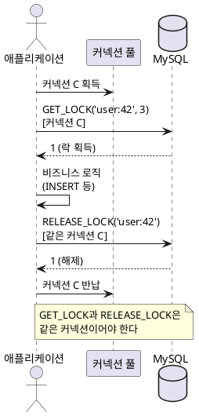

<!-- truncate -->

서버를 여러 대로 늘리면 **한 JVM 안의 락(`synchronized`)으로는 동시성을 막을 수 없습니다** — 서로 다른 인스턴스의 요청은 같은 락 객체를 공유하지 않기 때문입니다. 그래서 여러 노드가 공유하는 **분산 락**이 필요한데, 보통 Redis나 ZooKeeper를 떠올립니다(기초는 [분산 락과 Redis](./redis-distributed-lock) 참고). 하지만 <mark>이미 운영 중인 MySQL만으로도, 추가 인프라 없이 분산 락을 만들 수 있습니다 — **USER-LEVEL LOCK**(`GET_LOCK`/`RELEASE_LOCK`)을 사용하면 됩니다.</mark> 이 글은 우아한형제들 기술블로그의 [MySQL을 이용한 분산락](https://techblog.woowahan.com/2631/)(권순규, 2019) 사례를 토대로, 구현의 핵심과 한계를 정리합니다.

## 왜 분산 락이 필요한가 — 제약이 무시되는 순간

예를 들어 "한 사용자는 카드를 최대 2개까지" 같은 제약이 있다고 해봅시다. 요청이 하나씩 들어오면 "현재 개수를 세고 → 2개 미만이면 추가"가 잘 동작합니다. 그런데 **같은 사용자의 요청 20건이 동시에** 들어오면, 20개 스레드가 모두 "현재 0개"를 읽고 동시에 추가해 **카드가 20개** 생깁니다. 애플리케이션 코드의 검증은 멀쩡한데, 동시성 때문에 제약이 무시되는 것입니다.

<mark>해법은 "같은 자원(사용자)에 대한 동시 처리를 한 줄로 세우는" 분산 락입니다.</mark> (분산 락이 언제 필요하고 무엇을 조심하는지는 [분산 락은 왜·언제 필요한가](./distributed-lock-and-redis-failure)에서 자세히 설명했습니다.)

## MySQL USER-LEVEL LOCK 함수

MySQL은 **이름을 붙인 락**을 직접 걸고 푸는 함수를 제공합니다. 테이블 행 락이 아니라, 임의의 문자열을 키로 삼는 **named lock**입니다.

| 함수 | 하는 일 | 반환값 |
|---|---|---|
| `GET_LOCK(str, timeout)` | 그 이름의 락을 `timeout`초까지 기다리며 획득 | `1` 성공 · `0` 타임아웃 · `NULL` 오류 |
| `RELEASE_LOCK(str)` | 그 이름의 락 해제 | `1` 해제 · `0` 내 락이 아님 · `NULL` 없음 |
| `IS_FREE_LOCK(str)` | 획득 가능한지 확인 | `1` 가능 · `0` 사용 중 · `NULL` 오류 |
| `IS_USED_LOCK(str)` | 누가 사용하는지(커넥션 ID) | 커넥션 ID · `NULL`(미사용) |
| `RELEASE_ALL_LOCKS()` | 내 모든 락 일괄 해제 | 해제된 락 수 |

동작 특성을 공식 문서 기준으로 짚으면 이렇습니다([MySQL Locking Functions](https://dev.mysql.com/doc/refman/8.0/en/locking-functions.html)).

- **세션(커넥션) 단위** — 락은 그 락을 얻은 **커넥션에 묶이고**, 커넥션이 끊기면 자동으로 풀립니다.
- **트랜잭션과 무관** — <mark>`GET_LOCK`으로 얻은 락은 **커밋·롤백으로 풀리지 않습니다.**</mark> 트랜잭션 경계와 별개로, 명시적으로 `RELEASE_LOCK` 하거나 세션이 끝나야 풀립니다.
- **이름은 서버 전역** — 락 이름은 MySQL 서버 전체에서 유일하게 취급되어, 여러 애플리케이션 서버가 같은 이름으로 경합합니다(이름 길이 최대 64자).
- **대기 순서 미보장** — 먼저 기다린 요청이 먼저 얻는다는 보장이 없습니다.
- **다중 락** — MySQL 5.7.5부터 한 세션이 여러 이름의 락을 동시에 보유할 수 있습니다(이전 버전은 하나만, 새 락을 얻으면 기존 락이 풀렸습니다).

## 핵심은 "같은 커넥션" — 가장 많이 틀리는 지점

여기서 <mark>분산 락 구현의 성패를 가르는 핵심은 **`GET_LOCK`과 `RELEASE_LOCK`을 반드시 같은 커넥션에서 호출**하는 것입니다.</mark> 락이 커넥션에 묶여 있으니, 다른 커넥션에서 `RELEASE_LOCK`을 호출하면 "내 락이 아님(`0`)"이 되어 해제에 실패합니다.

문제는 스프링에서 흔히 사용하는 `JdbcTemplate`·`NamedParameterJdbcTemplate`이 **호출할 때마다 커넥션 풀에서 커넥션을 새로 받아 사용하고 반납**한다는 점입니다. 그래서 `GET_LOCK`과 `RELEASE_LOCK`이 **서로 다른 커넥션**에서 실행되어, 락이 풀리지 않거나 심하면 **다른 스레드의 락을 실수로 건드리는** 상황이 생깁니다.

우아한형제들 글은 이 지점을 세 단계로 해결합니다.

1. **`JdbcTemplate`만 사용** — `GET_LOCK`·`RELEASE_LOCK`이 서로 다른 커넥션을 써서 **실패**.
2. **`@Transactional` 추가** — 트랜잭션이 커넥션을 하나로 묶어 **동작은 하지만**, 락 획득과 비즈니스 로직이 **같은 커넥션·같은 트랜잭션**을 공유해 서로 영향을 줄 수 있음.
3. **`DataSource`에서 커넥션을 직접 관리** — 락 전용 커넥션을 **직접 얻어** `GET_LOCK`과 `RELEASE_LOCK`을 같은 커넥션으로 보장. 이 방식으로 제약이 정확히 지켜집니다.

<details>
<summary>PlantUML 코드</summary>



</details>


## executeWithLock — 획득·해제를 한곳에 묶기

커넥션을 직접 다루는 코드는 "획득 → 실행 → `finally`에서 해제"를 **고차 함수 하나로 감싸고**, 호출부는 임계 구역 로직만 넘기는 방식이 깔끔합니다. 그래야 커넥션 일치와 해제 누락을 구조적으로 막습니다.

```java
public <T> T executeWithLock(String key, int timeoutSec, Supplier<T> critical) {
    try (Connection conn = dataSource.getConnection()) {   // 락 전용 커넥션 하나
        if (!getLock(conn, key, timeoutSec)) {             // 같은 conn으로 GET_LOCK
            throw new LockNotAcquired(key);
        }
        try {
            return critical.get();                         // 임계 구역(비즈니스 로직)
        } finally {
            releaseLock(conn, key);                         // 같은 conn으로 RELEASE_LOCK
        }
    } catch (SQLException e) {
        throw new RuntimeException(e);
    }
}
```

호출부는 "무엇을 할지"만 넘깁니다.

```java
executeWithLock("card:user:" + userId, 3, () -> {
    // 이 블록 안에서는 같은 사용자 요청이 직렬화된다
    cardService.addCardIfUnderLimit(userId);
    return null;
});
```

<mark>이렇게 묶으면 `GET_LOCK`·`RELEASE_LOCK`이 항상 같은 커넥션을 쓰고, 어떤 경로로 끝나든 `finally`에서 반드시 해제됩니다.</mark> (락을 함수형으로 감싸는 아이디어는 Redis 락에서도 같습니다 — [대규모 결제 분산 락](./large-scale-payment-distributed-lock) 참고.)

## 조심할 점 — 공짜가 아니다

DB로 분산 락을 구현하면 인프라는 안 늘지만, 대가가 있습니다.

- **커넥션을 점유한다** — 락을 기다리는 동안 그 커넥션 하나가 묶입니다. 경합이 심하면 락 대기 커넥션이 쌓여 **커넥션 풀이 고갈**되고, 락과 무관한 요청까지 멈출 수 있습니다(이러한 연쇄 지연은 [외부 호출·풀 고갈](./external-api-timeout-server-hang)과 같은 구조). 그래서 **타임아웃을 짧게** 설정하고, 락 전용 풀을 분리하는 것도 방법입니다.
- **대기 순서가 보장되지 않는다** — 공정성이 필요하면 MySQL named lock은 맞지 않습니다.
- **트랜잭션 경계와 분리해 생각한다** — 락은 트랜잭션과 무관하게 풀리므로(커밋·롤백 영향 없음), "락 획득 → 트랜잭션 시작·커밋 → 락 해제" 순서를 직접 지켜야 합니다. 비즈니스 트랜잭션이 커밋되기 전에 락을 풀면 다음 요청이 아직 반영 안 된 데이터를 읽습니다.
- **복제·운영 제약** — 잠금 함수는 **statement 기반 복제에 안전하지 않고**(`binlog_format=STATEMENT`면 경고), NDB Cluster에서는 서버 간 락을 보장하지 못합니다. 또 모든 락 경합이 DB로 몰리니 **DB 부하**를 감안해야 합니다.

## MySQL 락 vs Redis 락 — 언제 무엇을

| 기준 | MySQL `GET_LOCK` | Redis(Redisson) |
|---|---|---|
| 추가 인프라 | 불필요(기존 DB) | 필요(Redis) |
| 성능·처리량 | DB 부하에 영향받음 | 대체로 더 높음 |
| 대기 효율 | 커넥션 점유 | Pub/Sub 대기 |
| 적합 상황 | 경합 적음·인프라 최소화 | 고빈도 경합·대규모 |

<mark>정리하면 — 경합이 많지 않고 인프라를 늘리고 싶지 않다면 MySQL `GET_LOCK`이 좋은 선택이고, 고빈도·대규모 경합이면 Redis 기반 락이 유리합니다.</mark> 어느 쪽이든 **최종 정합성은 DB 제약(유니크 인덱스·조건부 UPDATE)으로 한 번 더** 지키는 편이 안전합니다. 저수준 구현 차이는 [Redisson vs RedisTemplate](./redisson-vs-redistemplate)에서 비교했습니다.

## 정리

- 서버가 여러 대면 `synchronized`로는 못 막고, **분산 락**이 필요합니다. Redis·ZooKeeper 없이 **MySQL `GET_LOCK`** 으로도 됩니다.
- `GET_LOCK` 락은 **커넥션에 묶이고 트랜잭션과 무관**합니다. 그래서 **`GET_LOCK`과 `RELEASE_LOCK`을 같은 커넥션으로** 호출하는 것이 핵심 — `DataSource`에서 커넥션을 직접 관리하고 `executeWithLock`으로 감쌉니다.
- 대신 **커넥션 점유·대기 순서 미보장·복제 제약·DB 부하**를 감안하고, 타임아웃을 짧게 설정하며 최종 정합성은 DB 제약으로 보강합니다.
