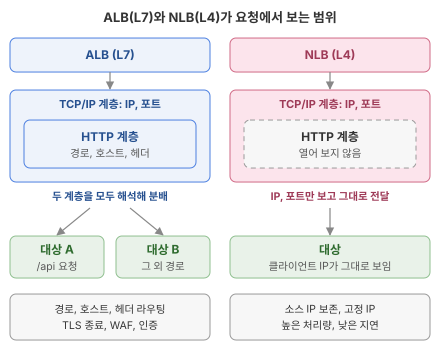
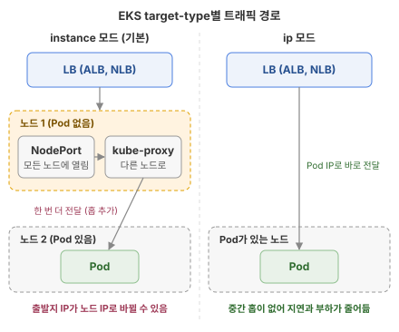

<!-- truncate -->

AWS에서 로드밸런서를 도입할 때는 먼저 **ALB와 NLB 중 무엇을 쓸지** 정해야 합니다. ALB와 NLB 모두 Elastic Load Balancing(ELB)에 속하지만 **동작하는 네트워크 계층이 다릅니다** — <mark>ALB는 **L7(애플리케이션 계층)**, NLB는 **L4(전송 계층)** 에서 동작하고, 이 차이에 따라 트래픽을 분배하는 기준이 달라집니다.</mark>

- **ALB**(Application Load Balancer) — HTTP 요청의 **내용**(경로, 호스트, 헤더)을 보고 분배합니다.
- **NLB**(Network Load Balancer) — TCP/UDP **연결(플로우)** 만 보고 그대로 전달합니다.

<details>
<summary>SVG 코드</summary>

```svg
<svg xmlns="http://www.w3.org/2000/svg" width="440" height="352" viewBox="0 0 440 352" font-family="-apple-system, 'Segoe UI', 'Noto Sans KR', sans-serif">
<defs><marker id="ah" viewBox="0 0 10 10" refX="9" refY="5" markerWidth="7" markerHeight="7" orient="auto-start-reverse"><path d="M0,0 L10,5 L0,10 z" fill="#888"/></marker></defs>
<rect x="0" y="0" width="440" height="352" fill="#FFFFFF"/>
<text x="220.0" y="22" font-size="13" fill="#333" text-anchor="middle" font-weight="bold">ALB(L7)와 NLB(L4)가 요청에서 보는 범위</text>
<rect x="10" y="38" width="200" height="34" rx="6" fill="#EEF3FB" stroke="#4C7FE0"/>
<text x="110.0" y="59.0" font-size="12" fill="#26508F" text-anchor="middle" font-weight="bold">ALB (L7)</text>
<line x1="110" y1="72" x2="110" y2="89" stroke="#888" stroke-width="1.2" marker-end="url(#ah)"/>
<rect x="10" y="90" width="200" height="92" rx="6" fill="#EEF3FB" stroke="#4C7FE0"/>
<text x="110" y="108" font-size="11" fill="#26508F" text-anchor="middle" font-weight="bold">TCP/IP 계층: IP, 포트</text>
<rect x="24" y="120" width="172" height="48" rx="6" fill="#EEF3FB" stroke="#4C7FE0"/>
<text x="110.0" y="141.0" font-size="12" fill="#26508F" text-anchor="middle" font-weight="bold">HTTP 계층</text>
<text x="110.0" y="157.0" font-size="10.5" fill="#555" text-anchor="middle">경로, 호스트, 헤더</text>
<text x="110" y="200" font-size="10.5" fill="#26508F" text-anchor="middle" font-weight="bold">두 계층을 모두 해석해 분배</text>
<line x1="90" y1="208" x2="57" y2="235" stroke="#888" stroke-width="1.2" marker-end="url(#ah)"/>
<line x1="130" y1="208" x2="163" y2="235" stroke="#888" stroke-width="1.2" marker-end="url(#ah)"/>
<rect x="10" y="236" width="94" height="42" rx="6" fill="#E9F2E9" stroke="#8FBF8F"/>
<text x="57.0" y="254.0" font-size="12" fill="#2E6B2E" text-anchor="middle" font-weight="bold">대상 A</text>
<text x="57.0" y="270.0" font-size="10.5" fill="#555" text-anchor="middle">/api 요청</text>
<rect x="116" y="236" width="94" height="42" rx="6" fill="#E9F2E9" stroke="#8FBF8F"/>
<text x="163.0" y="254.0" font-size="12" fill="#2E6B2E" text-anchor="middle" font-weight="bold">대상 B</text>
<text x="163.0" y="270.0" font-size="10.5" fill="#555" text-anchor="middle">그 외 경로</text>
<rect x="10" y="294" width="200" height="46" rx="6" fill="#F7F7F7" stroke="#999999"/>
<text x="110" y="313" font-size="10.5" fill="#333" text-anchor="middle">경로, 호스트, 헤더 라우팅</text>
<text x="110" y="329" font-size="10.5" fill="#333" text-anchor="middle">TLS 종료, WAF, 인증</text>
<rect x="230" y="38" width="200" height="34" rx="6" fill="#FCE4EC" stroke="#D06A86"/>
<text x="330.0" y="59.0" font-size="12" fill="#9E3A57" text-anchor="middle" font-weight="bold">NLB (L4)</text>
<line x1="330" y1="72" x2="330" y2="89" stroke="#888" stroke-width="1.2" marker-end="url(#ah)"/>
<rect x="230" y="90" width="200" height="92" rx="6" fill="#FCE4EC" stroke="#D06A86"/>
<text x="330" y="108" font-size="11" fill="#9E3A57" text-anchor="middle" font-weight="bold">TCP/IP 계층: IP, 포트</text>
<rect x="244" y="120" width="172" height="48" rx="6" fill="#F7F7F7" stroke="#999999" stroke-dasharray="5 4"/>
<text x="330.0" y="141.0" font-size="12" fill="#333" text-anchor="middle" font-weight="bold">HTTP 계층</text>
<text x="330.0" y="157.0" font-size="10.5" fill="#555" text-anchor="middle">열어 보지 않음</text>
<text x="330" y="200" font-size="10.5" fill="#9E3A57" text-anchor="middle" font-weight="bold">IP, 포트만 보고 그대로 전달</text>
<line x1="330" y1="208" x2="330" y2="235" stroke="#888" stroke-width="1.2" marker-end="url(#ah)"/>
<rect x="230" y="236" width="200" height="42" rx="6" fill="#E9F2E9" stroke="#8FBF8F"/>
<text x="330.0" y="254.0" font-size="12" fill="#2E6B2E" text-anchor="middle" font-weight="bold">대상</text>
<text x="330.0" y="270.0" font-size="10.5" fill="#555" text-anchor="middle">클라이언트 IP가 그대로 보임</text>
<rect x="230" y="294" width="200" height="46" rx="6" fill="#F7F7F7" stroke="#999999"/>
<text x="330" y="313" font-size="10.5" fill="#333" text-anchor="middle">소스 IP 보존, 고정 IP</text>
<text x="330" y="329" font-size="10.5" fill="#333" text-anchor="middle">높은 처리량, 낮은 지연</text>
</svg>
```

</details>

<figure style={{textAlign: 'center', margin: '1.5rem 0'}}>
  
</figure>

## L7 vs L4 — 무엇을 보고 분배하나

L4와 L7은 OSI 7계층 모델에서의 위치입니다.

- **L4(전송 계층)** — TCP/UDP 수준. 패킷의 **IP, 포트**만 보고 어느 대상으로 보낼지 정합니다. 요청 **내용은 열어 보지 않습니다.**
- **L7(애플리케이션 계층)** — HTTP 수준. 요청을 **해석해** 경로(`/api`), 호스트, 헤더, 쿼리, 메서드까지 보고 분배합니다.

<mark>그래서 NLB는 "연결을 그대로 넘기는" 단순, 고속 분배에, ALB는 "내용을 보고 똑똑하게 라우팅"하는 데 강합니다.</mark>

## 한눈에 비교

| 기준 | ALB (L7) | NLB (L4) |
|---|---|---|
| 동작 계층 | 애플리케이션(L7) | 전송(L4) |
| 프로토콜 | HTTP, HTTPS, gRPC | TCP, UDP, TLS |
| 라우팅 | **내용 기반**(경로, 호스트, 헤더, 쿼리, 메서드) | **플로우 해시**(IP, 포트) |
| 소스 IP | 백엔드는 ALB IP를 봄 → 클라이언트 IP는 `X-Forwarded-For` 헤더 | **실제 클라이언트 IP 그대로 보존** |
| 고정 IP | 없음(DNS 이름만, IP는 바뀜) | **AZ당 고정 IP / Elastic IP** |
| 성능, 지연 | L7 처리로 약간의 오버헤드 | **초고성능, 초저지연**(초당 수백만) |
| 대표 기능 | WAF, 인증(Cognito/OIDC), 리다이렉트, 스티키 | 급격한 스파이크, PrivateLink |
| 타깃 | 인스턴스, IP, **Lambda** | 인스턴스, IP, **ALB** |

## ALB — L7의 강점

ALB는 요청을 해석하므로 **내용 기반 라우팅**이 가능합니다. 하나의 진입점에서 경로와 호스트별로 서로 다른 서비스(타깃 그룹)에 보낼 수 있습니다.

- **라우팅 규칙** — `/api/*`는 주문 서비스로, `/img/*`는 이미지 서비스로, `admin.example.com`은 관리자 서비스로.
- **HTTP 기능** — HTTPS/TLS 종료, HTTP→HTTPS 리다이렉트, 고정 응답, 헤더 재작성, **WebSocket, gRPC** 지원.
- **보안, 인증** — **AWS WAF** 연동, Cognito/OIDC 기반 **인증**을 로드밸런서 단에서 처리.
- **스티키 세션** — 쿠키로 같은 사용자를 같은 대상에 고정.
- **Lambda 타깃** — 서버 없이 Lambda로 바로 요청을 보낼 수 있습니다.

<mark>HTTP(S) 기반 마이크로서비스에서 경로와 호스트로 나눠 보내고, WAF, 인증까지 앞단에서 처리하고 싶다면 ALB입니다.</mark>

## NLB — L4의 강점

NLB는 연결을 해석하지 않고 그대로 넘기므로 **극한의 성능과 낮은 지연**을 보입니다. 사전 워밍업 없이 **급격한 트래픽 폭증**도 그대로 처리합니다.

- **TCP/UDP** — HTTP가 아닌 프로토콜(게임, IoT, DB, gRPC 위의 커스텀 등)도 처리.
- **소스 IP 보존** — 백엔드가 **실제 클라이언트 IP를 그대로** 봅니다(ALB처럼 헤더로 전달하는 게 아니라 패킷 수준에서 보존). IP 기반 접근 제어와 감사에 유리.
- **고정 IP / Elastic IP** — AZ마다 고정 IP를 줄 수 있어, **방화벽 화이트리스트**에 넣기 좋습니다(ALB는 DNS 이름만 제공).
- **PrivateLink** — VPC 엔드포인트 서비스를 만들 때 사용하는 진입점이 NLB입니다.
- **ALB를 타깃으로** — NLB(고정 IP) 뒤에 ALB(L7 라우팅)를 배치해 양쪽 장점을 함께 사용할 수도 있습니다.

<mark>TCP/UDP, 극한 성능, 고정 IP, 소스 IP 보존과 PrivateLink가 필요하면 NLB입니다.</mark>

## 자주 헷갈리는 — 소스 IP와 고정 IP

두 가지는 실무에서 선택을 결정하는 대표적인 기준입니다.

- **소스 IP** — ALB는 연결을 종료(terminate)하므로 백엔드 입장에선 **ALB의 IP**가 출발지입니다. 실제 클라이언트 IP는 `X-Forwarded-For` 헤더로 전달되니, 애플리케이션이 그 헤더를 읽어야 합니다. NLB(인스턴스, IP 타깃)는 **클라이언트 IP가 패킷에 그대로** 남아, 백엔드가 별도 설정 없이 실제 IP를 봅니다.
- **고정 IP** — ALB는 IP가 수시로 바뀌어 **DNS 이름으로만** 참조해야 합니다. 상대 방화벽에 "이 IP만 허용"을 넣어야 한다면 ALB로는 곤란하고, **고정 IP를 제공하는 NLB**가 맞습니다.

## 쿠버네티스(EKS)에서는 — Ingress vs Service

EKS에서는 **AWS Load Balancer Controller**가 쿠버네티스 리소스를 보고 로드밸런서를 만들어 줍니다. 리소스 종류로 나뉩니다.

- **ALB → `Ingress`** — HTTP 경로, 호스트 라우팅 규칙을 `Ingress`로 선언하면, 컨트롤러가 그 규칙대로 ALB를 구성합니다(`/api`는 주문 서비스, `/img`는 이미지 서비스처럼).
- **NLB → `Service`(type: LoadBalancer)** — L4 그대로 노출할 때는 `Service`를 LoadBalancer 타입으로 만들면 NLB가 생깁니다.

```yaml
# ALB — Ingress로 HTTP 라우팅
kind: Ingress
metadata:
  annotations:
    alb.ingress.kubernetes.io/scheme: internet-facing
    alb.ingress.kubernetes.io/target-type: ip   # instance(기본) 대신 Pod IP로 직접
spec:
  ingressClassName: alb
---
# NLB — Service(LoadBalancer)로 L4 노출
kind: Service
metadata:
  annotations:
    service.beta.kubernetes.io/aws-load-balancer-type: external
    service.beta.kubernetes.io/aws-load-balancer-nlb-target-type: ip
spec:
  type: LoadBalancer
```

여기서 **IP 모드**란 위 애너테이션의 **`target-type: ip`**(ALB), **`nlb-target-type: ip`**(NLB)를 말합니다. 기본값은 `instance`입니다.

**NodePort**는 클러스터의 **모든 노드에 똑같이 열리는 포트**(기본 30000~32767 범위)로, 그 포트로 들어온 트래픽을 해당 Service의 Pod으로 넘겨 주는 입구입니다. `instance` 모드에선 로드밸런서가 **노드들**을 타깃으로 지정하고 이 NodePort로 보내는데, 받은 노드에 해당 Pod이 없으면 `kube-proxy`가 **다른 노드의 Pod으로 한 번 더 넘깁니다**. 즉 홉이 하나 더 생기고, 그 과정에서 출발지 IP가 노드 IP로 바뀌기도 합니다. <mark>`ip` 모드는 이 중간 단계를 건너뛰고 로드밸런서가 **Pod IP로 바로** 전달합니다 — 홉이 줄어 지연과 부하에 유리합니다.</mark>

<details>
<summary>SVG 코드</summary>

```svg
<svg xmlns="http://www.w3.org/2000/svg" width="440" height="366" viewBox="0 0 440 366" font-family="-apple-system, 'Segoe UI', 'Noto Sans KR', sans-serif">
<defs><marker id="ah" viewBox="0 0 10 10" refX="9" refY="5" markerWidth="7" markerHeight="7" orient="auto-start-reverse"><path d="M0,0 L10,5 L0,10 z" fill="#888"/></marker></defs>
<rect x="0" y="0" width="440" height="366" fill="#FFFFFF"/>
<line x1="220" y1="36" x2="220" y2="356" stroke="#DDDDDD" stroke-dasharray="4 4"/>
<text x="220.0" y="22" font-size="13" fill="#333" text-anchor="middle" font-weight="bold">EKS target-type별 트래픽 경로</text>
<text x="110" y="46" font-size="12" fill="#333" text-anchor="middle" font-weight="bold">instance 모드 (기본)</text>
<rect x="30" y="58" width="160" height="38" rx="6" fill="#EEF3FB" stroke="#4C7FE0"/>
<text x="110.0" y="81.0" font-size="12" fill="#26508F" text-anchor="middle" font-weight="bold">LB (ALB, NLB)</text>
<rect x="10" y="250" width="200" height="72" rx="8" fill="#F7F7F7" stroke="#999999" stroke-dasharray="4 3"/>
<text x="22" y="268" font-size="11" fill="#333" text-anchor="start" font-weight="bold">노드 2 (Pod 있음)</text>
<rect x="67" y="276" width="86" height="36" rx="6" fill="#E9F2E9" stroke="#8FBF8F"/>
<text x="110.0" y="298.0" font-size="12" fill="#2E6B2E" text-anchor="middle" font-weight="bold">Pod</text>
<line x1="110" y1="96" x2="110" y2="121" stroke="#888" stroke-width="1.2" marker-end="url(#ah)"/>
<rect x="10" y="122" width="200" height="88" rx="8" fill="#FFF3E0" stroke="#E0A000" stroke-dasharray="4 3"/>
<text x="22" y="140" font-size="11" fill="#7A5200" text-anchor="start" font-weight="bold">노드 1 (Pod 없음)</text>
<rect x="20" y="150" width="84" height="46" rx="6" fill="#F7F7F7" stroke="#999999"/>
<text x="62.0" y="170.0" font-size="12" fill="#333" text-anchor="middle" font-weight="bold">NodePort</text>
<text x="62.0" y="186.0" font-size="10.5" fill="#555" text-anchor="middle">모든 노드에 열림</text>
<rect x="116" y="150" width="84" height="46" rx="6" fill="#F7F7F7" stroke="#999999"/>
<text x="158.0" y="170.0" font-size="12" fill="#333" text-anchor="middle" font-weight="bold">kube-proxy</text>
<text x="158.0" y="186.0" font-size="10.5" fill="#555" text-anchor="middle">다른 노드로</text>
<line x1="104" y1="173" x2="115" y2="173" stroke="#888" stroke-width="1.2" marker-end="url(#ah)"/>
<line x1="158" y1="196" x2="120" y2="275" stroke="#888" stroke-width="1.2" marker-end="url(#ah)"/>
<text x="130" y="236" font-size="10" fill="#9E3A57" text-anchor="end">한 번 더 전달 (홉 추가)</text>
<text x="110" y="344" font-size="10.5" fill="#9E3A57" text-anchor="middle" font-weight="bold">출발지 IP가 노드 IP로 바뀔 수 있음</text>
<text x="330" y="46" font-size="12" fill="#333" text-anchor="middle" font-weight="bold">ip 모드</text>
<rect x="250" y="58" width="160" height="38" rx="6" fill="#EEF3FB" stroke="#4C7FE0"/>
<text x="330.0" y="81.0" font-size="12" fill="#26508F" text-anchor="middle" font-weight="bold">LB (ALB, NLB)</text>
<rect x="230" y="250" width="200" height="72" rx="8" fill="#F7F7F7" stroke="#999999" stroke-dasharray="4 3"/>
<text x="242" y="268" font-size="11" fill="#333" text-anchor="start" font-weight="bold">Pod가 있는 노드</text>
<rect x="287" y="276" width="86" height="36" rx="6" fill="#E9F2E9" stroke="#8FBF8F"/>
<text x="330.0" y="298.0" font-size="12" fill="#2E6B2E" text-anchor="middle" font-weight="bold">Pod</text>
<line x1="330" y1="96" x2="330" y2="275" stroke="#888" stroke-width="1.2" marker-end="url(#ah)"/>
<text x="338" y="186" font-size="10" fill="#2E6B2E" text-anchor="start">Pod IP로 바로 전달</text>
<text x="330" y="344" font-size="10.5" fill="#2E6B2E" text-anchor="middle" font-weight="bold">중간 홉이 없어 지연과 부하가 줄어듦</text>
</svg>
```

</details>

<figure style={{textAlign: 'center', margin: '1.5rem 0'}}>
  
</figure>

## ALB와 Spring Cloud Gateway — 인프라 로드밸런서 vs 애플리케이션 게이트웨이

"ALB도 L7 라우팅을 하는데 Spring Cloud Gateway는 왜 사용하나?"라는 질문이 자주 나옵니다. ALB와 Spring Cloud Gateway는 **동작하는 위치**가 다릅니다.

- **ALB** — AWS가 **인프라 계층에서** 제공하는 로드밸런서입니다. 맨 앞 진입점에서 **큰 단위로** 나눠 보내고, 다음 같은 일을 **관리형으로** 처리합니다.
    - **TLS 종료** — 클라이언트와의 HTTPS 암호화를 ALB가 풀어, 뒤 서버에는 복호화된 평문 요청만 전달합니다(인증서도 ALB에서 관리). 예: 브라우저는 `https://`로 접속하지만 백엔드 서버는 복잡한 암호화 처리를 신경 쓰지 않습니다.
    - **WAF**(Web Application Firewall, 웹 애플리케이션 방화벽) — 요청 내용을 규칙으로 검사해 수상한 것을 애플리케이션에 닿기 전에 차단합니다(AWS에서는 `AWS WAF`를 ALB에 붙여 관리형 룰셋, 요청 빈도 제한 등을 적용). 다음 같은 요청을 막습니다.
        - **SQL 인젝션** — 입력값에 `' OR 1=1 --` 같은 DB 조작 구문이 포함된 요청
        - **XSS**(크로스 사이트 스크립팅) — `<script>` 태그로 악성 스크립트를 심으려는 시도
        - **과도한 요청 빈도** — 한 IP가 초당 수백 번씩 보내는 비정상 트래픽(요청 수를 제한하는 rate limit으로 차단)
    - **경로/호스트 라우팅** — URL을 보고 목적지를 나눕니다. 예: `api.example.com`은 API 서버로, `/img/*` 경로는 이미지 서버로 보냅니다.
- **Spring Cloud Gateway** — 우리가 직접 배포하는 **애플리케이션**입니다(코드로 동작하는 리버스 프록시). 여기선 **요청 하나하나**를 세밀하게 제어합니다. 예를 들어 "JWT가 있는지 검사", "사용자당 초당 10회로 제한(레이트 리밋)", "뒤 서비스가 실패하면 차단(서킷 브레이커)", "헤더를 붙여 전달" 같은 **필터**를 코드와 설정으로 적용합니다.

<mark>정리하면 ALB는 "경로와 호스트로 나눠 보내는" **큰 단위 라우팅**에, Spring Cloud Gateway는 "요청마다 인증, 변환, 제어까지" 하는 **세밀한 게이트웨이**에 강합니다.</mark> 그래서 보통 함께 구성합니다.

- 클라이언트 → **ALB**(TLS 종료, WAF, 경로/호스트 라우팅) → **Spring Cloud Gateway**(요청별 인증, 필터) → 마이크로서비스
- 고정 IP가 필요하면 맨 앞에 NLB를 배치해 `NLB → ALB → Spring Cloud Gateway`로 구성하기도 합니다.

Spring Cloud Gateway는 기본이 WebFlux(리액티브) 기반이라, 비동기 처리 특성은 [WebFlux vs MVC](./spring-webflux-vs-mvc)를 참고하세요.

## 선택 기준

| 상황 | 선택 |
|---|---|
| 경로, 호스트별 라우팅, HTTP(S) 서비스 | ALB |
| EKS에서 HTTP 라우팅(`Ingress`) | ALB |
| WAF, 인증을 앞단에서 처리 | ALB |
| TCP/UDP(비 HTTP) 프로토콜 | NLB |
| 초고성능, 초저지연, 급격한 스파이크 | NLB |
| 고정 IP(방화벽 화이트리스트), 소스 IP 보존 | NLB |
| PrivateLink(엔드포인트 서비스) | NLB |

> 참고로 **CLB(Classic)** 는 L4/L7 혼합의 **레거시**라 신규에는 권장하지 않고, **GWLB(Gateway)** 는 방화벽 같은 네트워크 **어플라이언스**를 끼울 때 사용하는 L3 로드밸런서입니다.

## 정리

- **ALB=L7, NLB=L4** — ALB는 요청 **내용**을 보고(경로, 호스트, 헤더) 똑똑하게 라우팅하고, NLB는 **연결**만 보고 빠르게 전달합니다.
- **ALB**: HTTP(S), gRPC, WebSocket, 내용 기반 라우팅, WAF, 인증, 리다이렉트, Lambda 타깃.
- **NLB**: TCP/UDP, 초고성능, 저지연, **고정 IP, 소스 IP 보존**, PrivateLink.
- <mark>HTTP를 내용으로 나눠야 하면 ALB, 극한 성능, 고정 IP, L4가 필요하면 NLB — **NLB 뒤에 ALB**로 함께 구성하기도 합니다.</mark>
