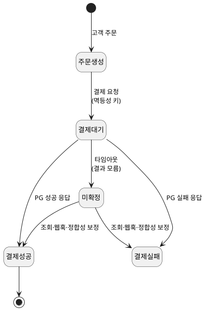
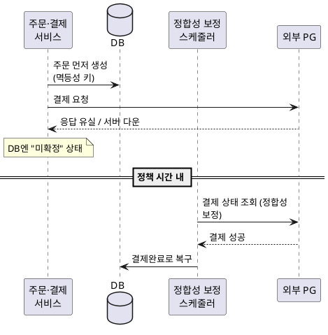

<!-- truncate -->

결제 시스템에는 다루기 어려운 불일치가 있습니다 — <mark>**고객은 돈을 냈는데 우리 쪽엔 주문이 없는** 상황입니다.</mark> 우리 서비스와 외부 PG(Payment Gateway, 결제·정산을 대행하는 외부 시스템)는 **물리적으로 분리된 분산 시스템**이라, PG가 결제를 끝내고 그 결과를 우리에게 알려 주기 직전에 우리 서버가 내려가면, 돈은 빠져나갔는데 주문은 완료되지 않습니다. 이 글은 이러한 결제·주문 정합성 문제를 "장애를 막기"가 아니라 **"장애가 나도 결국 올바른 상태로 복구되게"** 설계하는 과정을 정리합니다.

## 문제 — 두 시스템 사이에서 응답이 사라진다

흐름은 단순합니다. 고객이 결제를 시도하면 우리 서비스가 외부 PG를 호출해 결제를 요청하고, PG가 결과를 응답합니다. 문제는 그 사이입니다.

- PG가 결제를 **성공적으로 처리**했지만, 그 성공 응답이 우리에게 닿기 전에 **우리 서버가 내려가거나 네트워크가 끊기면** — 우리 DB에는 결제 성공이 반영되지 않습니다.
- 결과: **PG에는 결제가 있는데 우리에겐 주문이 없습니다.** 고객은 돈을 냈지만 상품·서비스를 받지 못합니다.

<mark>핵심 전제는 "두 시스템이 분리돼 있으니 응답은 언제든 유실될 수 있다"입니다.</mark> 그래서 각 단계에서 "실패하면 어떻게 복구할지"를 먼저 정해야 합니다.

## 설계 결정 — 네 가지

### 1. 주문을 결제보다 먼저 만든다

"결제가 성공해야 주문을 만든다"로 하면, 위 상황(성공 응답 유실)에서 **주문 자체가 존재하지 않아** 추적조차 못 합니다. 그래서 <mark>결제 성공 여부와 무관하게 **주문을 먼저 생성**합니다.</mark> 고객이 주문 과정을 시작하는 순간, 결제를 할지 안 할지 몰라도 일단 주문 레코드를 생성합니다.

- **트레이드오프**: 결제까지 안 간 주문(이탈·결제 실패)이 공중에 떠, 이를 **정리하는 정책·기능**이 필요합니다.
- 하지만 "돈은 냈는데 주문이 사라지는 것"보다 "결제 안 된 주문을 나중에 정리하는 것"이 훨씬 낫습니다.

### 2. 타임아웃은 실패가 아니라 "미확정" 상태다

PG를 호출했는데 설정한 타임아웃 안에 응답이 안 오면, 많은 코드가 이걸 **실패로 단정**합니다. 그런데 타임아웃은 "PG가 실패했다"가 아니라 **"결과를 모른다"** 입니다 — PG는 성공했을 수도 있습니다.

<mark>그래서 결과를 모르는 상태를 **명시적인 "미확정(UNKNOWN)" 상태로** 표시합니다.</mark> 결제건의 상태를 `결제대기(PENDING)` → (타임아웃) → `미확정` 처럼 단계별로 마킹해 놓고, 나중에 **PG에 상태를 조회해** 성공/실패로 확정합니다.

PlantUML 코드

- **트레이드오프**: 즉시 성공/실패를 확정하지 못하고, PG 상태를 다시 조회하는 절차가 더해집니다. 그래도 타임아웃을 실패로 단정해 생기는 문제보다 안전합니다.

### 3. 중복 결제는 멱등성 키 + DB 유니크로 막는다

타임아웃으로 기다리던 고객이 "결제가 안 됐나?" 하며 다시 누르거나, 우리 시스템이 재시도하면 **같은 주문에 결제가 두 번** 될 수 있습니다. 해법은 재시도를 막는 게 아니라, <mark>**아무리 여러 번 시도해도 결제는 한 번만 성립하게** 만드는 것 — 멱등성(idempotency)입니다.</mark>

- **애플리케이션**: 주문·결제건마다 **멱등성 키**를 부여해, 같은 키의 요청은 한 번만 처리합니다.
- **데이터베이스**: 결제건에 **유니크 제약**을 걸어, 애플리케이션 로직을 통과하더라도 중복 삽입이 DB에서 실패하게 합니다(이중 방어).

멱등성 키로 중복 결제를 막는 구체적인 키 설계·이중 방어는 [대규모 결제 분산 락](./large-scale-payment-distributed-lock)과 [MySQL GET_LOCK 분산 락](./mysql-get-lock-distributed-lock)에서도 설명했습니다.

### 4. 맞지 않는 상태는 웹훅 + 리컨실리에이션으로 복구한다

PG는 성공했는데 우리가 응답을 못 받아(서버·네트워크 장애) 두 시스템 상태가 **맞지 않는** 경우, 자동으로 다시 일치시켜야 합니다. 이때 "**정책 시간**(예: 5분) 안에 상태를 일치시킨다"를 기준으로 삼고 **두 가지 장치**로 대비합니다.

- **웹훅(webhook)** — PG는 결제 상태가 바뀌면 보통 웹훅으로 알려 줍니다. 응답을 유실한 결제건을 이 웹훅으로 보완합니다(빠른 경로).
- **리컨실리에이션(reconciliation, 정합성 보정)** — 웹훅마저 유실될 수 있으니, **스케줄러가 주기적으로 PG 상태를 조회해** 우리 DB와 비교하고 불일치를 바로잡습니다. 회계에서 장부를 주기적으로 대조하는 작업과 같은 개념입니다.

<mark>웹훅으로 빠르게 보완하고, 놓친 건은 주기적 정합성 보정으로 다시 바로잡는 **이중 복구**가 핵심입니다.</mark>

PlantUML 코드

## 최종 구성

네 결정을 합치면 구성 요소는 이렇습니다 — **주문·결제 애플리케이션**, **주문·결제 DB**, **자동 정합성 보정 스케줄러**, 그리고 외부 **PG**.

1. 고객이 주문하면 **멱등성 키**로 주문을 먼저 저장합니다(아직 결제 전).
2. 결제 요청 → PG 응답을 받으면 성공/실패로 처리, **타임아웃이면 미확정**으로 표시합니다.
3. 재시도가 와도 멱등성 키로 **한 번만** 성립시킵니다.
4. 응답을 못 받은 건은 **웹훅**으로 보완하고, 놓친 건은 **정합성 보정 스케줄러**가 주기적으로 조회해 복구합니다.

이렇게 "정상 응답은 동기로 끝내고, 못 받은 결과는 재시도·웹훅·정합성 보정으로 보완한다"가 전체 흐름입니다. 상태 변경 이벤트를 안전하게 보내는 문제는 [Outbox 패턴](./kafka-outbox-exactly-once), 커밋과 이벤트 발행의 불일치는 [`@TransactionalEventListener`의 쓰기 유실](./after-commit-listener-db-write-loss)에서 더 정리했습니다.

## 검증 — 그림이 아니라 동작으로 확인한다

아키텍처는 그림을 그리는 데서 끝나지 않습니다. <mark>설계대로 **복구가 실제로 되는지**를 시나리오로 검증해야 합니다.</mark>

- **PG 성공 직후 서버 종료** — 응답을 못 받는 상황을 재현하고, 결국 **결제완료로 복구**되는지 확인.
- **PG 응답 타임아웃** — 타임아웃 건이 실패로 끝나지 않고 **정상 완료로 수렴**하는지 확인.
- **동일 주문 결제 10회 요청** — 성공 결제가 **딱 1건만** 생기는지 확인(PG의 테스트 환경 사용, 사전 협의).
- **웹훅 누락** — 웹훅을 못 받아도 **정책 시간(5분) 안에 자동 복구**되는지 확인.

## 정리 — 실패를 전제로 설계한다

<mark>장애를 막는 것만으로는 부족합니다 — 장애는 늘 생기고, **발생해도 결국 올바른 상태로 복구될 수 있어야** 합니다.</mark> 특히 외부 PG처럼 물리적으로 분리된 분산 시스템에서는 **실패를 항상 전제로, 복구 가능하게** 설계해야 합니다. 요약하면:

1. **주문을 결제보다 먼저** 만들어 추적 가능하게.
2. **타임아웃은 실패가 아니라 미확정** — 명시적 상태로 표시하고 나중에 확정.
3. **멱등성 키 + DB 유니크** 로 중복 결제를 한 번만 성립.
4. **웹훅 + 리컨실리에이션** 으로 불일치를 정책 시간 내 자동 복구.
5. 설계는 **검증 시나리오**로 복구를 증명할 때 완성.

AI에게 결제 로직을 맡길 때도 이 관점과 검증 기준으로 지시하고 확인하면, "돈은 빠졌는데 주문이 없는" 문제를 미리 막을 수 있습니다.
