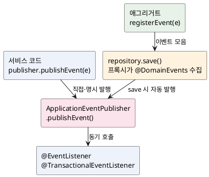

<!-- truncate -->

Spring에서 이벤트를 발행하는 방법을 찾아보면 `ApplicationEventPublisher.publishEvent(...)`를 직접 호출하는 코드도 있고, 엔티티에 `@DomainEvents`를 붙여 두는 코드도 보입니다. 둘을 "어느 쪽이 맞나"로 비교하기 쉽지만, 사실 **둘은 경쟁 관계가 아니라 한쪽이 다른 한쪽을 바탕으로 동작합니다.** <mark>`@DomainEvents`는 별도의 발행 엔진이 아니라, **결국 `ApplicationEventPublisher`를 통해 발행되는** Spring Data의 편의 기능입니다.</mark> 그래서 차이를 이해하는 핵심은 "누가·언제 발행하는가"입니다.

## 공통 바탕 — Spring의 이벤트 메커니즘

두 방식 모두 바탕은 같습니다. 발행자가 `ApplicationEventPublisher`로 이벤트를 발행하면, `@EventListener`를 단 메서드가 그 이벤트를 받습니다. 여기엔 두 가지 **기본 동작**이 있는데, 뒤의 이슈들이 전부 여기서 나옵니다.

- **기본이 동기(synchronous)** — 공식 문서는 "리스너는 기본적으로 이벤트를 동기로 받으며, `publishEvent()`는 모든 리스너가 처리를 끝낼 때까지 블록된다"고 명시합니다.
- **발행자의 트랜잭션에 참여** — "리스너가 이벤트를 받을 때, 트랜잭션 컨텍스트가 있으면 **발행자의 트랜잭션 안에서** 동작한다"고 설명합니다.

즉 리스너는 **별도 스레드가 아니라 발행한 그 스레드에서, 발행한 그 트랜잭션 안에서** 실행되는 것이 기본입니다.

## ApplicationEventPublisher — 직접·명시적으로 발행

코어 방식은 발행자를 주입받아 원하는 지점에서 직접 `publishEvent`를 호출합니다.

```java
@Service
@RequiredArgsConstructor
public class OrderService {

    private final OrderRepository orderRepository;
    private final ApplicationEventPublisher publisher;

    @Transactional
    public void place(OrderCommand cmd) {
        Order order = orderRepository.save(Order.create(cmd));
        publisher.publishEvent(new OrderPlacedEvent(order.getId())); // 이 지점에서 명시적으로 발행
    }
}
```

```java
@Component
public class OrderPlacedListener {

    @EventListener
    public void on(OrderPlacedEvent e) {
        // 발행한 스레드에서, place()의 트랜잭션 안에서(동기) 실행된다
    }
}
```

> **도입 버전** — `ApplicationEventPublisher` 인터페이스는 Spring 초기인 **Spring Framework 1.1.1**부터 있던 코어 기능입니다(javadoc `@since 1.1.1`). 다만 위처럼 `@EventListener`로 **애너테이션 기반** 수신을 하는 방식은 **Spring Framework 4.2**부터이며, 트랜잭션 단계에 묶는 `@TransactionalEventListener`도 4.2에서 함께 추가됐습니다. (Spring Boot로는 1.x부터 발행 자체가 가능하고, `@EventListener`는 Spring Framework 4.2를 포함한 Spring Boot 1.3 이상에서 쓸 수 있습니다.)

<mark>장점은 **어디서든 원하는 시점에** 발행할 수 있다는 점입니다</mark> — 영속과 무관한 이벤트(로그인 성공, 캐시 갱신, 스케줄러 트리거)도 자유롭게 발행합니다. 대신 발행 시점을 **직접 챙겨야** 하고(커밋 전/후 실수가 여기서 나옵니다), 발행하는 코드가 `ApplicationEventPublisher`에 의존하게 됩니다.

## @DomainEvents — 애그리거트에 모아 두고 save 때 자동 발행

DDD에서는 "주문이 생성됐다" 같은 사건을 **도메인 객체(애그리거트 루트)** 가 스스로 기록하게 두고 싶습니다. Spring Data는 이를 위해, 애그리거트에 이벤트를 모아 두면 **repository가 저장될 때 알아서 발행**해 주는 기능을 제공합니다. 보통 `AbstractAggregateRoot`를 상속해 `registerEvent()`로 모읍니다.

> **도입 버전** — `@DomainEvents`·`@AfterDomainEventPublication`·`AbstractAggregateRoot`는 모두 **Spring Data Commons 1.13**(Ingalls 릴리스 트레인, 2017년 1월 GA)에서 도입됐습니다(javadoc `@since 1.13`). 이 릴리스 트레인은 **Spring Boot 1.5**에 포함되므로, **Spring Boot 1.5 이상**이면 사용할 수 있습니다.

```java
@Entity
public class Order extends AbstractAggregateRoot<Order> {

    public static Order create(OrderCommand cmd) {
        Order order = new Order(cmd);
        order.registerEvent(new OrderPlacedEvent(order.getId())); // 도메인이 이벤트를 모아 둔다
        return order;
    }
}
```

```java
@Transactional
public void place(OrderCommand cmd) {
    orderRepository.save(Order.create(cmd)); // save 시 모아 둔 이벤트가 자동 발행된다 — publisher 주입 없음
}
```

`AbstractAggregateRoot` 없이 직접 구현하면 구조가 드러납니다. 이벤트는 **DB에 저장되지 않는 `@Transient` 필드**에 담기고, 발행 뒤에는 `@AfterDomainEventPublication` 메서드로 **비워야** 합니다.

```java
@Entity
public class Order {

    @Transient
    private final List<Object> events = new ArrayList<>();

    @DomainEvents                       // save/delete 시 Spring Data가 호출해 이 목록을 발행
    Collection<Object> domainEvents() {
        return events;
    }

    @AfterDomainEventPublication        // 발행 직후 호출 — 비우지 않으면 다음 save에서 중복 발행
    void clearEvents() {
        events.clear();
    }
}
```

여기서 `@Transient`(JPA의 `jakarta.persistence.Transient`)는 **그 필드를 영속 대상에서 빼라는** 표시입니다. 이 필드는 DB 컬럼으로 매핑되지 않아 **저장·조회되지 않고 메모리에만** 존재합니다. 덕분에 이벤트 목록을 엔티티가 잠시 들고 있되 DB에는 흔적을 남기지 않을 수 있지만, 바꿔 말하면 엔티티를 **새로 로드하면 그 목록이 비어 있는**(아래 ④) 이유이기도 합니다.

한 가지 주의할 점은, **이름이 같은 `@Transient`가 둘** 있다는 것입니다.

- **JPA — `jakarta.persistence.Transient`** — **JPA 제공자(Hibernate)** 가 읽어 그 필드를 **DB 컬럼 매핑에서 제외**합니다.
- **Spring Data — `org.springframework.data.annotation.Transient`** — Spring Data의 매핑 계층(MongoDB·Redis·JDBC 등 **비-JPA 저장소**)에서 속성을 제외할 때 사용합니다.

JPA `@Entity`의 영속 매핑은 Hibernate가 하므로 여기서는 **JPA 쪽을 사용해야** 합니다. JPA 엔티티에 Spring Data의 `@Transient`를 붙이면 Hibernate가 그 표시를 알지 못해 필드를 **그냥 컬럼으로 매핑하려** 합니다(의도와 반대).

발행을 수행하는 건 Spring Data가 등록하는 `EventPublishingRepositoryProxyPostProcessor`입니다. repository 프록시가 **`save`·`saveAll`·`delete`·`deleteAll`·`deleteAllInBatch`·`deleteInBatch`** 호출을 가로채 `@DomainEvents` 목록을 꺼내 `ApplicationEventPublisher`로 발행하고, 그다음 `@AfterDomainEventPublication`을 호출해 목록을 비웁니다. <mark>발행은 **save가 실행되는 그 호출 안에서 동기로** 일어나므로, save가 트랜잭션 안이면 이벤트도 **커밋 전, 같은 트랜잭션에서** 발행됩니다.</mark>

<details>
<summary>PlantUML 코드</summary>



</details>


## 핵심 차이 한눈에

| 구분 | ApplicationEventPublisher | @DomainEvents |
|---|---|---|
| 발행 주체 | 서비스/애플리케이션 코드가 직접 | 애그리거트(도메인 객체)가 모아 둠 |
| 발행 시점 | `publishEvent()`를 호출하는 순간(어디서든) | repository `save`·`delete` 계열 호출 시 자동 |
| 트리거 | 명시적 호출 | 영속성 생명주기에 묶임 |
| 도메인 결합 | 도메인·서비스가 발행자에 의존 | 도메인은 발행자를 모름(인프라와 분리) |
| 바탕 엔진 | (그 자체) | 내부적으로 `ApplicationEventPublisher` 사용 |

정리하면, **무엇을 쓰든 최종 발행 엔진과 리스너 처리 방식은 동일**합니다. 차이는 이벤트가 **도메인에서 나오느냐 서비스에서 나오느냐**, 그리고 **save에 묶이느냐 호출 시점에 자유로우냐**입니다.

## 장단점

**ApplicationEventPublisher**

- 장점 — 발행 시점·위치가 자유롭고(영속과 무관한 이벤트 포함), 흐름이 코드에 명시적으로 드러납니다. Spring Data 없이도 동작합니다.
- 단점 — 발행하는 코드가 발행자에 결합됩니다. 발행 시점을 손으로 챙겨야 해, **커밋 전에 발행해 버리는** 실수가 나기 쉽습니다.

**@DomainEvents**

- 장점 — 도메인 모델이 발행자를 **알 필요가 없어**(DDD 순수성), 이벤트가 애그리거트의 상태 변화와 자연히 함께 발행됩니다. 서비스는 `save`만 하면 됩니다.
- 단점 — **`save`를 거쳐야만** 발행되고(아래 이슈), `@Transient`라 재로딩 시 유실되며, 목록을 비우지 않으면 중복 발행됩니다. Spring Data repository에 묶입니다.

## 사용 시 실제로 겪는 이슈

### ① 기본이 동기 — 리스너 실패가 원 작업을 되돌린다

리스너는 기본적으로 **발행한 트랜잭션 안에서 동기로** 실행됩니다. 그래서 리스너가 예외를 던지면 그 예외가 그대로 올라와 **원래의 저장까지 롤백**됩니다. "알림 전송은 부가 기능인데 그게 실패했다고 주문 저장이 롤백"되는 식입니다. 또 리스너가 느리면 `publishEvent()`가 끝날 때까지 블록되어 **요청 응답이 그만큼 늦어집니다.**

부가 처리를 본 흐름에서 떼어 내려면 `@Async`로 비동기 리스너를 쓰거나(아래 ④), 아예 발행 후 비동기 큐로 넘깁니다.

### ② 커밋 전에 발행된다 — 외부 부작용·미커밋 데이터 주의

두 방식 모두 **기본적으로 커밋 전에** 발행됩니다(`@DomainEvents`는 `save` 중, 직접 발행은 보통 메서드가 끝나기 전). 이 시점에 리스너가 **외부로 메일·푸시를 보내거나** 커밋됐다고 가정하고 후속 작업을 하면, 그 뒤 트랜잭션이 롤백될 때 **돌이킬 수 없는 부작용**이 남습니다.

그래서 "커밋이 확정된 뒤에만" 실행하려면 `@TransactionalEventListener(phase = AFTER_COMMIT)`를 사용합니다. 다만 이 리스너 **안에서 DB를 갱신하면 그 쓰기가 조용히 유실**되는 별도의 문제가 있는데, 이는 [AFTER_COMMIT 리스너에서 DB 쓰기가 사라지는 이유](./after-commit-listener-db-write-loss)에서 전파(`REQUIRES_NEW`)와 커밋 타이밍으로 따로 설명했습니다.

### ③ (@DomainEvents) save를 거치지 않으면 발행되지 않는다

`@DomainEvents`는 **repository의 `save`·`delete` 계열을 호출할 때만** 발행됩니다. 그래서 흔히 놓치는 두 가지가 있습니다.

- **더티 체킹만 한 경우** — 영속 상태 엔티티를 조회해 필드만 변경하고 `save`를 호출하지 않으면, 트랜잭션 flush로 `UPDATE`는 나가도 **`@DomainEvents`는 호출되지 않아** 이벤트가 영영 발행되지 않습니다. 변경 후 **명시적으로 `save`** 를 호출해야 합니다.
- **`deleteById`** — 삭제 계열 중 `deleteById`는 애그리거트 인스턴스 없이 쿼리만 날릴 수 있어 **제외**됩니다. 삭제 이벤트가 필요하면 인스턴스를 로드해 `delete(entity)`로 지웁니다.

### ④ (@DomainEvents) 목록을 비우지 않으면 중복, 재로딩하면 유실

이벤트는 `@Transient` 필드라 **DB에 저장되지 않습니다.** 두 가지 결과가 따릅니다.

- **중복 발행** — 발행 후 목록을 비우지 않으면, 같은 인스턴스를 다시 `save`할 때 이전 이벤트가 또 발행됩니다. `AbstractAggregateRoot`는 `@AfterDomainEventPublication`으로 자동으로 비우지만, 직접 구현하면 **직접 비워야** 합니다.
- **유실** — `registerEvent`로 모아 둔 이벤트는 커밋돼도 DB에 남지 않습니다. 발행 없이 트랜잭션이 끝나거나, 다른 트랜잭션에서 엔티티를 **새로 로드**하면 그 목록은 비어 있습니다.

### ⑤ @Async 리스너 — 예외가 조용히 사라진다

동기 발행이 부담스러워 `@Async`를 붙이면 처리 방식이 달라집니다. 공식 문서 기준으로 비동기 리스너는 **예외가 호출자에게 전파되지 않고**(로그만 남습니다), 반환값으로 다음 이벤트를 발행할 수 없으며, `ThreadLocal`·로깅 컨텍스트도 기본적으로 전파되지 않습니다. 비동기는 "실패해도 본 흐름과 무관한" 작업에만 쓰고, 실패 처리·재시도는 리스너가 **스스로** 책임져야 합니다.

## 그래서 무엇을 언제 쓰나

- **`@DomainEvents`** — 이벤트가 **애그리거트의 상태 변화에서 비롯**되고, 도메인 모델을 Spring 인프라에서 깨끗하게 떼어 두고 싶을 때. "애그리거트를 저장하면 그 사건이 함께 발행된다"가 자연스러운 경우입니다. DDD 레이어링과 함께 쓰면 잘 맞습니다([DDD 레이어드 멀티모듈](./ddd-layered-multimodule)).
- **`ApplicationEventPublisher`** — 이벤트가 **특정 저장과 묶이지 않거나**(로그인·스케줄러·캐시), 발행 시점을 **명시적으로 통제**해야 하거나, Spring Data repository를 거치지 않는 경로일 때.
- **공통** — 커밋 이후의 후속 처리는 어느 쪽이든 `@TransactionalEventListener(AFTER_COMMIT)`와 조합하고, 그 안에서의 DB 쓰기는 전파를 함께 점검합니다([커밋 타이밍 글](./after-commit-listener-db-write-loss)).

## 정리

- `@DomainEvents`는 `ApplicationEventPublisher`의 **대안이 아니라 그 위에서 동작하는** Spring Data 편의 기능입니다 — 최종 발행 엔진과 리스너 처리 방식은 같습니다.
- 차이는 **발행 주체(도메인 vs 서비스)** 와 **발행 시점(save 자동 vs 명시 호출)** 입니다.
- 두 방식 모두 **기본이 동기·커밋 전 발행**이라, 리스너 실패가 원 작업을 롤백하고 커밋 전 외부 부작용이 남을 수 있습니다 — 후속 처리는 `AFTER_COMMIT`으로 분리합니다.
- `@DomainEvents`는 **`save`를 거쳐야 발행**되고(더티 체킹·`deleteById` 제외), `@Transient` 목록이라 **비우지 않으면 중복·재로딩하면 유실**됩니다.
- `@Async` 리스너는 **예외가 전파되지 않으니**, 실패 처리를 스스로 해야 합니다.

## 참고

- [Spring Data — Publishing Events from Aggregate Roots](https://docs.spring.io/spring-data/jpa/reference/repositories/core-domain-events.html)
- [Spring Data Commons — `AbstractAggregateRoot` API](https://docs.spring.io/spring-data/commons/docs/current/api/org/springframework/data/domain/AbstractAggregateRoot.html)
- [Spring Framework — Standard and Custom Events (`ApplicationEventPublisher`)](https://docs.spring.io/spring-framework/reference/core/beans/context-introduction.html)
- [Spring Framework — Transaction-bound Events (`@TransactionalEventListener`)](https://docs.spring.io/spring-framework/reference/data-access/transaction/event.html)
