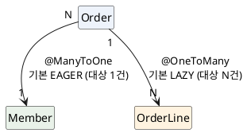

<!-- truncate -->

JPA 연관관계 어노테이션은 저마다 **기본 페치 전략**이 다릅니다. `@ManyToOne`과 `@OneToOne`은 기본이 **즉시 로딩(EAGER)**, `@OneToMany`와 `@ManyToMany`는 기본이 **지연 로딩(LAZY)** 입니다. 외우긴 쉬운데, "왜 이렇게 나뉘나"를 알면 실수가 줄고 **어떤 연관을 LAZY로 둬야 하는지**도 보입니다. <mark>규칙은 한 줄입니다 — **연관의 대상이 "1건"이면 EAGER, "N건"이면 LAZY** 가 기본입니다.</mark>

## 어노테이션별 기본값

| 어노테이션 | 대상 수 | 기본 페치 |
|---|---|---|
| `@ManyToOne` | 1건(to-one) | **EAGER** |
| `@OneToOne` | 1건(to-one) | **EAGER** |
| `@OneToMany` | N건(to-many) | **LAZY** |
| `@ManyToMany` | N건(to-many) | **LAZY** |
| (참고) `@Basic` 필드 | 1개 값 | EAGER |
| (참고) `@ElementCollection` | N개 값 | LAZY |

```java
@Entity
public class Order {

    @ManyToOne                       // 기본 EAGER — 주문을 읽으면 회원도 함께 로딩
    private Member member;

    @OneToOne                        // 기본 EAGER
    private Payment payment;

    @OneToMany(mappedBy = "order")   // 기본 LAZY — 주문 라인은 접근할 때 로딩
    private List<OrderLine> lines = new ArrayList<>();

    @ManyToMany                      // 기본 LAZY
    private Set<Coupon> coupons = new HashSet<>();
}
```

<details>
<summary>PlantUML 코드</summary>



</details>


## 왜 대상 수로 나뉠까

핵심은 **"한 번 더 조회하는 비용이 예측 가능한가"** 입니다.

- **to-one(`@ManyToOne`·`@OneToOne`)** — 대상이 **최대 1건**입니다. 보통 소유 측이 외래 키(FK)를 들고 있어, 부모를 읽을 때 **조인 한 번**이면 함께 가져올 수 있습니다. 비용이 작고 일정하니, 스펙은 "어차피 같이 쓸 테니 기본으로 함께 로딩하자"고 본 것입니다.
- **to-many(`@OneToMany`·`@ManyToMany`)** — 대상이 **몇 건일지 모릅니다.** 주문 하나에 라인이 1개일 수도 10,000개일 수도 있습니다. 부모를 읽을 때마다 이 컬렉션을 전부 끌어오면 **쓰지도 않을 대량의 행**을 매번 로딩하게 됩니다. 그래서 기본을 LAZY로 두고 **실제로 접근할 때** 로딩합니다.

<mark>즉 **"1건이라 저렴하다 → EAGER", "N건이라 비쌀 수 있다 → LAZY"** 가 기본값의 논리입니다.</mark> 예를 들어 상품 500개를 목록으로 읽는데 각 상품의 `@OneToMany` 리뷰가 기본 EAGER라면, 상품 500개를 읽는 순간 리뷰 수만 건이 전부 딸려 오는 식이 됩니다.

## EAGER는 "요구", LAZY는 "힌트"

기본값을 이해할 때 한 가지 더 알아 둘 점은, 이 둘의 **강제력이 다르다**는 것입니다. JPA 스펙은 이렇게 규정합니다.

- **EAGER** — 연관을 **반드시 즉시 로딩하라는 요구(requirement)**. 구현체는 이를 지켜야 합니다.
- **LAZY** — 처음 접근할 때 로딩하라는 **힌트(hint)**. 구현체가 사정상 즉시 로딩해도 스펙 위반은 아닙니다.

Hibernate는 컬렉션과 to-one 연관에 대해 프록시/바이트코드로 LAZY를 실제로 구현합니다. 다만 "LAZY로 뒀으니 무조건 미뤄지겠지"가 항상 성립하진 않는다는 점(아래 to-one 주의)이 여기서 나옵니다.

## 그런데 to-one의 EAGER 기본이 실무에서는 문제

기본값이 EAGER라고 해서 to-one을 그대로 두면, 두 가지가 따라옵니다.

**① 사용하지 않는데도 매번 조인/추가 조회.** 주문만 필요한 화면에서도 `member`가 EAGER면 회원을 항상 함께 읽습니다.

**② 목록 조회에서 N+1.** 더 문제가 되는 쪽입니다. JPQL이나 `findAll`로 목록을 읽으면, EAGER to-one은 보통 **엔티티마다 추가 SELECT**로 당겨져 쿼리가 1 + N번 실행됩니다.

```java
// Order.member가 기본 EAGER일 때
List<Order> orders = orderRepository.findAll();
// 1) SELECT * FROM orders                       ← 목록 1번
// 2) SELECT * FROM member WHERE id = ?           ← 주문 수(N)만큼 반복 → N+1
```

(엔티티 하나를 `em.find`로 읽을 땐 조인으로 한 번에 가져오지만, 목록 쿼리에서는 이렇게 N+1이 됩니다.)

그래서 실무에서는 <mark>**to-one 연관도 명시적으로 `fetch = LAZY`로 두는 것을 권장**합니다.</mark> 그리고 정말 함께 필요한 지점에서만 **그때그때 함께 로딩**합니다 — `join fetch`·`@EntityGraph`·DTO 프로젝션 등으로요. 필요할 때 함께 읽는 방법은 [JPA 연관관계 즉시 로딩](./jpa-eager-loading-associations)에 정리돼 있습니다.

```java
@ManyToOne(fetch = FetchType.LAZY)   // 기본 EAGER를 LAZY로 명시 — 필요할 때만 로딩
private Member member;
```

## to-one을 LAZY로 둘 때의 주의

to-one을 `fetch = LAZY`로 설정해도 **항상 지연 로딩이 되는 것은 아닙니다.** 특히 **`@OneToOne`의 반대쪽(mappedBy)** 에서 제약이 있습니다.

회원(`Member`)과 사물함(`Locker`)이 1:1이고, **FK 컬럼 `locker_id`가 `member` 테이블에 있는** 경우를 예로 들겠습니다. 이때 FK를 가진 `Member`가 **소유 측**, FK가 없는 `Locker`가 **반대쪽**입니다.

```java
@Entity
class Member {
    @OneToOne(fetch = FetchType.LAZY)   // 소유 측 — member 테이블이 locker_id(FK)를 가짐
    private Locker locker;
}

@Entity
class Locker {
    @OneToOne(mappedBy = "locker", fetch = FetchType.LAZY)  // 반대쪽 — FK 없음
    private Member member;
}
```

지연 로딩의 원리는 **"일단 프록시(실제 조회를 미루는 대리 객체)만 넣어 두고, 실제로 사용할 때 조회"** 하는 것입니다. 그런데 프록시를 넣으려면 적어도 **그 연관이 있는지 없는지(null 여부)** 는 알아야 합니다 — 사실은 `null`이어야 할 곳에 프록시를 넣어 두면 안 되기 때문입니다.

- **소유 측(`Member.locker`)** — FK가 **자기 테이블**에 있습니다. `member`를 읽으면 `locker_id` 값이 이미 있으니, 값이 있으면 프록시를 넣고 없으면 `null`로 둡니다. **추가 조회 없이 지연 로딩이 됩니다.**
- **반대쪽(`Locker.member`)** — FK가 **상대(`member`) 테이블**에 있습니다. `locker`만 읽어서는 그 사물함을 사용하는 회원이 있는지조차 알 수 없어, null 여부를 알려면 **결국 `member`를 조회**해야 합니다. 어차피 조회해야 한다면 지연시킬 이유가 없으므로, LAZY로 둬도 **바로 로딩되어 EAGER와 다를 바 없습니다.**

그래서 `@ManyToOne`은 **언제나 FK를 가진 소유 측**이라 LAZY가 잘 동작하고, 문제가 되는 건 주로 **반대쪽 `@OneToOne`** 입니다. 피하려면 **연관을 FK 소유 측에서 읽도록 설계**하거나, Hibernate **바이트코드 인핸스먼트**로 보완합니다.

<mark>즉 **컬렉션(to-many)의 LAZY는 자연스럽게 동작하지만, to-one의 LAZY는 "FK를 가진 소유 측"일 때만 깔끔하게 동작**합니다.</mark>

## 정리

- 기본 페치는 **대상 수로 갈립니다** — `@ManyToOne`·`@OneToOne`(1건)은 **EAGER**, `@OneToMany`·`@ManyToMany`(N건)는 **LAZY**.
- 이유는 **"1건이라 조인 한 번으로 저렴 → EAGER, N건이라 비쌀 수 있음 → LAZY"** 입니다.
- 스펙상 **EAGER는 요구, LAZY는 힌트**라, LAZY가 항상 미뤄진다고 단정할 수 없습니다.
- to-one의 **EAGER 기본은 불필요한 조회와 목록 조회 N+1**을 부르니, 실무에서는 **`fetch = LAZY`로 명시**하고 필요할 때만 함께 로딩하는 편이 안전합니다.
- 단 **to-one LAZY는 "FK를 가진 소유 측"일 때만 깔끔하고, 반대쪽 `@OneToOne`에서는 제약**이 있어 소유 방향 설계나 바이트코드 인핸스먼트로 보완합니다.

## 참고

- [Jakarta Persistence — `FetchType` (EAGER/LAZY 정의)](https://jakarta.ee/specifications/persistence/3.1/apidocs/jakarta.persistence/jakarta/persistence/fetchtype)
- [Jakarta Persistence — `ManyToOne`·`OneToMany` 기본 `fetch`](https://jakarta.ee/specifications/persistence/3.1/apidocs/jakarta.persistence/jakarta/persistence/manytoone)
- 함께 보기: [JPA 연관관계 즉시 로딩](./jpa-eager-loading-associations) · [단방향 연관관계 매핑의 문제점](./jpa-unidirectional-association-pitfalls)
