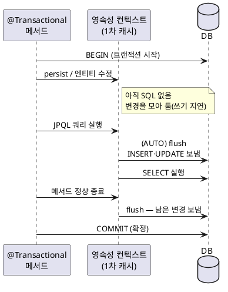

<!-- truncate -->

JPA로 개발하다 보면 "`save`를 안 호출했는데 UPDATE가 실행됐다", "`save`를 호출했는데 INSERT가 바로 실행되지 않는다", "커밋 전에 쿼리를 실행했더니 변경이 먼저 반영됐다" 같은 상황을 만납니다. 전부 **flush·commit·rollback이 각각 언제 실행되는지**를 모르면 헷갈리는 지점입니다. <mark>핵심은 **"내 코드가 엔티티를 변경하는 시점"과 "그 변경이 SQL로 DB에서 실행되는 시점"이 다르다**는 것 — 그 변경을 DB로 보내는 게 flush이고, 확정이 commit, 취소가 rollback입니다.</mark>

## 세 동작부터 — flush ≠ commit ≠ rollback

먼저 용어를 정확히 구분합니다. 바탕에는 **영속성 컨텍스트(persistence context)** 가 있습니다 — 트랜잭션 동안 엔티티를 관리하는 1차 캐시입니다. 엔티티를 `persist`하거나 조회해 두면 이 안에서 **managed(영속) 상태**가 되고, 변경은 일단 **여기에만** 쌓입니다.

- **flush** — 영속성 컨텍스트에 쌓인 변경(INSERT·UPDATE·DELETE)을 **SQL로 DB에 보냅니다**. 단, **트랜잭션을 끝내지는 않습니다** — 아직 커밋 전이라 다른 트랜잭션에는 (격리 수준에 따라) 보이지 않고, 롤백되면 전부 사라집니다.
- **commit** — 트랜잭션을 **확정**합니다. 커밋 직전에 flush가 한 번 일어나고(남은 변경을 보냄), 이어서 DB `COMMIT`으로 영구 반영됩니다.
- **rollback** — 트랜잭션을 **취소**합니다. flush로 이미 SQL이 실행됐더라도 DB `ROLLBACK`으로 전부 되돌리고, 영속성 컨텍스트도 폐기합니다.

<mark>즉 **flush는 "SQL을 보냄", commit은 "확정", rollback은 "취소"** 이고, flush됐다고 확정된 게 아닙니다.</mark> 이 셋이 `@Transactional`이 그리는 트랜잭션 경계 위에서 언제 실행되는지가 전부입니다.

## @Transactional이 그리는 경계 위에서의 타이밍

Spring에서 `@Transactional` 메서드는 **진입할 때 트랜잭션을 시작(BEGIN)** 하고, **정상 종료하면 커밋**, **예외로 끝나면 롤백**합니다. 영속성 컨텍스트도 보통 이 트랜잭션과 **같은 범위**로 살아 있습니다(열고 닫힘이 트랜잭션에 묶임).

```java
@Transactional
public void rename(Long id, String name) {
    Member m = memberRepository.findById(id).orElseThrow(); // ← 여기서 SELECT
    m.setName(name);   // managed 엔티티를 수정 — 아직 UPDATE 없음(변경만 보류)
}   // ← 메서드 정상 종료: flush(UPDATE member set name=... ) → COMMIT
```

`setName`을 호출한 줄에서 UPDATE가 실행되는 게 아닙니다. **메서드가 끝나는 순간** 커밋 과정에서 flush가 일어나 그때 UPDATE가 실행됩니다. 아래 그림이 이 흐름입니다.

<details>
<summary>PlantUML 코드</summary>



</details>


## flush는 언제 실행되나 — 모드와 트리거

flush가 자동으로 실행되는 시점은 **flush 모드**가 정합니다. JPA는 `AUTO`(기본)와 `COMMIT`을, Hibernate는 추가로 `ALWAYS`·`MANUAL`을 둡니다.

| 모드 | flush 시점 |
|---|---|
| **AUTO** (JPA 기본) | 커밋 직전 + **그 테이블을 읽는 쿼리 실행 직전** |
| **COMMIT** | 커밋 직전에만(쿼리 전엔 flush 안 함) |
| **ALWAYS** (Hibernate) | 커밋 직전 + **모든 쿼리 실행 전** |
| **MANUAL** (Hibernate) | `flush()`를 직접 부를 때만 |

정리하면 flush를 유발하는 경로는 세 가지입니다.

1. **커밋 직전** — 모든 모드 공통. 트랜잭션을 확정하기 전에 남은 변경을 보냅니다.
2. **쿼리 실행 직전**(AUTO) — 보류 중인 변경이 그 쿼리가 읽는 테이블에 영향을 주면, **오래된 결과를 보지 않도록** 쿼리 전에 먼저 flush합니다.
3. **명시적 호출** — `em.flush()` 또는 `repository.saveAndFlush(...)`로 직접 보냅니다.

두 번째가 자주 놓치는 지점입니다. "아직 커밋도 안 했는데" 변경이 먼저 반영되는 이유가 이것입니다.

```java
@Transactional
public List<Member> example() {
    Member m = memberRepository.findById(1L).orElseThrow();
    m.setName("새 이름");   // 변경 보류 — 아직 UPDATE 없음

    // 아래 JPQL은 member 테이블을 읽음 → AUTO라서 "실행 직전"에 flush(UPDATE) 발생
    return em.createQuery("select m from Member m where m.active = true", Member.class)
             .getResultList();
    // → 방금 바꾼 이름이 반영된 상태로 쿼리가 실행됨
}
```

## dirty checking — save를 호출하지 않아도 UPDATE가 실행된다

영속 상태 엔티티는 **로드 시점의 스냅샷**을 함께 보관합니다. flush 때 Hibernate가 현재 값과 스냅샷을 비교해 **달라진 엔티티에만 UPDATE를 생성**합니다 — 이게 변경 감지(dirty checking)입니다. <mark>그래서 트랜잭션 안에서 managed 엔티티의 필드만 변경하면, `save`를 호출하지 않아도 flush 때 UPDATE가 실행됩니다.</mark>

```java
@Transactional
public void activate(Long id) {
    Member m = memberRepository.findById(id).orElseThrow(); // managed 상태
    m.activate();   // 필드 변경만 — repository.save() 호출 없음
}   // 종료 → flush에서 변경 감지 → UPDATE → COMMIT
```

반대로, **managed가 아닌(detached) 엔티티**를 변경하면 변경 감지 대상이 아니라 아무 일도 생기지 않습니다. 변경 감지가 어떤 스냅샷을 기준으로 동작하는지에 따라 의외의 UPDATE가 실행되기도 하는데, 그 사례는 [조회만 했는데 UPDATE가 실행된다](./hibernate-json-column-phantom-update)에서 따로 살펴봤습니다.

## repository.save는 언제 DB에 반영되나

`JpaRepository.save`는 내부적으로 **새 엔티티면 `persist`, 아니면 `merge`** 를 호출합니다. 그런데 `persist`가 곧바로 INSERT를 실행하는 건 아닙니다 — **기본은 쓰기 지연**이라 flush/commit 때 실행됩니다. 단, **기본 키 생성 전략**이 여기에 관여합니다.

```java
@Transactional
public Long register(MemberCommand cmd) {
    Member m = memberRepository.save(new Member(cmd));
    // SEQUENCE/TABLE 전략: 여기서 INSERT 안 나감(쓰기 지연) → flush/commit 때 전송
    // IDENTITY 전략: 생성된 ID를 받아야 해서 save 시점에 INSERT가 "즉시" 실행됨
    return m.getId();
}   // 종료 → flush(남은 변경) → COMMIT
```

- **`IDENTITY`**(auto_increment) — ID는 DB가 INSERT를 해야 정해집니다. `persist`가 **엔티티를 managed로 만들려면 ID가 필요**하므로, INSERT를 **즉시** 실행합니다(쓰기 지연 불가).
- **`SEQUENCE`/`TABLE`** — ID를 시퀀스에서 먼저 받아 두므로 INSERT는 **flush까지 미룰 수 있습니다.**

즉시 보내고 싶으면 `saveAndFlush(...)`를 쓰거나 `em.flush()`를 직접 호출합니다. 반대로 "`save`를 호출했으니 바로 DB에 있겠지"라고 가정하면, SEQUENCE 전략에서는 flush 전까지 **다른 네이티브 쿼리에는 안 보일** 수 있습니다.

## commit과 rollback의 시점·규칙

### commit — 메서드 정상 종료 시

`@Transactional` 메서드가 예외 없이 끝나면, 커밋 직전에 **마지막 flush**로 남은 변경을 모두 보낸 뒤 DB `COMMIT`으로 확정합니다. 이 순서라서, flush에서 제약 위반(유니크 키 등)이 터지면 **메서드는 끝났는데 커밋 단계에서 예외**가 나기도 합니다.

### rollback — 예외 종류에 따라 다르다

Spring의 기본 롤백 규칙은 **예외 종류에 묶여** 있습니다.

```java
@Transactional
public void order() {
    orderRepository.save(new Order(...));   // flush 때 INSERT 예정
    if (invalid) {
        throw new IllegalStateException();   // unchecked → 롤백됨 (INSERT도 취소)
    }
}
```

- **unchecked 예외(`RuntimeException`·`Error`)** — 기본적으로 **롤백**합니다.
- **checked 예외(`IOException` 등)** — 기본적으로 **롤백하지 않고 커밋**합니다. 롤백하려면 `@Transactional(rollbackFor = Exception.class)`로 명시해야 합니다.

flush로 이미 SQL이 실행됐더라도 롤백이면 DB가 전부 되돌립니다. 그래서 **flush됐다는 사실만으로 데이터가 남았다고 믿으면 안 됩니다.** 한편 안쪽 트랜잭션이 롤백 표시(rollback-only)를 남기면 상위 트랜잭션에서 `UnexpectedRollbackException`이 발생하는데, 이 메커니즘은 [try-catch로 잡았는데 왜 롤백될까](./spring-transaction-rollback-only)에서 정리했습니다.

## 자주 하는 오해 몇 가지

### "flush가 `save`를 호출한다"? — 방향이 반대다

`save`/`persist`/변경 감지가 **"이 엔티티를 저장 대상으로 등록"** 하는 쪽이고, flush는 그렇게 **등록된 변경을 SQL로 보내는** 단계일 뿐입니다. flush가 엔티티들을 순회하며 `save`를 호출하는 게 아닙니다. `save`를 한 번도 호출하지 않아도(변경 감지) flush는 UPDATE를 보내고, 반대로 `save`를 호출해도 flush 전까지는 SQL이 실행되지 않습니다 — **둘은 서로를 호출하는 관계가 아니라 "등록 → 보냄"의 단계 차이**입니다.

### "flush하면 1차 캐시가 비워진다"? — flush ≠ clear

flush는 변경을 DB로 보낼 뿐, 엔티티는 여전히 **managed 상태로 영속성 컨텍스트에 남습니다.** 컨텍스트를 비우려면 `em.clear()`(전체 detach)나 `em.detach(entity)`가 따로 필요합니다. 그래서 "flush했으니 다음 조회는 DB에서 새로 읽겠지"는 흔히 오해하는 점으로, 같은 트랜잭션에서 같은 ID를 `find`하면 여전히 1차 캐시의 그 인스턴스를 돌려줍니다.

### "트랜잭션 없이 조회→수정해도 반영된다"? — 안 된다

변경 감지는 **영속성 컨텍스트가 살아 있고 flush·commit까지 가야** UPDATE가 됩니다. `@Transactional` 없이 엔티티를 조회해 필드만 변경하면, 커밋도 flush도 없어 **아무 UPDATE도 실행되지 않습니다.**

### "flush = commit"? — 아니다

flush는 SQL만 보낼 뿐 확정이 아닙니다. 커밋 전까지는 같은 트랜잭션 안에서만 보이고(격리 수준은 [트랜잭션 격리 수준](./db-isolation-levels)), 롤백되면 사라집니다. 그래서 커밋이 끝난 **뒤**에 후속 작업을 해야 한다면 `@TransactionalEventListener(AFTER_COMMIT)`가 필요한데, 거기서 DB를 쓰면 또 유실되는 별도 사례가 [AFTER_COMMIT 리스너에서 DB 쓰기가 사라지는 이유](./after-commit-listener-db-write-loss)입니다.

### "SQL은 코드 순서대로 실행된다"? — 아니다

Hibernate는 flush 때 INSERT → UPDATE → DELETE 순으로 SQL을 모아 보냅니다. "지우고 같은 키로 다시 넣기"를 한 메서드에서 하면, DELETE보다 INSERT가 먼저 실행돼 유니크 충돌이 날 수 있습니다. 이럴 땐 중간에 `flush()`를 호출해 DELETE를 먼저 보냅니다.

## 정리

- **flush**는 쌓인 변경을 **SQL로 DB에 보내는 것**이고, **commit**은 **확정**, **rollback**은 **취소**입니다 — flush됐다고 확정된 게 아닙니다.
- `@Transactional` 메서드는 **진입 시 BEGIN, 정상 종료 시 (flush→)COMMIT, 예외 시 ROLLBACK** 입니다.
- flush는 **커밋 직전 / (AUTO) 쿼리 실행 직전 / 명시적 `flush`·`saveAndFlush`** 때 발생합니다.
- **dirty checking** 덕분에 managed 엔티티는 `save` 없이 필드만 바꿔도 flush 때 UPDATE가 실행됩니다.
- `save`는 보통 쓰기 지연이지만, **`IDENTITY` 전략이면 ID 확보를 위해 즉시 INSERT** 합니다.
- 롤백은 **unchecked 예외에만 기본 적용**되고, checked 예외는 `rollbackFor`로 명시해야 롤백됩니다.

또한 `save`를 거치지 않는 변경 감지 경로에서는 도메인 이벤트(`@DomainEvents`)가 발행되지 않는 것처럼, 이벤트·외부 호출 같은 부수효과의 타이밍도 "언제 flush/commit 되는가"에 좌우됩니다 — [도메인 이벤트 글](./spring-domain-events-vs-application-event-publisher)과 함께 보면 좋습니다.

## 참고

- [Hibernate ORM User Guide — Flushing](https://docs.jboss.org/hibernate/orm/current/userguide/html_single/Hibernate_User_Guide.html#flushing)
- [Jakarta Persistence — `FlushModeType`](https://jakarta.ee/specifications/persistence/3.1/apidocs/jakarta.persistence/jakarta/persistence/flushmodetype)
- [Spring Framework — Transaction rollback rules](https://docs.spring.io/spring-framework/reference/data-access/transaction/declarative/rolling-back.html)
