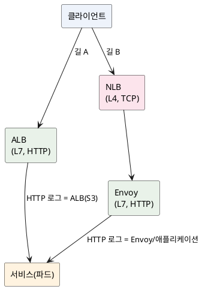

<!-- truncate -->

장애를 추적하다 이러한 상황을 만났습니다. 어떤 서비스의 요청은 **ALB 접근 로그(S3)** 에서 요청 단위로 다 보이는데, 다른 서비스의 요청은 **어떤 ALB 로그에도 없었습니다.** 둘 다 같은 EKS, 같은 제품군인데도요. "EKS라서 ALB가 없는 건가?" 싶었지만 정확한 답은 아니었습니다. <mark>핵심은 **서비스마다 "앞단(인그레스)"이 다르다**는 것 — 로그를 어디서 볼지는 EKS 여부가 아니라 인그레스 경로로 결정됩니다.</mark>

## 먼저 등장하는 요소들 — 한 줄씩

본문에 나오는 용어를 짧게 정리합니다.

- **EKS** — AWS의 **관리형 쿠버네티스**(컨테이너를 자동으로 배치·운영하는 오케스트레이터) 서비스입니다.
- **파드(Pod)** — 쿠버네티스가 실행하는 **컨테이너의 최소 단위.** 여기서는 "서비스 인스턴스 한 개" 정도로 보면 됩니다.
- **인그레스(Ingress)** — 클러스터 **외부의 트래픽을 내부 서비스로 들여보내는 입구**(와 그 규칙)입니다.
- **ALB / NLB** — AWS가 제공하는 로드밸런서입니다. **ALB는 L7(HTTP)**, **NLB는 L4(TCP)** 를 처리합니다(차이는 [ALB vs NLB](./alb-vs-nlb)).
- **AWS Load Balancer Controller** — 쿠버네티스의 `Ingress`·`Service` 선언을 보고 **실제 ALB/NLB를 자동으로 만들어 주는** 컨트롤러입니다.
- **서비스 메시(Service Mesh)** — 서비스 간 통신의 라우팅·보안·관측을 **애플리케이션 코드 밖(인프라 계층)에서** 처리하는 방식입니다.
- **Istio** — 대표적인 서비스 메시 구현이고, **Envoy** 는 Istio가 트래픽 처리에 사용하는 **L7 프록시**입니다. 그중 클러스터 입구 역할을 하는 Envoy가 **`istio-ingressgateway`** 입니다.

## 먼저 용어 — L4 vs L7, 그리고 세 가지 앞단

네트워크 계층으로 나눠 보면 이해가 쉽습니다.

- **L4 (전송 계층, TCP/UDP)** — 연결(패킷)만 중계합니다. HTTP 메서드·경로·상태코드 같은 **애플리케이션 정보는 모릅니다.**
- **L7 (애플리케이션 계층, HTTP)** — HTTP를 이해합니다. 경로로 라우팅하고, 상태코드를 남기고, 헤더를 봅니다.

앞단으로 자주 사용하는 세 가지입니다.

| 구성 요소 | 계층 | HTTP를 아는가 | HTTP 로그/상태 |
|---|---|---|---|
| **NLB** (Network Load Balancer) | **L4** | 모름 (TCP 패스스루) | **안 남김** |
| **ALB** (Application Load Balancer) | **L7** | 앎 | 접근 로그(S3) + CloudWatch 상태 메트릭 |
| **Envoy** (Istio ingress gateway) | **L7** | 앎 | Envoy 접근 로그(보통 stdout → 로그 수집 스택) |

<mark>핵심 한 줄 — **NLB는 L4라 HTTP 상태(400 등)를 아예 기록하지 못합니다.** 로그를 켜도 안 보입니다.</mark> L4/L7과 NLB·ALB의 차이 자체는 [ALB vs NLB](./alb-vs-nlb)에 따로 정리했습니다.

## EKS에서 외부 트래픽을 받는 두 가지 길

EKS(쿠버네티스) 서비스가 외부 요청을 받는 방식은 보통 둘 중 하나입니다.

- **길 A — ALB** — 쿠버네티스 `Ingress` 리소스를 만들면 AWS Load Balancer Controller가 **ALB를 자동 생성**합니다. ALB가 **직접 L7**을 처리하므로 **접근 로그(S3)·CloudWatch 상태 메트릭이 남습니다.** 즉 EKS도 ALB를 사용합니다.
- **길 B — Istio 인그레스(NLB → Envoy)** — 서비스 메시를 사용하면 외부 입구가 **istio-ingressgateway(Envoy)** 이고, 그 앞에 **NLB**를 배치해 트래픽을 받습니다. **L7(라우팅·상태코드·로그)은 Envoy가 담당**하고, 여기엔 **ALB가 들어가지 않습니다.**

PlantUML 코드

<mark>같은 클러스터·같은 제품군이어도 서비스마다 경로가 다를 수 있습니다.</mark> ALB 경로 서비스는 ALB 접근 로그(S3)에 요청이 남아 요청 단위로 조회됐고, Istio(NLB) 경로 서비스는 ALB가 없으니 **ALB 로그에 아예 없고** 400은 Envoy나 애플리케이션이 남겨 **stdout → 로그 수집 스택**으로 전달됩니다. "어떤 건 ALB 로그에 있고 어떤 건 없다"의 이유는 **EKS 여부가 아니라, 그 서비스가 어느 길로 들어오느냐**였습니다.

## 그래서 로그·상태는 어디서 보나

| 경로 | HTTP 상태(4XX/5XX) | 요청 단위 상세(URL·바이트) | 비고 |
|---|---|---|---|
| **ALB (길 A)** | CloudWatch `HTTPCode_ELB_4XX`/`Target_4XX` | **ALB 접근 로그(S3)** — 켜져 있을 때 | access log 꺼져 있으면 집계만, 요청 단위는 없음 |
| **Istio/NLB (길 B)** | NLB엔 **없음**(L4). Envoy가 가진 상태 | **Envoy 접근 로그 / 애플리케이션 로그** → 로그 수집 스택 | NLB access log는 연결(TCP) 레벨뿐 |

추적할 때 순서는 이렇습니다.

1. **이 서비스는 어느 길인가** — 로드밸런서 목록에서 ALB(`application`)인지 NLB(`network`, istio gateway)인지 확인합니다.
2. **ALB 경로면** — CloudWatch로 `ELB_4XX`(LB가 반환한 것)인지 `Target_4XX`(애플리케이션이 반환한 것)인지 가르고, 접근 로그(S3)가 켜져 있으면 요청 단위로 봅니다.
3. **Istio 경로면** — ALB 로그를 찾지 말고 **Envoy·애플리케이션 로그(로그 수집 스택)** 에서 상태·경로·시각으로 검색합니다.

## 정리 — "EKS라 ALB 불필요"는 반만 맞다

- EKS도 **ALB를 사용할 수 있습니다**(Load Balancer Controller + `Ingress`). 실제로 일부 서비스는 ALB 경로입니다.
- 다만 **서비스 메시(Istio)를 사용하는 서비스는 `NLB(L4) → Envoy(L7)`** 로 들어와서, **L7을 Envoy가 맡고 ALB를 거치지 않습니다.** 그래서 ALB 로그가 없는 것입니다.
- 결론 — **"EKS 전체에 ALB가 없다"가 아니라 "그 서비스가 Istio 경로라서 ALB가 없다"** 입니다. 로그를 어디서 볼지는 **인그레스 경로**로 결정됩니다.

## 부록 — 빠른 판별 팁

- 로드밸런서 타입이 **`application`이면 ALB(L7)**, **`network`면 NLB(L4)** 입니다.
- 이름에 **`istio`·`ingressgateway`** 가 들어간 NLB는 서비스 메시 입구이니, 그 뒤 서비스는 Istio 경로입니다.
- 어떤 서비스가 어느 경로인지는 **그 서비스의 외부 호스트명이 어느 LB의 라우팅 규칙에 있는지**로 확인합니다. ALB의 호스트 규칙에 없으면 Istio(NLB) 경로일 가능성이 높습니다.
- **NLB access log를 켜도 HTTP 상태는 안 나옵니다**(L4). HTTP가 필요하면 Envoy·애플리케이션 로그를 봅니다.

이 구조를 모른 채 엉뚱한 ALB 로그를 찾다 시간을 들인 실제 사례는 [애플리케이션 로그에 안 남는 400 추적](./embedded-tomcat-request-header-too-large)에서 이어서 설명합니다.
