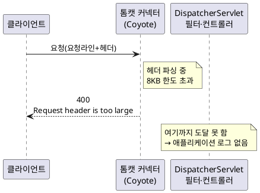

<!-- truncate -->

특정 작업을 **"대량"으로 실행할 때만** 400이 떨어지고, 애플리케이션 로그에는 아무 흔적이 없었습니다. 원인은 애플리케이션 코드가 아니라 **Spring Boot 내장 톰캣 커넥터가 요청 헤더를 파싱하는 단계에서 헤더 크기 제한(기본 8KB)을 초과**해 던진 예외였습니다. <mark>컨트롤러에 도달하기 전에 끊기므로 **애플리케이션 코드가 남기는 로그에는 없고**, 톰캣이 컨테이너 stdout에 `INFO`로만 남깁니다.</mark> 추적 과정과 해결을 정리합니다.

## 현상 — 애플리케이션 로그에 없다

- 화면에서 **대량 요청**(대상 전체 선택)으로 처리하면 400 응답, **소량(몇 건)** 은 정상.
- 애플리케이션 **코드가 남긴 로그(비즈니스 로그)가 없음** — 평소처럼 `ERROR`·요청 로그로 찾으면 안 보임.

<mark>"애플리케이션 로그에 없다"가 추적의 출발점입니다.</mark> 애플리케이션이 요청을 받아 처리하다 실패했다면 보통 로그가 남습니다. 안 남았다는 건 **요청이 애플리케이션 코드에 도달하기 전에 잘렸을 가능성**을 가리킵니다.

## 어디서 400이 나왔나 — 엣지부터 본다

### LB 메트릭 — "LB가 반환한 4XX" vs "애플리케이션이 반환한 4XX"

로드밸런서(ALB) CloudWatch 메트릭에는 두 종류의 4XX가 있습니다.

- `HTTPCode_ELB_4XX_Count` — **로드밸런서 자신이 반환한** 4XX (요청이 타깃까지 못 감)
- `HTTPCode_Target_4XX_Count` — **타깃(애플리케이션)이 반환한** 4XX

이 둘을 나눠 보면 "LB에서 잘렸는지, 애플리케이션이 반환했는지"가 갈립니다. 애플리케이션 로그가 없을 때 먼저 확인할 지표입니다.

### 주의 — 서비스마다 인그레스(앞단)가 다르다

처음엔 엉뚱한 ALB를 봤습니다. 같은 제품군이라도 서비스마다 앞단이 다를 수 있습니다. 어떤 서비스는 **ALB** 뒤에 있어 ALB 접근 로그(S3)와 상태 메트릭이 남지만, 어떤 서비스는 **Istio 인그레스**(`NLB(L4) → istio-ingressgateway(Envoy, L7) → 서비스`) 뒤에 있어 **HTTP는 Envoy가 처리하고 ALB가 없습니다.** 이 구조는 [같은 EKS인데 ALB 로그가 있고 없고](./eks-ingress-alb-vs-istio)에서 자세히 정리했습니다.

문제의 서비스는 **Istio 경로**였습니다. 그래서 ALB 접근 로그에는 이 요청이 **아예 없고**(ALB를 안 타니까), NLB 접근 로그는 켜도 HTTP 상태가 안 남고, 애플리케이션·Envoy 로그는 **stdout → 로그 수집 스택(APM/로그 플랫폼)** 으로 전달됩니다. <mark>AWS 네이티브 ALB 로그로는 이 400을 요청 단위로 볼 수 없었고, 로그 수집 스택(여기선 Datadog)에서 찾아야 했습니다.</mark>

### 로그 수집 스택에서 예외 발견

서비스·상태코드·시각으로 검색하니 예외가 나왔습니다.

```text
[1384164357] java.lang.IllegalArgumentException: Request header is too large
  at org.apache.coyote.http11.Http11InputBuffer.fill(Http11InputBuffer.java:770)
  at org.apache.coyote.http11.Http11InputBuffer.parseHeader(Http11InputBuffer.java:964)
  at org.apache.coyote.http11.Http11InputBuffer.parseHeaders(Http11InputBuffer.java:591)
  at org.apache.coyote.http11.Http11Processor.service(Http11Processor.java:287)
  at org.apache.coyote.AbstractProcessorLight.process(AbstractProcessorLight.java:63)
  at org.apache.coyote.AbstractProtocol$ConnectionHandler.process(AbstractProtocol.java:896)
  at org.apache.tomcat.util.net.NioEndpoint$SocketProcessor.doRun(NioEndpoint.java:1744)
  at org.apache.tomcat.util.net.SocketProcessorBase.run(SocketProcessorBase.java:52)
  at org.apache.tomcat.util.threads.ThreadPoolExecutor.runWorker(ThreadPoolExecutor.java:1191)
  at org.apache.tomcat.util.threads.ThreadPoolExecutor$Worker.run(ThreadPoolExecutor.java:659)
  at org.apache.tomcat.util.threads.TaskThread$WrappingRunnable.run(TaskThread.java:61)
  at java.base/java.lang.Thread.run(Thread.java:1583)
```

같은 시각 톰캣이 남긴 짝 로그는 이렇습니다.

```text
[1384164357] Error parsing HTTP request header
  Note: further occurrences of HTTP request parsing errors will be logged at DEBUG level.
```

<mark>이 "further occurrences … will be logged at DEBUG level" 한 줄이 중요합니다.</mark> 톰캣은 요청 파싱 오류를 **처음 한 번만 평소 레벨로 남기고, 그 뒤부터는 DEBUG로 강등**합니다. 그래서 운영 로그 레벨이 INFO면 **같은 오류가 계속 나도 로그엔 띄엄띄엄(혹은 한 번만)** 보여, "가끔 나는 문제"로 오인하기 쉽습니다. 재현·추적할 때는 이 점을 감안해야 합니다.

그리고 이 로그의 **메타데이터**가 핵심을 하나 더 알려 줍니다.

```text
level:         INFO
log.file.path: /var/log/pods/prod-inbound-service_..._rollout-xxxxx/application/0.log
```

<mark>이 예외는 별도 어딘가가 아니라 **애플리케이션 컨테이너의 stdout(= `application/0.log`)에 그대로 남아 있었습니다.**</mark> 내장 톰캣은 애플리케이션과 **같은 프로세스**라, 커넥터가 던진 예외도 애플리케이션과 같은 stdout 로그에 기록됩니다(로그 수집 스택은 이 stdout을 수집). 다만 **① 레벨이 `INFO`, ② 로거가 `org.apache.coyote`(내 애플리케이션 패키지가 아님), ③ 비즈니스 컨텍스트(요청 매핑·사용자)가 없음** — 그래서 평소처럼 `ERROR`나 비즈니스 키워드로 찾으면 놓치기 쉽습니다. 정확히는 **"애플리케이션 로그에 없다"가 아니라 "애플리케이션 코드가 남긴 로그엔 없고, 톰캣이 `INFO`로 남긴 줄에 있다"** 입니다.

## 원인 — 내장 톰캣이 헤더 파싱 단계에서 요청을 중단한다

스택의 `org.apache.coyote.http11.*` 는 **Spring Boot 내장 톰캣(Coyote HTTP/1.1 커넥터)** 입니다. `spring-boot-starter-web`이 띄우는 그 톰캣입니다. `Http11Processor.service → parseHeaders → fill` 순서로, **요청 헤더를 다 읽기도 전에** 버퍼 한도를 넘겨 `IllegalArgumentException: Request header is too large`를 던집니다.

<mark>이 지점은 **DispatcherServlet·필터·컨트롤러·`@Valid`·`@RequestBody`보다 앞**입니다.</mark> 그래서 애플리케이션 비즈니스 로직이 **한 줄도 실행되지 않고**(→ 비즈니스 로그 없음), 톰캣 커넥터가 바로 **400**을 반환합니다.

<details>
<summary>PlantUML 코드</summary>



</details>


### 무엇이 한도인가

`Request header is too large`는 **요청라인(메서드 + URL + 쿼리스트링) + 모든 헤더의 총합**이 톰캣의 `max-http-request-header-size`(**기본 8192바이트 = 8KB**)를 넘었다는 뜻입니다.

- **바디(Body)는 이 한도와 무관합니다.** 바디는 헤더를 다 읽은 뒤 별도 스트림으로 읽습니다. "요청 바디가 커서"가 아닙니다.
- 커지는 건 **요청라인(긴 URL/쿼리) 또는 헤더(큰 쿠키·인증 토큰·커스텀 헤더)** 입니다.

### 왜 "대량"일 때만?

대량일 때만 발생한다는 건 **처리 개수에 비례해 커지는 값이 헤더나 URL에 실린다**는 신호입니다. 흔한 경우는 이렇습니다.

- 선택한 대상 ID 목록이 **URL 쿼리스트링**에 실려 요청라인이 길어짐
- 또는 목록·컨텍스트가 **커스텀 헤더·쿠키**로 전달되어 헤더 총량이 커짐

소량이면 8KB 안쪽이라 통과, 대량이면 초과해서 커넥터가 400으로 거부합니다.

## 해결

### 단기 — 헤더 크기 한도 상향

```yaml
server:
  max-http-request-header-size: 65536   # 기본 8KB → 64KB
```

인증 헤더가 큰 다른 서비스에서 이미 같은 설정을 사용하고 있었습니다(선례 존재). 즉시 증상은 사라지지만, "왜 헤더가 그렇게 큰가"의 근본은 남습니다.

### 근본 — 큰 값은 헤더/URL이 아니라 바디로

- 개수가 많아질 수 있는 **대상 ID 목록·선택 데이터**는 요청라인(URL/쿼리)이나 헤더가 아니라 **요청 바디(JSON 등)** 로 보냅니다.
- 조회성 API라 바디를 못 사용하는 경우라면 **페이지네이션·청크 분할**로 한 번에 보내는 양을 제한합니다.

어느 쪽이 헤더를 키우는지는 **실패 요청의 URL 길이·헤더(특히 `Cookie`·커스텀 헤더)** 를 로그나 브라우저 네트워크 탭에서 보면 바로 특정됩니다.

## 정리 — 배운 것

- **애플리케이션 "코드" 로그에 없는 4XX는 "애플리케이션 전 단계"(커넥터·인그레스·LB)를 의심합니다.** 커넥터 예외는 애플리케이션과 같은 stdout에 남더라도 레벨(`INFO`)·로거(`coyote`)가 달라 평소 검색으로는 놓치기 쉽습니다.
- **`ELB_4XX`(LB가 반환)와 `Target_4XX`(애플리케이션이 반환)를 구분**하면 "어디서 잘렸는지"가 빨리 좁혀집니다.
- **서비스마다 앞단(ALB vs Istio NLB)이 다르면 로그 위치도 다릅니다** — ALB면 S3 접근 로그, Istio/NLB면 Envoy·애플리케이션 로그(로그 수집 스택). NLB(L4)는 HTTP 상태를 안 남깁니다([인그레스 구조](./eks-ingress-alb-vs-istio)).
- **`Request header is too large`는 바디가 아니라 요청라인+헤더 총합** 문제입니다. 기본 8KB를 기억합니다.
- 톰캣은 파싱 오류를 **처음만 남기고 DEBUG로 강등**하니, 로그에 드물게 보여도 빈도를 과소평가하지 않습니다.

`400`이 같은 코드인데 특정 인스턴스에서만 나는 다른 사례는 [서버 한 대만 400을 반환한다](./one-instance-400-bad-request), 외부 호출이 자원을 오래 점유해 번지는 장애는 [외부 API 하나가 느려지자](./external-api-timeout-server-hang)도 함께 보세요.

### 관련 설정·개념 메모

| 항목 | 메모 |
|---|---|
| `server.max-http-request-header-size` | 요청라인+헤더 총합 한도, 기본 8KB (구버전 `server.max-http-header-size`) |
| 커넥터 레벨 예외 | `@ControllerAdvice`/`@ExceptionHandler`로 못 잡음(디스패처보다 앞 단계) |
| 혼동 주의 | `max-http-request-header-size`(헤더) ≠ `max-http-form-post-size`(폼 바디) ≠ `maxParameterCount`(파라미터 개수) |
