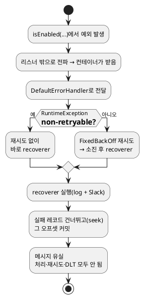

<!-- truncate -->

`AckMode.MANUAL`로 두고 직접 `acknowledge()`를 호출하는 Kafka 리스너에서 이러한 질문을 받았습니다 — **리스너 첫 줄에서 예외가 나면 오프셋이 커밋될까?**

```java
@KafkaListener(topics = "${spring.kafka.topics.goods-all}",
               containerFactory = "plainMessageContainerFactory")
public void onMessageAll(String message, Acknowledgment acknowledgment) {
    if (featureFlagClient.isEnabled(FeatureFlagKey.GOODS_RESEND.getKey())) { // ← 여기서 예외가 나면?
        log.info("Goods All Consume: {} ", message);
        this.receiveGoods(message);
        acknowledgment.acknowledge();   // 정상 경로에서만 커밋
    }
}
```

직관적으로는 "`acknowledge()`를 호출하지 못했으니 커밋도 안 되겠지" 싶습니다. <mark>하지만 이 설정에서는 **커밋됩니다** — 예외가 `DefaultErrorHandler`로 넘어가 복구(recover)되면, 그 레코드의 오프셋이 커밋되며 건너뛰어지기 때문입니다.</mark>

## 전체 설정 — 어디에 무엇이 있나

일부만 보면 헷갈리니, `@KafkaListener`의 `containerFactory = "plainMessageContainerFactory"`가 가리키는 **① 컨테이너 팩토리**와 거기에 연결된 **② 에러 핸들러**까지 함께 봅니다.

```java
// ① 컨테이너 팩토리 — ackMode와 에러 핸들러를 여기서 연결한다
@Bean("plainMessageContainerFactory")
public ConcurrentKafkaListenerContainerFactory<String, Object> newContainerFactory() {
    var factory = new ConcurrentKafkaListenerContainerFactory<String, Object>();
    factory.getContainerProperties().setAckMode(ContainerProperties.AckMode.MANUAL); // ← 수동 커밋
    factory.getContainerProperties().setDeliveryAttemptHeader(true);
    factory.setConsumerFactory(consumerFactory());
    factory.setCommonErrorHandler(errorHandler.defaultErrorHandler());  // ← 아래 ②를 연결
    factory.setRecordInterceptor(consumeRecordInterceptor);
    return factory;
}
```

```java
// ② 에러 핸들러 — 재시도(BackOff) + 복구기(recoverer) + 비재시도 분류
@Bean
public DefaultErrorHandler defaultErrorHandler() {
    BackOff fixedBackOff = new FixedBackOff(INTERVAL, MAX_ATTEMPTS); // 3초 간격, 최대 2번 "의도"
    DefaultErrorHandler errorHandler = new DefaultErrorHandler((consumerRecord, exception) -> {
        // ↓ 이 람다가 recoverer — 재시도가 끝났거나, 비재시도일 때 호출된다
        Throwable cause = exception;
        while (cause != null) {
            if (cause instanceof InboundServiceException ex) {   // 특정 예외만 분기
                log.error("[Error] topic={}, key={}, msg={}",
                        consumerRecord.topic(), consumerRecord.key(), cause.getMessage());
                kafkaSlackUtils.sendSlackMessage(consumerRecord, ex);
                return;   // 로그·Slack 후 종료 → "복구 완료"로 간주
            }
            cause = cause.getCause();
        }
        log.error("[Error] topic={}, key={}, ...", consumerRecord.topic(), consumerRecord.key());
        kafkaSlackUtils.sendSlackMessage(consumerRecord, exception);
    }, fixedBackOff);

    errorHandler.addNotRetryableExceptions(RuntimeException.class); // ← 거의 모든 예외를 "재시도 안 함"으로
    return errorHandler;
}
```

연결 고리는 이렇습니다 — <mark>`@KafkaListener`(**`plainMessageContainerFactory`**) → **①** 팩토리(`AckMode.MANUAL` + `setCommonErrorHandler`) → **②** `DefaultErrorHandler`(recoverer + `addNotRetryableExceptions`).</mark> 즉 리스너에서 던진 예외는 결국 **②의 recoverer까지 전달됩니다.**

여기서 **recoverer(복구기)** 는 따로 떨어진 객체가 아니라, ②에서 `new DefaultErrorHandler(recoverer, backOff)`의 **첫 번째 인자로 넘긴 람다**(`(consumerRecord, exception) -> { 로그 + Slack }`)입니다. 재시도가 끝났거나 예외가 비재시도로 분류되면, **컨테이너가 이 람다를 호출**해 "이 레코드는 복구(포기)했다"고 처리합니다. 아래부터는 이 ①·②를 기준으로 설명합니다.

## MANUAL ack의 흔한 오해 — "내가 ack해야만 커밋"은 정상 경로 한정

`AckMode.MANUAL`에서 **정상적으로 메서드가 끝나는** 경우라면, 오프셋은 `acknowledge()`를 호출할 때만 커밋됩니다. 여기까지는 맞습니다. 그래서 위 코드에서 **플래그가 꺼져 있으면**(예외 없이 `if`를 건너뜀) `acknowledge()`가 호출되지 않아 그 레코드는 커밋되지 않고, 재시작·리밸런스 때 다시 전달됩니다.

<mark>문제는 "예외로 끝나는" 경우입니다.</mark> 예외는 `acknowledge()`를 건너뛰는 것으로 끝나지 않고, **리스너 밖으로 전파되어 컨테이너의 에러 핸들러로** 전달됩니다. 그다음은 내 `acknowledge()`가 아니라 **에러 핸들러**가 오프셋을 좌우합니다.

## 예외는 DefaultErrorHandler가 받는다 — 복구하면 오프셋이 커밋된다

**①** 에서 `setCommonErrorHandler(errorHandler.defaultErrorHandler())`로 연결한 그 `DefaultErrorHandler`가 여기서 핵심입니다. 공식 문서는 동작을 이렇게 설명합니다.

> If retries are exhausted, attempt recovery of the failed record (default log only) and perform seeks so that the remaining records (excluding the failed record) will be redelivered. **The recovered record's offset is committed.**

— 출처: [Spring for Apache Kafka — Handling Exceptions (`DefaultErrorHandler`)](https://docs.spring.io/spring-kafka/reference/kafka/annotation-error-handling.html#default-eh)

즉 재시도를 소진하면 **recoverer(복구기)** 를 호출하고, **실패한 레코드는 건너뛰도록 seek**한 뒤 **그 레코드의 오프셋을 커밋**합니다. <mark>복구란 "이 레코드는 더 손대지 않고 넘어간다"는 뜻이고, 넘어가려면 오프셋을 커밋해 다시 안 받게 해야 합니다.</mark> `acknowledge()`를 호출하지 않았어도, 에러 핸들러가 대신 오프셋을 전진시키는 것입니다.

(`AckMode.MANUAL`/`MANUAL_IMMEDIATE`에서 복구 레코드의 오프셋을 **즉시 명시적으로** 커밋하려면 `commitRecovered`를 `true`로 둡니다. 기본값은 `false`이지만, 그 경우에도 복구된 레코드는 seek로 건너뛰어 이후 커밋 주기에 포함되므로 재전달되지 않습니다.)

### 실제로 커밋하는 지점 — 프레임워크 코드

"복구하면 커밋된다"의 근거는 `CommonErrorHandler`에 있습니다.

```java
// org.springframework.kafka.listener.CommonErrorHandler
/**
 * Return true if the offset should be committed for a handled error (no exception thrown).
 * @return true to commit.
 */
default boolean isAckAfterHandle() {
    return true;   // ← 기본값 true
}
```

에러 핸들러가 예외를 **다시 던지지 않고** 레코드를 처리(복구)하면, 컨테이너(`KafkaMessageListenerContainer`)가 `isAckAfterHandle()`이 `true`인지 보고 **그 레코드의 오프셋을 커밋**합니다. <mark>`DefaultErrorHandler`는 이 값을 재정의하지 않으므로 기본 `true` — recoverer가 `return`(정상 종료)하는 순간 그 레코드의 오프셋이 커밋됩니다(`acknowledge()`와 무관).</mark> 이 자동 커밋을 막으려면 `isAckAfterHandle()`을 `false`로 재정의합니다.

소스: [`CommonErrorHandler.isAckAfterHandle()`](https://github.com/spring-projects/spring-kafka/blob/main/spring-kafka/src/main/java/org/springframework/kafka/listener/CommonErrorHandler.java) · 실제 커밋은 [`KafkaMessageListenerContainer`](https://github.com/spring-projects/spring-kafka/blob/main/spring-kafka/src/main/java/org/springframework/kafka/listener/KafkaMessageListenerContainer.java)의 `invokeErrorHandler`가 수행합니다.

## 더 큰 문제 — `addNotRetryableExceptions(RuntimeException.class)`

**②** 의 `FixedBackOff(INTERVAL, MAX_ATTEMPTS)`는 "3초 간격 최대 2번"을 의도했습니다. 그런데 바로 아래 `errorHandler.addNotRetryableExceptions(RuntimeException.class)` 한 줄이 그걸 무력화합니다. 공식 문서상 비재시도(non-retryable)로 분류된 예외는 **첫 실패에 곧바로 recoverer가 호출**됩니다(재시도 건너뜀). <mark>그런데 `RuntimeException` 전체를 비재시도로 지정했으니, 그 하위인 **대부분의 애플리케이션 예외가 전부 "재시도 없이 즉시 복구/건너뜀"** 대상이 됩니다.</mark> `featureFlagClient.isEnabled(...)`가 던지는 예외도 거의 확실히 `RuntimeException` 계열이라, **`FixedBackOff` 재시도는 한 번도 일어나지 않고** 바로 복구 경로를 탑니다.

## 그래서 이 코드에서 실제로 벌어지는 일

<details>
<summary>PlantUML 코드</summary>



</details>


1. `isEnabled(...)`에서 예외 발생 → 리스너 밖으로 전파.
2. `DefaultErrorHandler`가 받음 → `RuntimeException`이라 **비재시도** → 재시도 없이 **recoverer 즉시 호출**.
3. recoverer(여기선 로그 + Slack 알림)가 실행되고 `return` — 즉 **복구 완료**로 간주.
4. 실패 레코드를 건너뛰고 **그 오프셋이 커밋**됩니다.

결과적으로 <mark>그 메시지는 **처리되지도, 재시도되지도, DLT로 보존되지도 않은 채 건너뛰어집니다** — Slack 알림만 남고 메시지는 유실됩니다.</mark> "MANUAL ack라 `acknowledge()` 안 하면 안전하다"는 가정이 성립하지 않는 지점입니다. 오프셋·전달 보장의 기본은 [Kafka 전달 시맨틱](./kafka-delivery-semantics)에 정리돼 있습니다.

## 그럼 어떻게 해야 하나

의도가 "일시적 오류는 재시도하고, 그래도 안 되면 보존"이라면 설정을 이렇게 바로잡습니다.

### ① 비재시도 범위를 좁힌다

`addNotRetryableExceptions`는 **넘긴 예외와 그 하위 클래스**를 "재시도 안 함"으로 분류합니다. 그래서 `RuntimeException`을 넣으면 그 아래 거의 모든 예외가 걸려 `FixedBackOff`가 무의미해집니다. 정말 재시도가 의미 없는 예외(잘못된 입력·역직렬화 오류 등)만 지정하세요.

```java
// 검증·역직렬화 오류만 즉시 스킵, 나머지는 FixedBackOff로 재시도
errorHandler.addNotRetryableExceptions(IllegalArgumentException.class, DeserializationException.class);
```

역직렬화 예외 등 몇 가지는 **기본으로 이미 비재시도**로 분류돼 있습니다. 분류 전체를 교체하려면 `setClassifications(...)`를 사용합니다. → [DefaultErrorHandler 예외 분류](https://docs.spring.io/spring-kafka/reference/kafka/annotation-error-handling.html#default-eh)

### ② 유실이 문제면 recoverer를 DLT로 교체한다

지금 recoverer는 로그·Slack뿐이라 메시지가 사라집니다. Spring이 제공하는 **`DeadLetterPublishingRecoverer`** 는 실패 레코드를 **죽은 편지 토픽(dead-letter topic, 기본 `<원본토픽>.DLT`)으로 다시 발행**해 보존합니다(발행용 `KafkaTemplate`이 필요).

```java
// 1) DLT 발행용 KafkaTemplate (이미 있으면 재사용)
@Bean
public KafkaTemplate<Object, Object> kafkaTemplate(ProducerFactory<Object, Object> pf) {
    return new KafkaTemplate<>(pf);
}

// 2) DeadLetterPublishingRecoverer를 recoverer로 연결 — 재시도 소진 후 DLT로 보존
@Bean
public DefaultErrorHandler defaultErrorHandler(KafkaTemplate<Object, Object> kafkaTemplate) {
    // 기본 목적지: <원본토픽>.DLT (원본과 같은 파티션 번호로 발행)
    var recoverer = new DeadLetterPublishingRecoverer(kafkaTemplate);
    return new DefaultErrorHandler(recoverer, new FixedBackOff(3000L, 2L)); // 3초 간격 2번 후 DLT 발행
}
```

목적지 토픽을 직접 정하려면 `(record, 예외) → TopicPartition` 해석기를 함께 넘깁니다.

```java
var recoverer = new DeadLetterPublishingRecoverer(kafkaTemplate,
        (record, ex) -> new TopicPartition(record.topic() + ".DLT", record.partition()));
```

이러면 재시도 후에도 실패한 레코드가 DLT에 남아, 원인을 고친 뒤 그 토픽을 재처리할 수 있습니다. → [Dead-letter topics](https://docs.spring.io/spring-kafka/reference/kafka/annotation-error-handling.html#dead-letters)

### ③ 건너뛰면 안 되는 치명 오류는 멈춘다

외부 의존성 장애처럼 "지금 스킵하면 데이터가 유실된다"면, 복구로 넘겨 오프셋을 전진시키면 안 됩니다. 두 가지 선택이 있습니다.

```java
// (가) 사실상 무한 재시도 — 복구/스킵에 도달하지 않아 오프셋이 전진하지 않음
//     (그동안 해당 파티션 처리는 멈춤 → 의존성이 회복되면 재개)
var errorHandler = new DefaultErrorHandler(new FixedBackOff(3000L, Long.MAX_VALUE));
```

```java
// (나) 컨테이너 정지 — 예외가 나면 리스너 컨테이너를 멈춰 오프셋 전진을 막음
@Bean
public CommonErrorHandler containerStoppingErrorHandler() {
    return new CommonContainerStoppingErrorHandler();
}

// 팩토리에 연결 (①의 newContainerFactory 안)
factory.setCommonErrorHandler(containerStoppingErrorHandler());
```

이 핸들러는 예외가 나면 **컨테이너를 중단**시킵니다. 커밋되지 않은 그 레코드는 전진하지 않으므로, 컨테이너를 다시 시작하면(수동 또는 헬스체크 재기동) **같은 레코드부터 다시 소비**합니다 — "조용히 건너뛰는" 대신 멈춰서 사람이 개입하게 하는 선택입니다.

참고로 여기 나온 `DefaultErrorHandler`·`DeadLetterPublishingRecoverer`·`CommonContainerStoppingErrorHandler`는 **직접 구현하는 게 아니라 Spring Kafka가 제공하는 내장 클래스**(`org.springframework.kafka.listener` 패키지)입니다. 직접 만드는 건 recoverer 람다 정도이고, 나머지는 가져다 설정만 하면 됩니다.

→ [Container stopping error handler](https://docs.spring.io/spring-kafka/reference/kafka/annotation-error-handling.html#container-stopping-error-handlers)

### ④ 커밋 시점을 명시한다

복구 레코드의 오프셋을 **즉시** 커밋할지 분명히 하려면, **①의 팩토리에서 ack 모드**를, **②의 에러 핸들러에서 `commitRecovered`** 를 각각 설정합니다.

```java
// ① 팩토리(newContainerFactory) 내부 — 복구 레코드를 즉시 커밋하는 ack 모드
factory.getContainerProperties().setAckMode(ContainerProperties.AckMode.MANUAL_IMMEDIATE);

// ② 에러 핸들러(defaultErrorHandler) 내부 — 복구된 레코드의 오프셋을 명시적으로 커밋
errorHandler.setCommitRecovered(true);
```

둘의 차이는 **복구 레코드를 "언제" 커밋하느냐**입니다.

- **기본값 `commitRecovered=false`** — 에러 핸들러가 복구 레코드를 **직접 즉시 커밋하지는 않고** seek로 건너뛰기만 합니다. 그 오프셋은 **다음 커밋 시점**에 함께 커밋됩니다 — 뒤 레코드가 처리·커밋될 때 같이(오프셋 커밋은 누적이라, 어떤 레코드의 오프셋을 커밋하면 **그보다 앞선 레코드는 모두 처리된 것으로 간주**됩니다. 건너뛴 레코드도 그 앞이면 함께 포함). 그래서 복구 직후부터 다음 커밋 사이에 앱이 죽으면 그 레코드가 **다시 와서 또 복구**될 수 있습니다.
- **`MANUAL_IMMEDIATE` + `commitRecovered=true`** — 복구 **즉시** 그 레코드의 오프셋을 커밋합니다. 다음 커밋을 기다리지 않아 위 같은 공백이 없고, "복구하면 바로 커밋"이라는 의도가 코드에 분명히 드러납니다.

→ [commitRecovered](https://docs.spring.io/spring-kafka/reference/kafka/annotation-error-handling.html#default-eh)

그리고 **플래그가 꺼진 정상 경로**(예외 없이 `acknowledge()` 생략)는 반대로 **오프셋이 계속 커밋되지 않아** 재시작 때 재전달이 쌓일 수 있습니다. "플래그 꺼짐 = 나중에 처리"가 의도가 아니라면, 꺼졌을 때도 커밋해 넘깁니다.

```java
public void onMessageAll(String message, Acknowledgment acknowledgment) {
    if (featureFlagClient.isEnabled(FeatureFlagKey.GOODS_RESEND.getKey())) {
        this.receiveGoods(message);
    }
    acknowledgment.acknowledge();   // 플래그가 꺼져 있어도 커밋해 재전달이 쌓이지 않게
}
```

## 정리

- `AckMode.MANUAL`에서 **정상 종료**는 `acknowledge()`를 호출해야만 커밋되지만, **예외로 끝나면** 오프셋은 `DefaultErrorHandler`가 좌우합니다.
- `DefaultErrorHandler`는 재시도 소진(또는 **비재시도 예외는 첫 실패**)에 **recoverer를 호출하고 실패 레코드의 오프셋을 커밋**해 건너뜁니다 — `acknowledge()`와 무관하게.
- `addNotRetryableExceptions(RuntimeException.class)`는 **거의 모든 예외를 재시도 없이 즉시 건너뛰게** 만들어, `FixedBackOff` 재시도를 사실상 무력화합니다.
- 그래서 `isEnabled(...)` 예외는 **재시도 없이 복구·스킵 → 오프셋 커밋 → 메시지 유실**로 이어집니다. 보존이 필요하면 **DLT**, 재시도가 필요하면 **비재시도 범위를 좁혀야** 합니다.

## 참고

- [Spring for Apache Kafka — Handling Exceptions (`DefaultErrorHandler`)](https://docs.spring.io/spring-kafka/reference/kafka/annotation-error-handling.html)
- [Spring for Apache Kafka — Dead-Letter Topics](https://docs.spring.io/spring-kafka/reference/kafka/annotation-error-handling.html#dead-letters)
