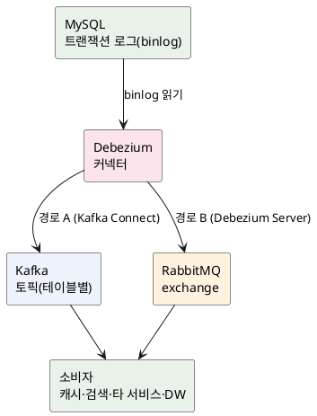

<!-- truncate -->

"주문 테이블이 바뀌면 캐시도 비우고, 검색 색인도 갱신하고, 다른 서비스에도 알려야 한다." 이걸 애플리케이션 코드에서 DB 저장과 메시지 발행을 **둘 다** 하면, 하나가 실패할 때 데이터가 어긋나는 **이중 쓰기(dual write)** 문제가 생깁니다. <mark>CDC(Change Data Capture)는 애플리케이션이 아니라 **DB 자신이 남긴 변경 기록(트랜잭션 로그)을 읽어** 행 변경을 스트림으로 흘려보내는 방식입니다.</mark> 개념·방식·설정·활용 케이스를 정리합니다.

## CDC란 — DB의 행 변경을 스트림으로

CDC는 테이블의 행이 **INSERT·UPDATE·DELETE** 될 때마다 그 변경을 **이벤트로 포착**해 다른 시스템으로 전달하는 기법입니다. 애플리케이션이 "저장 + 이벤트 발행"을 직접 하지 않아도, DB에 일어난 변경이 자동으로 하류(캐시·검색·분석·타 서비스)로 전파됩니다.

<mark>핵심 이점은 **애플리케이션 코드를 건드리지 않고**, DB에 실제로 커밋된 변경만 **빠짐없이·순서대로** 보낸다는 것입니다.</mark>

## 두 가지 방식 — 쿼리 기반 vs 로그 기반

| 방식 | 동작 | 한계 |
|---|---|---|
| **쿼리 기반**(폴링) | `updated_at > ?`로 주기적으로 조회 | DELETE를 못 잡음, 폴링 부하·지연, 중간 변경 누락 가능, 테이블에 타임스탬프 컬럼 필요 |
| **로그 기반**(binlog/WAL) | DB의 **트랜잭션 로그**를 읽어 변경을 순서대로 추출 | DB 로그 설정·권한 필요 |

<mark>실무에서는 **로그 기반**을 주로 사용합니다 — 애플리케이션·스키마를 바꾸지 않고, DELETE까지 포함해, 커밋 순서 그대로, 낮은 지연으로 포착하기 때문입니다.</mark> 대표 구현이 **Debezium**입니다.

## 아키텍처 — MySQL → Debezium → Kafka / RabbitMQ

Debezium은 MySQL의 **binlog(바이너리 로그)** 를 읽어 변경 이벤트를 만들고, 두 가지 경로로 보낼 수 있습니다.

- **경로 A — Kafka Connect** — Debezium 커넥터를 Kafka Connect에 올려 **테이블별 Kafka 토픽**으로 발행합니다. 가장 일반적인 구성입니다.
- **경로 B — Debezium Server** — Kafka 없이 **독립 실행(standalone)** 되는 런타임으로, **RabbitMQ**·Kinesis·Pub/Sub 등 다른 메시징으로 바로 보냅니다.

<details>
<summary>PlantUML 코드</summary>



</details>


## MySQL 준비 — binlog 설정과 권한

로그 기반 CDC의 전제는 **binlog가 켜져 있고, 행 단위로 전체 이미지를 남기는 것**입니다.

```ini
# my.cnf
[mysqld]
server-id         = 223344     # 복제 클러스터 내 유일한 값
log_bin           = mysql-bin  # binlog 활성화
binlog_format     = ROW        # 행 단위 변경 기록(필수)
binlog_row_image  = FULL       # 변경 전/후 전체 컬럼 기록(필수)
expire_logs_days  = 10         # binlog 보존 기간
# gtid_mode=ON, enforce_gtid_consistency=ON  # 장애 복구에 권장
```

Debezium이 접속할 계정에는 binlog를 읽을 권한이 필요합니다.

```sql
CREATE USER 'debezium'@'%' IDENTIFIED BY '...';
GRANT SELECT, RELOAD, SHOW DATABASES, REPLICATION SLAVE, REPLICATION CLIENT
  ON *.* TO 'debezium'@'%';
```

<mark>`binlog_format=ROW`와 `binlog_row_image=FULL`이 핵심입니다 — 그래야 변경 전/후 값을 온전히 담은 이벤트를 만들 수 있습니다.</mark>

## 경로 A — Kafka Connect에 Debezium 커넥터 등록

Kafka Connect에 아래 설정을 등록하면(`POST /connectors`), Debezium이 초기 스냅샷을 뜬 뒤 binlog를 이어 읽습니다.

```json
{
  "name": "inventory-connector",
  "config": {
    "connector.class": "io.debezium.connector.mysql.MySqlConnector",
    "database.hostname": "mysql",
    "database.port": "3306",
    "database.user": "debezium",
    "database.password": "...",
    "database.server.id": "223344",
    "topic.prefix": "fulfillment",
    "database.include.list": "inventory",
    "table.include.list": "inventory.orders,inventory.customers",
    "schema.history.internal.kafka.bootstrap.servers": "kafka:9092",
    "schema.history.internal.kafka.topic": "schema-changes.inventory"
  }
}
```

토픽 이름은 **`topic.prefix.데이터베이스.테이블`** 규칙을 따릅니다. 위 설정이면 `fulfillment.inventory.orders`, `fulfillment.inventory.customers` 토픽이 생깁니다. <mark>테이블마다 토픽이 하나씩 생기고, **기본 키**(primary key — 각 행을 유일하게 식별하는 값, 보통 `id`)를 메시지 키로 사용해 파티셔닝하므로 **같은 행(같은 기본 키)의 변경은 순서가 보존**됩니다.</mark>

한편 `schema.history.internal.kafka.topic`(`schema-changes.inventory`)은 데이터 토픽과 **별개인 내부용 스키마 이력 토픽**입니다. binlog(ROW)에는 **컬럼 값만 있고 이름·타입이 없어서**, Debezium이 **DDL 변경 이력(테이블 구조)** 을 여기에 적어 두고 binlog를 해석할 때 참조합니다. 소비자가 읽는 게 아니라 **Debezium이 직접 쓰고 읽는** 토픽이라, 보통 **단일 파티션 + 무한 보존**으로 설정해 사라지지 않게 합니다.

## 변경 이벤트 형식 — op·before·after

Debezium이 보내는 이벤트의 `payload`는 **무슨 연산이, 어떤 행을, 어떻게** 바꿨는지 담습니다.

```json
{
  "op": "u",                       // c=insert, u=update, d=delete, r=snapshot
  "before": { "id": 1, "status": "PAID",    "qty": 1 },
  "after":  { "id": 1, "status": "SHIPPED", "qty": 1 },
  "source": { "db": "inventory", "table": "orders", "file": "mysql-bin.000003", "pos": 1234 },
  "ts_ms":  1930000000000          // 커넥터가 이벤트를 처리한 시각
}
```

- **`op`** — `c`(생성/INSERT)·`u`(수정)·`d`(삭제)·`r`(초기 스냅샷 읽기).
- **`before`/`after`** — 변경 전/후 행 상태. DELETE면 `after`가 `null`, INSERT면 `before`가 `null`.
- **`source`** — 출처(DB·테이블·binlog 파일·위치). 재처리·추적에 사용합니다.

## 경로 B — Debezium Server로 RabbitMQ에 보내기

Kafka가 없다면 **Debezium Server**를 독립 실행해 RabbitMQ로 바로 보냅니다. 소스(MySQL)와 싱크(RabbitMQ)를 `application.properties`에 설정합니다.

```properties
# 소스: MySQL CDC
debezium.source.connector.class=io.debezium.connector.mysql.MySqlConnector
debezium.source.database.hostname=mysql
debezium.source.database.user=debezium
debezium.source.database.password=...
debezium.source.database.server.id=223344
debezium.source.topic.prefix=fulfillment
debezium.source.database.include.list=inventory
debezium.source.offset.storage.file.filename=/data/offsets.dat

# 싱크: RabbitMQ
debezium.sink.type=rabbitmq
debezium.sink.rabbitmq.connection.host=rabbitmq
debezium.sink.rabbitmq.connection.port=5672
debezium.sink.rabbitmq.exchange=cdc.exchange
```

<mark>Debezium Server는 Kafka Connect를 대체하는 경량 런타임이라, **Kafka 없이도** CDC 스트림을 RabbitMQ 같은 다른 메시징으로 흘려보낼 수 있습니다.</mark> (최신 RabbitMQ Streams를 쓰면 `debezium.sink.type=rabbitmqstream`도 가능합니다.)

## 언제 CDC가 필요한가 — 활용 케이스

- **캐시 무효화** — 원본이 바뀌면 CDC 이벤트로 해당 캐시 키를 비웁니다. 애플리케이션이 캐시 갱신을 직접 챙기지 않아도 돼, 로컬 캐시 불일치를 줄입니다([다층 캐시](./multi-layer-caching)).
- **검색 색인 동기화** — 행 변경을 Elasticsearch·OpenSearch 색인에 반영해 DB와 검색을 맞춥니다.
- **마이크로서비스 데이터 전파** — 한 서비스의 DB 변경을 이벤트로 다른 서비스에 전달합니다. **이중 쓰기 없이** 서비스 간 데이터를 느슨하게 동기화합니다.
- **감사·분석(DW) 적재** — 모든 변경 이력을 데이터 웨어하우스·레이크로 흘려보내 분석·감사에 사용합니다.
- **아웃박스 + CDC** — 애플리케이션이 같은 트랜잭션에서 **아웃박스 테이블**에 이벤트를 적고, CDC가 그 테이블을 읽어 발행합니다. 이중 쓰기 없이 "정확히 한 번 느낌"의 발행을 구현하는 방법은 [아웃박스 패턴](./kafka-outbox-exactly-once)에 정리했습니다.

## 운영 주의점

- **초기 스냅샷** — 커넥터가 처음 뜨면 대상 테이블 전체를 한 번 읽어(`op=r`) 현재 상태를 만든 뒤 binlog 스트리밍을 시작합니다. 큰 테이블은 스냅샷 부하·시간을 감안합니다.
- **전달 보장은 at-least-once** — 장애·재시작 시 같은 변경이 **중복 전달**될 수 있습니다. 소비자는 **멱등**하게 처리해야 합니다(전달 보장 개념은 [Kafka 전달 시맨틱](./kafka-delivery-semantics)).
- **순서** — 같은 행(기본 키)의 변경은 같은 파티션으로 가 순서가 보존되지만, **다른 키·다른 테이블 간 전역 순서는 보장되지 않습니다.**
- **스키마 변경(DDL)** — 컬럼 추가·변경이 이벤트 구조에 영향을 줍니다. Debezium은 스키마 이력을 따로 관리하니, 소비자도 스키마 진화를 감안해야 합니다.
- **binlog 보존·오프셋** — binlog가 만료돼 사라지기 전에 Debezium이 따라잡아야 합니다. 커넥터는 읽은 위치(offset)를 저장해 재시작 시 이어 읽습니다.
- **민감 정보** — 변경 이벤트에 개인정보가 그대로 담길 수 있으니, 컬럼 필터·마스킹을 적용합니다.

## 정리

- **CDC**는 애플리케이션이 아니라 **DB의 트랜잭션 로그**를 읽어 행 변경을 스트림으로 보내는 기법으로, **이중 쓰기** 없이 캐시·검색·타 서비스·DW를 동기화합니다.
- 방식은 **쿼리 기반(폴링)** 과 **로그 기반(binlog/WAL)** 이 있고, 실무는 **로그 기반(Debezium)** 을 주로 사용합니다.
- MySQL은 **`binlog_format=ROW`·`binlog_row_image=FULL`·유일한 `server-id`** 와 복제 권한이 전제입니다.
- 변경 발행은 **Kafka Connect(테이블별 토픽)** 또는 **Debezium Server(RabbitMQ 등)** 로 하고, 이벤트는 **`op`·`before`·`after`·`source`** 구조입니다.
- 전달은 **at-least-once**라 소비자는 **멱등**해야 하고, 순서는 **같은 키 단위로만** 보존됩니다.

## 참고

- [Debezium — MySQL connector](https://debezium.io/documentation/reference/stable/connectors/mysql.html)
- [Debezium — Server (Kafka 없이 RabbitMQ 등으로)](https://debezium.io/documentation/reference/stable/operations/debezium-server.html)
- [MySQL — The Binary Log](https://dev.mysql.com/doc/refman/8.0/en/binary-log.html)
