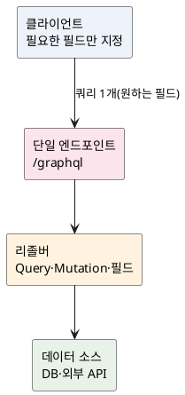

<!-- truncate -->

REST로 화면 하나를 그리려다 보면, 필요 없는 필드까지 받아 오거나(**과다 조회**) 연관 데이터를 받으려 여러 엔드포인트를 **여러 번** 부르게 됩니다(**과소 조회**). <mark>GraphQL은 **단일 엔드포인트(`/graphql`)** 에 클라이언트가 **필요한 필드만 지정한 쿼리**를 보내면, 서버가 딱 그만큼을 **한 번에** 돌려주는 API 방식입니다.</mark> 개념부터 Spring for GraphQL 설정까지 정리합니다.

## GraphQL이란 — 클라이언트가 필요한 만큼만

GraphQL은 API를 위한 **쿼리 언어**이자 그걸 실행하는 **런타임**입니다. REST가 "URL(자원)마다 고정된 응답"을 준다면, GraphQL은 **스키마**로 가능한 데이터의 형태를 정의해 두고, **클라이언트가 그중 필요한 필드만 선택해** 요청합니다.

```graphql
# 클라이언트 쿼리 — 필요한 필드만, 연관 데이터까지 한 번에
query {
  order(id: 1) {
    status
    customer { name }   # 연관 데이터도 같은 요청에서
  }
}
```

<mark>핵심은 **과다 조회·과소 조회를 함께 줄이는 것** — 클라이언트가 응답 모양을 정하므로 딱 필요한 만큼만, 한 번의 요청으로 받습니다.</mark>

## 구조 — 스키마·단일 엔드포인트·리졸버

GraphQL API는 세 가지로 구성됩니다.

- **스키마(SDL)** — 타입과 진입점(`Query`·`Mutation`·`Subscription`)을 정의합니다. 조회는 `Query`, 변경은 `Mutation`, 실시간 구독은 `Subscription`입니다.
- **단일 엔드포인트** — 자원마다 URL을 두지 않고 보통 `/graphql` 하나로 받습니다.
- **리졸버(resolver)** — 각 필드를 "어떻게 채울지" 정하는 함수입니다. 서버가 쿼리를 파싱해 필드별 리졸버를 호출합니다.

<details>
<summary>PlantUML 코드</summary>



</details>


## 스키마 정의 (SDL)

Spring에서는 `src/main/resources/graphql/`에 `.graphqls` 스키마를 둡니다.

```graphql
type Query {
  order(id: ID!): Order
}
type Mutation {
  updateStatus(id: ID!, status: String!): Order
}

type Order {
  id: ID!
  status: String!
  quantity: Int!
  customer: Customer      # 연관 타입
}
type Customer {
  id: ID!
  name: String!
}
```

`!`는 **필수(non-null)** 표시입니다. `Order.customer`처럼 연관 타입을 두면, 클라이언트가 원할 때만 그 필드를 채웁니다.

## Spring for GraphQL 설정과 코드

`spring-boot-starter-graphql` 의존성을 추가하고, 컨트롤러에 **애너테이션으로 리졸버**를 붙입니다.

```java
@Controller
public class OrderController {

    @QueryMapping                                   // schema의 Query.order
    public Order order(@Argument Long id) {         // id 인자 바인딩
        return orderRepository.findById(id).orElseThrow();
    }

    @MutationMapping                                // schema의 Mutation.updateStatus
    public Order updateStatus(@Argument Long id, @Argument String status) {
        return orderService.changeStatus(id, status);
    }
}
```

- **`@QueryMapping`** — `@SchemaMapping(typeName = "Query")`의 약식으로, 메서드명을 스키마 필드명과 자동 매칭합니다.
- **`@MutationMapping`** — 변경 작업(`Mutation`)용.
- **`@Argument`** — 쿼리 인자를 메서드 파라미터로 주입합니다.

## N+1 문제와 DataLoader

연관 필드를 리졸버로 채우면 흔히 **N+1**이 생깁니다. 주문 10건을 조회하고 각 주문의 `customer`를 따로 조회하면, 목록 1번 + 회원 10번 = 11번 조회가 실행됩니다. <mark>Spring for GraphQL은 **`@BatchMapping`** 으로 부모 목록을 **한꺼번에 받아 한 번에** 로딩해 N+1을 없앱니다(내부적으로 DataLoader로 배치·캐싱).</mark>

```java
// 주문 목록의 customer를 "한 번에" 로딩 — N+1 제거
@BatchMapping
public Map<Order, Customer> customer(List<Order> orders) {
    List<Long> ids = orders.stream().map(Order::getCustomerId).toList();
    Map<Long, Customer> byId = customerRepository.findAllById(ids).stream()
            .collect(Collectors.toMap(Customer::getId, c -> c));
    return orders.stream()
            .collect(Collectors.toMap(o -> o, o -> byId.get(o.getCustomerId())));
}
```

## REST와 비교 — 장단점

| | REST | GraphQL |
|---|---|---|
| 엔드포인트 | 자원마다 여러 개 | 보통 `/graphql` 하나 |
| 응답 모양 | 서버가 고정 | **클라이언트가 필드 선택** |
| 과다/과소 조회 | 생기기 쉬움 | 줄어듦 |
| 캐싱 | HTTP 캐시가 쉬움 | POST 단일 엔드포인트라 **HTTP 캐시가 어렵다** |
| 복잡도·보안 | 단순 | 쿼리 깊이·비용 제한 등 **별도 방어 필요** |

<mark>클라이언트마다 필요한 데이터가 제각각인 화면(모바일·대시보드)이나 **연관이 많은 데이터**엔 GraphQL이 강하고, 단순 CRUD·강한 HTTP 캐싱엔 REST가 편합니다.</mark>

## 주의점

- **N+1** — 연관 필드는 **`@BatchMapping`/DataLoader**로 배치 로딩합니다(위 예시). 안 그러면 조회 수가 급격히 늘어납니다.
- **쿼리 비용·깊이 제한** — 클라이언트가 임의로 깊고 넓은 쿼리를 보낼 수 있어, **깊이·복잡도 한도**를 설정해 과부하·악용을 막습니다.
- **캐싱** — 단일 POST라 HTTP 레벨 캐시가 어렵습니다. 영속 쿼리(persisted query)·필드 캐시 등 별도 전략이 필요합니다.
- **에러 모델** — HTTP 200에 `errors` 배열로 부분 실패를 담는 방식이라, 클라이언트가 `errors`를 반드시 확인해야 합니다.

## 정리

- GraphQL은 **단일 엔드포인트 + 스키마 + 리졸버**로, **클라이언트가 필요한 필드만 한 번에** 받아 과다·과소 조회를 줄입니다.
- Spring for GraphQL은 `.graphqls` 스키마 + **`@QueryMapping`·`@MutationMapping`·`@Argument`** 컨트롤러로 구현합니다.
- 연관 필드의 **N+1**은 **`@BatchMapping`(DataLoader)** 로 배치 로딩해 없앱니다.
- **캐싱·쿼리 비용 제한**은 REST보다 신경 써야 합니다 — 깊이·복잡도 한도를 둡니다.
- 내부 고성능 통신이 목적이라면 [gRPC](./grpc-concept-and-spring)와 성격이 다르니 용도에 따라 구분해 선택하세요.

## 참고

- [GraphQL 공식 — Learn](https://graphql.org/learn/)
- [Spring for GraphQL — Annotated Controllers](https://docs.spring.io/spring-graphql/reference/controllers.html)
- [Spring for GraphQL — Batch Loading(DataLoader)](https://docs.spring.io/spring-graphql/reference/request-execution.html#execution.batching)
