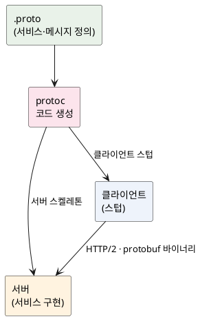

<!-- truncate -->

서비스 간 통신을 REST(JSON/HTTP)로만 하다 보면, 내부 마이크로서비스처럼 **속도·타입 안정성·스트리밍**이 중요한 구간에서 아쉬울 때가 있습니다. <mark>gRPC는 **계약(`.proto`)을 먼저 정의**하고 그걸로 서버·클라이언트 코드를 생성해, **HTTP/2 위에서 바이너리(protobuf)** 로 주고받는 RPC 프레임워크입니다.</mark> 개념부터 Spring 설정까지 쉽게 정리합니다.

## gRPC란 — "원격 함수 호출"을 계약으로

gRPC는 구글이 만든 **RPC(Remote Procedure Call)** 프레임워크입니다. 핵심은 **원격 서버의 메서드를 마치 로컬 함수처럼 호출**하는 것입니다. 이를 위해 세 가지가 맞물립니다.

- **IDL(계약) = Protocol Buffers(`.proto`)** — 서비스와 메시지(요청·응답)의 구조를 언어 중립적으로 정의합니다.
- **직렬화 = protobuf 바이너리** — JSON 같은 텍스트가 아니라 **작고 빠른 바이너리**로 인코딩합니다.
- **전송 = HTTP/2** — 한 연결에서 여러 요청을 동시에 처리(멀티플렉싱)하고, 헤더를 압축하며, **스트리밍**을 지원합니다.

<mark>즉 "스키마를 먼저 정하고(코드 생성), 바이너리로, HTTP/2 위에서" — 이 세 가지가 gRPC가 빠르고 타입 안전한 이유입니다.</mark>

## 흐름 — .proto 한 벌로 서버·클라이언트 생성

`.proto` 파일 하나를 `protoc`(컴파일러)로 변환하면, **서버가 구현할 뼈대**와 **클라이언트가 호출할 스텁(stub)** 코드가 각각 생성됩니다. 양쪽이 같은 계약에서 나오므로 타입이 어긋날 수 없습니다.

<details>
<summary>PlantUML 코드</summary>



</details>


## 계약 정의 — .proto 예시

주문 조회 서비스를 정의해 봅니다. `service`가 호출 가능한 메서드, `message`가 요청·응답 구조입니다.

```proto
syntax = "proto3";
package order;
option java_package = "com.example.order.grpc";

service OrderService {
  rpc GetOrder (GetOrderRequest) returns (Order);          // 유너리
  rpc ListOrders (ListOrdersRequest) returns (stream Order); // 서버 스트리밍
}

message GetOrderRequest { int64 id = 1; }
message ListOrdersRequest { int64 customer_id = 1; }

message Order {
  int64 id = 1;
  string status = 2;
  int32 quantity = 3;
}
```

각 필드 뒤의 숫자(`= 1`)는 **필드 번호(태그)** 로, 바이너리 인코딩·호환성의 기준입니다. 필드를 추가해도 번호만 유지하면 **구버전과 호환**됩니다.

## 4가지 호출 방식

HTTP/2 스트리밍 덕분에 gRPC는 네 가지 호출 형태를 지원합니다.

| 방식 | 요청 → 응답 | 쓰임새 |
|---|---|---|
| **유너리(unary)** | 1 → 1 | 일반 조회·생성 (가장 흔함) |
| **서버 스트리밍** | 1 → N | 목록·피드를 서버가 밀어 보냄 |
| **클라이언트 스트리밍** | N → 1 | 청크 업로드처럼 클라가 나눠 보냄 |
| **양방향 스트리밍** | N ↔ N | 채팅·실시간 양방향(full-duplex) |

<mark>REST가 기본적으로 "1요청 1응답"인 데 비해, gRPC는 **스트리밍을 기본으로 지원**합니다.</mark>

## Spring Boot 설정과 코드

Spring에서는 두 가지 선택이 있습니다 — 2025년 GA된 **공식 Spring gRPC**(`spring-grpc-spring-boot-starter`, `@GrpcService` 제공)와, 오래 쓰인 커뮤니티 **`net.devh:grpc-spring-boot-starter`**. 공식 쪽은 빈 주입·인터셉터·테스트가 Spring 방식으로 맞물립니다. 빌드 플러그인으로 `.proto`에서 코드를 생성한 뒤, 생성된 뼈대를 상속해 구현합니다.

```java
// 생성된 OrderServiceGrpc.OrderServiceImplBase 를 상속해 구현
@GrpcService
public class OrderGrpcService extends OrderServiceGrpc.OrderServiceImplBase {

    @Override
    public void getOrder(GetOrderRequest req, StreamObserver<Order> responseObserver) {
        Order order = Order.newBuilder()
                .setId(req.getId())
                .setStatus("SHIPPED")
                .setQuantity(1)
                .build();
        responseObserver.onNext(order);   // 응답 1건 전송
        responseObserver.onCompleted();   // 스트림 종료
    }
}
```

클라이언트는 생성된 **스텁**으로 로컬 메서드처럼 호출합니다.

```java
// blocking 스텁 — 동기 호출
Order order = orderStub.getOrder(
        GetOrderRequest.newBuilder().setId(1L).build());
System.out.println(order.getStatus());
```

응답(`StreamObserver`)으로 여러 번 `onNext`를 부르면 그대로 **서버 스트리밍**이 됩니다 — 같은 모델로 1건부터 N건까지 처리합니다.

## REST와 비교 — 언제 gRPC를 쓰나

| | REST(JSON/HTTP) | gRPC |
|---|---|---|
| 포맷 | 텍스트(JSON) — 사람이 읽기 쉬움 | 바이너리(protobuf) — 작고 빠름 |
| 계약 | 느슨(OpenAPI 별도) | `.proto`로 강제·코드 생성 |
| 스트리밍 | 제한적 | 4가지 기본 지원 |
| 브라우저 | 네이티브 | 직접은 안 되고 **grpc-web** 필요 |
| 가독성·도구 | `curl`·브라우저로 즉석 테스트 | 바이너리라 별도 도구 필요 |

<mark>정리하면 **내부 서비스 간 통신·고성능·스트리밍·다언어 환경**에는 gRPC가 강하고, **브라우저 공개 API·사람이 직접 사용하는 API**에는 REST가 편합니다.</mark> 외부 공개는 REST(또는 GraphQL), 내부는 gRPC로 **섞어 구성**하는 경우가 흔합니다.

## 주의점

- **브라우저에서 직접 호출 불가** — 공개 웹 API로 쓰려면 `grpc-web` 프록시가 필요합니다.
- **디버깅** — 바이너리라 `curl`로 즉석 확인이 어렵습니다. `grpcurl` 같은 도구나 리플렉션을 켜 둡니다.
- **로드밸런싱** — HTTP/2는 연결을 오래 유지해, L4 LB로는 커넥션이 한 서버에 쏠릴 수 있습니다. L7(gRPC 인식) 프록시나 클라이언트 측 LB가 필요합니다([L7/L4 차이](./alb-vs-nlb)).
- **계약 진화** — 필드 번호를 변경하거나 재사용하면 호환되지 않습니다. 번호는 **추가만** 하고 바꾸지 않습니다.

## 정리

- gRPC는 **`.proto` 계약 → 코드 생성 → HTTP/2 위 protobuf 바이너리**로 통신하는 RPC 프레임워크입니다.
- **유너리·서버/클라이언트/양방향 스트리밍** 네 가지 호출을 기본 지원합니다.
- Spring에서는 **공식 Spring gRPC(`@GrpcService`)** 또는 커뮤니티 `net.devh` 스타터로, `.proto`에서 생성된 뼈대·스텁을 사용합니다.
- **내부·고성능·스트리밍**엔 gRPC, **브라우저·공개 API**엔 REST가 맞아 보통 섞어 구성합니다. 클라이언트가 **필요한 필드만** 받아 가는 방식이 필요하면 [GraphQL](./graphql-concept-and-spring)도 함께 보세요.

## 참고

- [gRPC 공식 문서 — Core concepts](https://grpc.io/docs/what-is-grpc/core-concepts/)
- [Protocol Buffers — proto3](https://protobuf.dev/programming-guides/proto3/)
- [Spring gRPC (공식)](https://docs.spring.io/spring-grpc/reference/) · [grpc-spring (net.devh)](https://github.com/grpc-ecosystem/grpc-spring)
