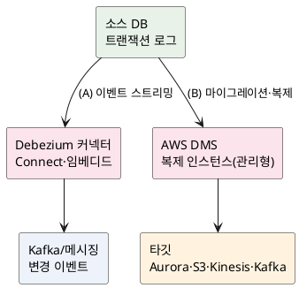
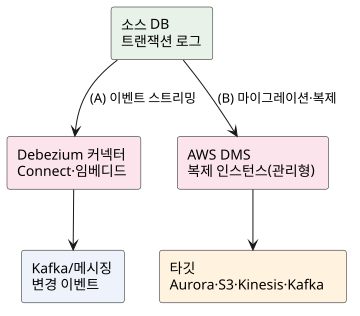

<!-- truncate -->

CDC(변경 데이터 캡처) 도구를 선택할 때 **Debezium**과 **AWS DMS**가 자주 함께 거론됩니다. 둘 다 DB의 **트랜잭션 로그(binlog 등)를 읽어** 변경을 포착한다는 점은 같지만, <mark>Debezium은 **변경을 이벤트 스트림으로 보내는 오픈소스 CDC 프레임워크**이고, AWS DMS는 **DB를 옮기고 지속 복제하는 AWS 관리형 서비스**로 성격이 다릅니다.</mark> CDC 개념 자체는 [CDC 글](./cdc-change-data-capture-debezium)에 정리했고, 여기서는 둘을 비교합니다.

## 한눈에 — 성격이 다르다

| | Debezium | AWS DMS |
|---|---|---|
| 정체성 | 오픈소스 **CDC → 이벤트 스트림** 프레임워크 | AWS **관리형 마이그레이션·복제** 서비스 |
| 주 용도 | 이벤트 드리븐·캐시·검색·서비스 전파 | DB 이관(이기종 포함) + 지속 복제 |
| 실행·운영 | 직접 운영(Kafka Connect/임베디드) | AWS가 관리(복제 인스턴스·서버리스) |
| 출력 | Kafka 토픽 등 메시징(상세한 변경 이벤트) | 타깃 DB·S3·Kinesis·Kafka 등 |
| 결합 | Kafka 생태계·온프렘·멀티클라우드 | AWS 생태계 중심 |

<mark>간단히 말하면 **"이벤트가 필요하면 Debezium, DB를 옮기거나 AWS로 복제하려면 DMS"** 입니다.</mark>

## 동작 원리

<details>
<summary>PlantUML 코드</summary>



</details>



- **Debezium** — 커넥터가 소스의 binlog를 읽어 **초기 스냅샷 → 스트리밍** 순으로 변경 이벤트를 만들고, **Kafka 토픽**(또는 Debezium Server로 RabbitMQ 등)으로 발행합니다. 다운스트림의 **여러 소비자**가 그 이벤트를 각자 구독합니다.
- **AWS DMS** — **복제 인스턴스**(또는 서버리스)가 **소스·타깃 엔드포인트**에 연결되고, **복제 태스크**가 데이터를 옮깁니다. 태스크 유형은 **`full-load`**(초기 적재), **`cdc`**(변경만), **`full-load-and-cdc`**(둘 다)로, 소스 트랜잭션 로그를 읽어 타깃에 거의 실시간으로 적용합니다.

<mark>Debezium은 "변경을 **이벤트로 흘려보내는** 것"에, DMS는 "소스를 타깃으로 **옮기고 맞추는** 것"에 초점이 있습니다.</mark>

## 연동 방법

**Debezium** — 보통 Kafka Connect에 커넥터 설정(JSON)을 등록합니다. 코드로 통합하거나 Kafka가 없으면 **임베디드 엔진**·Debezium Server를 사용합니다(아래 Spring 활용).

```json
{ "name": "orders-connector", "config": {
    "connector.class": "io.debezium.connector.mysql.MySqlConnector",
    "database.hostname": "mysql", "database.user": "debezium",
    "topic.prefix": "fulfillment", "database.include.list": "inventory"
}}
```

**AWS DMS** — 코드 설정이 아니라 **AWS 리소스 구성**입니다. ① 복제 인스턴스(또는 서버리스) 생성 → ② 소스·타깃 **엔드포인트** 등록 → ③ **복제 태스크**(유형·테이블 매핑) 생성·실행. 타깃을 **Kinesis/Kafka**로 두면 CDC를 스트림으로 받을 수 있고, **S3**로 두면 데이터 레이크 적재가 됩니다. 콘솔·CLI·CDK/CloudFormation으로 선언합니다.

## 데이터 포맷 — 구조가 다르다

같은 UPDATE라도 두 도구가 보내는 JSON **구조(envelope)** 가 다릅니다.

**Debezium** — `op`(c/u/d/r)와 `before`/`after`/`source`를 담습니다.

```json
{
  "op": "u",
  "before": { "id": 1, "status": "PAID" },
  "after":  { "id": 1, "status": "SHIPPED" },
  "source": { "db": "inventory", "table": "orders" },
  "ts_ms": 1930000000000
}
```

**AWS DMS**(Kinesis/Kafka 타깃) — `data`(행 값)와 `metadata`(연산·테이블·시각)로 나뉩니다. 연산은 `load`·`insert`·`update`·`delete`입니다.

```json
{
  "data": { "id": 1, "status": "SHIPPED" },
  "metadata": {
    "operation": "update",
    "schema-name": "inventory",
    "table-name": "orders",
    "timestamp": "2026-11-03T03:00:00.000Z"
  }
}
```

<mark>Debezium은 **변경 전/후(`before`/`after`)를 함께** 주지만, DMS 기본 포맷은 보통 **변경 후 값(`data`)과 메타데이터** 중심입니다.</mark> 소비자 파싱 코드가 서로 다릅니다.

## Spring Boot 활용

### Debezium — 토픽 소비 또는 임베디드 엔진

가장 흔한 방식은 Debezium이 발행한 **Kafka 토픽을 `@KafkaListener`로 소비**하고 envelope를 파싱하는 것입니다. 메시지 구조상 커밋 타이밍·멱등 처리는 [MANUAL ack·에러 핸들러 글](./spring-kafka-manual-ack-error-offset-commit)과 같은 주의가 필요합니다.

Kafka·Kafka Connect 없이 **Spring 애플리케이션 안에서 CDC를 직접 돌리고** 싶으면 **Debezium 임베디드 엔진**을 사용합니다. `debezium-api`·`debezium-embedded`·커넥터 의존성을 추가하고, `DebeziumEngine`을 만들어 변경 이벤트를 콜백으로 받습니다.

```java
// 임베디드 엔진 — 앱 프로세스 안에서 CDC 실행(Kafka Connect 불필요)
DebeziumEngine<ChangeEvent<String, String>> engine = DebeziumEngine
        .create(Json.class)
        .using(props)                        // 커넥터·오프셋 저장 설정
        .notifying(record -> {
            handleChange(record.value());    // 변경 이벤트 처리
        })
        .build();
Executors.newSingleThreadExecutor().execute(engine);  // 백그라운드 실행
```

다만 임베디드는 **그 애플리케이션 인스턴스에 CDC가 종속되므로**, Kafka Connect 같은 분산 내결함성·확장성은 떨어집니다. 가볍게 한 곳에서만 처리할 때 적합합니다.

### AWS DMS — 타깃 스트림을 소비

DMS에서는 Spring이 CDC를 직접 수행하지 않고, **타깃으로 지정한 스트림(Kinesis/MSK)을 소비**합니다. Kinesis면 KCL이나 Spring Cloud Stream Kinesis 바인더로, Kafka(MSK)면 `@KafkaListener`로 받아 위의 **DMS `data`/`metadata` 포맷**을 파싱합니다. 즉 Spring은 **소비자 역할**이고, 변경 포착·전달은 DMS가 맡습니다.

## 선택 기준

- **Debezium을 사용하는 경우** — 변경을 **이벤트로 여러 소비자에게** 흘려보내는 이벤트 드리븐 구조, **상세한 변경 이벤트(before/after)** 가 필요, Kafka 생태계·온프렘·멀티클라우드, 세밀한 제어가 중요할 때. 대신 **직접 운영**해야 합니다.
- **AWS DMS를 사용하는 경우** — **DB 이관**(특히 이기종: Oracle→Aurora 등)과 **지속 복제**가 목적, 타깃이 **AWS 서비스**(Aurora·S3·Redshift·Kinesis), **관리형·저운영**을 원할 때. 대신 이벤트 세분화·포맷 유연성은 Debezium보다 제한적입니다.
- **함께 쓰기** — DMS로 **일회성 마이그레이션**을 하고, 이후 이벤트 스트리밍은 **Debezium**으로 가져가는 조합도 흔합니다.

## 정리

- 둘 다 **트랜잭션 로그 기반 CDC**이지만, **Debezium = 오픈소스 CDC→이벤트 스트림**, **AWS DMS = 관리형 마이그레이션·복제**로 목적이 다릅니다.
- Debezium은 커넥터로 **Kafka 등에 변경 이벤트**를, DMS는 **복제 인스턴스+엔드포인트+태스크**로 **타깃에 데이터**를 옮깁니다.
- 포맷은 **Debezium(`op`·`before`/`after`)** vs **DMS(`data`·`metadata`)** 로 구조가 다릅니다.
- Spring에서는 Debezium을 **토픽 소비 또는 임베디드 엔진**으로, DMS는 **타깃 스트림 소비자**로 사용합니다.
- **이벤트가 필요하면 Debezium, DB 이관·AWS 복제가 목적이면 DMS** — 일회성 이관(DMS) + 지속 스트리밍(Debezium) 조합도 좋습니다.

## 참고

- [Debezium — MySQL connector](https://debezium.io/documentation/reference/stable/connectors/mysql.html) · [Embedded Engine](https://debezium.io/documentation/reference/stable/development/engine.html)
- [AWS DMS — How it works](https://docs.aws.amazon.com/dms/latest/userguide/CHAP_Introduction.html) · [Kinesis 타깃 포맷](https://docs.aws.amazon.com/dms/latest/userguide/CHAP_Target.Kinesis.html)
