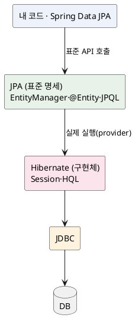
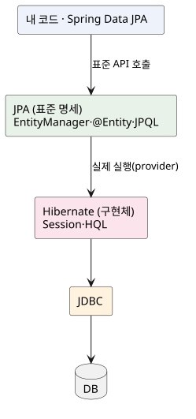

<!-- truncate -->

JPA로 개발한다고 하면서 로그·설정·문서에는 **Hibernate**가 계속 등장합니다. "둘이 같은 건가, 다른 건가?" 헷갈리기 쉽습니다. <mark>한 줄로 말하면 **JPA는 표준 명세(인터페이스·애너테이션)이고, Hibernate는 그 명세를 실제로 구현한 구현체(provider)** 입니다.</mark> 둘의 관계를 레이어·애너테이션·쿼리까지 쉽게 정리합니다.

## JPA — 표준 "명세"

JPA(Jakarta Persistence, 옛 이름 Java Persistence API)는 자바에서 객체와 관계형 DB를 매핑(ORM)하는 **표준 명세**입니다. 즉 **"이렇게 쓰면 된다"는 규격(인터페이스·애너테이션)만 정의**하고, 실제 동작 코드는 들어 있지 않습니다.

- **인터페이스** — `EntityManager`, `EntityManagerFactory`, `EntityTransaction` 등.
- **애너테이션** — `@Entity`, `@Id`, `@OneToMany`, `@Column` 등(`jakarta.persistence` 패키지).
- **쿼리 언어** — JPQL.

<mark>JPA 자체는 **규격일 뿐이라 단독으로는 아무것도 실행하지 못합니다.** 누군가 이 규격을 구현해 줘야 동작합니다.</mark>

## Hibernate — 가장 널리 쓰이는 "구현체"

Hibernate는 그 JPA 명세를 **실제로 구현한 ORM 프레임워크**입니다. JPA 구현체(provider)는 여럿(EclipseLink 등) 있지만, **Hibernate가 사실상 표준처럼 가장 많이** 쓰이며 Spring Boot의 **기본 JPA 구현체**이기도 합니다.

한 가지 더 — Hibernate는 **JPA보다 먼저 등장한** ORM이라, JPA 표준과 별개로 **자체 네이티브 API**도 가지고 있습니다.

- **자체 API** — `SessionFactory`, `Session`(JPA의 `EntityManagerFactory`·`EntityManager`에 대응).
- **자체 쿼리** — HQL(JPQL을 포함하는 상위 집합).

## 관계 — 인터페이스와 구현

정리하면 **JPA(규격) ↔ Hibernate(구현)** 의 관계입니다. 익숙한 비유로 보면 이해가 쉽습니다.

| 표준(명세) | 구현체 |
|---|---|
| **JPA** | **Hibernate**, EclipseLink … |
| JDBC | MySQL·PostgreSQL 드라이버 |
| `List` 인터페이스 | `ArrayList`·`LinkedList` |

<details>
<summary>PlantUML 코드</summary>



</details>



<mark>내 코드는 **JPA 인터페이스에 의존**하고, 런타임에는 그 뒤의 **Hibernate가 실제 SQL을 만들어 JDBC로 실행**합니다.</mark> 실제로 JPA의 `EntityManager` 안에는 Hibernate의 `Session`이 들어 있어, 필요하면 직접 가져와 사용할 수도 있습니다.

```java
// JPA 표준으로 코딩하다가, Hibernate 고유 기능이 필요하면 꺼낸다
Session session = entityManager.unwrap(Session.class);
```

## 레이어 — Spring Data JPA는 어디에

Spring을 사용하면 보통 **Spring Data JPA**까지 맨 위에 놓여, 아래처럼 구성됩니다.

- **내 코드 / Spring Data JPA** — `JpaRepository` 등으로 편의 제공(그 아래로 JPA를 호출).
- **JPA(표준)** — `EntityManager`·애너테이션으로 "무엇을" 할지 규정.
- **Hibernate(구현)** — "어떻게"를 담당해 SQL 생성·캐시·변경 감지 등을 실제 수행.
- **JDBC → DB** — 최종적으로 SQL을 DB에 실행.

<mark>Spring Data JPA ≠ JPA ≠ Hibernate — **편의 레이어 / 표준 / 구현**으로 역할이 각각 다릅니다.</mark>

## 애너테이션·쿼리 — 표준과 확장

같은 매핑이라도 **어느 패키지에 속하는지**로 표준인지 Hibernate 확장인지 갈립니다.

- **표준(JPA)** — `jakarta.persistence.*` — `@Entity`·`@Id`·`@OneToMany`·`@Column` 등.
- **Hibernate 확장** — `org.hibernate.annotations.*` — `@BatchSize`·`@DynamicUpdate`·`@Formula`·`@Type` 등 표준에 없는 기능.

쿼리도 **JPQL(표준)** 과 **HQL(Hibernate)** 이 있습니다. 둘 다 테이블이 아니라 **엔티티·필드를 대상으로** 하는 객체 지향 쿼리로 문법이 거의 같지만, **HQL이 JPQL을 포함하는 상위 집합**입니다 — JPQL의 모든 문법에 더해 Hibernate 고유 기능까지 지원합니다.

```java
// JPQL (표준) — 엔티티 Order를 대상으로, 테이블/컬럼이 아니라 필드명으로
List<Order> r1 = em.createQuery(
        "select o from Order o where o.status = :s", Order.class)
    .setParameter("s", "SHIPPED").getResultList();

// HQL (Hibernate) — 위 JPQL이 그대로 동작하고(상위 집합),
//                    Hibernate 전용 문법도 추가로 쓸 수 있다
Session session = em.unwrap(Session.class);
List<Order> r2 = session.createQuery(
        "from Order o where o.status = :s", Order.class)   // select 생략 등 Hibernate 허용 문법
    .setParameter("s", "SHIPPED").list();
```

위에서 보듯 **같은 문장이 양쪽에서 동작**합니다. 차이는 HQL이 `select` 생략, 일부 함수·문법 등 **표준에 없는 편의**를 더 허용한다는 점입니다. 반대로 **HQL 고유 문법을 사용하면 JPQL(다른 구현체)에서는 동작하지 않습니다.** <mark>원칙은 **표준(JPA/JPQL)으로 쓰되, 표준에 없는 기능만 Hibernate 확장(HQL·Hibernate 애너테이션)을 사용**하는 것입니다.</mark>

## 왜 구분이 중요한가

- **이식성** — JPA 표준만 사용하면 구현체를 EclipseLink 등으로 **교체**할 여지가 있습니다. 반대로 Hibernate 전용 애너테이션·HQL을 사용하면 그만큼 Hibernate에 종속됩니다.
- **문서·디버깅** — 문제가 표준 동작인지 Hibernate 구현 특성인지 알아야 **어느 문서를 볼지** 정해집니다. 예를 들어 flush·변경 감지 같은 실행 시점의 세부는 Hibernate 구현 특성입니다([flush·commit 타이밍](./jpa-hibernate-flush-commit-rollback-timing), [기본 페치 전략](./jpa-association-default-fetch-type)).
- **예외 계층** — 같은 오류도 표준(`jakarta.persistence.PersistenceException`)과 Hibernate(`org.hibernate.HibernateException`) 양쪽으로 나타날 수 있습니다.

## 정리

- **JPA = 표준 명세**(인터페이스·애너테이션·JPQL), **Hibernate = 그 구현체**(provider) — 규격과 구현의 관계입니다.
- Hibernate는 가장 널리 쓰이는 JPA 구현이자 **Spring Boot 기본 provider**이고, JPA보다 먼저 등장해 **자체 API(Session·HQL)** 도 가집니다.
- 레이어는 **Spring Data JPA → JPA(표준) → Hibernate(구현) → JDBC → DB** 입니다.
- 애너테이션은 **`jakarta.persistence`(표준)** 과 **`org.hibernate.annotations`(확장)** 으로 나뉩니다 — 표준 우선, 필요할 때만 확장.
- 표준으로 작성할수록 **이식성**이 좋고, Hibernate 전용 기능을 사용할수록 Hibernate에 종속됩니다.

## 참고

- [Jakarta Persistence (JPA 명세)](https://jakarta.ee/specifications/persistence/)
- [Hibernate ORM 공식 문서](https://hibernate.org/orm/documentation/)
