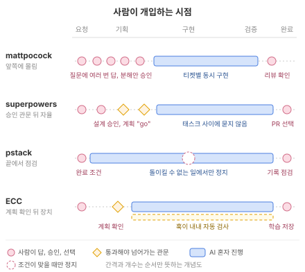

<!-- truncate -->

코딩 AI에게 일을 맡기면 코드는 빠르게 작성됩니다. 문제는 **AI가 요청을 잘못 이해해 의도와 다른 기능을 구현하거나, 동작만 확인된 품질 낮은 코드를 대량으로 작성하는 경우**가 자주 있다는 점입니다. 이 문제를 대상으로 하는 오픈소스 **스킬 모음**이 여럿 공개돼 있습니다. 스킬은 Claude Code 같은 코딩 에이전트가 읽어 들이는 작업 지침 파일(`SKILL.md`)이고, 스킬 모음은 이 지침들을 모아 **AI가 일하는 순서(워크플로)를 정해 둔 것**입니다.

이 글은 많이 사용되는 네 가지 스킬 모음을 비교합니다.

| 도구 | 저장소 | 한 줄 요약 |
|---|---|---|
| mattpocock/skills | [mattpocock/skills](https://github.com/mattpocock/skills) | 코드를 작성하기 전에 AI가 질문해서 만들 것을 사람과 먼저 합의합니다 |
| superpowers | [obra/superpowers](https://github.com/obra/superpowers) | 사람이 설계와 계획을 승인하면, 그 뒤로는 AI가 끝까지 혼자 진행합니다 |
| pstack | [backnotprop/pstack](https://github.com/backnotprop/pstack) ([cursor/plugins](https://github.com/cursor/plugins) 미러) | 사람은 완료 조건만 정하고, AI가 실험하며 진행한 뒤 사람은 마지막에 작업 기록을 점검합니다 |
| ECC | [affaan-m/ECC](https://github.com/affaan-m/ECC) | 테스트와 리뷰를 말로 부탁하지 않고, 훅 같은 자동 장치로 반드시 실행되게 합니다 |

<mark>네 도구를 나란히 놓으면 가장 큰 차이는 **사람이 언제 개입하느냐**입니다.</mark> 성격 비유와 선택 기준은 이 글의 해석이며, 저장소가 정한 규칙은 아닙니다.

## 네 도구가 막으려는 실패

네 도구가 해결하려는 문제는 같습니다. AI가 요청과 다른 기능을 만들거나, 품질이 낮은 코드를 만드는 문제입니다. 다만 **여러 실패 중 무엇을 가장 먼저 막아야 하는지**에 대한 판단이 도구마다 다릅니다. 각 README가 도구를 만든 이유로 소개하는 실패를 정리하면 다음과 같습니다.

| 도구 | README가 꼽은 대표 실패 | 해결 방법 |
|---|---|---|
| mattpocock/skills | **이해 불일치(misalignment)**: 개발자는 AI가 요청을 이해했다고 생각했지만, 결과물을 보면 전혀 다른 것을 만들었습니다 | 코드를 작성하기 전에 AI가 무엇을 만들지 개발자에게 자세히 질문합니다(grilling) |
| superpowers | **설계 없는 구현**: 만들 것이 정해지면 설계 없이 바로 코드부터 작성합니다 | 먼저 질문하고, 설계 승인과 테스트 우선 작성을 반드시 거치게 합니다 |
| pstack | **슬롭(slop)**: 양은 많지만 품질이 낮은 불필요한 코드가 늘어납니다 | 코드 양을 줄여 품질을 높이고, 동작은 실행 결과로 증명합니다 |
| ECC | **잊히는 지시**: "TDD로 해 줘" 같은 말은 작업 중에 모델이 잊을 수 있습니다 | 검사를 프롬프트 지시 대신 훅과 관문으로 자동 실행합니다 |

<mark>어떤 실패를 가장 피하고 싶은지에 따라 워크플로가 달라집니다.</mark> AI가 요청을 잘못 이해하는 것을 가장 피하고 싶으면 코드를 작성하기 전에 많이 묻고, AI가 사람의 답을 기다리며 멈춰 있는 시간을 가장 피하고 싶으면 묻지 않고 진행합니다. 이 차이가 아래 그림으로 이어집니다.

## 한 장으로 보는 차이 — 사람이 개입하는 시점

같은 기능을 만들어도, 사람을 호출하는 시점이 도구마다 다릅니다.

<details>
<summary>SVG 코드</summary>

```svg
<svg xmlns="http://www.w3.org/2000/svg" width="440" height="392" viewBox="0 0 440 392" font-family="-apple-system, 'Segoe UI', 'Noto Sans KR', sans-serif">
  <rect x="0" y="0" width="440" height="392" fill="#FFFFFF"/>
  <text x="220" y="22" text-anchor="middle" font-size="13" font-weight="bold" fill="#333">사람이 개입하는 시점</text>

  <!-- 단계 헤더 -->
  <g font-size="10" fill="#888" text-anchor="middle">
    <text x="118" y="46">요청</text>
    <text x="176" y="46">기획</text>
    <text x="272" y="46">구현</text>
    <text x="362" y="46">검증</text>
    <text x="414" y="46">완료</text>
  </g>
  <line x1="104" y1="54" x2="428" y2="54" stroke="#DDDDDD"/>

  <!-- 1. mattpocock -->
  <text x="8" y="84" font-size="11.5" font-weight="bold" fill="#333">mattpocock</text>
  <text x="8" y="99" font-size="9.5" fill="#888">앞쪽에 몰림</text>
  <line x1="108" y1="88" x2="426" y2="88" stroke="#CCCCCC" stroke-dasharray="2 3"/>
  <rect x="222" y="81" width="150" height="14" rx="3" fill="#D6E4FB" stroke="#4C7FE0"/>
  <g fill="#FBDCE4" stroke="#D06A86">
    <circle cx="118" cy="88" r="6"/>
    <circle cx="140" cy="88" r="6"/>
    <circle cx="160" cy="88" r="6"/>
    <circle cx="180" cy="88" r="6"/>
    <circle cx="202" cy="88" r="6"/>
    <circle cx="392" cy="88" r="6"/>
  </g>
  <text x="160" y="112" font-size="9.5" fill="#9E3A57" text-anchor="middle">질문에 여러 번 답, 분해안 승인</text>
  <text x="297" y="112" font-size="9.5" fill="#26508F" text-anchor="middle">티켓별 동시 구현</text>
  <text x="400" y="112" font-size="9.5" fill="#9E3A57" text-anchor="middle">리뷰 확인</text>

  <!-- 2. superpowers -->
  <text x="8" y="154" font-size="11.5" font-weight="bold" fill="#333">superpowers</text>
  <text x="8" y="169" font-size="9.5" fill="#888">승인 관문 뒤 자율</text>
  <line x1="108" y1="158" x2="426" y2="158" stroke="#CCCCCC" stroke-dasharray="2 3"/>
  <rect x="226" y="151" width="168" height="14" rx="3" fill="#D6E4FB" stroke="#4C7FE0"/>
  <g fill="#FBDCE4" stroke="#D06A86">
    <circle cx="118" cy="158" r="6"/>
    <circle cx="146" cy="158" r="6"/>
    <circle cx="414" cy="158" r="6"/>
  </g>
  <g fill="#FFF3E0" stroke="#E0A000">
    <path d="M178 150 L186 158 L178 166 L170 158 Z"/>
    <path d="M208 150 L216 158 L208 166 L200 158 Z"/>
  </g>
  <text x="176" y="182" font-size="9.5" fill="#9E3A57" text-anchor="middle">설계 승인, 계획 "go"</text>
  <text x="310" y="182" font-size="9.5" fill="#26508F" text-anchor="middle">태스크 사이에 묻지 않음</text>
  <text x="408" y="182" font-size="9.5" fill="#9E3A57" text-anchor="middle">PR 선택</text>

  <!-- 3. pstack -->
  <text x="8" y="224" font-size="11.5" font-weight="bold" fill="#333">pstack</text>
  <text x="8" y="239" font-size="9.5" fill="#888">끝에서 점검</text>
  <line x1="108" y1="228" x2="426" y2="228" stroke="#CCCCCC" stroke-dasharray="2 3"/>
  <rect x="130" y="221" width="264" height="14" rx="3" fill="#D6E4FB" stroke="#4C7FE0"/>
  <circle cx="272" cy="228" r="9" fill="#FFFFFF" stroke="#D06A86" stroke-dasharray="3 2"/>
  <g fill="#FBDCE4" stroke="#D06A86">
    <circle cx="118" cy="228" r="6"/>
    <circle cx="414" cy="228" r="6"/>
  </g>
  <text x="128" y="252" font-size="9.5" fill="#9E3A57" text-anchor="middle">완료 조건</text>
  <text x="272" y="252" font-size="9.5" fill="#26508F" text-anchor="middle">돌이킬 수 없는 일에서만 정지</text>
  <text x="404" y="252" font-size="9.5" fill="#9E3A57" text-anchor="middle">기록 점검</text>

  <!-- 4. ECC -->
  <text x="8" y="294" font-size="11.5" font-weight="bold" fill="#333">ECC</text>
  <text x="8" y="309" font-size="9.5" fill="#888">계획 확인 뒤 장치</text>
  <line x1="108" y1="298" x2="426" y2="298" stroke="#CCCCCC" stroke-dasharray="2 3"/>
  <rect x="190" y="291" width="204" height="14" rx="3" fill="#D6E4FB" stroke="#4C7FE0"/>
  <rect x="190" y="309" width="204" height="8" rx="2" fill="#FFFBEA" stroke="#E0A000" stroke-dasharray="4 3"/>
  <g fill="#FBDCE4" stroke="#D06A86">
    <circle cx="118" cy="298" r="6"/>
    <circle cx="414" cy="298" r="6"/>
  </g>
  <path d="M170 290 L178 298 L170 306 L162 298 Z" fill="#FFF3E0" stroke="#E0A000"/>
  <text x="160" y="330" font-size="9.5" fill="#9E3A57" text-anchor="middle">계획 확인</text>
  <text x="292" y="330" font-size="9.5" fill="#8A6400" text-anchor="middle">훅이 내내 자동 검사</text>
  <text x="406" y="330" font-size="9.5" fill="#9E3A57" text-anchor="middle">학습 저장</text>

  <!-- 범례 -->
  <line x1="8" y1="346" x2="432" y2="346" stroke="#EEEEEE"/>
  <g font-size="9.5" fill="#555">
    <circle cx="16" cy="364" r="5" fill="#FBDCE4" stroke="#D06A86"/>
    <text x="26" y="367">사람이 답, 승인, 선택</text>
    <path d="M140 358 L146 364 L140 370 L134 364 Z" fill="#FFF3E0" stroke="#E0A000"/>
    <text x="152" y="367">통과해야 넘어가는 관문</text>
    <rect x="274" y="358" width="22" height="12" rx="3" fill="#D6E4FB" stroke="#4C7FE0"/>
    <text x="302" y="367">AI 혼자 진행</text>
    <circle cx="16" cy="382" r="6" fill="#FFFFFF" stroke="#D06A86" stroke-dasharray="3 2"/>
    <text x="26" y="385">조건이 맞을 때만 정지</text>
    <text x="152" y="385" fill="#888">간격과 개수는 순서만 뜻하는 개념도</text>
  </g>
</svg>
```

</details>

<figure style={{textAlign: 'center', margin: '1.5rem 0'}}>
  
</figure>

| 도구 | 사람이 개입하는 시점 | AI가 혼자 진행하다 멈추는 경우 | 가장 피하려는 실패 |
|---|---|---|---|
| mattpocock | 구현 전에 AI의 질문에 여러 번 답하고, 단계마다 다음 명령을 사람이 직접 실행 | 정해 둔 조건 없음 | AI가 요청을 잘못 이해하는 것 |
| superpowers | 설계 승인, 계획 검토 | 돌이킬 수 없는 작업, 보안에 민감한 작업, 작업 폴더 밖에 영향을 주는 작업, 계획에 큰 결함이 있을 때 | 시작 단계에서는 요청을 잘못 이해하는 것, 실행 중에는 질문하느라 작업이 멈추는 것 |
| pstack | 시작(완료 조건 제시)과 끝(작업 기록 점검) | 공유 브랜치 강제 푸시, 배포, 데이터 삭제, 고객에게 메시지 보내기 | AI가 사람의 답을 기다리며 멈춰 있는 것 |
| ECC | 시작할 때 계획 확인 한 번, 끝날 때 학습 내용 저장 승인 | 커밋 직전에 훅이 심각한 문제를 발견하면 커밋 차단 | AI가 "테스트 해 줘" 같은 지시를 잊는 것 |

<mark>도구가 사람을 호출하는 시점이 팀이 낼 수 있는 시간과 일치해야 합니다.</mark> 그래서 도구를 선택할 때는 기능 목록보다 "우리 팀이 AI 작업에 얼마나 붙어 있을 수 있나"를 먼저 봅니다. 아래에서는 네 도구에 같은 요청, **"주문 취소 기능을 추가해 줘"** 를 맡긴다고 생각하고 흐름을 차례로 살펴봅니다.

## mattpocock/skills — 코드 전에 질문으로 생각을 맞춘다

Matt Pocock의 스킬 모음입니다. README 첫머리에 "바이브 코딩이 아니라 실제 엔지니어링을 위해 매일 사용하는 스킬"이라고 적혀 있습니다. 과정을 전부 소유하는 대형 프레임워크(GSD, BMAD, Spec-Kit 등)는 사람의 통제권을 빼앗는다고 보고, **작고 고쳐 사용하기 쉬운 스킬**을 단계마다 사람이 직접 실행하게 합니다.

### 흐름

| 단계 | 스킬 | AI가 하는 일 | 사람이 하는 일 |
|---|---|---|---|
| ① 질문 | `/grill-with-docs` (작업 폴더가 없으면 `/grill-me`) | 지금 답할 수 있는 질문을 한 번에 모아 묻고, 질문마다 추천 답을 함께 제시합니다 | 답만 선택합니다. 추천 답이 맞으면 "yes" |
| ② 스펙 | `/to-spec` | 새 질문 없이 지금까지의 대화를 스펙(기획서)으로 정리해 이슈 트래커에 등록합니다 | 테스트할 경계(seam)가 맞는지 확인 |
| ③ 티켓 | `/to-tickets` | 화면, API, DB를 모두 포함하는 작은 단위의 티켓으로 나누고, 티켓마다 먼저 끝나야 하는 티켓을 적습니다 | 티켓 크기와 선후 관계 승인 |
| ④ 구현 | `/implement-spec` 또는 티켓마다 `/implement` | 선행 티켓이 끝난 티켓마다 서브에이전트를 한 개씩 배정해 `/tdd`로 동시에 구현합니다 | 없음 |
| ⑤ 리뷰 | `/code-review` | 리뷰어 두 명이 각각 "코딩 규칙을 지켰는가"와 "스펙대로 만들었는가"를 확인합니다 | 두 리뷰 결과 확인 |
| ⑥ 회고 | `/retro` | 코드가 아니라 AI의 작업 환경(린트 규칙, 코딩 규칙 문서 등)에서 개선할 점을 제안합니다 | 제안 반영 여부 결정 |

한 세션에 끝낼 작은 일이면 ②와 ③을 건너뛰고 바로 `/implement`로 구현합니다. ①부터 ③까지는 **한 대화 창에서 끊지 않는 것**이 규칙입니다. 질문, 스펙, 티켓이 같은 맥락에서 이어지게 하기 위해서입니다.

### 사용 예시

`/grill-with-docs 주문 취소 기능 추가`를 입력하면 AI는 바로 코드를 쓰지 않고, 결정 나무(design tree)에서 지금 답할 수 있는 질문만 한 번에 묻습니다.

```text
1. 취소 가능한 시점은 "결제 완료 후 출고 전"까지로 할까요? (추천: yes)
2. 부분 취소(일부 상품만)도 이번 범위에 넣을까요? (추천: no, 다음 티켓으로)
3. 용어집의 '취소'는 고객 요청 취소를 뜻하는데, 판매자 직권 취소도 같은 말로 부를까요?
   (추천: '판매자 취소'로 따로 부르기)
```

사람이 "1 yes, 2 yes, 3 yes"처럼 답하면, 정해진 결정이 다음 질문으로 이어집니다(예: 부분 취소를 넣었으니 "환불 금액 계산 기준"을 묻는다). 물을 질문이 없어지고 사람이 "서로 이해했다"고 확인하면 끝납니다. 이때 파일이나 도구로 확인할 수 있는 사실은 사람에게 묻지 않고 AI가 직접 찾습니다.

<mark>mattpocock/skills에서 사람의 일은 앞쪽에 몰립니다.</mark> 질문에 답하고 테스트 지점과 티켓 분해를 승인하면, 그 합의 위에서 서브에이전트들이 티켓을 동시에 짓습니다.

### 알아 둘 개념

- **seam(테스트 지점)**: 안을 보지 않고 겉에서 동작을 확인하는 경계입니다. "모든 걸 테스트할 수는 없으니 미리 합의해 중요한 경로에 테스트를 모은다"는 생각이고, seam은 적을수록 좋으며 이상적인 수는 한 개라고 합니다.
- **세로 슬라이스(tracer bullet)**: 티켓을 "DB 작업", "API 작업"처럼 층별로 자르지 않고, 한 기능을 스키마부터 UI까지 좁지만 완전하게 관통하도록 나눕니다. 티켓 한 개만 끝나도 혼자 시연할 수 있습니다.
- **frontier**: 앞 조건이 모두 정해져 지금 처리할 수 있는 것들의 집합입니다. 질문에서는 "지금 물을 수 있는 결정", 구현에서는 "막힘이 풀린 티켓"을 뜻합니다.
- **두 관점 리뷰**: Standards 관점은 저장소 코딩 규칙에 Fowler 『리팩터링』의 코드 냄새 12종을 기준선으로 더해 보고, Spec 관점은 원래 스펙과 비교합니다. 한 리뷰어가 둘을 같이 보면 한쪽 판단이 다른 쪽을 흐리기 때문에 일부러 나눴습니다.

### 흐름 밖에서 사용하는 스킬

| 이럴 때 | 스킬 | 하는 일 |
|---|---|---|
| 버그 원인을 찾기 어려울 때 | `/diagnosing-bugs` | 원인을 추측하기 전에, 이 버그가 있을 때만 실패하는 명령을 먼저 만듭니다 |
| 외부 이슈와 PR이 많이 쌓였을 때 | `/triage` | 이슈를 분류하고 검증해서 AI가 바로 처리할 수 있는 형태로 정리합니다 |
| 규모가 크고 진행 방향이 정해지지 않은 일 | `/wayfinder` | 먼저 정해야 할 결정을 티켓으로 나열하고 차례로 결정한 뒤, 방향이 정해지면 `/to-spec`으로 넘깁니다 |
| 코드베이스 정기 점검 | `/improve-codebase-architecture` | 최근 자주 바뀐 코드부터 개선 후보를 찾아 보고서로 정리합니다(며칠에 한 번 실행 권장) |
| 말로는 결정하기 어려운 질문 | `/prototype` | 버릴 시제품을 만들어 질문 한 가지에 답하고, 알게 된 내용을 원래 대화로 가져옵니다 |
| AI의 설명이 이해되지 않을 때 | `/wait-what` | 빠진 맥락을 채워 쉬운 말로 다시 설명합니다 |

## superpowers — 승인 두 번 뒤에는 AI가 혼자 끝까지

obra의 스킬 모음입니다. 지향은 "추측 대신 절차, 주장 대신 증거"입니다. mattpocock과 가장 큰 차이는 **스킬이 자동으로 발동한다**는 점입니다. 명령어를 몰라도 "주문 취소 기능 추가해 줘"라고 말하면 알맞은 스킬이 순서대로 실행되고, README는 이를 "제안이 아니라 필수 워크플로"라고 설명합니다.

### 흐름

| 단계 | 스킬 | AI가 하는 일 | 사람이 하는 일 |
|---|---|---|---|
| ① 질문 | `brainstorming` | 관련 코드를 읽고 요청을 다시 정리한 뒤, 가장 중요한 질문부터 한 개씩 묻고 접근법 두세 개를 장단점과 함께 제시합니다 | 질문에 답하고 접근법 선택 |
| ② 설계 승인 | `brainstorming`의 HARD-GATE | 설계 문서를 작성합니다(작은 변경이면 짧게) | **설계 문서 승인** |
| ③ 계획 | `writing-plans` | 작업을 2\~5분 단위 태스크로 나누고, 태스크마다 수정할 파일 경로, 함수 시그니처, 테스트, 검증 명령을 적습니다 | **계획을 검토하고 실행 방식을 선택한 뒤 "go"** |
| ④ 작업 폴더 | `using-git-worktrees` | 별도 작업 폴더(worktree)를 만들고, 기존 테스트가 통과하는지 먼저 확인합니다 | 폴더 생성 동의 |
| ⑤ 태스크 반복 | `subagent-driven-development` | 태스크마다 새 서브에이전트가 테스트를 먼저 작성하고 구현합니다. 리뷰어가 스펙을 지켰는지와 코드 품질을 확인합니다 | 없음 |
| ⑥ 마무리 | `finishing-a-development-branch` | 브랜치 전체를 리뷰하고 전체 테스트를 실행합니다 | merge, PR 생성, 브랜치 보관 중 선택 |

### 설계 승인 관문(HARD-GATE)

superpowers의 핵심 규칙입니다. 설계 문서를 사람이 승인하기 전에는 **제품 코드 작성, 뼈대 생성, 의존성 설치, 구현 스킬 호출이 모두 금지**됩니다(읽고 탐색하는 것은 허용). 아이디어에 "좋네요"라고 한 것은 승인이 아니며, 승인은 보여 준 설계 문서에만 해당합니다.

예외도 있습니다. "아이콘을 파란색으로 바꿔 줘"처럼 필요한 정보가 요청에 모두 들어 있는 작은 일은 질문 없이 바로 처리하고, 사람이 질문을 건너뛰겠다고 하면 관문도 함께 풀립니다.

### 승인 뒤에는 묻지 않는다

"go" 이후 `subagent-driven-development`는 **태스크 사이에 사람에게 확인하러 멈추지 않습니다.** 애매한 점은 AI가 직접 판정하고 "무엇을 정했는지, 왜, 틀리면 무엇을 잃는지"를 기록에 남긴 뒤 계속 진행합니다. 스킬 본문이 드는 이유는 다음과 같습니다.

> 틀린 판정은 사람이 보고 다시 고칠 수 있는 재작업이지만, 질문에 멈춘 세션은 사람의 하루를 잃게 한다.

→ AI가 요청을 잘못 이해하는 문제는 시작 단계의 승인 관문에서 막고, 실행 중에는 질문하느라 작업이 멈추는 것을 더 큰 문제로 본다는 뜻입니다. README는 에이전트가 계획에서 벗어나지 않고 몇 시간씩 혼자 일하는 경우가 드물지 않다고 말합니다.

실행 중 멈추는 경우는 네 가지뿐입니다. 돌이킬 수 없거나 파괴적인 작업, 보안에 민감한 작업, 작업 폴더 밖에 영향을 주는 일(merge, 공유 브랜치 푸시, 배포), 어느 길로 가도 추측일 만큼 결함이 큰 계획입니다.

### 테스트 먼저 철칙

`test-driven-development`의 철칙은 "실패하는 테스트 없이 제품 코드 없음"입니다. 테스트보다 먼저 쓴 코드는 "참고용"이라도 **지우고 다시 시작**합니다. 이유는 "테스트가 실패하는 것을 보지 않았다면, 그것이 맞는 것을 테스트하는지 알 수 없다"는 것입니다. 나중에 붙인 테스트는 바로 통과하므로 아무것도 증명하지 못합니다.

완료 직전에는 `verification-before-completion`이 붙습니다. "끝났다, 고쳤다, 통과했다"고 말하기 전에 그 말을 증명할 명령을 **지금 다시 실행해 출력을 읽어야** 합니다. 이전 실행 결과나 "통과할 것"은 증거로 치지 않습니다.

<mark>superpowers에서 사람의 일은 설계 승인과 계획 검토, 두 번의 관문에 모입니다.</mark> 합의는 앞에서 깊게 하고 실행은 맡기고 싶을 때, 테스트와 리뷰를 예외 없이 지키고 싶을 때 적합합니다.

### 상황별 스킬

| 이럴 때 | 스킬 | 하는 일 |
|---|---|---|
| 버그를 고칠 때 | `systematic-debugging` | 원인 조사, 정상 동작하는 코드와 비교, 가설 검증, 수정 순서로 진행합니다. 수정이 세 번 실패하면 설계 구조 자체를 의심합니다 |
| 리뷰 지적을 받았을 때 | `receiving-code-review` | 지적을 바로 수용하지 않고 코드와 대조합니다. 지적이 틀렸으면 근거를 들어 반박합니다 |
| 서로 관련 없는 실패가 여러 개일 때 | `dispatching-parallel-agents` | 문제마다 서브에이전트를 한 개씩 배정해 동시에 처리합니다 |
| 비용을 줄이고 싶을 때 | `executing-plans` | 서브에이전트 없이 현재 세션이 태스크를 직접 처리하고, 마지막에 한 번만 리뷰합니다(가장 저렴한 방식) |

## pstack — 완료 조건만 주고 끝에서 기록을 점검한다

pstack의 지향은 "처리량이 아니라 품질"입니다. README는 "AI가 슬롭 코드를 너무 많이 작성한다"는 지적에 동의하며 **코드는 덜 작성하고 품질은 높이자고** 합니다. 저자는 계획 단계를 기본으로 포함하지 않습니다("개인적으로 나는 계획을 믿지 않는다. 가장 좋은 스펙은 코드다"). 대신 사람이 **통과와 실패를 가를 완료 조건**을 주면, AI가 맞는 절차를 선택해 실험과 실행 결과로 진행합니다.

### 핵심 원칙 — 사람을 기다리며 멈추지 않는다

원칙 스킬 `never-block-on-the-human`은 롤백할 수 있는 일이면 "할까요?"라고 묻지 말고 하고 나서 보여 주라고 합니다.

> 코드 변경은 롤백할 수 있고 리뷰할 수 있으므로, 틀린 결정의 비용이 대개 멈추는 것보다 낮다.

→ superpowers가 "실행 중"에만 적용하던 생각을 pstack은 시작부터 적용합니다. 대신 **공유 브랜치 강제 푸시, 배포, 데이터 삭제, 고객 메시지**처럼 돌이킬 수 없는 일에서는 항상 멈추고, 실험으로 답할 수 없는 제품 결정은 사람에게 남깁니다.

### 흐름

| 단계 | 스킬 | AI가 하는 일 | 사람이 하는 일 |
|---|---|---|---|
| ① 완료 조건 | `/poteto-mode` | 첫 메시지에서 목표, 문제, 가장 작은 변경 범위를 자기 말로 다시 정리하고, **사람의 확인을 기다리지 않고** 진행합니다 | 방법이 아니라 완료 조건을 제시 |
| ② 플레이북 | `/poteto-mode` | 요청을 23개 작업 절차(플레이북) 중 한 가지로 분류하고, 그 절차의 단계를 할 일 목록으로 만듭니다 | 없음 |
| ③ 설계 비교 | `/architect`, `/arena` | 여러 함수에 걸친 변경이면 타입과 시그니처부터 설계합니다. 같은 과제를 여러 모델에 맡긴 뒤, 가장 우수한 안을 기준으로 다른 안의 장점을 합칩니다 | 없음 |
| ④ 반복 실행 | `/loop` | 작은 변경을 한 가지 적용하고 실제 실행 결과로 검증합니다. 개선되면 커밋하고 아니면 버리며, 매번 기록을 한 줄 남깁니다 | 돌이킬 수 없는 작업일 때만 답변 |
| ⑤ 증명 | `/interrogate` | 여러 모델이 변경 사항의 결함을 찾게 하고, **실행해서 재현되는 결함만** 인정합니다 | 없음 |
| ⑥ 점검 | `/show-me-your-work` | 결정마다 시각, 단계, 내용, 이유, 증거, 결과를 한 줄씩 기록합니다. 다른 계열 모델이 사람이 꼭 확인할 항목(Attention)을 선별해 정리합니다 | Attention 섹션만 확인 |

다시 정리한 뒤 확인을 기다리지 않는 이유는, 오해가 있으면 코드보다 먼저 그 정리 문장에서 드러나 메시지 한 번으로 바로잡을 수 있기 때문입니다. 플레이북에서 건너뛴 단계는 `skip: 이유`로 남아 나중에 무엇을 왜 뺐는지 보입니다. 대표 플레이북은 bug fix(재현, 원인 이분 탐색, 수정, 같은 화면에서 검증), feature, refactoring, investigation(코드를 바꾸지 않고 질문에만 답하기), autonomous run(완료 조건을 채울 때까지 멈추지 않기) 등입니다.

### 프롬프트에 담을 것

pstack 가이드는 명세가 아니라 **목표**를 말하라고 합니다. 쓸모 있는 프롬프트는 다섯 가지를 담습니다.

```text
목표:      주문 취소 API를 추가한다
완료 조건: 결제 완료 주문에 POST /orders/{id}/cancel 을 호출하면 상태가 CANCELED가 되고,
           출고 후 주문은 409를 돌려준다. 기존 테스트 전부 통과
보고 싶은 증거: 실제 curl 출력, 변경 전후 주문 상태 값
이미 아는 것: 환불은 PaymentClient.refund()로 처리한다
제약:      아직 DB 스키마는 바꾸지 마
```

"더 좋게 해 줘", "한 시간 작업해"는 완료 조건이 아닙니다. 처음부터 원인을 추측해 적거나 방법을 지정하는 것도 피합니다. 검색 범위가 그쪽으로 좁아지고 더 유리한 방법을 찾을 여지가 사라지기 때문입니다.

### 밤새 맡기기는 신뢰가 쌓인 뒤에만

pstack은 "자러 간다" 같은 말을 계속 진행하라는 세션 지시로 해석해, 밤새 반복하고 아침에 기록만 점검하는 사용법을 안내합니다. 다만 가이드는 아래 네 조건이 모두 갖춰진 뒤에만 자율로 돌리고, 그 전에는 **지켜보며 사용하라고** 합니다.

1. 그 작업을 직접 해 봤거나 에이전트가 하는 것을 지켜봤습니다.
2. 에이전트가 내가 사용할 도구와 신호를 갖고 있습니다.
3. 모든 단계가 자기 일을 증명하고, 기준 미달이면 멈출 수 있습니다.
4. 기록을 읽고 반복 실패를 도구, 스킬, 검사로 바꿨습니다.

<mark>pstack에서 사람의 일은 처음(완료 조건)과 끝(기록 점검)에 있습니다.</mark> 완료 조건이 분명한 일을, 신뢰를 쌓은 뒤 사람이 지켜보지 않는 동안 맡길 때 적합합니다.

### 상황별 스킬

| 이럴 때 | 스킬 | 하는 일 |
|---|---|---|
| 코드를 이해해야 할 때 | `/how`, `/why`, `/teach` | 현재 동작 방식(`/how`), 그렇게 만든 이유(`/why`, 커밋과 PR 기록 기반), 두 가지를 합친 설명(`/teach`)을 제공합니다 |
| 작은 변경이 다른 곳에 문제를 일으킬까 걱정될 때 | `/blast-radius` | 변경한 코드 밖에서 영향을 받을 수 있는 곳을 찾고, 안전하다는 근거를 코드를 실행해 확인합니다 |
| 작업을 다시 이어받을 때 | `/recall`, `/ketchup` | 최근 작업 맥락을 다시 정리하거나(`/recall`), 마지막 메시지 이후 바뀐 내용과 사람이 결정할 항목을 정리합니다(`/ketchup`) |
| AI가 같은 실수를 반복할 때 | `/correct` | 반복되는 실수를 구조, 타입, 린트, 테스트 순으로 가능한 한 강한 수단으로 막습니다(문서화는 마지막 수단) |

## ECC — 부탁을 장치로 바꾼다

ECC(Everything Claude Code)는 에이전트 72개, 스킬 327개, 명령 98개에 훅, 규칙, 메모리까지 들어 있는 대규모 스킬 모음입니다. 지향은 "부탁이 아니라 시스템"입니다. 계획, 테스트, 리뷰, 기억을 매번 프롬프트로 부탁하지 말고 **한 번 설치해 AI의 작업 방식으로 만들자**는 것입니다. README의 기본 순서는 계획, 테스트, 구현, 리뷰, 검증, 기억, 개선입니다.

### 흐름

| 단계 | 스킬/명령 | AI가 하는 일 | 사람이 하는 일 |
|---|---|---|---|
| ① 계획 | `/ecc:plan "만들 기능"` | 코드베이스의 기존 패턴을 먼저 찾은 뒤, 요구사항을 다시 정리하고 위험과 단계를 적은 계획을 작성합니다 | **"yes"로 확인하거나 "modify: …"로 수정 요청** |
| ② 테스트 먼저 | `tdd-workflow` | 테스트를 작성하고 실제로 실행해 실패를 확인(RED)한 뒤, 최소한의 구현으로 통과(GREEN)시키고 정리합니다. 커버리지 목표는 80%입니다 | 계획에 포함된 셸 명령 검토 |
| ③ 리뷰 | `/code-review` | 작성 과정을 모르는 새 맥락의 리뷰어가 보안, 품질, 관례 순으로 확인합니다. CRITICAL이나 HIGH 문제가 있으면 커밋을 막습니다 | 없음 |
| ④ 검증 | `verification-loop` | 빌드, 타입, 린트, 테스트, 보안, 변경 내용(diff)을 차례로 검사해 PASS/FAIL 보고서를 작성합니다 | 없음 |
| ⑤ 기억 | `/save-session`, `/learn-eval` | 세션 내용을 요약해 저장하고, 다음에 다시 사용할 해결법을 선별해 품질을 확인합니다 | **학습 내용 저장 승인** |

④에 `verification-loop`를 대응시킨 것은 이 글의 추정입니다. README는 이 단계에 스킬 이름을 적지 않고 "빌드, 린트, 타입, 테스트 검증"이라고만 적습니다.

`/ecc:plan`은 사용자가 명시적으로 확인하기 전에는 코드를 한 줄도 쓰지 않습니다. `tdd-workflow`는 "작성만 하고 실행하지 않은 테스트는 RED로 치지 않는다"고 하고, 무엇을 증명했는지 **증거 보고서**로 남깁니다. 세션이 끊겨도 검증 내역이 남습니다.

### 훅과 규칙 — 잊히지 않는 검사

ECC의 차별점은 README의 "Why Choose ECC" 표에 나옵니다.

> "TDD 해 달라는 말은 모델이 잊을 수 있는 지시다" → "TDD가 증거를 남기는 RED → GREEN → REFACTOR 관문 워크플로가 된다"<br />
> "품질 검사가 상기시키기에 의존한다" → "훅이 프롬프트 밖에서 결정적 검사를 강제할 수 있다"

→ 말로 한 부탁은 모델이 잊을 수 있으니, 꼭 지킬 검사는 모델의 대화 밖에서 실행되는 장치에 맡긴다는 뜻입니다.

**훅**은 AI가 파일을 고치거나 명령을 실행하는 순간마다 자동으로 실행되는 스크립트입니다. 모델 맥락 밖에서 실행되기 때문에 AI가 잊거나 건너뛸 수 없고, 실행 전에 막을 수도(차단) 경고만 할 수도 있습니다.

| 시점 | 훅이 하는 일 |
|---|---|
| 파일 편집 후 | 수정한 파일에 포매터와 타입 검사를 실행하고, `console.log`가 남아 있으면 경고합니다 |
| 커밋 전 | 린트, 커밋 메시지 형식, 남은 디버그 코드, 노출된 비밀값을 검사하고, 심각한 문제가 있으면 커밋을 막습니다 |
| 세션 종료 시 | 세션 상태를 저장하고, 다음에 활용할 만한 패턴을 추출합니다 |

**규칙(rules)** 은 매 세션 항상 읽히는 지침입니다. 공통 규칙이 "계획, 테스트 먼저, 리뷰, 커밋" 순서를 정해 두어 AI가 이 순서를 기본으로 따르지만, 규칙은 지시라서 놓칠 수 있습니다. 늘 맥락을 차지하므로 **공통 규칙과 실제로 사용하는 언어 규칙 한 개**부터 설치하라고 합니다. 또 Claude Code 플러그인은 규칙을 배포할 수 없어서, 플러그인으로 설치했다면 `rules/common`과 언어 규칙을 따로 복사해야 합니다.

### 327개 중 무엇부터

README는 전체 목록이 아니라 **지금 하는 일의 흐름부터** 시작하라고 합니다.

| 지금 하는 일 | 여기서 시작 |
|---|---|
| 새 기능 개발 | `/ecc:plan "기능 설명"` → `tdd-workflow` |
| 버그 수정 | 실패하는 테스트로 버그를 재현한 뒤 `tdd-workflow` |
| 새로 작성한 코드 리뷰 | `/code-review` |
| 빌드가 실패할 때 | `/build-fix` |
| 긴 세션을 마치고 나중에 이어 갈 때 | `/save-session` 또는 `/learn-eval` → `/resume-session` |
| 무엇을 설치할지 모를 때 | `node scripts/ecc.js consult "security reviews"`처럼 하려는 작업을 입력하면 필요한 구성 요소만 추천받아 설치 |

<mark>ECC에서 사람의 일은 계획 확인과 학습 저장 승인이고, 그 사이의 검사는 설치해 둔 훅이 맡습니다.</mark> "테스트 해", "리뷰 받아"를 매번 말로 챙겨야 하는 팀에 적합합니다.

## 세 구간으로 다시 비교하기

워크플로를 **시작, 실행, 완료 판정** 세 구간으로 나눠 보면 네 도구의 성격이 더 분명해집니다.

| 구간 | mattpocock/skills | superpowers | pstack | ECC |
|---|---|---|---|---|
| 시작: 일을 어떻게 시작하나 | **질문부터.** 지금 답할 수 있는 질문을 한 번에 묻고 답을 기다립니다 | **승인 관문.** 설계 문서와 계획이 승인되기 전에는 구현을 시작하지 않습니다 | **절차 선택부터.** 계획을 작성하는 대신 요청을 23개 플레이북 중 한 가지로 분류합니다 | **계획 확인.** 단계와 위험을 적은 계획을 사람이 확인해야 구현을 시작합니다 |
| 실행: 일을 어떻게 나누나 | **티켓 단위.** 선행 티켓이 끝난 티켓마다 서브에이전트를 배정해 동시에 구현합니다 | **작은 태스크 단위.** 태스크마다 새 서브에이전트를 실행하고 매번 리뷰합니다 | **상황에 맞게.** 일반 구현은 서브에이전트에게 맡기고, 설계 방향이 여러 가지면 여러 모델의 안을 비교합니다 | **역할별 전문 에이전트.** 계획, 테스트, 리뷰를 각 전문 에이전트가 차례로 맡습니다 |
| 완료: 무엇으로 완료를 판단하나 | "코딩 규칙을 지켰는가"와 "스펙대로 만들었는가"를 따로 리뷰합니다 | 테스트가 먼저 실패하는 것을 확인해야 하고, 테스트보다 먼저 작성된 코드는 지웁니다 | 실제로 실행해 재현되는 결함만 인정합니다 | 증거 보고서와 빌드, 타입, 린트, 테스트 검증을 확인하고, 커밋 전에는 훅이 검사합니다 |

## 우리 팀은 무엇을 선택할까

선택 기준은 두 가지이고, 순서가 있습니다. **먼저 팀이 가장 자주 겪는 실패로 후보를 좁히고, 그다음 사람이 붙어 있을 수 있는 시간으로 확인합니다.** 막으려는 실패가 다른 도구는 시간이 맞아도 효과가 없기 때문입니다.

| 우리 팀이 자주 겪는 문제 | 먼저 사용해 볼 것 |
|---|---|
| AI가 요청을 잘못 이해해 의도와 다른 기능을 구현합니다 | mattpocock `/grill-with-docs` 또는 `/grill-me` |
| AI가 질문 없이 바로 코드부터 작성하고, 테스트는 나중에 추가합니다 | superpowers(스킬이 자동으로 실행되는 워크플로) |
| 코드가 필요 이상으로 많고 정리되지 않았습니다 | pstack `/poteto-mode`, `/interrogate` |
| "테스트 해 줘", "리뷰해 줘"를 매번 말해야 하고, 말해도 빠뜨립니다 | ECC `tdd-workflow`, 훅, 규칙 |

이 배정은 출발점일 뿐입니다. mattpocock도 "코드가 동작하지 않는다"(→ `/tdd`)와 "구조가 엉킨다"(→ `/improve-codebase-architecture`)를 실패로 들고 있어서 2, 3행 문제에도 후보가 됩니다.

두 번째 기준은 시간입니다. 앞의 "사람이 개입하는 시점" 그림에서 팀이 낼 수 있는 시간과 맞는 줄을 선택합니다.

- 기획 대화에 여러 번 답할 수 있다 → mattpocock
- 승인 한두 번만 가능하다 → superpowers 또는 ECC
- 결과만 볼 수 있다 → pstack. 단 신뢰가 쌓이기 전까지는 pstack도 지켜보며 사용하므로 처음에는 시간이 듭니다.

<mark>실패로 후보를 좁히고, 시간으로 확인합니다.</mark> 한 팀 안에서도 작업 종류마다 맞는 도구가 다를 수 있습니다.

## 섞어 사용할 때 — 자동 워크플로는 한 개만

기본 순서를 미리 정하는 워크플로는 함께 사용하면 부딪칩니다. superpowers(늘 자동 발동), 규칙과 훅을 설치한 ECC, 부르면 작업 전체를 맡는 `/poteto-mode`가 여기에 해당합니다.

예를 들어 superpowers가 활성화된 세션에서 `/poteto-mode 주문 취소 기능 만들어`를 입력하면 이렇게 됩니다.

- superpowers `brainstorming`: 설계 문서가 승인될 때까지 코드를 막습니다.
- pstack `poteto-mode`: 목표를 다시 정리한 뒤 확인을 기다리지 않고 진행하려 합니다.

한쪽은 승인을 기다리고 한쪽은 진행하려는 것입니다. superpowers와 ECC를 같이 활성화하면 계획 승인 관문이 두 번 생깁니다(이 조합은 각 README가 직접 다루지 않은 추론입니다). 부딪치는 지점은 주로 **무엇을 만들지 아직 열려 있는 작업의 시작 지점**입니다.

<mark>안전한 방법은 도구 한 개를 기본으로 정하고, 다른 도구에서는 필요한 스킬만 이름으로 호출해 사용하는 것입니다.</mark>

| 도구 | 항상 활성화되나 | 다른 도구를 기본으로 정했을 때 |
|---|---|---|
| mattpocock | 아닙니다. 단, `tdd`, `code-review`, `pr` 같은 model-invoked 스킬은 AI가 필요할 때 스스로 사용할 수 있습니다 | 기본 도구와 역할이 겹치지 않는 스킬만 선택해 설치합니다. 예를 들어 `/grill-with-docs`를 설치하면 내부에서 사용하는 `grilling`, `domain-modeling`도 함께 설치합니다 |
| superpowers | 그렇습니다. 스킬이 자동으로 실행됩니다 | 설치하면 대개 superpowers가 기본 워크플로가 됩니다 |
| pstack | 아닙니다. `/poteto-mode`는 사람이 직접 실행할 때만 동작합니다 | `/interrogate` 같은 스킬만 선택해 사용합니다. 내부에서 사용하는 `arena`도 함께 설치해야 안전합니다 |
| ECC | 규칙과 훅을 설치하면 그렇습니다 | `--skills tdd-workflow`처럼 스킬만 선택해 설치합니다. 가벼운 설치 옵션(`--profile minimal`)도 규칙은 설치하므로 이 용도에는 맞지 않습니다 |

## 같은 상황에서 각 도구가 내놓는 스킬

기본 도구를 한 개 정한 뒤, **비어 있거나 약한 칸만 다른 도구의 스킬로 채우는** 식으로 읽으면 됩니다. "—"는 그 상황을 맡는 전용 스킬이 없다는 뜻입니다.

| 상황 | mattpocock/skills | superpowers | pstack | ECC |
|---|---|---|---|---|
| 버그를 고칠 때 | `/diagnosing-bugs` | `systematic-debugging` | `/poteto-mode`의 bug fix 플레이북 | 실패하는 테스트로 재현 → `tdd-workflow` |
| 코드를 이해해야 할 때 | — | — | `/how`, `/why`, `/teach` | `codebase-onboarding` |
| 코드 구조를 개선할 때 | `/improve-codebase-architecture` | — | refactoring 플레이북, `/architect` | `/refactor-clean`(사용하지 않는 코드 정리) |
| 리뷰할 때 | `/code-review`(코딩 규칙과 스펙 두 관점) | `requesting-code-review` | `/interrogate`(재현되는 결함만 인정) | `/code-review`(작성 과정을 모르는 새 맥락) |
| PR과 문서를 작성할 때 | `/pr` | `finishing-a-development-branch` | `technical-writing`, `unslop` | `/pr`, `/update-docs` |
| 다음 세션에서 이어 갈 때 | `/handoff`(다른 폴더나 동료에게 넘길 때) | — | `/recall` | `/save-session` → `/resume-session` |
| 같은 실수가 반복될 때 | `/retro` | `writing-skills`(해결법을 스킬로 저장) | `/correct`, `/reflect` | `/learn-eval` |

## 설치와 사용 전 확인할 점

각 README에 적힌 Claude Code 설치 명령입니다. **같은 도구를 두 방법으로 겹쳐 설치하지 않습니다.** 둘 다 설치하면 스킬, 명령, 훅이 중복 설치됩니다.

```bash
# mattpocock/skills (플러그인 또는 skills.sh 중 한 가지)
claude plugin install mattpocock-skills@claude-plugins-official
npx skills@latest add mattpocock/skills   # 설치기가 물으면 setup-matt-pocock-skills 포함

# superpowers (플러그인만 안내)
/plugin install superpowers@claude-plugins-official

# pstack (skills.sh 또는 플러그인 중 한 가지)
npx skills add backnotprop/pstack
/plugin marketplace add cursor/plugins
/plugin install pstack@cursor-plugins

# ECC (안내 설치기가 범위와 훅 사용 여부를 묻는다)
npx ecc-universal@2.2.3 setup
```

ECC는 비공식 미러에 악성코드가 있을 수 있다며 공식 경로에서만 설치하라고 경고합니다. pstack의 `poteto-mode`는 원칙 스킬 전부와 대부분의 다른 스킬을 함께 설치해야 동작합니다.

**보안 주의**: pstack의 `/arena`는 기본으로 여러 회사의 모델(fable, opus, gemini)에 같은 과제를 맡기고 다른 회사 모델이 심사합니다. `/show-me-your-work`의 아침 점검도 다른 계열 모델이 기록과 대화를 읽습니다. <mark>사내 코드와 대화 내용이 그 모델 제공사로 나갈 수 있으므로, 사내 정책상 허용되는지 먼저 확인해야 합니다.</mark> 역할별 모델은 `setup-pstack`으로 바꿀 수 있습니다.

## 정리

네 도구의 차이는 "사람이 언제 개입하는가" 한 가지 질문으로 정리됩니다.

- **mattpocock/skills**: 질문으로 생각을 맞춘 뒤 티켓으로 나누고, 티켓을 여러 AI에게 동시에 맡깁니다. 사람은 앞쪽에서 여러 번 답합니다.
- **superpowers**: 설계와 계획을 승인받으면 태스크는 승인된 계획대로 이어 갑니다. 사람은 두 번의 관문에 집중합니다.
- **pstack**: 요청에 맞는 절차를 선택해 실험과 결과로 진행하고, 신뢰가 쌓이면 사람은 끝에서 기록만 점검합니다.
- **ECC**: 계획을 한 번 확인받은 뒤 테스트, 리뷰, 검증을 이어 가고, 꼭 지킬 검사는 훅이 맡습니다.

<mark>선택할 때는 팀이 가장 자주 겪는 실패로 후보를 좁히고, 사람이 붙어 있을 수 있는 시간으로 확인합니다. 섞을 때는 자동 워크플로 한 개만 기본으로 정하고 나머지는 스킬만 빌립니다.</mark>

AI 작업 방식을 저장소 안에 규칙, 스킬, 훅으로 직접 구성하는 방법은 [세션이 바뀌어도 일관되게 동작하는 AI 엔지니어링 하네스 만들기](/blog/ai-engineering-harness)에서 설명했습니다.

### 용어 한 줄 정리

| 용어 | 뜻 |
|---|---|
| 스킬(skill) | 코딩 에이전트가 읽는 작업 지침 파일(`SKILL.md`). 어떤 상황에서 무엇을 어떤 순서로 할지 적습니다 |
| user-invoked / model-invoked | 사용자가 명령어로 직접 실행하는 스킬 / AI가 상황을 판단해 스스로 사용하는 스킬 |
| 서브에이전트 | 메인 대화와 분리된 별도 맥락에서 작업 한 가지를 맡아 처리하는 AI |
| worktree | 같은 저장소를 다른 폴더에 다른 브랜치로 체크아웃한 작업 공간. 원래 작업 폴더에 영향을 주지 않습니다 |
| TDD(RED, GREEN) | 실패하는 테스트를 먼저 작성하고(RED), 그 테스트를 통과하는 최소한의 코드를 작성하는(GREEN) 개발 방식 |
| seam | 내부 구현을 보지 않고 외부에서 동작을 확인할 수 있는 테스트 경계 |
| 플레이북 | 버그 수정, 기능 추가처럼 작업 종류별로 정해 둔 절차 |
| 훅(hook) | 파일 편집, 커밋 같은 이벤트가 발생할 때마다 모델과 별개로 자동 실행되는 스크립트 |
| 슬롭(slop) | AI가 대량으로 작성한 품질 낮은 불필요한 코드나 글 |
