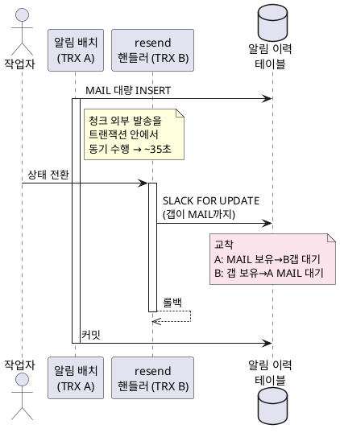
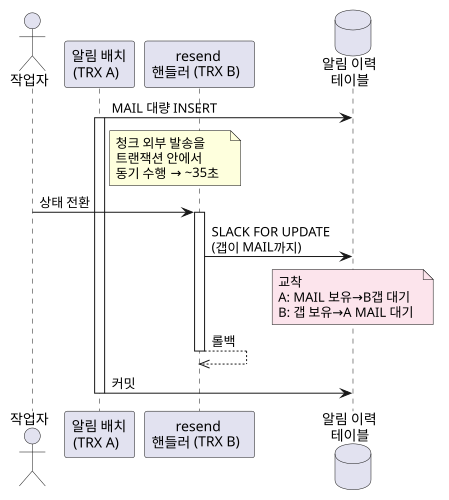
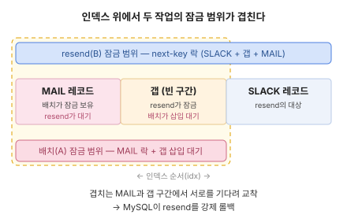

<!-- truncate -->

운영 중 데드락 하나를 추적하다가, "INSERT는 갭 락(gap lock)을 거는가?"라는 질문을 제대로 정리하게 됐습니다. <mark>결론부터 말하면 **INSERT는 갭 락을 새로 걸지 않습니다. 대신 `insert intention lock`(삽입 의도 락)을 요청하고, 다른 트랜잭션의 갭 락(이미 보유했거나 먼저 요청해 대기 중인 것)에 걸려 대기합니다.**</mark>

데드락(deadlock)은 **두 작업이 서로 상대가 잠근 것을 기다려, 양쪽 다 더 진행하지 못하는** 상황입니다. 아래에서 실제 데드락을 **현상 → 타임라인 → 원인 → 대응** 순으로, 배경지식 없이도 따라올 수 있게 정리합니다.

## 무슨 일이 있었나

이 시스템은 알림(메일, Slack)을 보냅니다. 성격이 다른 두 작업이 **같은 테이블**에 접근합니다.

- **알림 배치** — 밤에 실행돼, 많은 알림을 테이블에 한꺼번에 **새로 기록(`INSERT`)** 합니다.
- **재발송(resend)** — 사람이 화면에서 상태를 변경하면, 기존 알림을 찾아 다시 보냅니다. 이때 `SELECT ... FOR UPDATE`, 즉 **찾은 행을 잠그는 조회**를 사용합니다.

어느 날 이 두 작업이 동시에 겹치면서 **데드락**이 발생했고, MySQL이 재발송 쪽을 강제로 **롤백**(실행 취소)했습니다(`Deadlock found when trying to get lock`).

<mark>두 작업이 **같은 인덱스**에서 겹치면서, 서로의 잠금을 기다리는 순환 대기가 생겼습니다.</mark> 참고로 이 DB의 격리 수준은 InnoDB 기본값인 **REPEATABLE READ**입니다([트랜잭션 격리 수준](./db-isolation-levels)).

## 어떻게 벌어졌나 — 타임라인

교착은 우연이 아니라, **사람의 상태 전환이 재발송을 자동 호출**하면서 진행 중이던 배치와 겹쳐 생겼습니다.

1. 알림 배치가 시작돼, 한 트랜잭션에서 `MAIL` 행을 대량 `INSERT`하는 중이었습니다.
2. 그 사이 작업자가 특정 건을 화면에서 **완료 상태로 전환**했습니다.
3. 전환은 내부적으로 **이벤트**를 발생시키고, 그 이벤트를 받은 코드가 **재발송(resend)** 을 실행합니다 — 이때 `SLACK` 행을 `FOR UPDATE`로 조회합니다.
4. 이 `FOR UPDATE`가 진행 중인 배치 `INSERT`와 충돌해 교착 → 재발송이 롤백됐습니다.

<details>
<summary>PlantUML 코드</summary>



</details>



<mark>특히 핸들러가 **전환 상태를 구분하지 않고** 재발송을 호출한 점이 문제였습니다 — 재발송이 필요 없는 완료 전환에서도 `FOR UPDATE`가 실행됐습니다.</mark>

## 왜 교착이 생겼나 — 서로를 기다리는 두 트랜잭션

원인을 보기 전에 **잠금(lock)** 과 **갭(gap)** 만 간단히 정리하겠습니다. DB는 같은 데이터를 여럿이 동시에 수정해 데이터가 깨지는 것을 막으려고, 작업 중인 행에 **잠금**을 걸어 다른 트랜잭션의 접근을 막습니다. InnoDB의 잠금은 **행 하나**만 잠그기도 하고, 인덱스로 정렬된 행과 행 **사이의 빈 구간(갭)** 까지 잠그기도 합니다. 갭을 잠그는 이유는, 그 사이로 새 행이 들어와 조회 결과가 달라지는 것을 막기 위해서입니다.

이제 사건을 보면, 핵심은 **재발송의 범위 잠금이 조회 대상이 아닌 행까지 닿았다**는 것입니다.

- 재발송은 원래 `SLACK` 알림만 잠그면 됩니다.
- 그런데 REPEATABLE READ에서 범위를 조건으로 하는 `FOR UPDATE` 조회는 **next-key 락**을 사용합니다. 이것은 **찾은 행 + 그 앞의 갭(빈 구간)** 을 함께 잠그는 방식이고, 범위가 어디서 끝나는지 확인하려고 읽은 **범위 바로 다음 행**에도 걸립니다. 이번에는 그 다음 행이 배치가 방금 넣은 `MAIL` 행이었습니다.
- 한편 배치는 그 `MAIL` 행을 잠근 채, 다음 행을 넣으려고 바로 **그 행 앞의 갭**에 삽입을 시도합니다.

<details>
<summary>SVG 코드</summary>

```svg
<svg xmlns="http://www.w3.org/2000/svg" width="440" height="300" viewBox="0 0 440 300" font-family="-apple-system, 'Segoe UI', 'Noto Sans KR', sans-serif">
  <rect x="0" y="0" width="440" height="300" fill="#FFFFFF"/>
  <text x="220" y="26" text-anchor="middle" font-size="13" font-weight="700" fill="#222222">인덱스 위에서 두 작업의 잠금 범위가 겹친다</text>
  <rect x="148" y="48" width="277" height="168" rx="7" fill="#FFFBEA" stroke="#E0A000" stroke-dasharray="5 4"/>
  <rect x="153" y="54" width="267" height="27" rx="5" fill="#D6E4FB" stroke="#4C7FE0"/>
  <text x="286" y="72" text-anchor="middle" font-size="11" fill="#26508F">resend(B) next-key 요청 (갭 + MAIL) — 대기 중</text>
  <rect x="20" y="100" width="133" height="64" rx="4" fill="#EEF3FB" stroke="#B9CBE8"/>
  <rect x="153" y="100" width="134" height="64" rx="4" fill="#FFF3E0" stroke="#E8C98F"/>
  <rect x="287" y="100" width="133" height="64" rx="4" fill="#FCE4EC" stroke="#E0A8BC"/>
  <text x="86" y="120" text-anchor="middle" font-size="12" font-weight="700" fill="#222222">검색 범위</text>
  <text x="86" y="137" text-anchor="middle" font-size="9.5" fill="#444444">SLACK, line 706793</text>
  <text x="86" y="151" text-anchor="middle" font-size="9.5" fill="#444444">~ 706800</text>
  <text x="220" y="120" text-anchor="middle" font-size="12" font-weight="700" fill="#222222">갭 (빈 구간)</text>
  <text x="220" y="137" text-anchor="middle" font-size="9.5" fill="#444444">배치가 삽입하려는 곳</text>
  <text x="220" y="151" text-anchor="middle" font-size="9.5" fill="#B0486A">resend 요청이 먼저 대기</text>
  <text x="353" y="120" text-anchor="middle" font-size="12" font-weight="700" fill="#222222">MAIL 레코드</text>
  <text x="353" y="137" text-anchor="middle" font-size="9.5" fill="#444444">line 706809 (범위 다음 행)</text>
  <text x="353" y="151" text-anchor="middle" font-size="9.5" fill="#B0486A">배치 보유, resend 대기</text>
  <rect x="153" y="184" width="267" height="27" rx="5" fill="#FBDCE4" stroke="#D06A86"/>
  <text x="286" y="202" text-anchor="middle" font-size="11" fill="#9E3A57">배치(A): MAIL 락 보유 + 갭에 삽입 대기</text>
  <text x="220" y="236" text-anchor="middle" font-size="10" fill="#888888">← 인덱스 순서 (line_id, type, sent_at) →</text>
  <text x="220" y="259" text-anchor="middle" font-size="11" fill="#333333">겹치는 갭과 MAIL 구간에서 서로를 기다려 교착</text>
  <text x="220" y="276" text-anchor="middle" font-size="11" fill="#333333">→ MySQL이 resend를 강제 롤백</text>
</svg>
```

</details>

<figure style={{textAlign: 'center', margin: '1.5rem 0'}}>
  
</figure>

그 결과 양쪽이 정확히 엇갈려 기다립니다.

- **재발송(B)** 은 배치가 잠근 `MAIL` 레코드에 next-key 락을 요청했다가 → **배치가 잠금을 해제하길 대기**.
- **배치(A)** 는 그 `MAIL` 행 앞 갭에 삽입하려는데, 그 갭을 포함하는 재발송의 next-key 요청이 **먼저 대기열에 있어** → **재발송이 끝나길 대기**.

<mark>A는 갭에 삽입하려고, B는 레코드를 잠그려고 서로를 기다려 누구도 진행하지 못합니다. InnoDB가 이 교착을 감지해 한쪽(재발송)을 강제 롤백해 해소합니다.</mark> 재발송은 갭 락을 아직 얻지도 못한 상태였는데 배치가 왜 기다렸는지는 아래 데드락 로그 분석에서 근거와 함께 확인합니다. (롤백과 재시도 처리는 [try-catch로 잡았는데 왜 롤백될까](./spring-transaction-rollback-only)를 함께 보세요.)

## 그런데 INSERT가 갭 락을 거나?

여기서 제목의 질문에 답하겠습니다. 방금 배치의 `INSERT`가 갭 앞에서 대기했지만, 그렇다고 **`INSERT`가 갭 락을 "거는" 것은 아닙니다.** 핵심만 먼저 말하면 — `INSERT`는 "여기에 넣겠다"는 **의도만 표시**(insert intention lock)할 뿐 갭 자체를 잠그지 않습니다. 다만 **다른 트랜잭션이 이미 그 갭을 잠가 놨으면** 해제될 때까지 기다립니다.

먼저 InnoDB가 사용하는 잠금 종류를 정리하면 이렇습니다.

| 락 | 대상 | 설명 |
|---|---|---|
| record lock | 인덱스 레코드 1건 | 그 행만 잠금 |
| gap lock | 레코드 사이 간격(gap) | 그 갭에 새 행이 들어오는 걸 막음 |
| next-key lock | record + gap | 범위 조회 시 기본으로 적용되는 락(REPEATABLE READ) |
| insert intention lock | 삽입하려는 gap | `INSERT`가 갭에 들어가기 전 요청하는 "삽입 의도" 락 |

`INSERT`가 갭과 상호작용하는 방식은 이렇습니다.

1. `INSERT`는 갭 락을 **설정하지 않습니다.** 대신 삽입하려는 갭에 **insert intention lock**(삽입 의도 락)을 요청합니다.
2. insert intention lock끼리는 **서로 호환**됩니다. 같은 갭에 여러 건이 동시에 들어가도 서로 막지 않아, 평소 `INSERT`끼리는 충돌하지 않습니다.
3. 그러나 **다른 트랜잭션이 그 갭에 gap / next-key 락을 이미 보유하고 있거나, 먼저 요청해 대기 중이면** 충돌해, `INSERT`가 대기합니다(`insert intention waiting`).
4. 삽입이 끝나면 삽입된 행에 **레코드 락**을 가집니다(갭 락이 아니라 그 행만).

<mark>즉 이번 교착에서 배치가 대기한 것은 **`INSERT`가 갭 락을 걸어서가 아니라, `INSERT`의 삽입 의도 락이 재발송이 먼저 요청한 next-key 락(갭 포함)을 앞지를 수 없어 대기**한 것입니다.</mark>

## 데드락 로그로 확인하기 — 근거, 분석 방법, 결과

지금까지의 설명은 추측이 아니라 **InnoDB가 남긴 데드락 로그**에서 나왔습니다. 이 섹션은 로그 원문과, 그 로그를 어떤 순서로 읽어 위 결론에 도달했는지를 정리합니다.

### 로그를 얻는 방법

- **`SHOW ENGINE INNODB STATUS`** — 출력의 `LATEST DETECTED DEADLOCK` 부분에 **가장 최근 데드락 1건**이 나옵니다. 다음 데드락이 생기면 덮어쓰입니다.
- **`innodb_print_all_deadlocks = ON`** — 모든 데드락을 MySQL **에러 로그**에 남깁니다. RDS, Aurora라면 파라미터 그룹에서 설정하고 에러 로그에서 확인합니다. 운영 DB에서는 활성화하는 편이 안전합니다(데드락은 재현이 어려워 지나간 것을 다시 볼 수 없기 때문).

MySQL 문서도 두 방법을 이렇게 안내합니다.

> To view the last deadlock in an InnoDB user transaction, use SHOW ENGINE INNODB STATUS. ... enable innodb_print_all_deadlocks to print information about all deadlocks to the mysqld error log.

→ `SHOW ENGINE INNODB STATUS`는 마지막 1건만 보여 주므로, 지난 데드락까지 분석하려면 에러 로그 기록을 활성화해야 합니다. ([MySQL — Deadlocks in InnoDB](https://dev.mysql.com/doc/refman/8.0/en/innodb-deadlocks.html))

### 로그 원문

인덱스 `idx_inspection_line_notification_history_01`의 컬럼은 `(inspection_line_id, notification_type, sent_at)`입니다. 줄이 길어 가로로 스크롤해야 하는 부분이 있습니다.

```text
TRANSACTION 1236910283, ACTIVE 0 sec starting index read
mysql tables in use 1, locked 1
LOCK WAIT 2 lock struct(s), heap size 1128, 1 row lock(s)
MySQL thread id 84574895, OS thread handle 70370427443520, query id 1208694623 10.0.1.11 app_user executing
select ilnhe1_0.`id`,ilnhe1_0.`created_at`,ilnhe1_0.`created_by`,ilnhe1_0.`description`,ilnhe1_0.`external_message_id`,ilnhe1_0.`inspection_line_id`,ilnhe1_0.`notification_type`,ilnhe1_0.`recipient`,ilnhe1_0.`send_yn`,ilnhe1_0.`sent_at`,ilnhe1_0.`updated_at`,ilnhe1_0.`updated_by` from `inspection_line_notification_history` ilnhe1_0 where ilnhe1_0.`inspection_line_id` in (706800,706795,706793) and ilnhe1_0.`notification_type`='SLACK' and ilnhe1_0.`send_yn`=1 and ilnhe1_0.`sent_at`>'2026-10-31 00:36:05.372801' order by ilnhe1_0.`id` for update
RECORD LOCKS space id 429 page no 453 n bits 456 index idx_inspection_line_notification_history_01 of table `rms`.`inspection_line_notification_history` trx id 1236910283 lock_mode X waiting
Record lock, heap no 103 PHYSICAL RECORD: n_fields 4; compact format; info bits 0
 0: len 8; hex 80000000000ac8f9; asc         ;;
 1: len 4; hex 4d41494c; asc MAIL;;
 2: len 5; hex 99bb3e7000; asc   >p ;;
 3: len 8; hex 000000000000734f; asc       sO;;

RECORD LOCKS space id 429 page no 453 n bits 456 index idx_inspection_line_notification_history_01 of table `rms`.`inspection_line_notification_history` trx id 1236910283 lock_mode X waiting
Record lock, heap no 103 PHYSICAL RECORD: n_fields 4; compact format; info bits 0
 0: len 8; hex 80000000000ac8f9; asc         ;;
 1: len 4; hex 4d41494c; asc MAIL;;
 2: len 5; hex 99bb3e7000; asc   >p ;;
 3: len 8; hex 000000000000734f; asc       sO;;

TRANSACTION 1236910269, ACTIVE 35 sec inserting
mysql tables in use 1, locked 1
LOCK WAIT 3 lock struct(s), heap size 1128, 2 row lock(s), undo log entries 589
MySQL thread id 84576387, OS thread handle 70370419022144, query id 1208694624 10.0.2.22 app_user update
INSERT INTO inspection_line_notification_history (
    inspection_line_id, notification_type, recipient, send_yn, description, sent_at,
    external_message_id, created_by, created_at, updated_by, updated_at
) VALUES
(706933, 'MAIL', 'user01@example.com', 1, '{"reason":"신청대기 1일 경과"}', '2026-10-31 07:00:00', '1034188006', 'RMS System User', '2026-10-31 00:36:02.396071', 'RMS System User', '2026-10-31 00:36:02.396071'),(706933, 'MAIL', 'user02@example.com', 1, '{"reason":"신청대기 1일 경과"}', '2026-10-31 07:00:00', '1034188007', 'RMS System User', '2026-10-31 00:36:02.39609', 'RMS System User', '2026-10-31 00:36:02.39609'),(706933, 'MAIL', 'user03@example.com', 1, '{"reason":"신청대기 1일 경과"}', '2026-10-31 07:00:00', '1034188008', 'RMS System User', '2026-10-31 00:36:02.396127', 'RMS System User', '2026-10-31 00:36:02.396127'),(706933, 'MAIL', 'user04@example.com', 1, '{"reason":"신청대기 1일 경과"}', '2026-10-31 07:00:00', '1034188009', 'RMS System User', '2026-10-31 00:36:02.39615', 'RMS System User', '2026-10-31 00:36:02.39615'),(706933, 'MAIL', 'user05@example.com', 1, '{"reason":"신청대기 1일 경과"}', '2026-10-31 07:00:00', '1034188010', 'RMS System User', '2026-10-31 00:36:02.396187', 'RMS System User', '2026-10-31 00:36:02.396187'),(706933, 'MAIL', 'user06@example.com', 1, '{"reason":"신청대기 1일 경과"}', '2026-10-31 07:00:00', '1034188011', 'RMS System User', '2026-10-31 00:36:02.396211', 'RMS System User', '2026-10-31 00:36:02.396211'),(706933, 'MAIL', 'user07@example.com', 1, '{"reason":"신청대기 1일 경과"}', '2026-10-31 07:00:00', '1034188012', 'RMS System User', '2026-10-31 00:36:02.396231', 'RMS System User', '2026-10-31 00:36:02.396231'),(706933, 'MAIL', 'user08@example.com', 1, '{"reason":"신청대기 1일 경과"}', '2026-10-31 07:00:00', '1034188013', 'RMS System User', '2026-10-31 00:36:02.396282', 'RMS System User', '2026-10-31 00:36:02.396282'),(706933, 'MAIL', 'user09@example.com', 1, '{"reason":"신청대기 1일 경과"}', '2026-10-31 07:00:00', '1034188014', 'RMS System User', '2026-10-31 00:36:02.396303', 'RMS System User', '2026-10-31 00:36:02.396303'),(706977, 'MAIL', 'user10@example.com', 1, '{"reason":"신청대기 1일 경과"}', '2026-10-31 07:00:00', '1034188004', 'RMS System User', '2026-10-31 00:36:02.396325', 'RMS System User', '2026-10-31 00:36:02.396325'),(706977, 'MAIL', 'user11@example.com', 1, '{"reason":"신청대기 1일 경과"}', '2026-10-31 07:00:00', '1034188005', 'RMS System User', '2026-10-31 00:36:02.396349', 'RMS System User', '2026-10-31 00:36:02.396349'),(706977, 'MAIL', 'user01@example.com', 1, '{"reason":"신청대기 1일 경과"}', '2026-10-31 07:00:00', '1034188006', 'RMS System User', '2026-10-31 00:36:02.396396', 'RMS System User', '2026-10-31 00:36:02.396396'),(706977, 'MAIL', 'user02@example.com', 1, '{"reason":"신청대기 1일 경과"}', '2026-10-31 07:00:00', '1034188007', 'RMS System User', '2026-10-31 00:36:
RECORD LOCKS space id 429 page no 453 n bits 456 index idx_inspection_line_notification_history_01 of table `rms`.`inspection_line_notification_history` trx id 1236910269 lock_mode X locks rec but not gap
Record lock, heap no 103 PHYSICAL RECORD: n_fields 4; compact format; info bits 0
 0: len 8; hex 80000000000ac8f9; asc         ;;
 1: len 4; hex 4d41494c; asc MAIL;;
 2: len 5; hex 99bb3e7000; asc   >p ;;
 3: len 8; hex 000000000000734f; asc       sO;;

RECORD LOCKS space id 429 page no 453 n bits 544 index idx_inspection_line_notification_history_01 of table `rms`.`inspection_line_notification_history` trx id 1236910269 lock_mode X locks gap before rec insert intention waiting
Record lock, heap no 103 PHYSICAL RECORD: n_fields 4; compact format; info bits 0
 0: len 8; hex 80000000000ac8f9; asc         ;;
 1: len 4; hex 4d41494c; asc MAIL;;
 2: len 5; hex 99bb3e7000; asc   >p ;;
 3: len 8; hex 000000000000734f; asc       sO;;
```

앞의 트랜잭션(`…283`)이 **재발송**, 뒤의 트랜잭션(`…269`)이 **알림 배치**입니다. 재발송의 대기 정보는 같은 내용이 두 번 출력되고, 배치의 INSERT 문은 InnoDB가 길이 제한으로 중간에서 잘라 출력한 것입니다.

### 분석 방법 — 네 가지 질문으로 읽기

데드락 로그는 처음 보면 알아보기 어렵지만, 아래 네 가지 질문의 답을 차례로 찾는다고 생각하면 됩니다.

1. 두 트랜잭션은 각각 **무엇을 하던 중**이었나?
2. 각자 어떤 잠금을 **가졌고**, 어떤 잠금을 **기다렸나**?
3. 다툼의 대상이 된 행은 **정확히 어떤 행**인가?
4. 서로를 기다리는 **고리**가 생겼나?

**① 무엇을 하던 중이었나 — `TRANSACTION` 블록의 첫 줄들**

각 `TRANSACTION` 블록의 처음 세 줄은 그 트랜잭션의 상태 요약입니다. 여기서 세 가지 값을 확인합니다.

- `ACTIVE N sec` — 트랜잭션이 시작된 지 몇 초 지났는지, 뒤의 문구는 지금 하던 일
- `undo log entries N` — 지금까지 변경한(INSERT, UPDATE, DELETE) 행 수. 표시가 없으면 0
- `N row lock(s)` — 가지고 있거나 기다리는 행 잠금 수

| 항목 | 재발송 | 배치 |
|---|---|---|
| 시작 후 경과 | 0초, `starting index read` (첫 행을 읽기 시작) | 35초, `inserting` (INSERT 중) |
| 변경한 행 수 | 0행 | 589행 |
| 행 잠금 수 | 1개 | 2개 |

재발송의 행 잠금 1개는 아래 ②에서 보듯 **기다리는 중인 잠금**입니다. <mark>재발송은 시작하자마자 첫 행에서 막혔고, **실제로 얻은 행 잠금은 전혀 없었습니다.**</mark> 앞 섹션에서 "재발송이 갭을 잠갔다"가 아니라 "재발송의 잠금 요청이 대기 중이었다"고 쓴 근거가 이 부분입니다.

**② 무엇을 가졌고 무엇을 기다렸나 — `RECORD LOCKS` 줄**

`RECORD LOCKS ...` 줄 끝의 `lock_mode ...` 부분이 잠금의 종류입니다. 두 가지만 보면 됩니다.

- 끝에 **`waiting`이 있으면 기다리는 중**, 없으면 이미 가진 잠금입니다.
- 앞부분 문구로 **잠금 범위**를 알 수 있습니다.

| 로그 문구 | 쉬운 뜻 |
|---|---|
| `lock_mode X` | 그 행 + 그 행 앞의 빈 구간까지 잠금 (next-key 락) |
| `lock_mode X locks rec but not gap` | 그 행만 잠금 |
| `lock_mode X locks gap before rec` | 그 행 앞의 빈 구간만 잠금 |
| `insert intention` | 그 빈 구간에 새 행을 넣겠다는 요청 |

이번 로그의 세 줄을 이 표에 대입하면 다음과 같습니다.

| 누가 | 로그 문구 | 쉬운 뜻 |
|---|---|---|
| 재발송 | `lock_mode X waiting` | 103번 행과 그 앞 구간을 잠그려고 **기다리는 중** |
| 배치 | `lock_mode X locks rec but not gap` | 103번 행을 **가지고 있음** |
| 배치 | `lock_mode X locks gap before rec insert intention waiting` | 103번 행 앞 구간에 새 행을 넣으려고 **기다리는 중** |

세 줄 모두 `heap no 103`(페이지 안의 레코드 번호)이 같으므로, 두 트랜잭션이 **같은 행에서 충돌하고 있다**는 것을 알 수 있습니다.

**③ 그 행은 어떤 행인가 — 레코드 값 읽기**

`Record lock, heap no 103 ...` 아래의 `0:`부터 `3:`까지 네 줄이 그 행의 값입니다. 인덱스 레코드라서 **인덱스 컬럼 3개(`inspection_line_id`, `notification_type`, `sent_at`) + PK** 순서로 나옵니다.

줄 끝의 `asc ...`는 저장된 바이트를 글자로 찍은 것이라 문자열(`MAIL`)만 읽을 수 있습니다. 숫자와 날짜는 `hex` 값을 변환해야 합니다.

| 줄 | 컬럼 | hex | 변환한 값 |
|---|---|---|---|
| `0:` | `inspection_line_id` | `80000000000ac8f9` | 706809 |
| `1:` | `notification_type` | `4d41494c` | `MAIL` |
| `2:` | `sent_at` | `99bb3e7000` | 2026-10-31 07:00:00 |
| `3:` | PK `id` | `000000000000734f` | 29519 |

<details>
<summary>변환 방법 (Python)</summary>

정수는 맨 앞 비트를 뒤집어 저장하므로(`0x80…`) 그 비트를 되돌리면 값이 나옵니다. `DATETIME`은 연월, 일, 시, 분, 초를 5바이트에 비트 단위로 나눠 저장합니다.

```python
line_id = 0x80000000000ac8f9 ^ (1 << 63)      # 706809
ntype = bytes.fromhex("4d41494c").decode()     # 'MAIL'

v = 0x99bb3e7000 - (1 << 39)                   # DATETIME 5바이트, 부호 비트 제거
sec, v = v & 0x3F, v >> 6
minute, v = v & 0x3F, v >> 6
hour, v = v & 0x1F, v >> 5
day, ym = v & 0x1F, v >> 5
print(f"{ym // 13}-{ym % 13:02d}-{day:02d} {hour:02d}:{minute:02d}:{sec:02d}")
# 2026-10-31 07:00:00

pk = 0x734f                                    # 29519
```

</details>

변환한 값을 재발송 SQL과 비교하면 두 가지가 확인됩니다.

- **재발송이 찾던 행이 아닙니다.** 재발송은 `inspection_line_id`가 706793, 706795, 706800인 `SLACK` 행을 찾는데, 기다린 행은 `inspection_line_id` 706809인 `MAIL` 행입니다. 범위 검색은 범위가 어디서 끝나는지 확인하려고 **범위 바로 다음 행**까지 읽고, REPEATABLE READ에서는 그 행에도 잠금을 겁니다. 이 MAIL 행이 그 "범위 다음 행"이었습니다.
- **배치가 넣은 행입니다.** 이 행의 `sent_at`(07:00)은 배치가 INSERT하는 값과 같고, ②에서 본 것처럼 배치가 이 행을 가지고 있습니다.

**④ 서로를 기다리는 고리가 생겼나**

마지막으로 ①부터 ③까지를 "누가 누구를 기다리나"로 줄입니다.

- **재발송 → 배치**: 재발송은 MAIL 행을 잠그려는데, 배치가 그 행을 가지고 있어 기다립니다.
- **배치 → 재발송**: 배치는 MAIL 행 앞 구간에 새 행을 넣으려는데, 재발송이 그 구간을 포함하는 잠금을 **먼저 요청해 두었기 때문에** 기다립니다.

두 화살표가 서로를 향하므로 어느 쪽도 끝나지 않습니다. 이것이 데드락입니다.

두 번째 화살표가 의아할 수 있습니다. 재발송은 아직 아무것도 잠그지 못했는데 배치는 왜 기다릴까요? InnoDB는 같은 행에 대한 잠금 요청을 **온 순서대로** 처리하기 때문입니다. 먼저 와서 기다리는 요청이 있으면, 나중에 온 INSERT는 그 요청을 앞질러 갈 수 없습니다. InnoDB 소스(`lock0lock.cc`)에 이 규칙이 주석으로 남아 있습니다.

> This is very important that LOCK_INSERT_INTENTION should not overtake a WAITING Gap or Next-Key lock on the same heap_no, because the following insertion of the record would split the gap duplicating the waiting lock...

→ INSERT의 삽입 의도 락은 같은 행에서 **기다리는 중인** 갭 락이나 next-key 락을 앞지를 수 없습니다. 그래서 재발송이 잠금을 아직 얻지 못했어도, 먼저 요청해 기다리고 있었다는 사실만으로 배치의 INSERT가 막혔습니다. ([mysql-server 8.0 `lock0lock.cc`](https://github.com/mysql/mysql-server/blob/8.0/storage/innobase/lock/lock0lock.cc))

<mark>재발송은 배치를, 배치는 재발송을 기다리는 **순환 대기**가 로그만으로 확인됩니다.</mark>

### 결과 — 원인과 로그 근거 대응

| 확인한 사실 | 로그 근거 |
|---|---|
| 두 트랜잭션이 같은 인덱스의 같은 레코드에서 충돌 | 세 `RECORD LOCKS` 줄 모두 `idx_inspection_line_notification_history_01`, `page no 453`, `heap no 103` |
| 재발송은 조회 대상이 아닌 MAIL 행을 기다림 | 재발송의 `lock_mode X waiting` 레코드 = (706809, `MAIL`). 조회 조건은 706793/706795/706800, `SLACK` |
| 그 MAIL 행은 배치가 방금 넣은 행 | 레코드의 `sent_at` 07:00:00 = 배치 `VALUES`의 `sent_at`, 배치가 `locks rec but not gap` 보유 |
| 재발송은 행 락을 전혀 얻지 못한 상태 | `ACTIVE 0 sec starting index read`, `2 lock struct(s)`, `1 row lock(s)` |
| 배치는 그 행 앞 갭에 삽입하려다 대기 | `lock_mode X locks gap before rec insert intention waiting` |
| 배치가 오래 열려 있었음 | `ACTIVE 35 sec inserting`, `undo log entries 589` |
| 롤백 대상이 재발송이 된 이유 | 변경 행 수: 재발송 0 vs 배치 589 → InnoDB는 작은 트랜잭션을 롤백 |
| 재발송을 실행시킨 계기 | 조건 `sent_at > '2026-10-31 00:36:05.372801'`이 상태 변경 이력의 시각과 일치 |

롤백 대상 선택 기준은 MySQL 문서에 명시돼 있습니다.

> InnoDB tries to pick small transactions to roll back, where the size of a transaction is determined by the number of rows inserted, updated, or deleted.

→ 589행을 넣은 배치 대신, 변경 행이 없는 재발송이 롤백됐습니다. ([MySQL — Deadlock Detection](https://dev.mysql.com/doc/refman/8.0/en/innodb-deadlock-detection.html))

마지막 행은 로그 밖의 데이터와 대조한 결과입니다. 재발송 쿼리의 `sent_at` 조건값이 상태 변경 이력 테이블에 기록된 전환 시각과 같았고, 코드에서도 전환 이벤트가 재발송을 호출하는 경로가 확인됐습니다. 이것으로 **작업자의 상태 전환이 재발송을 실행시킨 계기**라는 타임라인의 2, 3번 단계가 로그와 코드로 뒷받침됩니다.

## 왜 배치가 잠금을 오래 유지했나

데드락이 생기려면 배치가 **잠금을 오래 유지**해야 합니다(그래야 재발송과 충돌할 구간이 생깁니다). 데드락 로그상 배치 트랜잭션은 수십 초 동안 열려 있었는데, 원인은 **한 번에 많은 건을 처리하면서 외부 발송을 트랜잭션 안에서 하나씩 끝낸** 데 있었습니다.

- 배치가 **청크(예: 100건) 단위**로 동작하면서, 한 트랜잭션 안에서 **그 100건의 메일과 Slack을 실제로 다 보낼 때까지** 트랜잭션을 닫지 않았습니다.
- 메일과 Slack을 외부로 보내는 것은 느린 작업이라, 그동안 레코드 잠금이 계속 유지됩니다.

<mark>느린 외부 작업을 트랜잭션 경계 안에서 처리해 트랜잭션이 길어졌고, 그만큼 교착이 생길 수 있는 구간도 커졌습니다. 청크를 작게 하거나 외부 발송을 트랜잭션 밖으로 빼면 트랜잭션이 짧아져 충돌 확률이 떨어집니다.</mark>

## 대응

이번 건에서 1차로 적용한 조치와, 함께 검토한 그 밖의 방안입니다.

1. **재발송 트랜잭션을 READ COMMITTED로 (1차 적용)** — 그 트랜잭션의 격리 수준만 낮춰 **갭을 잠그는 동작을 없앴습니다.** `FOR UPDATE`가 `SLACK` 행만 잠그고 옆 `MAIL` 행, 갭을 건드리지 않게 되어, 이 유형의 교착이 사라집니다. 격리 수준을 **그 트랜잭션에만** 낮춰 다른 로직은 그대로 둡니다([트랜잭션 격리 수준](./db-isolation-levels)).
2. **핸들러에 전환 상태 필터 (보완)** — 완료 전환처럼 재발송이 불필요한 경우엔 애초에 `FOR UPDATE`를 실행하지 않게 해, 불필요한 범위 잠금 자체를 없앱니다.
3. **배치 트랜잭션 짧게 하기** — 청크를 작게 하거나 **외부 발송을 트랜잭션 밖으로 빼서**, 배치가 잠금을 유지하는 시간을 줄입니다.
4. **인덱스 보강 / 직렬화** — 조회 조건 컬럼을 인덱스에 추가해 잠금 범위를 좁히거나([인덱스, 실행계획](./mysql-index-btree-explain)), named lock으로 재발송을 한 번에 하나씩만 실행되도록 합니다([MySQL 네임드 락](./mysql-get-lock-distributed-lock)).

<mark>핵심 대응은 **재발송 트랜잭션만 READ COMMITTED로 낮춰 갭 락을 없앤 것**입니다. 나머지(전환 상태 필터, 트랜잭션 짧게 하기, 인덱스 보강)는 같은 데드락이 다시 생기지 않게 하는 추가 대책입니다.</mark>

## 정리

- 데드락은 **재발송의 넓은 범위 잠금(REPEATABLE READ next-key 락) ↔ 배치 `INSERT`의 삽입 의도**가 얽힌 순환 대기였습니다.
- **직접 계기**는 사람의 상태 전환이 재발송을 자동 호출한 것, **교착이 길어진 이유**는 배치가 외부 발송을 트랜잭션 안에서 끝내느라 잠금을 오래 유지한 것입니다.
- `INSERT`는 갭 락을 **거는** 게 아니라, `insert intention lock`으로 다른 트랜잭션의 갭 락(보유 중이거나 먼저 대기 중인 요청)에 **걸려 대기**합니다.
- 데드락 로그는 **트랜잭션 헤더 → `lock_mode` 문구 → 레코드 필드 디코딩 → 대기 관계** 순으로 읽어, 위 설명의 근거를 줄 단위로 확인했습니다.
- 1차 대응은 **갭을 잠그는 재발송을 그 트랜잭션에서만 READ COMMITTED로** 낮추는 것이고, 전환 상태 필터, 트랜잭션 짧게 하기, 인덱스 보강으로 재발을 막습니다.

## 참고

- [MySQL Reference Manual — InnoDB Locking (Record, Gap, Next-Key, Insert Intention)](https://dev.mysql.com/doc/refman/8.0/en/innodb-locking.html)
- [MySQL Reference Manual — Deadlocks in InnoDB](https://dev.mysql.com/doc/refman/8.0/en/innodb-deadlocks.html)
- [MySQL Reference Manual — Deadlock Detection](https://dev.mysql.com/doc/refman/8.0/en/innodb-deadlock-detection.html)
- [mysql-server 8.0 — `storage/innobase/lock/lock0lock.cc`](https://github.com/mysql/mysql-server/blob/8.0/storage/innobase/lock/lock0lock.cc)
