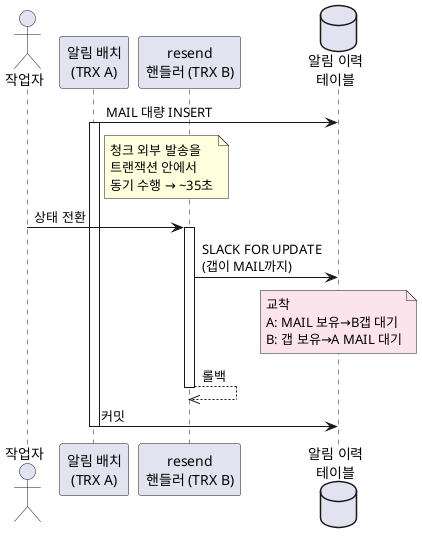

<!-- truncate -->

운영 중 데드락 하나를 추적하다가, "INSERT는 갭 락(gap lock)을 거는가?"라는 질문을 제대로 정리하게 됐습니다. <mark>결론부터 말하면 **INSERT는 갭 락을 새로 걸지 않습니다. 대신 `insert intention lock`(삽입 의도 락)을 요청하고, 다른 트랜잭션이 보유한 갭 락에 걸려 대기합니다.**</mark>

데드락(deadlock)은 **두 작업이 서로 상대가 잠근 것을 기다려, 양쪽 다 더 진행하지 못하는** 상황입니다. 아래에서 실제 데드락을 **현상 → 타임라인 → 원인 → 대응** 순으로, 배경지식 없이도 따라올 수 있게 정리합니다.

## 무슨 일이 있었나

이 시스템은 알림(메일·Slack)을 보냅니다. 성격이 다른 두 작업이 **같은 테이블**에 접근합니다.

- **알림 배치** — 밤에 실행돼, 많은 알림을 테이블에 한꺼번에 **새로 기록(`INSERT`)** 합니다.
- **재발송(resend)** — 사람이 화면에서 상태를 변경하면, 기존 알림을 찾아 다시 보냅니다. 이때 `SELECT ... FOR UPDATE`, 즉 **찾은 행을 잠그는 조회**를 사용합니다.

어느 날 이 두 작업이 동시에 겹치면서 **데드락**이 발생했고, MySQL이 재발송 쪽을 강제로 **롤백**(실행 취소)했습니다(`Deadlock found when trying to get lock`).

<mark>두 작업이 **같은 인덱스**에서 겹치면서, 서로의 잠금을 기다리는 순환 대기가 생겼습니다.</mark> 참고로 이 DB의 격리 수준은 InnoDB 기본값인 **REPEATABLE READ**입니다([트랜잭션 격리 수준](./db-isolation-levels)).

## 어떻게 벌어졌나 — 타임라인

교착은 우연이 아니라, **사람의 상태 전환이 재발송을 자동 호출**하면서 진행 중이던 배치와 겹쳐 생겼습니다.

1. 알림 배치가 시작돼, 한 트랜잭션에서 `MAIL` 행을 대량 `INSERT`하는 중이었습니다.
2. 그 사이 작업자가 특정 건을 화면에서 **완료 상태로 전환**했습니다.
3. 전환은 내부적으로 **이벤트**를 발생시키고, 그 이벤트를 받은 코드가 **재발송(resend)** 을 실행합니다 — 이때 `SLACK` 행을 `FOR UPDATE`로 조회합니다.
4. 이 `FOR UPDATE`가 진행 중인 배치 `INSERT`와 충돌해 교착 → 재발송이 롤백됐습니다.

<details>
<summary>PlantUML 코드</summary>



</details>


<mark>특히 핸들러가 **전환 상태를 구분하지 않고** 재발송을 호출한 점이 문제였습니다 — 재발송이 필요 없는 완료 전환에서도 `FOR UPDATE`가 실행됐습니다.</mark>

## 왜 교착이 생겼나 — 서로를 기다리는 두 트랜잭션

원인을 보기 전에 **잠금(lock)** 과 **갭(gap)** 만 간단히 정리하겠습니다. DB는 같은 데이터를 여럿이 동시에 수정해 데이터가 깨지는 것을 막으려고, 작업 중인 행에 **잠금**을 걸어 다른 트랜잭션의 접근을 막습니다. InnoDB의 잠금은 **행 하나**만 잠그기도 하고, 인덱스로 정렬된 행과 행 **사이의 빈 구간(갭)** 까지 잠그기도 합니다. 갭을 잠그는 이유는, 그 사이로 새 행이 들어와 조회 결과가 달라지는 것을 막기 위해서입니다.

이제 사건을 보면, 핵심은 **재발송이 필요 이상으로 넓게 잠갔다**는 것입니다.

- 재발송은 원래 `SLACK` 알림 **한 행만** 잠그면 됩니다.
- 그런데 REPEATABLE READ에서 범위를 조건으로 하는 `FOR UPDATE` 조회는 **next-key 락**을 사용합니다. 이것은 **찾은 행 + 그 앞의 갭(빈 구간)** 을 함께 잠그는 방식입니다. 그 바람에 인덱스 순서상 `SLACK` 옆에 있던 `MAIL` 행과 그 사이 갭까지 잠금 범위에 들어왔습니다.
- 한편 배치는 방금 넣은 그 `MAIL` 행을 잠근 채, 다음 행을 넣으려고 바로 **그 갭**에 삽입을 시도합니다.

<details>
<summary>SVG 코드</summary>

```svg
<svg xmlns="http://www.w3.org/2000/svg" width="440" height="282" viewBox="0 0 440 282" font-family="-apple-system, 'Segoe UI', 'Noto Sans KR', sans-serif">
  <rect x="0" y="0" width="440" height="282" fill="#FFFFFF"/>
  <text x="220" y="26" text-anchor="middle" font-size="13" font-weight="700" fill="#222222">인덱스 위에서 두 작업의 잠금 범위가 겹친다</text>
  <rect x="15" y="48" width="277" height="162" rx="7" fill="#FFFBEA" stroke="#E0A000" stroke-dasharray="5 4"/>
  <rect x="20" y="54" width="400" height="27" rx="5" fill="#D6E4FB" stroke="#4C7FE0"/>
  <text x="220" y="72" text-anchor="middle" font-size="11" fill="#26508F">resend(B) 잠금 범위 — next-key 락 (SLACK + 갭 + MAIL)</text>
  <rect x="20" y="100" width="133" height="58" rx="4" fill="#FCE4EC" stroke="#E0A8BC"/>
  <rect x="153" y="100" width="134" height="58" rx="4" fill="#FFF3E0" stroke="#E8C98F"/>
  <rect x="287" y="100" width="133" height="58" rx="4" fill="#EEF3FB" stroke="#B9CBE8"/>
  <text x="86" y="120" text-anchor="middle" font-size="12" font-weight="700" fill="#222222">MAIL 레코드</text>
  <text x="86" y="137" text-anchor="middle" font-size="9.5" fill="#444444">배치가 잠금 보유</text>
  <text x="86" y="151" text-anchor="middle" font-size="9.5" fill="#B0486A">resend가 대기</text>
  <text x="220" y="120" text-anchor="middle" font-size="12" font-weight="700" fill="#222222">갭 (빈 구간)</text>
  <text x="220" y="137" text-anchor="middle" font-size="9.5" fill="#444444">resend가 잠금</text>
  <text x="220" y="151" text-anchor="middle" font-size="9.5" fill="#B0486A">배치가 삽입 대기</text>
  <text x="353" y="120" text-anchor="middle" font-size="12" font-weight="700" fill="#222222">SLACK 레코드</text>
  <text x="353" y="137" text-anchor="middle" font-size="9.5" fill="#444444">resend의 대상</text>
  <rect x="20" y="178" width="267" height="27" rx="5" fill="#FBDCE4" stroke="#D06A86"/>
  <text x="153" y="196" text-anchor="middle" font-size="11" fill="#9E3A57">배치(A) 잠금 범위 — MAIL 락 + 갭 삽입 대기</text>
  <text x="220" y="227" text-anchor="middle" font-size="10" fill="#888888">← 인덱스 순서(idx) →</text>
  <text x="220" y="250" text-anchor="middle" font-size="11" fill="#333333">겹치는 MAIL·갭 구간에서 서로를 기다려 교착</text>
  <text x="220" y="267" text-anchor="middle" font-size="11" fill="#333333">→ MySQL이 resend를 강제 롤백</text>
</svg>
```

</details>

<figure style={{textAlign: 'center', margin: '1.5rem 0'}}>
  
</figure>

그 결과 양쪽이 정확히 엇갈려 기다립니다.

- **재발송(B)** 은 배치가 잠근 `MAIL` 레코드를 잠그려다 → **배치가 잠금을 해제하길 대기**.
- **배치(A)** 는 재발송이 갭을 잠가 둔 그 지점에 삽입하려다 → **재발송이 잠금을 해제하길 대기**.

<mark>A는 갭을, B는 레코드를 서로 기다려 누구도 진행하지 못합니다. InnoDB가 이 교착을 감지해 한쪽(재발송)을 강제 롤백해 해소합니다.</mark> (롤백·재시도 처리는 [try-catch로 잡았는데 왜 롤백될까](./spring-transaction-rollback-only)를 함께 보세요.)

## 그런데 INSERT가 갭 락을 거나?

여기서 제목의 질문에 답하겠습니다. 방금 배치의 `INSERT`가 갭 앞에서 대기했지만, 그렇다고 **`INSERT`가 갭 락을 "거는" 것은 아닙니다.** 요지만 먼저 말하면 — `INSERT`는 "여기에 넣겠다"는 **의도만 표시**(insert intention lock)할 뿐 갭 자체를 잠그지 않습니다. 다만 **다른 트랜잭션이 이미 그 갭을 잠가 놨으면** 해제될 때까지 기다립니다.

먼저 InnoDB가 사용하는 잠금 종류를 정리하면 이렇습니다.

| 락 | 대상 | 설명 |
|---|---|---|
| record lock | 인덱스 레코드 1건 | 그 행만 잠금 |
| gap lock | 레코드 사이 간격(gap) | 그 갭에 새 행이 들어오는 걸 막음 |
| next-key lock | record + gap | 범위 조회 시 기본으로 적용되는 락(REPEATABLE READ) |
| insert intention lock | 삽입하려는 gap | `INSERT`가 갭에 들어가기 전 요청하는 "삽입 의도" 락 |

`INSERT`가 갭과 상호작용하는 방식은 이렇습니다.

1. `INSERT`는 갭 락을 **설정하지 않습니다.** 대신 삽입하려는 갭에 **insert intention lock**(삽입 의도 락)을 요청합니다.
2. insert intention lock끼리는 **서로 호환**됩니다. 같은 갭에 여러 건이 동시에 들어가도 서로 막지 않아, 평소 `INSERT`끼리는 충돌하지 않습니다.
3. 그러나 **다른 트랜잭션이 그 갭에 gap / next-key 락을 이미 보유하고 있으면** 충돌해, `INSERT`가 대기합니다(`insert intention waiting`).
4. 삽입이 끝나면 삽입된 행에 **레코드 락**을 가집니다(갭 락이 아니라 그 행만).

<mark>즉 이번 교착에서 배치가 대기한 것은 **`INSERT`가 갭 락을 걸어서가 아니라, `INSERT`의 삽입 의도 락이 재발송이 보유한 갭(next-key) 락에 걸려 대기**한 것입니다.</mark>

## 왜 배치가 잠금을 오래 유지했나

데드락이 생기려면 배치가 **잠금을 오래 유지**해야 합니다(그래야 재발송과 충돌할 구간이 생깁니다). 데드락 로그상 배치 트랜잭션은 수십 초 동안 열려 있었는데, 원인은 **한 번에 많은 건을 처리하면서 외부 발송을 트랜잭션 안에서 하나씩 끝낸** 데 있었습니다.

- 배치가 **청크(예: 100건) 단위**로 동작하면서, 한 트랜잭션 안에서 **그 100건의 메일·Slack을 실제로 다 보낼 때까지** 트랜잭션을 닫지 않았습니다.
- 메일·Slack을 외부로 보내는 것은 느린 작업이라, 그동안 레코드 잠금이 계속 유지됩니다.

<mark>느린 외부 작업을 트랜잭션 경계 안에서 처리해 트랜잭션이 길어졌고, 그만큼 교착이 생길 수 있는 구간도 커졌습니다. 청크를 작게 하거나 외부 발송을 트랜잭션 밖으로 빼면 트랜잭션이 짧아져 충돌 확률이 떨어집니다.</mark>

## 대응

이번 건에서 1차로 적용한 조치와, 함께 검토한 그 밖의 방안입니다.

1. **재발송 트랜잭션을 READ COMMITTED로 (1차 적용)** — 그 트랜잭션의 격리 수준만 낮춰 **갭을 잠그는 동작을 없앴습니다.** `FOR UPDATE`가 `SLACK` 행만 잠그고 옆 `MAIL` 행·갭을 건드리지 않게 되어, 이 유형의 교착이 사라집니다. 격리 수준을 **그 트랜잭션에만** 낮춰 다른 로직은 그대로 둡니다([트랜잭션 격리 수준](./db-isolation-levels)).
2. **핸들러에 전환 상태 필터 (보완)** — 완료 전환처럼 재발송이 불필요한 경우엔 애초에 `FOR UPDATE`를 실행하지 않게 해, 불필요한 범위 잠금 자체를 없앱니다.
3. **배치 트랜잭션 짧게 하기** — 청크를 작게 하거나 **외부 발송을 트랜잭션 밖으로 빼서**, 배치가 잠금을 유지하는 시간을 줄입니다.
4. **인덱스 보강 / 직렬화** — 조회 조건 컬럼을 인덱스에 추가해 잠금 범위를 좁히거나([인덱스·실행계획](./mysql-index-btree-explain)), named lock으로 재발송을 한 번에 하나씩만 실행되도록 합니다([MySQL 네임드 락](./mysql-get-lock-distributed-lock)).

<mark>핵심 대응은 **재발송 트랜잭션만 READ COMMITTED로 낮춰 갭 락을 없앤 것**입니다. 나머지(전환 상태 필터·트랜잭션 짧게 하기·인덱스 보강)는 같은 데드락이 다시 생기지 않게 하는 추가 대책입니다.</mark>

## 정리

- 데드락은 **재발송의 넓은 범위 잠금(REPEATABLE READ next-key 락) ↔ 배치 `INSERT`의 삽입 의도**가 얽힌 순환 대기였습니다.
- **직접 계기**는 사람의 상태 전환이 재발송을 자동 호출한 것, **교착이 길어진 이유**는 배치가 외부 발송을 트랜잭션 안에서 끝내느라 잠금을 오래 유지한 것입니다.
- `INSERT`는 갭 락을 **거는** 게 아니라, `insert intention lock`으로 다른 트랜잭션이 보유한 갭 락에 **걸려 대기**합니다.
- 1차 대응은 **갭을 잠그는 재발송을 그 트랜잭션에서만 READ COMMITTED로** 낮추는 것이고, 전환 상태 필터·트랜잭션 짧게 하기·인덱스 보강으로 재발을 막습니다.

## 참고

- [MySQL Reference Manual — InnoDB Locking (Record·Gap·Next-Key·Insert Intention)](https://dev.mysql.com/doc/refman/8.0/en/innodb-locking.html)
- `SHOW ENGINE INNODB STATUS`의 `LATEST DETECTED DEADLOCK` 섹션 — 어떤 트랜잭션이 무엇을 보유하고 무엇을 기다렸는지 그대로 보여줍니다.
