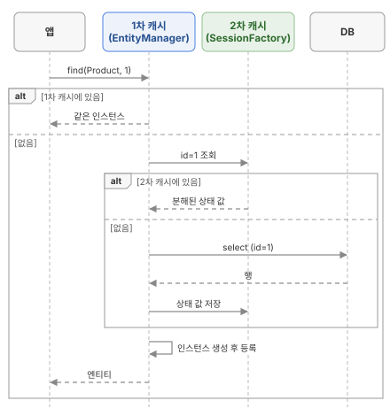

<!-- truncate -->

상품 상세 API가 있다고 가정합니다. 상품을 조회할 때마다 그 상품의 카테고리도 함께 조회합니다. 카테고리는 몇 달에 한 번 바뀔까 말까 한 데이터인데, API가 1초에 100번 호출되면 **같은 카테고리 SELECT가 1초에 100번** 실행됩니다.

JPA에는 이미 1차 캐시가 있는데 왜 이 SELECT가 줄지 않을까요? 그리고 이를 줄이는 **2차 캐시**는 어떻게 동작할까요? 이 글은 이 두 질문을 차례로 설명합니다.

<mark>2차 캐시는 **여러 요청이 함께 사용하는 엔티티 캐시**이고, **ID로 엔티티를 찾을 때만** 사용됩니다.</mark>

## 1차 캐시는 왜 반복 조회를 줄이지 못하나

1차 캐시는 영속성 컨텍스트(`EntityManager`) 안에 있는 캐시입니다. Spring에서는 보통 **요청(트랜잭션)마다 `EntityManager`가 새로 만들어지고, 요청이 끝나면 함께 사라집니다.**

비유하면 1차 캐시는 **요청마다 새로 받는 개인 메모장**입니다. 같은 요청 안에서 같은 카테고리를 두 번 조회하면 두 번째는 메모장을 보고 SQL을 생략합니다. 하지만 요청이 끝나면 메모장을 버리므로, 다음 요청은 빈 메모장으로 시작해 다시 SELECT를 실행합니다.

- **요청 1** — `find(Category, 1)` → SELECT 실행 → 메모장에 기록 → 요청이 끝나면 메모장을 버림
- **요청 2** — `find(Category, 1)` → 메모장이 비어 있음 → SELECT 다시 실행
- **요청 3 이후** — 같은 과정 반복

2차 캐시는 **서버 전체가 함께 보는 공용 메모장**입니다. 요청이 끝나도 남아 있으므로, 요청 1이 기록한 카테고리를 요청 2와 요청 3이 그대로 재사용합니다.

| 구분 | 1차 캐시 | 2차 캐시 |
|---|---|---|
| 누가 사용하나 | 해당 요청(트랜잭션)만 | 같은 서버의 모든 요청 |
| 언제 사라지나 | 요청이 끝나면 | 만료 시간이 지나거나 데이터가 수정되면 |
| 기본 상태 | 항상 활성화 | 비활성화, 직접 설정해야 함 |

앞의 예시에 적용하면 차이는 다음과 같습니다.

| 1초에 100번 요청 | 실행되는 카테고리 SELECT |
|---|---|
| 2차 캐시 없음 | 100번 |
| 2차 캐시 있음 | 처음 1번, 나머지 99번은 캐시에서 조회 |

## `find`가 캐시를 확인하는 순서

`em.find(Product.class, 1L)`나 Spring Data JPA의 `findById(1L)`를 호출하면 아래 순서로 엔티티를 찾습니다.

1. **1차 캐시**(이 요청의 메모장)에 있으면 바로 반환합니다.
2. 없으면 **2차 캐시**(공용 메모장)를 확인합니다. 있으면 그 값으로 엔티티 객체를 새로 만들어 반환합니다.
3. 둘 다 없으면 **DB에서 SELECT**하고, 결과를 두 캐시에 모두 기록한 뒤 반환합니다.

<details>
<summary>SVG 코드</summary>

```svg
<svg xmlns="http://www.w3.org/2000/svg" width="440" height="470" viewBox="0 0 440 470" font-family="-apple-system, 'Segoe UI', 'Noto Sans KR', sans-serif">
<defs><marker id="ah" viewBox="0 0 10 10" refX="9" refY="5" markerWidth="7" markerHeight="7" orient="auto-start-reverse"><path d="M0,0 L10,5 L0,10 z" fill="#888"/></marker></defs>
<rect x="0" y="0" width="440" height="470" fill="#FFFFFF"/>
<rect x="16.0" y="14" width="80" height="44" rx="6" fill="#F7F7F7" stroke="#999999"/>
<text x="56" y="40.0" font-size="11.5" fill="#333" text-anchor="middle" font-weight="bold">앱</text>
<rect x="116.0" y="14" width="104" height="44" rx="6" fill="#EEF3FB" stroke="#4C7FE0"/>
<text x="168" y="33.0" font-size="11.5" fill="#26508F" text-anchor="middle" font-weight="bold">1차 캐시</text>
<text x="168" y="47.0" font-size="11.5" fill="#26508F" text-anchor="middle" font-weight="bold">(EntityManager)</text>
<rect x="228.0" y="14" width="104" height="44" rx="6" fill="#E9F2E9" stroke="#8FBF8F"/>
<text x="280" y="33.0" font-size="11.5" fill="#2E6B2E" text-anchor="middle" font-weight="bold">2차 캐시</text>
<text x="280" y="47.0" font-size="11.5" fill="#2E6B2E" text-anchor="middle" font-weight="bold">(SessionFactory)</text>
<rect x="350.0" y="14" width="84" height="44" rx="6" fill="#F7F7F7" stroke="#999999"/>
<text x="392" y="40.0" font-size="11.5" fill="#333" text-anchor="middle" font-weight="bold">DB</text>
<line x1="56" y1="58" x2="56" y2="460" stroke="#BBBBBB" stroke-dasharray="4 3"/>
<line x1="168" y1="58" x2="168" y2="460" stroke="#BBBBBB" stroke-dasharray="4 3"/>
<line x1="280" y1="58" x2="280" y2="460" stroke="#BBBBBB" stroke-dasharray="4 3"/>
<line x1="392" y1="58" x2="392" y2="460" stroke="#BBBBBB" stroke-dasharray="4 3"/>
<line x1="56" y1="88" x2="167" y2="88" stroke="#888" stroke-width="1.2" marker-end="url(#ah)"/>
<text x="112.0" y="83" font-size="10" fill="#333" text-anchor="middle">find(Product, 1)</text>
<rect x="10" y="100" width="422" height="350" fill="none" stroke="#999"/>
<path d="M10,100 h30 v12 l-5,5 h-25 z" fill="#F7F7F7" stroke="#999"/>
<text x="23" y="112" font-size="10" fill="#333" text-anchor="middle" font-weight="bold">alt</text>
<text x="46" y="113" font-size="10" fill="#555" text-anchor="start">[1차 캐시에 있음]</text>
<line x1="168" y1="140" x2="57" y2="140" stroke="#888" stroke-width="1.2" stroke-dasharray="5 4" marker-end="url(#ah)"/>
<text x="112.0" y="135" font-size="10" fill="#333" text-anchor="middle">같은 인스턴스</text>
<line x1="10" y1="152" x2="432" y2="152" stroke="#999" stroke-dasharray="5 4"/>
<text x="16" y="165" font-size="10" fill="#555" text-anchor="start">[없음]</text>
<line x1="168" y1="184" x2="279" y2="184" stroke="#888" stroke-width="1.2" marker-end="url(#ah)"/>
<text x="224.0" y="179" font-size="10" fill="#333" text-anchor="middle">id=1 조회</text>
<rect x="118" y="196" width="308" height="174" fill="none" stroke="#999"/>
<path d="M118,196 h30 v12 l-5,5 h-25 z" fill="#F7F7F7" stroke="#999"/>
<text x="131" y="208" font-size="10" fill="#333" text-anchor="middle" font-weight="bold">alt</text>
<text x="154" y="209" font-size="10" fill="#555" text-anchor="start">[2차 캐시에 있음]</text>
<line x1="280" y1="236" x2="169" y2="236" stroke="#888" stroke-width="1.2" stroke-dasharray="5 4" marker-end="url(#ah)"/>
<text x="224.0" y="231" font-size="10" fill="#333" text-anchor="middle">분해된 상태 값</text>
<line x1="118" y1="248" x2="426" y2="248" stroke="#999" stroke-dasharray="5 4"/>
<text x="124" y="261" font-size="10" fill="#555" text-anchor="start">[없음]</text>
<line x1="168" y1="288" x2="391" y2="288" stroke="#888" stroke-width="1.2" marker-end="url(#ah)"/>
<text x="280.0" y="283" font-size="10" fill="#333" text-anchor="middle">select (id=1)</text>
<line x1="392" y1="320" x2="169" y2="320" stroke="#888" stroke-width="1.2" stroke-dasharray="5 4" marker-end="url(#ah)"/>
<text x="280.0" y="315" font-size="10" fill="#333" text-anchor="middle">행</text>
<line x1="168" y1="352" x2="279" y2="352" stroke="#888" stroke-width="1.2" marker-end="url(#ah)"/>
<text x="224.0" y="347" font-size="10" fill="#333" text-anchor="middle">상태 값 저장</text>
<polyline points="168,386 194,386 194,400 169,400" fill="none" stroke="#888" stroke-width="1.2" marker-end="url(#ah)"/>
<rect x="198" y="386" width="112" height="15" fill="#FFFFFF"/>
<text x="200" y="397" font-size="10" fill="#333" text-anchor="start">인스턴스 생성 후 등록</text>
<line x1="168" y1="432" x2="57" y2="432" stroke="#888" stroke-width="1.2" stroke-dasharray="5 4" marker-end="url(#ah)"/>
<text x="112.0" y="427" font-size="10" fill="#333" text-anchor="middle">엔티티</text>
</svg>
```

</details>

<figure style={{textAlign: 'center', margin: '1.5rem 0'}}>
  
</figure>

2차 캐시에서 가져온 엔티티도 1차 캐시에 등록되므로 일반 엔티티와 똑같이 사용할 수 있습니다. 필드를 변경하면 UPDATE가 실행되고(변경 감지), LAZY 연관관계도 정상적으로 로딩됩니다. 조회 결과가 언제 이와 같은 "관리되는 상태(영속 상태)"가 되는지는 [조회 결과는 언제 영속 상태가 되나](/blog/jpa-managed-entity-criteria)에서 설명했습니다.

> **2차 캐시는 객체가 아니라 "값"을 저장합니다**
>
> 2차 캐시에는 `Product` 객체 자체가 아니라 `id=1, name="키보드", category_id=3` 같은 **필드 값 목록**이 저장됩니다. Hibernate 문서도 "DB 표현과 비슷한 분해된(dehydrated) 형태로 저장한다"고 설명합니다.
>
> 이렇게 저장하는 이유는 여러 요청이 동시에 같은 캐시를 읽기 때문입니다. 객체 자체를 공유하면 요청 A가 필드를 변경했을 때 요청 B의 객체도 함께 바뀝니다. 값만 저장하고 **요청마다 새 객체를 만들면** 이러한 간섭이 생기지 않습니다. ([Hibernate User Guide — Caching](https://github.com/hibernate/hibernate-orm/blob/6.6/documentation/src/main/asciidoc/userguide/chapters/caching/Caching.adoc))

## 흔히 오해하는 점 — 설정했는데 쿼리가 그대로다

2차 캐시를 설정한 뒤 로그를 보면 SELECT가 그대로 실행되는 경우가 많습니다. **2차 캐시는 ID로 한 건을 찾을 때만 사용되기 때문**입니다.

```java
// ① ID로 조회 → 2차 캐시 사용 (두 번째 요청부터 SQL 없음)
categoryRepository.findById(3L);

// ② 조건으로 조회 → 2차 캐시를 사용하지 않음 (매번 SQL 실행)
categoryRepository.findByCode("ELECTRONICS");
```

②가 캐시를 사용하지 않는 이유는 간단합니다. 2차 캐시는 "ID → 값" 형태로 저장돼 있어서, `code = 'ELECTRONICS'`인 카테고리의 ID가 무엇인지는 DB에 물어봐야 알 수 있습니다. 그래서 JPQL, QueryDSL, 쿼리 메서드(`findByXxx`), 네이티브 쿼리처럼 **조건으로 찾는 조회는 매번 SQL을 실행**합니다.

| 조회 방법 | 2차 캐시 사용 |
|---|---|
| `em.find`, `findById` | O |
| LAZY 연관 엔티티 로딩 (`product.getCategory().getName()`) | O (내부적으로 ID로 찾음) |
| JPQL, QueryDSL, 쿼리 메서드 | X (아래 쿼리 캐시를 따로 설정해야 함) |
| 네이티브 쿼리, `JdbcTemplate` | X |

두 번째 행이 2차 캐시가 가장 효과를 내는 곳입니다. 상품 100건을 조회한 뒤 각 상품의 카테고리에 접근하면, 카테고리는 ID로 로딩되므로 2차 캐시에서 가져옵니다.

<mark>그래서 2차 캐시의 효과는 **"ID로 찾는 조회가 얼마나 많은가"** 로 정해집니다.</mark>

## Spring Boot에서 설정하기

세 단계로 설정합니다.

**① 의존성 추가** — Hibernate와 캐시 라이브러리(여기서는 Ehcache)를 연결합니다.

```groovy
implementation 'org.hibernate.orm:hibernate-jcache'
implementation 'org.ehcache:ehcache::jakarta'
```

**② 설정 활성화**

```yaml
spring:
  jpa:
    properties:
      hibernate:
        cache:
          use_second_level_cache: true       # 2차 캐시 활성화
          region.factory_class: jcache       # 캐시 라이브러리 연결 방식
      jakarta.persistence.sharedCache.mode: ENABLE_SELECTIVE   # @Cacheable 붙인 엔티티만 캐시
```

`ENABLE_SELECTIVE`는 **`@Cacheable`을 붙인 엔티티만** 캐시하는 설정입니다. 모든 엔티티를 캐시하면 자주 바뀌는 데이터까지 캐시돼 오히려 문제가 생기므로, 필요한 엔티티만 선별하는 이 값을 권장합니다.

**③ 캐시할 엔티티 표시**

```java
@Entity
@jakarta.persistence.Cacheable                                                   // 캐시 대상
@org.hibernate.annotations.Cache(usage = CacheConcurrencyStrategy.READ_WRITE)   // 동시성 전략(아래 설명)
public class Category {
    @Id Long id;
    String code;
    String name;
}
```

> **이름이 같은 Spring `@Cacheable`과는 다른 기능입니다**
>
> 엔티티에 붙이는 `jakarta.persistence.Cacheable`은 "이 엔티티를 2차 캐시에 저장하라"는 표시입니다. 서비스 메서드에 붙이는 `org.springframework.cache.annotation.Cacheable`은 "이 메서드의 반환값을 캐시하라"는 Spring 기능입니다. 이름만 같으므로 import를 확인합니다.

## 동시성 전략 — 데이터가 바뀌는가

`@Cache(usage = ...)`의 동시성 전략은 **캐시된 데이터가 수정될 때 캐시를 어떻게 갱신할지** 정합니다. 질문 한 가지로 선택할 수 있습니다. "이 데이터는 수정되는가?"

- **수정되지 않는다**(국가 코드, 은행 코드 등) → `READ_ONLY`. 가장 단순하고 빠릅니다. 대신 이 엔티티를 수정하려고 하면 예외가 발생합니다.
- **수정된다**(카테고리명, 설정값 등) → `READ_WRITE`. 수정하는 동안 다른 요청이 오래된 값을 읽지 않도록 Hibernate가 캐시 항목을 잠시 잠급니다.

<mark>대부분은 이 두 가지 중에서 선택하면 됩니다.</mark> 그 밖에 `NONSTRICT_READ_WRITE`(잠깐 오래된 값이 보여도 되는 경우)와 `TRANSACTIONAL`(JTA 트랜잭션 환경 전용)이 있습니다.

## 쿼리 캐시 — 조건 조회 결과까지 캐시하려면

`findByCode` 같은 조건 조회도 캐시하고 싶다면 **쿼리 캐시**를 따로 활성화합니다. 쿼리 캐시는 "어떤 쿼리를 어떤 파라미터로 실행했더니 결과가 무엇이었다"를 저장합니다.

```text
[쿼리 캐시]  "select c from Category c where c.visible = true"  →  ID 목록 [1, 2, 3]
[엔티티 캐시] 1 → (전자제품...), 2 → (도서...), 3 → (식품...)
```

같은 쿼리가 다시 실행되면 쿼리 캐시에서 ID 목록을 가져오고, 각 엔티티는 엔티티 캐시(위에서 설명한 2차 캐시)에서 가져옵니다. SQL은 실행되지 않습니다.

설정에 `hibernate.cache.use_query_cache: true`를 추가하고, **캐시할 쿼리마다 직접 표시**합니다. 쿼리 캐시를 활성화해도 표시하지 않은 쿼리는 캐시되지 않습니다.

```java
// Spring Data JPA
@QueryHints(@QueryHint(name = "org.hibernate.cacheable", value = "true"))
List<Category> findByVisibleTrue();

// QueryDSL JPA
queryFactory.selectFrom(category)
            .where(category.visible.isTrue())
            .setHint("org.hibernate.cacheable", true)
            .fetch();
```

쿼리 캐시를 사용할 때는 두 가지를 주의합니다.

- **테이블이 수정되면 그 테이블을 조회한 쿼리 캐시는 모두 비워집니다.** 카테고리 한 건만 수정해도 카테고리 테이블을 조회한 쿼리 캐시가 전부 무효가 되므로, 자주 수정되는 테이블에는 효과가 거의 없습니다.
- **결과 엔티티도 반드시 캐시 대상으로 지정합니다.** 쿼리 캐시에는 ID 목록만 있으므로, 엔티티 캐시에 해당 엔티티가 없으면 Hibernate가 **ID마다 SELECT를 실행**합니다. 결과가 100건이면 쿼리 1번이 SELECT 100번으로 늘어납니다.

## 주의할 점

### JPA를 거치지 않은 수정은 캐시에 반영되지 않는다

2차 캐시는 **Hibernate가 직접 실행한 INSERT, UPDATE, DELETE만** 확인해 갱신합니다. 예를 들어 운영자가 DB 콘솔에서 카테고리명을 직접 수정하면, 캐시는 이를 알 수 없어 만료될 때까지 이전 이름을 반환합니다. 다음 경로의 수정이 모두 같은 문제를 일으킵니다.

- DB 콘솔, 다른 애플리케이션, 배치에서 직접 수정
- 같은 애플리케이션 안이라도 `JdbcTemplate`, QueryDSL SQL로 실행한 UPDATE

네이티브 쿼리로 실행한 UPDATE는 조금 다릅니다. Hibernate가 어느 엔티티가 바뀌었는지 알 수 없어서, 안전하게 **2차 캐시를 전부 비웁니다.** 오래된 값은 남지 않지만 캐시가 자주 비워져 효과가 떨어집니다.

### 서버가 여러 대면 캐시도 서버마다 따로 있다

Ehcache 같은 캐시는 **서버(JVM) 메모리 안에** 있습니다. 서버가 2대라면 공용 메모장도 2권입니다.

1. 서버 A에서 카테고리명을 "전자제품"에서 "디지털"로 수정합니다.
2. 서버 A의 캐시는 "디지털"로 갱신됩니다.
3. 서버 B의 캐시는 수정 사실을 모르므로, 만료될 때까지 "전자제품"을 반환합니다.

해결 방법은 세 가지입니다.

- **수정되지 않는 데이터만 캐시** — `READ_ONLY` 데이터라면 서버 간 차이가 생기지 않습니다.
- **만료 시간을 짧게(예: 1분)** — 이전 값이 보이는 시간을 그 이내로 제한합니다.
- **분산 캐시 사용** — Redis(Redisson), Hazelcast 같은 외부 캐시를 모든 서버가 함께 사용합니다. 대신 캐시를 조회할 때마다 네트워크 통신이 생깁니다.

## 언제 사용하나

다음 세 가지 질문에 모두 "예"라면 2차 캐시가 잘 맞습니다.

1. **ID로 조회하거나 연관관계로 로딩하는 경우가 많은가?** (목록이나 검색 위주라면 효과가 적습니다)
2. **수정이 적은가?** (카테고리, 공통 코드, 설정처럼)
3. **잠깐 이전 값이 보여도 괜찮은가?** (서버가 여러 대라면 특히)

API 응답 전체를 캐시하고 싶거나, 캐시를 지우는 시점을 코드로 정하고 싶다면 2차 캐시보다 Spring의 `@Cacheable` 메서드 캐시나 Redis 캐시가 더 적합합니다. 캐시 전략 전반(Cache-Aside, Write-Through 등)은 [캐싱 전략 wiki](/wiki/database/db-caching-strategy)에 정리돼 있습니다.

## 용어 한 줄 정리

| 용어 | 뜻 |
|---|---|
| 1차 캐시 | 한 요청(트랜잭션) 안에서만 사용하는 엔티티 캐시. 항상 활성화 |
| 2차 캐시 | 같은 서버의 모든 요청이 함께 사용하는 엔티티 캐시. 직접 설정 |
| 엔티티 캐시 | 2차 캐시 중 "ID → 필드 값"을 저장하는 부분 |
| 쿼리 캐시 | "쿼리 + 파라미터 → 결과 ID 목록"을 저장하는 캐시. 별도 설정 |
| 동시성 전략 | 캐시된 데이터가 수정될 때 캐시를 갱신하는 방식 (`READ_ONLY`, `READ_WRITE` 등) |
| 분산 캐시 | 서버 밖(Redis 등)에 두어 여러 서버가 함께 사용하는 캐시 |

## 정리

- 1차 캐시는 요청이 끝나면 사라지므로, **요청 사이의 반복 조회**를 줄이려면 2차 캐시가 필요합니다.
- 2차 캐시는 **`findById`와 연관 엔티티 로딩처럼 ID로 찾는 조회**에만 사용됩니다. 조건으로 찾는 조회는 쿼리 캐시를 따로 설정해야 합니다.
- 동시성 전략은 데이터가 수정되지 않으면 `READ_ONLY`, 수정되면 `READ_WRITE`를 선택합니다.
- JPA를 거치지 않은 수정과 여러 서버 환경에서는 **이전 값이 보일 수 있습니다.** 그래서 수정이 적은 엔티티만 캐시합니다.

## 참고

- [Jakarta Persistence 3.1 명세 — 3.9 Caching](https://jakarta.ee/specifications/persistence/3.1/jakarta-persistence-spec-3.1.html#a3065)
- [Hibernate ORM 6.6 User Guide — Caching (원문 asciidoc)](https://github.com/hibernate/hibernate-orm/blob/6.6/documentation/src/main/asciidoc/userguide/chapters/caching/Caching.adoc)
- [Hibernate ORM 6.6 User Guide — Caching (HTML)](https://docs.hibernate.org/orm/6.6/userguide/html_single/Hibernate_User_Guide.html#caching)
