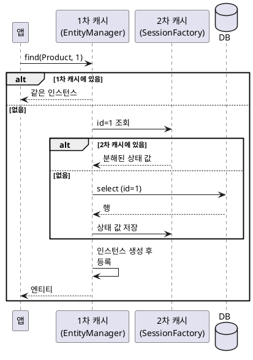
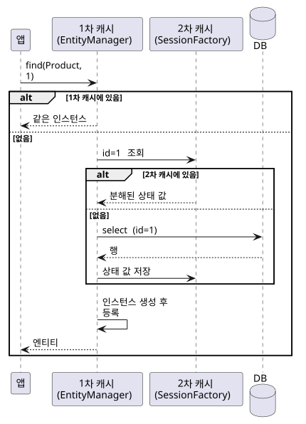

<!-- truncate -->

상품, 카테고리, 공통 코드처럼 **자주 읽고 거의 바뀌지 않는 엔티티**는 요청마다 같은 SELECT를 실행합니다. 1차 캐시(영속성 컨텍스트)는 트랜잭션이 끝나면 사라지므로 요청 간에는 재사용되지 않습니다. 이 반복 조회를 애플리케이션 전체에서 공유하는 캐시로 줄이는 기능이 **2차 캐시(second-level cache)** 입니다.

<mark>2차 캐시는 **ID로 엔티티를 찾는 경로(`find`, 연관 엔티티 로딩)** 에만 적용되고, JPQL, QueryDSL 쿼리는 쿼리 캐시를 따로 활성화하지 않는 한 매번 SQL을 실행합니다.</mark> 이 점을 모르고 2차 캐시를 활성화하면 "설정했는데 쿼리가 줄지 않는다"는 결과를 보게 됩니다.

## 1차 캐시와 2차 캐시

| 구분 | 1차 캐시 | 2차 캐시 |
|---|---|---|
| 위치 | 영속성 컨텍스트(`EntityManager`) | `EntityManagerFactory`(Hibernate `SessionFactory`) |
| 수명 | 트랜잭션(요청) 단위 | 애플리케이션 단위 |
| 공유 범위 | 한 트랜잭션 안 | 같은 JVM의 모든 트랜잭션 |
| 저장 형태 | 엔티티 인스턴스 | 분해된 상태 값(필드 값 배열) |
| 기본값 | 항상 사용 | 비활성화 상태, 설정 필요 |
| 정의 | JPA 명세 | 명세는 "공유 캐시" 인터페이스만, 실제 저장소는 구현체, 캐시 제공자 |

2차 캐시가 인스턴스가 아니라 상태 값을 저장한다는 점은 Hibernate 문서에 명시돼 있습니다.

> Hibernate stores cached entities in a dehydrated form, which is similar to the database representation.

→ 캐시에서 가져올 때마다 **새 인스턴스를 생성**하므로, 여러 트랜잭션이 같은 객체를 동시에 수정하는 문제가 생기지 않습니다. ([Hibernate User Guide — Caching](https://github.com/hibernate/hibernate-orm/blob/6.6/documentation/src/main/asciidoc/userguide/chapters/caching/Caching.adoc))

같은 문단에는 연관관계에 대한 설명도 있습니다.

> Aside from the foreign key column values of the @ManyToOne or @OneToOne child-side associations, entity relationships are not stored in the cache

→ 엔티티 캐시에는 다대일, 일대일의 **외래 키 값만** 들어가고, 컬렉션(`@OneToMany`)은 별도의 컬렉션 캐시를 설정해야 캐시됩니다.

## `find`가 캐시를 거치는 순서

<details>
<summary>PlantUML 코드</summary>



</details>



1차 캐시에서 찾지 못하면 2차 캐시를 확인하고, 그래도 없으면 DB를 조회한 뒤 두 캐시에 모두 등록합니다. 2차 캐시에서 가져온 엔티티도 영속성 컨텍스트에 등록되므로 **영속 상태**이고, 변경 감지와 지연 로딩이 그대로 동작합니다. 조회 결과가 언제 영속 상태가 되는지는 [조회 결과는 언제 영속 상태가 되나](/blog/jpa-managed-entity-criteria)에서 설명했습니다.

## 어떤 조회가 2차 캐시를 사용하나

| 조회 방법 | 엔티티 캐시 사용 | 설명 |
|---|---|---|
| `em.find`, `findById` | O | ID로 찾는 대표 경로 |
| LAZY 다대일 프록시 초기화 | O | 내부적으로 ID 조회 |
| 캐시된 컬렉션 초기화 | O | 컬렉션 캐시에서 요소 ID를 얻고, 요소는 엔티티 캐시에서 조회 |
| JPQL, QueryDSL JPA, Spring Data 쿼리 메서드 | X (쿼리 캐시 활성화 시 결과 목록 재사용) | SQL을 실행하고 결과 행으로 엔티티를 생성 |
| 네이티브 쿼리 | X | 위와 같음 |
| QueryDSL SQL, `JdbcTemplate` | X | JPA를 거치지 않음 |

Spring Data JPA에서 `findById`는 캐시를 사용하지만, `findByCode(String code)` 같은 쿼리 메서드는 JPQL로 실행되므로 캐시를 사용하지 않습니다. <mark>2차 캐시의 효과는 **ID 기반 조회가 얼마나 많은가**로 결정됩니다.</mark>

## Spring Boot에서 활성화하는 방법

Hibernate는 JCache(JSR-107) 표준을 통해 Ehcache, Caffeine 같은 캐시 제공자를 연결합니다.

```groovy
implementation 'org.hibernate.orm:hibernate-jcache'
implementation 'org.ehcache:ehcache::jakarta'
```

```yaml
spring:
  jpa:
    properties:
      hibernate:
        cache:
          use_second_level_cache: true
          region.factory_class: jcache
      jakarta.persistence.sharedCache.mode: ENABLE_SELECTIVE
```

`sharedCache.mode`는 JPA 명세에 정의된 값으로, 어떤 엔티티를 캐시할지 정합니다.

| 값 | 의미 |
|---|---|
| `ENABLE_SELECTIVE` | `@Cacheable`(또는 `@Cacheable(true)`)을 붙인 엔티티만 캐시 — Hibernate의 기본값이자 권장값 |
| `DISABLE_SELECTIVE` | `@Cacheable(false)`를 제외한 모든 엔티티 캐시 |
| `ALL` / `NONE` | 전부 캐시 / 캐시 사용하지 않음 |
| `UNSPECIFIED` | 명세상 정의 없음, 구현체 기본값을 따름 |

엔티티에는 캐시 대상 표시와 **동시성 전략**을 지정합니다.

```java
@Entity
@jakarta.persistence.Cacheable
@org.hibernate.annotations.Cache(usage = CacheConcurrencyStrategy.READ_WRITE)
public class Product {
    @Id Long id;
    String name;

    @ManyToOne(fetch = FetchType.LAZY)
    Category category;

    // 컬렉션은 따로 지정해야 캐시된다 (요소 엔티티 Option도 캐시 대상이어야 효과가 있음)
    @org.hibernate.annotations.Cache(usage = CacheConcurrencyStrategy.READ_WRITE)
    @OneToMany(mappedBy = "product")
    List<Option> options = new ArrayList<>();
}
```

> **`jakarta.persistence.Cacheable`과 Spring `@Cacheable`은 다른 기능입니다**
>
> 엔티티 클래스에 붙이는 `jakarta.persistence.Cacheable`은 **JPA 2차 캐시 대상**을 표시합니다. 서비스 메서드에 붙이는 `org.springframework.cache.annotation.Cacheable`은 **메서드 반환값**을 Spring 캐시 추상화(Redis, Caffeine 등)에 저장합니다. 이름만 같고 동작 위치와 저장 대상이 다르므로 import를 확인합니다.

## 동시성 전략 고르기

동시성 전략은 **캐시된 엔티티가 수정될 때 캐시와 DB를 어떻게 맞출지**를 정합니다. Hibernate 문서의 설명을 기준으로 정리하면 다음과 같습니다.

| 전략 | 용도 | 비고 |
|---|---|---|
| `READ_ONLY` | 수정되지 않는 데이터(국가 코드 등) | 수정하면 예외. 가장 단순하고 빠름 |
| `NONSTRICT_READ_WRITE` | 수정이 적고, 잠깐 오래된 값이 보여도 되는 데이터 | 동시 접근 시 오래된 값을 읽을 수 있음 |
| `READ_WRITE` | 수정되는 데이터의 일반적인 선택 | 캐시 항목에 소프트 락을 걸어 일관성 유지 |
| `TRANSACTIONAL` | JTA 트랜잭션 캐시가 있을 때 | 캐시 제공자가 XA를 지원해야 함 |

<mark>수정이 없으면 `READ_ONLY`, 수정이 있으면 `READ_WRITE`를 기본으로 선택하고, 오래된 값을 짧게 허용할 수 있을 때만 `NONSTRICT_READ_WRITE`를 검토합니다.</mark>

## 쿼리 캐시 — JPQL 결과를 캐시하려면

JPQL, QueryDSL 결과를 재사용하려면 **쿼리 캐시**를 별도로 활성화하고, 캐시할 쿼리마다 힌트를 지정합니다. Hibernate 문서에 따르면 쿼리 캐시를 활성화해도 쿼리는 기본적으로 캐시되지 않습니다.

> individual queries are not cached even after enabling query caching. Each particular query that needs to be cached must be manually set as cacheable.

→ 설정 `hibernate.cache.use_query_cache: true`에 더해, 쿼리마다 cacheable 힌트를 지정해야 합니다.

```java
// Spring Data JPA
@QueryHints(@QueryHint(name = "org.hibernate.cacheable", value = "true"))
List<Category> findByVisibleTrue();

// QueryDSL JPA
queryFactory.selectFrom(category)
            .where(category.visible.isTrue())
            .setHint("org.hibernate.cacheable", true)
            .fetch();
```

쿼리 캐시는 "쿼리 + 파라미터 → 결과"를 저장합니다. 결과 엔티티가 캐시 대상(`@Cacheable`)이면 **ID 목록만** 저장하고 엔티티 본문은 엔티티 캐시에서 다시 가져옵니다(Hibernate 6.6 문서의 기본 `AUTO` 레이아웃). 쿼리에 관련된 테이블이 한 번이라도 수정되면 그 쿼리 캐시는 무효화되므로, **자주 수정되는 테이블에는 효과가 거의 없습니다.**

> **쿼리 캐시를 활성화했는데 쿼리가 오히려 늘었다면?**
>
> 쿼리 캐시가 ID 목록만 갖고 있는데 그 엔티티가 엔티티 캐시에 없으면(만료됐거나 캐시 대상이 아니면), Hibernate는 **ID마다 SELECT를 실행**해 엔티티를 채웁니다. 쿼리 한 번이 N번의 단건 조회로 바뀌는 것이므로, 쿼리 캐시를 사용할 때는 결과 엔티티도 반드시 캐시 대상으로 지정하고 두 캐시의 만료 시간을 일치시킵니다.

## 주의할 점

### JPA 밖에서 수정한 데이터는 캐시가 모른다

2차 캐시는 **Hibernate가 실행한 변경만** 감지해 갱신합니다. 다음 경로의 수정은 캐시에 반영되지 않습니다.

- `JdbcTemplate`, QueryDSL SQL로 실행한 UPDATE
- 다른 애플리케이션, 배치, DB 콘솔에서 직접 수정한 데이터

같은 애플리케이션 안의 네이티브 UPDATE(`executeUpdate`)는 Hibernate가 어느 엔티티가 바뀌었는지 알 수 없으므로, 영향받는 엔티티를 지정하지 않으면 **2차 캐시 영역 전체를 무효화**합니다. 네이티브 DML을 자주 실행하는 애플리케이션에서는 캐시 적중률이 크게 떨어질 수 있습니다.

### 다중 서버에서는 서버마다 캐시가 따로 있다

Ehcache, Caffeine 같은 로컬 캐시는 **JVM마다 별도**입니다. 서버 A에서 상품명을 수정하면 A의 캐시만 갱신되고, 서버 B는 만료 시간까지 이전 값을 반환합니다.

- **수정되지 않는 데이터만 캐시** — `READ_ONLY` 엔티티라면 서버 간 불일치가 생기지 않습니다.
- **짧은 만료 시간(TTL)** — 오래된 값이 보이는 시간을 TTL 이내로 제한합니다.
- **분산 캐시 제공자** — Hazelcast, Infinispan, Redis(Redisson의 Hibernate 연동) 등으로 모든 서버가 같은 캐시를 보게 합니다. 대신 캐시 조회마다 네트워크 왕복이 생깁니다.

### 1차 캐시가 있으니 같은 트랜잭션에서는 효과가 없다

한 트랜잭션에서 같은 엔티티를 여러 번 조회하는 경우는 이미 1차 캐시가 처리합니다. 2차 캐시는 **여러 요청이 같은 엔티티를 반복 조회**할 때 효과가 있습니다.

## 언제 쓰나

1. **ID 조회가 많고, 수정이 적고, 오래된 값을 잠시 허용할 수 있다** → 2차 캐시가 잘 맞습니다(카테고리, 공통 코드, 설정 엔티티).
2. **목록, 검색 쿼리가 대부분이다** → 엔티티 캐시 효과가 적습니다. 쿼리 캐시는 테이블이 거의 바뀌지 않을 때만 검토합니다.
3. **API 응답 단위로 캐시하고 싶다** → 2차 캐시보다 Spring 캐시 추상화(`@Cacheable` 메서드 캐시)나 Redis 캐시가 적합합니다. 캐시 키, 만료, 무효화를 애플리케이션이 직접 제어할 수 있습니다.

캐시 전략 전반(Cache-Aside, Write-Through 등)은 [캐싱 전략 wiki](/wiki/database/db-caching-strategy)에 정리돼 있습니다.

## 정리

- **1차 캐시**는 트랜잭션 단위이고 항상 활성화돼 있으며, **2차 캐시**는 애플리케이션 단위이고 설정해야 활성화됩니다. 2차 캐시는 인스턴스가 아니라 분해된 상태 값을 저장합니다.
- 2차 캐시는 **`find`, 연관 엔티티 로딩 같은 ID 기반 조회**에만 적용됩니다. JPQL, QueryDSL, 네이티브 쿼리는 쿼리 캐시를 활성화하고 힌트를 지정해야 결과를 재사용합니다.
- 동시성 전략은 수정 여부에 따라 `READ_ONLY`, `READ_WRITE`를 기본으로 고릅니다.
- JPA 밖에서의 수정과 다중 서버의 로컬 캐시는 **오래된 값**을 반환하는 원인이 됩니다. 캐시 대상은 수정이 적은 엔티티로 한정합니다.

## 참고

- [Jakarta Persistence 3.1 명세 — 3.9 Caching](https://jakarta.ee/specifications/persistence/3.1/jakarta-persistence-spec-3.1.html#a3065)
- [Hibernate ORM 6.6 User Guide — Caching (원문 asciidoc)](https://github.com/hibernate/hibernate-orm/blob/6.6/documentation/src/main/asciidoc/userguide/chapters/caching/Caching.adoc)
- [Hibernate ORM 6.6 User Guide — Caching (HTML)](https://docs.hibernate.org/orm/6.6/userguide/html_single/Hibernate_User_Guide.html#caching)
